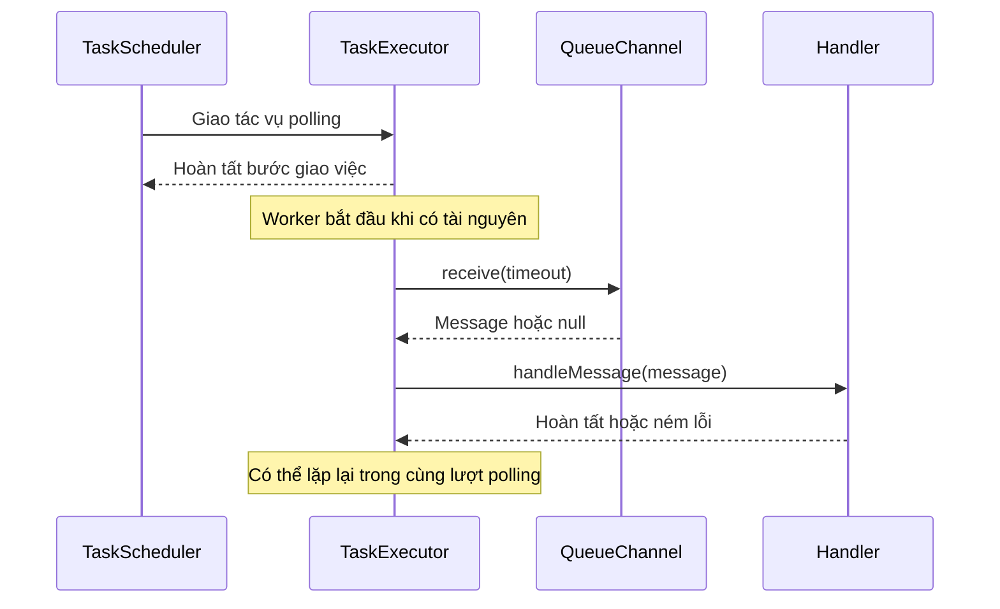

# TaskExecutor trong poller

Trong **SPRING_INTEGRATION_CORE**, poller kết nối việc lập lịch với luồng xử lý thông điệp. Khi một endpoint nhận dữ liệu từ `QueueChannel` hoặc một inbound adapter chủ động đọc nguồn bên ngoài, câu hỏi quan trọng là: **thread nào thực hiện thao tác nhận và chạy các endpoint phía sau?**

Bài thuộc chương **Poller**, giải thích cách sử dụng `TaskExecutor` để tách công việc polling khỏi thread lập lịch. Mục tiêu là thiết kế luồng có mức đồng thời phù hợp, hiểu giới hạn tài nguyên và dự đoán được hành vi khi xử lý chậm hoặc thất bại.

## 1. Phân biệt lịch chạy và nơi chạy

Ba thành phần giữ ba trách nhiệm khác nhau:

| Thành phần | Trách nhiệm | Ví dụ |
| --- | --- | --- |
| `Trigger` | Xác định thời điểm kích hoạt tiếp theo | Fixed delay, fixed rate, cron |
| `TaskScheduler` | Thực hiện việc lập lịch và gọi tác vụ đến hạn | Scheduler do Spring Integration quản lý |
| `TaskExecutor` của poller | Thực thi công việc polling được giao | `ThreadPoolTaskExecutor` |

`TaskExecutor` không đồng nghĩa với bất đồng bộ: `SyncTaskExecutor` chạy ngay trên thread gọi; `ThreadPoolTaskExecutor` thường giao việc cho worker trong pool. Vì vậy, phải xem implementation và chính sách thực thi thay vì chỉ thấy thuộc tính `taskExecutor` là kết luận có thread mới. [Tài liệu Task Execution and Scheduling](https://docs.spring.io/spring-framework/reference/integration/scheduling.html).

Với poller thông thường không cấu hình executor bất đồng bộ, công việc nhận và xử lý đồng bộ chạy trên thread gọi tác vụ theo lịch. Handler mất nhiều thời gian sẽ chiếm thread đó. Tăng pool của scheduler có thể giúp những tác vụ lịch khác, nhưng không thay thế việc thiết kế executor riêng cho công việc của endpoint.

## 2. Task được giao cho executor là gì?

Xét endpoint service activator đọc từ một `QueueChannel`:

```text
Producer -> QueueChannel -> PollingConsumer -> Handler
```

Cần phân biệt hai loại endpoint:

- `PollingConsumer` nhận từ một `PollableChannel`, chẳng hạn `QueueChannel`.
- `SourcePollingChannelAdapter` gọi một `MessageSource`, sau đó gửi message nhận được vào flow.

Cả hai có thể được kích hoạt bằng poller, nhưng nguồn dữ liệu và những bảo đảm khi đọc đồng thời phụ thuộc implementation. Không gắn poller cho một handler chỉ nhận từ `DirectChannel`, vì handler đó được gọi theo cơ chế đăng ký nhận message. [Tổng quan Poller](https://docs.spring.io/spring-integration/reference/polling-consumer.html).

Khi dùng executor bất đồng bộ, có thể hình dung đường đi như sau:



Executor nhận **tác vụ thực hiện một lượt polling**, không mặc nhiên nhận một task riêng cho từng message. Với `maxMessagesPerPoll(5)`, một worker có thể lần lượt nhận và xử lý tối đa năm message trong một lượt. Con số năm không tạo năm worker.

Nếu handler gửi tiếp qua `DirectChannel`, transformer, filter, router hay handler tiếp theo thường tiếp tục chạy trên cùng worker. Khi flow gặp `ExecutorChannel`, một `QueueChannel` khác hoặc một thành phần bất đồng bộ, nó có thể chuyển sang một ranh giới thực thi khác.

Cơ chế giao task và vòng lặp polling có thể đối chiếu trong [mã nguồn AbstractPollingEndpoint](https://raw.githubusercontent.com/spring-projects/spring-integration/main/spring-integration-core/src/main/java/org/springframework/integration/endpoint/AbstractPollingEndpoint.java).

## 3. Ví dụ Java DSL với pool có giới hạn

Ví dụ sau dành cho ứng dụng đã có `spring-integration-core` và các thư viện Spring tương thích. Đây là cấu hình minh họa dùng Java DSL; không giả định phiên bản dependency của một dự án cụ thể.

Luồng nhận các chuỗi công việc vào `jobs`, xử lý trên pool riêng, và đưa lỗi polling vào `pollerFailures`. Các con số là lựa chọn phục vụ bài thực hành, cần đo lại khi áp dụng thực tế.

```java
import java.util.concurrent.ThreadPoolExecutor;

import org.springframework.context.annotation.Bean;
import org.springframework.context.annotation.Configuration;
import org.springframework.integration.channel.QueueChannel;
import org.springframework.integration.config.EnableIntegration;
import org.springframework.integration.dsl.IntegrationFlow;
import org.springframework.integration.dsl.Pollers;
import org.springframework.messaging.Message;
import org.springframework.scheduling.concurrent.ThreadPoolTaskExecutor;

@Configuration
@EnableIntegration
public class PollerExecutorConfiguration {

    @Bean
    public QueueChannel jobs() {
        return new QueueChannel(100);
    }

    @Bean
    public QueueChannel pollerFailures() {
        return new QueueChannel(100);
    }

    @Bean
    public ThreadPoolTaskExecutor pollerExecutor() {
        ThreadPoolTaskExecutor executor = new ThreadPoolTaskExecutor();
        executor.setCorePoolSize(2);
        executor.setMaxPoolSize(2);
        executor.setQueueCapacity(4);
        executor.setThreadNamePrefix("job-poller-");
        executor.setRejectedExecutionHandler(
                new ThreadPoolExecutor.AbortPolicy());
        executor.setWaitForTasksToCompleteOnShutdown(true);
        executor.setAwaitTerminationSeconds(10);
        return executor;
    }

    @Bean
    public IntegrationFlow jobsFlow(
            QueueChannel jobs,
            QueueChannel pollerFailures,
            ThreadPoolTaskExecutor pollerExecutor) {

        return IntegrationFlow.from(jobs)
                .handle(String.class, (payload, headers) -> {
                    process(payload);
                    return null;
                }, endpoint -> endpoint.poller(
                        Pollers.fixedDelay(200)
                                .maxMessagesPerPoll(1)
                                .receiveTimeout(0)
                                .taskExecutor(pollerExecutor)
                                .errorChannel(pollerFailures)))
                .get();
    }

    @Bean
    public IntegrationFlow failuresFlow(QueueChannel pollerFailures) {
        return IntegrationFlow.from(pollerFailures)
                .handle((Message<?> message) -> {
                    Throwable failure = (Throwable) message.getPayload();
                    System.err.println("Polling failed: " + failure);
                }, endpoint -> endpoint.poller(
                        Pollers.fixedDelay(500)
                                .maxMessagesPerPoll(10)
                                .receiveTimeout(0)))
                .get();
    }

    private static void process(String job) {
        System.out.printf("START %s on %s%n",
                job, Thread.currentThread().getName());
        if ("FAIL".equals(job)) {
            throw new IllegalArgumentException("Rejected job: " + job);
        }
        try {
            Thread.sleep(700); // Chỉ để mô phỏng xử lý chậm trong bài học.
        }
        catch (InterruptedException ex) {
            Thread.currentThread().interrupt();
            throw new IllegalStateException("Job interrupted", ex);
        }
        System.out.printf("DONE  %s on %s%n",
                job, Thread.currentThread().getName());
    }
}
```

`ThreadPoolTaskExecutor` là bean được Spring quản lý vòng đời nên ví dụ không gọi `initialize()` thủ công. Nếu tự tạo executor bên ngoài container thì người viết phải tự khởi tạo và giải phóng tài nguyên phù hợp. Những tùy chọn chờ shutdown trong ví dụ không tạo bảo đảm xử lý hết mọi message; còn phải xét thời gian xử lý, thứ tự dừng endpoint và thời gian tiến trình được phép tồn tại. [Javadoc ThreadPoolTaskExecutor](https://docs.spring.io/spring-framework/docs/current/javadoc-api/org/springframework/scheduling/concurrent/ThreadPoolTaskExecutor.html).

Các phương thức `taskExecutor`, `receiveTimeout`, `errorChannel` và `maxMessagesPerPoll` thuộc cấu hình poller. Trong Java DSL, chúng được đặt ở endpoint đọc từ queue, không phải trên `QueueChannel`. [Javadoc PollerSpec](https://docs.spring.io/spring-integration/api/org/springframework/integration/dsl/PollerSpec.html).

Để gửi dữ liệu từ mã thử nghiệm hoặc một producer, lấy bean `jobs` từ application context và gửi message:

```java
import org.springframework.integration.channel.QueueChannel;
import org.springframework.messaging.support.MessageBuilder;

// context là ApplicationContext đang chạy cấu hình trên.
QueueChannel jobs = context.getBean("jobs", QueueChannel.class);
for (int i = 1; i <= 8; i++) {
    boolean accepted = jobs.send(
            MessageBuilder.withPayload("JOB-" + i).build(), 1000);
    if (!accepted) {
        throw new IllegalStateException("Input queue is full");
    }
}
jobs.send(MessageBuilder.withPayload("FAIL").build(), 1000);
```

Hai tên thread `job-poller-1` và `job-poller-2` có thể xuất hiện xen kẽ. Message được chấp nhận vào `jobs` chưa có nghĩa là nghiệp vụ đã hoàn tất. Với ví dụ có queue hữu hạn, producer cũng phải kiểm tra kết quả `send` hoặc có chiến lược riêng khi hết chỗ.

## 4. Fixed delay không bảo đảm các worker chạy nối tiếp

Một ngộ nhận thường gặp là: “Đã dùng fixed delay thì lượt sau chỉ chạy sau khi handler trước hoàn thành”.

Điều đó không thể áp dụng nguyên vẹn khi scheduler chỉ giao việc sang executor bất đồng bộ. Bước được scheduler quan sát hoàn tất có thể chỉ là bước **submit task**, trong khi worker vẫn đang xử lý. Do vậy, nhiều lượt polling có thể tồn tại đồng thời, hoặc nằm chờ trong queue của executor.

Ví dụ giả định submit diễn ra nhanh và tài nguyên còn đủ:

```text
0 ms:    scheduler giao lượt A; worker 1 xử lý JOB-1
200 ms:  scheduler giao lượt B; worker 2 xử lý JOB-2
400 ms:  scheduler giao lượt C; task chờ trong executor
600 ms:  scheduler giao lượt D; task chờ trong executor
700 ms:  worker 1 xong JOB-1, có thể bắt đầu lượt C
```

Mốc thời gian nhằm giải thích cơ chế, không phải cam kết thời gian thực. Scheduler, JVM, thời gian chờ tài nguyên và rejection policy đều có thể làm thay đổi diễn biến.

Nếu cần đúng một nghiệp vụ đang chạy tại một thời điểm, một lựa chọn là pool một worker có hàng đợi hữu hạn, đồng thời bảo đảm không có consumer khác hoặc nhánh bất đồng bộ khác xử lý cùng công việc. Nếu cần có khoảng nghỉ sau khi **nghiệp vụ** hoàn tất, phải thiết kế cơ chế điều tiết tương ứng; chỉ đổi `fixedRate` sang `fixedDelay` trên một poller bất đồng bộ chưa giải quyết yêu cầu đó.

## 5. Hai hàng đợi độc lập

Trong cấu hình trên có hai nơi chờ khác nhau:

```text
jobs:             [Message A, Message B, Message C, ...]
executor queue:   [polling task 1, polling task 2, ...]
```

| Thuộc tính | Lưu cái gì? | Đầy thì tác động đến ai? |
| --- | --- | --- |
| Capacity của `QueueChannel` | Message nghiệp vụ chưa được nhận | Producer gửi message |
| `queueCapacity` của executor | Task polling chưa bắt đầu | Thread giao task, thường là scheduler |

Một task đang chờ chưa nhất thiết đã nhận message nào. Ngược lại, task đang chạy có thể đã lấy message ra khỏi `jobs` và đang gọi dịch vụ bên ngoài. Bởi vậy, chỉ theo dõi độ sâu của `jobs` sẽ bỏ sót công việc đang xử lý và số lượt polling tồn đọng.

Khi tải nghiệp vụ giảm, executor vẫn có thể còn những lượt polling cũ trong queue. Các lượt đó chạy sau và có thể chỉ nhận `null`. Queue executor rất lớn có thể che khuất việc lịch kích hoạt nhanh hơn khả năng xử lý.

Với `QueueChannel` trong bộ nhớ, dữ liệu không tự có tính bền vững sau khi tiến trình dừng. `send(..., timeout)` và `receive(timeout)` điều khiển thời gian chờ tại channel, không phải thời hạn nghiệp vụ. [Các implementation MessageChannel](https://docs.spring.io/spring-integration/reference/channel/implementations.html).

## 6. Core pool, max pool và rejection policy

Với cấu hình thông thường của `ThreadPoolExecutor`, khi đã đủ core worker, task mới được đưa vào queue trước; pool chỉ tăng vượt core khi queue không nhận thêm task và còn dưới giới hạn max. Queue không giới hạn có thể làm `maxPoolSize` không phát huy như người cấu hình mong đợi.

Ví dụ:

```text
corePoolSize = 2
maxPoolSize  = 8
queueCapacity = 1000
```

Trong nhiều tình huống, cấu hình này vẫn chỉ có hai worker xử lý còn task liên tục xếp hàng. Nếu mục tiêu bài thử là quan sát bốn tác vụ chạy đồng thời ổn định, có thể bắt đầu bằng `corePoolSize = maxPoolSize = 4` và một queue nhỏ, rồi đo đạc.

Khi cả pool và queue đã bão hòa:

| Chính sách | Hành vi chính | Hệ quả với poller |
| --- | --- | --- |
| `AbortPolicy` | Ném lỗi khi từ chối task | Phải quan sát lỗi submit và tình trạng bão hòa |
| `CallerRunsPolicy` | Có thể chạy task trên thread giao việc khi executor chưa shutdown | Scheduler có thể phải làm việc nghiệp vụ, ảnh hưởng các lịch khác |
| `DiscardPolicy` | Bỏ task bị từ chối | Mất một lượt polling mà không có lỗi rõ ràng |
| `DiscardOldestPolicy` | Loại task chờ cũ rồi thử giao task mới | Thứ tự và dấu vết các lượt polling khó theo dõi |

Bỏ một lượt polling không nhất thiết là xóa một message: ở bước submit, task thường chưa gọi `receive`. Tuy vậy, đó vẫn là việc bỏ lịch thực thi và cần đánh giá ảnh hưởng đến độ trễ. Các chính sách rejection có hành vi riêng khi executor đã shutdown. [Javadoc ThreadPoolExecutor](https://docs.oracle.com/en/java/javase/21/docs/api/java.base/java/util/concurrent/ThreadPoolExecutor.html).

Không nên chọn `CallerRunsPolicy` chỉ để làm biến mất lỗi bão hòa. Nó thay đổi thread thực thi, vì vậy cũng thay đổi cách suy luận về mức cô lập giữa các flow dùng chung scheduler.

## 7. Tác động của maxMessagesPerPoll và receiveTimeout

`maxMessagesPerPoll` giới hạn số lần nhận thành công trong một lượt. Poller có thể kết thúc sớm khi không còn message hoặc khi xử lý ném lỗi. `receiveTimeout` là thời gian chờ khi nhận từ channel có hỗ trợ chờ, không phải timeout dành cho handler hay HTTP client.

| Cấu hình minh họa | Điều cần dự đoán |
| --- | --- |
| `maxMessagesPerPoll(1)` | Một lượt xử lý tối đa một message; nhiều lượt có thể chạy đồng thời |
| `maxMessagesPerPoll(10)` | Một worker có thể bị giữ lâu hơn để xử lý liên tiếp nhiều message |
| `receiveTimeout(0)` | Queue rỗng thì nhận về ngay, giảm thời gian worker bị giữ khi không có việc |
| `receiveTimeout(5000)` | Một worker có thể chờ message tới năm giây cho một lần nhận khi queue rỗng |

Với endpoint cho phép polling không giới hạn bằng giá trị âm, một lượt có thể kéo dài nếu nguồn liên tục có dữ liệu. Khi học cách kiểm soát concurrency, nên đặt giới hạn dương rõ ràng. Không dựa vào giá trị mặc định chung cho mọi loại endpoint. [Cấu hình Message Endpoints](https://docs.spring.io/spring-integration/reference/endpoint.html).

Ví dụ suy luận: pool có bốn worker, queue đầu vào đang rỗng, mỗi worker chờ nhận năm giây. Không có CPU cao vẫn có thể thấy cả bốn worker active. Thread đang chờ dữ liệu cũng chiếm suất trong pool; cần phân biệt “active” với “đang tính toán”.

Với nguồn đọc file hoặc nguồn tự trả về ngay, tăng `receiveTimeout` không nhất thiết tạo được long polling. Timeout này chỉ có ý nghĩa ở nơi implementation hỗ trợ thao tác nhận có chờ; thời hạn kết nối mạng của adapter cần cấu hình riêng.

## 8. Thứ tự hoàn thành và tính an toàn khi chạy đồng thời

Giả sử đầu vào chứa ba công việc:

| Message | Thời gian xử lý giả định |
| --- | --- |
| `A` | 900 ms |
| `B` | 100 ms |
| `C` | 100 ms |

Hai worker có thể lấy `A`, `B`, rồi worker xử lý `B` tiếp tục lấy `C`. Kết quả hoàn thành có thể là `B`, `C`, `A`. Không nên dùng thứ tự hoàn thành làm bằng chứng rằng queue đã nhận message sai thứ tự.

Khi nghiệp vụ yêu cầu cập nhật tuần tự theo `orderId`, có thể chia công việc theo khóa sang các luồng xử lý tuần tự phù hợp, hoặc kiểm soát bằng version và khóa ở tầng dữ liệu. Tăng thread mà không xét khóa nghiệp vụ có thể khiến hai cập nhật của cùng đơn hàng ghi đè nhau.

Những thành phần cần xem xét trước khi tăng concurrency gồm:

- Handler singleton có trạng thái thay đổi, bộ đếm thường, danh sách hoặc map dùng chung.
- Client, session và nguồn dữ liệu không cho phép sử dụng đồng thời.
- Giới hạn connection pool, số request đồng thời và quota dịch vụ đích.
- Các thao tác có tác dụng phụ cần idempotency khi retry hoặc phát lại.

Một transformer thuần biến đổi payload độc lập thường dễ chạy đồng thời hơn handler giữ trạng thái của “message trước”. Aggregator cũng cần cấu hình correlation và kho trạng thái phù hợp; pool của poller không thay cho cơ chế đồng bộ của aggregator.

## 9. Ranh giới transaction

Transaction Spring thông thường gắn với thread. Transaction đang tồn tại ở producer không tự truyền sang worker chỉ vì producer gửi message vào `QueueChannel`.

Với transaction advice trên poller, transaction có thể được mở tại phần công việc polling thực sự chạy trong worker. Chuỗi downstream đồng bộ có thể tham gia transaction đó khi dùng đúng transaction manager và tài nguyên tương thích. Chuyển tiếp sang thread khác tạo ranh giới cần phân tích lại. [Transaction Support](https://docs.spring.io/spring-integration/reference/transactions.html).

Có thể bổ sung vào cấu hình poller khi ứng dụng đã cung cấp transaction manager phù hợp:

```java
Pollers.fixedDelay(200)
        .maxMessagesPerPoll(1)
        .receiveTimeout(0)
        .taskExecutor(pollerExecutor)
        .transactional(transactionManager);
```

Đây là đoạn thay thế cấu hình để minh họa vị trí advice, không phải một bean độc lập. Ví dụ ban đầu chưa khai báo transaction manager.

Cần kiểm tra riêng câu hỏi: **tài nguyên được nhận có tham gia rollback hay không?** Với `QueueChannel` bộ nhớ thông thường, handler lỗi không tự đưa message vừa nhận trở lại queue. Thêm transaction cho thao tác ghi cơ sở dữ liệu không tự biến queue bộ nhớ thành hàng đợi transactional.

Tương tự, lời gọi HTTP đã thực hiện thành công không tự bị hoàn tác chỉ vì transaction cơ sở dữ liệu rollback. Với nghiệp vụ có tác dụng phụ, cần quyết định cơ chế lưu trạng thái, idempotency, retry hoặc bù trừ thay vì suy luận rằng executor hay transaction bảo đảm xử lý đúng một lần.

## 10. Xử lý lỗi trong worker và lỗi khi giao task

Phải quan sát hai thời điểm khác nhau:

1. **Task đã chạy:** nhận message hoặc handler ném exception. Flow cần error handler hoặc error channel phù hợp để ghi nhận và xử lý.
2. **Task chưa được nhận:** executor bão hòa hoặc đã shutdown làm submit thất bại. Cần kiểm tra đường xử lý lỗi của scheduler và chính sách rejection; không giả định chắc chắn có message nghiệp vụ trong lỗi.

Trong ví dụ, `.errorChannel(pollerFailures)` cấu hình kênh lỗi mặc định của poller. Khi exception xử lý message mang header `errorChannel`, cơ chế phân giải kênh lỗi có thể ưu tiên header đó. Lỗi được chuyển thành `ErrorMessage` có payload là `Throwable`; trường `failedMessage` có thể có nếu exception là một `MessagingException`, nhưng không nên giả định luôn tồn tại. [Error Handling](https://docs.spring.io/spring-integration/reference/error-handling.html).

Producer gửi vào `jobs` đã hoàn tất thao tác của nó trước khi handler chạy, nên `try/catch` quanh `jobs.send(...)` không bắt được lỗi nghiệp vụ phát sinh sau đó trong worker.

Lưu lỗi không tự tạo retry. Muốn retry phải chỉ rõ nơi áp dụng advice, số lần thử, khoảng chờ và hành động khi hết lần thử. Retry handler có thể giữ worker lâu hơn; phát lại message có thể làm lặp tác dụng phụ. Kênh lỗi hữu hạn cũng cần có consumer hoạt động và chính sách khi đầy.

## 11. Chọn kích thước pool bằng giả định có thể đo

Một mô hình ước lượng cho bài tập:

```text
Số worker cần thiết xấp xỉ
    tốc độ message đến × thời gian một message chiếm worker
```

Giả sử tải đến 20 message/giây và mỗi message chiếm worker trung bình 0,2 giây. Nhu cầu trung bình là khoảng bốn worker bận liên tục. Đây là điểm xuất phát để đo thử, chưa tính biến động, đuôi độ trễ, chờ connection, retry hay giới hạn dịch vụ đích.

Cũng phải xem khả năng tạo lượt polling. Nếu mỗi lượt chỉ xử lý một message và lịch chỉ giao khoảng năm lượt/giây, pool rất lớn vẫn không tạo được 20 lượt nhận/giây trong điều kiện ổn định. Tăng `maxMessagesPerPoll` có thể thay đổi số message mỗi lượt, nhưng đồng thời làm tăng thời gian giữ worker.

Với handler mô phỏng 700 ms trong ví dụ, hai worker có trần lý tưởng khoảng `2 / 0,7`, tức 2,86 message/giây nếu luôn có việc. Lịch 200 ms có thể giao gần năm lượt/giây, nên trong một đợt tải kéo dài, task chờ có thể tăng đến giới hạn và bị từ chối. Phép tính này giải thích hiện tượng cần quan sát, không thay thế benchmark.

Ưu tiên theo dõi:

| Chỉ số | Câu hỏi cần trả lời |
| --- | --- |
| Số message chờ và tuổi message lâu nhất | Độ trễ nghiệp vụ đang tích lũy ở đầu vào đến đâu? |
| Active worker và số task chờ executor | Pool có thiếu năng lực hay lịch đang giao quá nhanh? |
| Số lần rejection | Có lượt polling không được nhận không? |
| Thời gian xử lý, lỗi và retry | Bottleneck là CPU, I/O hay dịch vụ đích? |
| Connection pool và request đang chạy | Tăng worker có vượt khả năng tài nguyên phụ thuộc không? |

Nếu nhiều poller dùng chung executor, một flow chậm có thể chiếm tài nguyên của flow khác. Dùng pool riêng khi cần cô lập rõ ràng, nhưng tính tổng số thread và connection của toàn ứng dụng trước khi mở rộng.

## 12. Thực hành và kiểm chứng hành vi

Không kiểm chứng concurrency chỉ bằng một lệnh `sleep` rồi khẳng định “chắc đã xử lý xong”. Với kiểm thử tự động, có thể dùng `CountDownLatch`, timeout hữu hạn và bộ đếm an toàn luồng.

### Bài tập A: chứng minh handler chạy trên worker

1. Khởi động cấu hình ví dụ và gửi một message hợp lệ.
2. Ghi nhận tên thread ở producer và ở handler.
3. Xác nhận handler chạy với tiền tố `job-poller-`.
4. Tháo `.taskExecutor(...)` trong một cấu hình thử riêng rồi quan sát lại thread thực thi.

### Bài tập B: chứng minh có hai handler chồng thời gian

Dùng hai latch: `entered` khởi tạo bằng hai, `release` khởi tạo bằng một. Handler giảm `entered` rồi chờ `release` với timeout hữu hạn. Gửi hai message và chờ `entered` về không; sau đó mới mở `release`. Nếu pool chỉ có một worker và handler đầu tiên chưa được mở, điều kiện cả hai cùng vào handler không đạt trong thời gian chờ.

Luôn mở `release` trong `finally` và đóng application context để không giữ thread sau kiểm thử. Khi cần lưu số lượng handler đang chạy, dùng `AtomicInteger` và giảm bộ đếm trong `finally`.

### Bài tập C: quan sát thứ tự và bão hòa

- Cho `JOB-1` chạy chậm hơn `JOB-2`, ghi riêng thứ tự bắt đầu và thứ tự hoàn thành.
- Gửi một đợt message đủ lớn, quan sát queue đầu vào và queue executor đồng thời.
- Giảm queue executor để thấy rejection sớm hơn, sau đó thay đổi nhịp polling hoặc thời gian xử lý để giải thích kết quả.
- Gửi `FAIL`, kiểm tra lỗi đến `pollerFailures` và không mặc nhiên kết luận message sẽ được nhận lại.

Trong test lỗi, có thể dừng `failuresFlow` hoặc dùng cấu hình không đăng ký consumer lỗi, rồi nhận trực tiếp từ `pollerFailures` với timeout hữu hạn. Nếu vẫn để consumer minh họa chạy, consumer đó có thể lấy lỗi trước test và gây kết quả không ổn định.

Các bài tập này là hướng dẫn xác minh trong ứng dụng thực hành. Nội dung bài không khẳng định ví dụ đã được chạy trong môi trường dự án.

## 13. Những nhầm lẫn cần tránh

| Nhận định | Cách hiểu đúng |
| --- | --- |
| Có `TaskExecutor` là luôn chạy trên thread khác | Còn phụ thuộc implementation và rejection policy |
| `maxMessagesPerPoll(10)` tạo mười thread | Đây là giới hạn message của một lượt polling |
| Fixed delay ngăn mọi lượt xử lý chồng nhau | Executor bất đồng bộ có thể để nhiều lượt cùng chạy hoặc xếp hàng |
| Queue executor là nơi lưu message nghiệp vụ | Nó lưu các task chờ thực thi |
| Tăng `maxPoolSize` lập tức làm pool lớn hơn | Queue và core pool ảnh hưởng quyết định tạo worker |
| `receiveTimeout` giới hạn thời gian handler | Nó điều khiển chờ nhận tại channel có hỗ trợ |
| Producer gửi thành công nghĩa là nghiệp vụ thành công | Producer có thể chỉ mới đưa message vào queue |
| Thêm transaction là message lỗi tự quay lại queue | Phụ thuộc tài nguyên nhận và cơ chế rollback thực tế |

Khi thiết kế poller có executor, hãy mô tả được toàn bộ đường đi: **ai tạo lịch, ai nhận task, task chờ ở đâu, thread nào nhận message, ranh giới bất đồng bộ nằm ở đâu và lỗi được đưa đến đâu**. Từ mô tả đó mới chọn nhịp polling, số worker, giới hạn queue và chiến lược khôi phục phù hợp với nghiệp vụ.