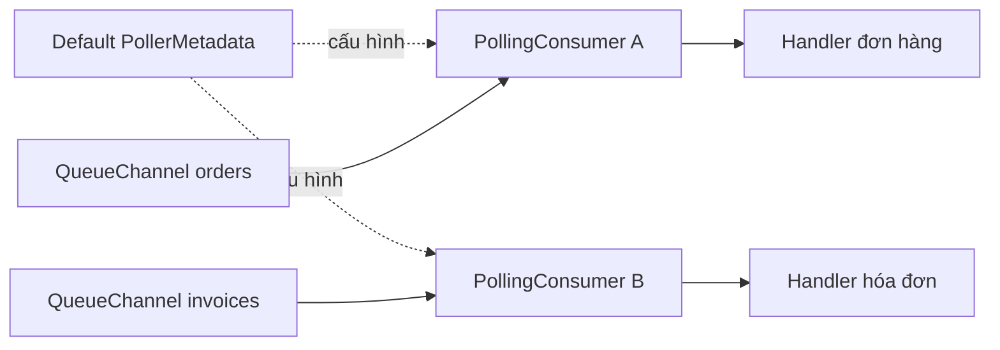

# Global default poller

## 1. Mục tiêu và tình huống sử dụng

Trong module **SPRING_INTEGRATION_CORE**, poller quyết định lúc một endpoint chủ động lấy thông điệp để xử lý. Bài này thuộc chương **Poller**, tập trung vào cách khai báo một cấu hình polling mặc định dùng chung, cách endpoint lựa chọn cấu hình đó và cách tạo ngoại lệ cho từng luồng.

Giả sử ứng dụng có ba hàng đợi: đơn hàng cần chuẩn hóa, hóa đơn cần chuyển đổi và thông báo cần gửi. Các consumer đều cần kiểm tra hàng đợi định kỳ. Nếu mỗi endpoint lặp lại cùng lịch và giới hạn lấy thông điệp, một thay đổi vận hành sẽ đòi hỏi sửa nhiều chỗ. Global default poller giúp tập trung cấu hình chung và giữ cấu hình luồng gọn hơn.

Sau bài này, bạn có thể:

- Khai báo default poller bằng Java, Java DSL và XML.
- Phân biệt endpoint cần polling với endpoint nhận thông điệp theo sự kiện.
- Chọn poller mặc định hoặc cấu hình riêng theo nhu cầu của luồng.
- Giải thích tác động của lịch, giới hạn thông điệp và thời gian chờ nhận.
- Viết kiểm thử chứng minh một luồng hoạt động khi không khai báo poller tại endpoint.

Các ví dụ dùng API có trong Spring Integration 6.5, Java 17 trở lên. Cần dependency `spring-integration-core`; phần kiểm thử dùng JUnit Jupiter. Dùng bộ dependency tương thích do dự án hoặc Spring Boot quản lý, không trộn tùy ý các phiên bản Spring.

## 2. Global default poller là gì?

**Global default poller** là cấu hình polling dự phòng cho endpoint cần polling nhưng chưa được gán poller riêng. Với Java configuration, Spring Integration nhận diện cấu hình này qua tên bean `PollerMetadata.DEFAULT_POLLER`. Với XML, khai báo một `<int:poller>` cấp cao nhất có `default="true"`. Quy tắc chọn cấu hình này được mô tả trong [Message Endpoints — Global Default Poller](https://docs.spring.io/spring-integration/reference/endpoint.html).

Từ “global” cần được hiểu trong phạm vi cấu hình của Spring `ApplicationContext`. Một ứng dụng khác hoặc một tiến trình khác không tự động nhận cấu hình đó. Khi có nhiều context theo quan hệ cha–con, cần xét khả năng nhìn thấy bean và cấu hình của từng context; không giả định mọi context có chung một default độc lập với cách chúng được khởi tạo.

Tên phương thức Java không quyết định vai trò mặc định:

```java
@Bean
public PollerMetadata defaultPoller() {
    // Bean có tên "defaultPoller" theo tên phương thức.
    // Chưa được đăng ký bằng tên mặc định mà Spring Integration tìm kiếm.
    return new PollerMetadata();
}
```

Đoạn trên còn thiếu trigger, nên cũng chưa phải cấu hình polling sử dụng được. Cách đăng ký đúng sẽ xuất hiện ở phần ví dụ hoàn chỉnh.

### 2.1. Metadata dùng chung, endpoint thực thi riêng

Đừng hình dung default poller là một vòng lặp duy nhất đi lần lượt qua tất cả hàng đợi.



Mỗi endpoint có vòng đời và nhiệm vụ polling của mình. Chúng có thể dùng chung hạ tầng scheduler, nhưng việc dùng chung metadata không tự tạo ra thứ tự xử lý giữa hai hàng đợi hoặc giới hạn tổng lưu lượng của toàn ứng dụng.

`PollerMetadata` có các thuộc tính như trigger, giới hạn thông điệp mỗi lượt, receive timeout, executor, error handler và advice chain. Xem [PollerMetadata API](https://docs.spring.io/spring-integration/api/org/springframework/integration/scheduling/PollerMetadata.html). Nên xem đây là cấu hình được thiết lập trước khi endpoint khởi tạo; không dùng việc sửa bean lúc chạy như một cơ chế cập nhật đồng loạt endpoint.

## 3. Endpoint nào sử dụng default poller?

Có hai tình huống polling chính:

1. **Polling consumer** nhận từ một `PollableChannel`, chẳng hạn `QueueChannel`.
2. **Polling inbound channel adapter** chủ động gọi một `MessageSource` để lấy dữ liệu, chẳng hạn nguồn file hoặc một nguồn do ứng dụng cung cấp.

Ngược lại, consumer nối với `DirectChannel` nhận thông điệp theo cơ chế subscribe. Thêm default poller không biến consumer đó thành consumer chạy theo lịch. Sự phân biệt giữa `PollingConsumer`, `EventDrivenConsumer` và `SourcePollingChannelAdapter` được giải thích trong [Poller](https://docs.spring.io/spring-integration/reference/polling-consumer.html).

| Trường hợp | Dùng default poller? | Cách hiểu |
|---|---|---|
| Service activator nhận từ `QueueChannel`, không chỉ định poller | Có | Endpoint cần chủ động gọi receive |
| Transformer nhận từ `QueueChannel`, không chỉ định poller | Có | Loại channel đầu vào quyết định nhu cầu polling |
| Polling inbound adapter không có poller riêng | Có | Adapter cần lịch để gọi nguồn |
| Service activator nhận từ `DirectChannel` | Không | Thông điệp đến theo cơ chế subscribe |
| Endpoint đã khai báo poller riêng | Không | Cấu hình tại endpoint được chọn |
| Ứng dụng tự gọi `queue.receive(...)` | Không | Đây là lời gọi trực tiếp của ứng dụng |
| Messaging gateway gửi vào một channel | Không trực tiếp | Gateway không tự trở thành polling endpoint |

Quy trình xác định cấu hình có thể đọc theo thứ tự:

```text
Endpoint có cần polling không?
├─ Không: xử lý theo cơ chế của endpoint/channel.
└─ Có:
   ├─ Có poller riêng: dùng poller riêng.
   └─ Không có poller riêng:
      ├─ Tìm được default poller: dùng cấu hình mặc định.
      └─ Không tìm được: thiếu cấu hình, endpoint không khởi tạo hợp lệ.
```

Với các annotation xử lý thông điệp, bỏ `@Poller` trên một endpoint có đầu vào là `PollableChannel` cho phép dùng default metadata nếu bean đó tồn tại. Xem [Annotation Support](https://docs.spring.io/spring-integration/reference/6.5/configuration/annotations.html).

## 4. Ví dụ Java DSL hoàn chỉnh

Ví dụ sau đặt thông điệp vào hàng đợi `orders`, chuyển payload sang chữ hoa và đưa kết quả vào `normalizedOrders`. Endpoint transformer không cấu hình poller riêng nên sẽ dùng mặc định.

```java
package example.integration;

import java.time.Duration;
import java.util.Locale;

import org.springframework.context.annotation.Bean;
import org.springframework.context.annotation.Configuration;
import org.springframework.integration.channel.QueueChannel;
import org.springframework.integration.config.EnableIntegration;
import org.springframework.integration.dsl.IntegrationFlow;
import org.springframework.integration.dsl.PollerSpec;
import org.springframework.integration.dsl.Pollers;
import org.springframework.integration.scheduling.PollerMetadata;

@Configuration
@EnableIntegration
public class GlobalDefaultPollerConfig {

    @Bean(name = PollerMetadata.DEFAULT_POLLER)
    public PollerSpec defaultPoller() {
        return Pollers.fixedDelay(Duration.ofSeconds(1))
                .maxMessagesPerPoll(5)
                .receiveTimeout(0);
    }

    @Bean
    public QueueChannel orders() {
        return new QueueChannel(100);
    }

    @Bean
    public QueueChannel normalizedOrders() {
        return new QueueChannel(100);
    }

    @Bean
    public IntegrationFlow normalizeOrdersFlow() {
        return IntegrationFlow.from("orders")
                .transform(
                        String.class,
                        payload -> payload.toUpperCase(Locale.ROOT),
                        endpoint -> endpoint.id("normalizeOrders"))
                .channel("normalizedOrders")
                .get();
    }
}
```

Giải thích cấu hình:

- `@EnableIntegration` đăng ký hạ tầng Spring Integration cho ví dụ Spring thuần này.
- `PollerMetadata.DEFAULT_POLLER` cung cấp tên bean mà framework dùng để tìm mặc định.
- `fixedDelay(Duration.ofSeconds(1))` đặt khoảng nghỉ sau khi lượt polling trước hoàn tất trong cấu hình không giao việc sang executor riêng của ví dụ.
- `maxMessagesPerPoll(5)` giới hạn số thông điệp lấy trong một lượt.
- `receiveTimeout(0)` làm cho thao tác nhận từ hàng đợi trả về ngay nếu chưa có thông điệp.
- Hai `QueueChannel` có dung lượng 100 thông điệp; đây là giới hạn bộ đệm, độc lập với giới hạn mỗi lượt polling.

`PollerSpec` là một `FactoryBean` tạo `PollerMetadata`. Khi dùng nó làm `@Bean`, trả về spec để Spring quản lý việc khởi tạo; không gọi `getObject()` thủ công trong phương thức bean. Đây là lưu ý của [Java DSL — Pollers](https://docs.spring.io/spring-integration/reference/6.5/dsl/java-pollers.html).

### 4.1. Gửi và nhận thông điệp

Lớp sau chạy cùng package với lớp cấu hình:

```java
package example.integration;

import org.springframework.context.annotation.AnnotationConfigApplicationContext;
import org.springframework.integration.channel.QueueChannel;
import org.springframework.messaging.Message;
import org.springframework.messaging.support.GenericMessage;

public class GlobalDefaultPollerDemo {

    public static void main(String[] args) {
        try (var context = new AnnotationConfigApplicationContext(
                GlobalDefaultPollerConfig.class)) {

            QueueChannel input = context.getBean("orders", QueueChannel.class);
            QueueChannel output =
                    context.getBean("normalizedOrders", QueueChannel.class);

            boolean accepted =
                    input.send(new GenericMessage<>("ord-101"), 1_000);

            if (!accepted) {
                throw new IllegalStateException("Hàng đợi đầu vào đã đầy");
            }

            Message<?> result = output.receive(5_000);

            if (result == null) {
                throw new IllegalStateException("Không nhận được kết quả");
            }

            System.out.println(result.getPayload()); // ORD-101
        }
    }
}
```

Giá trị trả về `true` từ `input.send(...)` cho biết hàng đợi đã nhận thông điệp. Kết quả nghiệp vụ được quan sát ở đầu ra sau đó. Việc đóng context kết thúc cả hạ tầng polling do context quản lý.

## 5. Khai báo trực tiếp bằng PollerMetadata

Nếu muốn cấu hình Java không qua builder, có thể **thay thế** phương thức `defaultPoller()` ở trên bằng:

```java
@Bean(name = PollerMetadata.DEFAULT_POLLER)
public PollerMetadata defaultPoller() {
    PollerMetadata metadata = new PollerMetadata();
    metadata.setTrigger(
            new org.springframework.scheduling.support.PeriodicTrigger(
                    java.time.Duration.ofSeconds(1)));
    metadata.setMaxMessagesPerPoll(5);
    metadata.setReceiveTimeout(0);
    return metadata;
}
```

Đây là một cách biểu diễn khác của cùng ý tưởng. Không đăng ký cả hai phương thức như hai default poller trong cùng context.

Với annotation, một consumer có thể dùng mặc định mà không viết `@Poller`:

```java
@org.springframework.integration.annotation.ServiceActivator(
        inputChannel = "orders")
public void consumeOrder(String orderId) {
    System.out.println("Đã nhận: " + orderId);
}
```

Phương thức phải nằm trên một bean do Spring quản lý. Ví dụ annotation này là **phương án thay cho consumer trong DSL**, không phải consumer bổ sung để cùng nhận mọi bản sao thông điệp từ `orders`. Nếu nhiều consumer cùng đọc một `QueueChannel`, chúng cạnh tranh lấy thông điệp.

## 6. Cấu hình poller riêng cho một endpoint

Giả sử luồng ưu tiên cần kiểm tra thường xuyên hơn. Có thể thay riêng phương thức flow bằng:

```java
@Bean
public IntegrationFlow normalizeOrdersFlow() {
    return IntegrationFlow.from("orders")
            .transform(
                    String.class,
                    payload -> payload.toUpperCase(Locale.ROOT),
                    endpoint -> endpoint
                            .id("normalizeOrders")
                            .poller(Pollers.fixedDelay(
                                            Duration.ofMillis(200))
                                    .maxMessagesPerPoll(2)
                                    .receiveTimeout(0)))
            .channel("normalizedOrders")
            .get();
}
```

Endpoint `normalizeOrders` lúc này có poller riêng. Các endpoint khác chưa chỉ định poller vẫn dùng cấu hình mặc định.

Đừng coi cấu hình riêng là một bản vá tự động trộn từng field với default. Hãy khai báo rõ những thuộc tính mà endpoint riêng cần, nhất là giới hạn mỗi lượt, receive timeout và cơ chế xử lý lỗi nếu ứng dụng đã tùy chỉnh chúng ở default.

Với annotation, ý tưởng tương đương là:

```java
@org.springframework.integration.annotation.ServiceActivator(
        inputChannel = "orders",
        poller = @org.springframework.integration.annotation.Poller(
                fixedDelay = "200",
                maxMessagesPerPoll = "2",
                receiveTimeout = "0"))
public void consumePriorityOrder(String orderId) {
    System.out.println("Đơn ưu tiên: " + orderId);
}
```

Các thuộc tính thời gian dạng số trong annotation trên dùng mili giây. Đây cũng là ví dụ thay thế; không đăng ký thêm vào luồng đang có consumer nếu không chủ đích tạo cạnh tranh.

## 7. Polling inbound adapter và giới hạn mỗi lượt

Default poller cũng có thể được dùng khi luồng bắt đầu từ một supplier tạo thông điệp:

```java
@Bean
public IntegrationFlow heartbeatFlow() {
    return IntegrationFlow.fromSupplier(() -> "heartbeat")
            .handle(message -> System.out.println(message.getPayload()))
            .get();
}
```

Nếu thêm bean này vào cấu hình có default `maxMessagesPerPoll(5)`, supplier luôn trả dữ liệu có thể được gọi năm lần trong mỗi lượt polling. Cấu hình “mỗi giây kiểm tra một lượt” không đồng nghĩa “mỗi giây phát đúng một thông điệp”.

Nếu yêu cầu là một lần gọi nguồn cho mỗi lượt, hãy khai báo riêng:

```java
@Bean
public IntegrationFlow heartbeatFlow() {
    return IntegrationFlow.fromSupplier(
                    () -> "heartbeat",
                    endpoint -> endpoint.poller(
                            Pollers.fixedDelay(Duration.ofSeconds(1))
                                    .maxMessagesPerPoll(1)))
            .handle(message -> System.out.println(message.getPayload()))
            .get();
}
```

Một `MessageSource` trả `null` biểu thị chưa có dữ liệu, khiến lượt polling dừng nhận thêm. Supplier luôn trả giá trị không có điểm dừng tự nhiên này. Vì vậy, không đặt giới hạn không hữu hạn cho một nguồn như vậy khi chưa chủ đích kiểm soát vòng nhận.

`@Poller` có mặc định giới hạn khác nhau giữa polling consumer và polling inbound adapter khi không chỉ định giá trị. Đặt con số tường minh giúp tránh dựa nhầm vào mặc định của loại endpoint. Xem [Poller annotation API](https://docs.spring.io/spring-integration/docs/current/api/org/springframework/integration/annotation/Poller.html).

## 8. Cấu hình XML tương đương

Đây là cấu hình độc lập, không nạp đồng thời với các bean Java cùng tên:

```xml
<?xml version="1.0" encoding="UTF-8"?>
<beans xmlns="http://www.springframework.org/schema/beans"
       xmlns:xsi="http://www.w3.org/2001/XMLSchema-instance"
       xmlns:int="http://www.springframework.org/schema/integration"
       xsi:schemaLocation="
           http://www.springframework.org/schema/beans
           https://www.springframework.org/schema/beans/spring-beans.xsd
           http://www.springframework.org/schema/integration
           https://www.springframework.org/schema/integration/spring-integration.xsd">

    <int:poller id="sharedPoller"
                default="true"
                fixed-delay="1000"
                max-messages-per-poll="5"
                receive-timeout="0"/>

    <int:channel id="orders">
        <int:queue capacity="100"/>
    </int:channel>

    <int:channel id="normalizedOrders">
        <int:queue capacity="100"/>
    </int:channel>

    <int:transformer id="normalizeOrders"
                     input-channel="orders"
                     output-channel="normalizedOrders"
                     expression="payload.toUpperCase()"/>
</beans>
```

Transformer không có phần tử con `<int:poller>`, nên dùng mặc định. Không đánh dấu nhiều top-level poller là `default="true"` trong cùng context.

Một poller có tên nhưng không phải mặc định có thể được tham chiếu tại endpoint:

```xml
<int:poller id="priorityPoller"
            fixed-delay="200"
            max-messages-per-poll="2"
            receive-timeout="0"/>

<int:transformer id="normalizePriorityOrders"
                 input-channel="priorityOrders"
                 output-channel="normalizedOrders"
                 expression="payload.toUpperCase()">
    <int:poller ref="priorityPoller"/>
</int:transformer>
```

Đoạn mở rộng này cần khai báo thêm channel `priorityOrders`. Thuộc tính `ref` ở đây nằm trên poller lồng trong endpoint.

## 9. Đọc đúng các tham số vận hành

### 9.1. Fixed delay và thời gian xử lý

Với ví dụ không dùng executor riêng, nếu một lượt mất 400 ms và fixed delay là 1.000 ms, lần bắt đầu tiếp theo cách lần bắt đầu trước khoảng 1.400 ms, cộng sai số scheduling.

```text
t = 0 ms       Bắt đầu lượt thứ nhất
t ≈ 400 ms     Lượt thứ nhất kết thúc
t ≈ 1.400 ms   Bắt đầu lượt tiếp theo
```

Fixed rate tính nhịp theo các mốc bắt đầu được lên lịch; fixed delay tính khoảng nghỉ sau hoàn tất. Không dùng fixed rate như một lời đảm bảo tự tạo xử lý song song. Các builder tương ứng được mô tả trong [Pollers API](https://docs.spring.io/spring-integration/api/org/springframework/integration/dsl/Pollers.html).

### 9.2. Max messages per poll

Giới hạn này áp dụng cho một endpoint trong một lượt polling. Nó không phải kích thước queue, số worker, hoặc giới hạn số thông điệp của cả ứng dụng trong một giây.

Trong mô hình đơn giản có một consumer, hàng đợi luôn có dữ liệu, xử lý tuần tự, không có executor riêng, có thể ước lượng:

```text
Thông lượng xấp xỉ ≈ N / (D + N × H)

N: số thông điệp xử lý mỗi lượt
D: fixed delay, tính bằng giây
H: thời gian xử lý trung bình mỗi thông điệp, tính bằng giây
```

Ví dụ `N = 5`, `D = 1`, `H = 0,1` cho khoảng 3,33 thông điệp/giây. Đây là ước lượng để hiểu ảnh hưởng của thời gian xử lý, không phải cam kết thông lượng. Queue trống, receive timeout, tải scheduler, lỗi và I/O đều có thể làm kết quả khác đi.

### 9.3. Receive timeout

`receiveTimeout` là thời gian một thao tác nhận từ pollable channel có thể chờ thông điệp, không phải timeout của handler hay toàn bộ lượt polling.

Đặt `receiveTimeout(0)` giúp ví dụ kết thúc lượt nhanh khi hàng đợi trống. Một giá trị dương có thể phù hợp với mục tiêu chờ dữ liệu, nhưng cũng giữ luồng thực thi trong thời gian chờ. Với inbound adapter, thời gian chờ I/O còn phụ thuộc nguồn và cấu hình client tương ứng.

## 10. Lỗi khi xử lý bất đồng bộ

Khi producer đưa thông điệp vào `QueueChannel`, consumer thường xử lý sau đó trên luồng polling. Ngoại lệ từ handler không quay về lời gọi `send()` đã hoàn tất của producer.

Spring Integration có cơ chế đưa ngoại lệ thành `ErrorMessage`. Error handler tiêu chuẩn có thể chọn channel từ header `errorChannel` của thông điệp hoặc dùng error channel mặc định; khi tùy chỉnh handler, cần đọc cấu hình cụ thể. Xem [Error Handling](https://docs.spring.io/spring-integration/reference/error-handling.html).

Hệ quả khi thiết kế default poller:

- Cần quan sát được lỗi ở luồng xử lý bất đồng bộ.
- Việc gửi được vào queue chưa chứng minh nghiệp vụ đã thành công.
- Default poller không tự cung cấp retry hay cơ chế đưa thông điệp lỗi trở lại hàng đợi.
- Transaction, nếu có, phải phù hợp với tài nguyên tham gia; không suy ra một queue trong bộ nhớ tự có khả năng rollback chỉ vì đã thêm transaction advice.

Nếu dùng chung advice hoặc executor trong metadata, mỗi endpoint áp dụng chúng vào hoạt động của mình. Khi cần chính sách retry, transaction hoặc tài nguyên thực thi khác nhau, tạo poller riêng cho endpoint có yêu cầu khác.

## 11. Kiểm thử luồng thực sự dùng mặc định

Một kiểm thử hữu ích cần kiểm tra cả bean mặc định lẫn kết quả xử lý. Chỉ assert có bean `PollerMetadata` chưa chứng minh luồng đã được nối đúng.

Lưu ví dụ kiểm thử sau trong cùng package với cấu hình khi thực hành:

```java
package example.integration;

import org.junit.jupiter.api.Test;
import org.springframework.context.annotation.AnnotationConfigApplicationContext;
import org.springframework.integration.channel.QueueChannel;
import org.springframework.integration.scheduling.PollerMetadata;
import org.springframework.messaging.Message;
import org.springframework.messaging.support.GenericMessage;

import static org.junit.jupiter.api.Assertions.assertEquals;
import static org.junit.jupiter.api.Assertions.assertNotNull;
import static org.junit.jupiter.api.Assertions.assertTrue;

class GlobalDefaultPollerConfigTest {

    @Test
    void processesOrderWithoutEndpointSpecificPoller() {
        try (var context = new AnnotationConfigApplicationContext(
                GlobalDefaultPollerConfig.class)) {

            PollerMetadata metadata = context.getBean(
                    PollerMetadata.DEFAULT_POLLER,
                    PollerMetadata.class);

            assertEquals(5L, metadata.getMaxMessagesPerPoll());
            assertEquals(0L, metadata.getReceiveTimeout());

            QueueChannel input = context.getBean("orders", QueueChannel.class);
            QueueChannel output =
                    context.getBean("normalizedOrders", QueueChannel.class);

            assertTrue(input.send(new GenericMessage<>("ord-101"), 1_000));

            Message<?> result = output.receive(5_000);

            assertNotNull(result, "Luồng phải tạo kết quả trong thời gian chờ");
            assertEquals("ORD-101", result.getPayload());
        }
    }
}
```

`normalizeOrdersFlow()` trong cấu hình gốc không gọi `.poller(...)`, nên kiểm thử kết quả đồng thời xác nhận đường xử lý đã được khởi tạo với default. `receive(5_000)` chờ có điều kiện đến khi có dữ liệu, tránh dùng một khoảng `Thread.sleep()` cố định trước khi kiểm tra.

Kiểm thử này xác nhận một thông điệp đi qua luồng. Nó không chứng minh giới hạn năm thông điệp mỗi lượt hoặc độ chính xác của lịch. Muốn kiểm tra các hành vi đó, cần kiểm soát trigger, điểm đồng bộ và vòng đời endpoint phù hợp.

## 12. Lỗi cấu hình thường gặp

| Hiện tượng | Nguyên nhân cần kiểm tra | Cách xử lý |
|---|---|---|
| Endpoint polling không khởi tạo | Không có poller riêng và không tìm được default | Kiểm tra tên bean và context đang nạp cấu hình |
| Bean tên `defaultPoller` tồn tại nhưng không được dùng | Chỉ dựa vào tên phương thức | Đăng ký bằng `PollerMetadata.DEFAULT_POLLER` |
| Xung đột khi khởi tạo | Nhiều cấu hình cùng đăng ký default | Chọn một nơi sở hữu default |
| `DirectChannel` vẫn xử lý ngay khi gửi | Consumer hoạt động theo sự kiện | Dùng `QueueChannel` khi cần ranh giới polling |
| Một heartbeat xuất hiện nhiều lần mỗi lượt | Nguồn luôn có dữ liệu, giới hạn mỗi lượt lớn hơn 1 | Đặt `maxMessagesPerPoll(1)` cho nguồn đó |
| Poller riêng không còn hành vi lỗi như default | Đã chọn một cấu hình riêng | Khai báo đầy đủ chính sách cần thiết |
| Hai consumer không cùng nhận mọi đơn hàng | Chúng cùng đọc một queue | Thiết kế publish-subscribe nếu cần phân phối bản sao |
| Hàng đợi tăng liên tục | Tốc độ đến lớn hơn khả năng xử lý | Đo thời gian handler, backlog và nhịp polling |

Khi điều tra, kiểm tra lần lượt loại channel đầu vào, định nghĩa endpoint, tên bean default và thuộc tính poller đã cấu hình. Sau đó mới điều chỉnh scheduler hoặc concurrency dựa trên số liệu quan sát.

## 13. Bài thực hành

Từ cấu hình gốc, thực hiện các thay đổi độc lập:

1. Thêm một `QueueChannel` dành cho hóa đơn và một flow transformer không khai báo poller. Gửi thông điệp vào cả hai luồng và quan sát rằng chúng đều hoạt động.
2. Đổi default sang fixed delay hai giây. Xác định các endpoint chịu ảnh hưởng, kể cả polling inbound adapter nếu đã thêm.
3. Gán poller riêng 200 ms cho luồng đơn hàng. Kiểm tra luồng hóa đơn vẫn dùng mặc định.
4. Thay channel đầu vào của một flow bằng `DirectChannel`. Giải thích vì sao endpoint đó không cần polling nữa.
5. Thêm một supplier luôn trả dữ liệu. So sánh giới hạn mỗi lượt bằng 1 và 5.
6. Trong một cấu hình thử nghiệm riêng, bỏ default khi consumer vẫn đọc từ queue và không có poller riêng. Quan sát lỗi khởi tạo thay vì đợi một thông điệp không bao giờ được xử lý.

Khi giải thích kết quả, tách ba câu hỏi: endpoint nào cần polling, cấu hình nào được chọn và mỗi lượt polling thực hiện bao nhiêu lần nhận. Ba câu hỏi này giúp dùng global default poller đúng mục đích trong các luồng transformer, filter, router hoặc service activator mà không che khuất các yêu cầu riêng của từng endpoint.