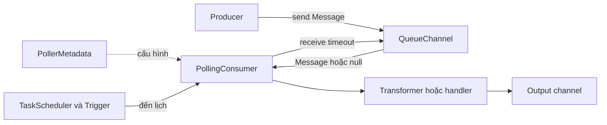

# PollerMetadata

## 1. Mục tiêu và ngữ cảnh

Trong chương **Poller** của module `SPRING_INTEGRATION_CORE`, `PollerMetadata` giúp tập trung chính sách polling: khi nào lấy thông điệp, lấy tối đa bao nhiêu, chờ nhận trong bao lâu và xử lý lỗi theo cách nào. Nó kết nối cơ chế lập lịch với các endpoint trong luồng tích hợp dùng `Message`, `MessageChannel`, transformer, filter, router hoặc service activator.

Sau bài này, bạn có thể:

- Phân biệt đối tượng cấu hình `PollerMetadata` với endpoint thực thi polling.
- Khai báo poller có tên, poller mặc định và sử dụng trong annotation hoặc Java DSL.
- Phối hợp `Trigger`, `maxMessagesPerPoll`, `receiveTimeout` và executor.
- Nhận diện ranh giới lỗi, advice và transaction khi thông điệp đi qua luồng.
- Quan sát kết quả polling bằng một ví dụ và kiểm thử có thời gian chờ hữu hạn.

**Nền ví dụ:** Java 17 trở lên, Spring Integration 6.5.x và Spring Framework 6.2.x tương thích. Các lớp cấu hình dưới đây dùng `spring-integration-core` và `@EnableIntegration`; phần kiểm thử cần JUnit Jupiter. Hãy dùng bộ dependency tương thích của dự án hoặc BOM đang quản lý phiên bản. Bài này không giả định một phiên bản Spring Boot cụ thể.

## 2. PollerMetadata giữ cấu hình gì?

Lớp `org.springframework.integration.scheduling.PollerMetadata` là đối tượng chứa các lựa chọn cho polling. Những điểm cấu hình chính gồm `trigger`, `maxMessagesPerPoll`, `receiveTimeout`, `taskExecutor`, `errorHandler`, `adviceChain` và `transactionSynchronizationFactory`. Các setter tương ứng cho phép tạo bean bằng Java configuration. Xem [API PollerMetadata 6.5.x](https://docs.spring.io/spring-integration/docs/6.5.x/api/org/springframework/integration/scheduling/PollerMetadata.html).

Nên phân biệt ba trách nhiệm:

| Thành phần | Trách nhiệm |
| --- | --- |
| `PollerMetadata` | Chứa chính sách để cấu hình polling |
| `PollingConsumer` | Lấy thông điệp từ `PollableChannel`, chuyển cho handler |
| `SourcePollingChannelAdapter` | Gọi một `MessageSource`, gửi thông điệp nhận được vào output channel |

`PollingConsumer` thường xuất hiện khi một endpoint đọc từ `QueueChannel`. `SourcePollingChannelAdapter` thường xuất hiện ở đầu vào lấy dữ liệu từ nguồn chủ động được thăm dò. Cả hai đều là endpoint polling; việc khai báo một bean metadata đơn lẻ chưa tạo ra luồng xử lý thông điệp. Tham khảo [Poller và hai loại endpoint](https://docs.spring.io/spring-integration/reference/6.5/polling-consumer.html).



Trong sơ đồ, mũi tên từ metadata biểu diễn quan hệ cấu hình. Thông điệp đi từ queue tới endpoint rồi tới handler; nó không đi qua bean metadata.

Một `DirectChannel` chuyển thông điệp theo cơ chế đăng ký handler, nên consumer thông thường của channel này không cần poller. Đừng gắn poller chỉ vì handler chạy một công việc định kỳ ở góc nhìn nghiệp vụ; trước hết phải xác định chính xác nguồn nào đang được thăm dò. Xem [Message Endpoints](https://docs.spring.io/spring-integration/reference/6.5/endpoint.html).

## 3. Một chu kỳ polling diễn ra thế nào?

Với một consumer đọc queue, có thể hình dung chu kỳ bằng mã giả sau:

```text
khi đến lịch chạy:
    nếu maxMessagesPerPoll == 0:
        kết thúc lượt, không nhận thông điệp

    số_đã_xử_lý = 0
    trong khi chưa đạt giới hạn:
        message = inputChannel.receive(receiveTimeout)
        nếu message == null:
            kết thúc lượt
        chuyển message cho handler
        tăng số_đã_xử_lý
```

Đây là mô hình khái niệm cho đường xử lý thành công, không phải mã nguồn đầy đủ: thực tế còn có advice, lỗi, lifecycle và transaction.

Trong Spring Integration 6.5, giới hạn dương đặt trần số thông điệp cho một lượt; giá trị âm cho phép tiếp tục tới khi nguồn hết dữ liệu; `0` bỏ qua việc lấy thông điệp. Một lượt có thể kết thúc sớm khi nhận `null`. Vì vậy, hãy dùng rõ `-1` khi muốn không giới hạn, thay vì suy luận rằng mọi giá trị không dương đều có cùng nghĩa. Quy tắc thực thi được mô tả trong [API AbstractPollingEndpoint](https://docs.spring.io/spring-integration/docs/6.5.0/api/org/springframework/integration/endpoint/AbstractPollingEndpoint.html#setMaxMessagesPerPoll(long)).

**Giới hạn đếm thông điệp, không đếm phần tử trong payload.** Nếu một thông điệp chứa danh sách 500 đơn hàng thì `maxMessagesPerPoll(1)` vẫn có thể chuyển cả danh sách đó tới handler. Muốn xử lý từng đơn hàng, bạn cần xem xét splitter hoặc thay đổi cách nguồn phát thông điệp.

## 4. Ba tham số cần đọc cùng nhau

### 4.1. Trigger quyết định thời điểm chạy

`PeriodicTrigger` hỗ trợ fixed delay và fixed rate; mặc định là fixed delay. Với fixed delay, khoảng nghỉ được tính từ khi tác vụ trước hoàn tất. Với fixed rate, mốc tính dựa trên lịch bắt đầu. Constructor nhận `Duration` giúp biểu đạt đơn vị rõ ràng. Xem [API PeriodicTrigger](https://docs.spring.io/spring-framework/docs/6.2.x/javadoc-api/org/springframework/scheduling/support/PeriodicTrigger.html).

```java
PeriodicTrigger trigger = new PeriodicTrigger(Duration.ofSeconds(1));
trigger.setInitialDelay(Duration.ofSeconds(2));
trigger.setFixedRate(false);
```

Giả sử polling và xử lý đồng bộ một lượt mất 300 ms, sau đó nghỉ 1 giây: thời gian giữa hai lần bắt đầu xấp xỉ 1.300 ms. Đây là phép ước lượng cho cấu hình thực thi đồng bộ, bỏ qua độ trễ của hệ điều hành và scheduler.

Fixed rate không tự tạo thêm worker và không bảo đảm xử lý đúng giờ khi tài nguyên đã bận. Khi cần tăng tốc, phải đo thời gian xử lý và mức sử dụng tài nguyên thay vì chỉ đổi loại trigger.

### 4.2. maxMessagesPerPoll đặt ngân sách mỗi lượt

Giả sử queue có 23 thông điệp, mỗi lượt cho phép tối đa 10 và không có producer mới. Bỏ qua lỗi, các lượt có thể lấy lần lượt 10, 10 rồi 3 thông điệp. Con số 10 không có nghĩa gom thành một batch payload, cũng không đồng nghĩa có 10 luồng chạy song song.

Nên cấu hình giá trị dương rõ ràng trong ví dụ và luồng cần ngân sách hữu hạn. Mặc định còn phụ thuộc loại endpoint và đường cấu hình: tài liệu nêu `PollingConsumer` thường không giới hạn, còn inbound `SourcePollingChannelAdapter` thường lấy một thông điệp mỗi lượt. Xem [cấu hình poller và giá trị mặc định](https://docs.spring.io/spring-integration/reference/6.5/endpoint.html).

Với nguồn luôn trả thông điệp khác `null`, không giới hạn có thể làm một lượt kéo dài liên tục. Trường hợp một supplier luôn sinh thời gian hiện tại là ví dụ dễ gặp: mỗi lần gọi đều tạo dữ liệu mới, nên điều kiện “hết dữ liệu” không xuất hiện.

### 4.3. receiveTimeout là thời gian chờ nhận

`receiveTimeout` trên consumer đọc `PollableChannel` được tính theo mili giây. Ví dụ `100` cho phép mỗi lần gọi nhận đợi tối đa 100 ms khi chưa có thông điệp; `0` yêu cầu kiểm tra không chờ. Thuộc tính này không đặt timeout cho toàn bộ xử lý nghiệp vụ. Tham khảo [Polling Consumer](https://docs.spring.io/spring-integration/reference/6.5/endpoint.html).

Nếu lượt được phép lấy 10 thông điệp nhưng chỉ có 3, sau khi xử lý thông điệp thứ ba, lần nhận tiếp theo có thể phải chờ hết timeout mới trả `null`. Ngược lại, nếu lấy đủ 10 thông điệp thì lượt có thể dừng ngay vì đã đạt giới hạn.

Đừng dùng `receiveTimeout` để kiểm soát thời gian gọi HTTP hoặc truy vấn cơ sở dữ liệu của một `MessageSource`. Nguồn đó có cơ chế timeout riêng; interface `MessageSource.receive()` không nhận tham số timeout của `PollableChannel`.

## 5. Ví dụ hoàn chỉnh với poller có tên

Bài toán: producer gửi mã đơn hàng vào queue; transformer lấy mã theo lịch, bỏ khoảng trắng và chuẩn hóa thành chữ hoa. Kết quả được đưa vào queue thứ hai để quan sát.

```java
import java.time.Duration;
import java.util.Locale;

import org.springframework.context.annotation.Bean;
import org.springframework.context.annotation.Configuration;
import org.springframework.integration.annotation.Poller;
import org.springframework.integration.annotation.Transformer;
import org.springframework.integration.channel.QueueChannel;
import org.springframework.integration.config.EnableIntegration;
import org.springframework.integration.scheduling.PollerMetadata;
import org.springframework.scheduling.support.PeriodicTrigger;

@Configuration
@EnableIntegration
public class PollerMetadataLessonConfig {

    @Bean
    public QueueChannel orderQueue() {
        return new QueueChannel(100);
    }

    @Bean
    public QueueChannel processedOrders() {
        return new QueueChannel(100);
    }

    @Bean
    public PollerMetadata orderPoller() {
        PeriodicTrigger trigger =
                new PeriodicTrigger(Duration.ofMillis(200));
        trigger.setFixedRate(false);

        PollerMetadata metadata = new PollerMetadata();
        metadata.setTrigger(trigger);
        metadata.setMaxMessagesPerPoll(5);
        metadata.setReceiveTimeout(0);
        return metadata;
    }

    @Bean
    public OrderNormalizer orderNormalizer() {
        return new OrderNormalizer();
    }

    public static class OrderNormalizer {

        @Transformer(
                inputChannel = "orderQueue",
                outputChannel = "processedOrders",
                poller = @Poller("orderPoller"))
        public String normalize(String orderCode) {
            return orderCode.trim().toUpperCase(Locale.ROOT);
        }
    }
}
```

`@EnableIntegration` đăng ký hạ tầng cần thiết trong cấu hình Spring thuần này. Bean `OrderNormalizer` được Spring quản lý; annotation trên phương thức tạo endpoint transformer đọc `orderQueue`.

`@Poller("orderPoller")` tham chiếu chính xác tên bean metadata. Khi dùng thuộc tính `value` để tham chiếu bean, các lựa chọn polling khác phải đặt trong bean đó; không kết hợp thêm `fixedDelay`, `cron` hoặc `maxMessagesPerPoll` trong cùng annotation tham chiếu. Xem [Using the @Poller Annotation](https://docs.spring.io/spring-integration/reference/6.5/configuration/annotations.html#annotations-poller).

Trong ví dụ, một lượt lấy tối đa 5 thông điệp đang sẵn có, không chờ queue rỗng, rồi chờ 200 ms trước lượt kế tiếp khi xử lý đồng bộ hoàn tất. Hai queue có sức chứa hữu hạn để ví dụ thể hiện rõ nơi dữ liệu được đệm. Kết quả cần được đọc ra; nếu output queue đầy, việc gửi kết quả có thể làm chậm hoặc chặn luồng theo cấu hình gửi của endpoint.

## 6. Poller mặc định và phạm vi áp dụng

Khi nhiều endpoint đọc queue dùng cùng chính sách, có thể khai báo bean mang tên quy ước `PollerMetadata.DEFAULT_POLLER`:

```java
@Bean(name = PollerMetadata.DEFAULT_POLLER)
public PollerMetadata defaultPoller() {
    PollerMetadata metadata = new PollerMetadata();
    metadata.setTrigger(new PeriodicTrigger(Duration.ofSeconds(1)));
    metadata.setMaxMessagesPerPoll(10);
    metadata.setReceiveTimeout(0);
    return metadata;
}
```

Đây là đoạn thay thế cho cách chọn poller ở ví dụ trước: đặt bean này trong lớp cấu hình rồi bỏ thuộc tính `poller` trên `@Transformer` nếu muốn endpoint dùng mặc định.

Một endpoint đọc `PollableChannel` trong cùng `ApplicationContext`, không khai báo poller riêng, có thể dùng bean mặc định này. Bean có tên `defaultPoller` một cách tùy ý chưa đủ; điều quan trọng là tên quy ước, vì vậy nên dùng hằng số của framework. Xem [Global Default Poller](https://docs.spring.io/spring-integration/reference/6.5/endpoint.html).

Quy tắc thiết kế cho ví dụ đơn hàng:

| Nhu cầu | Cách chọn |
| --- | --- |
| Một chính sách chung cho nhiều queue đơn giản | Poller mặc định |
| Queue thanh toán có timeout, advice hoặc lỗi riêng | Poller có tên, tham chiếu rõ |
| Một endpoint nhỏ có cấu hình đơn giản | `@Poller` nội tuyến hoặc DSL nội tuyến |
| Endpoint thông thường nhận từ `DirectChannel` | Dùng consumer theo sự kiện |

Dùng chung metadata không có nghĩa các endpoint chia sẻ một bộ đếm lấy thông điệp. Nếu hai endpoint đều có giới hạn 10, hãy xem đó là ngân sách của từng lượt trên từng endpoint. Nếu yêu cầu nghiệp vụ là toàn hệ thống chỉ được gọi dịch vụ ngoài 10 lần mỗi giây, cần thiết kế cơ chế giới hạn phù hợp và tính cả số instance ứng dụng.

## 7. Sử dụng trong Java DSL

Java DSL vẫn tạo các thành phần Spring Integration trong application context. `ConsumerEndpointSpec.poller(PollerMetadata)` cho phép truyền metadata trực tiếp vào cấu hình endpoint. Xem [API ConsumerEndpointSpec](https://docs.spring.io/spring-integration/docs/6.5.0/api/org/springframework/integration/dsl/ConsumerEndpointSpec.html#poller(org.springframework.integration.scheduling.PollerMetadata)).

Để chuyển ví dụ sang DSL, giữ hai bean queue và `orderPoller`, **bỏ bean `orderNormalizer()`**, rồi thêm phương thức sau vào lớp cấu hình:

```java
import org.springframework.beans.factory.annotation.Qualifier;
import org.springframework.integration.dsl.IntegrationFlow;

@Bean
public IntegrationFlow normalizeOrdersFlow(
        @Qualifier("orderQueue") QueueChannel input,
        @Qualifier("processedOrders") QueueChannel output,
        @Qualifier("orderPoller") PollerMetadata metadata) {

    return IntegrationFlow.from(input)
            .transform(String.class,
                    value -> value.trim().toUpperCase(Locale.ROOT),
                    endpoint -> endpoint
                            .id("normalizeOrdersEndpoint")
                            .poller(metadata))
            .channel(output)
            .get();
}
```

Các dòng `import` thuộc đầu tệp Java. Đoạn này biểu diễn một phương án cấu hình thay thế. Nếu giữ đồng thời endpoint annotation và endpoint DSL đọc chung `orderQueue`, chúng trở thành các consumer cạnh tranh; kết quả quan sát sẽ không còn mô tả một transformer duy nhất.

Khi không cần bean dùng lại, có thể thay `.poller(metadata)` bằng cấu hình nội tuyến:

```java
endpoint -> endpoint.poller(poller -> poller
        .fixedDelay(Duration.ofMillis(200))
        .maxMessagesPerPoll(5)
        .receiveTimeout(0))
```

Một biến thể khác là dùng `Pollers.fixedDelay(Duration.ofMillis(200))` làm điểm bắt đầu của `PollerSpec`. `Pollers` là tiện ích tạo cấu hình poller theo fixed delay, fixed rate, cron hoặc trigger tự cung cấp; xem [API Pollers](https://docs.spring.io/spring-integration/docs/6.5.0/api/org/springframework/integration/dsl/Pollers.html).

Vị trí khai báo phải đúng endpoint đọc queue. Nếu thêm `DirectChannel` sau transformer rồi gắn router vào channel đó, router nhận thông điệp từ cơ chế đăng ký của channel; nó không cần một poller thứ hai. Nếu thêm `QueueChannel` giữa hai bước, hãy xác định chính sách polling cho consumer phía sau queue mới.

## 8. Scheduler, executor và tính song song

Scheduler quyết định thời điểm kích hoạt tác vụ. Executor, khi được cấu hình, nhận tác vụ để thực thi. Đây là hai điểm cần xem riêng khi giải thích một luồng bị trễ.

Ví dụ mở rộng sau đặt worker pool hữu hạn; thêm bean vào cấu hình rồi truyền nó vào phương thức tạo metadata:

```java
import org.springframework.scheduling.concurrent.ThreadPoolTaskExecutor;

@Bean
public ThreadPoolTaskExecutor pollWorkers() {
    ThreadPoolTaskExecutor executor = new ThreadPoolTaskExecutor();
    executor.setCorePoolSize(2);
    executor.setMaxPoolSize(2);
    executor.setQueueCapacity(10);
    executor.setThreadNamePrefix("order-poll-");
    return executor;
}
```

Trong phương thức `orderPoller`, nhận tham số `@Qualifier("pollWorkers") ThreadPoolTaskExecutor workers`, rồi thêm `metadata.setTaskExecutor(workers)` trước khi trả về. Spring quản lý khởi tạo và đóng executor của bean này.

Cấu hình executor làm thay đổi giả định thời gian: tác vụ được scheduler kích hoạt có thể chỉ gửi công việc sang worker rồi hoàn tất. Vì vậy, không dùng cách tính fixed delay của ví dụ đồng bộ để khẳng định hai lượt xử lý nghiệp vụ luôn cách nhau đúng 200 ms sau khi xử lý xong. Tác vụ polling có thể xếp hàng hoặc chồng lấn; cần xem thread safety và thứ tự kết quả.

Nếu lịch kích hoạt nhanh hơn khả năng hoàn tất của worker, hàng đợi tác vụ tăng dù queue thông điệp có thể đang rỗng. Tài liệu mô tả rõ tình huống executor tích tụ tác vụ do polling có thời gian chờ nhận dài; xem [Asynchronous Polling](https://docs.spring.io/spring-integration/reference/6.5/endpoint.html).

Đối với bài toán đơn hàng, trước khi thêm worker, hãy đo:

- Số thông điệp chờ và tuổi của thông điệp lâu nhất trong `orderQueue`.
- Thời gian xử lý một thông điệp và thời gian chờ dịch vụ ngoài.
- Số worker đang bận, số tác vụ chờ, số lần bị executor từ chối.
- Thứ tự đầu ra khi hai thông điệp được xử lý với thời lượng khác nhau.

Pool giới hạn hai luồng không biến `maxMessagesPerPoll(5)` thành năm worker. Nó giới hạn số tác vụ executor có thể chạy đồng thời; trong mỗi tác vụ, việc lấy nhiều thông điệp vẫn chịu logic của poller.

## 9. ErrorHandler và đường đi của lỗi

Producer gửi thành công vào queue chỉ chứng minh queue đã nhận thông điệp. Khi transformer chạy sau đó trên luồng polling và ném exception, `try/catch` bao quanh lần `send()` trước đó không thể bắt exception xử lý ấy như một lời gọi đồng bộ.

Spring Integration có cơ chế biểu diễn lỗi bằng `ErrorMessage`; đường xử lý tiêu chuẩn xem header `errorChannel` của thông điệp khi có ngữ cảnh tương ứng, rồi dùng channel lỗi mặc định. Tác vụ polling được lập lịch cũng tham gia cơ chế xử lý lỗi của framework. Xem [Error Handling](https://docs.spring.io/spring-integration/reference/6.5/error-handling.html).

Để minh họa một đường lỗi riêng trong bài học, có thể thêm queue quan sát lỗi và một error handler phát thông điệp:

```java
import org.springframework.integration.channel.QueueChannel;
import org.springframework.integration.channel.MessagePublishingErrorHandler;

@Bean
public QueueChannel pollErrors() {
    return new QueueChannel(20);
}

@Bean
public MessagePublishingErrorHandler orderPollErrorHandler(
        @Qualifier("pollErrors") QueueChannel errors) {
    MessagePublishingErrorHandler handler =
            new MessagePublishingErrorHandler();
    handler.setDefaultErrorChannel(errors);
    return handler;
}
```

Tiếp tục mở rộng phương thức tạo `orderPoller` để nhận bean `orderPollErrorHandler`, sau đó gọi:

```java
metadata.setErrorHandler(orderPollErrorHandler);
```

`pollErrors` là queue dùng quan sát trong ví dụ; cần đọc nó bằng `receive(timeout)` hoặc gắn consumer thích hợp. Nếu gắn endpoint tiêu thụ tự động từ queue này, endpoint đó cũng cần chính sách poller. Trong hệ thống thực tế, hãy cân nhắc sức chứa và hành vi khi đường lỗi bị đầy.

Tự đặt `setErrorHandler(error -> ...)` thay thế cơ chế xử lý lỗi tại điểm đó. Nếu lambda chỉ ghi log rồi trả về, không nên kỳ vọng nó tự phát `ErrorMessage` hoặc thử lại thông điệp. Phát lỗi, retry và bảo đảm dữ liệu không mất là những quyết định khác nhau.

Đặc biệt, `QueueChannel` bộ nhớ thông thường không tự đưa thông điệp đã lấy trở lại queue chỉ vì transformer ném lỗi. Khi cần phục hồi, hãy thiết kế rõ nguồn dữ liệu, lưu trữ, retry hoặc hàng đợi lỗi và tính idempotent của thao tác nghiệp vụ.

## 10. Advice và transaction gắn ở đâu?

`adviceChain` cho phép đặt logic bao quanh thao tác polling. Advice thông thường bao phủ cả nhận và xử lý trong phạm vi được advice; `ReceiveMessageAdvice` chuyên cho phần nhận. Advice đặt ở handler là một điểm chặn khác, nên không thể coi hai vị trí này tương đương. Xem [Conditional Pollers và advice](https://docs.spring.io/spring-integration/reference/6.5/polling-consumer.html).

Ví dụ có thể dùng advice của poller để kiểm tra điều kiện có nên tiếp tục lấy dữ liệu; dùng advice của handler để đo hoặc thử lại một thao tác gọi dịch vụ cụ thể. Trước khi đặt retry, cần trả lời: “thử lại lời gọi nào, và lời gọi đó đã tạo hiệu ứng bên ngoài hay chưa?”.

Transaction advice tại poller có thể đưa thao tác `receive()` của tài nguyên hỗ trợ transaction vào cùng ranh giới với xử lý đồng bộ phía sau. Việc rollback có phục hồi dữ liệu hay không còn tùy tài nguyên tham gia transaction. Một `QueueChannel` bộ nhớ thông thường không trở thành queue có rollback chỉ vì thêm transaction advice. Xem [Poller Transaction Support](https://docs.spring.io/spring-integration/reference/6.5/transactions.html).

`transactionSynchronizationFactory` phục vụ đăng ký callback theo kết quả transaction. Nó không thay cho transaction manager hay transaction advice để bắt đầu transaction.

Khi luồng chuyển sang thread khác qua `ExecutorChannel` hoặc qua một queue trung gian, không giả định transaction gắn với thread trước sẽ bao phủ luôn xử lý sau đó. Ví dụ, thao tác ghi cơ sở dữ liệu và lời gọi HTTP không tự trở thành một giao dịch nguyên tử chỉ vì cùng bắt đầu từ một poller.

## 11. Tái sử dụng cấu hình và thay đổi lúc chạy

Bean metadata phù hợp để tập trung cấu hình ở thời điểm khởi tạo. Cần phân biệt:

| Thao tác | Điều cần hiểu |
| --- | --- |
| Hai endpoint tham chiếu cùng metadata | Dùng chung nguồn cấu hình; mỗi endpoint vẫn có lifecycle của mình |
| Sửa trường số trong metadata sau khi ứng dụng đã khởi tạo | Không mặc nhiên cập nhật trường đã được áp dụng vào endpoint |
| Dùng chung một đối tượng advice hoặc trigger có trạng thái | Cần xem trạng thái đó có bị chia sẻ giữa các nơi dùng hay không |
| Muốn dừng một endpoint | Điều khiển lifecycle của endpoint đang chạy |

Ví dụ, gọi `metadata.setMaxMessagesPerPoll(0)` sau startup không nên được dùng như một cơ chế pause đáng tin cậy cho mọi endpoint đã lấy cấu hình từ metadata. Khi muốn điều khiển động, hãy làm việc với endpoint quản lý tương ứng hoặc cơ chế điều khiển được framework hỗ trợ; thử nghiệm rõ hành vi trên phiên bản dự án.

Về thiết kế, có thể dùng một poller mặc định cho các luồng đơn giản và tạo bean riêng cho những endpoint cần trạng thái điều tiết độc lập. Cách này làm rõ nơi cần thay đổi khi một dịch vụ đối tác có yêu cầu riêng.

## 12. Kiểm thử kết quả mà không phụ thuộc thời điểm chính xác

Ví dụ sau kiểm thử cấu hình annotation ở mục 5, chưa bật các phần mở rộng executor và error handler. Nó chờ kết quả bằng timeout của output queue, không dùng `Thread.sleep()` để đoán lúc poller đã chạy.

```java
import org.junit.jupiter.api.Test;
import org.springframework.context.annotation.AnnotationConfigApplicationContext;
import org.springframework.integration.channel.QueueChannel;
import org.springframework.messaging.Message;
import org.springframework.messaging.support.MessageBuilder;

import static org.junit.jupiter.api.Assertions.assertEquals;
import static org.junit.jupiter.api.Assertions.assertNotNull;
import static org.junit.jupiter.api.Assertions.assertTrue;

class PollerMetadataLessonTest {

    @Test
    void normalizesAnOrderThroughThePollingEndpoint() {
        try (AnnotationConfigApplicationContext context =
                     new AnnotationConfigApplicationContext(
                             PollerMetadataLessonConfig.class)) {

            QueueChannel input =
                    context.getBean("orderQueue", QueueChannel.class);
            QueueChannel output =
                    context.getBean("processedOrders", QueueChannel.class);

            boolean accepted = input.send(
                    MessageBuilder.withPayload("  order-42  ").build(),
                    1_000);
            assertTrue(accepted);

            Message<?> result = output.receive(3_000);

            assertNotNull(result);
            assertEquals("ORDER-42", result.getPayload());
        }
    }
}
```

Timeout 3 giây là ngân sách chờ trong ví dụ, không phải cam kết endpoint luôn hoàn tất trong khoảng đó dưới mọi tải. Kiểm thử này chứng minh thông điệp đi qua endpoint polling và transformer trả kết quả mong đợi; nó chưa chứng minh giới hạn mỗi lượt hay mức song song.

Để khảo sát giới hạn mỗi lượt một cách có kiểm soát, có thể cấu hình endpoint chưa tự khởi động, nạp sẵn queue, dùng trigger cho đúng một lần kích hoạt, rồi đo số kết quả. Cách này tránh việc nhiều lần kích hoạt xen vào phép đo. Với đường lỗi, chủ động làm handler ném lỗi và xác nhận nhận được lỗi ở channel đã chọn.

## 13. Ước lượng năng lực trong một tình huống cụ thể

Giả sử có một endpoint đồng bộ, queue luôn đủ dữ liệu và các điều kiện:

- Mỗi lượt xử lý tối đa 10 thông điệp.
- Mỗi thông điệp mất trung bình 40 ms.
- Fixed delay là 600 ms.
- Bỏ qua chi phí nhận, gửi và lập lịch.

Một lượt xử lý mất khoảng `10 × 40 = 400 ms`; khoảng thời gian cho xử lý và nghỉ là `400 + 600 = 1.000 ms`. Năng lực ước lượng theo giả thiết là `10 / 1 = 10 thông điệp/giây`.

Nếu tăng giới hạn lên 20, thời gian xử lý thành `800 ms`; tổng thành `1.400 ms`, tức khoảng `14,3 thông điệp/giây`. Tăng gấp đôi giới hạn chưa làm năng lực tăng gấp đôi, vì thời gian xử lý cũng tăng.

Nếu mỗi thông điệp phải gọi dịch vụ giới hạn 8 yêu cầu/giây, cả hai cấu hình vẫn cần cơ chế điều tiết thích hợp. `maxMessagesPerPoll` giới hạn một lượt polling, còn hạn mức đối tác thường áp dụng trên một cửa sổ thời gian và có thể tính tổng nhiều instance.

## 14. Chẩn đoán các nhầm lẫn thường gặp

| Hiện tượng | Hướng kiểm tra |
| --- | --- |
| Có bean metadata nhưng queue không được đọc | Endpoint nào tham chiếu metadata? Endpoint đã khởi động chưa? |
| Endpoint đọc queue thiếu cấu hình poller | Đã tham chiếu poller có tên hoặc khai báo đúng bean mặc định chưa? |
| Dữ liệu được xử lý bởi hai nơi ngoài dự kiến | Có đồng thời endpoint annotation và DSL đọc cùng queue không? |
| Một lượt chạy rất lâu | Có dùng giới hạn âm với nguồn liên tục trả dữ liệu không? Handler hoặc output có bị chặn không? |
| Queue rỗng nhưng worker vẫn bận | `receiveTimeout` có dài, lịch kích hoạt có dày và tác vụ có xếp hàng không? |
| Mã bắt lỗi quanh `send()` không thấy lỗi handler | Xử lý sau queue có chạy trên thread polling khác không? |
| Đã ghi log lỗi nhưng không có retry | Error handler có thực sự triển khai cơ chế phục hồi không? |
| Thay đổi metadata mà hành vi không đổi | Có đang sửa đối tượng cấu hình thay vì endpoint đang chạy không? |

Khi cấu hình một endpoint mới, hãy lần theo một thông điệp cụ thể: nó đang ở nguồn nào, ai gọi nhận, lịch nào kích hoạt, thread nào xử lý, đi qua ranh giới bất đồng bộ ở đâu và lỗi được quan sát tại channel nào. Trả lời được chuỗi câu hỏi đó sẽ giúp bạn chọn `PollerMetadata` phù hợp trước khi điều chỉnh các con số.
