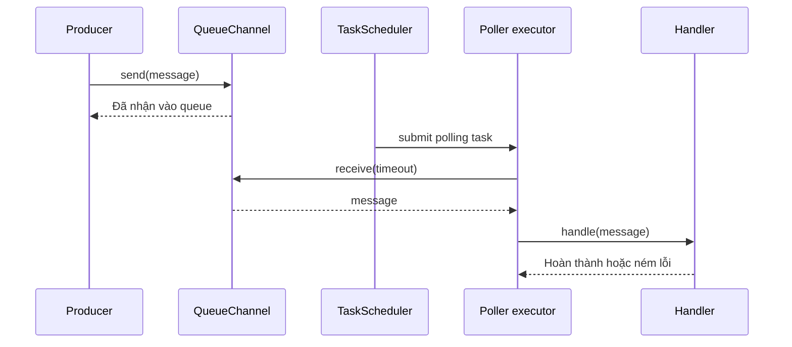

# Poller và asynchronous processing

## 1. Mục tiêu và tình huống sử dụng

Trong module `SPRING_INTEGRATION_CORE`, bài này thuộc chương **Poller**, tập trung vào cách tổ chức luồng thực thi khi một endpoint lấy thông điệp chủ động rồi xử lý bằng worker thread. Sau bài học, bạn có thể vẽ đường đi của `Message`, xác định nơi đổi thread, cấu hình Java DSL và giải thích tác động đến lỗi, thứ tự, tải và kiểm thử.

Giả sử ứng dụng tiếp nhận yêu cầu xuất hóa đơn. Mỗi yêu cầu cần gọi dịch vụ bên ngoài, có thể mất vài giây. Nếu mọi công việc đều chạy trên scheduler thread, một lần gọi chậm sẽ chiếm tài nguyên dùng để kích hoạt các tác vụ định kỳ. Ta muốn tách việc quyết định **khi nào poll** khỏi việc thực hiện **poll và xử lý**.

Cần phân biệt ba kết quả nghiệp vụ:

- **Đã tiếp nhận**: yêu cầu đã được đưa vào channel hoặc một cơ chế lưu trữ.
- **Đang xử lý**: worker đã nhận yêu cầu và bắt đầu thực hiện.
- **Đã hoàn tất**: tác động nghiệp vụ thành công và kết quả đã được ghi nhận.

Đây là ba thời điểm khác nhau. API trả về sau khi gửi message không đủ chứng minh hóa đơn đã được xuất.

## 2. Polling, bất đồng bộ và song song là các khái niệm khác nhau

**Polling** là cách endpoint chủ động gọi nhận dữ liệu theo trigger. Nó không tự khẳng định handler chạy song song.

**Bất đồng bộ** là việc bên gửi không phải thực hiện toàn bộ xử lý ở cùng call stack. **Song song** đòi hỏi nhiều công việc thực sự có cơ hội chạy đồng thời. Một executor chỉ có một worker vẫn tạo được ranh giới bất đồng bộ nhưng chỉ xử lý một công việc tại một thời điểm.

Trong Spring Integration, `PollingConsumer` lấy message từ `PollableChannel`; inbound polling adapter lấy dữ liệu từ `MessageSource`. Poller có thể giao tác vụ cho executor. Nếu không cấu hình executor riêng, handler thường chạy trên thread của scheduler kích hoạt poll. [Tham khảo Message Endpoints](https://docs.spring.io/spring-integration/reference/endpoint.html).

| Thành phần | Vai trò trong mô hình thực thi |
| --- | --- |
| `Message` | Mang payload và headers qua các bước |
| `TaskScheduler` | Kích hoạt tác vụ theo trigger |
| Executor của poller | Nhận tác vụ polling để worker thực hiện |
| `QueueChannel` | Giữ message chờ consumer đến nhận |
| `DirectChannel` | Chuyển tiếp tới handler trên thread đang gửi |
| `ExecutorChannel` | Giao việc dispatch tới executor của channel |
| Endpoint | Kết hợp channel, handler và cấu hình vận hành |

Chỉ định một `Executor` chưa đủ bảo đảm đổi thread: chẳng hạn `SyncTaskExecutor` chạy ngay trên thread gọi. Bài này sử dụng `ThreadPoolTaskExecutor` để tạo worker thực tế. [Task Execution and Scheduling](https://docs.spring.io/spring-framework/reference/integration/scheduling.html).

## 3. Xác định ranh giới thread trên sơ đồ

### 3.1. QueueChannel và poller không có executor riêng

```text
request-thread: gửi Message --> QueueChannel --> trả về
                                  |
scheduler-thread:                 nhận --> transformer --> handler
```

Producer được tách khỏi consumer nhờ queue. Tuy nhiên, chuỗi xử lý đồng bộ phía sau poller vẫn có thể chiếm scheduler thread trong thời gian dài.

### 3.2. QueueChannel và executor trên poller



Ở mô hình này, worker nhận tác vụ poll, lấy message và chạy chuỗi handler đồng bộ phía sau. Nếu đặt thêm channel có executor ở giữa chuỗi, phần sau channel đó có thể chuyển sang một worker khác.

### 3.3. Đặt ExecutorChannel sau bước nhận

```text
scheduler --> receive --> ExecutorChannel --> business-worker --> handler
```

Cách này tách xử lý nghiệp vụ sau khi đã nhận message. Vị trí tách khác với executor trên poller, do đó phạm vi xử lý lỗi và transaction cũng phải được xem xét lại.

`QueueChannel` cần consumer chủ động nhận; `ExecutorChannel` dispatch tới subscriber và không cần poller để tiêu thụ nó. `DirectChannel` giữ cùng thread khi dispatch. [Message Channel Implementations](https://docs.spring.io/spring-integration/reference/channel/implementations.html).

**Bài tập vẽ thread:** với luồng `QueueChannel -> transformer -> DirectChannel -> service activator -> ExecutorChannel -> handler cuối`, hãy đánh dấu phần chạy trên poller worker và phần chạy trên executor của channel. Việc thêm transformer, router hay filter tự nó không tạo worker mới.

## 4. Hiểu đơn vị công việc trước khi tăng concurrency

Một **polling task** có thể thực hiện nhiều lần nhận message trong cùng một lượt. `maxMessagesPerPoll` giới hạn số message trong lượt; nó không phải số worker và không tự chia từng message thành một tác vụ riêng. Với chuỗi đồng bộ, các message của một lượt vẫn được xử lý lần lượt trên worker thực hiện lượt đó. [Polling Consumers](https://docs.spring.io/spring-integration/reference/7.0/endpoint.html).

Ví dụ tự xây dựng:

```text
maxMessagesPerPoll = 3

worker-1, lượt A: nhận A1 -> xử lý A1 -> nhận A2 -> xử lý A2 -> nhận A3 -> xử lý A3
worker-2, lượt B: nhận B1 -> xử lý B1 -> ...
```

Hai lượt có thể chồng lấn nếu trigger tiếp tục submit trong lúc lượt trước còn chạy và executor còn khả năng nhận việc. Ngược lại, cấu hình bốn worker nhưng chỉ có một lượt chạy cũng chưa làm ba message trong lượt đó chạy song song.

Khi dùng executor bất đồng bộ, không nên suy luận rằng `fixedDelay` luôn đợi nghiệp vụ kết thúc rồi mới tính khoảng nghỉ. Công việc scheduler nhìn thấy có thể kết thúc sau bước giao tác vụ cho executor, trong khi worker vẫn đang xử lý. Nếu yêu cầu nghiệp vụ là không bao giờ chạy chồng, cần thiết kế cơ chế tuần tự hoặc kiểm soát số tác vụ đang thực thi; chỉ đổi từ fixed rate sang fixed delay không đủ làm bằng chứng.

## 5. Ví dụ Java DSL: xử lý đơn hàng bằng poller worker

Ví dụ sau dùng Java 17 trở lên và các API Java DSL của Spring Integration 6.x/7.x. Giả sử ứng dụng đã có dependency `spring-integration-core` và Spring context tương thích; nếu dùng Spring Boot, quản lý phiên bản theo BOM của dự án. Không cần bật `@EnableAsync` để executor của poller hoạt động.

Đây là cấu hình dùng trong một Spring context độc lập hoặc được import vào ứng dụng. Các queue kết quả chỉ phục vụ quan sát trong bài học; khi vận hành thực tế phải có thành phần tiêu thụ hoặc lưu kết quả.

```java
import java.time.Duration;
import java.util.concurrent.ThreadPoolExecutor;

import org.springframework.beans.factory.annotation.Qualifier;
import org.springframework.context.annotation.Bean;
import org.springframework.context.annotation.Configuration;
import org.springframework.integration.channel.DirectChannel;
import org.springframework.integration.channel.QueueChannel;
import org.springframework.integration.config.EnableIntegration;
import org.springframework.integration.dsl.IntegrationFlow;
import org.springframework.integration.dsl.Pollers;
import org.springframework.messaging.MessagingException;
import org.springframework.scheduling.concurrent.ThreadPoolTaskExecutor;

@Configuration
@EnableIntegration
public class PollerAsyncConfiguration {

    public record Order(String id) { }

    public record ProcessedOrder(String id, String workerThread) { }

    @Bean
    public QueueChannel orders() {
        return new QueueChannel(100);
    }

    @Bean
    public QueueChannel completedOrders() {
        return new QueueChannel(100);
    }

    @Bean
    public DirectChannel orderPollerErrors() {
        return new DirectChannel();
    }

    @Bean
    public ThreadPoolTaskExecutor orderPollExecutor() {
        ThreadPoolTaskExecutor executor = new ThreadPoolTaskExecutor();
        executor.setCorePoolSize(4);
        executor.setMaxPoolSize(4);
        executor.setQueueCapacity(20);
        executor.setThreadNamePrefix("order-poll-");
        executor.setRejectedExecutionHandler(
                new ThreadPoolExecutor.AbortPolicy());
        return executor;
    }

    @Bean
    public IntegrationFlow orderProcessing(
            @Qualifier("orders") QueueChannel orders,
            @Qualifier("completedOrders") QueueChannel completedOrders,
            ThreadPoolTaskExecutor orderPollExecutor,
            @Qualifier("orderPollerErrors") DirectChannel orderPollerErrors) {

        return IntegrationFlow.from(orders)
                .<Order>handle((order, headers) -> {
                    if ("FAIL".equals(order.id())) {
                        throw new IllegalStateException("Không xử lý được đơn FAIL");
                    }
                    return new ProcessedOrder(
                            order.id(), Thread.currentThread().getName());
                }, endpoint -> endpoint
                        .id("orderPollingConsumer")
                        .poller(Pollers.fixedRate(Duration.ofMillis(100))
                                .maxMessagesPerPoll(1)
                                .receiveTimeout(0)
                                .taskExecutor(orderPollExecutor)
                                .errorChannel(orderPollerErrors)))
                .channel(completedOrders)
                .get();
    }

    @Bean
    public IntegrationFlow orderErrorFlow(
            @Qualifier("orderPollerErrors") DirectChannel errors) {
        return IntegrationFlow.from(errors)
                .handle(message -> {
                    Throwable failure = (Throwable) message.getPayload();
                    Object failedId = "unknown";
                    if (failure instanceof MessagingException messagingException
                            && messagingException.getFailedMessage() != null
                            && messagingException.getFailedMessage().getPayload()
                                    instanceof Order order) {
                        failedId = order.id();
                    }
                    System.err.printf("orderId=%s, thread=%s, failure=%s%n",
                            failedId,
                            Thread.currentThread().getName(),
                            failure);
                })
                .get();
    }
}
```

`ThreadPoolTaskExecutor` được trả về từ `@Bean` sẽ được Spring quản lý vòng đời; không cần gọi `initialize()` thủ công trong cấu hình này. Poller DSL cung cấp các điểm cấu hình `taskExecutor`, `receiveTimeout` và `errorChannel`. [PollerSpec API](https://docs.spring.io/spring-integration/api/org/springframework/integration/dsl/PollerSpec.html).

Các quyết định trong ví dụ:

- Queue đầu vào chứa tối đa 100 message để bài thực hành có giới hạn rõ ràng.
- Pool cố định bốn worker giúp dễ quan sát và suy luận số tác vụ đồng thời.
- Hàng đợi executor chứa tối đa 20 **polling task**, không phải 20 đơn hàng đã nhận.
- Mỗi lượt chỉ lấy một message để dễ theo dõi tác vụ nào xử lý đơn nào.
- `receiveTimeout(0)` làm lượt poll trả về ngay khi queue rỗng.
- `AbortPolicy` làm tình trạng hết khả năng nhận task trở thành lỗi có thể quan sát, thay vì âm thầm bỏ tác vụ.

Không dùng số 4, 20 hoặc 100 làm cấu hình mặc định cho mọi hệ thống. Chúng là lựa chọn phục vụ bài học.

### Gửi một yêu cầu và chờ kết quả riêng biệt

Đoạn sau đặt trong code đang có `ApplicationContext context`:

```java
QueueChannel orders = context.getBean("orders", QueueChannel.class);
QueueChannel results = context.getBean("completedOrders", QueueChannel.class);

boolean accepted = orders.send(
        org.springframework.messaging.support.MessageBuilder
                .withPayload(new PollerAsyncConfiguration.Order("ORD-001"))
                .setHeader("requestId", "REQ-001")
                .build(),
        200);

if (!accepted) {
    throw new IllegalStateException("Queue đầu vào đang đầy");
}

org.springframework.messaging.Message<?> result = results.receive(5000);
if (result == null) {
    throw new IllegalStateException("Chưa có kết quả trong thời hạn chờ");
}
System.out.println(result.getPayload());
```

`accepted` là kết quả tiếp nhận vào queue. Việc nhận được `ProcessedOrder` mới là dấu hiệu handler mẫu đã chạy xong. Trong hệ thống nhiều request, cần định tuyến hoặc đối chiếu kết quả bằng định danh; không để mọi request tùy ý lấy kết quả đầu tiên từ một queue chung.

Một gateway trả `void` có thể đóng vai trò đầu vào thuận tiện, nhưng vẫn phải quy định rõ hợp đồng tiếp nhận. Với gateway request–reply, caller có thể tiếp tục chờ reply dù bên trong flow sử dụng worker khác; đổi thread không đồng nghĩa API gọi vào luôn trả về ngay.

## 6. Hai hàng đợi và bài toán quá tải

Trong ví dụ có hai loại backlog:

```text
Đơn hàng đang chờ:       QueueChannel orders
Lượt polling đang chờ:  task queue của orderPollExecutor
```

Ngoài ra còn có `completedOrders`, nơi giữ kết quả chưa được đọc. Nếu queue kết quả đầy, bước gửi kết quả có thể chặn worker, rồi làm tăng các backlog phía trước. Vì vậy, phải quan sát cả đầu ra khi chẩn đoán poller chậm.

Giả sử mỗi đơn mất trung bình 0,4 giây, mỗi lượt xử lý một đơn và bỏ qua chi phí khác:

```text
4 worker / 0,4 giây ≈ 10 đơn/giây
trigger 100 ms      ≈ 10 lượt/giây
```

Đây là ước lượng lý tưởng của tình huống, không phải số đo hiệu năng. Nếu lưu lượng vào là 15 đơn/giây trong khi hệ thống hoàn tất 10 đơn/giây, backlog tăng khoảng 5 đơn/giây. Một queue còn trống 100 chỗ có thể đầy sau khoảng 20 giây. Tăng capacity chỉ kéo dài thời gian trước khi đầy nếu tốc độ xử lý vẫn thấp hơn tốc độ vào.

Khi thực nghiệm, nên ghi lại:

| Chỉ số | Câu hỏi cần trả lời |
| --- | --- |
| Độ sâu queue đầu vào | Message đang tích lại hay được xử lý kịp? |
| Tuổi message cũ nhất | Người dùng đã chờ bao lâu? |
| Worker đang hoạt động | Pool đã bão hòa chưa? |
| Số task chờ trong executor | Có đang tích các lượt poll chưa chạy? |
| Độ sâu queue kết quả | Consumer đầu ra có bị chậm hoặc ngừng không? |
| Tỷ lệ rejection | Executor có từ chối lịch poll mới không? |
| Độ trễ dịch vụ ngoài | Tăng worker còn cải thiện được gì? |

Pool lớn hơn không luôn làm hệ thống nhanh hơn. Ví dụ, nếu dịch vụ hóa đơn chỉ cho phép năm request đồng thời, tăng lên 50 worker có thể chủ yếu tạo thêm timeout và retry.

Trong thread pool thông thường, task được xếp hàng sau khi số core worker đã bận; việc tăng đến `maxPoolSize` phụ thuộc khả năng xếp hàng. Vì vậy, queue rất lớn có thể khiến cấu hình `corePoolSize=2`, `maxPoolSize=20` vận hành lâu với hai worker. `CallerRunsPolicy` có thể chạy task trên thread submit khi bão hòa, nên nếu dùng nó, phải chấp nhận scheduler có thể thực hiện công việc nghiệp vụ. [Cấu hình executor](https://docs.spring.io/spring-framework/reference/integration/scheduling.html).

## 7. Receive timeout, giới hạn lượt poll và tác vụ rỗng

`receiveTimeout` là thời gian chờ **nhận message**, không phải timeout HTTP, timeout xử lý nghiệp vụ hay thời hạn tổng của request. Nó chỉ có tác dụng phù hợp khi thao tác nhận hỗ trợ chờ. Poller lấy dữ liệu từ nguồn trả về tức thì không tự có thêm khả năng chờ nhờ tham số này. [Polling and receive timeout](https://docs.spring.io/spring-integration/reference/endpoint.html).

Một thí nghiệm khác với ví dụ chính:

```text
trigger mỗi 100 ms
receiveTimeout = 5 giây
queue không có dữ liệu
pool có 4 worker
```

Các worker có thể bận chờ dữ liệu, trong khi trigger tiếp tục tạo thêm task. Backlog executor tăng dù backlog message bằng không. Nếu thấy CPU thấp nhưng executor đầy, hãy kiểm tra worker đang chờ ở đâu trước khi tăng pool.

Với nguồn thường xuyên có dữ liệu, đặt `maxMessagesPerPoll` hữu hạn giúp mỗi lượt có điểm kết thúc rõ hơn. Giá trị lớn có thể giảm chi phí tổ chức lượt poll, nhưng cũng khiến một worker bận lâu hơn. Không sử dụng tham số này như một giới hạn tổng số message đang xử lý của cả ứng dụng.

## 8. Lỗi sau ranh giới bất đồng bộ

Khi producer đã gửi message vào queue và tiếp tục công việc, exception phát sinh sau đó trên worker không thể tự quay về call stack cũ bằng `try/catch`. Spring Integration sử dụng `ErrorMessage` cho các đường xử lý lỗi bất đồng bộ do framework quản lý. Việc phân giải thường ưu tiên header `errorChannel` của message, sau đó đến channel lỗi mặc định được cấu hình. Ví dụ đã chọn `orderPollerErrors` cho poller. [Error Handling](https://docs.spring.io/spring-integration/reference/error-handling.html).

Thử gửi `new Order("FAIL")`: yêu cầu có thể được tiếp nhận thành công, nhưng không tạo `ProcessedOrder`; error flow ghi nhận lỗi. Handler lỗi trong ví dụ chỉ in ra console để quan sát, chưa triển khai phục hồi nghiệp vụ.

Khi thiết kế luồng phục hồi cho tình huống hóa đơn, cần trả lời cụ thể:

1. Lỗi nào được thử lại, với khoảng nghỉ và số lần tối đa nào?
2. Yêu cầu hết lượt thử được lưu ở đâu để có thể xử lý lại?
3. Dùng khóa nào để tránh xuất hai hóa đơn khi request trước đã thành công nhưng phản hồi bị mất?
4. Trạng thái thất bại được cung cấp cho người dùng bằng cách nào?

Tách **lỗi xử lý message** khỏi **lỗi submit task**. Task bị executor từ chối có thể chưa nhận message nào, vì thế không nên đòi mọi lỗi luôn có `failedMessage`. Với rejection ở bước submit, cần quan sát cả đường báo lỗi của scheduler và executor; error flow chỉ gắn với xử lý trong worker không phải bằng chứng đã bao phủ tất cả trường hợp. [Cơ chế lỗi của scheduled poller](https://docs.spring.io/spring-integration/reference/error-handling.html).

Trong ví dụ dùng queue bộ nhớ, một message đã được lấy ra không tự quay lại queue chỉ vì handler lỗi. Muốn phục hồi phải bổ sung cơ chế retry, lưu thất bại hoặc thiết kế nguồn có khả năng giao lại phù hợp.

## 9. Thứ tự, trạng thái dùng chung và transaction

### 9.1. Thứ tự hoàn tất

Xét hai đơn được lấy theo thứ tự A rồi B:

```text
worker-1: A -------- xử lý 2 giây -------- hoàn tất
worker-2:   B -- xử lý 0,1 giây -- hoàn tất
```

B hoàn tất trước A. Nếu nghiệp vụ yêu cầu tuần tự theo `customerId`, cần thiết kế tuyến xử lý giữ thứ tự theo khóa, hoặc dùng cơ chế đồng bộ trạng thái phù hợp. Một hàng đợi FIFO ở đầu vào không đủ bảo đảm thứ tự hoàn tất khi có nhiều worker.

Aggregator dựa trên correlation và điều kiện release để gom kết quả; không nên dùng thứ tự hoàn tất ngẫu nhiên của worker làm điều kiện xác định nhóm đã đủ. Nếu cần thứ tự trong nhóm, hãy truyền thông tin thứ tự rõ ràng và xử lý theo yêu cầu nghiệp vụ.

### 9.2. Payload và handler dùng chung

Message chuyển qua worker có thể vẫn tham chiếu cùng đối tượng payload. Vì vậy, sau khi gửi một đơn hàng dạng đối tượng mutable, producer không nên tiếp tục sửa các trường mà worker sắp đọc. Trong ví dụ, record với trường `String` giúp giảm rủi ro này; record chứa danh sách mutable vẫn cần được xem xét riêng.

Một singleton handler có thể phục vụ nhiều worker. Tránh dùng field như `currentOrderId` để giữ trạng thái tạm của từng lần gọi. Hãy dùng biến cục bộ hoặc cơ chế trạng thái được thiết kế cho truy cập đồng thời.

### 9.3. Transaction và thông tin gắn với thread

Với transaction thông thường gắn với thread, không coi transaction của producer tự bao phủ phần xử lý sau queue. Tương tự, khi đặt `ExecutorChannel` ở giữa flow, cần xác định transaction nào bao phủ phần trước và phần sau ranh giới đó. [ExecutorChannel và transaction](https://docs.spring.io/spring-integration/reference/channel/implementations.html).

Nếu đặt transaction advice cho poller, vẫn phải kiểm tra nguồn hoặc channel và tài nguyên nghiệp vụ có tham gia transaction hay không. Đánh dấu transactional không làm queue bộ nhớ thường trở thành kho dữ liệu bền vững.

`requestId` trong headers là lựa chọn hữu ích để liên kết log giữa các bước. MDC, security context và các giá trị `ThreadLocal` khác cần cơ chế truyền hoặc khởi tạo phù hợp khi đổi thread; không suy luận chúng xuất hiện trên worker chỉ vì có ở producer.

## 10. Kiểm thử hành vi bất đồng bộ

Kiểm thử cần đợi một điều kiện có thời hạn thay vì ngủ một khoảng cố định rồi đoán công việc đã xong. Bài này cung cấp mã minh họa; không yêu cầu chạy build trong bước viết tài liệu.

Đoạn JUnit 5 sau sử dụng đúng cấu hình bên trên và tự đóng context sau khi kiểm tra:

```java
import static org.junit.jupiter.api.Assertions.*;

import java.util.HashSet;
import java.util.Set;

import org.junit.jupiter.api.Test;
import org.springframework.context.annotation.AnnotationConfigApplicationContext;
import org.springframework.integration.channel.QueueChannel;
import org.springframework.messaging.Message;
import org.springframework.messaging.support.MessageBuilder;

class PollerAsyncConfigurationTest {

    @Test
    void processesMessagesOnPollerWorkers() {
        try (var context = new AnnotationConfigApplicationContext(
                PollerAsyncConfiguration.class)) {
            QueueChannel input = context.getBean("orders", QueueChannel.class);
            QueueChannel output = context.getBean(
                    "completedOrders", QueueChannel.class);

            for (String id : Set.of("ORD-A", "ORD-B")) {
                assertTrue(input.send(MessageBuilder.withPayload(
                        new PollerAsyncConfiguration.Order(id)).build(), 200));
            }

            Set<String> receivedIds = new HashSet<>();
            for (int i = 0; i < 2; i++) {
                Message<?> message = output.receive(5000);
                assertNotNull(message, "Hết thời hạn chờ kết quả");
                var result = assertInstanceOf(
                        PollerAsyncConfiguration.ProcessedOrder.class,
                        message.getPayload());
                receivedIds.add(result.id());
                assertTrue(result.workerThread().startsWith("order-poll-"));
            }
            assertEquals(Set.of("ORD-A", "ORD-B"), receivedIds);
        }
    }
}
```

Kiểm thử này chứng minh hai kết quả được tạo và handler chạy trên thread có prefix của executor được cấu hình. Nó **không đo mức song song**: cả hai message có thể do cùng một worker xử lý vào hai thời điểm khác nhau.

Để kiểm chứng nhiều handler thực sự chạy chồng, có thể thiết kế test riêng bằng latch hoặc barrier có timeout: đợi ít nhất hai handler đi vào vùng xử lý trước khi mở chốt cho chúng hoàn tất. Luôn giải phóng chốt trong `finally` để test lỗi không giữ worker mãi.

Các ca thực hành tiếp theo:

| Ca kiểm tra | Điều kiện cần quan sát |
| --- | --- |
| Đơn `FAIL` | Thu được sự kiện lỗi chứa định danh khi có failed message |
| Đầu vào đầy và consumer tạm dừng | `send(message, timeout)` thất bại có kiểm soát |
| Worker bị giữ và task queue đầy | Có tín hiệu rejection, không suy đoán đã xử lý đơn |
| Hai đơn có thời gian xử lý khác nhau | Kết quả không được kiểm tra theo thứ tự hoàn tất cố định |
| Consumer kết quả dừng | Phát hiện backlog đầu ra và worker chờ gửi |
| Đóng context khi còn việc | Quan sát rõ công việc đã hoàn tất và công việc còn dang dở |

## 11. Lựa chọn thiết kế cho từng yêu cầu

| Yêu cầu | Hướng thiết kế cần cân nhắc |
| --- | --- |
| Nhận từ `QueueChannel` và xử lý trên worker riêng | Cấu hình executor cho poller |
| Poll tuần tự nhưng xử lý phía sau độc lập | Tách bằng executor channel, xác định lại ranh giới giao việc |
| Giữ thứ tự toàn luồng | Một tuyến xử lý tuần tự và không có ranh giới song song phía sau |
| Giữ thứ tự theo khách hàng | Phân tuyến theo khóa với xử lý tuần tự trong từng tuyến |
| Chịu được ứng dụng khởi động lại | Thiết kế lưu trữ hoặc broker bền vững và quy tắc xác nhận |
| Caller cần kết quả nghiệp vụ | Hợp đồng request–reply hoặc API truy vấn trạng thái |
| Downstream có giới hạn đồng thời | Giới hạn worker theo khả năng downstream và đo thực tế |

Trước khi thay đổi cấu hình, hãy ghi lại một luồng cụ thể: producer gửi vào đâu, thread nào nhận, đoạn nào còn đồng bộ, lỗi xuất hiện ở đâu và khi nào yêu cầu được coi là hoàn tất. Sơ đồ này giúp phát hiện sớm các giả định sai về transaction, thứ tự và khả năng phục hồi.

## 12. Tự kiểm tra kiến thức

1. Vì sao có `QueueChannel` đã tách producer khỏi consumer nhưng vẫn có lý do để cấu hình executor trên poller?
2. Với bốn worker và `maxMessagesPerPoll(10)`, có thể kết luận luôn có 40 message xử lý đồng thời không? Hãy phân biệt message trong lượt và số lượt đang chạy.
3. Khi queue message rỗng nhưng executor task queue đầy, cần kiểm tra `receiveTimeout` và vị trí chặn nào?
4. `send()` trả về thành công rồi handler báo lỗi là kết quả hợp lệ trong mô hình nào?
5. Vì sao FIFO không bảo đảm thứ tự hoàn tất khi có nhiều worker?
6. Khi chuyển một bước xử lý qua `ExecutorChannel`, cần xem lại transaction và báo lỗi ra sao?
7. Tại sao kiểm tra tên thread chưa chứng minh xử lý song song?
8. Nếu đầu ra không được tiêu thụ, tăng số worker có giải quyết được nguyên nhân không?

Người học nắm được bài khi có thể trả lời những câu hỏi này bằng đường đi của message và thread cụ thể, rồi sửa thiết kế theo yêu cầu nghiệp vụ thay vì chỉ tăng pool hoặc giảm chu kỳ poll.
