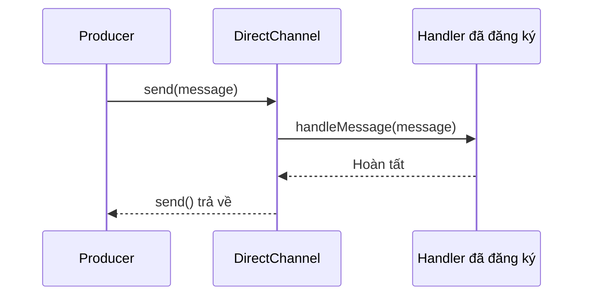
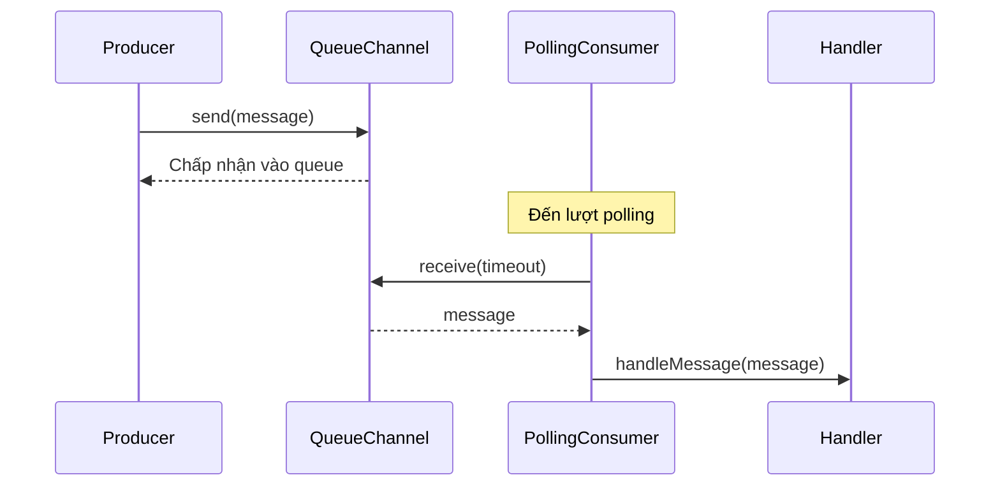
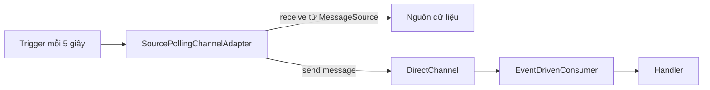

# Poller không phù hợp với SubscribableChannel

Trong Spring Integration Core, poller quyết định thời điểm một endpoint chủ động lấy thông điệp. Với consumer đọc từ channel, thao tác đó cần hợp đồng `PollableChannel.receive()`. Ngược lại, `SubscribableChannel` chuyển thông điệp tới handler đã đăng ký khi có lệnh gửi; consumer không cần vòng lặp lấy thông điệp theo lịch.

Vì vậy, **không gắn poller cho consumer có input channel là `DirectChannel`, `ExecutorChannel` hoặc `PublishSubscribeChannel`**. Cần phân biệt quy tắc này với một nguồn được polling rồi gửi kết quả vào các channel đó: cách nối nguồn như vậy vẫn hợp lệ.

Bài thuộc chương **Poller** của module `SPRING_INTEGRATION_CORE`, tập trung vào cách phối hợp Message, MessageChannel, endpoint và Java DSL để chọn đúng cơ chế kích hoạt handler. Các ví dụ dùng API kiểu Spring Integration 6.x trở lên; dự án cần có `spring-integration-core` cùng các phụ thuộc Spring tương thích.

## 1. Hai hợp đồng nhận thông điệp

Các chữ ký dưới đây được rút gọn để làm rõ khác biệt, không phải toàn bộ mã nguồn interface:

```java
// Channel hỗ trợ lấy thông điệp chủ động.
interface PollableChannel extends MessageChannel {
    Message<?> receive();
    Message<?> receive(long timeout);
}

// Channel hỗ trợ đăng ký handler.
interface SubscribableChannel extends MessageChannel {
    boolean subscribe(MessageHandler handler);
    boolean unsubscribe(MessageHandler handler);
}
```

`send()` có trên cả hai họ channel thông qua `MessageChannel`. Khác biệt quan trọng là phía consumer nhận thông điệp bằng `receive()` hay được gọi qua `handleMessage()`.

| Input channel của consumer | Cách nhận | Endpoint thông thường | Poller tại consumer |
|---|---|---|---|
| `DirectChannel` | Channel gọi một handler đã đăng ký | `EventDrivenConsumer` | Không cấu hình |
| `ExecutorChannel` | Channel dispatch qua executor | `EventDrivenConsumer` | Không cấu hình |
| `PublishSubscribeChannel` | Channel phát tới các subscriber | `EventDrivenConsumer` | Không cấu hình |
| `QueueChannel` | Consumer gọi `receive()` | `PollingConsumer` | Cần cấu hình riêng hoặc mặc định |

Đây là hai cơ chế phổ biến được xét trong bài; không dùng bảng này để suy ra cách hoạt động của mọi channel reactive hoặc channel tùy biến. Tài liệu [Message Endpoints](https://docs.spring.io/spring-integration/reference/endpoint.html) mô tả việc chọn endpoint dựa trên hợp đồng của input channel.

## 2. Vì sao poller không có việc để làm trên SubscribableChannel?

Hãy xét một yêu cầu duyệt đơn hàng gửi vào `DirectChannel`:



Handler đã được gọi bởi chính hành động gửi thông điệp. Không có bước chờ poller đến hạn. Với `DirectChannel`, lời gọi handler chạy trên thread của bên gửi trong cấu hình thông thường.

Nếu thêm ý tưởng “cứ một giây thì lấy một message từ `DirectChannel`”, lập tức xuất hiện câu hỏi: lấy qua phương thức nào? `SubscribableChannel` không cung cấp `receive()` và không cam kết giữ một hàng đợi để consumer đọc sau.

Poller cũng không biến channel thành hàng đợi. Những cấu hình như `fixedDelay`, `cron`, `receiveTimeout` hay `maxMessagesPerPoll` không bổ sung khả năng lưu giữ message cho `DirectChannel`.

Đối chiếu với luồng dùng queue:



Ở luồng thứ hai, lịch polling có đối tượng để tác động: consumer gọi `receive()` trên queue. Cần hỏi **endpoint đang lấy dữ liệu từ đâu** trước khi chọn cấu hình lịch.

## 3. Ví dụ sai: đặt @Poller trên consumer của DirectChannel

Giả sử ứng dụng khai báo channel sau:

```java
import org.springframework.context.annotation.Bean;
import org.springframework.integration.channel.DirectChannel;
import org.springframework.messaging.SubscribableChannel;

@Bean
public SubscribableChannel orders() {
    return new DirectChannel();
}
```

Sau đó cấu hình handler theo cách sau:

```java
import org.springframework.integration.annotation.Poller;
import org.springframework.integration.annotation.ServiceActivator;

// SAI: orders là DirectChannel, không phải PollableChannel.
@ServiceActivator(
    inputChannel = "orders",
    poller = @Poller(fixedDelay = "1000", maxMessagesPerPoll = "1")
)
public void approve(String orderId) {
    System.out.println("Approved: " + orderId);
}
```

Mục đích có thể là “xử lý tối đa một đơn mỗi giây”, nhưng cấu hình này đặt lịch ở một consumer không có khả năng polling input channel. Đó là lỗi ghép endpoint và channel, chưa phải lỗi trong nghiệp vụ `approve()`.

Trong cơ chế tạo endpoint thông thường, framework từ chối poller được gắn trực tiếp cho consumer của channel chỉ hỗ trợ subscription. Lỗi thường xuất hiện khi khởi tạo application context, có thể được bọc trong lỗi tạo bean. Không nên phụ thuộc vào một chuỗi exception cố định giữa các phiên bản. Cần đọc nguyên nhân gốc và tên input channel liên quan. Có thể đối chiếu cơ chế tạo endpoint tại [ConsumerEndpointFactoryBean](https://github.com/spring-projects/spring-integration/blob/main/spring-integration-core/src/main/java/org/springframework/integration/config/ConsumerEndpointFactoryBean.java).

Lưu ý: các đoạn `@Bean` và annotation phải nằm trong lớp được Spring quản lý. Chỉ đặt chúng vào một đối tượng tự tạo bằng `new` không tạo ra integration endpoint.

## 4. Cách sửa thứ nhất: giữ DirectChannel và bỏ poller

Chọn cách này khi yêu cầu là xử lý ngay khi thông điệp đến. Ví dụ hoàn chỉnh dưới đây dùng Java DSL, không cần `@ServiceActivator` bổ sung:

```java
import org.springframework.context.annotation.Bean;
import org.springframework.context.annotation.Configuration;
import org.springframework.integration.channel.DirectChannel;
import org.springframework.integration.config.EnableIntegration;
import org.springframework.integration.dsl.IntegrationFlow;
import org.springframework.messaging.SubscribableChannel;

@Configuration
@EnableIntegration
public class ImmediateOrdersConfig {

    @Bean
    public SubscribableChannel orders() {
        return new DirectChannel();
    }

    @Bean
    public IntegrationFlow approveOrders() {
        return IntegrationFlow.from("orders")
            .handle(String.class, (orderId, headers) -> {
                System.out.println("Approved: " + orderId);
                return null; // Handler kết thúc luồng, không phát reply.
            })
            .get();
    }
}
```

Sau khi context khởi động, gửi thử:

```java
import org.springframework.messaging.MessageChannel;
import org.springframework.messaging.support.MessageBuilder;

MessageChannel orders = context.getBean("orders", MessageChannel.class);
orders.send(MessageBuilder.withPayload("ORDER-013").build());
```

`context` ở đây là application context đang chạy cấu hình trên. Handler được gọi trong quá trình `send()`. Không có khoảng chờ một giây do framework tự thêm.

Nếu handler là transformer, filter hoặc router, nguyên tắc chọn cơ chế nhận vẫn giữ nguyên: xem input channel của endpoint đó. Loại nghiệp vụ không tự tạo nhu cầu polling. Với aggregator, lịch timeout hoặc thời điểm giải phóng nhóm là một cơ chế riêng; không dùng poller trên `DirectChannel` để thay thế cấu hình của aggregator.

## 5. Cách sửa thứ hai: dùng QueueChannel và polling consumer

Nếu yêu cầu thực tế là nhận trước, xử lý sau theo nhịp, hãy biểu diễn điểm đệm bằng một channel có thể polling. Đây là cấu hình thay thế cho ví dụ trước; không nạp đồng thời hai lớp có cùng tên bean `orders` và `approveOrders`.

```java
import java.time.Duration;

import org.springframework.context.annotation.Bean;
import org.springframework.context.annotation.Configuration;
import org.springframework.integration.channel.QueueChannel;
import org.springframework.integration.config.EnableIntegration;
import org.springframework.integration.dsl.IntegrationFlow;
import org.springframework.integration.dsl.Pollers;

@Configuration
@EnableIntegration
public class QueuedOrdersConfig {

    @Bean
    public QueueChannel orders() {
        return new QueueChannel(100);
    }

    @Bean
    public IntegrationFlow approveOrders() {
        return IntegrationFlow.from("orders")
            .handle(String.class, (orderId, headers) -> {
                System.out.println("Approved: " + orderId);
                return null;
            }, endpoint -> endpoint.poller(
                Pollers.fixedDelay(Duration.ofSeconds(1))
                    .maxMessagesPerPoll(1)
                    .receiveTimeout(0)
            ))
            .get();
    }
}
```

Trong DSL này, `endpoint -> endpoint.poller(...)` cấu hình consumer chứa handler ở bước `.handle(...)`. Input của consumer chính là bean `orders`, nay là `QueueChannel`.

Các giá trị được chọn có ý nghĩa cụ thể:

- Capacity `100`: điểm đệm hữu hạn cho ví dụ.
- `fixedDelay` một giây: khoảng nghỉ giữa lần thực thi polling kết thúc và lần tiếp theo trong cấu hình không dùng executor riêng cho poller này.
- `maxMessagesPerPoll(1)`: một lần polling lấy tối đa một message; không phải kích thước batch của payload.
- `receiveTimeout(0)`: nếu queue rỗng, thao tác nhận trả về ngay.

Với một consumer như trên, thời gian xử lý cũng góp vào khoảng cách giữa các lần polling. Đây không phải cam kết thông lượng chính xác một message mỗi giây. Thêm consumer khác hoặc executor làm thay đổi cách thực thi và cần được xem xét riêng.

Không gọi `Thread.sleep()` trong handler để mô phỏng poller: cách đó giữ thread đang xử lý và không tạo ra hợp đồng nhận thông điệp mới. Cú pháp cấu hình poller trong DSL được giới thiệu tại [Pollers](https://docs.spring.io/spring-integration/reference/dsl/java-pollers.html).

Đổi sang queue cũng làm thay đổi ý nghĩa của thao tác gửi. Việc gửi thành công mới cho biết queue đã nhận message, chưa xác nhận nghiệp vụ đã hoàn tất. Một lời gọi gửi có timeout hữu hạn có thể viết như sau:

```java
boolean accepted = orders.send(
    MessageBuilder.withPayload("ORDER-013").build(),
    500
);
if (!accepted) {
    throw new IllegalStateException("Hàng đợi chưa nhận được đơn hàng");
}
```

Không nên đổi channel chỉ để làm biến mất lỗi cấu hình mà bỏ qua thay đổi về thời điểm hoàn tất, dung lượng và xử lý lỗi.

## 6. Trường hợp hợp lệ: nguồn có poller gửi vào DirectChannel

Một hệ thống có thể kiểm tra nguồn mỗi năm giây rồi xử lý ngay kết quả. Poller thuộc endpoint nguồn, không thuộc consumer của `DirectChannel`:



Ví dụ sau tạo dữ liệu giả bằng bộ đếm; nó chỉ minh họa vị trí poller, không mô phỏng tính bền vững hoặc cơ chế xác nhận của nguồn bên ngoài:

```java
import java.time.Duration;
import java.util.concurrent.atomic.AtomicInteger;

import org.springframework.context.annotation.Bean;
import org.springframework.context.annotation.Configuration;
import org.springframework.integration.channel.DirectChannel;
import org.springframework.integration.config.EnableIntegration;
import org.springframework.integration.dsl.IntegrationFlow;
import org.springframework.integration.dsl.Pollers;
import org.springframework.messaging.SubscribableChannel;

@Configuration
@EnableIntegration
public class PolledSourceConfig {

    private final AtomicInteger sequence = new AtomicInteger();

    @Bean
    public SubscribableChannel fetchedOrders() {
        return new DirectChannel();
    }

    @Bean
    public IntegrationFlow fetchOrders() {
        return IntegrationFlow
            .fromSupplier(
                () -> "ORDER-" + sequence.incrementAndGet(),
                source -> source.poller(
                    Pollers.fixedDelay(Duration.ofSeconds(5))
                        .maxMessagesPerPoll(1)
                )
            )
            .channel("fetchedOrders")
            .get();
    }

    @Bean
    public IntegrationFlow consumeFetchedOrders() {
        return IntegrationFlow.from("fetchedOrders")
            .handle(message -> System.out.println(message.getPayload()))
            .get();
    }
}
```

Supplier trả về payload; adapter chịu trách nhiệm tạo message.

Ở đây có hai endpoint độc lập:

1. Adapter nguồn được đánh thức theo lịch để gọi supplier rồi gửi message.
2. Consumer phía `fetchedOrders` đăng ký handler và được gọi khi adapter gửi.

Handler phía sau `DirectChannel` có thể chạy trên thread thực hiện tác vụ polling của nguồn. Điều đó không biến nó thành `PollingConsumer`: cần phân biệt **nguồn gốc của thread** với **hợp đồng nhận message của endpoint**. Xem cơ chế polling nguồn tại [Channel Adapter](https://docs.spring.io/spring-integration/reference/channel-adapter.html).

## 7. Bất đồng bộ không đồng nghĩa với polling

Một nhầm lẫn phổ biến là thấy handler chạy trên thread khác rồi kết luận phải có poller. Hai câu hỏi cần được trả lời độc lập:

- **Ai kích hoạt nhận message?** Channel dispatch tới subscriber, hay consumer chủ động gọi `receive()`?
- **Thread nào thực thi?** Thread gửi, executor hay thread chạy tác vụ polling?

`ExecutorChannel` vẫn là subscribable: nó dùng executor để thực thi công việc thay vì cung cấp queue có `receive()` cho endpoint. `PublishSubscribeChannel` có thể thực thi subscriber đồng bộ hoặc qua executor tùy cấu hình; cả hai trường hợp đều không yêu cầu poller tại subscriber.

Một executor có thể có hàng đợi tác vụ nội bộ, nhưng đó không phải API polling message của channel. Không thể dùng `receiveTimeout` để đọc hàng đợi tác vụ đó. Tương tự, không gắn `cron` lên subscriber để hẹn giờ gọi handler.

Khi yêu cầu là tách thread, có thể cân nhắc `ExecutorChannel`. Khi cần tích lũy message rồi lấy theo lịch, cần một điểm đệm có hợp đồng phù hợp như `QueueChannel`. Khi cần phát một sự kiện cho nhiều nhánh, cần xem xét `PublishSubscribeChannel`. Các lựa chọn này giải quyết những yêu cầu khác nhau; xem [Message Channel Implementations](https://docs.spring.io/spring-integration/reference/channel/implementations.html).

## 8. Những thay đổi về lỗi, transaction và gateway

### 8.1. Lỗi đồng bộ và lỗi trong tác vụ polling

Trong luồng `DirectChannel` thông thường, exception từ handler truyền theo call stack của bên gửi. Nếu dùng queue và polling consumer, bên gửi có thể đã nhận kết quả thành công từ `send()` trước khi handler chạy. Không thể bắt lỗi xử lý đến sau chỉ bằng `try/catch` bao quanh lời gọi gửi ban đầu.

Spring Integration cung cấp cơ chế phát `ErrorMessage` cho lỗi trong tác vụ polling. Khi thiết kế cấu hình lỗi, hãy xác định error handler đang dùng, error channel của message hoặc poller và nơi tiêu thụ error message; không mặc định rằng chỉ cần khai báo một channel là đã có quy trình phục hồi. Cách truyền và định tuyến lỗi được mô tả tại [Error Handling](https://docs.spring.io/spring-integration/reference/error-handling.html).

Không thêm poller lên `DirectChannel` chỉ để cố ép lỗi đi vào `errorChannel`. Nếu cần retry hoặc recovery tại handler, chọn advice và chiến lược xử lý lỗi tương ứng với mô hình thực thi.

### 8.2. Transaction không tự đi qua điểm đệm

Đặt một queue giữa hai bước tạo ra ranh giới thực thi cần được thiết kế rõ. Transaction của thread gửi không tự trở thành transaction của thread polling. Một `QueueChannel` dùng bộ nhớ thông thường cũng không tự bảo đảm message còn tồn tại sau khi tiến trình dừng.

Ví dụ “đã enqueue thành công, sau đó cập nhật cơ sở dữ liệu lỗi” cần có chính sách phục hồi riêng. Poller chỉ tạo lịch lấy message; bản thân nó không bảo đảm retry, chống xử lý trùng hoặc exactly-once.

### 8.3. Gateway vẫn cần reply đúng lúc

Nếu đầu vào được gọi qua messaging gateway theo kiểu request-reply, thêm queue không tự biến lời gọi gateway thành fire-and-forget. Cần kiểm tra reply channel, handler có phát reply hay không và timeout phù hợp với độ trễ polling cộng thời gian xử lý.

Các handler trả về `null` hoặc chỉ in ra màn hình trong bài là ví dụ kết thúc luồng một chiều. Không dùng nguyên trạng làm ví dụ cho gateway đang chờ kết quả duyệt đơn.

## 9. Poller mặc định không thay đổi loại channel

Một ứng dụng có thể có global default poller để các polling endpoint sử dụng khi không có cấu hình riêng. Điều đó không có nghĩa mọi endpoint đều chạy theo lịch.

Ví dụ, nếu một context có cả `DirectChannel` và `QueueChannel`:

- Consumer của `QueueChannel` có thể dùng default poller khi không khai báo poller riêng.
- Consumer của `DirectChannel` vẫn hoạt động theo subscription.

Do đó, sự hiện diện của default poller không đồng nghĩa lỗi cấu hình. Cần tìm poller được gắn trực tiếp vào endpoint nào. Nếu một luồng dùng `DirectChannel` xử lý “ngay lập tức” dù ứng dụng có default poller năm giây, đó là hành vi phù hợp với kiểu channel.

## 10. Cách quan sát và kiểm chứng

Các phép thử dưới đây dành cho người học thực hiện trong dự án có phụ thuộc thích hợp; bài không kèm kết quả chạy giả định.

### 10.1. Kiểm chứng DirectChannel không chờ lịch

Ví dụ độc lập dùng JUnit Jupiter, không khởi động Spring context:

```java
import java.util.concurrent.atomic.AtomicReference;

import org.junit.jupiter.api.Test;
import org.springframework.integration.channel.DirectChannel;
import org.springframework.messaging.support.MessageBuilder;

import static org.junit.jupiter.api.Assertions.assertSame;
import static org.junit.jupiter.api.Assertions.assertTrue;

class DirectChannelDispatchTest {

    @Test
    void handlerRunsOnSenderThreadBeforeSendReturns() {
        DirectChannel channel = new DirectChannel();
        AtomicReference<Thread> handlerThread = new AtomicReference<>();
        channel.subscribe(message -> handlerThread.set(Thread.currentThread()));

        Thread senderThread = Thread.currentThread();
        boolean accepted = channel.send(
            MessageBuilder.withPayload("ORDER-013").build()
        );

        assertTrue(accepted);
        assertSame(senderThread, handlerThread.get());
    }
}
```

Phép thử kiểm chứng hành vi dispatch trực tiếp; nó không kiểm tra việc Spring chọn endpoint hay cấu hình poller.

### 10.2. Kiểm chứng ranh giới queue

Với `QueueChannel` chưa có consumer, gửi một message rồi gọi `receive(0)`: message được lấy ra mà không cần subscriber. Khi đặt một `PollingConsumer` phía sau, chính consumer thực hiện thao tác nhận đó theo lịch.

Khi viết kiểm thử tích hợp cho cấu hình queue, có thể dùng một channel kết quả hoặc `CountDownLatch` để chờ xử lý có giới hạn thời gian. Đừng chỉ ngủ một khoảng cố định rồi kết luận luồng hoạt động đúng. Cũng đừng để mã test gọi `receive()` trên input queue đồng thời với polling consumer, vì test sẽ cạnh tranh lấy message của consumer.

### 10.3. Kiểm chứng cấu hình bị từ chối

Trong một test context riêng, khai báo `DirectChannel` rồi gắn poller tường minh cho consumer. Kỳ vọng context không tạo endpoint thành công và kiểm tra nguyên nhân gốc liên quan đến input channel không pollable. Sau đó bỏ poller, xác nhận context khởi động được và message đi tới handler.

Tránh so khớp toàn bộ exception message; thông tin bọc ngoài có thể thay đổi khi chuyển phiên bản Spring hoặc đổi kiểu cấu hình.

## 11. Quy trình chẩn đoán nhanh

Khi gặp lỗi poller không phù hợp, thực hiện theo thứ tự:

1. Xác định endpoint có cấu hình poller: `@ServiceActivator`, transformer, bridge hay một bước DSL cụ thể.
2. Lấy tên **input channel của endpoint đó**; không nhầm với output channel của adapter nguồn phía trước.
3. Kiểm tra đối tượng channel thực tế được Spring tạo. Biến khai báo kiểu `MessageChannel` không cho biết nó hỗ trợ `receive()` hay subscription.
4. Tìm poller tường minh: `poller = @Poller(...)`, `.poller(...)` hoặc phần tử XML `<poller>`.
5. Nếu muốn xử lý theo sự kiện, giữ subscribable channel và bỏ poller ở consumer.
6. Nếu muốn nhận từ điểm đệm theo lịch, chọn channel pollable và cấu hình polling endpoint; đồng thời xem lại lỗi, dung lượng, transaction và thời gian chờ reply.

| Hiện tượng | Điểm cần kiểm tra |
|---|---|
| Context lỗi khi thêm `@Poller` | Input channel của endpoint có thực sự là pollable không? |
| Handler chạy ngay dù có default poller | Endpoint có đang nhận qua subscription không? |
| Handler chậm làm bên gửi chậm theo | Có đang dùng `DirectChannel` trên cùng thread không? |
| Đổi sang queue rồi message không được xử lý | Polling endpoint đã được tạo, có poller và đã start chưa? |
| Bên gửi không bắt được lỗi nghiệp vụ sau khi enqueue | Lỗi xảy ra trên tác vụ polling nào, được chuyển đến đâu? |
| Nguồn được polling nhưng đầu ra là `DirectChannel` | Đây có thể là cấu hình hợp lệ; kiểm tra vị trí poller thay vì chỉ tên channel |

## 12. Bài tập áp dụng

Thiết kế một luồng nhận mã đơn hàng, chuẩn hóa khoảng trắng bằng transformer, lọc mã rỗng, rồi chuyển mã hợp lệ sang handler xử lý.

Thực hiện hai phiên bản độc lập:

1. Dùng `DirectChannel` ở đầu vào và quan sát handler chạy trong lời gọi gửi.
2. Dùng `QueueChannel` dung lượng hữu hạn ở đầu vào, consumer đầu tiên có poller một giây và tối đa một message mỗi lượt. Các đoạn tiếp theo có thể dùng channel trực tiếp, không cần thêm poller cho từng handler.

Giải thích được vì sao transformer ngay sau queue cần cơ chế polling nhưng filter và handler phía sau các channel trực tiếp nhận theo sự kiện. Thử thêm router để rẽ đơn hợp lệ thành hai nhánh, rồi xác định input channel của từng endpoint trước khi quyết định có cần poller hay không.

Tiêu chí hoàn thành là chỉ ra được **điểm lấy message**, **điểm dispatch tới subscriber** và **ranh giới thực thi** của mỗi phiên bản. Chính ba yếu tố đó quyết định nơi đặt poller và cách quan sát lỗi trong một luồng tích hợp.
