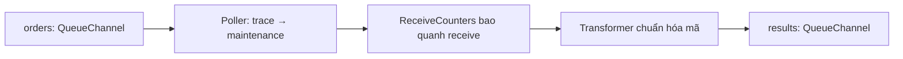

# Advice chain trên poller

## 1. Mục tiêu và bối cảnh

Trong module **SPRING_INTEGRATION_CORE**, poller là nơi một luồng thông điệp chủ động lấy dữ liệu để bắt đầu xử lý. Với chương **Poller transaction**, câu hỏi quan trọng là: hành vi bổ sung cần bao quanh bước nhận thông điệp, một endpoint hay toàn bộ phần xử lý đồng bộ do poller khởi tạo?

Bài học này hướng đến việc đọc đúng phạm vi advice, sắp xếp transaction và retry có chủ đích, viết advice quan sát poller và kiểm thử kết quả qua `MessageChannel`. Các ví dụ dùng **Java 17+, Spring Integration 6.5.x**; phần retry dùng **Spring Retry 2.x**. Đây là mốc API cho ví dụ, không phải yêu cầu thay đổi phiên bản của dự án đang học.

Kiến thức cần có: `Message`, `QueueChannel`, `DirectChannel`, endpoint, Java DSL và khái niệm commit/rollback của Spring transaction.

## 2. Advice được gắn vào đâu?

Advice chain là tập hợp các hành vi được áp dụng qua AOP, chẳng hạn đo thời gian, tạm ngừng nhận việc, mở transaction hoặc retry. Chọn nơi gắn advice quyết định phần công việc nào chịu tác động.

| Nơi gắn | Phạm vi cần hình dung | Ví dụ phù hợp |
| --- | --- | --- |
| Poller, với `MethodInterceptor` thông thường | Một lần nhận và xử lý, gồm các lời gọi đồng bộ tiếp theo | Đo thời gian xử lý từ lúc nhận; mở transaction trước khi nhận |
| Poller, với `ReceiveMessageAdvice` | Lời gọi `receive()` | Đếm lần nguồn rỗng; quan sát thông điệp vừa nhận |
| Handler, với request handler advice | Thao tác được advice tại endpoint đó; phạm vi cụ thể phụ thuộc loại advice | Retry một lời gọi dịch vụ |
| Channel, với `ChannelInterceptor` | Hoạt động gửi/nhận qua channel | Kiểm tra header hoặc quan sát lưu lượng channel |

`PollingConsumer` nhận từ một `PollableChannel`, ví dụ `QueueChannel`. `SourcePollingChannelAdapter` nhận từ một `MessageSource`, ví dụ nguồn đọc cơ sở dữ liệu. Cả hai đều có thể được cấu hình poller. Xem [Poller trong Spring Integration](https://docs.spring.io/spring-integration/reference/polling-consumer.html).

### Một lịch kích hoạt có thể chứa nhiều lần nhận

Trong mô hình poller đồng bộ của ví dụ, cần phân biệt:

- **Lượt lịch chạy**: scheduler kích hoạt poller theo trigger.
- **Một lần poll**: nhận một thông điệp và xử lý nó nếu có.
- **Số lần tối đa trong lượt chạy**: được giới hạn bởi `maxMessagesPerPoll`.

Ví dụ `maxMessagesPerPoll(3)` cho phép lượt chạy thực hiện tối đa ba lần poll. Chain được áp dụng cho từng lần nhận/xử lý, không tự biến cả ba thông điệp thành một transaction chung. Khi nhận được `null`, vòng nhận dừng sớm. Chi tiết này thể hiện trong [mã nguồn AbstractPollingEndpoint 6.5.0](https://raw.githubusercontent.com/spring-projects/spring-integration/v6.5.0/spring-integration-core/src/main/java/org/springframework/integration/endpoint/AbstractPollingEndpoint.java).

Trong bài, đặt `maxMessagesPerPoll(1)` để thứ tự advice và kết quả quan sát dễ đối chiếu.

## 3. Đọc thứ tự chain như một chuỗi lời gọi lồng nhau

Với ba advice thông thường `A`, `B`, `C`, thứ tự khai báo là thứ tự đi vào; advice đầu tiên nằm ngoài cùng:

```text
A.before
  B.before
    C.before
      receive() -> xử lý đồng bộ
    C.after
  B.after
A.after
```

Nếu có lỗi, exception đi ngược ra qua các lớp đang bao quanh lời gọi. Khối `finally` vẫn chạy; đoạn mã đặt sau `proceed()` chỉ chạy khi lời gọi đó trả về bình thường. Đây là mô hình around advice được mô tả trong [Ordering Advices](https://docs.spring.io/spring-integration/reference/6.5/handler-advice/order.html).

`invocation.proceed()` là thao tác chuyển quyền cho advice kế tiếp hoặc đối tượng đích. Một advice quan sát thông thường gọi nó đúng một lần, trả lại kết quả và để exception truyền ra. Việc không gọi `proceed()` là quyết định chặn công việc, cần có ngữ nghĩa rõ ràng như skip poll.

### Khi trộn hai loại advice

Spring Integration tách `ReceiveMessageAdvice` ra khỏi nhóm bao quanh toàn bộ poll. Trong mỗi nhóm, thứ tự khai báo được giữ lại. Ví dụ:

```text
Khai báo:      trace, receiveA, transaction, receiveB

Thực thi:     trace
                transaction
                  receiveA
                    receiveB
                      receive()
                  xử lý đồng bộ
```

Vì vậy, đặt `receiveA` trước `transaction` trong danh sách không làm nó chạy ngoài transaction. Với source đã được proxy, advice nhận thông điệp còn phải được xem xét cùng advice đã có trên proxy. Quy tắc tách nhóm được nêu trong [Smart Polling và Advice Chain Ordering](https://docs.spring.io/spring-integration/reference/6.5/polling-consumer.html).

## 4. Ví dụ Java DSL: quan sát, tạm ngừng nhận và đếm thông điệp

Giả sử hệ thống nhận mã đơn hàng vào hàng đợi nội bộ, chuẩn hóa mã rồi đưa kết quả ra channel. Khi dịch vụ phía sau cần bảo trì, ứng dụng tạm bỏ qua các lần poll mới.

Ví dụ dưới đây chỉ cần `spring-integration-core` cùng các dependency Spring tương thích. Hai `QueueChannel` dùng bộ nhớ để minh họa advice; phần transaction sẽ được thêm riêng ở mục sau.

```java
package example.integration;

import java.time.Duration;
import java.util.Locale;
import java.util.concurrent.atomic.LongAdder;

import org.aopalliance.intercept.MethodInterceptor;
import org.aopalliance.intercept.MethodInvocation;
import org.springframework.context.annotation.Bean;
import org.springframework.context.annotation.Configuration;
import org.springframework.integration.aop.ReceiveMessageAdvice;
import org.springframework.integration.channel.QueueChannel;
import org.springframework.integration.config.EnableIntegration;
import org.springframework.integration.dsl.IntegrationFlow;
import org.springframework.integration.dsl.Pollers;
import org.springframework.integration.scheduling.PollSkipAdvice;
import org.springframework.integration.scheduling.SimplePollSkipStrategy;
import org.springframework.messaging.Message;

@Configuration
@EnableIntegration
public class PollerAdviceConfiguration {

    @Bean
    QueueChannel orders() {
        return new QueueChannel(100);
    }

    @Bean
    QueueChannel results() {
        return new QueueChannel(100);
    }

    @Bean
    SimplePollSkipStrategy maintenanceGate() {
        return new SimplePollSkipStrategy();
    }

    @Bean
    PollSkipAdvice maintenanceAdvice(SimplePollSkipStrategy maintenanceGate) {
        return new PollSkipAdvice(maintenanceGate);
    }

    @Bean
    PollTraceAdvice pollTraceAdvice() {
        return new PollTraceAdvice();
    }

    @Bean
    ReceiveCounters receiveCounters() {
        return new ReceiveCounters();
    }

    @Bean
    IntegrationFlow orderFlow(
            QueueChannel orders,
            QueueChannel results,
            PollTraceAdvice pollTraceAdvice,
            PollSkipAdvice maintenanceAdvice,
            ReceiveCounters receiveCounters) {

        return IntegrationFlow
                .from(orders, endpoint -> endpoint
                        .id("ordersPollingEndpoint")
                        .autoStartup(false)
                        .poller(Pollers.fixedDelay(Duration.ofMillis(250))
                                .maxMessagesPerPoll(1)
                                .receiveTimeout(0)
                                .advice(pollTraceAdvice,
                                        maintenanceAdvice,
                                        receiveCounters)))
                .<String, String>transform(value ->
                        value.trim().toUpperCase(Locale.ROOT))
                .channel(results)
                .get();
    }

    public static final class PollTraceAdvice implements MethodInterceptor {

        private static final System.Logger LOG =
                System.getLogger(PollTraceAdvice.class.getName());

        @Override
        public Object invoke(MethodInvocation invocation) throws Throwable {
            long started = System.nanoTime();
            LOG.log(System.Logger.Level.DEBUG, "poll.enter");
            try {
                Object result = invocation.proceed();
                LOG.log(System.Logger.Level.DEBUG, "poll.returned");
                return result;
            }
            catch (Throwable failure) {
                LOG.log(System.Logger.Level.WARNING, "poll.failed", failure);
                throw failure;
            }
            finally {
                long elapsedMicros =
                        (System.nanoTime() - started) / 1_000;
                LOG.log(System.Logger.Level.DEBUG,
                        "poll.elapsedMicros={0}", elapsedMicros);
            }
        }
    }

    public static final class ReceiveCounters implements ReceiveMessageAdvice {

        private final LongAdder messages = new LongAdder();
        private final LongAdder emptyReceives = new LongAdder();

        @Override
        public Message<?> afterReceive(Message<?> result, Object source) {
            if (result == null) {
                emptyReceives.increment();
            }
            else {
                messages.increment();
            }
            return result;
        }

        public long messageCount() {
            return messages.sum();
        }

        public long emptyReceiveCount() {
            return emptyReceives.sum();
        }
    }
}
```

`Pollers.fixedDelay(Duration)` biểu diễn khoảng nghỉ giữa các lượt chạy; `receiveTimeout(0)` giúp ví dụ nhận từ hàng đợi mà không chờ khi rỗng. `advice(...)` là nơi truyền các advice cho poller. API tương ứng có tại [Pollers 6.5.0](https://docs.spring.io/spring-integration/docs/6.5.0/api/org/springframework/integration/dsl/Pollers.html) và [PollerSpec 6.5.0](https://docs.spring.io/spring-integration/docs/6.5.0/api/org/springframework/integration/dsl/PollerSpec.html).

Luồng của ví dụ:



Sơ đồ biểu diễn vị trí advice theo logic thực thi. `ReceiveCounters` chạy trong thao tác nhận từ `orders`; nó không phải một endpoint chuyển tiếp độc lập.

### Chạy thử mà không cần Spring Boot

Đặt lớp sau trong cùng package với cấu hình. Endpoint được khởi động sau khi gửi dữ liệu để ví dụ dễ quan sát:

```java
package example.integration;

import org.springframework.context.Lifecycle;
import org.springframework.context.annotation.AnnotationConfigApplicationContext;
import org.springframework.integration.channel.QueueChannel;
import org.springframework.integration.support.MessageBuilder;
import org.springframework.messaging.Message;

public class PollerAdviceDemo {

    public static void main(String[] args) {
        try (var context = new AnnotationConfigApplicationContext(
                PollerAdviceConfiguration.class)) {

            var input = context.getBean("orders", QueueChannel.class);
            var output = context.getBean("results", QueueChannel.class);
            var endpoint = context.getBean(
                    "ordersPollingEndpoint", Lifecycle.class);

            if (!input.send(MessageBuilder.withPayload(" order-42 ")
                    .build(), 1_000)) {
                throw new IllegalStateException("Input queue is full");
            }

            endpoint.start();
            Message<?> result = output.receive(2_000);
            if (result == null) {
                throw new IllegalStateException("No result within 2 seconds");
            }
            System.out.println(result.getPayload()); // ORDER-42
            endpoint.stop();
        }
    }
}
```

Giới hạn chờ là điều kiện thất bại có thể kiểm chứng, không phải cách bảo đảm scheduler luôn hoàn thành đúng trong hai giây ở mọi môi trường.

### Cách đọc kết quả

- `messageCount()` tăng khi nhận được thông điệp, trước khi transformer hoàn tất.
- `emptyReceiveCount()` tăng khi lời gọi nhận trả về `null`.
- `poll.returned` chỉ nói lời gọi được advice trả về bình thường; poll có thể bị skip hoặc nguồn có thể rỗng.
- Nếu bật log mức `DEBUG`, thời gian được ghi cả khi lời gọi thành công và khi có exception.

Không dùng `messageCount()` làm số đơn hàng đã xử lý thành công. Muốn đo thành công nghiệp vụ, cần ghi nhận sau thao tác nghiệp vụ; muốn đo commit, cần quan sát hoàn tất transaction.

## 5. Skip poll khác với lọc thông điệp

`PollSkipAdvice` dùng `PollSkipStrategy` để quyết định có tiếp tục poll hay không. Với bean `maintenanceGate` trong ví dụ:

```java
// maintenanceGate là bean SimplePollSkipStrategy đã được inject.
maintenanceGate.skipPolls(); // Bỏ qua các poll tiếp theo.
maintenanceGate.reset();     // Cho phép poll lại ở sự kiện trigger tiếp theo.
```

Đây là API của [SimplePollSkipStrategy](https://docs.spring.io/spring-integration/api/org/springframework/integration/scheduling/SimplePollSkipStrategy.html). Advice tương ứng thuộc package `org.springframework.integration.scheduling`, như trong [PollSkipAdvice API](https://docs.spring.io/spring-integration/api/org/springframework/integration/scheduling/PollSkipAdvice.html).

Trong chain `trace → maintenance → receiveCounters`, khi đang skip, trace vẫn bao quanh lời gọi; nhận thông điệp và `ReceiveCounters` không được thực hiện. Hàng đợi trong ví dụ giữ nguyên thông điệp chưa nhận. Một công việc đã đi qua bước kiểm tra skip vẫn có thể chạy tiếp; bật skip không hủy công việc đang xử lý.

Filter giải quyết việc khác: nó quyết định chấp nhận hay loại một **thông điệp đã được lấy vào luồng**. Nếu chỉ muốn tạm dừng lấy việc mới, skip trước `receive()` tránh được việc nhận rồi phải xử lý đường discard.

## 6. Receive advice cần tôn trọng hợp đồng nhận thông điệp

`ReceiveMessageAdvice` cung cấp hai điểm mở rộng:

- `beforeReceive(source)`: trả về `false` để không thực hiện lời gọi nhận.
- `afterReceive(result, source)`: xem thông điệp hoặc `null`; trả về thông điệp tiếp tục xử lý, có thể thay thế nó.

Xem hợp đồng [ReceiveMessageAdvice 6.5.0](https://docs.spring.io/spring-integration/docs/6.5.0/api/org/springframework/integration/aop/ReceiveMessageAdvice.html).

Trong `ReceiveCounters`, luôn trả lại chính `result`. Nếu đổi thành `return null` sau khi đã nhận một đơn hàng, phần xử lý sẽ không thấy đơn hàng đó. Với hàng đợi bộ nhớ, thông điệp đã bị lấy khỏi hàng đợi; không có cơ chế tự đưa lại chỉ vì advice trả về `null`.

`afterReceive` cũng không phải callback sau xử lý nghiệp vụ. Đếm được một thông điệp tại đây vẫn tương thích với việc transformer hoặc handler phía sau thất bại. Nếu bản thân `receive()` ném exception, hook này không nên được coi là nơi bắt mọi lỗi của nguồn; cần một advice bao quanh lời gọi để quan sát exception đó.

Ví dụ đếm chỉ cập nhật `LongAdder`. Khi advice còn thay đổi trạng thái nguồn hoặc trigger, phải thiết kế việc truy cập đồng thời. Đặc biệt, [hướng dẫn Smart Polling](https://docs.spring.io/spring-integration/reference/6.5/polling-consumer.html) lưu ý không gắn `TaskExecutor` cho poller nếu advice sửa nguồn mà không bảo đảm an toàn luồng.

## 7. Đưa transaction vào chain

### Tạo transaction advice rõ ràng

Khi một lần poll cần bao gồm cả nhận dữ liệu và xử lý database, có thể tạo bean sau rồi thêm vào chain. Đoạn cấu hình giả định ứng dụng đã có `PlatformTransactionManager` quản lý đúng tài nguyên cần sử dụng:

```java
import org.springframework.context.annotation.Bean;
import org.springframework.integration.transaction.TransactionInterceptorBuilder;
import org.springframework.transaction.PlatformTransactionManager;
import org.springframework.transaction.annotation.Propagation;
import org.springframework.transaction.interceptor.TransactionInterceptor;

// Đặt trong lớp @Configuration.
@Bean
TransactionInterceptor pollTransactionAdvice(
        PlatformTransactionManager transactionManager) {

    return new TransactionInterceptorBuilder()
            .transactionManager(transactionManager)
            .propagation(Propagation.REQUIRED)
            .timeout(10)
            .build();
}
```

`timeout(10)` của builder là timeout transaction tính bằng giây; nó khác `receiveTimeout(0)` tính bằng mili giây. Builder được mô tả trong [TransactionInterceptorBuilder API](https://docs.spring.io/spring-integration/docs/6.5.0/api/org/springframework/integration/transaction/TransactionInterceptorBuilder.html). Timeout transaction không thay thế timeout kết nối hay đọc dữ liệu của HTTP client.

Inject thêm `TransactionInterceptor pollTransactionAdvice` vào phương thức `orderFlow`, rồi thay danh sách advice bằng:

```java
.advice(pollTraceAdvice,
        maintenanceAdvice,
        pollTransactionAdvice,
        receiveCounters)
```

Ý nghĩa thiết kế của cách sắp xếp này:

1. Trace quan sát cả quyết định skip và lỗi thoát khỏi transaction advice.
2. Skip chặn trước transaction, tránh mở transaction cho poll đã bị từ chối.
3. Transaction advice bao quanh nhận và phần xử lý đồng bộ phía sau.
4. Receive counter chỉ quan sát thao tác nhận bên trong phạm vi đó.

Chỉ thêm bean transaction vào ví dụ chuẩn hóa chuỗi sẽ không tạo ra thay đổi database nào. Để thực hành commit/rollback, cần bổ sung thao tác ghi bằng tài nguyên do transaction manager quản lý.

### Transaction bảo vệ tài nguyên tham gia

Với luồng `receive → transform → ghi đơn hàng → ghi lịch sử`, một lỗi có thể làm rollback các thay đổi database tham gia transaction. Nếu bước nhận cũng dùng tài nguyên có hỗ trợ transaction phù hợp, nó có thể tham gia cùng phạm vi. Cơ sở của thiết kế này được nêu trong [Poller Transaction Support](https://docs.spring.io/spring-integration/reference/6.5/transactions.html).

Hãy tách ba câu hỏi khi đánh giá ví dụ thực tế:

| Câu hỏi | Điều cần xác nhận |
| --- | --- |
| Transaction được mở ở đâu? | Advice nào mở và propagation đang dùng |
| Tài nguyên nào tham gia? | Connection, message store hay session có được manager đó quản lý không |
| Lỗi nào kích hoạt rollback? | Exception có đi tới transaction advice và phù hợp rollback rule không |

`QueueChannel` trong ví dụ dùng bộ nhớ. Gắn một transaction manager JDBC cho poller không khiến thao tác lấy phần tử khỏi hàng đợi này được hoàn tác. Tương tự, email đã gửi hoặc lệnh HTTP đã có hiệu lực không được database rollback thu hồi. Với tác động ra hệ thống ngoài, cần kế hoạch idempotency hoặc outbox phù hợp với nghiệp vụ.

### Cấu hình XML tương đương về thứ tự

Nếu dùng XML, đưa transaction advice vào chain khi cần phối hợp với các advice khác. Đoạn sau minh họa vị trí khai báo, giả định các bean và namespace tương ứng đã có:

```xml
<int:poller fixed-delay="250" max-messages-per-poll="1">
    <int:advice-chain>
        <ref bean="pollTraceAdvice"/>
        <ref bean="maintenanceAdvice"/>
        <ref bean="pollTransactionAdvice"/>
        <ref bean="receiveCounters"/>
    </int:advice-chain>
</int:poller>
```

Trong XML, `<transactional/>` và `<advice-chain/>` là hai lựa chọn loại trừ nhau trong cùng poller. Khi đã dùng chain, transaction cần nằm trong chain. Quy tắc này thuộc cấu hình XML; Java DSL có API riêng để xây dựng danh sách advice. Xem [Transaction Support](https://docs.spring.io/spring-integration/reference/6.5/transactions.html).

## 8. Retry và transaction: thứ tự thay đổi hành vi

### Retry ngoài, transaction trong

Với tất cả advice ở đây đều bao quanh toàn bộ poll, chain sau biểu diễn retry của đơn vị nhận/xử lý:

```text
trace → maintenance → retry → transaction → receive + process
```

Khi chưa có transaction bao ngoài và dùng `REQUIRED`, mỗi attempt đi vào transaction advice có thể mở transaction mới; attempt thất bại rollback trước khi retry tiếp. Nếu có transaction bao ngoài, phải xem lại propagation. `REQUIRED` có thể tham gia transaction đang tồn tại; `REQUIRES_NEW` tạo transaction độc lập. Xem [Transaction Propagation](https://docs.spring.io/spring-framework/reference/data-access/transaction/declarative/tx-propagation.html).

Để tạo interceptor phù hợp cho **poller**, Spring Retry 2.x cung cấp builder sau. Đây là cấu hình riêng, cần dependency `spring-retry`; biến trả về có thể được đưa vào vị trí `retry` nêu trên:

```java
import org.aopalliance.intercept.MethodInterceptor;
import org.springframework.retry.interceptor.RetryInterceptorBuilder;

MethodInterceptor pollRetry = RetryInterceptorBuilder.stateless()
        .maxAttempts(3)
        .backOffOptions(100, 2.0, 500)
        .build();
```

`maxAttempts(3)` gồm lần gọi đầu tiên và tối đa hai lần thử lại. Các khoảng backoff trong cấu hình tính bằng mili giây. Dùng builder/interceptor hỗ trợ retry thay vì tự gọi `invocation.proceed()` nhiều lần trên cùng invocation. API tham khảo: [RetryInterceptorBuilder](https://docs.spring.io/spring-retry/docs/2.0.11/apidocs/org/springframework/retry/interceptor/RetryInterceptorBuilder.html).

Trong môi trường thực tế, còn phải giới hạn loại lỗi được retry. Cấu hình ngắn trên minh họa thứ tự chain, chưa biểu diễn chính sách phân loại lỗi của một hệ thống cụ thể.

### Transaction ngoài, retry trong

```text
trace → maintenance → transaction → retry → receive + process
```

Các attempt chạy bên trong cùng phạm vi transaction bao ngoài. Một lần thất bại có thể để transaction ở trạng thái rollback-only; một attempt sau thành công không xóa được trạng thái ấy. Việc chờ backoff còn diễn ra khi transaction bao ngoài đang mở. So sánh hai thứ tự được trình bày trong [Ordering Advices](https://docs.spring.io/spring-integration/reference/6.5/handler-advice/order.html).

Ví dụ thiết kế: một thao tác database bị deadlock thường cần lần thử sau với transaction sạch. Chỉ đổi số lần retry mà giữ nguyên một transaction đã không còn dùng được sẽ không giải quyết được vấn đề.

### Retry poller có thể nhận thông điệp khác

Xét hàng đợi bộ nhớ có hai mã `A`, `B`, với cấu hình `retry → transaction`:

```text
Attempt 1: receive A → handler lỗi → rollback database
Attempt 2: receive B → handler thành công
```

`A` đã bị lấy khỏi hàng đợi bộ nhớ. Lần thử thứ hai chạy lại đơn vị poll, nên có thể nhận `B` hoặc thấy nguồn rỗng. Từ đó suy ra: **retry poller không tự bảo đảm thử lại cùng một Message**. Đây là hệ quả của phạm vi `receive + process` và loại nguồn trong ví dụ, không phải một cơ chế redelivery của hàng đợi bộ nhớ.

Ngay cả với nguồn có hỗ trợ rollback/redelivery, cần xác nhận hợp đồng của adapter và tài nguyên. Không suy luận rằng một database transaction manager tự điều phối được mọi nguồn ngoài database.

### Chỉ retry một lời gọi thì đặt advice tại handler

Giả sử luồng nghiệp vụ là:

```text
poller → chuẩn hóa → gọi dịch vụ định giá → ghi đơn hàng
```

Nếu chỉ thao tác định giá có lỗi mạng tạm thời, đặt retry tại handler gọi dịch vụ sẽ thể hiện yêu cầu rõ hơn. Ví dụ dưới đây là đoạn thay thế để minh họa vị trí gắn, giả định `pricingService` và `pricingRetry` đã được inject:

```java
.handle(pricingService, "quote",
        endpoint -> endpoint.advice(pricingRetry))
```

`pricingRetry` có thể là `RequestHandlerRetryAdvice`; với phiên bản 6.5.x, loại advice này dùng `RetryTemplate` của Spring Retry. Nó được thiết kế cho request handler, không dùng thay cho interceptor của poller một cách máy móc. Xem [Provided Advice Classes](https://docs.spring.io/spring-integration/reference/6.5/handler-advice/classes.html).

Giữ ý định thiết kế cụ thể: retry định giá cùng một yêu cầu khác với chạy lại cả việc nhận và các bước đồng bộ của poller. Động lực tách hai phạm vi được giải thích trong [Adding Behavior to Endpoints](https://docs.spring.io/spring-integration/reference/6.5/handler-advice.html).

## 9. Exception, error channel và ranh giới luồng

### Để lỗi đi qua lớp cần quyết định rollback

Một advice bắt exception để ghi log rồi trả về bình thường có thể thay đổi quyết định transaction. Mẫu dưới đây làm mất tín hiệu thất bại:

```java
try {
    return invocation.proceed();
}
catch (Exception failure) {
    logFailure(failure);
    return null; // Advice phía ngoài chỉ thấy kết thúc bình thường.
}
```

Trong ví dụ `PollTraceAdvice`, exception được ném lại sau khi ghi log. Với advice recovery có chủ đích, phải xác định rõ lỗi đã được giải quyết thành công về nghiệp vụ hay vẫn cần rollback. Nếu một lớp bên trong đã đánh dấu rollback-only, nuốt exception cũng không làm transaction trở lại bình thường.

### Error channel không phải nút hoàn tác

Đối với poller chạy theo lịch, lỗi thoát ra có thể được error handler xuất bản thành `ErrorMessage`. Có thể cấu hình đích mặc định riêng bằng `.errorChannel("pollErrors")` trên poller và định nghĩa channel cùng consumer xử lý nó. Cơ chế `ErrorMessage` được mô tả trong [Error Handling](https://docs.spring.io/spring-integration/reference/6.5/error-handling.html).

Trong chain của bài, exception đi ra khỏi transaction advice trước khi tới bộ xử lý lỗi bên ngoài polling task. Handler đọc `ErrorMessage` có thể ghi nhật ký hoặc tạo yêu cầu phục hồi; việc đọc thông báo lỗi không tự trả `A` về hàng đợi bộ nhớ.

Nếu recovery bắt lỗi ngay bên trong chain và không ném lại, phải xem transaction advice có còn quan sát được lỗi không. Vị trí bắt lỗi có ý nghĩa trực tiếp đối với kết quả transaction.

### Giao sang luồng khác thay đổi phần việc poller quan sát

```text
poller transaction
  receive → transform → DirectChannel → ghi database
                                          cùng call stack

poller transaction
  receive → ExecutorChannel → chấp nhận giao việc
                     luồng khác → handler → có thể lỗi sau đó
```

Khi giao việc bất đồng bộ thành công, poller có thể hoàn tất trước handler chạy trên luồng khác. Transaction gắn với luồng poller không tự đi theo công việc mới; lỗi xảy ra sau đó không quay lại call stack cũ. Tham khảo [Transaction Boundaries](https://docs.spring.io/spring-integration/reference/transactions.html).

Do đó, thêm `ExecutorChannel` để tăng đồng thời cần đi kèm quyết định về transaction ở consumer, xử lý lỗi và khả năng phát lại. Nếu mục tiêu là rollback cùng đơn vị công việc, hãy xác định chính xác nơi kết thúc xử lý đồng bộ trước khi chọn channel.

## 10. Thực hành kiểm thử theo hành vi

Có thể dùng ví dụ Java DSL để kiểm thử mà không phụ thuộc HTTP, broker hay database. Ví dụ JUnit 5 sau mở context riêng, đưa một thông điệp vào trước khi bật endpoint và kiểm tra đầu ra bằng thời gian chờ hữu hạn:

```java
package example.integration;

import org.junit.jupiter.api.Test;
import org.springframework.context.Lifecycle;
import org.springframework.context.annotation.AnnotationConfigApplicationContext;
import org.springframework.integration.channel.QueueChannel;
import org.springframework.integration.support.MessageBuilder;
import org.springframework.messaging.Message;

import static org.junit.jupiter.api.Assertions.*;

class PollerAdviceTest {

    @Test
    void receivesAndTransformsOneMessage() {
        try (var context = new AnnotationConfigApplicationContext(
                PollerAdviceConfiguration.class)) {

            var input = context.getBean("orders", QueueChannel.class);
            var output = context.getBean("results", QueueChannel.class);
            var endpoint = context.getBean(
                    "ordersPollingEndpoint", Lifecycle.class);
            var counters = context.getBean(
                    PollerAdviceConfiguration.ReceiveCounters.class);

            assertTrue(input.send(MessageBuilder
                    .withPayload(" order-42 ").build(), 1_000));

            endpoint.start();
            try {
                Message<?> result = output.receive(2_000);
                assertNotNull(result);
                assertEquals("ORDER-42", result.getPayload());
                assertEquals(1L, counters.messageCount());
            }
            finally {
                endpoint.stop();
            }
        }
    }
}
```

Điểm kiểm tra là thông điệp đầu ra và bộ đếm nhận, không phải thời gian ngủ cố định. Ví dụ này chưa chứng minh commit/rollback vì không có database. Các ca mở rộng nên bám vào yêu cầu cụ thể:

| Tình huống | Cách tạo điều kiện và điều cần quan sát |
| --- | --- |
| Skip trước khi chạy | Gọi `skipPolls()` trước `start()`; dùng latch hoặc advice quan sát để xác nhận đã có lượt poll; kiểm tra đầu vào còn nguyên, bộ đếm nhận chưa tăng |
| Cho phép nhận lại | Sau khi xác nhận skip, gọi `reset()`; đợi kết quả xuất hiện qua `results.receive(timeout)` |
| Nguồn rỗng | Xác nhận poll đã chạy và bộ đếm rỗng tăng; không coi đây là lỗi nghiệp vụ |
| Handler ném lỗi | Dùng handler chủ động ném exception, cấu hình error channel riêng; kiểm tra có `ErrorMessage` và không có kết quả nghiệp vụ |
| Thứ tự advice | Dùng hai advice ghi sự kiện vào danh sách an toàn luồng; dùng latch đánh dấu kết thúc rồi so thứ tự vào/ra |
| Rollback database | Ghi bằng database thật dùng cho test, ném lỗi sau ghi; đợi transaction kết thúc rồi đọc bằng connection/transaction độc lập |
| Retry đúng phạm vi | Ghi lại mã nghiệp vụ và số lần gọi tại từng bước; phân biệt nhận lại, xử lý lại và chỉ gọi lại dịch vụ |
| Tác động giao luồng | Ghi tên luồng ở poller và handler; làm handler bất đồng bộ thất bại sau khi việc giao đã thành công |

Với test transaction, cần kiểm tra cả thay đổi database lẫn trạng thái thông điệp tại nguồn. Chỉ đếm số lần gọi handler không đủ chứng minh thông điệp đã được phát lại đúng. Với scheduler, không khẳng định một khoảng chờ ngắn không có đầu ra đồng nghĩa advice đã chạy; cần tín hiệu xác nhận lượt poll.

## 11. Các lỗi cấu hình thường gặp

| Biểu hiện | Giả định sai cần xem lại | Hướng sửa |
| --- | --- | --- |
| Đếm nhận cao hơn số xử lý thành công | Đếm trong `afterReceive` được hiểu là thành công nghiệp vụ | Đặt thêm đo lường sau xử lý hoặc sau commit |
| Advice nhận chạy sau transaction dù khai báo trước | Xem danh sách trộn như một chuỗi duy nhất | Tách nhóm whole-poll và receive-only khi vẽ call stack |
| Mở transaction trong lúc bảo trì | Skip nằm sau transaction | Đưa quyết định skip ra trước nếu đó là yêu cầu |
| Rollback nhưng mất thông điệp trong RAM | Gắn transaction manager làm mọi channel transactional | Chọn nguồn/store có hợp đồng transaction phù hợp hoặc thiết kế phục hồi |
| Retry nhận mã đơn khác | Retry toàn bộ poll được hiểu là retry cùng thông điệp | Đặt retry tại handler khi muốn giữ nguyên request |
| Có log lỗi nhưng database vẫn commit | Advice bên trong nuốt exception trước transaction advice | Xác định lại recovery và đường truyền exception |
| Handler lỗi nhưng poller đã kết thúc | Phần việc đã được giao sang luồng khác | Thiết kế transaction và lỗi ở consumer mới |
| Một lượt xử lý nhiều thông điệp nhưng rollback chỉ ảnh hưởng một phần | `maxMessagesPerPoll` bị hiểu như kích thước transaction batch | Thiết kế batch tường minh nếu cần tính nguyên tử cho cả lô |

## 12. Gợi ý áp dụng vào luồng đơn hàng

Với yêu cầu “tạm ngừng nhận khi bảo trì, ghi database nguyên tử và chỉ retry dịch vụ định giá”, có thể bắt đầu bằng phương án sau:

```text
Poller chain:
  trace → skip → transaction → receive

Phần xử lý đồng bộ:
  chuẩn hóa → handler định giá có retry riêng → ghi đơn + lịch sử
```

Trước khi triển khai, hãy trả lời bằng hành vi có thể kiểm thử: đơn hàng đang ở đâu sau khi định giá thất bại, transaction nào chịu trách nhiệm cho hai bản ghi, và khóa nghiệp vụ nào ngăn lặp tác động khi phát lại. Những câu trả lời này quyết định nguồn nhận, vị trí retry và chiến lược phục hồi phù hợp.

