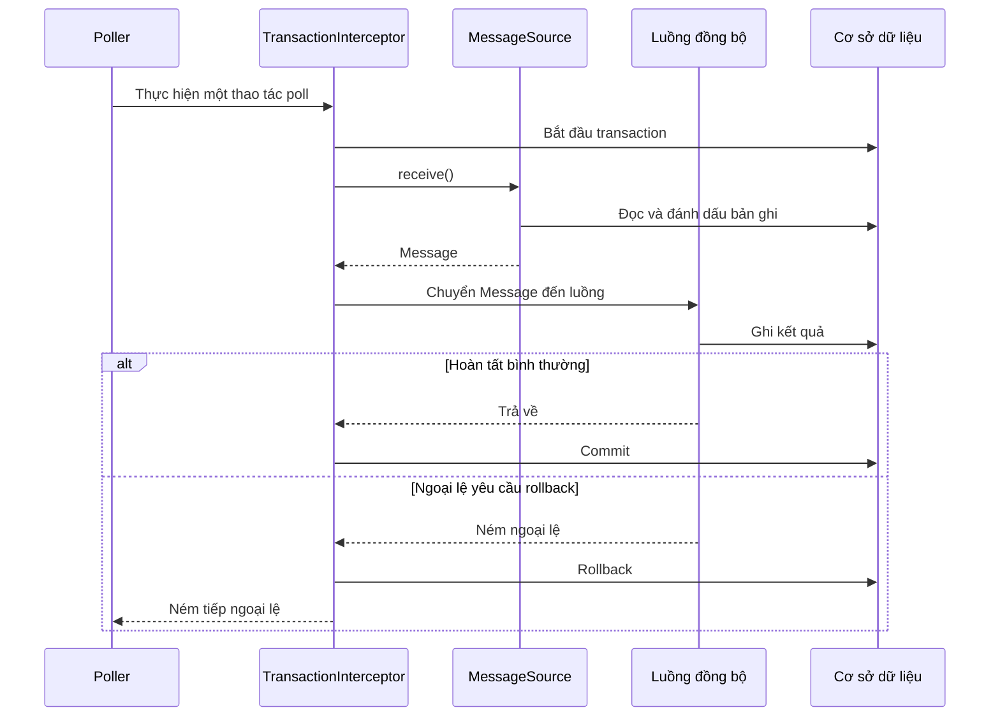

# TransactionInterceptor

## 1. Vai trò trong chương Poller transaction

Trong module `SPRING_INTEGRATION_CORE`, một luồng thông điệp được ghép từ `Message`, `MessageChannel` và các endpoint. Transformer có thể chuẩn hóa dữ liệu, filter có thể từ chối thông điệp, còn service activator có thể cập nhật cơ sở dữ liệu. Khi luồng bắt đầu bằng một poller, cần xác định thao tác nào phải cùng thành công hoặc cùng được hoàn tác.

Ví dụ, ứng dụng đọc một bản ghi từ bảng `inbox`, đánh dấu đã nhận và ghi kết quả vào bảng `ledger`. Nếu việc ghi kết quả lỗi nhưng dấu đã nhận vẫn được commit, bản ghi có thể không còn được lấy lại. Đặt transaction ở đúng vị trí giúp bảo vệ tính nhất quán này.

`TransactionInterceptor` là AOP advice của **Spring Framework**, nằm trong package `org.springframework.transaction.interceptor`. Spring Integration dùng advice này để áp dụng transaction vào thao tác polling. Interceptor điều phối lời gọi qua hạ tầng transaction; transaction manager phụ trách tài nguyên thực tế. Xem [API TransactionInterceptor](https://docs.spring.io/spring-framework/docs/current/javadoc-api/org/springframework/transaction/interceptor/TransactionInterceptor.html).

Bài học tập trung vào luồng imperative dùng JDBC và `PlatformTransactionManager`. Các ví dụ Java dùng Java 17 trở lên và API Java DSL có trong Spring Integration 6.x. Luồng reactive có cơ chế truyền ngữ cảnh riêng, cần được thiết kế theo reactive transaction thay vì áp dụng trực tiếp giả định về thread trong bài này.

## 2. Ba thành phần cần phân biệt

| Thành phần | Trách nhiệm | Ví dụ trong bài |
| --- | --- | --- |
| `TransactionInterceptor` | Bao quanh lời gọi, chọn thuộc tính transaction, xử lý kết quả hoặc ngoại lệ | Advice gắn vào poller |
| `TransactionAttribute` | Mô tả propagation, isolation, timeout, read-only và quy tắc rollback | `DefaultTransactionAttribute`, `RuleBasedTransactionAttribute` |
| `PlatformTransactionManager` | Bắt đầu, commit, rollback hoặc tham gia transaction của tài nguyên | `DataSourceTransactionManager` cho JDBC |

Một interceptor được khai báo thành bean chưa tạo ra transaction cho mọi endpoint. Nó phải được gắn vào vị trí thực thi cần bảo vệ. Tương tự, dùng một transaction manager của cơ sở dữ liệu A không khiến các thao tác ở cơ sở dữ liệu B tự động tham gia transaction đó.

Với JDBC, `DataSourceTransactionManager` quản lý một `DataSource` và gắn connection với thread đang thực thi. `JdbcTemplate` có thể sử dụng connection này thông qua cơ chế lấy connection của Spring. Vì vậy, transaction manager và các thao tác JDBC trong ví dụ phải dùng cùng `DataSource`. Xem [DataSourceTransactionManager](https://docs.spring.io/spring-framework/docs/current/javadoc-api/org/springframework/jdbc/datasource/DataSourceTransactionManager.html).

## 3. Vì sao đặt advice trên poller?

Poller có thể phục vụ hai tình huống:

- `SourcePollingChannelAdapter` gọi `MessageSource.receive()` để lấy dữ liệu từ nguồn.
- `PollingConsumer` gọi `receive()` trên một `PollableChannel` rồi chuyển thông điệp đến handler.

Cả hai đều bắt đầu công việc từ lịch polling thay vì một lời gọi nghiệp vụ trực tiếp của người dùng. Đây là nơi có thể đặt advice cho thao tác poll. Xem [Poller trong Spring Integration](https://docs.spring.io/spring-integration/reference/polling-consumer.html).

Điểm quyết định là transaction có thể bắt đầu **trước `receive()`**, bao gồm cả việc nhận dữ liệu nếu nguồn hỗ trợ transaction. Chỉ đặt `@Transactional` trên service xử lý phía sau có thể bỏ thao tác nhận dữ liệu ra ngoài phạm vi bảo vệ. Cơ chế này được mô tả trong [Poller Transaction Support](https://docs.spring.io/spring-integration/reference/transactions.html#transaction-support).

Luồng minh họa khi poller mở một transaction mới:



Sơ đồ lược bỏ proxy và các lớp nội bộ để thể hiện ranh giới nghiệp vụ. Nếu `REQUIRED` tham gia một transaction đã có, việc kết thúc phạm vi interceptor không nhất thiết là thời điểm commit vật lý; transaction ngoài vẫn quyết định kết quả cuối cùng.

## 4. Cấu hình TransactionInterceptor bằng Java DSL

### 4.1. Tạo advice

Spring Integration cung cấp `TransactionInterceptorBuilder` để tạo interceptor bằng API fluent:

```java
@Bean
TransactionInterceptor pollerTx(PlatformTransactionManager txManager) {
    return new TransactionInterceptorBuilder()
            .transactionManager(txManager)
            .propagation(Propagation.REQUIRED)
            .isolation(Isolation.DEFAULT)
            .timeout(10)
            .readOnly(false)
            .build();
}
```

Các import liên quan:

```java
import org.springframework.context.annotation.Bean;
import org.springframework.integration.transaction.TransactionInterceptorBuilder;
import org.springframework.transaction.PlatformTransactionManager;
import org.springframework.transaction.annotation.Isolation;
import org.springframework.transaction.annotation.Propagation;
import org.springframework.transaction.interceptor.TransactionInterceptor;
```

Nên truyền transaction manager tường minh khi ứng dụng có nhiều manager. Builder cũng nhận một `TransactionAttribute` hoàn chỉnh; khi dùng cách đó, các thiết lập thuộc tính riêng lẻ của builder bị bỏ qua. Xem [TransactionInterceptorBuilder](https://docs.spring.io/spring-integration/api/org/springframework/integration/transaction/TransactionInterceptorBuilder.html).

### 4.2. Gắn advice vào poller

```java
Pollers.fixedDelay(Duration.ofSeconds(1))
        .maxMessagesPerPoll(1)
        .transactional(pollerTx)
```

`PollerSpec` hỗ trợ các lựa chọn sau:

| Cách cấu hình | Ý nghĩa |
| --- | --- |
| `.transactional(txManager)` | Tạo transaction advice với manager được truyền vào và thuộc tính mặc định |
| `.transactional(pollerTx)` | Dùng interceptor đã cấu hình riêng |
| `.advice(pollerTx)` | Đưa interceptor vào chuỗi advice tổng quát |

Chọn một cách để gắn cùng interceptor; không thêm nó hai lần qua cả `transactional` và `advice`. API chi tiết nằm ở [PollerSpec](https://docs.spring.io/spring-integration/api/org/springframework/integration/dsl/PollerSpec.html).

`fixedDelay` điều khiển lịch polling, còn `timeout` của transaction điều khiển thời hạn transaction. Hai giá trị này giải quyết hai vấn đề khác nhau.

## 5. Ví dụ đầy đủ: xử lý JDBC inbox

### 5.1. Yêu cầu và giả định

Một tiến trình duy nhất lấy bản ghi có `status = 'NEW'`, chuẩn hóa payload rồi ghi vào `ledger`. Cần đảm bảo:

1. Thành công: bản ghi chuyển sang `DONE`, có kết quả tương ứng trong `ledger`.
2. Lỗi sau khi đã ghi kết quả: bản ghi trở lại `NEW`, kết quả chưa commit phải được hoàn tác.
3. Lỗi kiểm tra dữ liệu: không đánh dấu bản ghi là đã xử lý thành công.

Ví dụ dùng một `MessageSource` tự viết để thấy rõ thao tác JDBC bên trong `receive()`. Ứng dụng cần có `spring-integration-core`, `spring-jdbc`, `spring-tx`, JDBC driver và một bean `DataSource` đã cấu hình. Nếu dùng Spring Boot, quản lý phiên bản dependency theo BOM của ứng dụng.

SQL dưới đây dùng cú pháp phù hợp cho môi trường thực hành H2 hoặc PostgreSQL. Khởi tạo bảng và dữ liệu trước khi bật endpoint. Ví dụ chỉ xét một worker, chưa triển khai cơ chế lấy việc an toàn cho nhiều tiến trình.

### 5.2. Dữ liệu thực hành

```sql
create table inbox (
    id bigint primary key,
    payload varchar(100) not null,
    status varchar(20) not null
);

create table ledger (
    inbox_id bigint primary key,
    normalized_payload varchar(100) not null
);

insert into inbox (id, payload, status) values
    (100, '  order-created  ', 'NEW'),
    (101, '  fail  ', 'NEW');
```

`ledger.inbox_id` là khóa định danh nghiệp vụ của ví dụ. Ràng buộc khóa chính giúp phát hiện ghi trùng, nhưng tự nó chưa tạo thành một chiến lược xử lý thông điệp trùng hoàn chỉnh.

### 5.3. Cấu hình luồng

```java
import java.time.Duration;
import java.util.List;
import java.util.Locale;

import javax.sql.DataSource;

import org.springframework.beans.factory.annotation.Qualifier;
import org.springframework.context.annotation.Bean;
import org.springframework.context.annotation.Configuration;
import org.springframework.integration.annotation.IntegrationComponentScan;
import org.springframework.integration.channel.DirectChannel;
import org.springframework.integration.config.EnableIntegration;
import org.springframework.integration.core.MessageSource;
import org.springframework.integration.dsl.IntegrationFlow;
import org.springframework.integration.dsl.Pollers;
import org.springframework.integration.support.MessageBuilder;
import org.springframework.integration.transaction.TransactionInterceptorBuilder;
import org.springframework.jdbc.core.JdbcTemplate;
import org.springframework.jdbc.datasource.DataSourceTransactionManager;
import org.springframework.transaction.PlatformTransactionManager;
import org.springframework.transaction.annotation.Isolation;
import org.springframework.transaction.annotation.Propagation;
import org.springframework.transaction.interceptor.TransactionInterceptor;
import org.springframework.transaction.support.TransactionSynchronizationManager;

@Configuration
@EnableIntegration
public class InboxPollingConfiguration {

    public record WorkItem(long id, String payload) {
    }

    @Bean
    JdbcTemplate inboxJdbc(DataSource dataSource) {
        return new JdbcTemplate(dataSource);
    }

    @Bean
    PlatformTransactionManager inboxTxManager(DataSource dataSource) {
        return new DataSourceTransactionManager(dataSource);
    }

    @Bean
    TransactionInterceptor pollerTx(
            @Qualifier("inboxTxManager") PlatformTransactionManager txManager) {

        return new TransactionInterceptorBuilder()
                .transactionManager(txManager)
                .propagation(Propagation.REQUIRED)
                .isolation(Isolation.DEFAULT)
                .timeout(10)
                .readOnly(false)
                .build();
    }

    @Bean
    MessageSource<WorkItem> inboxSource(
            @Qualifier("inboxJdbc") JdbcTemplate jdbc) {

        return () -> {
            requireTransaction();

            List<WorkItem> rows = jdbc.query("""
                    select id, payload
                    from inbox
                    where status = 'NEW'
                    order by id
                    limit 1
                    """, (rs, rowNum) -> new WorkItem(
                            rs.getLong("id"), rs.getString("payload")));

            if (rows.isEmpty()) {
                return null;
            }

            WorkItem item = rows.get(0);
            int claimed = jdbc.update("""
                    update inbox
                    set status = 'PROCESSING'
                    where id = ? and status = 'NEW'
                    """, item.id());

            if (claimed != 1) {
                throw new IllegalStateException("Cannot claim item " + item.id());
            }

            return MessageBuilder.withPayload(item)
                    .setHeader("inboxId", item.id())
                    .build();
        };
    }

    @Bean
    IntegrationFlow inboxFlow(
            @Qualifier("inboxSource") MessageSource<WorkItem> source,
            @Qualifier("inboxJdbc") JdbcTemplate jdbc,
            @Qualifier("pollerTx") TransactionInterceptor pollerTx) {

        return IntegrationFlow
                .from(source, endpoint -> endpoint
                        .id("inboxPollingEndpoint")
                        .autoStartup(false)
                        .poller(Pollers.fixedDelay(Duration.ofSeconds(1))
                                .maxMessagesPerPoll(1)
                                .transactional(pollerTx)))
                .channel(new DirectChannel())
                .transform(WorkItem.class, item -> new WorkItem(
                        item.id(), item.payload().strip().toUpperCase(Locale.ROOT)))
                .filter(WorkItem.class, item -> !item.payload().isBlank(),
                        filter -> filter.throwExceptionOnRejection(true))
                .handle(WorkItem.class, (item, headers) -> {
                    requireTransaction();

                    jdbc.update("""
                            insert into ledger (inbox_id, normalized_payload)
                            values (?, ?)
                            """, item.id(), item.payload());

                    if ("FAIL".equals(item.payload())) {
                        throw new IllegalStateException(
                                "Simulated failure for item " + item.id());
                    }

                    int completed = jdbc.update("""
                            update inbox
                            set status = 'DONE'
                            where id = ? and status = 'PROCESSING'
                            """, item.id());

                    if (completed != 1) {
                        throw new IllegalStateException(
                                "Cannot complete item " + item.id());
                    }

                    return null;
                })
                .get();
    }

    private static void requireTransaction() {
        if (!TransactionSynchronizationManager.isActualTransactionActive()) {
            throw new IllegalStateException("Expected an active transaction");
        }
    }
}
```

`@EnableIntegration` bật hạ tầng Spring Integration trong cấu hình này. Không cần thêm `@EnableTransactionManagement` chỉ để sử dụng trực tiếp interceptor trên poller; annotation đó phục vụ cơ chế transaction dựa trên annotation như `@Transactional`.

`autoStartup(false)` giữ endpoint dừng khi khởi tạo ứng dụng để có thể chuẩn bị dữ liệu và quan sát từng tình huống. Trong ứng dụng thực hành, có thể lấy bean `inboxPollingEndpoint` dưới dạng `Lifecycle` rồi gọi `start()`; gọi `stop()` khi kết thúc quan sát:

```java
import org.springframework.context.Lifecycle;

Lifecycle endpoint = applicationContext.getBean(
        "inboxPollingEndpoint", Lifecycle.class);
endpoint.start();

// Sau khi quan sát đủ kết quả, dừng polling:
endpoint.stop();
```

Hai lời gọi trên thể hiện hai thời điểm riêng biệt. Nếu gọi `stop()` ngay sau `start()`, có thể chưa có thao tác poll nào kịp chạy. Không dùng `sleep` với thời gian cố định làm tiêu chí kết luận transaction đúng.

### 5.4. Diễn giải hành vi

`MessageSource` trả `null` khi không có dữ liệu; đây là kết quả bình thường, không phải tín hiệu lỗi. Khi có dữ liệu, nó trả một `Message<WorkItem>` chứa payload và header `inboxId` để đối chiếu khi xử lý lỗi.

Transformer chuẩn hóa payload. Filter được cấu hình ném ngoại lệ khi từ chối, vì yêu cầu của ví dụ là dữ liệu rỗng không được coi là xử lý thành công. Handler cuối trả `null` sau khi ghi xong để kết thúc luồng không có reply.

Các thao tác SQL dùng `JdbcTemplate`; cách dùng callback để ánh xạ dòng và truyền tham số cho `update` được mô tả trong [Spring JDBC Core](https://docs.spring.io/spring-framework/reference/data-access/jdbc/core.html).

Sau khi bản ghi `100` được xử lý và bản ghi `101` đã được thử:

| Dữ liệu | Kết quả mong đợi |
| --- | --- |
| `inbox.id = 100` | `status = 'DONE'` |
| `ledger.inbox_id = 100` | Có một dòng với payload `ORDER-CREATED` |
| `inbox.id = 101` | Vẫn là `NEW` sau rollback |
| `ledger.inbox_id = 101` | Không có dòng đã commit |

Với bản ghi `101`, thao tác `INSERT` đã chạy trước lỗi mô phỏng. Việc không có kết quả đã commit cho thấy transaction hoàn tác cả phần ghi kết quả lẫn việc đổi trạng thái trong `receive()`.

Bản ghi lỗi vẫn đứng đầu danh sách lấy việc nên sẽ được thử lại ở các lần poll tiếp theo. Đây là hệ quả của câu truy vấn và lịch polling trong ví dụ, chưa phải chính sách retry có giới hạn. Cần dừng endpoint sau khi quan sát để tránh lặp lỗi liên tục.

Hai lần gọi `requireTransaction()` giúp phát hiện vị trí không có transaction khi thực hành. Chỉ kiểm tra cờ này chưa chứng minh mọi connection đều tham gia cùng transaction; kết quả dữ liệu sau lỗi mới là bằng chứng quan trọng cho ví dụ.

## 6. Một lần poll có phải một transaction cho cả batch?

Cần phân biệt **chu kỳ được scheduler kích hoạt**, **một thao tác nhận thông điệp** và **số bản ghi trong payload**.

Trong cơ chế polling imperative tiêu chuẩn, vòng lặp `maxMessagesPerPoll` gọi tác vụ đã được áp dụng advice cho từng thao tác poll. Do đó, đặt `maxMessagesPerPoll(10)` không có nghĩa mười thông điệp chắc chắn được xử lý trong một transaction chung. Khi mỗi lần gọi mở transaction `REQUIRED` mới, mỗi thao tác nhận và xử lý đồng bộ có phạm vi riêng. Cấu trúc này có thể đối chiếu ở [AbstractPollingEndpoint phiên bản 6.5.0](https://github.com/spring-projects/spring-integration/blob/v6.5.0/spring-integration-core/src/main/java/org/springframework/integration/endpoint/AbstractPollingEndpoint.java).

Trong ví dụ, `limit 1` giới hạn dữ liệu của một lần nhận, còn `maxMessagesPerPoll(1)` giới hạn số lần nhận trong một chu kỳ. Nếu nguồn trả về một danh sách 50 bản ghi trong một message, rồi splitter xử lý tất cả đồng bộ, một transaction có thể bao phủ nhiều bản ghi trong payload đó.

Với JDBC inbound adapter có sẵn, `max-rows` giới hạn số dòng của kết quả, còn `max-messages-per-poll` điều khiển số lần gọi nhận trong chu kỳ. Adapter có thể thực hiện cả `SELECT` và `UPDATE` trong transaction của poller. Xem [Polling and Transactions của JDBC inbound adapter](https://docs.spring.io/spring-integration/reference/jdbc/inbound-channel-adapter.html#jdbc-polling-transactions).

Thiết kế batch vì thế phải dựa trên đơn vị dữ liệu thực tế và phạm vi lời gọi, thay vì chỉ nhìn giá trị `maxMessagesPerPoll`.

## 7. Chọn thuộc tính transaction

| Thuộc tính | Ý nghĩa trong bài | Điểm cần cân nhắc |
| --- | --- | --- |
| `REQUIRED` | Tham gia transaction có sẵn hoặc mở mới | Thường đủ khi poller là nơi bắt đầu công việc |
| `REQUIRES_NEW` | Dùng transaction vật lý độc lập với transaction đang có | Có thể commit độc lập; cần cân nhắc số connection |
| `ISOLATION_DEFAULT` | Dùng isolation mặc định của tài nguyên | Không đồng nghĩa đã giải quyết cạnh tranh lấy việc |
| `timeout(10)` | Thời hạn transaction tính bằng giây | Không phải polling interval hoặc timeout HTTP |
| `readOnly(false)` | Cho phép trường hợp nghiệp vụ có ghi dữ liệu | Phù hợp với việc đổi trạng thái và ghi `ledger` |

Isolation và timeout chủ yếu được áp dụng khi bắt đầu transaction mới. `readOnly` là chỉ dẫn cho hạ tầng và tài nguyên; không nên dùng nó như hàng rào bảo đảm mọi câu lệnh ghi đều bị chặn. Xem [TransactionDefinition](https://docs.spring.io/spring-framework/docs/current/javadoc-api/org/springframework/transaction/TransactionDefinition.html).

Nếu service bên trong dùng `REQUIRED`, nó thường chia sẻ transaction vật lý của poller. Khi phạm vi trong đánh dấu rollback-only, việc bên ngoài bắt ngoại lệ không nhất thiết cứu được transaction; lúc commit có thể nhận `UnexpectedRollbackException`.

Nếu service dùng `REQUIRES_NEW`, kết quả đã commit của service đó có thể tồn tại dù transaction poller sau cùng rollback. Điều này làm thay đổi yêu cầu “cùng thành công hoặc cùng hoàn tác” của ví dụ. Xem [Transaction Propagation](https://docs.spring.io/spring-framework/reference/data-access/transaction/declarative/tx-propagation.html).

Trong môi trường có nhiều worker, còn phải thiết kế cơ chế claim bản ghi phù hợp với cơ sở dữ liệu, chẳng hạn khóa hoặc cập nhật có điều kiện kèm cách xử lý cạnh tranh. Không nên suy ra rằng chỉ thêm interceptor đã giải quyết trọn vẹn việc phân phối công việc đồng thời.

## 8. Rollback phụ thuộc vào ngoại lệ nào?

### 8.1. Quy tắc mặc định

Với thuộc tính transaction mặc định, `RuntimeException` và `Error` dẫn đến rollback; checked exception không mặc nhiên có cùng quy tắc. Interceptor xét ngoại lệ đi ra khỏi phạm vi được advice.

Trong messaging, ngoại lệ gốc có thể bị bọc trong `MessagingException` hoặc `MessageHandlingException`, vốn là runtime exception. Vì vậy, khi kiểm tra rollback, phải xem ngoại lệ thực sự tới interceptor thay vì chỉ nhìn khai báo `throws` của phương thức nghiệp vụ. Quy tắc cơ sở được mô tả tại [Rolling Back a Declarative Transaction](https://docs.spring.io/spring-framework/reference/data-access/transaction/declarative/rolling-back.html).

Ví dụ sau làm mất tín hiệu thất bại nếu chưa có thành phần nào đánh dấu transaction là rollback-only:

```java
try {
    writeResult();
} catch (RuntimeException ex) {
    log.warn("Cannot write result", ex);
    // Trả về bình thường khiến phạm vi ngoài có thể được commit.
}
```

Nếu yêu cầu là hoàn tác toàn bộ công việc, hãy để ngoại lệ phù hợp thoát ra hoặc ném tiếp một ngoại lệ nghiệp vụ được cấu hình rollback. Việc ghi log không thay thế tín hiệu thất bại.

### 8.2. Khai báo quy tắc rõ ràng

Có thể thay nội dung bean `pollerTx` trong ví dụ bằng cấu hình dùng `RuleBasedTransactionAttribute`. Đoạn sau yêu cầu rollback đối với mọi `Exception` quan sát được ở ranh giới advice; quy tắc mặc định với `Error` vẫn có hiệu lực:

```java
import org.springframework.transaction.TransactionDefinition;
import org.springframework.transaction.interceptor.RollbackRuleAttribute;
import org.springframework.transaction.interceptor.RuleBasedTransactionAttribute;

@Bean
TransactionInterceptor pollerTx(
        @Qualifier("inboxTxManager") PlatformTransactionManager txManager) {

    RuleBasedTransactionAttribute attributes =
            new RuleBasedTransactionAttribute();
    attributes.setPropagationBehavior(TransactionDefinition.PROPAGATION_REQUIRED);
    attributes.setIsolationLevel(TransactionDefinition.ISOLATION_DEFAULT);
    attributes.setTimeout(10);
    attributes.setReadOnly(false);
    attributes.setRollbackRules(List.of(
            new RollbackRuleAttribute(Exception.class)));

    return new TransactionInterceptorBuilder()
            .transactionManager(txManager)
            .transactionAttribute(attributes)
            .build();
}
```

Chỉ giữ một bean `pollerTx` khi áp dụng biến thể này. Dùng kiểu exception cụ thể giúp thể hiện ý định rõ hơn so với chuỗi tên rộng dễ khớp ngoài dự kiến. API quy tắc được mô tả ở [RuleBasedTransactionAttribute](https://docs.spring.io/spring-framework/docs/current/javadoc-api/org/springframework/transaction/interceptor/RuleBasedTransactionAttribute.html).

## 9. Ranh giới thread và khả năng hoàn tác

Transaction imperative dựa trên thread không tự truyền sang worker khác. `DirectChannel` cho phép xử lý trên thread gửi; `ExecutorChannel` thường giao công việc cho executor; `QueueChannel` lưu thông điệp để consumer lấy ở thời điểm khác. Xem [Message Channel Implementations](https://docs.spring.io/spring-integration/reference/channel/implementations.html).

| Thay đổi trong luồng ví dụ | Hệ quả cần dự kiến |
| --- | --- |
| Giữ đường xử lý đồng bộ | Lỗi ở handler có thể quay lại advice poller |
| Chèn `ExecutorChannel` trước handler | Transaction poller không tự theo công việc sang thread executor |
| Chèn `QueueChannel` trước handler | Gửi vào queue thành công chưa chứng minh handler đã xử lý thành công |
| Dùng `@Async`, `CompletableFuture` hoặc tự tạo thread | Phải thiết kế transaction cho công việc ở thread mới |
| Dùng queue có message store transactional | Có thể bảo vệ thao tác enqueue/dequeue của tài nguyên đó, tùy manager và cấu hình |

Việc giao thông điệp qua một ranh giới bất đồng bộ không khiến interceptor lập tức commit ngay tại dòng gửi. Transaction hiện tại vẫn kết thúc khi phạm vi được advice trả về. Tuy nhiên, nó không chờ toàn bộ nghiệp vụ ở thread khác và không nhận được ngoại lệ muộn qua call stack thông thường.

Một `QueueChannel` trong bộ nhớ không có khả năng tự trả message đã lấy ra chỉ vì JDBC transaction rollback. Tính bền vững của message store và việc tham gia transaction cũng là hai thuộc tính cần kiểm tra riêng.

Nếu chuyển ví dụ sang kiến trúc bất đồng bộ, nên xác định từng đoạn có transaction riêng: đoạn nhận và lưu công việc; đoạn consumer xử lý công việc; đoạn phát sự kiện tiếp theo. Sau đó bổ sung cơ chế phát lại và xử lý trùng phù hợp với mỗi đoạn.

## 10. Advice của poller khác advice của handler

Vị trí đặt advice quyết định phương thức được bao quanh:

| Vị trí | Phạm vi cần hiểu |
| --- | --- |
| `poller(...transactional(pollerTx))` | Bao thao tác poll, gồm nhận dữ liệu và phần downstream đồng bộ của thao tác đó |
| `@Transactional` trên service | Bao lời gọi service qua proxy; không tự đưa thao tác nhận trước đó vào transaction |
| `TransactionInterceptor` trong request handler advice | Với reply-producing handler, thường bao `handleRequestMessage()`, không bao việc gửi reply xuống toàn bộ luồng |
| `TransactionHandleMessageAdvice` | Bao `handleMessage()`, có thể bao phần downstream đồng bộ trong lời gọi này |

Spring Integration cung cấp `TransactionHandleMessageAdvice` cho trường hợp cần phạm vi `handleMessage()`. Có thể tạo biến thể này bằng `new TransactionInterceptorBuilder(true)` rồi gắn vào endpoint thích hợp. Nó vẫn không truyền transaction qua ranh giới thread. Xem [Transaction Support cho handler advice](https://docs.spring.io/spring-integration/reference/handler-advice/tx-handle-message.html).

Ví dụ, nếu service A cập nhật bảng rồi trả một reply, sau đó transformer B mới ném lỗi, transaction chỉ bao phương thức A có thể đã kết thúc trước khi B chạy. Khi yêu cầu của nghiệp vụ bao gồm cả B, cần chọn ranh giới bao quanh cả lời gọi đồng bộ đó, chẳng hạn advice của poller trong ví dụ.

Đối với luồng bắt đầu từ messaging gateway, một service có `@Transactional` có thể mở transaction trước khi gọi gateway và bao đường xử lý đồng bộ phía sau. Cần xét nơi lời gọi thực sự đi qua proxy; self-invocation trong cùng đối tượng không tự tạo thêm phạm vi transaction theo cơ chế proxy thông thường.

## 11. Transaction, retry và errorChannel

### 11.1. Retry không đồng nghĩa với rollback

Transaction quyết định commit hoặc hoàn tác một lần thực thi. Retry quyết định có thực thi lại hay không. Nếu cùng một bản ghi được lấy lại ở lần poll kế tiếp sau rollback, đó là hành vi của nguồn và lịch polling; nó không mặc nhiên có backoff, số lần thử tối đa hoặc nơi cách ly bản ghi lỗi.

Về mặt thứ tự advice, hai cấu trúc sau có ý nghĩa khác nhau:

```text
Retry ở ngoài:
retry -> transaction -> nhận và xử lý
         transaction -> nhận và xử lý lại

Transaction ở ngoài:
transaction -> retry -> nhận và xử lý
                       thử lại trong cùng phạm vi transaction
```

Nếu muốn mỗi lần thử có transaction mới, advice retry tương thích cần bao ngoài advice transaction, và mỗi lần vào transaction phải thật sự có khả năng mở transaction mới. Ngược lại, thử lại trong một transaction đã bị đánh dấu rollback-only có thể không dẫn đến commit dù lần thử sau không ném lỗi.

Sơ đồ chỉ minh họa thứ tự bao quanh, không phải cấu hình có thể sao chép nguyên trạng. `RequestHandlerRetryAdvice` được thiết kế cho request handler; không nên tự gắn nó vào poller như một `MethodInterceptor` tổng quát. Xem [Provided Advice Classes](https://docs.spring.io/spring-integration/reference/handler-advice/classes.html).

### 11.2. ErrorMessage phục vụ xử lý lỗi

Với đường thực thi đồng bộ, ngoại lệ có thể đi ngược call stack về poller, qua transaction advice rồi mới tới cơ chế xử lý lỗi của tác vụ polling. Với cấu hình lỗi tiêu chuẩn, lỗi của tác vụ được xuất bản thành `ErrorMessage` đến error channel. Xem [Error Handling](https://docs.spring.io/spring-integration/reference/error-handling.html).

Không cần handler của `errorChannel` ném lại lỗi để kích hoạt rollback cho transaction poller đã được kết thúc khi ngoại lệ thoát qua advice. Ngược lại, nếu một recovery callback bên trong phạm vi advice đã nuốt lỗi và trả về bình thường, việc gửi thêm `ErrorMessage` không tự thay thế quyết định rollback.

Trong ví dụ JDBC inbox, nên quan sát đồng thời `inboxId`, exception, số lần bản ghi được thử và trạng thái dữ liệu đã commit. Chỉ thấy log lỗi chưa đủ kết luận rằng mọi thay đổi đã được hoàn tác.

## 12. Giới hạn đối với tài nguyên và các mẫu tích hợp

### 12.1. Thao tác ngoài JDBC transaction

Giả sử handler gọi HTTP để trừ tiền, sau đó ghi JDBC bị lỗi. Rollback JDBC không tự hoàn tác yêu cầu HTTP đã được hệ thống bên ngoài chấp nhận. Gửi email, gọi dịch vụ từ xa hoặc sửa file cũng cần được xem xét như các tác động độc lập nếu tài nguyên đó không tham gia transaction.

Với tình huống cần phát sự kiện sau cập nhật dữ liệu, một phương án thiết kế là ghi bản ghi outbox trong cùng JDBC transaction rồi để tiến trình khác phát đi. Phần phát vẫn cần xử lý trùng và theo dõi kết quả; interceptor không tự cung cấp bảo đảm exactly-once cho toàn hệ thống.

Spring Integration có transaction synchronization để chạy hành động gắn với commit hoặc rollback. Đây là cách phối hợp vòng đời công việc, không biến tài nguyên không transactional thành tài nguyên có rollback. Một callback `afterCommit` bị lỗi cũng không đảo ngược dữ liệu đã commit. Xem [Transaction Synchronization](https://docs.spring.io/spring-integration/reference/transactions.html#transaction-synchronization).

### 12.2. Transformer, filter, router và aggregator

| Thành phần | Cách đặt câu hỏi về transaction |
| --- | --- |
| Transformer | Ngoại lệ chuẩn hóa dữ liệu có cần làm nguồn được xử lý lại? |
| Filter | Từ chối là kết quả nghiệp vụ hợp lệ hay phải ném lỗi để rollback? |
| Router | Nhánh được chọn chạy trên thread hiện tại hay giao sang cơ chế bất đồng bộ? |
| Aggregator | Thông điệp được lưu vào nhóm hay nhóm đã hoàn tất và phát kết quả trong lần gọi hiện tại? |

Trong ví dụ, filter được đặt `throwExceptionOnRejection(true)` vì yêu cầu hoàn tác khi payload rỗng. Nếu filter chỉ loại thông điệp và trả về bình thường, poller có thể coi công việc là hoàn tất; trạng thái `PROCESSING` khi đó có thể được commit.

Với aggregator, một nhóm có thể nhận thông điệp ở nhiều lần poll và được giải phóng ở thời điểm khác. Không nên hình dung một transaction JDBC được giữ mở từ lúc nhận phần tử đầu tiên đến khi đủ cả nhóm. Cần xác định transaction cho thao tác cập nhật message store và cho lần xử lý phát kết quả cụ thể.

## 13. Thực hành quan sát và chẩn đoán

Thực hiện từng tình huống trên dữ liệu thử nghiệm riêng, khôi phục dữ liệu khi endpoint đã dừng. Nếu cần truy vấn kết quả, sử dụng connection khác sau khi công việc đã kết thúc để tránh nhầm dữ liệu chưa commit với trạng thái cuối cùng.

```sql
select id, payload, status from inbox order by id;
select inbox_id, normalized_payload from ledger order by inbox_id;
```

| Tình huống thực hành | Kết quả cần quan sát |
| --- | --- |
| Xử lý bản ghi `100` | Một dòng `ledger`, trạng thái `DONE` |
| Xử lý bản ghi `101` | Không có dòng `ledger` đã commit, trạng thái quay về `NEW` |
| Dùng payload chỉ có khoảng trắng | Filter ném lỗi, việc claim bản ghi được hoàn tác |
| Bỏ transaction advice | Guard trong `receive()` báo thiếu transaction trước khi thực hiện SQL |
| Chèn executor trước handler | Guard trong handler có thể báo thiếu transaction; trạng thái nguồn có thể đã commit riêng |
| Nuốt lỗi mô phỏng trong handler và tiếp tục | Phần JDBC có thể commit nếu chưa bị đánh dấu rollback-only |

Để thấy hậu quả autocommit khi bỏ advice, cần bỏ cả guard trong bản sao thực hành riêng. Sau đó, lỗi ở handler có thể để lại bản ghi `PROCESSING` và một dòng `ledger` đã được ghi. Đây là lý do guard được đặt trước SQL trong ví dụ gốc.

Khi biến kịch bản thành integration test, ưu tiên chờ điều kiện dữ liệu hoặc tín hiệu hoàn tất có timeout, quản lý start/stop endpoint rõ ràng và cô lập trạng thái giữa các test. Transaction của phương thức test không tự bao công việc trên thread poller.

Đặc biệt với kịch bản chèn executor, không nên giữ nguyên assertion của luồng đồng bộ rồi coi mọi sai khác là lỗi framework. Thay đổi đó đã thay đổi ranh giới transaction của thiết kế.

Một số dấu hiệu giúp tìm nguyên nhân:

| Dấu hiệu | Vị trí nên kiểm tra |
| --- | --- |
| Không có transaction trong `receive()` | Advice đã được gắn đúng poller hay mới chỉ khai báo bean? |
| Nguồn đã đổi trạng thái nhưng kết quả downstream thất bại | Có ranh giới thread hoặc service mở transaction độc lập? |
| Có transaction nhưng một số lệnh JDBC vẫn commit riêng | Các thao tác có cùng `DataSource` và cách lấy connection của Spring? |
| Bắt lỗi rồi vẫn nhận `UnexpectedRollbackException` | Có phạm vi tham gia nào đã đánh dấu rollback-only? |
| Cùng bản ghi lỗi xuất hiện liên tục | Có chính sách giới hạn thử lại và cách ly dữ liệu lỗi chưa? |
| Log báo lỗi sau commit nhưng dữ liệu vẫn tồn tại | Ngoại lệ có đến từ callback hoặc công việc diễn ra sau khi transaction kết thúc? |

Khi đánh giá một luồng dùng `TransactionInterceptor`, hãy đối chiếu ba yếu tố cụ thể: lời gọi nào được advice bao quanh, tài nguyên nào thực sự tham gia và ngoại lệ nào quay về ranh giới đó. Các kết quả dữ liệu trong bài thực hành thể hiện trực tiếp hệ quả của ba lựa chọn này.
