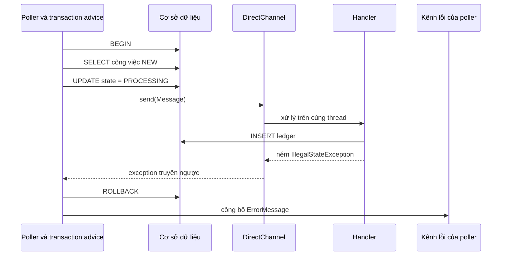

# Rollback khi handler lỗi

Trong chương **Poller transaction** của module **SPRING_INTEGRATION_CORE**, bài này giải thích cách một lỗi ở handler quyết định kết quả transaction do poller mở. Mục tiêu là thiết kế được luồng Message → MessageChannel → endpoint bằng Java DSL, đồng thời kiểm chứng được dữ liệu nào quay về trạng thái cũ khi xử lý thất bại.

Tình huống xuyên suốt: poller đọc một công việc từ cơ sở dữ liệu, đánh dấu đang xử lý rồi gọi handler ghi sổ nghiệp vụ. Handler phát sinh lỗi sau khi đã ghi sổ. Yêu cầu là công việc vẫn sẵn sàng cho lần đọc tiếp theo và bản ghi nghiệp vụ chưa được commit phải biến mất.

## 1. Điều kiện để lỗi handler dẫn tới rollback

Một handler ném exception chưa đủ để kết luận toàn bộ luồng sẽ rollback. Cần xác định bốn yếu tố:

1. Transaction đã được mở trước thao tác cần bảo vệ.
2. Thao tác đó thực sự tham gia tài nguyên do transaction manager quản lý.
3. Lỗi đi tới transaction interceptor trước khi phạm vi transaction kết thúc.
4. Quy tắc rollback áp dụng cho exception mà interceptor nhận được.

Poller có hỗ trợ transaction để bao bọc cả thao tác `receive()` và xử lý đồng bộ phía sau. Với transaction imperative, ngữ cảnh gắn với thread; một đoạn xử lý chuyển sang thread khác không tự kế thừa transaction này. [Spring Integration: Transaction Support](https://docs.spring.io/spring-integration/reference/6.5/transactions.html).

Có thể hình dung quyết định xử lý như sau:

```text
begin transaction
    receive từ nguồn
    gửi message qua kênh đồng bộ
    handler thực hiện nghiệp vụ
nếu hoàn thành bình thường và transaction không bị đánh dấu rollback-only:
    thử commit
nếu exception thoát ra và khớp quy tắc rollback:
    rollback
```

Commit vẫn có thể thất bại vì ràng buộc dữ liệu hoặc lỗi tài nguyên. Vì vậy, handler trả về bình thường chỉ cho biết phần thân xử lý đã kết thúc, chưa chứng minh commit thành công.

## 2. Theo dõi một lần xử lý thất bại

Giả sử công việc `id = 7` đang có `state = 'NEW'` và chưa có bản ghi tương ứng trong bảng `ledger`.



Sơ đồ mô tả cấu hình chuẩn trong ví dụ bên dưới: lỗi không bị advice khác nuốt, việc công bố lỗi của tác vụ poller diễn ra sau khi transaction advice đã xử lý exception.

Kết quả mong đợi sau lần thất bại:

| Dữ liệu hoặc hành động | Sau rollback trong ví dụ |
| --- | --- |
| `work_item.state` đổi thành `PROCESSING` | Trở lại `NEW` |
| Bản ghi `ledger` vừa được insert | Không còn trong dữ liệu đã commit |
| Bộ đếm Java đã tăng | Vẫn giữ giá trị mới |
| Exception đã được ghi vào kênh lỗi | Có thể đọc để quan sát thất bại |
| Công việc `id = 7` | Vẫn thỏa điều kiện truy vấn lần sau |

Bộ đếm là chi tiết cố ý của bài thực hành: nó cho thấy rollback cơ sở dữ liệu không đưa toàn bộ bộ nhớ ứng dụng về quá khứ.

## 3. Phạm vi của poller và phạm vi của handler

Đặt transaction ở poller có ý nghĩa khác với chỉ đặt `@Transactional` trên một service mà handler gọi.

```text
Transaction của poller:
    [receive + cập nhật nguồn + handler + ghi nghiệp vụ]

Chỉ có transaction ở service phía sau:
    receive + cập nhật nguồn
    [ghi nghiệp vụ trong service]
```

Trong cấu hình thứ hai, cập nhật nguồn có thể đã commit trước khi service bắt đầu. Service rollback không tự khôi phục phần đã hoàn tất bên ngoài transaction đó.

Đối với JDBC inbound adapter, `SELECT` tạo payload là một danh sách kết quả; câu `UPDATE` tùy chọn được thực hiện trong thao tác nhận. Đặt transaction trên poller giúp đưa cả hai câu lệnh vào cùng phạm vi với xử lý đồng bộ phía sau. [JDBC Inbound Channel Adapter](https://docs.spring.io/spring-integration/reference/6.5/jdbc/inbound-channel-adapter.html).

Ngược lại, thêm `@Transactional` vào một phương thức cấu hình `@Bean` không khiến mọi lần poll về sau chạy trong transaction. Cấu hình phải gắn advice vào endpoint thực thi tác vụ.

## 4. Ví dụ Java DSL với JDBC và H2

### 4.1. Nền tảng của ví dụ

Các đoạn mã dùng **Java 17 trở lên, Spring Integration 6.5.x và Spring Framework 6.2.x** làm mốc API. Đây là mốc minh họa, không phải khẳng định phiên bản mới nhất. Nếu chuyển sang major version khác, cần đối chiếu lại package và API.

Ứng dụng cần các dependency tương ứng:

- `org.springframework.integration:spring-integration-core`.
- `org.springframework.integration:spring-integration-jdbc`.
- `org.springframework:spring-jdbc`.
- `com.h2database:h2` cho cơ sở dữ liệu của ví dụ.
- Khi chạy kiểm thử: `spring-test`, JUnit Jupiter và `org.awaitility:awaitility`.

Dùng dependency management phù hợp với dự án để giữ các thư viện đồng bộ phiên bản. Không thêm một thư viện Java DSL riêng cho cấu hình này.

Ví dụ chỉ có **một poller, một nguồn và một handler**. Việc nhận việc đồng thời giữa nhiều instance cần thêm chiến lược khóa hoặc claim riêng; truy vấn minh họa chưa giải quyết bài toán đó.

### 4.2. Cấu hình đầy đủ

Đặt lớp dưới đây trong `RollbackDemoConfig.java` của một dự án thực hành:

```java
package example.integration;

import java.time.Duration;
import java.util.List;
import java.util.Map;
import java.util.concurrent.atomic.AtomicBoolean;
import java.util.concurrent.atomic.AtomicInteger;

import javax.sql.DataSource;

import org.springframework.context.annotation.Bean;
import org.springframework.context.annotation.Configuration;
import org.springframework.integration.channel.DirectChannel;
import org.springframework.integration.channel.QueueChannel;
import org.springframework.integration.config.EnableIntegration;
import org.springframework.integration.dsl.IntegrationFlow;
import org.springframework.integration.dsl.Pollers;
import org.springframework.integration.jdbc.JdbcPollingChannelAdapter;
import org.springframework.jdbc.core.JdbcTemplate;
import org.springframework.jdbc.datasource.DataSourceTransactionManager;
import org.springframework.jdbc.datasource.embedded.EmbeddedDatabase;
import org.springframework.jdbc.datasource.embedded.EmbeddedDatabaseBuilder;
import org.springframework.jdbc.datasource.embedded.EmbeddedDatabaseType;
import org.springframework.messaging.Message;
import org.springframework.transaction.PlatformTransactionManager;
import org.springframework.transaction.support.TransactionSynchronizationManager;

@Configuration
@EnableIntegration
public class RollbackDemoConfig {

    @Bean(destroyMethod = "shutdown")
    public EmbeddedDatabase dataSource() {
        return new EmbeddedDatabaseBuilder()
                .generateUniqueName(true)
                .setType(EmbeddedDatabaseType.H2)
                .build();
    }

    @Bean
    public JdbcTemplate jdbcTemplate(DataSource dataSource) {
        JdbcTemplate jdbc = new JdbcTemplate(dataSource);
        jdbc.execute("""
                CREATE TABLE work_item (
                    id BIGINT PRIMARY KEY,
                    amount DECIMAL(12, 2) NOT NULL,
                    state VARCHAR(20) NOT NULL
                )
                """);
        jdbc.execute("""
                CREATE TABLE ledger (
                    work_id BIGINT PRIMARY KEY,
                    amount DECIMAL(12, 2) NOT NULL
                )
                """);
        jdbc.update("""
                INSERT INTO work_item (id, amount, state)
                VALUES (?, ?, ?)
                """, 7L, new java.math.BigDecimal("125000.00"), "NEW");
        return jdbc;
    }

    @Bean
    public PlatformTransactionManager transactionManager(DataSource dataSource) {
        return new DataSourceTransactionManager(dataSource);
    }

    @Bean
    public JdbcPollingChannelAdapter workItemSource(JdbcTemplate jdbcTemplate) {
        JdbcPollingChannelAdapter source = new JdbcPollingChannelAdapter(
                jdbcTemplate,
                "SELECT id, amount FROM work_item WHERE state = 'NEW' ORDER BY id");
        source.setMaxRows(1);
        source.setRowMapper((rs, rowNum) -> Map.of(
                "id", rs.getLong("id"),
                "amount", rs.getBigDecimal("amount")));
        source.setUpdateSql("""
                UPDATE work_item
                SET state = 'PROCESSING'
                WHERE id IN (:id)
                """);
        return source;
    }

    @Bean
    public DirectChannel workItems() {
        DirectChannel channel = new DirectChannel();
        channel.setFailover(false);
        return channel;
    }

    @Bean
    public QueueChannel pollerErrors() {
        return new QueueChannel(10);
    }

    @Bean
    public WorkItemHandler workItemHandler(JdbcTemplate jdbcTemplate) {
        return new WorkItemHandler(jdbcTemplate);
    }

    @Bean
    public IntegrationFlow workItemFlow(
            JdbcPollingChannelAdapter workItemSource,
            WorkItemHandler workItemHandler,
            PlatformTransactionManager transactionManager) {

        return IntegrationFlow
                .from(workItemSource, endpoint -> endpoint
                        .id("workItemPoller")
                        .autoStartup(false)
                        .poller(Pollers.fixedDelay(Duration.ofHours(1))
                                .maxMessagesPerPoll(1)
                                .transactional(transactionManager)
                                .errorChannel("pollerErrors")))
                .channel("workItems")
                .handle(workItemHandler, "handle")
                .get();
    }

    public static final class WorkItemHandler {
        private final JdbcTemplate jdbc;
        private final AtomicBoolean failOnce = new AtomicBoolean(true);
        private final AtomicInteger attempts = new AtomicInteger();

        public WorkItemHandler(JdbcTemplate jdbc) {
            this.jdbc = jdbc;
        }

        public void handle(Message<?> message) {
            if (!TransactionSynchronizationManager.isActualTransactionActive()) {
                throw new IllegalStateException("Handler không có transaction");
            }

            List<?> rows = (List<?>) message.getPayload();
            Map<?, ?> row = (Map<?, ?>) rows.get(0);
            long id = ((Number) row.get("id")).longValue();
            attempts.incrementAndGet();

            jdbc.update("INSERT INTO ledger (work_id, amount) VALUES (?, ?)",
                    id, row.get("amount"));

            if (failOnce.getAndSet(false)) {
                throw new IllegalStateException("Lỗi mô phỏng sau INSERT ledger");
            }

            jdbc.update("UPDATE work_item SET state = 'DONE' WHERE id = ?", id);
        }

        public int attempts() {
            return attempts.get();
        }
    }
}
```

### 4.3. Vì sao cấu hình này có thể rollback cả hai bảng?

`transactionManager`, source và handler cùng dùng một `DataSource`. `JdbcTemplate` lấy connection theo ngữ cảnh transaction của Spring; vì vậy câu `UPDATE` trong source và câu `INSERT` trong handler cùng tham gia transaction được mở ở poller. [Spring Framework: Controlling Database Connections](https://docs.spring.io/spring-framework/reference/data-access/jdbc/connections.html).

Kênh `workItems` là `DirectChannel`, nên handler được gọi đồng bộ trên thread đang xử lý lần poll. Handler ném `IllegalStateException` sau `INSERT`; exception truyền ra ngoài, transaction advice có thể thực hiện rollback. Không cần thêm `@Transactional` lên handler để các thao tác JDBC này tham gia transaction đã có.

Một số chi tiết cần đọc đúng:

| Cấu hình | Vai trò trong bài thực hành |
| --- | --- |
| `source.setMaxRows(1)` | Payload của mỗi lần nhận có tối đa một hàng |
| `maxMessagesPerPoll(1)` | Mỗi đợt kích hoạt chỉ thực hiện tối đa một lần nhận |
| `WHERE id IN (:id)` | Dùng danh sách ID lấy từ kết quả truy vấn để cập nhật nguồn |
| `autoStartup(false)` | Test chủ động bắt đầu poller sau khi đã chuẩn bị quan sát |
| `fixedDelay(Duration.ofHours(1))` | Tránh lần poll tiếp theo chen vào lúc kiểm tra dữ liệu |
| `pollerErrors` | Hàng đợi quan sát lỗi của tác vụ poller |
| `failOnce` | Chỉ gây lỗi ở lần xử lý đầu tiên trong vòng đời bean |

`setMaxRows` là giới hạn hàng của source; nó khác số lần nhận do poller điều khiển. Hai thiết lập cùng bằng `1` giúp bài thực hành tránh lẫn một message chứa nhiều hàng với nhiều message. Không suy ra rằng tăng `maxMessagesPerPoll` sẽ gom tất cả lần nhận vào một transaction lớn. [API JdbcPollingChannelAdapter 6.5](https://docs.spring.io/spring-integration/docs/6.5.0/api/org/springframework/integration/jdbc/JdbcPollingChannelAdapter.html), [API PollerSpec 6.5](https://docs.spring.io/spring-integration/docs/6.5.0/api/org/springframework/integration/dsl/PollerSpec.html).

Khoảng delay một giờ phục vụ kiểm thử; lần thực thi đầu tiên vẫn có initial delay mặc định bằng `0`. Trong một ứng dụng chạy liên tục, có thể chọn khoảng poll thích hợp và cho endpoint tự khởi động. [API PeriodicTrigger](https://docs.spring.io/spring-framework/docs/current/javadoc-api/org/springframework/scheduling/support/PeriodicTrigger.html).

DDL và dữ liệu mẫu được khởi tạo ngay trong bean để ví dụ tự chứa. Ứng dụng thực tế nên quản lý schema và migration riêng.

## 5. Kiểm thử rollback bằng trạng thái dữ liệu

Một kiểm thử chỉ xác nhận “đã nhận exception” còn thiếu: handler có thể lỗi nhưng thao tác nguồn đã commit, hoặc bản ghi nghiệp vụ đã lọt sang transaction khác.

Kiểm thử dưới đây quan sát poller thật và kiểm tra ba kết quả sau lần thất bại:

1. Công việc trở lại `NEW`.
2. `ledger` không có bản ghi vừa được insert.
3. Handler thực sự đã được gọi một lần.

Sau đó test khởi động lại endpoint để chứng minh cùng công việc có thể được đọc lại và xử lý thành công.

```java
package example.integration;

import java.time.Duration;

import org.junit.jupiter.api.Test;
import org.springframework.beans.factory.annotation.Autowired;
import org.springframework.beans.factory.annotation.Qualifier;
import org.springframework.integration.channel.QueueChannel;
import org.springframework.integration.endpoint.SourcePollingChannelAdapter;
import org.springframework.jdbc.core.JdbcTemplate;
import org.springframework.messaging.Message;
import org.springframework.messaging.support.ErrorMessage;
import org.springframework.test.annotation.DirtiesContext;
import org.springframework.test.context.junit.jupiter.SpringJUnitConfig;

import static org.awaitility.Awaitility.await;
import static org.junit.jupiter.api.Assertions.*;

@SpringJUnitConfig(RollbackDemoConfig.class)
@DirtiesContext(classMode = DirtiesContext.ClassMode.AFTER_CLASS)
class RollbackDemoTest {

    @Autowired
    JdbcTemplate jdbc;

    @Autowired
    @Qualifier("workItemPoller")
    SourcePollingChannelAdapter poller;

    @Autowired
    @Qualifier("pollerErrors")
    QueueChannel errors;

    @Autowired
    RollbackDemoConfig.WorkItemHandler handler;

    @Test
    void rollbackThenCommitWhenTheSameWorkIsReadAgain() {
        Message<?> error;
        poller.start();
        try {
            error = errors.receive(5000);
        }
        finally {
            poller.stop();
        }

        ErrorMessage errorMessage = assertInstanceOf(ErrorMessage.class, error);
        Throwable cause = errorMessage.getPayload();
        while (cause.getCause() != null) {
            cause = cause.getCause();
        }
        assertInstanceOf(IllegalStateException.class, cause);
        assertEquals("Lỗi mô phỏng sau INSERT ledger", cause.getMessage());

        assertEquals("NEW", state());
        assertEquals(Integer.valueOf(0), ledgerCount());
        assertEquals(1, handler.attempts());

        poller.start();
        try {
            await().atMost(Duration.ofSeconds(5)).untilAsserted(() -> {
                assertEquals("DONE", state());
                assertEquals(Integer.valueOf(1), ledgerCount());
            });
        }
        finally {
            poller.stop();
        }

        assertEquals(2, handler.attempts());
        assertNull(errors.receive(0));
    }

    private String state() {
        return jdbc.queryForObject(
                "SELECT state FROM work_item WHERE id = 7", String.class);
    }

    private Integer ledgerCount() {
        return jdbc.queryForObject(
                "SELECT COUNT(*) FROM ledger WHERE work_id = 7", Integer.class);
    }
}
```

Không đặt `@Transactional` lên test này: thread của test và thread của poller có ranh giới riêng. Các truy vấn xác minh cần nhìn thấy kết quả sau khi transaction của poller đã kết thúc. `ErrorMessage` của lần lỗi là điểm đồng bộ để quan sát rollback; với lần thành công, Awaitility chờ đến khi dữ liệu đã commit có thể đọc được.

Bảng kết quả của hai lần xử lý:

| Thời điểm | `state` của công việc 7 | Số bản ghi `ledger` | `attempts` |
| --- | --- | --- | --- |
| Trước khi chạy | `NEW` | 0 | 0 |
| Sau lần handler gây lỗi | `NEW` | 0 | 1 |
| Sau lần đọc lại thành công | `DONE` | 1 | 2 |

`failOnce` đã chuyển sang `false` sau lần đầu và không bị rollback, nên lần đọc lại có thể đi hết handler. Đây là cơ chế gây lỗi cho test, không phải thiết kế bộ đếm retry bền vững.

Các đoạn mã là tài liệu thực hành; việc lưu bài học không đồng nghĩa chúng đã được biên dịch hoặc chạy trong repository này.

## 6. Exception nào quyết định rollback?

Theo cấu hình mặc định của Spring transaction, `RuntimeException` và `Error` dẫn tới rollback; checked exception không tự có quy tắc rollback tương tự. Có thể thay đổi bằng các rollback rule. [Spring Framework: Rolling Back a Declarative Transaction](https://docs.spring.io/spring-framework/reference/data-access/transaction/declarative/rolling-back.html).

Trong Spring Integration, exception nghiệp vụ có thể được bọc trong `MessageHandlingException` hoặc một `MessagingException` khác. Vì thế phải xem exception thực sự đi qua ranh giới transaction, không chỉ nhìn chữ ký `throws` của phương thức nghiệp vụ. Một checked exception làm nguyên nhân của runtime wrapper vẫn có thể đi kèm rollback mặc định.

Đặc biệt, không nên giả định `noRollbackFor` của một loại exception nghiệp vụ sẽ tự khớp khi interceptor chỉ nhận wrapper. Quy tắc theo kiểu exception không mặc nhiên duyệt toàn bộ chuỗi `cause`.

Nếu chính sách của poller là rollback với mọi `Exception` thoát ra, có thể khai báo advice rõ ràng:

```java
import java.util.List;

import org.springframework.context.annotation.Bean;
import org.springframework.transaction.PlatformTransactionManager;
import org.springframework.transaction.TransactionDefinition;
import org.springframework.transaction.interceptor.NameMatchTransactionAttributeSource;
import org.springframework.transaction.interceptor.RollbackRuleAttribute;
import org.springframework.transaction.interceptor.RuleBasedTransactionAttribute;
import org.springframework.transaction.interceptor.TransactionInterceptor;

@Bean
public TransactionInterceptor pollerTransactionAdvice(
        PlatformTransactionManager transactionManager) {
    RuleBasedTransactionAttribute attribute = new RuleBasedTransactionAttribute();
    attribute.setPropagationBehavior(TransactionDefinition.PROPAGATION_REQUIRED);
    attribute.setRollbackRules(List.of(new RollbackRuleAttribute(Exception.class)));

    NameMatchTransactionAttributeSource attributes =
            new NameMatchTransactionAttributeSource();
    attributes.addTransactionalMethod("*", attribute);

    TransactionInterceptor advice = new TransactionInterceptor();
    advice.setTransactionManager(transactionManager);
    advice.setTransactionAttributeSource(attributes);
    return advice;
}
```

Sau đó truyền bean advice này vào phương thức tạo flow và **thay** lời gọi `.transactional(transactionManager)` bằng:

```java
.transactional(pollerTransactionAdvice)
```

Không chồng hai transaction advice chỉ để thêm rollback rule. `RuleBasedTransactionAttribute` dùng quy tắc phù hợp gần nhất theo quan hệ kế thừa; nếu không có quy tắc riêng khớp, hành vi mặc định vẫn được áp dụng. [API RuleBasedTransactionAttribute](https://docs.spring.io/spring-framework/docs/6.2.0/javadoc-api/org/springframework/transaction/interceptor/RuleBasedTransactionAttribute.html), [API TransactionInterceptor](https://docs.spring.io/spring-framework/docs/6.2.0/javadoc-api/org/springframework/transaction/interceptor/TransactionInterceptor.html).

## 7. Bắt lỗi có thể làm transaction commit

Xét cách thay đoạn gây lỗi trong handler bằng:

```java
try {
    performBusinessOperation();
}
catch (RuntimeException ex) {
    logger.warn("Xử lý thất bại", ex);
    return;
}
```

Nếu không có phạm vi bên trong hoặc tài nguyên nào đã đánh dấu rollback-only, handler trả về bình thường và poller có thể commit những thay đổi trước đó. Log lỗi không phải tín hiệu rollback.

Khi yêu cầu nghiệp vụ là thất bại toàn bộ, hãy giữ exception truyền ra ngoài sau khi bổ sung thông tin chẩn đoán:

```java
catch (RuntimeException ex) {
    logger.warn("Xử lý thất bại, workId={}", workId, ex);
    throw ex;
}
```

Có một trường hợp khác: service con tham gia cùng transaction bằng `REQUIRED` đã đánh dấu rollback-only; handler phía ngoài bắt lỗi rồi tiếp tục. Transaction vẫn không thể commit và có thể kết thúc bằng `UnexpectedRollbackException`. Với `REQUIRES_NEW`, service con dùng transaction vật lý độc lập nên phần đã commit ở đó không bị rollback theo transaction ngoài. [Spring Framework: Transaction Propagation](https://docs.spring.io/spring-framework/reference/data-access/transaction/declarative/tx-propagation.html).

Vì vậy, khi thấy “đã bắt exception mà vẫn rollback”, cần kiểm tra cả các transaction scope bên trong. Khi thấy “handler lỗi mà dữ liệu vẫn còn”, cần kiểm tra exception có bị bắt trước ranh giới transaction hoặc dữ liệu có được ghi bằng transaction độc lập hay không.

## 8. `errorChannel` có nhiệm vụ gì?

`errorChannel` là tuyến chuyển thông tin lỗi tới handler quan sát hoặc xử lý lỗi. Nó không thay thế transaction advice.

Với luồng đồng bộ, exception có thể truyền ngược qua stack lời gọi. Với tác vụ poller theo lịch, cơ chế xử lý lỗi có thể bọc exception thành `ErrorMessage` và gửi tới kênh lỗi. Cấu hình `.errorChannel("pollerErrors")` trong ví dụ chọn kênh nhận lỗi của poller. [Spring Integration: Error Handling](https://docs.spring.io/spring-integration/reference/error-handling.html).

Phân biệt hai thời điểm:

| Trường hợp | Điều cần xem xét |
| --- | --- |
| Lỗi đã thoát qua transaction advice rồi mới được công bố | Một handler ghi log ở kênh lỗi không đảo ngược rollback đã hoàn tất |
| Handler hoặc recovery advice bắt lỗi và trả về trước transaction advice | Phạm vi ngoài có thể thấy hoàn thành bình thường và thử commit |

Không thể kết luận “error handler đã trả về bình thường nên transaction nghiệp vụ được commit” nếu chưa xác định error handler chạy ở đâu trong chuỗi thực thi.

Trong ví dụ, `pollerErrors` là queue bộ nhớ dành cho kiểm thử. Ứng dụng chạy lâu dài cần consumer cho kênh lỗi; nếu cứ đưa lỗi vào một queue hữu hạn mà không đọc, queue sẽ đầy. Bản thân việc công bố lỗi cũng có thể thất bại, nên cần quan sát log của hạ tầng.

Nếu cần lưu audit sau thất bại, phải chọn transaction riêng hoặc một cơ chế lưu phù hợp và kiểm thử nó độc lập. Chèn audit vào chính transaction sắp rollback sẽ khiến audit bị hủy cùng dữ liệu nghiệp vụ.

## 9. Đổi thread làm thay đổi kết quả rollback

Thay kênh đồng bộ bằng một `ExecutorChannel` chạy qua thread pool làm xuất hiện ranh giới khác:

```text
Thread poller:
    begin T1 → đọc nguồn → cập nhật nguồn → giao tác vụ cho executor → kết thúc T1

Thread worker:
    chạy handler → ghi nghiệp vụ → lỗi
```

Khi việc giao tác vụ đã thành công, T1 có thể commit trước lúc worker phát sinh lỗi. Transaction ở worker, nếu có, là một phạm vi cần được cấu hình riêng; lỗi tại đó không quay ngược thời gian để rollback T1.

`QueueChannel` cũng tách bước gửi vào queue khỏi bước consumer nhận và xử lý. `DirectChannel` hỗ trợ gọi handler trên thread gửi; channel dùng executor cho phép xử lý trên thread khác. [Message Channel Implementations](https://docs.spring.io/spring-integration/reference/6.5/channel/implementations.html).

Bảng dưới đây áp dụng cho mô hình transaction imperative của bài:

| Điểm nối | Handler phía sau mặc nhiên thuộc transaction poller? |
| --- | --- |
| `DirectChannel`, xử lý đồng bộ, cùng tài nguyên tham gia | Có thể thuộc cùng phạm vi |
| `ExecutorChannel` dùng thread pool | Không |
| Gửi vào queue rồi consumer nhận về sau | Không |
| Gọi service có `REQUIRES_NEW` | Phần service dùng transaction độc lập |
| Gọi HTTP hoặc gửi email | Tác dụng bên ngoài không trở thành dữ liệu JDBC transactional |

Thread pool cấp cho **chính poller** khác với executor nằm **giữa luồng**. Poller có thể mở transaction trên thread được giao chạy tác vụ, rồi gọi các handler đồng bộ trên thread ấy. Điều cần theo dõi là thread tại thời điểm transaction bắt đầu và việc xử lý có chuyển thread sau đó hay không.

## 10. Rollback không bảo đảm message tự quay lại nguồn

Trong ví dụ JDBC, công việc được đọc lại vì `UPDATE state = 'PROCESSING'` bị rollback, khiến hàng vẫn có `state = 'NEW'`. Đây là hệ quả của cách lưu trạng thái nguồn.

Nếu nguồn là một `QueueChannel` dùng queue trong bộ nhớ, thao tác `receive()` đã lấy message ra không tự được bù lại bởi `DataSourceTransactionManager`. Bền vững và transactional cũng là hai thuộc tính cần kiểm tra riêng: thêm kho lưu trữ chưa chứng minh việc nhận/gửi tham gia đúng transaction. [Cấu hình Message Channels và Message Store](https://docs.spring.io/spring-integration/reference/6.5/channel/configuration.html).

| Nguồn hoặc tác dụng | Cách đánh giá khả năng phục hồi |
| --- | --- |
| Hàng JDBC được đánh dấu trong cùng transaction | Kiểm tra trạng thái hàng sau rollback |
| Queue bộ nhớ thông thường | Không dựa vào JDBC rollback để đưa message trở lại |
| Broker có receive transactional | Kiểm tra transaction manager, session và chính sách redelivery cụ thể |
| File đã đổi tên hoặc HTTP đã thực hiện | Cần thiết kế bù trừ hoặc cơ chế phối hợp riêng |

Ví dụ, gửi email rồi mới insert `ledger` có thể tạo tình trạng email đã tới người nhận nhưng transaction cơ sở dữ liệu rollback. Một thiết kế phù hợp hơn là ghi yêu cầu gửi vào bảng outbox cùng transaction nghiệp vụ; thành phần khác đọc các yêu cầu đã commit để gửi. Khi đó vẫn cần chống gửi trùng và theo dõi retry ở bước gửi.

Đừng dùng giả định “poller transactional thì mọi thứ trong handler có thể undo” làm tiêu chí thiết kế.

## 11. Retry và rollback phải được đặt đúng thứ tự

Retry là thử lại thao tác; rollback là hủy thay đổi chưa commit trong một phạm vi transaction. Hai cơ chế có thể tương tác theo nhiều cách.

```text
Transaction(
    receive + Retry(handler)
)
```

Cách bố trí trên không mặc nhiên tạo transaction mới cho mỗi lần gọi handler. Trong bài thực hành, handler đã insert `ledger` rồi mới lỗi; retry ngay trong cùng transaction có thể gặp khóa chính trùng, hoặc tài nguyên đã ở trạng thái rollback-only.

Một cấu trúc khác về mặt ý tưởng là:

```text
Retry(
    Transaction(receive + handler)
)
```

Cấu trúc này chỉ có ích khi mỗi lần thử thật sự đi qua một transaction scope mới và nguồn cho phép nhận lại công việc sau rollback. Đây là sơ đồ để phân tích thứ tự advice, không phải đoạn DSL có thể sao chép trực tiếp.

`RequestHandlerRetryAdvice` hỗ trợ retry ở handler; một recovery callback có thể xử lý lỗi sau khi hết lượt thử. Nếu callback tiêu thụ exception và trả về bình thường trước khi transaction ngoài thấy lỗi, cần xem lại yêu cầu commit hay rollback. [Provided Advice Classes: Retry Advice](https://docs.spring.io/spring-integration/reference/6.5/handler-advice/classes.html).

Đối với ví dụ, việc khởi động poller lần thứ hai là **một lần đọc nguồn mới sau rollback**, không phải retry nội bộ của handler. Khóa chính `work_id` giúp phát hiện ghi trùng nhưng tự nó chưa tạo thành cơ chế idempotent hoàn chỉnh: ứng dụng vẫn cần quyết định một công việc đã tồn tại được xem là thành công hay lỗi.

## 12. Công việc lỗi liên tục và dữ liệu theo dõi

Nếu thay `failOnce` bằng một lỗi luôn xuất hiện, công việc `id = 7` sẽ liên tục quay về `NEW`. Với truy vấn sắp xếp theo ID và lấy một hàng, công việc này có thể khiến các hàng phía sau không được xử lý.

Một thiết kế vận hành cần quyết định rõ:

- Lỗi tạm thời nào được thử lại và thời gian chờ giữa các lần thử.
- Lỗi dữ liệu nào cần chuyển sang trạng thái từ chối hoặc khu vực cách ly.
- Nơi lưu số lần thất bại để thông tin không mất theo transaction đã rollback.
- Điều kiện cho phép xử lý lại một công việc đã được sửa dữ liệu.

Nếu tăng `attempt_count` trong chính transaction thất bại, giá trị tăng cũng sẽ bị rollback. Bộ đếm `AtomicInteger` trong ví dụ tránh hiệu ứng đó để quan sát test, nhưng mất khi tiến trình khởi động lại và không chia sẻ giữa các instance. Vì vậy, nó không phù hợp để quyết định giới hạn retry trong môi trường phân tán.

Với nhiều poller đồng thời, cần bổ sung cơ chế claim hoặc khóa và kiểm thử trên đúng hệ quản trị cơ sở dữ liệu sử dụng thực tế. Transaction bảo vệ tính nguyên tử của phạm vi đã chọn; nó không tự biến truy vấn nhận việc đơn giản thành hàng đợi phân tán.

## 13. Chẩn đoán khi kết quả khác dự kiến

Có thể bật log cho bài thực hành:

```properties
logging.level.org.springframework.integration=DEBUG
logging.level.org.springframework.transaction.interceptor=TRACE
logging.level.org.springframework.jdbc.datasource.DataSourceTransactionManager=DEBUG
```

Các dòng trên dùng cú pháp cấu hình logging của ứng dụng Spring Boot. Với Spring thuần, đặt logger tương ứng trong cấu hình hệ thống logging đang dùng.

Theo dõi `workId`, tên thread và nguyên nhân gốc thay vì chỉ ghi `message.getHeaders().getId()`. Khi đọc lại từ JDBC, message mới có thể mang ID thông điệp mới, trong khi vẫn đại diện cùng một công việc.

| Hiện tượng | Hướng kiểm tra đầu tiên |
| --- | --- |
| Handler lỗi nhưng `state = PROCESSING` vẫn còn | Transaction có bao cả thao tác nhận không; source có dùng cùng DataSource không |
| `ledger` vẫn có hàng sau lỗi | Lỗi có bị nuốt; ghi sổ có dùng transaction hoặc connection khác không |
| Có `UnexpectedRollbackException` ở cuối | Scope `REQUIRED` bên trong có đánh dấu rollback-only không |
| Lỗi worker xảy ra sau khi nguồn đã commit | Có executor hoặc queue tách thread giữa luồng không |
| Message mất khỏi queue bộ nhớ | Đã giả định sai rằng transaction JDBC có thể phục hồi queue hay chưa |
| Một công việc xuất hiện mãi trong log | Điều kiện chọn lại, chính sách retry và nơi lưu trạng thái thất bại |
| Test không nhìn thấy dữ liệu mong đợi | Có chờ transaction poller kết thúc và có bọc test trong transaction riêng không |

Khi xác minh rollback, bằng chứng quan trọng nhất là dữ liệu đọc từ phạm vi độc lập sau khi transaction của poller kết thúc. Log exception chỉ giúp giải thích nguyên nhân; kết quả truy vấn mới cho biết yêu cầu phục hồi trạng thái có đạt được hay không.