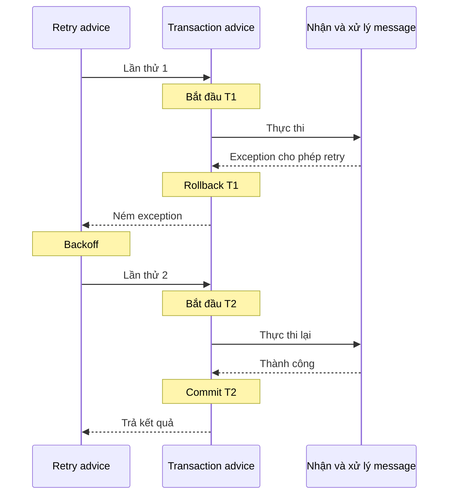

# Thứ tự retry advice và transaction advice

Trong chương **Poller transaction** của module **SPRING_INTEGRATION_CORE**, thứ tự advice quyết định một lần retry có mở lại transaction hay chỉ chạy lại thao tác bên trong transaction đang có. Quyết định này ảnh hưởng trực tiếp đến rollback, thời gian giữ khóa, việc đọc lại thông điệp và khả năng ghi dữ liệu trùng.

Với một poller cần thử lại toàn bộ thao tác đọc và xử lý khi gặp lỗi tạm thời, cấu trúc thường cần là:

```text
Retry advice
└── Transaction advice
    └── receive → xử lý đồng bộ → kết thúc lần poll
```

Trong cấu trúc này, retry nằm ngoài nên có thể gọi lại transaction advice. Tuy nhiên, mỗi lần thử chỉ thực sự có transaction mới khi transaction advice tạo một transaction vật lý mới. Nếu `REQUIRED` tham gia transaction đã có, kết luận đó không còn đúng.

## 1. Mục tiêu và kiến thức nền

Sau bài học, bạn có thể:

- Đọc chuỗi advice từ ngoài vào trong và xác định phạm vi được retry.
- Phân biệt transaction logic với transaction vật lý trong từng lần thử.
- Cấu hình poller bằng Java DSL với retry và transaction theo thứ tự tường minh.
- Giải thích vì sao đặt transaction ngoài retry có thể giữ transaction lỗi qua nhiều lần thử.
- Nhận diện khi rollback không khôi phục được thông điệp hoặc tác động bên ngoài.
- Thiết kế quan sát và kịch bản kiểm chứng cho lỗi tạm thời, lỗi commit và xử lý thất bại cuối cùng.

Bạn nên biết `Message`, `MessageChannel`, endpoint, `MessageSource`, poller và cách một handler xử lý payload. Cần phân biệt `DirectChannel`, thường gọi subscriber ngay trên thread gửi, với các ranh giới bất đồng bộ như `ExecutorChannel` hoặc việc đưa thông điệp vào một hàng đợi để xử lý về sau.

Transaction của Spring thường gắn với thread. Vì vậy, việc một message đi qua transformer, filter, router, service activator hoặc gateway không tự chứng minh tất cả thao tác đó thuộc cùng transaction. Cần theo dõi đường gọi thực tế, channel được sử dụng và transaction manager quản lý tài nguyên nào.

## 2. Advice đứng trước bọc advice đứng sau

Advice là phần xử lý bao quanh một lời gọi. Với các interceptor bao quanh cùng một điểm gọi, chuỗi:

```text
[Retry, Transaction, Target]
```

có nghĩa là `Retry` được gọi trước, rồi chuyển quyền cho `Transaction`, sau đó mới đến `Target`. Kết quả hoặc exception đi ngược chiều ra ngoài.

Có thể đọc chuỗi này như các lời gọi lồng nhau:

```java
retry(() -> transaction(() -> target()));
```

Đảo danh sách thành `[Transaction, Retry, Target]` sẽ tạo cấu trúc khác:

```java
transaction(() -> retry(() -> target()));
```

Hai cấu trúc có thể cho kết quả giống nhau khi mọi thao tác đều thành công ngay. Khi xuất hiện lỗi hoặc rollback, chúng có hành vi khác nhau.

Trong bài này, `Target` biểu diễn thao tác mà advice của poller bao quanh. Với ví dụ giới hạn một message mỗi poll, có thể hình dung đó là việc nhận message và chuyển nó vào đoạn flow đồng bộ tương ứng. Không đồng nhất phạm vi này với một lô nghiệp vụ nhiều message hoặc toàn bộ lịch chạy của scheduler.

### 2.1. Retry cần bao quanh đúng thao tác

Trước khi chọn thứ tự, cần trả lời câu hỏi nghiệp vụ: thao tác nào được phép chạy lại?

| Phạm vi được bao quanh | Thao tác có thể bị thực hiện lại | Điều cần chứng minh |
| --- | --- | --- |
| Poller nhận và chuyển tiếp message | Nhận nguồn, tạo message, gửi qua đoạn flow đồng bộ | Nguồn có thể được đọc lại an toàn sau rollback |
| Một handler cụ thể | Logic của handler trong callback được advice bao quanh | Handler chịu được lặp lại và transaction của nó được bố trí đúng |
| Lời gọi HTTP trong handler | Request tới hệ thống bên ngoài | Phía nhận có cơ chế chống thực hiện trùng |
| Thao tác ghi dữ liệu | Các câu lệnh trong phạm vi được retry | Lần thử sau không dùng lại transaction đã hỏng |

Retry một handler với message đã nhận và retry một poller bằng cách gọi lại `receive()` là hai lựa chọn khác nhau. Đây là khác biệt quan trọng khi thiết kế endpoint, gateway và các mẫu tích hợp.

## 3. Retry ngoài, transaction trong

Xét chuỗi:

```text
Retry → Transaction → Target
```

Giả sử:

- Khi bắt đầu poll không có transaction đang hoạt động trên thread.
- Transaction advice dùng `PROPAGATION_REQUIRED`.
- Exception của lần thử thất bại thỏa điều kiện rollback.
- Retry policy cho phép thử lại loại exception đó.
- Các thao tác cần bảo vệ tham gia đúng transaction và chạy đồng bộ trong phạm vi này.

Khi đó, lần thử đầu tiên mở transaction T1. Nếu xử lý thất bại, transaction advice rollback T1 rồi ném lỗi ra ngoài. Retry advice nhận lỗi, chờ theo backoff và gọi lại phần bên trong. Lần thử tiếp theo mở T2.



Các hệ quả chính:

1. Lỗi của từng lần thử đi qua transaction advice trước khi đến retry advice.
2. Nếu rollback được yêu cầu, transaction của lần đó kết thúc trước khi backoff bắt đầu.
3. Lần thử sau có cơ hội đọc dữ liệu mới, lấy lại khóa và thực hiện lại toàn bộ đơn vị công việc.
4. Lỗi phát sinh khi transaction advice commit cũng nằm bên trong phạm vi quan sát của retry advice.

Điểm 4 chỉ nói về vị trí bắt được exception. Có thử lại lỗi commit hay không còn phụ thuộc retry policy và khả năng xác định kết quả commit. Một exception tại thời điểm commit không luôn chứng minh rằng dữ liệu chưa được commit.

### 3.1. Backoff có thực sự ở ngoài transaction?

Với các giả định trên, T1 đã rollback trước khi retry chờ. Điều này tránh giữ transaction của lần thử đó xuyên qua khoảng nghỉ.

Tuy nhiên, nếu có transaction ngoài T0 và advice dùng `REQUIRES_NEW`, sau khi T1 kết thúc, T0 được khôi phục. Khoảng backoff khi đó vẫn diễn ra trong thời gian tồn tại của T0. Không nên suy rộng rằng đặt retry ngoài sẽ loại bỏ mọi transaction hoặc mọi khóa khỏi thời gian chờ.

### 3.2. Không phải lỗi nào cũng gây rollback

Spring transaction thường mặc định rollback đối với `RuntimeException` và `Error`; checked exception cần được xét theo rollback rule đã cấu hình. Nếu target ném checked exception mà transaction advice cho phép commit, retry bên ngoài có thể chạy lại sau một lần thử đã commit dữ liệu.

Vì vậy, cần thiết kế đồng thời:

```text
Lỗi nào được thử lại?
Lỗi đó có khiến transaction rollback không?
Nếu đã có tác động được commit, chạy lại có an toàn không?
```

Thứ tự đúng không bù được cho rollback rule không phù hợp.

## 4. Transaction ngoài, retry trong

Xét chuỗi ngược lại:

```text
Transaction → Retry → Target
```

Transaction advice mở T1 rồi gọi retry advice. Các lần thử bên trong diễn ra trong cùng phạm vi transaction ngoài, trừ khi có một ranh giới transaction khác tạo transaction độc lập.

```text
Bắt đầu T1
  Lần thử 1 → lỗi → retry bắt lỗi
  Backoff trong thời gian T1 còn tồn tại
  Lần thử 2 → tiếp tục trong T1
  Lần thử 3 → tiếp tục trong T1
Commit hoặc rollback T1 sau khi retry kết thúc
```

### 4.1. Transaction interceptor ngoài có thể chưa thấy lỗi từng lần thử

Retry advice bắt exception của lần thử đầu. Nếu lần thử sau thành công, transaction advice bên ngoài có thể chỉ thấy một kết quả bình thường.

Do đó, không chính xác khi khẳng định rằng mọi exception bị retry bắt đều tự động làm transaction ngoài trở thành `rollback-only`. Trạng thái thực tế phụ thuộc vào tài nguyên và các ranh giới transaction đã được đi qua.

Ví dụ:

- Một phép tính Java ném exception trước khi truy cập tài nguyên có thể không làm transaction hiện tại hỏng.
- Một lỗi database có thể khiến transaction không thể tiếp tục sử dụng cho các câu lệnh sau.
- Một phương thức qua proxy `@Transactional(REQUIRED)` ở bên trong có thể đánh dấu transaction dùng chung là `rollback-only` rồi ném lỗi cho retry.

Không nên dùng một trong các trường hợp này làm quy luật cho mọi exception.

### 4.2. Thử lại trên transaction đã lỗi

Nếu lần thử đầu làm transaction bị đánh dấu `rollback-only`, lần thử tiếp theo vẫn có thể chạy code Java, nhưng kết quả đó không bảo đảm sẽ được commit.

Khi transaction ngoài kết thúc, nó có thể rollback hoặc ném `UnexpectedRollbackException`, tùy đường đi và cách đánh dấu rollback. Với một số lỗi database, các câu lệnh tiếp theo đã thất bại ngay vì transaction chưa được rollback.

Đây là lý do việc tăng số lần retry không khắc phục được tình huống đang thử lại trong một transaction không còn sử dụng được.

### 4.3. Các lần thử có thể giữ lại thay đổi dở dang

Giả sử target thực hiện:

```text
1. Ghi bản ghi A.
2. Gọi một thao tác Java có thể lỗi.
3. Ghi bản ghi B.
```

Nếu bước 2 thất bại nhưng transaction vẫn dùng được, retry bên trong T1 có thể thực hiện lại bước 1. Dữ liệu của lần thử trước chưa được rollback riêng. Kết quả có thể là ghi trùng, cộng số dư nhiều lần hoặc vi phạm ràng buộc duy nhất.

Transaction ngoài chỉ bảo đảm ranh giới commit/rollback cuối cùng cho phần tài nguyên tham gia. Nó không tự tạo rollback riêng giữa các lần thử của retry.

### 4.4. Lỗi commit nằm ngoài retry bên trong

Khi retry trả kết quả thành công, transaction advice mới tiến hành commit. Nếu commit thất bại, retry đã kết thúc callback nên không thể tự thử lại lỗi đó.

| Tiêu chí | Retry → Transaction → Target | Transaction → Retry → Target |
| --- | --- | --- |
| Vị trí transaction advice | Được gọi trong mỗi lần thử | Bao quanh toàn bộ retry |
| Transaction mới mỗi lần thử | Có khi advice tạo transaction mới | Không do riêng transaction ngoài tạo ra |
| Rollback trước lần thử sau | Có nếu rule yêu cầu và đó là transaction riêng | Không có rollback riêng từ advice ngoài giữa các lần thử |
| Backoff | Sau khi transaction riêng của lần thử kết thúc | Trong thời gian transaction ngoài còn tồn tại |
| Exception khi commit | Có thể đến retry advice | Nằm ngoài retry bên trong |
| Trường hợp cần cân nhắc | Thử lại trọn đơn vị công việc có transaction | Thử lại thao tác nhỏ vẫn an toàn trong cùng transaction |

Transaction ngoài retry không phải lúc nào cũng sai. Nó phù hợp khi bạn chủ động muốn giữ một transaction, thao tác được lặp lại không để lại thay đổi dở dang và lỗi không làm transaction hỏng. Cần chứng minh các điều kiện đó theo nghiệp vụ và tài nguyên cụ thể.

## 5. Propagation quyết định transaction vật lý

Thứ tự advice cho biết interceptor nào được gọi lại. Propagation cho biết interceptor đó mở transaction mới, tham gia transaction đang có hay tạo một phạm vi khác.

### 5.1. `REQUIRED` khi không có transaction ngoài

```text
Retry
  Lần 1: REQUIRED → tạo T1 → rollback
  Lần 2: REQUIRED → tạo T2 → commit
```

Đây là trường hợp cơ sở của ví dụ poller trong bài. Không có transaction ngoài để tham gia, nên mỗi lần vào transaction advice sau khi lần trước kết thúc sẽ mở transaction mới.

### 5.2. `REQUIRED` khi đã có T0

```text
T0 đang hoạt động
└── Retry
    ├── Lần 1: REQUIRED → tham gia T0
    └── Lần 2: REQUIRED → vẫn tham gia T0
```

Mỗi lần gọi transaction advice có thể tạo một phạm vi transaction logic, nhưng cùng tham gia T0 về mặt vật lý. Nếu một phạm vi bên trong đánh dấu rollback, những lần thử sau không tự làm T0 trở lại trạng thái có thể commit.

Kết luận cần ghi nhớ:

> Đặt retry trước transaction là điều kiện về cấu trúc gọi; việc có transaction vật lý mới cho từng lần thử còn phụ thuộc propagation và transaction đang tồn tại.

### 5.3. `REQUIRES_NEW`

`REQUIRES_NEW` có thể tạm ngưng transaction ngoài và mở transaction riêng khi advice được gọi:

```text
T0
└── Retry
    ├── Tạm ngưng T0 → T1 → rollback → khôi phục T0
    └── Tạm ngưng T0 → T2 → commit   → khôi phục T0
```

Điều này tạo ranh giới độc lập cho mỗi lần thử, nhưng cũng thay đổi tính nguyên tử của nghiệp vụ. T2 đã commit sẽ không bị rollback chỉ vì T0 rollback sau đó.

Ngoài ra, transaction ngoài có thể vẫn giữ connection hoặc khóa của nó trong lúc transaction mới cần tài nguyên khác. Cần xét kích thước connection pool và quan hệ khóa trước khi dùng cách này cho nhiều poller đồng thời.

### 5.4. `NESTED` và savepoint

`NESTED`, khi transaction manager hỗ trợ, có thể sử dụng savepoint trong transaction vật lý hiện có. Rollback về savepoint không tương đương mở transaction vật lý mới.

Khóa, trạng thái tài nguyên và khả năng tiếp tục sau lỗi phải được xét theo database và transaction manager. Không dùng `NESTED` như một lời bảo đảm chung rằng retry có thể khôi phục mọi transaction lỗi.

## 6. Cấu hình Java DSL với thứ tự tường minh

Ví dụ dưới đây sử dụng các API của Spring Retry như `RetryTemplate`, `RetryOperationsInterceptor` và Java DSL của Spring Integration. Đây là retry theo interceptor của Spring Retry; nếu dự án dùng một cơ chế retry khác, cần đối chiếu API và phạm vi advice tương ứng.

Dự án cần có Spring Integration Core, Spring Retry, Spring Transaction và thành phần truy cập dữ liệu phù hợp. Mã cấu hình giả định ứng dụng cung cấp:

- Một `PlatformTransactionManager` quản lý tài nguyên dùng trong flow.
- Một `MessageSource<Job>` đọc nguồn có khả năng tham gia transaction đó.
- Một bean triển khai `JobService` để xử lý job.

`Job` và `JobService` trong ví dụ là hợp đồng nghiệp vụ để ứng dụng triển khai; cấu hình này không tự tạo nguồn dữ liệu hoặc database.

```java
import java.util.List;
import java.util.Map;

import org.springframework.beans.factory.annotation.Qualifier;
import org.springframework.context.annotation.Bean;
import org.springframework.context.annotation.Configuration;
import org.springframework.dao.TransientDataAccessException;
import org.springframework.integration.channel.DirectChannel;
import org.springframework.integration.core.MessageSource;
import org.springframework.integration.dsl.IntegrationFlow;
import org.springframework.integration.dsl.Pollers;
import org.springframework.retry.backoff.FixedBackOffPolicy;
import org.springframework.retry.interceptor.RetryOperationsInterceptor;
import org.springframework.retry.policy.SimpleRetryPolicy;
import org.springframework.retry.support.RetryTemplate;
import org.springframework.transaction.PlatformTransactionManager;
import org.springframework.transaction.TransactionDefinition;
import org.springframework.transaction.interceptor.MatchAlwaysTransactionAttributeSource;
import org.springframework.transaction.interceptor.RollbackRuleAttribute;
import org.springframework.transaction.interceptor.RuleBasedTransactionAttribute;
import org.springframework.transaction.interceptor.TransactionInterceptor;

@Configuration
public class PollerRetryTransactionConfig {

    public record Job(long id, String payload) {
    }

    public interface JobService {
        void process(Job job);
    }

    @Bean
    public RetryOperationsInterceptor pollRetryAdvice() {
        SimpleRetryPolicy retryPolicy = new SimpleRetryPolicy(
                3,
                Map.of(TransientDataAccessException.class, true),
                true); // Cho phép xét nguyên nhân bên trong exception bọc.

        FixedBackOffPolicy backOff = new FixedBackOffPolicy();
        backOff.setBackOffPeriod(200L);

        RetryTemplate retryTemplate = new RetryTemplate();
        retryTemplate.setRetryPolicy(retryPolicy);
        retryTemplate.setBackOffPolicy(backOff);

        RetryOperationsInterceptor interceptor =
                new RetryOperationsInterceptor();
        interceptor.setRetryOperations(retryTemplate);
        return interceptor;
    }

    @Bean
    public TransactionInterceptor pollTransactionAdvice(
            PlatformTransactionManager transactionManager) {

        RuleBasedTransactionAttribute attribute =
                new RuleBasedTransactionAttribute();
        attribute.setPropagationBehavior(
                TransactionDefinition.PROPAGATION_REQUIRED);
        attribute.setRollbackRules(
                List.of(new RollbackRuleAttribute(Exception.class)));

        MatchAlwaysTransactionAttributeSource attributeSource =
                new MatchAlwaysTransactionAttributeSource();
        attributeSource.setTransactionAttribute(attribute);

        return new TransactionInterceptor(
                transactionManager, attributeSource);
    }

    @Bean
    public DirectChannel jobChannel() {
        return new DirectChannel();
    }

    @Bean
    public IntegrationFlow jobFlow(
            MessageSource<Job> jobSource,
            JobService jobService,
            @Qualifier("jobChannel") DirectChannel jobChannel,
            @Qualifier("pollRetryAdvice")
            RetryOperationsInterceptor retryAdvice,
            @Qualifier("pollTransactionAdvice")
            TransactionInterceptor transactionAdvice) {

        return IntegrationFlow
                .from(jobSource, endpoint -> endpoint.poller(
                        Pollers.fixedDelay(1_000)
                                .maxMessagesPerPoll(1)
                                .advice(retryAdvice, transactionAdvice)))
                .channel(jobChannel)
                .handle(jobService, "process")
                .get();
    }
}
```

### 6.1. Những lựa chọn có ý nghĩa trong cấu hình

**Thứ tự advice:** `.advice(retryAdvice, transactionAdvice)` biểu diễn retry bọc transaction tại chuỗi advice của poller. Cách khai báo này giúp đọc trực tiếp thứ tự mong muốn. Tránh khai báo thêm một transaction advice ở nơi khác mà chưa xác định nó bọc phần nào của flow.

**Số lần thử:** `SimpleRetryPolicy` đặt tối đa `3` lần thực hiện, gồm lần đầu và tối đa hai lần thử lại. Nó không có nghĩa là một lần đầu cộng thêm ba lần retry.

**Phân loại lỗi:** Chỉ `TransientDataAccessException` và các lớp con, kể cả khi nằm trong cause chain mà policy xét được, mới thuộc nhóm được thử lại. Lỗi validation hoặc lỗi lập trình không tự trở thành lỗi retry. Nếu tầng truy cập dữ liệu không chuyển exception về hệ phân cấp này, cần phân loại theo exception thực tế của ứng dụng.

**Rollback:** Ví dụ yêu cầu rollback với `Exception` nhằm tránh trường hợp checked exception thoát ra nhưng transaction vẫn commit. Đây là lựa chọn minh họa cho đơn vị công việc của bài; nghiệp vụ thực tế cần xác định rollback rule của mình.

**Không recovery thành công giả:** Ví dụ không cấu hình recoverer để đổi lỗi cuối cùng thành một kết quả bình thường. Khi retry hết lượt hoặc gặp lỗi không được thử lại, exception tiếp tục đi ra ngoài.

**Một message mỗi poll:** `maxMessagesPerPoll(1)` giới hạn số message ở nhịp poll để phạm vi minh họa dễ theo dõi. Nó không ngăn retry gọi lại thao tác nhận nguồn nhiều lần khi có lỗi.

**Đoạn xử lý đồng bộ:** `DirectChannel` giữ lời gọi handler trong đường gọi đồng bộ của poller. Điều này cho phép exception từ `JobService.process()` quay về transaction advice và retry advice.

**Cùng tài nguyên:** Một transaction manager cho database A không tự quản lý database B, một request HTTP hoặc một broker bất kỳ. Cần kiểm tra từng tài nguyên tham gia.

### 6.2. Hợp đồng của nguồn dữ liệu

Để ví dụ đạt mục tiêu thử lại nguyên đơn vị công việc, nguồn `jobSource` phải có hành vi thích hợp. Chẳng hạn, một nguồn đọc bảng công việc có thể lấy một job đang chờ và cập nhật trạng thái nhận việc trong cùng transaction với thao tác ghi nghiệp vụ.

Nếu xử lý thất bại và rollback:

```text
Cập nhật trạng thái nhận việc → rollback
Ghi dữ liệu nghiệp vụ        → rollback
Lần thử sau                  → nguồn có thể cung cấp việc chưa hoàn tất
```

Cách khóa bản ghi, chống hai worker cùng nhận việc và cập nhật trạng thái phụ thuộc nguồn dữ liệu cụ thể. Chỉ thêm transaction advice vào poller không tự cung cấp các cơ chế đó.

Khi có nhiều worker, một lần retry cũng có thể nhận một job khác vì thứ tự hoặc quyền sở hữu đã thay đổi. Retry cả poll không phải cam kết giữ nguyên định danh job giữa các lần thử.

## 7. Poller retry có thể nhận message khác

Đây là rủi ro dễ bỏ sót khi chỉ nhìn sơ đồ transaction.

Giả sử `QueueChannel` trong bộ nhớ đang có M1 và M2:

```text
Lần thử 1:
  receive() lấy M1 khỏi queue
  handler xử lý M1 thất bại
  transaction database rollback

Lần thử 2:
  receive() lấy M2
  handler xử lý M2 thành công
```

Rollback của database không tự đặt M1 trở lại `QueueChannel` trong bộ nhớ. Retry có thể báo thành công vì lần poll tiếp theo xử lý được M2, trong khi M1 chưa được hoàn tất.

Từ đó cần phân biệt hai yêu cầu:

| Yêu cầu nghiệp vụ | Hướng thiết kế cần đánh giá |
| --- | --- |
| Thử lại trọn thao tác nhận và xử lý | Nguồn hỗ trợ rollback/redelivery hoặc cơ chế khôi phục phù hợp |
| Thử lại xử lý đúng message đã nhận | Giữ message ở phạm vi handler; thiết kế transaction của từng lần xử lý |
| Đưa message thất bại trở lại hệ thống | Cơ chế requeue, nack, redelivery hoặc lưu lỗi do nguồn hỗ trợ |
| Không mất việc khi tiến trình dừng | Nguồn lưu bền và quy trình xác nhận hoàn tất rõ ràng |

Một message store lưu bền cũng cần được đánh giá theo cách cập nhật, transaction manager và cấu hình thực tế. Tính lưu bền không tự đồng nghĩa với khả năng rollback việc nhận message trong mọi cấu hình.

### 7.1. Poller advice và handler retry advice

Spring Integration có `RequestHandlerRetryAdvice` cho phạm vi xử lý request của handler. Advice này giúp biểu đạt việc thử lại handler với message đang xử lý, khác với retry interceptor đặt quanh hoạt động poll.

Khi dùng nó, cần kiểm tra callback thực tế được advice bao quanh và exception có nằm trong callback đó không. Không mặc định rằng nó retry toàn bộ nguồn vào, cả flow phía sau hoặc mọi lỗi xảy ra ở thread khác.

Nếu handler retry chạy bên trong transaction của poller, các lần thử handler vẫn có thể tham gia cùng transaction đó. Muốn mỗi lần thử handler có transaction riêng, cần đặt một ranh giới transaction được gọi lại ở bên trong retry và đánh giá propagation như ở phần trước.

`RequestHandlerRetryAdvice` và `RetryOperationsInterceptor` vì vậy không phải hai tên gọi có thể thay thế tùy ý tại mọi vị trí cấu hình.

## 8. Ranh giới thread và các thành phần trong flow

### 8.1. Đường đi đồng bộ

```text
Poller [Retry → Transaction]
  → DirectChannel
  → transformer
  → filter
  → router
  → service activator
```

Nếu tất cả lời gọi liên quan chạy đồng bộ trên cùng thread và không có ranh giới transaction làm thay đổi việc tham gia, exception ở cuối đường đi có thể quay ngược về poller.

Tuy nhiên, filter bỏ message theo cấu hình thường là một kết quả bình thường. Nó không tự tạo exception để kích hoạt retry hoặc rollback. Nếu nghiệp vụ xem việc bị loại là thất bại, cần cấu hình hoặc xử lý rõ tình huống đó.

### 8.2. Chuyển sang thread khác

```text
Poller [Retry → Transaction]
  → ExecutorChannel
      → thread xử lý riêng
          → service activator
```

Poller có thể hoàn thành việc gửi và kết thúc transaction trước khi handler trên thread khác xử lý xong. Lỗi ở thread đó không tự đi ngược vào retry đã hoàn tất của poller. Transaction gắn với thread của poller cũng không tự truyền sang thread mới.

Nếu cần retry và transaction cho handler bất đồng bộ, phải thiết kế chúng ở phía xử lý đó, cùng cơ chế lưu message và báo lỗi tương ứng.

### 8.3. Gateway, aggregator và trạng thái tích hợp

Gateway không tự biến toàn bộ lời gọi qua một hệ thống khác thành một transaction database duy nhất. Cần xem message đi qua channel nào, reply được tạo ở đâu và lỗi được truyền hoặc chuyển đổi ra sao.

Aggregator có thể tích lũy message theo nhiều lần nhận khác nhau. Một transaction của poller không tự bao trùm toàn bộ thời gian chờ đủ nhóm. Việc lưu group, đánh dấu hoàn tất và xử lý output phải được xét theo message store và tài nguyên thật sự tham gia.

Các thành phần này vẫn tuân theo nguyên tắc chung: chỉ những thao tác nằm trong phạm vi gọi phù hợp và tham gia đúng transaction mới được bảo vệ bởi transaction đó.

## 9. Exception, error channel và recovery

### 9.1. Retry cần nhận được exception

Nếu code bắt lỗi rồi trả về như đã thành công:

```java
try {
    writeBusinessData();
} catch (RuntimeException ex) {
    logFailure(ex);
    // Không ném lại, không đánh dấu rollback.
}
```

Advice bên ngoài không còn nhận exception đó để phân loại retry. Transaction cũng có thể commit nếu tài nguyên chưa tự chuyển sang trạng thái rollback-only.

Việc gửi `ErrorMessage` tới một channel bằng code ứng dụng cũng không mặc nhiên tương đương ném exception qua transaction advice. Phải xét kết quả và exception thực sự rời khỏi callback.

### 9.2. Error handler của task và lỗi bên trong advice

Cần phân biệt nơi tiếp nhận lỗi cuối cùng của task poller với nơi retry bắt lỗi trong advice chain. Khi exception đi qua transaction advice, transaction có thể đã rollback trước khi tầng xử lý lỗi của task tiếp nhận lỗi cuối cùng.

Ngược lại, nếu một thành phần bên trong chuyển lỗi thành kết quả bình thường trước khi exception đi đến transaction advice, transaction advice có thể không áp dụng rollback theo exception đó.

Vì vậy, việc nhìn thấy thông báo trên `errorChannel` chưa đủ để kết luận transaction đã commit hay rollback. Cần theo dõi vị trí phát sinh `ErrorMessage`, thứ tự lời gọi và kết quả hoàn tất transaction.

### 9.3. Recovery thay đổi kết quả mà advice ngoài nhìn thấy

Sau khi hết lượt, một cơ chế recovery có thể ghi lỗi, chuyển message sang nơi xử lý thất bại hoặc trả về giá trị dự phòng.

Hai vị trí tạo ra hệ quả khác nhau:

- **Retry ngoài transaction:** Nếu từng lần thử có transaction riêng và đã rollback, recovery chạy sau các lần thử đó. Ghi database trong recovery không tự được bao bởi transaction riêng đã kết thúc.
- **Retry trong transaction:** Recovery trả kết quả bình thường có thể khiến transaction ngoài tiếp tục tới commit, bao gồm các thay đổi còn lại của những lần thử trước nếu transaction chưa bị đánh dấu rollback-only.

Giá trị recovery còn phải đáp ứng hợp đồng của điểm gọi được advice bao quanh. Không nên trả tùy ý một payload hoặc `null` từ recovery của poller như thể đang phục hồi một handler có kiểu kết quả khác.

Nếu cần lưu trạng thái lỗi bền vững hoặc đưa message vào dead-letter destination, hãy xác định transaction của thao tác đó. Ghi log đơn thuần không thay thế được cơ chế giữ lại công việc thất bại.

### 9.4. Stateless retry và stateful retry

Ví dụ trong bài dùng retry stateless: các lần thử diễn ra trong cùng đợt thực thi của interceptor, với backoff giữa các lần gọi lại.

Stateful retry có thể lưu trạng thái theo khóa và ném lỗi ra ngoài giữa các lần nhận lại, để transaction hoặc cơ chế redelivery của nguồn có cơ hội xử lý. Nó cần nguồn có thể đưa lại đúng công việc và một khóa định danh ổn định.

Không thay stateless bằng stateful chỉ để tìm cách có transaction mới. Trước hết phải xác định ai sẽ gọi lại, khi nào gọi lại và message có còn là cùng một công việc hay không.

## 10. Retry không bảo đảm exactly-once

Xét một handler:

```text
1. Ghi dữ liệu database.
2. Gọi HTTP để thu tiền.
3. Thực hiện thêm một thao tác database rồi gặp lỗi.
```

Rollback database không thu hồi được khoản tiền đã được hệ thống HTTP xử lý. Nếu retry chạy lại handler, request thu tiền có thể lặp lại.

Các hướng thiết kế cần gắn với loại tác động:

| Tác động | Cơ chế cần xem xét |
| --- | --- |
| Ghi cùng một sự kiện nghiệp vụ nhiều lần | Khóa nghiệp vụ ổn định và ràng buộc duy nhất |
| Cập nhật dữ liệu rồi cần phát sự kiện | Transactional outbox cùng transaction database, có consumer chống trùng |
| Gọi API hỗ trợ chống lặp | Idempotency key giữ nguyên qua các lần thử |
| Nhận lại message từ broker | Khóa định danh công việc và cơ chế deduplication phù hợp |
| Lỗi sau thời điểm có thể đã commit | Đối chiếu trạng thái theo khóa nghiệp vụ trước khi thực hiện lại |

Khóa chống trùng nên biểu diễn cùng một hành động nghiệp vụ, chẳng hạn `paymentRequestId`. Nếu mỗi lần poll tạo một message với `MessageHeaders.ID` mới, dùng ID đó có thể không nhận diện được công việc trùng.

Outbox và deduplication vẫn cần thiết kế xử lý lặp ở phía nhận. Chỉ đổi thứ tự advice không biến luồng tích hợp thành exactly-once.

## 11. Backoff, lịch poll và thời gian giữ tài nguyên

`fixedDelay` của poller quy định lịch chạy của task. Backoff của retry quy định khoảng chờ giữa các lần thử bên trong đợt thực thi đang diễn ra. Hai giá trị này có vai trò khác nhau.

Với một task chạy trực tiếp đồng bộ, có ba lần thử, mỗi lần tốn khoảng 100 ms và có hai khoảng backoff 200 ms:

```text
Thời gian thực thi task xấp xỉ:
100 + 200 + 100 + 200 + 100 = 700 ms
```

Với fixed delay 1.000 ms, lần chạy theo lịch tiếp theo bắt đầu sau khi lần chạy đó kết thúc rồi chờ thêm khoảng delay, bỏ qua sai số lập lịch. Nếu cấu hình thêm task executor hoặc cơ chế thực thi khác, cần đánh giá thời điểm bàn giao và hoàn tất task thực tế.

Backoff dạng blocking vẫn chiếm thread thực thi trong lúc chờ. Khi có nhiều poller cùng lỗi, số thread bị giữ và thời gian xử lý tích lũy có thể trở thành vấn đề dù transaction riêng đã kết thúc.

Đối với hệ thống chịu tải, cần xác định:

- Tổng thời gian tối đa cho một đợt retry.
- Số lần thử và khoảng backoff phù hợp với độ dài gián đoạn dự kiến.
- Giới hạn thread, connection pool và số poller chạy đồng thời.
- Cách tránh nhiều worker thử lại cùng lúc, chẳng hạn backoff có jitter khi cơ chế retry hỗ trợ.
- Quan hệ với retry ở broker, HTTP client hoặc một tầng khác.

Nếu hai tầng đều có tối đa ba lần thực hiện và tầng ngoài gọi lại toàn bộ tầng trong, số lần gọi target có thể lên tới chín. Cần đếm số lần thực thi thực tế thay vì chỉ xem một cấu hình retry riêng lẻ.

## 12. Tình huống thực hành: nhận job và ghi kết quả

Một hệ thống đọc bảng `pending_job` rồi ghi kết quả xử lý vào cùng database. Mỗi job có `jobId` ổn định.

Đơn vị công việc mong muốn:

```text
Nhận một job đang chờ
→ ghi kết quả theo jobId
→ đánh dấu job hoàn tất
→ commit
```

Giả sử nguồn và handler cùng tham gia một transaction; poller không có transaction ngoài; retry chỉ áp dụng cho lỗi truy cập dữ liệu tạm thời.

### 12.1. Lần thử đầu thất bại

1. Retry gọi transaction advice, mở T1.
2. Nguồn nhận job J42 trong T1.
3. Handler ghi dữ liệu nhưng gặp lỗi tạm thời được cấu hình cho retry.
4. Exception đi ra khỏi handler, qua `DirectChannel` và về transaction advice.
5. T1 rollback; cập nhật nhận việc và dữ liệu nghiệp vụ thuộc T1 bị hoàn tác.
6. Retry nhận exception rồi backoff.

### 12.2. Lần thử sau thành công

1. Retry gọi lại transaction advice, mở T2.
2. Nguồn nhận một job hợp lệ; có thể là J42 nếu nó vẫn là job được chọn.
3. Handler ghi kết quả và trạng thái hoàn tất.
4. T2 commit.

Nếu nghiệp vụ yêu cầu bắt buộc thử lại J42 thay vì nhận bất kỳ job hợp lệ nào, cần thiết kế cơ chế giữ định danh hoặc giao nhận lại theo J42. Chuỗi advice của poller không tự tạo bảo đảm đó.

### 12.3. Những thay đổi làm mất giả định của tình huống

| Thay đổi | Hệ quả phải đánh giá lại |
| --- | --- |
| Nguồn đánh dấu nhận việc bằng transaction riêng đã commit | Rollback handler không trả job về trạng thái chờ |
| Thay `DirectChannel` bằng `ExecutorChannel` | Lỗi handler có thể xảy ra sau khi poller kết thúc |
| Handler ghi database khác | Một transaction manager cục bộ không tự bảo vệ cả hai |
| Handler bắt lỗi rồi trả về | Retry có thể không chạy và transaction có thể commit |
| Gọi API bên ngoài trong handler | Tác động bên ngoài có thể lặp lại sau rollback |
| Dùng `REQUIRED` trong T0 đã tồn tại | Các lần thử có thể dùng chung transaction vật lý |

## 13. Cách kiểm chứng thứ tự và kết quả

Không chỉ kiểm tra rằng handler được gọi ba lần. Cần kiểm tra cả ranh giới transaction, dữ liệu sau rollback và định danh công việc được xử lý.

### 13.1. Kịch bản kiểm chứng

| Kịch bản | Điều cần quan sát |
| --- | --- |
| Thành công ngay lần đầu | Một lần xử lý, transaction commit, kết quả nghiệp vụ đúng |
| Lỗi tạm thời trước khi ghi | Retry đúng số lần; với cấu hình tạo transaction riêng, mỗi lần vào transaction mới |
| Ghi một phần rồi ném lỗi retryable | Dữ liệu của lần thất bại bị rollback trước lần thử sau |
| Lỗi không thuộc retry policy | Không chạy đủ mọi lượt; exception thoát ra và rollback theo rule |
| Checked exception | Kết quả rollback khớp cấu hình thay vì chỉ dựa vào mặc định |
| Hết lượt retry | Không có kết quả thành công giả; lỗi cuối cùng đến cơ chế xử lý đã chọn |
| Có transaction T0 bên ngoài | Xác nhận `REQUIRED` tham gia T0 và trạng thái rollback được truyền đúng |
| Nguồn không transactional | Theo dõi M1/M2 để phát hiện việc retry nhận sang message khác |
| Chuyển sang thread khác | Xác nhận lỗi phía sau có nằm ngoài phạm vi retry của poller không |
| Lỗi tại thời điểm commit | Xác nhận policy và quy trình đối chiếu khi kết quả commit không chắc chắn |

Với cấu hình `Retry → Transaction`, ba lần thử thất bại có rollback rule phù hợp và không có transaction ngoài sẽ dẫn tới ba lần bắt đầu và ba lần rollback transaction. Khi lần thứ ba thành công, kỳ vọng là ba lần bắt đầu, hai rollback và một commit.

Đây là kỳ vọng cho các giả định đã nêu, không phải quy luật áp dụng cho mọi propagation, nguồn message hoặc đường xử lý recovery.

### 13.2. Quan sát có ích

Các log hoặc metric nên cho phép liên kết:

- Khóa nghiệp vụ của công việc, ví dụ `jobId`.
- Số thứ tự lần thử trong một đợt retry.
- Thread đang thực thi và endpoint tương ứng.
- Loại exception cuối cùng và nguyên nhân dùng để phân loại.
- Transaction bắt đầu, commit, rollback hoặc chỉ tham gia transaction ngoài.
- Thời gian xử lý, thời gian backoff và số công việc đi vào nhánh xử lý lỗi.

Chỉ gọi `isActualTransactionActive()` hoặc ghi tên transaction chưa đủ chứng minh hai lần thử có hai transaction vật lý khác nhau. Có thể quan sát sự kiện begin/commit/rollback tại transaction manager hoặc bổ sung instrumentation phù hợp với tài nguyên.

Cũng không dùng việc thấy cùng một đối tượng connection từ pool để kết luận transaction chưa được tạo mới. Một connection vật lý có thể được tái sử dụng cho nhiều transaction nối tiếp.

Khi viết kiểm thử tích hợp cho JDBC, cần kiểm tra trạng thái database sau từng kết quả, không chỉ đếm lần gọi mock. Tránh để transaction tự động của lớp kiểm thử vô tình thay đổi giả định không có transaction ngoài.

Các kiểm thử lỗi khóa hoặc lỗi commit cần dựa trên hành vi của database và driver được sử dụng. Một exception tự ném trong Java hữu ích để kiểm tra luồng advice, nhưng không đại diện cho mọi trạng thái lỗi của tài nguyên thật.

## 14. Lỗi thường gặp và cách điều chỉnh

| Hiện tượng | Nguyên nhân có thể có | Hướng điều chỉnh |
| --- | --- | --- |
| Retry nhiều lần nhưng cuối cùng vẫn rollback | Retry đang chạy trong transaction dùng chung đã rollback-only | Kiểm tra thứ tự, propagation và transaction ngoài |
| Dữ liệu dở dang của lần trước còn trong lần sau | Transaction ngoài bao cả retry hoặc rollback rule không khớp | Đặt ranh giới rollback đúng đơn vị công việc |
| Poller báo thành công nhưng một message mất dấu | Retry toàn bộ poll đã nhận message khác từ nguồn không rollback được | Chọn cơ chế giữ message hoặc redelivery phù hợp |
| Handler lỗi nhưng poller không retry | Ranh giới bất đồng bộ hoặc exception bị bắt bên trong | Đặt retry tại nơi thực thi lỗi và làm rõ đường truyền exception |
| Thu tiền hoặc gửi email nhiều lần | Tác động bên ngoài không được rollback | Dùng idempotency key hoặc tách tác động qua cơ chế lưu bền thích hợp |
| Tăng retry làm hệ thống chậm hơn | Backoff giữ thread, giữ transaction ngoài hoặc có nhiều tầng retry | Giới hạn tổng thời gian và phối hợp các tầng |
| Có lỗi commit nhưng không thấy retry | Transaction advice nằm ngoài retry hoặc lỗi không thuộc policy | Xác định vị trí commit và tính an toàn trước khi đổi policy |
| Recovery được gọi nhưng lỗi không được lưu bền | Recovery nằm ngoài transaction đã kết thúc | Cấp ranh giới transaction thích hợp cho thao tác lưu lỗi |

## 15. Câu hỏi tự kiểm tra

1. Với `.advice(retryAdvice, transactionAdvice)`, điều gì bảo đảm transaction advice được gọi lại? Điều gì mới bảo đảm transaction vật lý mới được tạo?
2. Tại sao `REQUIRED` có thể cho T1, T2 ở một cấu hình nhưng vẫn dùng T0 ở cấu hình khác?
3. Khi transaction nằm ngoài retry, vì sao không thể khẳng định exception đầu tiên luôn đánh dấu rollback-only?
4. Nếu lần thử thứ hai thành công nhưng cuối cùng nhận `UnexpectedRollbackException`, cần kiểm tra những ranh giới transaction nào?
5. Nếu nguồn là `QueueChannel` trong bộ nhớ, rollback database có khôi phục message đã lấy ra không?
6. Khi đưa một `ExecutorChannel` vào flow, phạm vi lỗi nào còn quay về poller?
7. Nếu lỗi commit xảy ra sau khi database có thể đã commit, điều kiện nào làm retry an toàn?
8. Vì sao recovery trả kết quả bình thường có thể làm thay đổi quyết định commit của advice bên ngoài?

Các câu trả lời cần dựa trên cùng bốn yếu tố: **phạm vi thao tác được gọi lại, thứ tự advice, propagation thực tế và khả năng rollback hoặc thực hiện lặp của tài nguyên**. Khi bốn yếu tố này đã rõ, cấu hình retry và transaction mới phản ánh đúng yêu cầu nghiệp vụ của luồng thông điệp.
