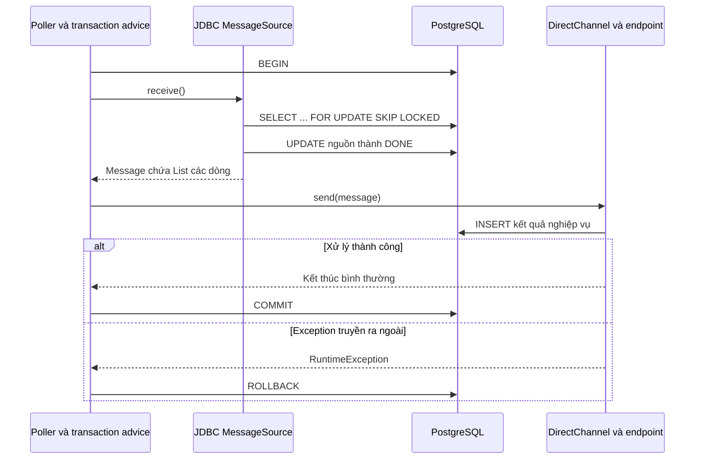
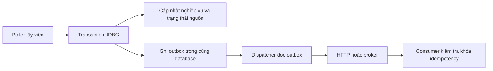

# Poller transaction với database

## 1. Mục tiêu và phạm vi

Trong module `SPRING_INTEGRATION_CORE`, bài thuộc chương **Poller transaction** này giải thích cách thiết kế một luồng đọc database sao cho việc lấy công việc, cập nhật trạng thái và ghi kết quả nghiệp vụ có thể cùng thành công hoặc cùng rollback.

Sau bài học, bạn có thể:

- Đặt ranh giới giao dịch quanh thao tác `receive()` của poller, thay vì chỉ quanh service phía sau.
- Kết hợp JDBC inbound adapter, `Message`, `DirectChannel`, splitter, transformer và service activator bằng Java DSL.
- Chọn transaction manager đúng `DataSource` và nhận diện những thành phần làm tách phạm vi giao dịch.
- Thiết kế truy vấn lấy việc khi nhiều instance cùng chạy; phân biệt rollback, retry và idempotency.
- Xây dựng kịch bản kiểm thử commit, rollback, cạnh tranh và chuyển giao bất đồng bộ.

Ví dụ sử dụng **Java 17+, Spring Integration 6.5.x, Spring Framework 6.2.x và PostgreSQL 17**. Đây là mốc phiên bản của ví dụ; khi ứng dụng dùng Spring Boot, hãy để BOM của phiên bản Boot tương thích quản lý các thư viện Spring. Cú pháp `LIMIT` và `FOR UPDATE SKIP LOCKED` bên dưới dành cho PostgreSQL.

## 2. Bài toán: lấy việc xong nhưng xử lý thất bại

Giả sử ứng dụng nhận yêu cầu tạo đơn hàng qua bảng `integration_job`. Poller định kỳ lấy các dòng `NEW`, chuyển chúng sang `DONE`, rồi ghi dữ liệu vào bảng `processed_order`.

Một luồng thiếu ranh giới giao dịch phù hợp có thể diễn ra như sau:

```text
SELECT công việc NEW
UPDATE công việc thành DONE và commit
Gọi service tạo đơn hàng
Service ném exception
Lần poll sau không còn thấy công việc vì trạng thái đã là DONE
```

Nếu chỉ thêm `@Transactional` vào service tạo đơn hàng, giao dịch của service bắt đầu sau khi nguồn đã đọc và cập nhật dữ liệu. Annotation đó không tự kéo những thao tác đã hoàn tất trước đó vào cùng giao dịch.

Mục tiêu của poller transaction là bao quanh đơn vị công việc:

```text
BEGIN
  Đọc và khóa các dòng cần xử lý
  Cập nhật trạng thái nguồn
  Gửi message và chạy các endpoint đồng bộ
  Ghi dữ liệu nghiệp vụ qua cùng tài nguyên JDBC
COMMIT nếu mọi bước thành công; ROLLBACK nếu có lỗi phù hợp quy tắc rollback
```

Spring Integration đưa thao tác `receive()` vào phạm vi giao dịch thông qua transaction advice của poller. Cơ chế này dùng hạ tầng transaction của Spring Framework. Xem [Poller Transaction Support](https://docs.spring.io/spring-integration/reference/6.5/transactions.html#poller-transaction-support).

## 3. Các thành phần tham gia

| Thành phần | Vai trò trong bài | Điều cần kiểm soát |
| --- | --- | --- |
| `JdbcPollingChannelAdapter` | Thực thi truy vấn lấy việc và tùy chọn câu lệnh cập nhật nguồn | Cùng `DataSource` với transaction manager |
| Poller của `SourcePollingChannelAdapter` | Quyết định thời điểm gọi nguồn và áp dụng transaction advice | Transaction phải bắt đầu trước `receive()` |
| `Message` | Mang danh sách các dòng được đọc và các header | Header không mang theo JDBC transaction sang thread khác |
| `DirectChannel` | Chuyển message tới consumer ngay trên thread gửi | Handler phía sau phải tiếp tục xử lý đồng bộ |
| Splitter | Tách danh sách thành các message con | Không tự chia giao dịch theo từng dòng |
| Transformer | Chuyển một dòng JDBC sang đối tượng nghiệp vụ | Lỗi chuyển đổi phải được xử lý đúng chính sách |
| Service activator | Ghi kết quả nghiệp vụ | Dùng JDBC tham gia giao dịch hiện tại |
| `DataSourceTransactionManager` | Quản lý giao dịch cục bộ của một JDBC `DataSource` | Không tự quản lý thêm database hoặc broker khác |

`DataSourceTransactionManager` gắn JDBC connection với thread hiện tại. `JdbcTemplate` lấy connection theo cơ chế của Spring nên có thể tham gia giao dịch đó khi dùng đúng `DataSource`. Hai pool có cùng JDBC URL vẫn không nên được xem là cùng tài nguyên giao dịch. Xem [DataSourceTransactionManager](https://docs.spring.io/spring-framework/docs/6.2.x/javadoc-api/org/springframework/jdbc/datasource/DataSourceTransactionManager.html).



Sơ đồ mô tả luồng imperative đồng bộ của bài. Điều kiện cùng thread cần đi kèm cùng tài nguyên giao dịch và propagation phù hợp; chỉ cùng thread chưa đủ để mọi thao tác đều được rollback.

## 4. Chuẩn bị database

Tạo các bảng sau trong một database PostgreSQL dành cho thực hành:

```sql
CREATE TABLE integration_job (
    id          BIGINT PRIMARY KEY,
    order_ref   VARCHAR(80) NOT NULL,
    amount      NUMERIC(18, 2) NOT NULL,
    status      VARCHAR(16) NOT NULL DEFAULT 'NEW',
    created_at  TIMESTAMPTZ NOT NULL DEFAULT CURRENT_TIMESTAMP,
    CONSTRAINT integration_job_status
        CHECK (status IN ('NEW', 'DONE', 'FAILED'))
);

CREATE INDEX integration_job_pending_idx
    ON integration_job (id)
    WHERE status = 'NEW';

CREATE TABLE processed_order (
    job_id      BIGINT PRIMARY KEY REFERENCES integration_job(id),
    order_ref   VARCHAR(80) NOT NULL UNIQUE,
    amount      NUMERIC(18, 2) NOT NULL,
    created_at  TIMESTAMPTZ NOT NULL DEFAULT CURRENT_TIMESTAMP
);

INSERT INTO integration_job (id, order_ref, amount)
VALUES
    (101, 'ORDER-101', 120000.00),
    (102, 'ORDER-102', 250000.00);
```

`integration_job.id` là định danh ổn định của một công việc. `processed_order.job_id` ngăn ghi nhiều kết quả cho cùng công việc, còn `order_ref` biểu diễn ràng buộc nghiệp vụ của ví dụ.

Chỉ mục partial giúp truy vấn tập trung vào phần dữ liệu đang chờ. Trong hệ thống thực tế, cần quan sát execution plan theo phân bố dữ liệu và chính sách lưu trữ; một bảng tích lũy nhiều dòng `DONE` cũng cần cơ chế lưu trữ hoặc dọn dữ liệu.

Bảng nguồn cố ý chưa ràng buộc `amount > 0` để có thể đưa dữ liệu không hợp lệ vào bài thực hành rollback. Service sẽ kiểm tra điều kiện này.

## 5. Cấu hình Java DSL

### 5.1. Điều kiện chạy ví dụ

Ứng dụng cần các dependency `spring-integration-core`, `spring-integration-jdbc`, `spring-jdbc` và PostgreSQL JDBC driver. Dùng bộ phiên bản Spring tương thích; Java DSL nằm trong `spring-integration-core`, không cần thêm thư viện Java DSL cũ.

Đoạn cấu hình sau được nạp vào một Spring application context đã cung cấp bean `DataSource` kết nối tới database ở phần 4. Ví dụ giả định context có một `DataSource`; nếu có nhiều nguồn, dùng `@Qualifier` nhất quán cho nguồn, transaction manager và `JdbcTemplate`.

```java
package example.integration;

import java.math.BigDecimal;
import java.util.Map;

import javax.sql.DataSource;

import org.springframework.beans.factory.annotation.Qualifier;
import org.springframework.context.annotation.Bean;
import org.springframework.context.annotation.Configuration;
import org.springframework.integration.channel.DirectChannel;
import org.springframework.integration.config.EnableIntegration;
import org.springframework.integration.dsl.IntegrationFlow;
import org.springframework.integration.dsl.Pollers;
import org.springframework.integration.jdbc.JdbcPollingChannelAdapter;
import org.springframework.jdbc.core.JdbcTemplate;
import org.springframework.jdbc.datasource.DataSourceTransactionManager;
import org.springframework.transaction.PlatformTransactionManager;

@Configuration
@EnableIntegration
public class JobPollingConfiguration {

    @Bean
    public PlatformTransactionManager jdbcTxManager(DataSource dataSource) {
        return new DataSourceTransactionManager(dataSource);
    }

    @Bean
    public JdbcTemplate jobJdbcTemplate(DataSource dataSource) {
        return new JdbcTemplate(dataSource);
    }

    @Bean
    public JdbcPollingChannelAdapter pendingJobs(DataSource dataSource) {
        var source = new JdbcPollingChannelAdapter(dataSource, """
                SELECT id, order_ref, amount
                FROM integration_job
                WHERE status = 'NEW'
                ORDER BY id
                LIMIT 10
                FOR UPDATE SKIP LOCKED
                """);

        source.setUpdateSql("""
                UPDATE integration_job
                SET status = 'DONE'
                WHERE id IN (:id) AND status = 'NEW'
                """);

        return source;
    }

    @Bean
    public DirectChannel jobWorkChannel() {
        return new DirectChannel();
    }

    @Bean
    public OrderWriter orderWriter(
            @Qualifier("jobJdbcTemplate") JdbcTemplate jdbc) {
        return new OrderWriter(jdbc);
    }

    @Bean
    public IntegrationFlow databaseJobFlow(
            JdbcPollingChannelAdapter pendingJobs,
            DirectChannel jobWorkChannel,
            OrderWriter orderWriter,
            @Qualifier("jdbcTxManager") PlatformTransactionManager tm) {

        return IntegrationFlow
                .from(pendingJobs, endpoint -> endpoint
                        .id("databaseJobPoller")
                        .poller(Pollers.fixedDelay(1000)
                                .maxMessagesPerPoll(1)
                                .transactional(tm)))
                .channel(jobWorkChannel)
                .split()
                .transform(Map.class, JobPollingConfiguration::toOrderTask)
                .handle(orderWriter, "write")
                .get();
    }

    private static OrderTask toOrderTask(Map<?, ?> row) {
        return new OrderTask(
                ((Number) row.get("id")).longValue(),
                (String) row.get("order_ref"),
                (BigDecimal) row.get("amount"));
    }

    public record OrderTask(long id, String orderRef, BigDecimal amount) {
    }

    public static class OrderWriter {

        private final JdbcTemplate jdbc;

        public OrderWriter(JdbcTemplate jdbc) {
            this.jdbc = jdbc;
        }

        public void write(OrderTask task) {
            if (task.amount().signum() <= 0) {
                throw new IllegalArgumentException(
                        "Amount must be positive; jobId=" + task.id());
            }

            jdbc.update("""
                    INSERT INTO processed_order (job_id, order_ref, amount)
                    VALUES (?, ?, ?)
                    """, task.id(), task.orderRef(), task.amount());
        }
    }
}
```

`OrderWriter.write()` trả về `void`, vì đây là endpoint cuối của luồng một chiều. Luồng không cần `replyChannel` để trả kết quả cho một caller.

Transaction advice được gắn trực tiếp vào poller bằng `.transactional(tm)`. Ví dụ không dựa vào `@Transactional` ở service để mở giao dịch nguồn, và không cần `@EnableTransactionManagement` chỉ để transaction advice này hoạt động. Nếu bổ sung service dùng annotation, cần cấu hình cơ chế annotation tương ứng.

### 5.2. Payload và câu lệnh update

Với mapper mặc định, một lần nhận có dữ liệu tạo message với payload là `List<Map<String, Object>>`. Ví dụ giữ kiểu này tới splitter, sau đó mới đổi từng map thành `OrderTask`.

`:id` trong câu lệnh update được lấy theo quy ước từ cột `id` của danh sách kết quả. Nếu đổi mapper hoặc tên thuộc tính, cần kiểm tra lại parameter mapping. Tài liệu [JDBC Inbound Channel Adapter](https://docs.spring.io/spring-integration/reference/6.5/jdbc/inbound-channel-adapter.html) mô tả payload dạng danh sách và quy ước tham số này.

Điểm quan trọng về thứ tự: `JdbcPollingChannelAdapter` chạy `SELECT`, rồi chạy `UPDATE` nếu cấu hình, sau đó mới trả payload cho poller. Nó không chờ service nghiệp vụ hoàn tất mới thực thi câu lệnh update. Có thể đối chiếu trực tiếp [phương thức doReceive() của phiên bản 6.5.4](https://github.com/spring-projects/spring-integration/blob/v6.5.4/spring-integration-jdbc/src/main/java/org/springframework/integration/jdbc/JdbcPollingChannelAdapter.java).

Trong ví dụ, giá trị `DONE` được ghi bên trong giao dịch chưa commit. Ý nghĩa “đã hoàn tất” chỉ đáng tin ở dữ liệu đã commit sau khi downstream thành công. Payload vẫn chứa dữ liệu của lần `SELECT`; adapter không tự đọc lại bảng để phản ánh mọi giá trị vừa cập nhật.

### 5.3. Vì sao các câu lệnh cùng một giao dịch?

- Poller mở giao dịch trước khi gọi nguồn.
- Nguồn và `jobJdbcTemplate` dùng cùng bean `DataSource`.
- `DirectChannel` và các endpoint trong ví dụ xử lý ngay trên thread poller.
- Không có executor, queue hay thao tác mở giao dịch độc lập giữa nguồn và writer.
- Lỗi ở downstream được truyền ra ngoài tới transaction advice.

Các điều kiện này tạo nên tính nguyên tử của ví dụ. Việc hai thành phần đều dùng tên gọi “transactional” không tự chứng minh chúng thuộc cùng một giao dịch.

## 6. Quan sát commit và rollback

### 6.1. Trường hợp thành công

Khi ứng dụng đã xử lý dữ liệu mẫu, kiểm tra từ một kết nối SQL riêng:

```sql
SELECT id, status
FROM integration_job
ORDER BY id;

SELECT job_id, order_ref, amount
FROM processed_order
ORDER BY job_id;
```

Kết quả mong đợi là nguồn có `101`, `102` ở trạng thái `DONE`, và bảng đích có đúng hai đơn hàng tương ứng.

Việc quan sát qua connection khác giúp đánh giá trạng thái đã commit. Nếu query ngay trong handler đang chạy giao dịch, bạn có thể nhìn thấy các thay đổi tạm thời của chính giao dịch đó.

### 6.2. Một dòng lỗi làm rollback cả batch

Dừng ứng dụng trước khi chuẩn bị lại dữ liệu trên database thực hành:

```sql
DELETE FROM processed_order WHERE job_id IN (101, 102);

UPDATE integration_job
SET status = 'NEW'
WHERE id IN (101, 102);

UPDATE integration_job
SET amount = -1
WHERE id = 102;
```

Sau khi chạy lại ứng dụng:

1. Nguồn đọc cả hai dòng, cập nhật tạm thời cả hai thành `DONE`.
2. Splitter gửi dòng `101`; writer chèn một đơn hàng trong giao dịch hiện tại.
3. Splitter gửi dòng `102`; writer ném `IllegalArgumentException`.
4. Exception truyền ngược lên poller; giao dịch rollback.
5. Cả hai dòng nguồn trở về `NEW`, và đơn hàng `101` vừa chèn cũng không tồn tại trong dữ liệu đã commit.

Vì dữ liệu `102` vẫn sai, poller có thể gặp lại lỗi ở các lượt sau. Để kết thúc tình huống thực hành, dừng ứng dụng, sửa `amount` của `102` thành số dương rồi chạy lại.

Rollback không có nghĩa là framework đã sửa được dữ liệu hoặc tự quyết định lịch retry phù hợp.

### 6.3. Khác biệt khi bỏ transaction của poller

Nếu bỏ `.transactional(tm)`, các câu lệnh JDBC không còn được ví dụ này gom vào giao dịch nguồn. Trong cấu hình connection thông thường, update nguồn có thể đã commit trước khi downstream lỗi. Một dòng `DONE` có thể không có đơn hàng tương ứng.

Đây cũng là lý do không dùng một bài test chỉ gọi riêng `OrderWriter.write()` để kết luận poller transaction đúng.

## 7. Batch, maxRows và maxMessagesPerPoll

Ba giới hạn sau tác động lên các tầng khác nhau:

| Cấu hình | Đơn vị tác động | Trong ví dụ |
| --- | --- | --- |
| SQL `LIMIT 10` | Số dòng tối đa của một kết quả truy vấn | Tối đa 10 công việc mỗi lần `receive()` |
| `source.setMaxRows(n)` | Giới hạn số dòng JDBC trả về cho adapter | Không dùng; giới hạn trực tiếp bằng SQL |
| `maxMessagesPerPoll(1)` | Số lần nhận nguồn tối đa trong một lượt kích hoạt poller | Một lần gọi nguồn, có thể chứa nhiều dòng |

Đối với JDBC inbound adapter, tăng `maxMessagesPerPoll` có thể khiến truy vấn được gọi nhiều lần liên tiếp trong cùng lượt kích hoạt. Nó không phải số dòng SQL. Nguồn trả `null` khi không có dữ liệu để tạo message. Xem [max-rows và max-messages-per-poll](https://docs.spring.io/spring-integration/reference/6.5/jdbc/inbound-channel-adapter.html#jdbc-max-rows-versus-max-messages-per-poll).

Trong cơ chế poller imperative tiêu chuẩn, transaction advice bao quanh từng thao tác nhận và chuyển tiếp qua polling task. Một lượt trigger cho phép nhiều lần nhận không đồng nghĩa có một giao dịch duy nhất bao quanh cả lượt. Với `REQUIRED` và không có giao dịch ngoài, mỗi lần nhận có giao dịch riêng. Chi tiết này có thể kiểm tra trong [AbstractPollingEndpoint.createPollingTask() và vòng lặp poller](https://github.com/spring-projects/spring-integration/blob/v6.5.4/spring-integration-core/src/main/java/org/springframework/integration/endpoint/AbstractPollingEndpoint.java).

Trong ví dụ:

```text
maxMessagesPerPoll = 1
LIMIT = 10
1 lần receive → 1 message chứa tối đa 10 dòng
splitter → tối đa 10 message con, vẫn trong giao dịch đang chạy
```

Nếu dòng thứ 7 lỗi, những thay đổi JDBC trước đó trong cùng batch cũng rollback. `setUpdatePerRow(true)` chỉ đổi cách adapter thực thi update theo từng dòng, không tự tạo một transaction cho mỗi dòng.

Nếu yêu cầu nghiệp vụ là mỗi công việc có giao dịch độc lập, một cách dễ quan sát là bắt đầu với `LIMIT 1`. Sau đó tăng số worker có kiểm soát hoặc thiết kế một bước claim bền vững riêng. Chỉ chèn splitter vào batch không đáp ứng yêu cầu đó.

## 8. Nhiều instance cùng poll: transaction chưa đủ

Hai poller dùng câu `SELECT ... WHERE status = 'NEW'` thông thường vẫn có thể cùng đọc một công việc. Bao quanh từng poller bằng transaction không tự biến câu `SELECT` đó thành thao tác giành quyền xử lý độc quyền.

Truy vấn của ví dụ bổ sung:

```sql
SELECT id, order_ref, amount
FROM integration_job
WHERE status = 'NEW'
ORDER BY id
LIMIT 10
FOR UPDATE SKIP LOCKED;
```

Với PostgreSQL, `FOR UPDATE` khóa các dòng được chọn, còn `SKIP LOCKED` bỏ qua dòng không thể lấy khóa ngay. Cơ chế này phù hợp với bảng hàng đợi có nhiều consumer, nhưng không đem lại ảnh chụp đầy đủ của mọi dòng đang chờ. Tham khảo [PostgreSQL SELECT — Locking Clause](https://www.postgresql.org/docs/17/sql-select.html#SQL-FOR-UPDATE-SHARE).

Trong thiết kế này, quyền xử lý một dòng được giữ bằng khóa cho tới commit hoặc rollback. Nếu một worker rollback, dòng đó lại có thể được chọn. Vì vậy, tránh hai worker cùng xử lý tại một thời điểm và tránh mọi lần thực thi lặp trong toàn bộ vòng đời là hai yêu cầu khác nhau.

Ví dụ suy luận về hai worker:

| Thời điểm | Worker A | Worker B |
| --- | --- | --- |
| T1 | Khóa batch có `101`, `102` | Chưa lấy việc |
| T2 | Đang ghi dữ liệu nghiệp vụ | Bỏ qua hai dòng bị khóa, lấy các dòng khác nếu có |
| T3 | Commit và giải phóng khóa | Tiếp tục batch riêng |
| T4 | Nếu A đã rollback thì `101`, `102` vẫn là `NEW` | Có thể lấy lại chúng trong một lượt sau |

Không nên suy ra thứ tự xử lý toàn cục từ `ORDER BY id`: worker khác có thể bỏ qua dòng đang khóa và hoàn thành một ID lớn hơn trước. Hệ thống cần thứ tự nghiêm ngặt theo khách hàng hoặc đơn hàng phải có chiến lược partition hoặc điều phối phù hợp.

Một `UPDATE ... WHERE status = 'NEW'` có điều kiện cũng chưa đủ nếu code không kiểm tra số dòng cập nhật và vẫn xử lý mọi dòng đã đọc. Adapter trong ví dụ được bảo vệ bởi truy vấn lấy khóa; không nên bỏ phần khóa rồi mặc định điều kiện update đã thay thế hoàn toàn cơ chế claim.

## 9. Thuộc tính giao dịch và propagation

### 9.1. Bắt đầu bằng cấu hình đơn giản

`.transactional(tm)` sử dụng transaction attributes mặc định. Vì nguồn có update và downstream có insert, luồng này cần giao dịch cho phép ghi.

Khi cần timeout, isolation hoặc rollback rule riêng, có thể tạo một `TransactionInterceptor` và truyền nó cho overload `.transactional(txAdvice)`. Ví dụ bean bổ sung trong class cấu hình:

```java
@Bean
public org.springframework.transaction.interceptor.TransactionInterceptor
        pollerTxAdvice(
                @Qualifier("jdbcTxManager") PlatformTransactionManager tm) {

    var attributes =
            new org.springframework.transaction.interceptor.RuleBasedTransactionAttribute();
    attributes.setPropagationBehavior(
            org.springframework.transaction.TransactionDefinition.PROPAGATION_REQUIRED);
    attributes.setIsolationLevel(
            org.springframework.transaction.TransactionDefinition.ISOLATION_READ_COMMITTED);
    attributes.setTimeout(10); // giây, không phải mili giây
    attributes.setReadOnly(false);
    attributes.setRollbackRules(java.util.List.of(
            new org.springframework.transaction.interceptor.RollbackRuleAttribute(
                    Exception.class)));

    var attributeSource =
            new org.springframework.transaction.interceptor.NameMatchTransactionAttributeSource();
    attributeSource.addTransactionalMethod("*", attributes);

    var advice =
            new org.springframework.transaction.interceptor.TransactionInterceptor();
    advice.setTransactionManager(tm);
    advice.setTransactionAttributeSource(attributeSource);
    return advice;
}
```

Để sử dụng, inject bean advice vào phương thức tạo flow và thay `.transactional(tm)` bằng `.transactional(pollerTxAdvice)`. Chỉ dùng một trong hai cách cho cùng poller để tránh thêm transaction advice trùng lặp. Khả năng truyền `TransactionInterceptor` được thể hiện trong [PollerSpec của Spring Integration 6.5.4](https://github.com/spring-projects/spring-integration/blob/v6.5.4/spring-integration-core/src/main/java/org/springframework/integration/dsl/PollerSpec.java).

`timeout = 10` giới hạn giao dịch theo cơ chế transaction/JDBC, không phải cơ chế hủy tùy ý mọi HTTP request hoặc đoạn tính toán Java sau đúng 10 giây. Vẫn cần timeout phù hợp ở các thao tác blocking.

### 9.2. Exception nào dẫn tới rollback?

Mặc định transaction của Spring rollback khi thấy `RuntimeException` hoặc `Error`; checked exception cần quy tắc thích hợp nếu nó đi tới interceptor dưới dạng checked exception. Spring Integration có thể bọc lỗi handler trong `MessagingException`, nên cần xét exception thực tế tới ranh giới transaction. Ví dụ chính ném `IllegalArgumentException` để hành vi rollback rõ ràng. Xem [Rolling Back a Declarative Transaction](https://docs.spring.io/spring-framework/reference/6.2/data-access/transaction/declarative/rolling-back.html).

Nếu handler bắt lỗi rồi trả về bình thường, transaction advice có thể thấy công việc đã thành công và commit. Nếu một lời gọi giao dịch bên trong đã đánh dấu rollback-only, việc bắt exception bên ngoài cũng không bảo đảm commit được; có thể nhận `UnexpectedRollbackException`.

### 9.3. Propagation ở service phía sau

| Propagation của service được gọi qua proxy | Hệ quả khi poller đang có giao dịch |
| --- | --- |
| `REQUIRED` | Tham gia giao dịch hiện tại nếu phù hợp tài nguyên; thường phù hợp luồng nguyên tử |
| `MANDATORY` | Yêu cầu đã tồn tại giao dịch; hữu ích để bộc lộ việc gọi sai ngữ cảnh |
| `REQUIRES_NEW` | Tạo giao dịch độc lập; kết quả đã commit ở đây có thể tồn tại dù poller rollback |
| `NOT_SUPPORTED` | Tạm ngưng giao dịch hiện tại trong phạm vi lời gọi; các thao tác tại đó không thuộc tính nguyên tử ban đầu |

`REQUIRES_NEW` có thể cần thêm connection trong lúc giao dịch ngoài vẫn giữ connection và khóa. Chỉ dùng khi yêu cầu ghi độc lập đã được xác định, chẳng hạn audit riêng. Cơ chế được mô tả trong [Transaction Propagation](https://docs.spring.io/spring-framework/reference/6.2/data-access/transaction/declarative/tx-propagation.html).

Tăng isolation lên `SERIALIZABLE` không tự thay thế thiết kế lấy việc; nó có thể làm xuất hiện serialization failure cần retry. Bài dùng khóa dòng và cấu hình rõ phạm vi giao dịch để diễn giải quyền xử lý.

## 10. Xử lý lỗi, retry và công việc gây lỗi lặp

### 10.1. errorChannel không quyết định thay transaction

Trong luồng đồng bộ, lỗi cần truyền ra khỏi handler tới transaction advice. Ở cấp tác vụ poller, framework có thể chuyển lỗi thành `ErrorMessage` cho cơ chế xử lý lỗi.

Cần phân biệt error handler của tác vụ ngoài giao dịch với một handler hoặc recovery callback nằm trong luồng nghiệp vụ. Recovery callback chạy bên trong và nuốt exception có thể khiến transaction commit; việc ghi log lỗi ở ngoài không tự đảo ngược một commit đã xảy ra. Xem [Error Handling](https://docs.spring.io/spring-integration/reference/6.5/error-handling.html).

Nếu bổ sung `.errorChannel("jobPollingErrors")`, cần khai báo channel và consumer tương ứng. Khi lỗi phát sinh ngay ở `SELECT` hoặc lúc commit, có thể chưa có message nghiệp vụ đầy đủ; consumer lỗi phải xử lý được trường hợp thiếu `failedMessage`.

Thông tin hữu ích để chẩn đoán gồm job ID nếu có, batch ID do ứng dụng cấp, tên endpoint, loại exception, SQLState và số lần thử. Tránh dùng `MessageHeaders.ID` làm khóa deduplicate bền vững cho job: lần đọc lại có thể tạo message mới với ID mới.

### 10.2. Retry cần phạm vi rõ ràng

Đọc lại một dòng `NEW` ở lượt poll tiếp theo là một dạng thử lại nhờ trạng thái database. Nó khác với retry handler trong cùng polling task.

Sau lỗi SQL làm transaction PostgreSQL chuyển sang trạng thái lỗi, tiếp tục chạy lại câu lệnh trong chính giao dịch đó thường không giải quyết được vấn đề. Với lỗi tạm thời như deadlock hoặc serialization failure, cần kết thúc transaction lỗi rồi thử lại toàn đơn vị công việc trong transaction mới.

Nếu dùng retry advice, cần xác định thứ tự bao bọc để mỗi lần thử mở giao dịch mới, ví dụ về ý tưởng:

```text
Retry bên ngoài
  Lần thử 1: transaction mới → nhận và xử lý → rollback
  Backoff
  Lần thử 2: transaction mới → nhận và xử lý → commit
```

Thử lại toàn polling task có thể chọn một batch khác khi nhiều worker cạnh tranh. Nếu cần theo dõi lần thử của một công việc cụ thể, phải dùng job ID và mô hình claim/trạng thái tương ứng.

### 10.3. Dòng lỗi cố định có thể giữ cả batch ở trạng thái chờ

Một dòng có `amount = -1` không trở nên hợp lệ nhờ retry. Khi nó liên tục xuất hiện trong batch đầu, những dòng hợp lệ cùng batch có thể bị rollback lặp lại.

Các lựa chọn thiết kế gồm:

- Giảm kích thước batch để thu hẹp phạm vi rollback.
- Phân loại dữ liệu sai thành kết quả nghiệp vụ từ chối, ghi lý do và chuyển trạng thái trong một giao dịch thành công.
- Tách bước claim và bước xử lý, bổ sung số lần thử, thời điểm thử tiếp và trạng thái `FAILED`.
- Chuyển công việc sang vùng cách ly sau một chính sách hữu hạn để có thể điều tra và phát lại.

Một bộ đếm retry được tăng rồi rollback cùng transaction lỗi sẽ không lưu được tiến độ. Nếu ghi thông tin lỗi bằng transaction độc lập, cần chú ý khóa: transaction ngoài còn giữ dòng nguồn có thể làm transaction mới cập nhật chính dòng đó phải chờ. Thường nên ghi sau khi giao dịch lỗi đã kết thúc hoặc ghi vào tài nguyên audit được thiết kế riêng.

## 11. Chuyển giao bất đồng bộ và tác động ngoài database

### 11.1. Thay DirectChannel bằng ExecutorChannel hoặc QueueChannel

Giả sử đổi flow thành:

```text
Poller transaction → UPDATE nguồn → ExecutorChannel → writer trên thread khác
```

Khi message đã được chuyển giao thành công, transaction của poller không chờ toàn bộ nghiệp vụ trên thread nhận. Writer thất bại sau đó không thể rollback giao dịch nguồn đã commit.

Đối với JDBC transaction cục bộ trong ví dụ, context gắn với thread; đưa một header tên `transactionId` vào message không làm connection hay transaction tự đi theo message. Phạm vi này được giải thích trong [Transaction Boundaries](https://docs.spring.io/spring-integration/reference/6.5/transactions.html#transaction-boundaries).

`QueueChannel` dùng bộ nhớ còn tạo thêm khoảng trống độ bền: nguồn có thể đã commit nhưng message đang chờ bị mất khi tiến trình dừng đột ngột.

Khi cần bất đồng bộ bền vững, có thể thiết kế chuyển giao qua JDBC message store dùng cùng tài nguyên giao dịch hoặc transactional outbox. Consumer phía sau vẫn cần giao dịch và chính sách xử lý riêng. Chỉ đổi loại channel không tự hoàn tất thiết kế đó.

### 11.2. HTTP, email và broker không tự rollback cùng JDBC

Ví dụ khác:

```text
BEGIN JDBC
  Đánh dấu công việc
  Gọi HTTP tạo vận đơn thành công
  INSERT kết quả gặp lỗi
ROLLBACK JDBC
```

Database trở lại trạng thái trước đó nhưng vận đơn bên ngoài có thể đã được tạo. Lần poll sau có thể gọi HTTP lại. Một JDBC transaction manager cục bộ không cung cấp tính nguyên tử cho cả hai hệ thống.

Mẫu outbox phù hợp khi có thể chuyển yêu cầu gửi ra ngoài thành dữ liệu bền vững:



Đây là đề xuất thiết kế rút ra từ giới hạn của giao dịch cục bộ trong ví dụ. Dispatcher có thể gửi trùng nếu dừng sau khi gửi nhưng trước khi đánh dấu đã gửi. Vì vậy cần khóa idempotency ổn định, chẳng hạn job ID hoặc event ID, cùng cách xử lý duplicate đã được định nghĩa ở hệ nhận.

Callback `afterCommit` thích hợp cho một số hành động sau commit, nhưng không thay thế bản ghi outbox bền vững: ứng dụng có thể dừng giữa commit và callback, hoặc callback thất bại khi commit đã hoàn tất.

### 11.3. Nếu phải xử lý lâu

Không nên giữ khóa nguồn suốt một tác vụ kéo dài nhiều phút. Một mô hình khác là:

```text
Transaction A: claim NEW → PROCESSING, ghi owner và lease_until, commit
Xử lý tác vụ
Transaction B: xác nhận kết quả → DONE hoặc lên lịch thử lại
```

Đây là mô hình khác với batch đồng bộ của bài và cần bổ sung schema. Lease phải có chính sách gia hạn, thu hồi, kiểm tra quyền sở hữu khi hoàn tất và xử lý worker cũ tiếp tục chạy sau khi lease hết hạn. Trạng thái `PROCESSING` tự nó không xử lý được lỗi worker chết hoặc tác động bên ngoài bị lặp.

## 12. Kiểm thử ranh giới giao dịch

Kiểm thử cần quan sát database đã commit và chạy qua endpoint poller thật khi đánh giá cấu hình poller. Mock `JdbcTemplate` chỉ phù hợp kiểm tra tương tác cục bộ, không chứng minh rollback, lock hoặc cách connection tham gia giao dịch.

Với SQL PostgreSQL của bài, dùng PostgreSQL thực hoặc môi trường PostgreSQL tách biệt cho test, có thể cấp qua Testcontainers. Database in-memory khác không đủ để xác nhận mọi đặc tính của `SKIP LOCKED`.

| Kịch bản | Thiết lập | Kết quả cần xác minh |
| --- | --- | --- |
| Commit | Hai job hợp lệ | Nguồn `DONE`, có hai kết quả đã commit |
| Rollback downstream | Job thứ hai có amount âm | Cả batch vẫn `NEW`, không còn insert của job thứ nhất |
| Lỗi ngay nguồn | Truy vấn hoặc kết nối lỗi | Không có thay đổi nghiệp vụ, lỗi được quan sát |
| Poll rỗng | Không có job `NEW` | Không tạo message nghiệp vụ rỗng để gọi writer |
| Chạy lại sau thành công | Giữ dữ liệu nguồn đã `DONE` | Không thêm đơn hàng mới cho các job đó |
| Hai worker | Dùng hai context/instance trên cùng database, giữ batch A bằng latch | B bỏ qua các dòng A đang khóa |
| Khôi phục sau rollback | A lỗi sau khi giữ khóa, sau đó sửa nguyên nhân | Các job được giải phóng có thể được worker lấy lại |
| Ranh giới bất đồng bộ | Thay channel và cho consumer lỗi sau chuyển giao | Chứng minh nguồn có thể đã commit trước lỗi consumer |
| Transaction độc lập | Cho service ghi bằng `REQUIRES_NEW`, rồi gây lỗi ngoài | Kết quả transaction trong có thể còn dù nguồn rollback |

Để test ổn định:

1. Khởi động context với poller tạm chưa tự chạy; có thể cấu hình `.autoStartup(false)` trên endpoint cho bản cấu hình test.
2. Chuẩn bị dữ liệu và commit trước khi bật poller.
3. Lấy endpoint `databaseJobPoller` để start/stop theo kịch bản; dùng latch hoặc cơ chế chờ có timeout cho các mốc xử lý.
4. Chờ kết quả cuối rồi đọc bằng connection khác. Việc handler vừa chạy xong chưa chứng minh commit đã hoàn tất.
5. Dừng poller và chờ giao dịch đang chạy kết thúc trước khi dọn dữ liệu.

Không bọc toàn bộ dữ liệu chuẩn bị trong một transaction test chưa commit rồi mong thread poller nhìn thấy nó. Tương tự, rollback của transaction ở thread test không tự dọn những commit đã diễn ra trên thread poller.

Khi cần kiểm tra nhanh ngữ cảnh tại writer, có thể quan sát:

```java
boolean active = org.springframework.transaction.support
        .TransactionSynchronizationManager.isActualTransactionActive();
String threadName = Thread.currentThread().getName();
```

Giá trị `active = true` là một tín hiệu chẩn đoán, chưa chứng minh writer và nguồn dùng cùng connection hoặc transaction manager. Bằng chứng hành vi quan trọng vẫn là thay đổi của cả hai cùng biến mất trong kịch bản rollback.

## 13. Vận hành và chẩn đoán

### 13.1. Kích thước batch và thời gian giữ khóa

Nếu thời gian xử lý trung bình mỗi job là `t`, batch có `B` job và writer chạy tuần tự, có thể ước lượng thô:

```text
thời gian transaction ≈ thời gian truy vấn và update + B × t + thời gian commit
```

Ví dụ `B = 10`, `t = 40 ms`, phần nhận và commit tổng cộng khoảng `30 ms`, thì mỗi giao dịch tốn xấp xỉ `430 ms`. Với fixed delay `1000 ms` và executor đồng bộ như cấu hình bài, khoảng cách giữa hai lần bắt đầu có thể xấp xỉ `1430 ms`, chưa tính biến động hệ thống. Đây là phép ước lượng của ví dụ, không phải mức throughput được framework cam kết.

Tăng batch có thể giảm số lần commit trên mỗi job nhưng giữ khóa lâu hơn, làm phạm vi rollback lớn hơn và tăng số message con phải thực hiện lại khi có lỗi.

Nếu bổ sung executor cho poller, cần đánh giá lại số tác vụ đồng thời, queue executor, kích thước connection pool và cách lịch trigger tương tác với executor. Executor của poller và `ExecutorChannel` ở giữa flow là hai vị trí cấu hình khác nhau; không nên suy luận hành vi giao dịch của chúng chỉ từ tên gọi executor.

### 13.2. Những tín hiệu nên quan sát

- Số job `NEW`, tuổi của job chờ lâu nhất và số job `FAILED`.
- Số lần poll có dữ liệu, poll rỗng, batch rollback và lỗi SQL.
- Thời gian transaction, thời gian xử lý từng job và thời gian chờ connection.
- Lock wait, deadlock, serialization failure và worker giữ transaction quá lâu.
- Tỷ lệ job hoàn tất trên mỗi khoảng thời gian, thay vì chỉ đếm số lượt poll.

`SKIP LOCKED` làm một lượt nhận có thể rỗng dù còn công việc đang bị worker khác khóa. Vì vậy, poll rỗng không tự chứng minh hệ thống đã xử lý hết backlog.

### 13.3. Bảng tìm nguyên nhân

| Hiện tượng | Hướng kiểm tra |
| --- | --- |
| Nguồn `DONE`, đích thiếu dữ liệu | Thiếu transaction ở poller, lỗi bị nuốt, channel bất đồng bộ hoặc writer dùng tài nguyên khác |
| Dòng đúng bị làm lại cùng dòng lỗi | Batch dùng chung transaction; splitter không tách transaction |
| Số lần thử không tăng | Bộ đếm bị rollback cùng lần thử lỗi |
| Nhiều đơn hàng hoặc lời gọi ngoài trùng | Thiếu claim/khóa khi đọc, tác động ngoài JDBC, thiếu idempotency khi phát lại |
| Lỗi lặp nhanh mà không có tiến triển | Dữ liệu hỏng cố định hoặc retry trong transaction đã lỗi |
| Transaction treo, pool cạn | Batch quá dài, thao tác blocking hoặc `REQUIRES_NEW` chờ connection/khóa |
| Thấy transaction active nhưng rollback không đủ | Kiểm tra đúng `DataSource`, transaction manager, propagation và connection thực tế |

## 14. Bài thực hành mở rộng

Thực hiện lần lượt trên database thực hành:

1. Chạy ví dụ với hai job hợp lệ, xác minh nguồn và đích đã commit.
2. Đổi amount của job thứ hai thành số âm theo phần 6, quan sát cả batch rollback.
3. Đổi `LIMIT 10` thành `LIMIT 1`, so sánh việc job hợp lệ trước đó có thể commit độc lập.
4. Tăng `maxMessagesPerPoll` và theo dõi số lần truy vấn; xác nhận nó điều khiển số lần nhận thay vì số dòng trong một message.
5. Chạy hai instance, thêm điểm chờ có kiểm soát ở writer để quan sát khóa và `SKIP LOCKED`.
6. Thay `DirectChannel` bằng một kênh xử lý qua thread khác trong phiên bản thử nghiệm, rồi gây lỗi consumer sau chuyển giao.
7. Phác thảo outbox cho yêu cầu gọi HTTP, chọn khóa idempotency và xác định cách phát lại khi dispatcher dừng sau khi gửi.

Khi trình bày kết quả, vẽ lại ranh giới giao dịch thực tế và chỉ rõ dữ liệu nào đã commit ở mỗi mốc lỗi. Đây là căn cứ để quyết định giữ xử lý đồng bộ trong một giao dịch hay tách thành các giai đoạn bền vững.
