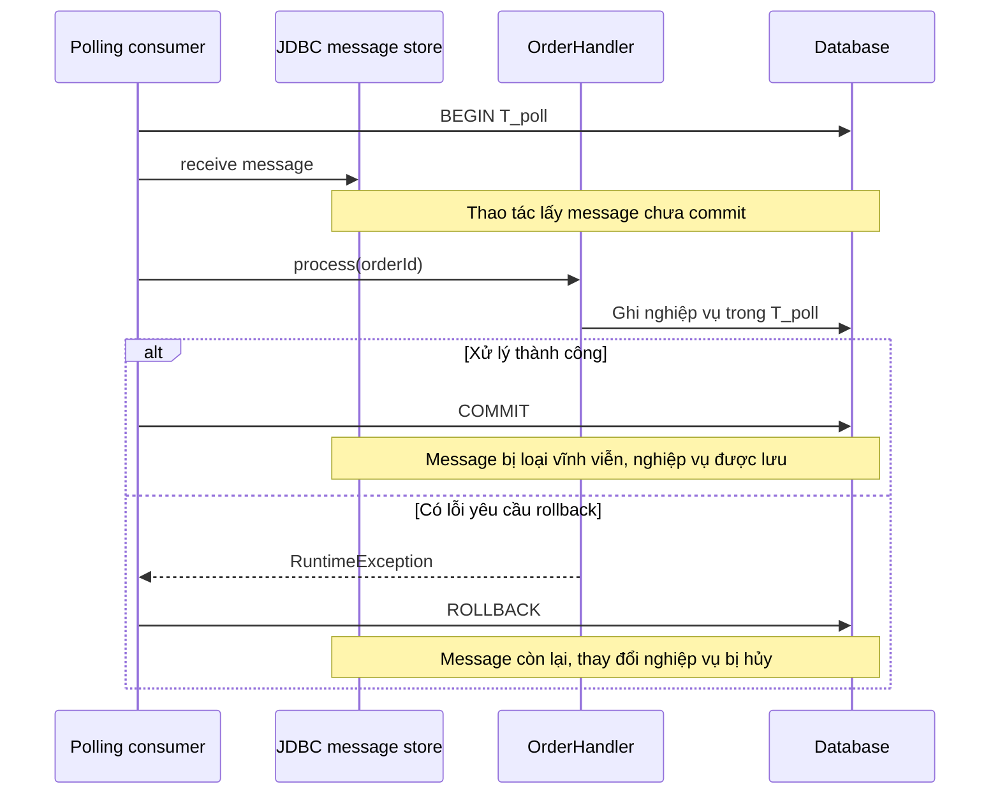

# Poller transaction với message store

## 1. Bài toán: đã lấy message nhưng xử lý chưa thành công

Trong Spring Integration Core, `QueueChannel` tách thời điểm gửi message khỏi thời điểm endpoint xử lý message. Nếu consumer đã lấy một yêu cầu khỏi queue rồi gặp lỗi khi cập nhật dữ liệu, yêu cầu đó phải còn cơ hội được xử lý lại. Đây là lý do cần kết hợp message store có khả năng tham gia transaction với transaction của poller.

Ví dụ xuyên suốt bài học là một luồng xác nhận đơn hàng:

- Producer đưa mã đơn hàng vào queue bền vững.
- Polling consumer lấy mã đơn và ghi nhận nghiệp vụ trong PostgreSQL.
- Khi thành công, việc lấy message và cập nhật nghiệp vụ cùng được commit.
- Khi thất bại, cả hai thao tác cùng rollback; message tiếp tục nằm trong queue để được lấy lại.

Sau bài học, bạn cần xác định được transaction bắt đầu ở đâu, tài nguyên nào thực sự tham gia, và vì sao một số cấu hình vẫn làm mất công việc dù đã có database message store.

## 2. Phân biệt lưu bền vững và khả năng rollback

**Lưu bền vững** trả lời câu hỏi: message đã ghi thành công có còn sau khi tiến trình khởi động lại không? **Tham gia transaction** trả lời câu hỏi: thao tác thêm hoặc lấy message có được commit/rollback cùng công việc khác không?

Hai đặc tính này cần được đánh giá riêng:

| Cấu hình | Qua lần khởi động lại | Handler lỗi sau `receive()` |
| --- | --- | --- |
| `QueueChannel` mặc định, lưu trong bộ nhớ | Không | Transaction JDBC không tự đưa message trở lại queue |
| Queue dùng JDBC store, poller không có transaction | Có, đối với message vẫn còn trong store | Thao tác lấy message có thể đã commit trước khi handler lỗi |
| Queue dùng JDBC store, poller có transaction phù hợp | Có, đối với message đã commit | Thao tác lấy message có thể rollback cùng nghiệp vụ JDBC |
| Queue dùng một store khác | Tùy triển khai | Phải kiểm tra transaction manager và ngữ nghĩa của store đó |

Với queue dựa trên transactional persistent store, message chỉ bị loại bỏ vĩnh viễn khi transaction lấy message commit. Rollback khôi phục trạng thái database trước thao tác lấy; ứng dụng không cần tự gọi `send()` để bù lại message. [Tài liệu cấu hình message channel](https://docs.spring.io/spring-integration/reference/channel/configuration.html).

Tự gửi lại message trong `catch` có thể tạo bản sao: một bản do ứng dụng gửi thêm, một bản do database phục hồi sau rollback.

## 3. Các thành phần và ranh giới transaction

### 3.1. Chọn đúng loại store

`JdbcChannelMessageStore` được thiết kế riêng cho message channel dùng database làm nơi lưu queue. `JdbcMessageStore` phục vụ các nhu cầu tổng quát hơn như lưu nhóm message cho aggregator hoặc claim check. Bài học dùng loại thứ nhất cho queue; không dùng nó thay thế toàn bộ chức năng store của aggregator. [Tài liệu JDBC message store](https://docs.spring.io/spring-integration/reference/jdbc/message-store.html).

`MessageGroupQueue` cung cấp cấu trúc queue dựa trên store. Mỗi queue cần một `groupId` ổn định để tìm lại đúng dữ liệu sau restart. `region` của store giúp tách dữ liệu giữa những ứng dụng hoặc môi trường dùng chung bảng. [API MessageGroupQueue](https://docs.spring.io/spring-integration/api/org/springframework/integration/store/MessageGroupQueue.html).

Ví dụ quy ước:

```text
DataSource: database của ứng dụng orders
region: orders-service
queue bean: orderQueue
groupId: orders.pending.v1
```

Không tạo `groupId` ngẫu nhiên ở mỗi lần khởi động. Database vẫn giữ message của group cũ nhưng queue mới không đọc group đó, khiến hệ thống có vẻ như đã mất dữ liệu. Nếu nhiều instance cần cạnh tranh xử lý cùng một queue, chúng phải chủ ý dùng cùng vùng dữ liệu và cùng group.

### 3.2. Transaction phải bao cả thao tác lấy message

Ranh giới mong muốn:

```text
BEGIN T_poll
  QueueChannel.receive()
    -> lấy và loại message khỏi JDBC store trong transaction
  handler.process(orderId)
    -> ghi dấu đã xử lý
    -> cập nhật đơn hàng
COMMIT T_poll
```

Nếu handler phát sinh lỗi đủ điều kiện rollback, `T_poll` rollback cả thao tác lấy message lẫn các thay đổi nghiệp vụ. Cấu hình transaction ở poller cho phép đặt `receive()` vào bên trong ranh giới này. [Tài liệu transaction của poller](https://docs.spring.io/spring-integration/reference/transactions.html#poller-transaction-support).



### 3.3. Các điều kiện của ví dụ

Ví dụ dùng một transaction JDBC cục bộ với các điều kiện sau:

1. Store, `JdbcTemplate` nghiệp vụ và transaction manager cùng dùng `DataSource` được cấu hình cho ví dụ.
2. Mã JDBC nghiệp vụ dùng cơ chế lấy connection nhận biết transaction của Spring; `JdbcTemplate` đáp ứng điều này.
3. Handler chạy đồng bộ trong đường gọi do poller khởi tạo.
4. Handler không mở transaction `REQUIRES_NEW` để commit phần nghiệp vụ riêng.
5. Lỗi cần rollback đi ra khỏi phần công việc được transaction interceptor bao quanh; rollback rule phải phù hợp.

`DataSourceTransactionManager` quản lý transaction cho một JDBC `DataSource` và gắn connection với thread hiện tại. Hai connection độc lập chỉ cùng trỏ đến một database chưa đủ để bảo đảm chúng thuộc cùng transaction. [API DataSourceTransactionManager](https://docs.spring.io/spring-framework/docs/current/javadoc-api/org/springframework/jdbc/datasource/DataSourceTransactionManager.html).

## 4. Cấu hình Java và Java DSL

### 4.1. Chuẩn bị môi trường

Các đoạn mã dùng Java 17 trở lên, API Java DSL có trong Spring Integration 6.x, PostgreSQL và truy cập nghiệp vụ bằng JDBC. Nếu dùng Spring Boot, để BOM của Boot quản lý các phiên bản thư viện tương thích; không ghép tùy ý các phiên bản Spring.

Các dependency cần thiết trong ứng dụng Boot:

```xml
<dependency>
    <groupId>org.springframework.boot</groupId>
    <artifactId>spring-boot-starter-integration</artifactId>
</dependency>
<dependency>
    <groupId>org.springframework.integration</groupId>
    <artifactId>spring-integration-jdbc</artifactId>
</dependency>
<dependency>
    <groupId>org.springframework.boot</groupId>
    <artifactId>spring-boot-starter-jdbc</artifactId>
</dependency>
<dependency>
    <groupId>org.postgresql</groupId>
    <artifactId>postgresql</artifactId>
    <scope>runtime</scope>
</dependency>
```

Ứng dụng phải cung cấp `DataSource`. Trước khi khởi động consumer, tạo schema của Spring Integration bằng script PostgreSQL đi kèm đúng phiên bản `spring-integration-jdbc`, thường tại `org/springframework/integration/jdbc/schema-postgresql.sql`. Quản lý schema qua migration; không chạy lại script tạo/xóa bảng ở mỗi lần restart. Store cần đúng bảng, sequence và chỉ mục mà query provider mong đợi. [API JdbcChannelMessageStore và vị trí script](https://docs.spring.io/spring-integration/api/org/springframework/integration/jdbc/store/JdbcChannelMessageStore.html).

Tạo thêm hai bảng nghiệp vụ trong cùng database, được truy cập qua cùng `DataSource`:

```sql
create table orders (
    order_id varchar(64) primary key,
    status varchar(20) not null
);

create table processed_order (
    order_id varchar(64) primary key,
    processed_at timestamp with time zone not null default current_timestamp
);
```

Trong bài toán này, một mã đơn chỉ đại diện cho một công việc xác nhận. Nếu một đơn có nhiều loại sự kiện hoặc nhiều phiên bản, khóa chống trùng cần thêm loại sự kiện hoặc phiên bản tương ứng.

### 4.2. Store, queue và consumer

```java
import javax.sql.DataSource;

import org.springframework.beans.factory.annotation.Qualifier;
import org.springframework.beans.factory.annotation.Value;
import org.springframework.context.annotation.Bean;
import org.springframework.context.annotation.Configuration;
import org.springframework.integration.channel.QueueChannel;
import org.springframework.integration.config.EnableIntegration;
import org.springframework.integration.dsl.IntegrationFlow;
import org.springframework.integration.dsl.Pollers;
import org.springframework.integration.jdbc.store.JdbcChannelMessageStore;
import org.springframework.integration.jdbc.store.channel.PostgresChannelMessageStoreQueryProvider;
import org.springframework.integration.store.MessageGroupQueue;
import org.springframework.jdbc.core.JdbcTemplate;
import org.springframework.jdbc.datasource.DataSourceTransactionManager;
import org.springframework.transaction.PlatformTransactionManager;

@Configuration
@EnableIntegration
public class PollerMessageStoreConfig {

    public static final String ORDER_GROUP = "orders.pending.v1";

    @Bean
    public PlatformTransactionManager integrationTransactionManager(
            DataSource dataSource) {
        return new DataSourceTransactionManager(dataSource);
    }

    @Bean
    public JdbcTemplate orderJdbcTemplate(DataSource dataSource) {
        return new JdbcTemplate(dataSource);
    }

    @Bean
    public JdbcChannelMessageStore orderMessageStore(DataSource dataSource) {
        JdbcChannelMessageStore store = new JdbcChannelMessageStore(dataSource);
        store.setChannelMessageStoreQueryProvider(
                new PostgresChannelMessageStoreQueryProvider());
        store.setRegion("orders-service");
        return store;
    }

    @Bean
    public QueueChannel orderQueue(
            @Qualifier("orderMessageStore") JdbcChannelMessageStore store) {
        return new QueueChannel(new MessageGroupQueue(store, ORDER_GROUP));
    }

    @Bean
    public OrderHandler orderHandler(
            @Qualifier("orderJdbcTemplate") JdbcTemplate jdbc) {
        return new OrderHandler(jdbc);
    }

    @Bean
    public IntegrationFlow orderProcessingFlow(
            @Qualifier("orderQueue") QueueChannel queue,
            OrderHandler handler,
            @Qualifier("integrationTransactionManager")
                    PlatformTransactionManager transactionManager,
            @Value("${lesson.order-consumer.auto-startup:true}")
                    boolean autoStartup) {
        return IntegrationFlow.from(queue)
                .handle(handler, "process", endpoint -> endpoint
                        .id("orderConsumer")
                        .autoStartup(autoStartup)
                        .poller(Pollers.fixedDelay(500)
                                .receiveTimeout(0)
                                .maxMessagesPerPoll(1)
                                .transactional(transactionManager)))
                .get();
    }
}
```

`OrderHandler` nằm trong cùng package với lớp cấu hình:

```java
import org.springframework.jdbc.core.JdbcTemplate;

public class OrderHandler {

    private final JdbcTemplate jdbc;

    public OrderHandler(JdbcTemplate jdbc) {
        this.jdbc = jdbc;
    }

    public void process(String orderId) {
        if (orderId == null || orderId.isBlank()) {
            throw new IllegalArgumentException("Thiếu orderId");
        }

        int inserted = jdbc.update("""
                insert into processed_order(order_id)
                values (?)
                on conflict (order_id) do nothing
                """, orderId);

        if (inserted == 0) {
            return;
        }

        int updated = jdbc.update("""
                update orders set status = 'CONFIRMED'
                where order_id = ?
                """, orderId);

        if (updated != 1) {
            throw new IllegalStateException("Không tìm thấy đơn " + orderId);
        }
    }
}
```

Đây là service activator một chiều: phương thức `void` không tạo reply. Payload chỉ là `String` chứa `orderId`, giúp ví dụ tránh phụ thuộc vào một lớp DTO được serialize. Khi dùng payload và header phức tạp, cần kiểm tra cơ chế serialization, cấu hình deserialization của phiên bản store đang dùng và khả năng đọc message cũ sau triển khai phiên bản mới.

Lệnh `ON CONFLICT ... DO NOTHING` xử lý trường hợp khóa nghiệp vụ đã tồn tại mà không cố tình gây lỗi unique constraint. Trong ví dụ, số dòng insert bằng 0 được hiểu là công việc này đã xử lý trước đó. Đây là cú pháp PostgreSQL, cần thay bằng cơ chế tương đương nếu đổi database. [Tài liệu PostgreSQL INSERT](https://www.postgresql.org/docs/current/sql-insert.html).

Bản ghi `processed_order` và cập nhật `orders` cùng nằm trong transaction poller. Nếu update thất bại, dấu đã xử lý cũng rollback. Nếu lần sau nhận thêm một message mang cùng mã đơn đã hoàn thành, handler có thể kết thúc an toàn và message trùng được tiêu thụ khi transaction commit.

### 4.3. Đọc đúng cấu hình poller

| Thành phần | Ý nghĩa trong ví dụ |
| --- | --- |
| `fixedDelay(500)` | Lịch polling có khoảng trễ 500 ms giữa các lượt theo cấu hình hiện tại |
| `receiveTimeout(0)` | Không chờ message khi queue đang rỗng |
| `maxMessagesPerPoll(1)` | Mỗi lượt theo lịch lấy tối đa một message |
| `transactional(transactionManager)` | Gắn transaction advice cho công việc lấy và xử lý message |
| `autoStartup` | Cho phép tắt consumer trong fixture kiểm thử |

`PollerSpec` cung cấp riêng cấu hình transaction và timeout nhận message; không suy ra chúng chỉ từ tần suất polling. [API PollerSpec](https://docs.spring.io/spring-integration/api/org/springframework/integration/dsl/PollerSpec.html).

Không đặt transaction lấy message ở chế độ read-only: store cần thực hiện thao tác thay đổi dữ liệu. Tương tự, `receiveTimeout` không phải transaction timeout.

Tăng `maxMessagesPerPoll` không đồng nghĩa tạo một transaction nguyên tử cho cả lô. Trong cơ chế poller imperative tiêu chuẩn của Spring Integration 6.3, advice bao quanh từng lần thực hiện polling task bên trong vòng lặp theo lịch. Vì thế, message trước có thể đã commit khi message sau thất bại. [Mã nguồn AbstractPollingEndpoint 6.3.11](https://raw.githubusercontent.com/spring-projects/spring-integration/v6.3.11/spring-integration-core/src/main/java/org/springframework/integration/endpoint/AbstractPollingEndpoint.java).

## 5. Producer cũng có ranh giới transaction riêng

Để chỉ gửi một công việc, producer có thể gọi:

```java
boolean sent = orderQueue.send(
        MessageBuilder.withPayload("ORD-1001").build());
if (!sent) {
    throw new IllegalStateException("Không ghi được công việc vào queue");
}
```

Đoạn mã dùng `org.springframework.integration.support.MessageBuilder`; `orderQueue` là bean được inject. `send()` thành công ở đây biểu thị việc đưa message vào queue, chưa xác nhận handler đã hoàn tất đơn hàng.

Nếu cần tạo đơn và đưa công việc vào queue một cách nguyên tử, đặt cả hai trong transaction producer trên cùng tài nguyên:

```java
TransactionTemplate producerTx =
        new TransactionTemplate(integrationTransactionManager);

producerTx.executeWithoutResult(status -> {
    orderJdbcTemplate.update("""
            insert into orders(order_id, status) values (?, 'NEW')
            """, "ORD-1001");

    boolean sent = orderQueue.send(
            MessageBuilder.withPayload("ORD-1001").build());
    if (!sent) {
        throw new IllegalStateException("Không ghi được công việc vào queue");
    }
});
```

`TransactionTemplate` thuộc package `org.springframework.transaction.support`; các biến còn lại là những bean đã cấu hình. Callback cho phép đặt ranh giới transaction rõ ràng trong luồng imperative. [Tài liệu transaction lập trình](https://docs.spring.io/spring-framework/reference/data-access/transaction/programmatic.html).

Transaction producer `T_send` và transaction consumer `T_poll` là hai transaction khác nhau. Consumer độc lập xử lý công việc đã được producer commit. Nếu producer rollback, cả đơn hàng mới và message mới đều không được lưu bởi transaction đó.

Việc gọi qua một messaging gateway không tự gộp hai transaction này. Với gateway một chiều gửi vào queue, lời gọi hoàn tất vẫn chỉ là bước giao công việc; muốn biết kết quả nghiệp vụ cần thiết kế cơ chế phản hồi hoặc tra cứu trạng thái riêng.

## 6. Những cấu hình làm thay đổi bảo đảm

### 6.1. Chỉ thêm `@Transactional` cho service

Giả sử poller không có transaction:

```text
receive() khỏi JDBC queue -> thao tác lấy đã kết thúc
                            -> service bắt đầu T_service
                            -> service lỗi, rollback T_service
```

Ngay cả khi annotation được áp dụng đúng qua proxy, transaction service vẫn bắt đầu sau thao tác lấy. Rollback nghiệp vụ không bao trùm thao tác trước đó. Để giữ công việc trong queue khi handler thất bại, cần transaction bắt đầu từ poller.

Khi poller đã tạo transaction, service có thể tham gia transaction đó bằng propagation phù hợp, chẳng hạn `REQUIRED` với cùng transaction manager. Ví dụ dùng `JdbcTemplate` trực tiếp nên không cần annotation ở handler để tham gia transaction đang có.

### 6.2. Chuyển xử lý sang thread khác

```text
T_poll: receive từ store -> ExecutorChannel -> kết thúc đường gọi, commit
                                      |
                                      +-> thread khác xử lý và gặp lỗi
```

Transaction JDBC của thread poller không tự truyền sang worker thread. Sau khi bàn giao bất đồng bộ thành công, poller có thể commit trước khi công việc nghiệp vụ hoàn tất.

Cần phân biệt việc này với `taskExecutor` của chính poller: executor đó có thể chạy toàn bộ polling task, bên trong task transaction vẫn được bắt đầu rồi thực hiện `receive()` và handler. Điểm cần xem xét là vị trí mở transaction so với nơi chuyển thread. [Tài liệu poller](https://docs.spring.io/spring-integration/reference/polling-consumer.html).

Nếu muốn chia luồng thành nhiều chặng độc lập, có thể bàn giao sang một queue bền vững khác. Khi hai queue dùng cùng tài nguyên transaction phù hợp, thao tác lấy ở chặng đầu và ghi sang queue tiếp theo có thể commit cùng nhau; nghiệp vụ ở consumer kế tiếp thuộc transaction khác.

### 6.3. Nhiều database hoặc tác dụng bên ngoài JDBC

Transaction manager JDBC cục bộ không tự rollback được một HTTP request, email đã gửi hoặc thao tác ở database khác. Xét tình huống:

```text
receive message trong T_poll
-> gọi API thanh toán thành công
-> cập nhật database thất bại
-> rollback T_poll
-> message xuất hiện lại
-> lần sau có thể gọi thanh toán thêm lần nữa
```

Trong thiết kế này, cần khóa idempotency mà hệ thống thanh toán chấp nhận, hoặc ghi một ý định gửi ra ngoài vào outbox cùng transaction database rồi để một chặng khác thực hiện. Outbox vẫn cần chiến lược chống trùng khi gửi lại.

Message store và poller transaction tạo nền tảng xử lý lại khi lỗi. Không suy ra bảo đảm exactly-once cho mọi tác dụng bên ngoài chỉ từ việc đã cấu hình `.transactional(...)`.

## 7. Xử lý lỗi, retry và message không thể xử lý

### 7.1. Lỗi phải được transaction interceptor quan sát

Một mẫu dễ gây commit ngoài ý muốn:

```java
try {
    performBusinessWork();
}
catch (RuntimeException ex) {
    logger.warn("Xử lý thất bại", ex);
    // Kết thúc bình thường dù công việc chưa hoàn tất.
}
```

Nếu transaction chưa bị đánh dấu rollback-only bởi thành phần khác, đường gọi kết thúc bình thường có thể dẫn tới commit thao tác lấy message. Ghi log không phải yêu cầu rollback.

Với cấu hình rollback mặc định của Spring, `RuntimeException` và `Error` kích hoạt rollback; checked exception cần rollback rule thích hợp. Trong Spring Integration, lỗi từ handler có thể được bọc trong messaging exception. Cần xem exception thực sự đi qua transaction advice, thay vì chỉ nhìn chữ ký phương thức nghiệp vụ. [Tài liệu rollback của Spring](https://docs.spring.io/spring-framework/reference/data-access/transaction/declarative/rolling-back.html).

### 7.2. `errorChannel` phục vụ luồng lỗi

Đối với cấu hình poller tiêu chuẩn, khi exception đi qua transaction advice và làm rollback, cơ chế xử lý lỗi của polling task có thể phát `ErrorMessage` để ghi nhận hoặc cảnh báo. Việc có log trên `errorChannel` không chứng minh message đã chuyển sang một queue lỗi bền vững. [Tài liệu Error Handling](https://docs.spring.io/spring-integration/reference/error-handling.html).

Cần phân biệt hai đường:

- Exception thoát khỏi công việc transactional, dẫn đến rollback rồi được cơ chế poller báo lỗi.
- Handler hoặc recovery advice đã xử lý exception bên trong ranh giới transaction và trả về bình thường, có thể khiến transaction commit nếu không còn trạng thái rollback-only.

Nếu recovery biến lỗi thành kết quả thành công, phải quyết định rõ message đã được xử lý thay thế, chuyển nơi lưu khác hay cần tiếp tục nằm trong queue.

### 7.3. Rollback không phải chính sách retry hoàn chỉnh

Rollback làm message có thể được lấy lại; lịch poller quyết định khi nào consumer thử lấy tiếp. Một message có dữ liệu sai vĩnh viễn có thể liên tục quay lại, chiếm tài nguyên và làm chậm những công việc khác.

Nên phân loại theo khả năng xử lý:

| Nhóm lỗi | Hướng xử lý |
| --- | --- |
| Deadlock, mất kết nối tạm thời | Rollback, thử lại với backoff phù hợp |
| Payload thiếu dữ liệu bắt buộc | Chuyển sang nơi cách ly bền vững theo chính sách |
| Công việc đã hoàn tất | Kết thúc idempotent và commit |
| Lỗi hệ thống kéo dài | Giảm nhịp hoặc tạm dừng consumer, phát cảnh báo |

Nếu tăng một bộ đếm attempt trong cùng transaction rồi rollback, lần tăng đó cũng có thể bị hủy. Header được thay đổi chỉ trong bộ nhớ cũng không tự cập nhật message gốc đã được database phục hồi. Vì vậy, retry có giới hạn qua nhiều lần poll cần cách lưu và cập nhật số lần thử một cách có chủ đích.

Một chiến lược cho lỗi dữ liệu được phát hiện trước khi ghi nghiệp vụ là route message sang một queue cách ly dùng store cùng database, rồi commit thao tác lấy và thao tác lưu cách ly trong cùng transaction. Sau khi ghi cách ly thành công, không ném lại lỗi chỉ để buộc rollback, vì như vậy thao tác cách ly cũng bị hủy.

Với transaction đã hỏng do lỗi SQL, không giả định có thể tiếp tục ghi queue cách ly trong transaction đó. Cần rollback và thiết kế một transaction xử lý tiếp theo; phải giải quyết việc lấy/chuyển message nguyên tử để tránh cả mất lẫn nhân đôi công việc.

## 8. Kiểm thử hành vi cần bảo đảm

Đây là hướng dẫn kiểm thử cho ứng dụng học tập; các đoạn mã trong bài không có nghĩa đã được thực thi trong một môi trường dự án cụ thể.

### 8.1. Kiểm tra rollback của queue và nghiệp vụ

Có thể kiểm tra quyết định commit/rollback mà chưa phụ thuộc lịch scheduler. Fixture cần PostgreSQL riêng cho bài test, schema đã khởi tạo, queue rỗng, các bean ở trên và thuộc tính:

```properties
lesson.order-consumer.auto-startup=false
```

Thuộc tính này được chính cấu hình ví dụ đọc để tắt endpoint `orderConsumer`; đây không phải một thuộc tính mặc định của Spring Integration. Không đánh dấu toàn bộ test bằng `@Transactional`: test cần quan sát kết quả sau khi transaction thử nghiệm đã kết thúc.

Thân phương thức JUnit 5 dưới đây dùng AssertJ, `Message`, `MessageBuilder` và `TransactionTemplate`. `orderQueue`, `orderJdbcTemplate`, `orderHandler`, `integrationTransactionManager` là những bean được inject vào test:

```java
@Test
void rollbackKeepsMessageAndUndoesBusinessChanges() {
    String orderId = "ORD-TX-ROLLBACK";
    orderJdbcTemplate.update("""
            insert into orders(order_id, status) values (?, 'NEW')
            """, orderId);
    assertThat(orderQueue.send(
            MessageBuilder.withPayload(orderId).build())).isTrue();

    TransactionTemplate tx =
            new TransactionTemplate(integrationTransactionManager);

    assertThatThrownBy(() -> tx.executeWithoutResult(status -> {
        Message<?> received = orderQueue.receive(0);
        assertThat(received).isNotNull();
        assertThat(received.getPayload()).isEqualTo(orderId);

        orderHandler.process((String) received.getPayload());
        throw new IllegalStateException("Mô phỏng lỗi sau khi ghi nghiệp vụ");
    })).isInstanceOf(IllegalStateException.class);

    assertThat(orderQueue.getQueueSize()).isEqualTo(1);
    assertThat(orderJdbcTemplate.queryForObject(
            "select status from orders where order_id = ?",
            String.class, orderId)).isEqualTo("NEW");
    assertThat(orderJdbcTemplate.queryForObject(
            "select count(*) from processed_order where order_id = ?",
            Long.class, orderId)).isEqualTo(0L);

    tx.executeWithoutResult(status -> {
        Message<?> receivedAgain = orderQueue.receive(0);
        assertThat(receivedAgain).isNotNull();
        assertThat(receivedAgain.getPayload()).isEqualTo(orderId);
        orderHandler.process((String) receivedAgain.getPayload());
    });

    assertThat(orderQueue.getQueueSize()).isEqualTo(0);
    assertThat(orderJdbcTemplate.queryForObject(
            "select status from orders where order_id = ?",
            String.class, orderId)).isEqualTo("CONFIRMED");
    assertThat(orderJdbcTemplate.queryForObject(
            "select count(*) from processed_order where order_id = ?",
            Long.class, orderId)).isEqualTo(1L);
}
```

Ba quan sát sau lần thất bại phải đồng thời đúng: queue còn message, đơn vẫn `NEW`, chưa có dấu `processed_order`. Chỉ kiểm tra một trong ba chưa đủ để kết luận việc lấy message và nghiệp vụ nguyên tử.

Test này chủ động gọi `receive()` trong `TransactionTemplate`, do đó kiểm tra việc cùng tham gia transaction của store và JDBC nghiệp vụ. Nó chưa kiểm tra poller đã được gắn transaction advice đúng.

### 8.2. Kiểm tra riêng cấu hình poller

Để kiểm tra endpoint thực tế, bật consumer trong một fixture khác và dùng handler thử nghiệm. Handler ghi nghiệp vụ rồi ném lỗi; endpoint có id `orderConsumer` giúp kiểm soát lifecycle. Chờ bằng latch hoặc điều kiện có timeout, không dựa vào một lệnh sleep cố định.

Với ca rollback, giữ handler luôn thất bại, chờ ít nhất một lần gọi, sau đó dừng endpoint và chờ lần xử lý đang chạy kết thúc trước khi đọc trạng thái queue. Nếu cho handler tự thành công ngay lần hai, message có thể đã bị lấy lại và commit trước thời điểm assertion, gây kết quả quan sát sai lệch.

Các ca bổ sung có giá trị:

| Ca kiểm thử | Kết quả cần quan sát |
| --- | --- |
| Poller xử lý thành công | Queue rỗng, đơn `CONFIRMED`, một dấu đã xử lý |
| Handler lỗi sau khi ghi dữ liệu | Message còn, trạng thái nghiệp vụ chưa đổi |
| Gửi hai message cùng `orderId` | Cả hai được tiêu thụ, chỉ một dấu nghiệp vụ |
| Restart sau khi enqueue đã commit | Consumer mới dùng cùng group đọc được công việc |
| Producer rollback sau khi enqueue | Không còn đơn mới và message mới của transaction đó |
| Hai consumer cạnh tranh | Không mất công việc; kiểm tra kết quả nghiệp vụ và khóa trên database thực tế |

Ca restart phải dùng database còn tồn tại sau khi application context đóng. Database trong bộ nhớ bị tạo mới ở lần khởi động sau không chứng minh được khả năng phục hồi của store.

## 9. Vận hành và chẩn đoán

Không tăng số worker chỉ dựa vào độ dài queue. Với database queue, tốc độ xử lý còn phụ thuộc connection pool, khóa hàng, chỉ mục và thời gian giữ transaction. Cần chọn query provider đúng database và kiểm tra cạnh tranh trên hệ quản trị sẽ sử dụng; JDBC store có hướng dẫn riêng cho concurrent polling và MVCC. [Hướng dẫn concurrent polling](https://docs.spring.io/spring-integration/reference/jdbc/message-store.html#jdbc-message-store-concurrent-polling).

Các tín hiệu hữu ích gồm độ sâu queue theo vùng/group, tuổi công việc cũ nhất, tỷ lệ commit/rollback, số lần xử lý lại theo khóa nghiệp vụ, thời gian transaction và thời gian chờ connection. Ghi kèm `orderId`, message id, endpoint và instance giúp liên hệ các lần thử mà không cần ghi toàn bộ payload.

| Hiện tượng | Điểm cần kiểm tra trước |
| --- | --- |
| Message biến mất dù handler rollback | Poller có transaction không; có chuyển thread hoặc nuốt exception không |
| Queue có dữ liệu nhưng sau restart không đọc được | `DataSource`, table prefix, `region`, `groupId` có khớp không |
| Nghiệp vụ đã ghi nhưng message vẫn quay lại | Nghiệp vụ có dùng transaction manager khác hoặc `REQUIRES_NEW` không |
| Lỗi được log lặp lại mãi | Message lỗi vĩnh viễn chưa có chính sách cách ly/retry |
| Chỉ chạy ổn khi có một consumer | Query provider, contention, isolation, chỉ mục và connection pool |

Tránh gọi dịch vụ mạng chậm trong khi đang giữ khóa lấy message nếu không có lý do nghiệp vụ rõ ràng. Transaction dài làm giảm khả năng phục vụ của cả queue lẫn các bảng nghiệp vụ cùng database.

## 10. Áp dụng vào các mẫu tích hợp khác

Transformer, filter và router chạy đồng bộ có thể nằm trong đường gọi của transaction poller. Tuy nhiên, một filter loại message mà không phát sinh lỗi thường là một kết quả xử lý bình thường: transaction có thể commit và message không còn trong queue. Nếu dữ liệu bị loại cần được điều tra, hãy thiết kế đường discard/cách ly rõ ràng.

Aggregator giữ trạng thái qua nhiều message và có quy tắc release riêng. Việc transaction poller bảo vệ một lần lấy message không tự chứng minh toàn bộ vòng đời của nhóm message là một transaction. Cần xem store của aggregator, thời điểm release và các ranh giới bất đồng bộ trong flow.

Khi thiết kế một chặng mới, hãy viết ra bốn yếu tố: thao tác lấy công việc, tài nguyên lưu trạng thái, điểm bàn giao và điều kiện kết thúc transaction. Với ví dụ của bài, bảo đảm cần giữ là: **message chỉ được tiêu thụ vĩnh viễn khi trạng thái xác nhận đơn và dấu chống trùng cùng commit; lỗi trước commit giữ lại cả khả năng thử lại lẫn trạng thái nghiệp vụ nhất quán**.
