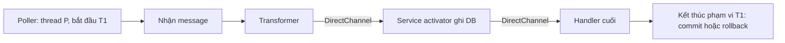
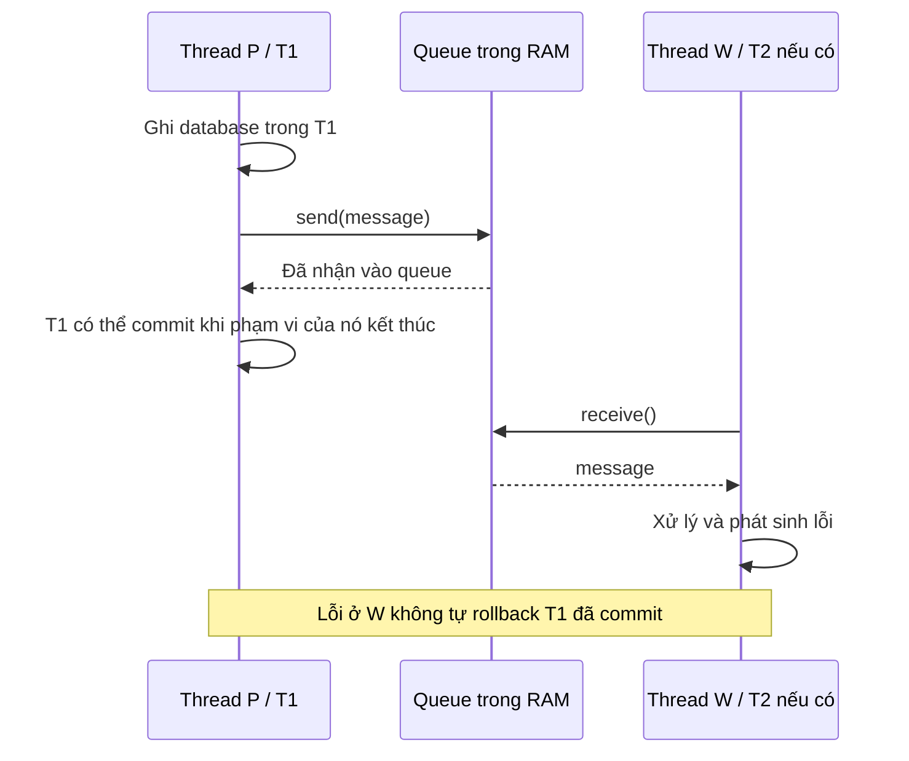

# Giới hạn của transaction trong in-memory flow

Trong chương **Poller transaction** của module **SPRING_INTEGRATION_CORE**, bài này tập trung vào những gì transaction có thể và không thể bảo vệ khi thiết kế luồng bằng Message, MessageChannel, endpoint, gateway và Java DSL.

Tình huống xuyên suốt: ứng dụng nhận yêu cầu xử lý đơn hàng, đưa message vào queue trong RAM, rồi dùng poller lấy message và ghi database. Nếu handler thất bại, database có thể rollback, nhưng điều đó chưa đủ để kết luận message còn trong queue hoặc toàn bộ tác động của luồng đã được hoàn tác.

Sau bài học, bạn có thể:

- Xác định tài nguyên thực sự tham gia một transaction.
- Vẽ ranh giới transaction khi luồng đi qua channel đồng bộ và bất đồng bộ.
- Giải thích vì sao transactional poller không tự biến queue trong RAM thành transactional queue.
- Chọn cách khôi phục phù hợp khi cần retry, lưu bền vững hoặc phối hợp database với hệ thống bên ngoài.

## 1. Transaction có phạm vi theo tài nguyên

### 1.1. Chạy trong transaction chưa đồng nghĩa với được rollback

Trong luồng imperative thông thường, Spring quản lý transaction thông qua transaction manager và các tài nguyên tương ứng. Với JDBC, `DataSourceTransactionManager` quản lý transaction cho một `DataSource`; `JdbcTemplate` dùng cơ chế lấy connection của Spring để tham gia transaction đang hoạt động. Tự mở connection độc lập có thể khiến thao tác đi ngoài transaction dự kiến. Xem [Controlling Database Connections](https://docs.spring.io/spring-framework/reference/data-access/jdbc/connections.html).

Cần phân biệt hai câu hỏi:

1. Đoạn code có đang chạy trong một transaction context không?
2. Tài nguyên mà đoạn code thay đổi có cơ chế commit/rollback và thực sự tham gia transaction đó không?

Ví dụ suy luận từ sự khác biệt này: trong cùng một handler, câu lệnh `INSERT` qua `JdbcTemplate` có thể rollback, còn `list.add(...)` chỉ thay đổi một object Java. Transaction manager của database không giữ bản sao của `List` để tự khôi phục.

| Thao tác trong handler | Kỳ vọng cần đặt |
|---|---|
| Ghi JDBC qua connection tham gia transaction | Có thể rollback theo kết quả transaction và quy tắc rollback |
| Thay đổi `Map`, `List` hoặc field của object Java | Không tự hoàn tác bằng transaction của database |
| Lấy message khỏi `QueueChannel` dùng queue RAM thông thường | Không tự trả message về queue khi database rollback |
| Gửi HTTP request hoặc email đã được bên ngoài chấp nhận | Không được database rollback tự thu hồi |
| Ghi qua một transaction manager khác | Phải phân tích transaction riêng và cách phối hợp tài nguyên |

Bảng trên là cách phân tích ví dụ, không phải cam kết rằng mọi cấu hình JDBC hay messaging đều có cùng hành vi.

### 1.2. Ba thuộc tính phải xét riêng

- **Atomicity của tài nguyên:** những thay đổi nào cùng commit hoặc cùng rollback?
- **Durability của message:** sau khi tiến trình dừng đột ngột, dữ liệu nào còn để xử lý tiếp?
- **Khả năng xử lý lại:** thành phần nào còn giữ message và có thể giao lại sau thất bại?

Một queue an toàn khi nhiều thread truy cập chỉ bảo vệ cấu trúc dữ liệu trước truy cập đồng thời. Nó không mặc nhiên cung cấp ba thuộc tính trên.

“In-memory” cũng không có nghĩa là mọi tài nguyên đều không hỗ trợ transaction. Chẳng hạn, database H2 chạy trong RAM vẫn có transaction cho dữ liệu của nó. Điều đó không làm cho một `QueueChannel` độc lập trong heap có cùng khả năng rollback.

## 2. Ranh giới thread và ranh giới transaction

### 2.1. Luồng đồng bộ có thể giữ transaction context

`DirectChannel` gọi handler trên thread gửi message. Nếu thread đó đã có transaction, các thao tác downstream phù hợp có thể tham gia transaction đang tồn tại. `ExecutorChannel` thường giao việc sang thread khác; `PublishSubscribeChannel` cũng có thể xử lý bất đồng bộ khi được cấp executor. Xem [Message Channel Implementations](https://docs.spring.io/spring-integration/reference/channel/implementations.html).

`@Transactional` với `PlatformTransactionManager` thường gắn transaction vào thread thực thi; nó không tự truyền transaction đó sang thread mới. Phạm vi bài này là luồng imperative, không áp dụng mô hình thread-local này một cách máy móc cho reactive transaction. Xem [Transactional Javadoc](https://docs.spring.io/spring-framework/docs/current/javadoc-api/org/springframework/transaction/annotation/Transactional.html).



Sơ đồ giả định các bước đều đồng bộ, không có propagation tạo transaction độc lập và thao tác database dùng đúng tài nguyên được quản lý.

### 2.2. Handoff bất đồng bộ không kéo dài transaction của bên gửi



Việc đi qua queue không buộc transaction bên gửi commit ngay tại câu lệnh `send()`. Transaction bên gửi vẫn kết thúc theo phạm vi đã cấu hình. Điểm thay đổi là downstream trên thread khác không còn thuộc transaction ấy theo cơ chế mặc định.

Nếu W có `@Transactional` hoặc transactional poller, W có thể mở T2. T2 là transaction khác, không phải phần tiếp tục tự động của T1.

Một gateway request-reply có thể chờ phản hồi từ downstream, nhưng việc chờ không tự truyền transaction sang worker thread. Cần phân biệt thời gian chờ kết quả với tài nguyên thực sự được phối hợp trong một transaction.

## 3. Transactional poller bảo vệ điều gì?

Poller có thể đặt thao tác nhận message và xử lý đồng bộ phía sau trong phạm vi transaction. Khả năng rollback thao tác nhận phụ thuộc vào việc nguồn hoặc store có hỗ trợ transaction hay không. Đây là lý do phải phân tích cả `receive()`, không chỉ handler. Xem [Transaction Support](https://docs.spring.io/spring-integration/reference/transactions.html).

Mô hình để đọc cấu hình:

```text
begin transaction
    receive từ nguồn
    xử lý downstream đồng bộ
commit nếu hoàn tất theo quy tắc transaction
rollback nếu có điều kiện rollback
```

Nếu “nguồn” là queue RAM thông thường, đặt `receive()` bên trong khối trên chưa cung cấp cơ chế undo cho queue.

### 3.1. Ví dụ Java DSL: database rollback, queue vẫn mất phần tử

Các thành phần cần có trong ứng dụng:

- `spring-integration-core`.
- `spring-jdbc` và JDBC driver phù hợp.
- Một bean `DataSource`, cùng bảng `processed_order` được tạo trước khi poller chạy.
- Phiên bản thư viện tương thích do dependency management của dự án quản lý.

DDL dùng cho ví dụ:

```sql
create table processed_order (
    order_id bigint primary key
);
```

Cấu hình dưới đây cố ý luôn phát sinh lỗi sau khi ghi database để quan sát giới hạn. Handler là bước cuối và không trả reply.

```java
import java.time.Duration;
import javax.sql.DataSource;

import org.springframework.context.annotation.Bean;
import org.springframework.context.annotation.Configuration;
import org.springframework.integration.channel.QueueChannel;
import org.springframework.integration.config.EnableIntegration;
import org.springframework.integration.dsl.IntegrationFlow;
import org.springframework.integration.dsl.Pollers;
import org.springframework.jdbc.core.JdbcTemplate;
import org.springframework.jdbc.datasource.DataSourceTransactionManager;
import org.springframework.transaction.PlatformTransactionManager;

@Configuration
@EnableIntegration
public class InMemoryPollerConfig {

    @Bean
    QueueChannel ordersIn() {
        return new QueueChannel(100);
    }

    @Bean
    PlatformTransactionManager transactionManager(DataSource dataSource) {
        return new DataSourceTransactionManager(dataSource);
    }

    @Bean
    JdbcTemplate jdbcTemplate(DataSource dataSource) {
        return new JdbcTemplate(dataSource);
    }

    @Bean
    IntegrationFlow failingOrderFlow(
            QueueChannel ordersIn,
            JdbcTemplate jdbcTemplate,
            PlatformTransactionManager transactionManager) {

        return IntegrationFlow.from(ordersIn)
                .handle(message -> {
                    Long orderId = (Long) message.getPayload();

                    jdbcTemplate.update(
                            "insert into processed_order(order_id) values (?)",
                            orderId);

                    throw new IllegalStateException(
                            "Lỗi giả lập sau khi ghi database");
                }, endpoint -> endpoint.poller(
                        Pollers.fixedDelay(Duration.ofMillis(500))
                                .receiveTimeout(0)
                                .maxMessagesPerPoll(1)
                                .transactional(transactionManager)))
                .get();
    }
}
```

`PollerSpec.transactional(transactionManager)` thêm transaction advice sử dụng manager được chỉ định; `receiveTimeout(0)` giúp lượt nhận không chờ khi queue rỗng. Tham khảo [PollerSpec Javadoc](https://docs.spring.io/spring-integration/api/org/springframework/integration/dsl/PollerSpec.html).

Gửi một message từ phía producer, với `ordersIn` là bean được lấy từ application context:

```java
ordersIn.send(
        org.springframework.messaging.support.MessageBuilder
                .withPayload(1001L)
                .build(),
        0);
```

Giả sử queue ban đầu rỗng, lệnh gửi thành công, chỉ có một consumer và một message:

| Thời điểm | Queue RAM | Dữ liệu đơn `1001` |
|---|---:|---|
| Producer gửi thành công | 1 message | Chưa có |
| Poller nhận message | 0 message | Chưa có |
| Handler thực hiện `INSERT` | 0 message | Có thay đổi chưa commit trong transaction |
| Handler ném exception và transaction rollback | 0 message | Không còn dòng vừa chèn |

Đây là kết quả suy ra cho cấu hình minh họa: database được hoàn tác; queue không có cơ chế tự đưa phần tử đã lấy trở lại. Lượt poll tiếp theo có thể chạy bình thường nhưng không còn message này để nhận.

`maxMessagesPerPoll(1)` được chọn để dễ quan sát một lượt nhận-xử lý. Tăng tham số đó không phải cách biến queue RAM thành transactional queue và cũng không đủ để tuyên bố cả lô có tính nguyên tử. Cơ chế poller được mô tả tại [Poller](https://docs.spring.io/spring-integration/reference/polling-consumer.html).

### 3.2. Gateway trước queue chỉ xác nhận việc tiếp nhận theo hợp đồng của nó

Nếu một gateway gửi yêu cầu một chiều vào `ordersIn`, việc lời gọi gateway kết thúc bình thường thường chỉ phản ánh việc gửi vào channel thành công. Nó chưa chứng minh handler do poller thực thi đã thành công.

Với ví dụ này, producer và poller là hai giai đoạn riêng. Bọc riêng producer bằng `@Transactional` không tự gộp việc xử lý về sau vào transaction producer.

## 4. Kiểm chứng giới hạn mà không phụ thuộc scheduler

Có thể tách bài toán thành một kiểm thử xác định: mở transaction, nhận message từ queue RAM, ghi JDBC rồi gây lỗi. `TransactionTemplate` cho phép chỉ rõ phạm vi transaction bằng callback. Xem [Programmatic Transaction Management](https://docs.spring.io/spring-framework/reference/data-access/transaction/programmatic.html).

Kiểm thử dưới đây cần JUnit Jupiter, H2, Spring JDBC và Spring Integration Core. Nó kiểm tra tương tác giữa queue RAM và transaction JDBC; nó không khởi động poller và không thay thế kiểm thử cấu hình endpoint.

```java
import org.junit.jupiter.api.Test;
import org.springframework.integration.channel.QueueChannel;
import org.springframework.jdbc.core.JdbcTemplate;
import org.springframework.jdbc.datasource.DataSourceTransactionManager;
import org.springframework.jdbc.datasource.embedded.EmbeddedDatabase;
import org.springframework.jdbc.datasource.embedded.EmbeddedDatabaseBuilder;
import org.springframework.jdbc.datasource.embedded.EmbeddedDatabaseType;
import org.springframework.messaging.Message;
import org.springframework.messaging.support.MessageBuilder;
import org.springframework.transaction.support.TransactionTemplate;

import static org.junit.jupiter.api.Assertions.*;

class InMemoryQueueTransactionTest {

    @Test
    void jdbcRollbackDoesNotRestoreMessageInHeapQueue() {
        EmbeddedDatabase database = new EmbeddedDatabaseBuilder()
                .generateUniqueName(true)
                .setType(EmbeddedDatabaseType.H2)
                .build();

        try {
            JdbcTemplate jdbc = new JdbcTemplate(database);
            jdbc.execute("""
                    create table processed_order (
                        order_id bigint primary key
                    )
                    """);

            QueueChannel queue = new QueueChannel(10);
            Message<Long> message = MessageBuilder
                    .withPayload(1001L)
                    .build();

            assertTrue(queue.send(message, 0));

            TransactionTemplate tx = new TransactionTemplate(
                    new DataSourceTransactionManager(database));

            assertThrows(IllegalStateException.class, () ->
                    tx.executeWithoutResult(status -> {
                        Message<?> received = queue.receive(0);
                        assertNotNull(received);

                        jdbc.update(
                                "insert into processed_order(order_id) values (?)",
                                received.getPayload());

                        throw new IllegalStateException("Lỗi giả lập");
                    }));

            Integer count = jdbc.queryForObject(
                    "select count(*) from processed_order",
                    Integer.class);

            assertEquals(Integer.valueOf(0), count);
            assertEquals(0, queue.getQueueSize());
            assertNull(queue.receive(0));
        } finally {
            database.shutdown();
        }
    }
}
```

Ví dụ dùng text block nên cần Java hỗ trợ cú pháp này; Java 17 trở lên đáp ứng yêu cầu cú pháp.

Hai assertion quan trọng chứng minh hai trạng thái khác nhau:

- `count == 0`: phần ghi database trong transaction đã rollback.
- `queue.receive(0) == null`: queue không tự khôi phục message đã nhận.

Nếu chỉ assert rằng có exception, kiểm thử chưa chứng minh được điều gì về khả năng khôi phục message. Nếu chỉ assert database rỗng, kiểm thử vẫn bỏ sót mất message.

Trong kiểm thử có scheduler thực, cần chờ một tín hiệu hoàn tất transaction hoặc một điều kiện có timeout, rồi kiểm tra trạng thái từ bên ngoài transaction của poller. Việc handler đã bắt đầu hoặc đã ghi log chưa chứng minh rollback đã hoàn tất.

## 5. In-memory state và side effect không tự quay về trạng thái cũ

### 5.1. Payload mutable có thể đã bị thay đổi

Xét đoạn code minh họa, trong đó `order` là cùng một object được các thành phần giữ tham chiếu:

```java
order.setStatus("PROCESSING");
recentOrders.put(order.getId(), order);

jdbcTemplate.update(
        "insert into processed_order(order_id) values (?)",
        order.getId());

throw new IllegalStateException("Không thể xử lý tiếp");
```

Nếu database rollback, setter và `put` vẫn là các thao tác Java đã chạy. Tham chiếu `order` trong cache có thể tiếp tục mang trạng thái `PROCESSING`.

Đây là suy luận về object Java trong ví dụ, không phải hành vi undo do Spring Integration cung cấp. Khi retry cùng một object mutable, lần xử lý sau có thể nhận trạng thái đã bị lần trước sửa đổi.

Cách thiết kế dễ kiểm soát hơn là dùng payload bất biến, tạo giá trị mới qua transformer, và cập nhật cache theo một quy trình có thể tái tạo từ nguồn dữ liệu đáng tin cậy. Các lựa chọn này giảm tác động của mutation; chúng không làm queue RAM có khả năng rollback.

### 5.2. Lời gọi hệ thống bên ngoài tạo thêm một cửa sổ lỗi

Giả sử handler gọi dịch vụ thanh toán rồi mới hoàn tất transaction database:

```text
1. Gửi yêu cầu thanh toán với business key ORDER-1001
2. Dịch vụ thanh toán chấp nhận
3. Thao tác database tiếp theo thất bại
4. Transaction database rollback
5. Producer hoặc cơ chế recovery gửi lại ORDER-1001
```

Từ thứ tự trên, có thể thấy việc rollback database không tự đảo ngược bước 2. Nếu gửi lại mà thiếu idempotency key được phía thanh toán thực thi, có thể phát sinh thanh toán lặp.

Cần thiết kế rõ trách nhiệm: dùng business key ổn định, ghi nhận kết quả cần đối soát, hoặc có nghiệp vụ bù trừ. Timeout của HTTP cũng có thể để lại kết quả chưa xác định ở phía gọi; không nên suy luận rằng timeout đồng nghĩa bên nhận chưa thực hiện.

## 6. Exception, errorChannel và retry tác động ở vị trí nào?

### 6.1. Exception phải đi qua đúng transaction boundary

Với cấu hình mặc định thông thường, unchecked exception và `Error` kích hoạt rollback; checked exception cần xem rollback rules hoặc chính sách đã cấu hình. Cần xét exception thực tế mà transaction interceptor quan sát, vì endpoint có thể bọc lỗi. Xem [Rolling Back a Declarative Transaction](https://docs.spring.io/spring-framework/reference/data-access/transaction/declarative/rolling-back.html).

Ví dụ dễ làm sai kỳ vọng:

```java
try {
    processOrder(message);
} catch (RuntimeException ex) {
    logger.error("Xử lý thất bại", ex);
    // Không ném lại, không đánh dấu rollback-only.
}
```

Nếu không có tầng nào đã đánh dấu rollback-only, interceptor bên ngoài có thể thấy lời gọi hoàn tất bình thường. Ngược lại, nếu transaction đã bị đánh dấu rollback-only, bắt exception không tự xóa dấu đó; kết thúc transaction vẫn có thể thất bại.

### 6.2. errorChannel là đường báo lỗi, không phải thao tác undo

Trong xử lý đồng bộ, exception có thể quay lại call stack của bên gửi. Khi đã chuyển sang task bất đồng bộ, framework có thể chuyển lỗi thành `ErrorMessage` và gửi tới error channel được xác định cho task. Xem [Error Handling](https://docs.spring.io/spring-integration/reference/error-handling.html).

Với poller trong ví dụ, cần phân biệt:

- Transaction advice quan sát thất bại và xử lý kết quả transaction.
- Cơ chế báo lỗi chuyển thông tin thất bại tới nơi theo dõi.

Nhận được `ErrorMessage` không chứng minh message gốc đã được requeue. Nếu error flow quyết định gửi lại message, đó là thao tác recovery bổ sung với rủi ro riêng, không phải rollback của queue.

### 6.3. Retry không đồng nghĩa với redelivery

`RequestHandlerRetryAdvice` có thể thực hiện lại lời gọi handler. Retry tại handler có phạm vi khác với nguồn giao lại message từ đầu; vị trí và thứ tự advice cũng quyết định retry nằm trong hay ngoài transaction. Xem [Provided Advice Classes](https://docs.spring.io/spring-integration/reference/handler-advice/classes.html).

Ví dụ suy luận:

```text
receive message một lần
    gọi handler lần 1 -> lỗi
    gọi handler lần 2 -> lỗi
    gọi handler lần 3 -> lỗi
thoát lần xử lý hiện tại
```

Sau lần cuối, queue RAM vẫn không tự có lại message. Muốn có lần giao tiếp theo, phải còn một nguồn giữ dữ liệu hoặc có recovery chủ động.

Không mặc định retry trong cùng transaction luôn hữu ích: một lỗi database có thể đã khiến transaction không thể commit. Cần quyết định rõ mỗi lần thử có cần transaction mới không.

### 6.4. Filter từ chối và REQUIRES_NEW cũng thay đổi kết quả

Filter có thể loại message theo thiết kế mà không ném exception. Khi cần coi việc từ chối là lỗi, phải cấu hình phù hợp, chẳng hạn `throwExceptionOnRejection`; không thể coi mọi message bị loại là một lần rollback. Xem [Filter](https://docs.spring.io/spring-integration/reference/filter.html).

`REQUIRES_NEW` tạo transaction vật lý độc lập. Nếu một bước bên trong đã commit transaction riêng, rollback của transaction ngoài không hoàn tác phần đã commit đó. Cùng thread vì vậy vẫn chưa đủ để kết luận mọi bước thuộc một transaction vật lý duy nhất. Xem [Transaction Propagation](https://docs.spring.io/spring-framework/reference/data-access/transaction/declarative/tx-propagation.html).

## 7. Lưu bền vững và transaction giải quyết các phần khác nhau

### 7.1. Queue RAM có cả cửa sổ mất message trước và sau receive

Suy luận từ luồng ví dụ:

| Điểm tiến trình dừng đột ngột | Hệ quả cần xem xét |
|---|---|
| Sau khi message chỉ mới được đưa vào queue RAM | Queue không giữ được message qua lần khởi động lại |
| Sau `receive()`, trước khi xử lý xong | Queue đã không còn phần tử; không có log bền vững để tự phục hồi |
| Sau commit database, trước khi báo kết quả | Nguồn bên ngoài có thể gửi lại dù database đã xử lý |
| Sau side effect bên ngoài, trước khi commit database | Cần đối soát hoặc bù trừ khi hai phía khác trạng thái |

Bounded queue giúp giới hạn số message chờ, không tạo durability. Graceful shutdown có thể giúp hoàn tất công việc đang chạy trong điều kiện cho phép, nhưng không thay thế cơ chế phục hồi khi tiến trình bị dừng đột ngột.

### 7.2. Queue dùng transactional store có thể rollback thao tác lấy

Với `QueueChannel` dựa trên transactional persistent store như `JdbcChannelMessageStore` và poller được cấu hình transaction phù hợp, việc lấy message khỏi store có thể chỉ được xác nhận vĩnh viễn khi transaction commit. Xem [Configuring Message Channels — Persistent QueueChannel Configuration](https://docs.spring.io/spring-integration/reference/channel/configuration.html).

Mô hình kỳ vọng khi dequeue và ghi nghiệp vụ cùng tham gia một transaction database:

```text
begin T
    lấy/xóa message trong JDBC channel store
    ghi processed_order bằng JDBC
commit T
```

Nếu T rollback, cả thao tác store và ghi nghiệp vụ cần được rollback theo hợp đồng của tài nguyên. Điều kiện thiết kế phải kiểm tra gồm: store phù hợp, cùng tài nguyên database được quản lý, transaction bao quanh receive, và downstream chưa chuyển sang một phạm vi độc lập.

`JdbcChannelMessageStore` được tối ưu cho message channel; `JdbcMessageStore` còn phục vụ các nhu cầu như aggregator. Store cần schema tương ứng với database sử dụng. Xem [JDBC Message Store](https://docs.spring.io/spring-integration/reference/jdbc/message-store.html).

Một store bền vững bất kỳ không tự bảo đảm nó tham gia đúng transaction. Chẳng hạn, hai database với hai local transaction manager vẫn cần phân tích cửa sổ lỗi khi commit riêng.

### 7.3. Aggregator thêm trạng thái cần bảo vệ

Aggregator có thể giữ message trong lúc chờ đủ nhóm. Nếu trạng thái nhóm chỉ ở RAM, database transaction của một service khác không tự làm nhóm đó tồn tại sau restart. Spring Integration cung cấp abstraction message store cho các thành phần có buffering, nhưng việc chọn store và phân tích khả năng phục hồi vẫn thuộc thiết kế luồng. Xem [Message Store](https://docs.spring.io/spring-integration/reference/message-store.html).

Vì vậy, khi vẽ một luồng gồm transformer, router, filter và aggregator, cần đánh dấu cả nơi đổi thread lẫn nơi giữ trạng thái. Chỉ đếm số endpoint hoặc nhìn thấy `@Transactional` ở một service là chưa đủ.

## 8. Callback sau transaction và pseudo transaction có giới hạn riêng

### 8.1. afterCommit cho biết thứ tự, không tạo hàng đợi bền vững

`afterCommit` chạy sau khi transaction đã commit. Nếu callback gửi message thất bại, database đã commit trước đó không tự quay lại. Việc ghi database mới trong callback cũng phải có ranh giới transaction phù hợp; không nên giả định transaction đã hoàn tất sẽ commit thêm dữ liệu. Xem [TransactionSynchronization Javadoc](https://docs.spring.io/spring-framework/docs/current/javadoc-api/org/springframework/transaction/support/TransactionSynchronization.html).

Suy luận về cửa sổ lỗi:

```text
database commit thành công
    -> tiến trình dừng trước khi callback hoàn tất
    -> thông báo chưa được gửi
```

Gửi sau commit tránh thông báo quá sớm về dữ liệu chưa commit. Nó vẫn cần cơ chế lưu ý định gửi nếu yêu cầu là phục hồi được sau crash.

`@TransactionalEventListener` cho phép gắn listener với một giai đoạn transaction, mặc định là sau commit. Việc gắn listener với phase không tự lưu event ra nơi bền vững. Xem [Transaction-bound Events](https://docs.spring.io/spring-framework/reference/data-access/transaction/event.html).

### 8.2. PseudoTransactionManager không biến RAM thành transactional resource

`PseudoTransactionManager` hỗ trợ ngữ nghĩa callback tương tự transaction cho nguồn vốn không transactional, thường phối hợp với `TransactionSynchronizationFactory`. Nó không làm nguồn đó thực sự có khả năng commit/rollback. Xem [PseudoTransactionManager Javadoc](https://docs.spring.io/spring-integration/api/org/springframework/integration/transaction/PseudoTransactionManager.html).

Nếu callback sau thất bại tự đưa message vào queue RAM, việc đó là recovery do ứng dụng triển khai. Vẫn phải giải quyết queue đầy, gửi lại thất bại, vòng lặp lỗi, thứ tự thay đổi và tiến trình dừng giữa hai bước. Có callback mang tên “rollback” không tương đương với atomic rollback của tài nguyên.

## 9. Chọn chiến lược theo yêu cầu của luồng

| Nhu cầu | Hướng thiết kế | Điều còn phải phân tích |
|---|---|---|
| Xử lý đồng bộ, cập nhật một database | Giữ chuỗi đồng bộ qua `DirectChannel` và dùng transaction phù hợp | Propagation, rollback rules, connection tham gia transaction |
| Buffer tạm và chấp nhận mất khi restart | Queue RAM có capacity hợp lý | Backpressure và cách producer biết kết quả |
| Nhận message và ghi nghiệp vụ cùng rollback | Transactional channel store và poller bao quanh receive | Phạm vi tài nguyên thực sự chung |
| Phục hồi qua restart | Persistent store hoặc broker với hợp đồng phù hợp | Durability, acknowledgement và redelivery cụ thể |
| Ghi nghiệp vụ rồi gửi sự kiện đáng tin cậy | Lưu ý định gửi trong outbox cùng transaction nghiệp vụ | Relay retry, sự kiện trùng và idempotency |
| Gọi dịch vụ bên ngoài có side effect | Business key, idempotency và quy trình đối soát/bù trừ | Kết quả chưa xác định do timeout hoặc crash |

Với transactional outbox, dữ liệu nghiệp vụ và bản ghi ý định phát sự kiện được ghi trong cùng transaction database; một tiến trình khác đọc outbox để phát đi. Cách này giữ lại công việc cần gửi qua restart, nhưng relay vẫn phải xử lý cửa sổ phát thành công rồi chưa kịp ghi nhận, nên consumer cần ứng phó sự kiện lặp. Tham khảo [Spring Blog — Outbox Pattern Strategies](https://spring.io/blog/2023/10/24/a-use-case-for-transactions-adapting-to-transactional-outbox-pattern/).

Đây là hướng thiết kế để so sánh với ví dụ queue RAM, không phải yêu cầu mọi luồng phải dùng broker, outbox hoặc distributed transaction.

## 10. Cách đọc và kiểm thử một luồng cụ thể

Với mỗi bước trong sơ đồ, ghi lại bốn thông tin:

1. **Thread:** bước chạy trên thread nào, có handoff không?
2. **Transaction:** manager nào quản lý, transaction bắt đầu và kết thúc ở đâu?
3. **Tài nguyên:** queue RAM, database, message store, cache hay hệ thống bên ngoài?
4. **Khôi phục:** sau lỗi hoặc restart, ai còn giữ dữ liệu để xử lý tiếp?

Có thể bổ sung log minh họa tại những endpoint cần quan sát:

```java
logger.info("thread={}, txActive={}",
        Thread.currentThread().getName(),
        org.springframework.transaction.support.TransactionSynchronizationManager
                .isActualTransactionActive());
```

`txActive=true` chỉ phản ánh có transaction hoạt động trên thread hiện tại. Nó không chứng minh queue RAM, cache hay HTTP call đã trở thành tài nguyên transactional.

Khi kiểm thử ứng dụng thực, chọn những kịch bản làm lộ ranh giới:

| Kịch bản | Trạng thái cần quan sát |
|---|---|
| Handler lỗi sau `INSERT` | Dữ liệu database và khả năng nhận lại message |
| Thêm `ExecutorChannel` trước handler cuối | Transaction của producer/poller và transaction ở worker |
| Bắt exception rồi trả về bình thường | Quyết định commit/rollback thực tế |
| Retry cùng payload đã bị sửa | Nội dung payload qua từng lần thử |
| Dừng tiến trình khi message đang chờ trong RAM | Khả năng tìm lại yêu cầu sau restart |
| Phát sự kiện thành công nhưng chưa ghi nhận kết quả | Khả năng xử lý trùng theo business key |

Các kịch bản là hướng thực hành. Kiểm thử `TransactionTemplate` ở mục 4 chỉ kiểm chứng một giới hạn cụ thể; cần kiểm thử endpoint thật khi muốn kết luận về scheduler, advice order hoặc error flow của cấu hình đang dùng.

## 11. Những điều cần nhớ

- Transaction context và khả năng rollback của tài nguyên là hai khái niệm riêng.
- Giữ xử lý đồng bộ giúp duy trì context; manager, propagation và tài nguyên vẫn quyết định phần được bảo vệ.
- Transactional poller không tự khôi phục message đã lấy từ queue RAM thông thường.
- Log lỗi, errorChannel, retry và callback đều cần được đặt vào đúng phạm vi khi phân tích.
- Muốn phục hồi qua crash phải có dữ liệu bền vững và một quy trình giao lại hoặc đối soát rõ ràng.
- Khi một luồng có nhiều tác động, hãy kiểm tra từng tài nguyên sau thất bại thay vì chỉ kiểm tra có exception hay không.