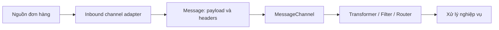
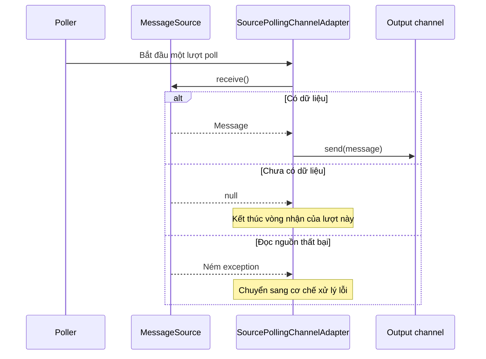

# Inbound channel adapter

## 1. Mục tiêu và tình huống sử dụng

Trong chương **Channel adapter** của module **SPRING_INTEGRATION_CORE**, inbound channel adapter là điểm đưa dữ liệu từ một nguồn vào hệ thống thông điệp Spring Integration. Nguồn có thể là phương thức Java, thư mục, bảng dữ liệu hoặc một hệ thống có cơ chế phát sự kiện.

Giả sử hệ thống bán hàng cũ lưu các đơn mới, còn ứng dụng tích hợp phải đưa từng đơn vào flow để chuẩn hóa, kiểm tra và phân phối. Phần xử lý phía sau nên làm việc với `Message<OrderEvent>`, thay vì biết cách truy vấn hay tiếp nhận dữ liệu từ hệ thống cũ. Adapter tạo ra ranh giới này.

Sau bài học, người học có thể:

- Xác định chiều inbound theo góc nhìn của ứng dụng tích hợp.
- Giải thích quan hệ giữa nguồn, endpoint, poller, `Message` và `MessageChannel`.
- Tạo inbound adapter bằng Java DSL hoặc `@InboundChannelAdapter`.
- Cấu hình lịch polling, giới hạn số message và vòng đời endpoint.
- Phân biệt không có dữ liệu với lỗi đọc nguồn; kiểm thử cả hai tình huống.
- Nhận ra những quyết định cần bổ sung khi chuyển từ ví dụ trong bộ nhớ sang nguồn dữ liệu thật.

Ví dụ chính dùng Java 17 trở lên và API Spring Integration 6.5.x. Cần có `org.springframework.integration:spring-integration-core`; phần kiểm thử dùng JUnit Jupiter. Hãy quản lý phiên bản bằng BOM tương thích của dự án hoặc khai báo phiên bản tương ứng nếu dùng Spring thuần. Ví dụ không cần Spring Boot, broker hay cơ sở dữ liệu.

## 2. Inbound có nghĩa là gì?

**Inbound được xác định theo chiều đi vào flow Spring Integration**, không theo chiều của câu lệnh mạng. Một adapter chủ động gửi HTTP request để lấy dữ liệu vẫn có vai trò inbound nếu kết quả được đưa vào flow.

Một inbound channel adapter có vai trò truyền thông điệp một chiều: nhận hoặc tạo dữ liệu từ nguồn rồi gửi vào channel. Nó không thiết lập hợp đồng chờ kết quả nghiệp vụ từ flow để trả về nguồn như một gateway request–reply. Nguồn vẫn có thể có acknowledgment hoặc phản hồi kỹ thuật của giao thức. Khái niệm một chiều nói về hợp đồng messaging. [Tài liệu Channel Adapter](https://docs.spring.io/spring-integration/reference/channel-adapter.html).



Có thể nhận diện các thành phần lân cận bằng câu hỏi mà chúng giải quyết:

| Thành phần | Câu hỏi chính | Ví dụ |
| --- | --- | --- |
| Inbound channel adapter | Làm thế nào đưa dữ liệu từ nguồn vào flow? | Định kỳ đọc đơn mới |
| Outbound channel adapter | Làm thế nào gửi message từ flow ra đích? | Ghi thông báo ra hệ thống ngoài |
| Gateway | Làm thế nào tương tác với messaging qua một hợp đồng gọi? | Gọi xử lý và nhận kết quả |
| Service activator | Gọi xử lý nào khi message đã có trong channel? | Tính phí từ đơn đã tiếp nhận |
| Message channel | Message được chuyển giao giữa các thành phần như thế nào? | Gọi trực tiếp hoặc lưu vào queue |

Gateway có thể hỗ trợ request–reply, đồng thời cũng có thể có phương thức `void` để gửi một chiều. Vì vậy, chỉ thấy “không trả kết quả” chưa đủ để phân loại; cần xem ai khởi phát tương tác và hợp đồng tích hợp. [Tài liệu Messaging Gateways](https://docs.spring.io/spring-integration/reference/gateway.html).

Trong một bài toán đồng bộ đơn hàng, đặt toàn bộ truy vấn nguồn, kiểm tra giá trị, chọn kho và ghi hóa đơn vào một phương thức nguồn sẽ làm mất lợi ích của flow. Adapter nên phụ trách tiếp nhận và ánh xạ dữ liệu; các bước transformer, filter, router hoặc aggregator đảm nhận công việc tiếp theo khi bài toán cần đến chúng.

## 3. Hai cơ chế đưa message vào flow

### 3.1. Polling: ứng dụng chủ động hỏi nguồn

Với nguồn có thể được hỏi định kỳ, `SourcePollingChannelAdapter` kết hợp lịch polling, `MessageSource<?>` và output channel.



Hai lớp dễ nhầm có nhiệm vụ khác nhau:

| Lớp | Đối tượng được đọc | Vị trí trong flow |
| --- | --- | --- |
| `SourcePollingChannelAdapter` | `MessageSource` | Khởi đầu flow từ một nguồn |
| `PollingConsumer` | `PollableChannel` | Lấy message đã ở trong một channel để chuyển cho handler |

Một source poller không phải là consumer của output channel. Việc adapter gửi vào `QueueChannel` không làm nó tự đọc ngược lại queue đó. [Tài liệu Poller](https://docs.spring.io/spring-integration/reference/polling-consumer.html).

### 3.2. Message-driven: tiếp nhận qua listener hoặc callback

Một số adapter tiếp nhận dữ liệu qua listener hoặc callback, thay vì khai báo poller để gọi `MessageSource.receive()`. Ví dụ, Spring Integration có cả JMS adapter polling và JMS adapter message-driven dựa trên listener container. [Tài liệu JMS Support](https://docs.spring.io/spring-integration/reference/jms.html).

Cần phân biệt ba thuộc tính độc lập:

- **Inbound/outbound**: hướng dữ liệu so với flow.
- **Polling/message-driven**: cách endpoint nhận dữ liệu từ nguồn.
- **Đồng bộ/bất đồng bộ ở downstream**: cách channel chuyển message và cách handler được thực thi.

Một nguồn polling vẫn có thể chuyển message qua `DirectChannel` để xử lý downstream trong chính luồng poller. Một nguồn message-driven cũng có thể gửi vào queue để việc xử lý tiếp diễn ở thời điểm khác.

`@InboundChannelAdapter` là cơ chế gọi phương thức theo polling. Không dùng tên annotation này để suy ra rằng mọi inbound adapter của mọi giao thức đều phải có poller.

## 4. Hợp đồng của nguồn: message, payload và null

### 4.1. MessageSource trả về Message

Hợp đồng cốt lõi của `org.springframework.integration.core.MessageSource<T>` là:

```java
Message<T> receive();
```

Nguồn trả về một `Message<T>` khi có dữ liệu, hoặc `null` khi không có message sẵn sàng. Phương thức này không nhận một message đầu vào. [API MessageSource](https://docs.spring.io/spring-integration/api/org/springframework/integration/core/MessageSource.html).

Ví dụ, nguồn tìm thấy một đơn:

```text
Message
├── payload: OrderEvent("ORD-101", "CUS-9", 250000)
└── headers
    ├── sourceSystem: legacy-orders
    └── eventKey: ORDER_CREATED:ORD-101
```

Payload mang dữ liệu cần xử lý. Header mang ngữ cảnh như nguồn phát và khóa nhận diện sự kiện. Không sửa trực tiếp map headers; dùng `MessageBuilder` để tạo message phù hợp. Payload là đối tượng Java và vẫn có thể mutable nếu kiểu dữ liệu của ứng dụng cho phép điều đó. [Tài liệu Message](https://docs.spring.io/spring-integration/reference/message.html).

Trong tình huống đơn hàng, dùng record giúp biểu diễn sự kiện đơn giản và tránh việc handler vô tình thay đổi các trường. Khóa `eventKey` nên dựa vào định danh nghiệp vụ ổn định. UUID trong header `id` của một message mới không thay thế được khóa nhận diện sự kiện được đọc lại từ nguồn.

### 4.2. Supplier hoặc phương thức nguồn có thể trả payload

Java DSL cung cấp `IntegrationFlow.fromSupplier(...)` cho nguồn trả về payload. Giá trị khác `null` được bọc thành message nếu nó chưa phải một `Message`. Với một `MessageSource` đã tạo message đầy đủ, dùng `IntegrationFlow.from(messageSource, ...)`. [Tài liệu Inbound Channel Adapters với Java DSL](https://docs.spring.io/spring-integration/reference/dsl/java-inbound-adapters.html).

Hãy chọn một hợp đồng rõ ràng:

| Nhu cầu | Cách khai báo phù hợp |
| --- | --- |
| Lấy đối tượng đơn hàng, chưa cần header riêng | `fromSupplier(buffer::poll, ...)` |
| Tạo message có `eventKey`, `sourceSystem` ngay tại biên | `MessageSource<OrderEvent>` |
| Tái sử dụng phương thức của một Spring bean | `@InboundChannelAdapter` |
| Kết nối giao thức đã có adapter chuyên dụng | Dùng adapter của module giao thức tương ứng |

### 4.3. Không có dữ liệu và có lỗi là hai kết quả khác nhau

Trong ví dụ nguồn đơn hàng:

- Queue trống: trả `null`.
- Đơn được đọc hợp lệ: trả một message.
- Không kết nối được nguồn hoặc dữ liệu không thể ánh xạ: ném exception để hệ thống quan sát được lỗi.

Nếu bắt mọi exception rồi trả `null`, dashboard chỉ thấy nguồn “chưa có dữ liệu”, kể cả khi kết nối đã hỏng hàng giờ. Ngược lại, ném exception mỗi khi nguồn trống sẽ tạo báo động liên tục cho trạng thái bình thường.

Nếu phương thức trả về một danh sách mười đơn, danh sách đó thường là **payload của một message**. Muốn xử lý từng đơn như từng message, cần chọn nguồn trả từng đơn hoặc thêm splitter. Số phần tử trong collection và số message của poller là hai đại lượng khác nhau.

## 5. Lịch polling và giới hạn mỗi lượt

### 5.1. Một lượt poll có thể đọc nguồn nhiều lần

`maxMessagesPerPoll` giới hạn số message mà source poller cố gắng phát trong một lượt; nếu nguồn trả `null` thì vòng nhận kết thúc sớm. Với `SourcePollingChannelAdapter`, giá trị mặc định là `1`. Giá trị âm như `-1` cho phép tiếp tục nhận đến khi nguồn hết dữ liệu; nguồn luôn trả dữ liệu có thể khiến lượt poll kéo dài không dứt. Từ Spring Integration 5.5, giá trị `0` bỏ qua việc gọi nguồn. [Cấu hình inbound adapter](https://docs.spring.io/spring-integration/reference/channel-adapter.html).

Ví dụ nguồn có năm đơn, mỗi lần `receive()` trả một đơn:

```text
maxMessagesPerPoll = 2

Lượt 1: ORD-101, ORD-102
Lượt 2: ORD-103, ORD-104
Lượt 3: ORD-105, null -> dừng vòng nhận
Lượt 4: null -> chờ lịch kế tiếp
```

Nếu `maxMessagesPerPoll = 10` nhưng nguồn chỉ có hai đơn, lượt đó có thể gọi `receive()` lần thứ ba và nhận `null`; không có nghĩa là sẽ luôn tạo ra mười message.

Giới hạn này không phải số thread, kích thước queue, giới hạn số bản ghi của câu SQL hay số phần tử được splitter tạo ra. Muốn khống chế các đại lượng đó phải cấu hình tại đúng thành phần.

### 5.2. fixedDelay, fixedRate và cron

| Lựa chọn | Ý nghĩa | Tình huống minh họa |
| --- | --- | --- |
| `fixedDelay` | Khoảng chờ tính từ khi tác vụ trước hoàn tất | Chờ 1 giây sau khi đọc xong rồi hỏi tiếp |
| `fixedRate` | Nhịp dựa trên các thời điểm bắt đầu được lên lịch | Kiểm tra nguồn theo nhịp định kỳ |
| `cron` | Chạy theo biểu thức lịch | Thăm dò trong những khung giờ đã định |

Các overload `Pollers.fixedDelay(long)` và `fixedRate(long)` nhận giá trị theo mili giây; có thể dùng overload `Duration` để thể hiện đơn vị rõ hơn. Cấu hình `fixedRate` tự nó không phải cấu hình xử lý song song. [API Pollers](https://docs.spring.io/spring-integration/api/org/springframework/integration/dsl/Pollers.html).

Ví dụ giả định một poll task mất 300 ms và không có executor riêng:

```text
fixedDelay = 1000 ms

0 ms          300 ms                  1300 ms
| xử lý poll  |------ chờ 1000 ms -----| poll tiếp
```

Nếu thêm executor cho poller, quan hệ giữa việc lên lịch và công việc thực sự hoàn tất cần được xem xét lại. Khi tăng concurrency, phải kiểm tra tính an toàn của nguồn, thứ tự message và cơ chế tránh nhiều worker cùng nhận một bản ghi.

Với nguồn rẻ và gần thời gian thực, có thể bắt đầu bằng khoảng chờ ngắn cùng giới hạn mỗi lượt nhỏ rồi đo lại. Với API giới hạn quota hoặc truy vấn tốn chi phí, khoảng chờ và số lần đọc mỗi lượt phải phản ánh giới hạn của nguồn.

## 6. Ví dụ hoàn chỉnh bằng Java DSL

### 6.1. Cấu hình nguồn, adapter và output channel

Tạo lớp `OrderInboundConfig.java` khi thực hành. Đặt các lớp ví dụ trong cùng package của dự án hoặc bổ sung package/import tương ứng.

```java
import java.math.BigDecimal;
import java.util.Objects;
import java.util.Queue;
import java.util.concurrent.ConcurrentLinkedQueue;

import org.springframework.beans.factory.annotation.Qualifier;
import org.springframework.context.annotation.Bean;
import org.springframework.context.annotation.Configuration;
import org.springframework.integration.channel.QueueChannel;
import org.springframework.integration.config.EnableIntegration;
import org.springframework.integration.core.MessageSource;
import org.springframework.integration.dsl.IntegrationFlow;
import org.springframework.integration.dsl.Pollers;
import org.springframework.integration.support.MessageBuilder;

@Configuration
@EnableIntegration
public class OrderInboundConfig {

    public record OrderEvent(
            String orderId,
            String customerId,
            BigDecimal total) {
    }

    public static final class PendingOrderBuffer {

        private final Queue<OrderEvent> queue =
                new ConcurrentLinkedQueue<>();

        public void add(OrderEvent event) {
            queue.add(Objects.requireNonNull(event));
        }

        public OrderEvent poll() {
            return queue.poll();
        }
    }

    @Bean
    public PendingOrderBuffer pendingOrderBuffer() {
        return new PendingOrderBuffer();
    }

    @Bean
    public QueueChannel acceptedOrders() {
        return new QueueChannel(20);
    }

    @Bean
    public QueueChannel orderInboundErrors() {
        return new QueueChannel(20);
    }

    @Bean
    public MessageSource<OrderEvent> pendingOrderSource(
            PendingOrderBuffer buffer) {

        return () -> {
            OrderEvent event = buffer.poll();

            if (event == null) {
                return null;
            }

            if (event.orderId() == null || event.orderId().isBlank()) {
                throw new IllegalArgumentException("orderId is required");
            }

            return MessageBuilder.withPayload(event)
                    .setHeader("sourceSystem", "legacy-orders")
                    .setHeader("eventKey",
                            "ORDER_CREATED:" + event.orderId())
                    .build();
        };
    }

    @Bean
    public IntegrationFlow orderInboundFlow(
            MessageSource<OrderEvent> pendingOrderSource,
            @Qualifier("acceptedOrders") QueueChannel output) {

        return IntegrationFlow
                .from(pendingOrderSource, endpoint -> endpoint
                        .id("orderInboundAdapter")
                        .autoStartup(false)
                        .sendTimeout(1000)
                        .poller(Pollers.fixedDelay(250)
                                .maxMessagesPerPoll(2)
                                .errorChannel("orderInboundErrors")))
                .channel(output)
                .get();
    }
}
```

Các tên trong ví dụ có vai trò cụ thể:

| Tên | Vai trò |
| --- | --- |
| `pendingOrderBuffer` | Nguồn mô phỏng, lưu các sự kiện chờ đọc |
| `pendingOrderSource` | Chuyển một sự kiện thành `Message<OrderEvent>` |
| `orderInboundAdapter` | Endpoint sở hữu poller và gửi message |
| `acceptedOrders` | Output channel để quan sát message đã được tiếp nhận |
| `orderInboundErrors` | Channel nhận lỗi của poller |
| `orderInboundFlow` | Định nghĩa luồng bằng Java DSL |

`autoStartup(false)` cho phép nạp dữ liệu trước khi chạy adapter. Thuộc tính `id` đặt tên endpoint để điều khiển vòng đời. `sendTimeout(1000)` giới hạn thời gian chờ gửi vào channel có thể chặn; nó không đặt timeout cho việc truy vấn nguồn. [API SourcePollingChannelAdapterSpec](https://docs.spring.io/spring-integration/api/org/springframework/integration/dsl/SourcePollingChannelAdapterSpec.html).

Queue đầu vào và `acceptedOrders` đều nằm trong bộ nhớ. Thao tác `buffer.poll()` lấy phần tử ra trước khi gửi thành công. Đó là lựa chọn để nhìn rõ cơ chế trong bài học; phần tử sẽ không tự quay lại nếu bước tiếp theo thất bại. Khi dùng nguồn thật, phải thiết kế thêm claim, acknowledgment hoặc khả năng đọc lại.

### 6.2. Chạy thử và quan sát

Lớp `InboundAdapterDemo.java` khởi động endpoint sau khi thêm hai đơn:

```java
import java.math.BigDecimal;

import org.springframework.context.annotation.AnnotationConfigApplicationContext;
import org.springframework.integration.channel.QueueChannel;
import org.springframework.integration.endpoint.SourcePollingChannelAdapter;
import org.springframework.messaging.Message;

public class InboundAdapterDemo {

    public static void main(String[] args) {
        try (var context = new AnnotationConfigApplicationContext(
                OrderInboundConfig.class)) {

            var buffer = context.getBean(
                    OrderInboundConfig.PendingOrderBuffer.class);
            var output = context.getBean(
                    "acceptedOrders", QueueChannel.class);
            var adapter = context.getBean(
                    "orderInboundAdapter",
                    SourcePollingChannelAdapter.class);

            buffer.add(new OrderInboundConfig.OrderEvent(
                    "ORD-101", "CUS-9", new BigDecimal("250000")));
            buffer.add(new OrderInboundConfig.OrderEvent(
                    "ORD-102", "CUS-8", new BigDecimal("120000")));

            adapter.start();
            try {
                for (int i = 0; i < 2; i++) {
                    Message<?> message = output.receive(2000);
                    if (message == null) {
                        throw new IllegalStateException(
                                "No order received within 2 seconds");
                    }
                    System.out.println(message.getPayload());
                    System.out.println(
                            message.getHeaders().get("eventKey"));
                }
            }
            finally {
                adapter.stop();
            }
        }
    }
}
```

Trong cấu hình đơn luồng này, kết quả mong đợi lần lượt là đơn `ORD-101` với khóa `ORDER_CREATED:ORD-101`, rồi `ORD-102` với khóa tương ứng. Các trường như message ID và timestamp thay đổi giữa những lần chạy.

Timeout hai giây là giới hạn chờ của ví dụ, không phải cam kết độ trễ của hệ thống. Chọn timeout kiểm thử theo môi trường thực tế, tránh đánh đồng nó với khoảng polling 250 ms.

Khi nguồn trống, adapter vẫn chạy và tiếp tục hỏi ở lịch sau. Khi gọi `stop()`, adapter ngừng lên lịch tiếp nhận mới; việc drain queue hoặc đợi công việc đã chuyển sang thành phần khác phải có chiến lược riêng.

## 7. Hai cách khai báo nguồn khác

### 7.1. fromSupplier khi chỉ cần payload

Có thể thay phương thức `orderInboundFlow` của ví dụ bằng phiên bản dưới đây nếu không cần các header tự tạo và kiểm tra `orderId` ở nguồn:

```java
@Bean
public IntegrationFlow orderInboundFlow(
        PendingOrderBuffer buffer,
        @Qualifier("acceptedOrders") QueueChannel output) {

    return IntegrationFlow
            .fromSupplier(buffer::poll, endpoint -> endpoint
                    .id("orderInboundAdapter")
                    .autoStartup(false)
                    .sendTimeout(1000)
                    .poller(Pollers.fixedDelay(250)
                            .maxMessagesPerPoll(2)
                            .errorChannel("orderInboundErrors")))
            .channel(output)
            .get();
}
```

Đây là phương án thay thế. Không giữ đồng thời hai phương thức bean cùng tên. Khi chọn phương án này, các assertion về `sourceSystem`, `eventKey` và lỗi thiếu `orderId` của ví dụ chính cũng phải được điều chỉnh.

### 7.2. Annotation trên phương thức của Spring bean

Nếu đã có một lớp cung cấp dữ liệu, có thể khai báo endpoint trên phương thức không tham số:

```java
import org.springframework.integration.annotation.InboundChannelAdapter;
import org.springframework.integration.annotation.Poller;

public class AnnotatedOrderSource {

    private final OrderInboundConfig.PendingOrderBuffer buffer;

    public AnnotatedOrderSource(
            OrderInboundConfig.PendingOrderBuffer buffer) {
        this.buffer = buffer;
    }

    @InboundChannelAdapter(
            channel = "acceptedOrders",
            autoStartup = "false",
            poller = @Poller(
                    fixedDelay = "250",
                    maxMessagesPerPoll = "2",
                    errorChannel = "orderInboundErrors"))
    public OrderInboundConfig.OrderEvent nextOrder() {
        return buffer.poll();
    }
}
```

Đăng ký lớp này bằng `@Bean` trong một cấu hình có `@EnableIntegration`, đồng thời khai báo các channel và buffer tương ứng. Trong phương án annotation, bỏ flow DSL đang poll cùng buffer để chỉ có một endpoint tiếp nhận.

Phương thức nguồn được gọi định kỳ không nhận tham số và không trả `void`. Trả payload khi chỉ cần dữ liệu; trả `Message<?>` khi cần header. `@InboundChannelAdapter` tạo endpoint gọi phương thức thông qua `MethodInvokingMessageSource`. Nếu không chỉ định poller cục bộ, cần có default poller hợp lệ trong context. [Tài liệu Annotation Support](https://docs.spring.io/spring-integration/reference/configuration/annotations.html).

Không nhầm phương thức bean factory nhận dependency với phương thức nguồn được poll: factory tạo bean khi dựng context; phương thức như `nextOrder()` mới là phương thức được gọi để lấy dữ liệu theo lịch.

## 8. Output channel quyết định điều gì?

| Output channel | Hành vi chính | Điều cần cân nhắc cho nguồn đơn hàng |
| --- | --- | --- |
| `DirectChannel` | Gọi handler trong luồng gửi | Handler chậm làm lượt đọc nguồn chậm theo |
| `QueueChannel` | Lưu message để được nhận sau | Cần consumer tiếp theo và giới hạn tồn đọng |
| `ExecutorChannel` | Dispatch qua executor | Cần kiểm soát executor và lỗi ở tác vụ downstream |
| `PublishSubscribeChannel` | Phân phối tới các subscriber | Dùng khi muốn nhiều bên cùng nhận sự kiện |

`DirectChannel` chuyển một message cho một handler trong luồng gửi. `QueueChannel` mặc định lưu trong bộ nhớ, có thể chặn sender khi đầy; việc đưa message vào queue thành công chưa chứng minh một consumer đã xử lý nghiệp vụ. [Tài liệu Message Channel Implementations](https://docs.spring.io/spring-integration/reference/channel/implementations.html).

Trong ví dụ, chương trình và test chủ động gọi `acceptedOrders.receive(...)`, nên không cần khai báo endpoint consumer khác. Trong ứng dụng thực, nếu một service activator đọc `QueueChannel`, consumer đó cần poller riêng hoặc default poller phù hợp. Poller của inbound adapter chỉ đọc nguồn.

Khi nhận xong một đơn, có thể mở rộng downstream theo nhu cầu:

| Thành phần | Công việc tiếp nối minh họa |
| --- | --- |
| Transformer | Chuyển cấu trúc của hệ thống cũ sang mô hình đơn chuẩn |
| Filter | Chỉ nhận loại sự kiện được hỗ trợ; có quyết định rõ về dữ liệu bị loại |
| Router | Chuyển đơn theo khu vực hoặc kênh bán |
| Aggregator | Ghép nhiều sự kiện thuộc cùng một đơn khi đã có khóa tương quan |

Nếu tăng tốc đọc nguồn trong khi tốc độ xử lý không đổi, queue sẽ đầy dần. Một kế hoạch vận hành cần trả lời giới hạn bộ nhớ, thời gian chờ gửi, cách tạm ngừng nhận mới và khả năng khôi phục dữ liệu khi ứng dụng khởi động lại.

## 9. Xử lý lỗi và khả năng đọc lại

### 9.1. Phân biệt lỗi trước và sau khi có Message

Trong ví dụ chính có ba điểm lỗi đáng quan tâm:

| Điểm lỗi | Đã có message chưa? | Hướng quan sát |
| --- | --- | --- |
| Đọc nguồn hoặc kiểm tra `orderId` thất bại | Có thể chưa có | Exception nguồn, thời điểm poll, định danh nguồn |
| Gửi output channel thất bại | Thường đã có | Message hoặc ngữ cảnh gửi và nguyên nhân |
| Consumer xử lý sau khi đọc queue thất bại | Đã có ở consumer | Cơ chế lỗi của consumer đó |

Scheduled poller có thể chuyển exception thành `ErrorMessage`. Với cấu hình chính, poller được chỉ định `orderInboundErrors`; nếu không định tuyến riêng, cơ chế mặc định dùng `errorChannel`, và một message có thể mang header chỉ định error channel. Lỗi handler đồng bộ qua `DirectChannel` truyền ngược lên luồng gửi; trong một flow bắt đầu bằng scheduled poller, exception đó có thể tiếp tục tới cơ chế xử lý lỗi của tác vụ poller. [Tài liệu Error Handling](https://docs.spring.io/spring-integration/reference/error-handling.html).

Đặt một lỗi ở bước đọc nguồn trước khi tạo message thì không thể mặc định có payload đơn hàng trong failed message. Hãy ghi đủ ngữ cảnh nguồn ngay khi truy xuất và phân biệt nó với ngữ cảnh của một message đã được phát.

Việc dùng `QueueChannel` để nhận lỗi trong ví dụ giúp test đọc và kiểm tra. Trong ứng dụng chạy liên tục, channel lỗi cần được tiêu thụ; nếu chỉ tích lỗi vào queue hữu hạn thì bản thân đường xử lý lỗi cũng có thể bị nghẽn.

### 9.2. Error channel không tự cung cấp retry

Nhận một `ErrorMessage` chỉ cho biết lỗi đã được biểu diễn và chuyển đi. Nó không tự đưa đơn về nguồn, không tự gọi lại tác vụ và không tự hoàn tác side effect.

Chính sách thực tế nên theo loại lỗi:

- Lỗi kết nối tạm thời: cân nhắc retry có giới hạn và backoff.
- Dữ liệu sai cấu trúc: chuyển sang vùng cách ly có thông tin để sửa hoặc phát lại.
- Sự kiện trùng: dùng khóa nghiệp vụ để ngăn side effect lặp.
- Hệ thống đích quá tải: hạn chế tiếp nhận và kiểm soát tồn đọng.

Đây là các quyết định thiết kế cho tình huống đơn hàng. Ví dụ không cài đặt retry hay kho cách ly; không suy ra những khả năng đó từ sự hiện diện của channel lỗi.

### 9.3. Tránh mất đơn giữa đọc nguồn và xử lý

Xét thuật toán đơn giản:

```text
1. Lấy ORD-101 khỏi nguồn.
2. Đánh dấu đã đọc hoặc xóa khỏi nguồn.
3. Gửi message vào flow.
4. Xử lý thanh toán.
```

Nếu ứng dụng dừng giữa bước 2 và bước 3, đơn có thể không còn nơi nào để xử lý. Nếu ứng dụng dừng sau side effect nhưng trước khi xác nhận, đọc lại đơn có thể làm side effect lặp.

Một phương án cho nguồn dạng bảng là claim bản ghi bằng thao tác nguyên tử, lưu trạng thái xử lý và có cách thu hồi claim hết hạn. Một phương án với broker là chọn acknowledgment/redelivery phù hợp. Với side effect có giá trị nghiệp vụ, cần khóa idempotency ổn định và nơi lưu trạng thái đủ bền để phục hồi.

Nếu mỗi đơn chỉ có đúng một sự kiện tạo mới, `ORDER_CREATED:<orderId>` có thể làm khóa của tình huống này. Nếu một đơn có nhiều sự kiện hợp lệ cùng loại hoặc nhiều phiên bản, phải dùng event ID hoặc bổ sung version; chỉ dùng order ID sẽ loại nhầm sự kiện.

Poller có thể tham gia transaction khi được cấu hình cùng transaction manager và tài nguyên hỗ trợ. Transaction gắn với luồng thực thi không tự lan truyền qua một ranh giới chuyển việc sang luồng khác. [Tài liệu Transaction Support](https://docs.spring.io/spring-integration/reference/transactions.html).

Đừng coi thêm transaction manager là đã bảo đảm exactly-once cho cơ sở dữ liệu, queue trong bộ nhớ và dịch vụ ngoài cùng lúc. Cần phân tích cụ thể tài nguyên tham gia, thời điểm commit, khả năng phát lại và điểm xảy ra side effect.

## 10. Kiểm thử adapter bằng hành vi quan sát được

Bộ test sau dùng cấu hình Java DSL ở mục 6. Mỗi test có context riêng, thêm dữ liệu trước hoặc sau khi khởi động endpoint, và chờ message bằng timeout hữu hạn.

```java
import java.math.BigDecimal;

import org.junit.jupiter.api.Test;
import org.springframework.context.annotation.AnnotationConfigApplicationContext;
import org.springframework.integration.channel.QueueChannel;
import org.springframework.integration.endpoint.SourcePollingChannelAdapter;
import org.springframework.messaging.Message;
import org.springframework.messaging.support.ErrorMessage;

import static org.junit.jupiter.api.Assertions.*;

class OrderInboundAdapterTest {

    @Test
    void publishesPayloadAndSourceHeaders() {
        try (var context = new AnnotationConfigApplicationContext(
                OrderInboundConfig.class)) {

            var buffer = context.getBean(
                    OrderInboundConfig.PendingOrderBuffer.class);
            var output = context.getBean(
                    "acceptedOrders", QueueChannel.class);
            var adapter = context.getBean(
                    "orderInboundAdapter",
                    SourcePollingChannelAdapter.class);

            buffer.add(new OrderInboundConfig.OrderEvent(
                    "ORD-101", "CUS-9", new BigDecimal("250000")));
            adapter.start();

            Message<?> message = output.receive(2000);
            assertNotNull(message);

            var event = assertInstanceOf(
                    OrderInboundConfig.OrderEvent.class,
                    message.getPayload());
            assertEquals("ORD-101", event.orderId());
            assertEquals("legacy-orders",
                    message.getHeaders().get("sourceSystem"));
            assertEquals("ORDER_CREATED:ORD-101",
                    message.getHeaders().get("eventKey"));
        }
    }

    @Test
    void resumesPollingAfterSourceWasEmpty() {
        try (var context = new AnnotationConfigApplicationContext(
                OrderInboundConfig.class)) {

            var buffer = context.getBean(
                    OrderInboundConfig.PendingOrderBuffer.class);
            var output = context.getBean(
                    "acceptedOrders", QueueChannel.class);
            var adapter = context.getBean(
                    "orderInboundAdapter",
                    SourcePollingChannelAdapter.class);

            adapter.start();
            assertNull(output.receive(400));

            buffer.add(new OrderInboundConfig.OrderEvent(
                    "ORD-102", "CUS-8", new BigDecimal("120000")));

            Message<?> message = output.receive(2000);
            assertNotNull(message);
            var event = assertInstanceOf(
                    OrderInboundConfig.OrderEvent.class,
                    message.getPayload());
            assertEquals("ORD-102", event.orderId());
        }
    }

    @Test
    void publishesSourceFailureToConfiguredErrorChannel() {
        try (var context = new AnnotationConfigApplicationContext(
                OrderInboundConfig.class)) {

            var buffer = context.getBean(
                    OrderInboundConfig.PendingOrderBuffer.class);
            var errors = context.getBean(
                    "orderInboundErrors", QueueChannel.class);
            var output = context.getBean(
                    "acceptedOrders", QueueChannel.class);
            var adapter = context.getBean(
                    "orderInboundAdapter",
                    SourcePollingChannelAdapter.class);

            buffer.add(new OrderInboundConfig.OrderEvent(
                    "", "CUS-9", new BigDecimal("250000")));
            adapter.start();

            Message<?> error = errors.receive(2000);
            assertNotNull(error);

            ErrorMessage errorMessage =
                    assertInstanceOf(ErrorMessage.class, error);
            Throwable cause = errorMessage.getPayload();
            while (cause.getCause() != null) {
                cause = cause.getCause();
            }

            assertInstanceOf(IllegalArgumentException.class, cause);
            assertEquals("orderId is required", cause.getMessage());
            assertNull(output.receive(0));
        }
    }
}
```

Ba test kiểm tra ba kết quả khác nhau: nhận đúng dữ liệu và headers, tiếp tục hoạt động sau thời gian nguồn trống, và đưa lỗi nguồn đến đúng channel. Việc đóng context ở cuối test giúp dọn lifecycle của endpoint và scheduler.

Không dùng một khoảng `Thread.sleep(...)` cố định rồi giả định xử lý đã xong. `receive(timeout)` chờ điều kiện có thể quan sát, đồng thời giới hạn thời gian test. Test nguồn trống ở đây xác nhận output chưa có message; nếu cần khẳng định chính xác số lần gọi nguồn, hãy bổ sung một fake source có bộ đếm.

Các tình huống nên bổ sung khi kết nối nguồn thật:

| Tình huống | Kết quả cần xác minh |
| --- | --- |
| Mất kết nối lúc đọc nguồn | Có tín hiệu lỗi; chính sách retry đúng giới hạn |
| Đọc lại cùng event ID | Side effect nghiệp vụ không bị lặp ngoài chủ đích |
| Queue đầy hoặc đích chậm | Hành vi chờ, timeout và khôi phục phù hợp |
| Hai instance cùng chạy | Không claim trùng hoặc có xử lý trùng an toàn |
| Dừng ứng dụng giữa một đơn | Có thể giải thích đơn còn ở đâu và phát lại thế nào |

Để kiểm soát source hoặc endpoint trong bộ test lớn hơn, Spring Integration có `spring-integration-test`, các công cụ mock và trigger dùng cho kiểm thử. Chỉ cần thêm chúng khi bộ test cần khả năng đó; ba test trên dùng API channel và context thông thường. [Tài liệu Testing Support](https://docs.spring.io/spring-integration/reference/testing.html).

## 11. Chẩn đoán lỗi cấu hình thường gặp

| Hiện tượng | Nguyên nhân cần kiểm tra | Hành động |
| --- | --- | --- |
| Không có message dù buffer đã có dữ liệu | Endpoint chưa start; ví dụ đặt `autoStartup(false)` | Lấy đúng endpoint ID và gọi `start()` |
| Context báo thiếu poller | Không có poller cục bộ và không có default poller | Cấu hình poller rõ ràng |
| Mỗi message chứa một list | Nguồn trả cả collection | Chọn trả từng phần tử hoặc thêm splitter |
| CPU tăng, một lượt chạy mãi | Nguồn luôn trả dữ liệu và không giới hạn mỗi lượt | Chọn giới hạn dương, kiểm tra logic nguồn |
| Đã gửi nhưng chưa có xử lý nghiệp vụ | Output queue chưa có consumer | Thêm consumer và kiểm tra poller của consumer |
| Gửi vào `DirectChannel` thất bại | Không có subscriber hoặc handler ném lỗi | Kiểm tra endpoint downstream và stack trace |
| Không thấy lỗi dù nguồn hỏng | Exception bị chuyển thành `null` | Giữ phân biệt nguồn trống và nguồn lỗi |
| Đơn xuất hiện nhiều lần | Thiếu claim, checkpoint hoặc idempotency | Dùng định danh sự kiện và lưu trạng thái phù hợp |
| Đọc nguồn chậm dần | Downstream chậm hoặc queue đầy | Đo thời gian đọc, thời gian gửi và tồn đọng |
| Thêm poller ở output nhưng nguồn vẫn chạy sai nhịp | Nhầm poller của consumer với poller nguồn | Kiểm tra cấu hình trên inbound endpoint |

Với nguồn đơn hàng, các số đo hữu ích gồm số lượt poll, số lượt trống, thời gian đọc nguồn, số message gửi được, số lỗi, kích thước tồn đọng và tuổi của sự kiện cũ nhất chưa xử lý. Một adapter đang ở trạng thái running chỉ thể hiện vòng đời; nó không tự chứng minh nguồn còn kết nối tốt hay đơn đang được xử lý kịp.

Khi ghi log, liên kết lỗi với tên nguồn và `eventKey` nếu đã có. Không cần log toàn bộ payload của mọi đơn để biết adapter có hoạt động: định danh và số đo đúng thường giúp chẩn đoán rõ hơn.

## 12. Bài thực hành củng cố

Thực hiện lần lượt trên ví dụ chính:

1. Thêm năm đơn hợp lệ, giữ `maxMessagesPerPoll(2)`, quan sát đủ năm message. Muốn xác minh ranh giới từng lượt poll, dùng trigger kiểm soát hoặc bộ đếm ở nguồn thay vì chỉ so timestamp đầu ra.
2. Để nguồn trống rồi thêm đơn mới; xác minh endpoint vẫn nhận được mà không cần restart.
3. Thêm một đơn thiếu `orderId`; xác minh lỗi xuất hiện trong `orderInboundErrors` và đơn không đi vào `acceptedOrders`.
4. Thêm transformer sau source để chuyển tổng tiền sang mô hình chuẩn của ứng dụng. Giữ thao tác truy xuất nguồn trong adapter và thao tác chuyển đổi trong transformer.
5. Đề xuất cách thay buffer bằng một bảng dữ liệu: xác định thời điểm claim, xác nhận thành công, xử lý claim hết hạn và khóa nhận diện sự kiện.
6. Đổi output thành `DirectChannel` có handler chậm, rồi giải thích vì sao thời gian một lượt poll thay đổi. Sau đó chuyển lại queue và giải thích tồn đọng được chuyển đến đâu.

Kết quả thực hành cần thể hiện được đường đi của một đơn từ nguồn đến message, vị trí áp dụng lịch polling, nơi lỗi được quan sát và cách truy tìm dữ liệu khi một bước thất bại. Các quyết định đó là nền tảng để ghép adapter với transformer, router, filter hoặc aggregator trong những flow tích hợp lớn hơn.
