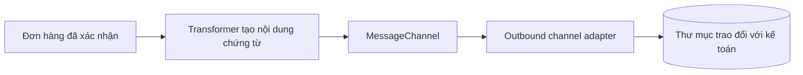
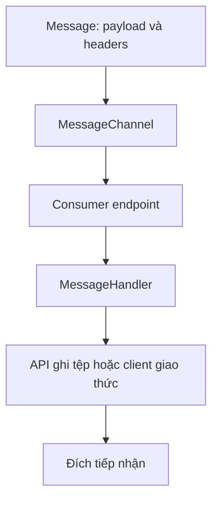
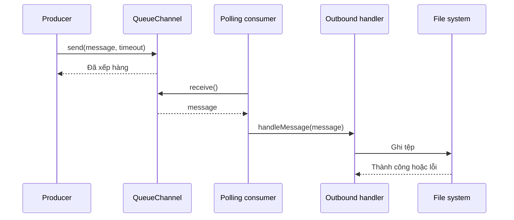
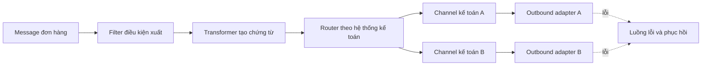

# Outbound channel adapter

## 1. Mục tiêu và vị trí trong luồng tích hợp

Trong chương **Channel adapter** của module `SPRING_INTEGRATION_CORE`, outbound channel adapter là điểm nối từ một `MessageChannel` đến nơi tiếp nhận dữ liệu: tệp, broker, dịch vụ bên ngoài hoặc một phương thức Java thực hiện tác động phụ. Bài học tập trung vào cách thiết kế điểm ra này bằng các thành phần cốt lõi của Spring Integration.

Sau bài học, bạn có thể:

- Xác định khi nào cần outbound adapter, khi nào cần outbound gateway.
- Kết nối `Message`, channel, consumer endpoint và `MessageHandler` bằng Java DSL hoặc annotation.
- Chọn cách thực thi đồng bộ, qua executor hoặc qua hàng đợi có poller.
- Thiết kế đường lỗi, retry và xử lý thông điệp trùng cho thao tác gửi ra ngoài.
- Kiểm thử tác động phụ thực tế thay vì chỉ kiểm tra lời gọi `send()`.

Tình huống xuyên suốt: hệ thống đơn hàng xuất nội dung chứng từ thành tệp để hệ thống kế toán đọc. Luồng không cần nhận ngay một kết quả tính toán từ kế toán; yêu cầu trước mắt là chuyển chứng từ đến đích đã thỏa thuận.



Các ví dụ dùng Java 17 và API Spring Integration 6.5.x. Nếu dùng Spring Boot, để BOM của phiên bản Boot tương thích quản lý dependency; không ghép tùy ý các phiên bản Spring Framework và Spring Integration. Ví dụ chính chỉ cần `spring-integration-core`; mã kiểm thử sử dụng JUnit Jupiter. Những đoạn mở rộng là phương án thay thế hoặc bổ sung được chỉ rõ, không phải tất cả đều đăng ký vào cùng một application context.

## 2. Outbound adapter có hợp đồng gì?

### 2.1. Nhận message, thực hiện tác động phụ, kết thúc nhánh

Outbound channel adapter tiếp nhận message từ channel và gọi một đích tiêu thụ. Với adapter một chiều, việc xử lý thành công không tạo ra reply message để tiếp tục nhánh hiện tại. Trong cấu hình Java, một phương thức POJO trả về `void` hoặc một `MessageHandler` là cách biểu diễn tự nhiên cho hợp đồng này. Spring Integration hỗ trợ cách kết nối đó qua service activator và Java DSL. Tham khảo [Channel Adapter](https://docs.spring.io/spring-integration/reference/6.5/channel-adapter.html).

Ví dụ về tác động phụ:

| Yêu cầu | Tác động tại đích | Cần reply nghiệp vụ trong cùng nhánh? |
| --- | --- | --- |
| Xuất chứng từ | Tạo tệp cho kế toán | Không |
| Phát sự kiện đơn hàng | Gửi message đến broker | Không, nếu hợp đồng chỉ yêu cầu phát sự kiện |
| Gửi thư thông báo | Chuyển thư cho máy chủ mail | Không |
| Tra cứu tồn kho để quyết định bán hàng | Nhận số lượng tồn kho và xử lý tiếp | Có; phù hợp với gateway |

Một chiều là đặc tính của **hợp đồng messaging**. Nó không có nghĩa là thao tác mạng không chờ phản hồi kỹ thuật. Chẳng hạn, bên gửi có thể phải đợi máy chủ chấp nhận yêu cầu hoặc đợi ghi tệp hoàn tất trước khi handler trả về.

### 2.2. Ba khái niệm cần tách biệt

1. **Reply của luồng:** một message kết quả được chuyển đến bước kế tiếp hoặc `replyChannel`.
2. **Xác nhận kỹ thuật:** giao thức hoặc thư viện cho biết thao tác gửi/ghi đã đạt một mốc nào đó.
3. **Hoàn tất nghiệp vụ:** hệ thống đích đã xử lý chứng từ theo quy tắc kinh doanh.

Trong tình huống kế toán, tạo được tệp chỉ xác nhận tệp đã được ghi theo cách triển khai của writer. Điều đó không chứng minh kế toán đã nhập chứng từ. Nếu cần theo dõi kết quả nhập, thiết kế thêm luồng nhận trạng thái, mã tương quan và trạng thái nghiệp vụ riêng.

### 2.3. Outbound không đồng nghĩa với bất đồng bộ

Với `DirectChannel`, handler được gọi ngay trên thread gửi message. Với `QueueChannel`, sender có thể hoàn tất thao tác xếp hàng trước khi consumer lấy message. `ExecutorChannel` chuyển việc thực thi handler sang executor; cấu hình executor và chính sách từ chối tác vụ vẫn ảnh hưởng hành vi thực tế. Đặc tính này thuộc channel và cơ chế thực thi, không xuất phát từ tên “outbound”. Xem [Message Channel Implementations](https://docs.spring.io/spring-integration/reference/6.5/channel/implementations.html).

## 3. Phân biệt với các endpoint gần nhau

| Thành phần | Hướng nhìn từ ứng dụng tích hợp | Vai trò điển hình |
| --- | --- | --- |
| Inbound channel adapter | Nguồn bên ngoài → message vào channel | Đưa dữ liệu vào luồng |
| Outbound channel adapter | Message từ channel → đích tiêu thụ | Thực hiện tác động phụ một chiều |
| Outbound gateway | Message yêu cầu → hệ thống đích → message phản hồi | Dùng kết quả từ hệ thống đích để xử lý tiếp |
| Service activator | Channel → phương thức/handler | Cơ chế gọi dịch vụ; có thể kết thúc bằng `void` hoặc tạo kết quả |
| Transformer | Message đầu vào → message có biểu diễn mới | Chuyển cấu trúc hoặc định dạng dữ liệu |

Service activator và outbound adapter không phải hai cơ chế loại trừ nhau. Một service activator gọi phương thức `void` để ghi dữ liệu ra ngoài có thể đóng vai trò outbound adapter. Ngược lại, không nên gọi mọi `.handle()` là outbound adapter: handler trả về kết quả để xử lý tiếp có hợp đồng khác. Java DSL hỗ trợ gọi `MessageHandler`, phương thức POJO và handler dạng lambda qua `.handle()`. Xem [Service Activators and the .handle() method](https://docs.spring.io/spring-integration/reference/6.2/dsl/java-handle.html).

Quy tắc lựa chọn cho chứng từ:

- Chỉ cần bàn giao chứng từ vào thư mục trao đổi: outbound adapter.
- Cần gọi hệ thống kế toán để nhận mã chứng từ ngay rồi tiếp tục luồng: outbound gateway.
- Chỉ cần đổi đối tượng đơn hàng thành chuỗi chứng từ: transformer đặt trước điểm ra.

Không đặt một request-reply gateway phía trước nhánh kết thúc bằng adapter một chiều rồi kỳ vọng adapter tự sinh phản hồi. Hợp đồng của toàn bộ đường đi phải thống nhất về việc có reply hay không.

## 4. Message, channel, endpoint và handler phối hợp thế nào?



- **Message:** mang dữ liệu và metadata cần cho thao tác xuất.
- **Channel:** quyết định cách chuyển message đến consumer.
- **Consumer endpoint:** quản lý kết nối với channel, vòng đời và cấu hình thực thi như poller, advice.
- **Handler:** đọc message, kiểm tra hợp đồng đầu vào và thực hiện thao tác tại đích.
- **Client/tài nguyên ngoài:** thực hiện việc ghi hoặc gửi thực tế.

Một bean `MessageHandler` đứng riêng chưa tự nhận message. Nó cần được gắn vào channel bằng flow, annotation hoặc cấu hình endpoint tương đương.

Hợp đồng minh họa của bài:

| Thành phần message | Giá trị | Ý nghĩa |
| --- | --- | --- |
| Payload | `String` UTF-8 | Nội dung chứng từ đã được chuẩn bị |
| Header `exportId` | `evt-1001` | Mã lần xuất, dùng tạo tên tệp và đối chiếu |
| Header `orderId` | `ORD-1001` | Mã đơn hàng để truy vết |
| Header `errorChannel` | Channel xử lý lỗi nếu đi qua cơ chế hỗ trợ | Địa chỉ tiếp nhận lỗi bất đồng bộ |

`exportId` và `orderId` là header do ứng dụng tự định nghĩa. Việc đưa một giá trị vào header không tự làm nó được truyền sang hệ thống đích. Handler hoặc header mapper của từng giao thức phải thực hiện ánh xạ cần thiết.

## 5. Ví dụ hoàn chỉnh: xuất nội dung ra tệp bằng Java DSL

### 5.1. Hành vi mong muốn

Ví dụ dùng một custom handler để thấy rõ cơ chế core:

1. Producer tạo message có payload chuỗi và header `exportId`.
2. `DirectChannel` chuyển message đến endpoint.
3. Handler tạo tệp `<exportId>.txt` bằng UTF-8.
4. Nếu tên tệp không hợp lệ, payload sai kiểu hoặc thao tác ghi thất bại, handler ném exception.
5. Handler không tạo reply message.

Mã dưới đây có thể đặt trong `ExportDemo.java` của một dự án đã khai báo `org.springframework.integration:spring-integration-core` phiên bản 6.5.x tương thích. Không cần Spring Boot để hiểu và thực hành ví dụ này.

```java
import java.io.IOException;
import java.nio.charset.StandardCharsets;
import java.nio.file.Files;
import java.nio.file.Path;
import java.nio.file.StandardOpenOption;
import java.util.UUID;

import org.springframework.beans.factory.annotation.Qualifier;
import org.springframework.context.annotation.AnnotationConfigApplicationContext;
import org.springframework.context.annotation.Bean;
import org.springframework.context.annotation.Configuration;
import org.springframework.integration.channel.DirectChannel;
import org.springframework.integration.config.EnableIntegration;
import org.springframework.integration.dsl.IntegrationFlow;
import org.springframework.messaging.Message;
import org.springframework.messaging.MessageChannel;
import org.springframework.messaging.MessageHandler;
import org.springframework.messaging.MessageHandlingException;
import org.springframework.messaging.support.MessageBuilder;

public class ExportDemo {

    public static void main(String[] args) {
        try (var context = new AnnotationConfigApplicationContext(Config.class)) {
            MessageChannel input =
                    context.getBean("exportRequests", MessageChannel.class);

            String exportId = "evt-" + UUID.randomUUID();
            Message<String> message = MessageBuilder
                    .withPayload("orderId=ORD-1001\ntotal=1250000\n")
                    .setHeader("exportId", exportId)
                    .setHeader("orderId", "ORD-1001")
                    .build();

            boolean accepted = input.send(message);
            if (!accepted) {
                throw new IllegalStateException("Channel không nhận message");
            }

            System.out.println("Đã ghi build/export/" + exportId + ".txt");
        }
    }

    @Configuration
    @EnableIntegration
    public static class Config {

        @Bean
        public DirectChannel exportRequests() {
            return new DirectChannel();
        }

        @Bean
        public TextFileOutboundHandler exportFileHandler() {
            return new TextFileOutboundHandler(Path.of("build", "export"));
        }

        @Bean
        public IntegrationFlow exportFlow(
                @Qualifier("exportRequests") MessageChannel input,
                TextFileOutboundHandler handler) {

            return IntegrationFlow.from(input)
                    .handle(handler, endpoint -> endpoint.id("exportFileEndpoint"))
                    .get();
        }
    }

    public static final class TextFileOutboundHandler implements MessageHandler {

        private final Path directory;

        public TextFileOutboundHandler(Path directory) {
            this.directory = directory.toAbsolutePath().normalize();
        }

        @Override
        public void handleMessage(Message<?> message) {
            if (!(message.getPayload() instanceof String text)) {
                throw new MessageHandlingException(
                        message, "Payload phải là String");
            }

            Object rawExportId = message.getHeaders().get("exportId");
            if (!(rawExportId instanceof String exportId)
                    || !exportId.matches("[A-Za-z0-9_-]{1,80}")) {
                throw new MessageHandlingException(
                        message, "exportId phải có 1..80 ký tự chữ, số, _ hoặc -");
            }

            Path target = directory.resolve(exportId + ".txt");

            try {
                Files.createDirectories(directory);
                Files.writeString(
                        target,
                        text,
                        StandardCharsets.UTF_8,
                        StandardOpenOption.CREATE_NEW,
                        StandardOpenOption.WRITE);
            }
            catch (IOException exception) {
                throw new MessageHandlingException(
                        message, "Không ghi được tệp xuất: " + exportId, exception);
            }
        }
    }
}
```

### 5.2. Giải thích kết quả

Tệp được tạo dưới thư mục `build/export` tính từ working directory khi chạy ứng dụng. Tên tệp chứa ID được sinh trong `main`; nội dung gồm mã đơn hàng và tổng tiền. Đây là định dạng văn bản minh họa, chưa phải schema chứng từ của một hệ thống kế toán cụ thể.

Trong cấu hình này, `DirectChannel` chỉ có một consumer và handler ghi tệp ngay trên thread gọi `send()`. Khi `send()` trả về thành công, lời gọi ghi tệp của handler đã hoàn tất. Kết luận này dựa trên cấu hình cụ thể; không áp dụng nguyên xi khi đổi sang hàng đợi hoặc executor.

`MessageHandler.handleMessage()` trả về `void`, vì vậy nhánh kết thúc tại handler. Header `replyChannel`, dù có trên message, cũng không làm handler này tự tạo một kết quả gửi về.

`CREATE_NEW` được chọn để phát hiện tên tệp đã tồn tại thay vì âm thầm ghi đè. Đây là **chính sách từ chối trùng tên**, chưa phải cơ chế idempotency hoàn chỉnh. Gửi lại cùng `exportId` sẽ phát sinh lỗi, kể cả khi tệp trước đó chứa cùng nội dung.

Việc giới hạn `exportId` tránh dùng trực tiếp một tên có dấu phân cách đường dẫn. Trong triển khai thực tế, thư mục đích nên do cấu hình tin cậy quản lý; thêm yêu cầu phân quyền và kiểm soát đường dẫn theo môi trường vận hành.

Custom writer này ghi trực tiếp vào tên đích, nên một bên đọc khác có thể nhìn thấy tệp khi nó chưa được ghi xong. Muốn bàn giao nguyên vẹn, cần quy ước tệp tạm rồi đổi tên hoặc dùng file adapter với cấu hình phù hợp. Không xem ví dụ này là giải pháp bàn giao tệp nguyên tử cho production.

## 6. Cấu hình bằng annotation và phương thức POJO

### 6.1. Đăng ký MessageHandler bằng @ServiceActivator

Nếu ưu tiên annotation, thay phần đăng ký handler và flow ở ví dụ trước bằng bean sau; giữ `@Configuration`, `@EnableIntegration` và bean channel `exportRequests`:

```java
import java.nio.file.Path;

import org.springframework.context.annotation.Bean;
import org.springframework.integration.annotation.ServiceActivator;
import org.springframework.messaging.MessageHandler;

@Bean
@ServiceActivator(inputChannel = "exportRequests")
public MessageHandler annotatedExportFileHandler() {
    return new ExportDemo.TextFileOutboundHandler(Path.of("build", "export"));
}
```

Annotation nối handler vào channel đã đặt tên. Không đăng ký đồng thời endpoint annotation này và `exportFlow` trên cùng `DirectChannel` nếu chỉ muốn một điểm xuất. Nhiều subscriber trên `DirectChannel` có ngữ nghĩa point-to-point; đó không phải cách yêu cầu mỗi message được xuất đến tất cả các đích.

### 6.2. Dùng POJO trả về void

Trong ứng dụng có sẵn service ghi chứng từ, có thể dùng `.handle(exportService, "write")`, với `exportService` là bean và `write` là phương thức `void` nhận kiểu đầu vào phù hợp. Điều này giữ logic ghi ở service và để flow mô tả việc kết nối.

Nếu phương thức đổi sang trả về dữ liệu, phải xem lại hợp đồng của endpoint. Một service activator có thể chuyển kết quả đến output/reply channel; không nên coi giá trị trả về là vô hại chỉ vì trước đây phương thức được dùng như điểm kết thúc.

## 7. QueueChannel và poller ở phía outbound

### 7.1. Consumer lấy message từ queue

Khi muốn tách tốc độ phát sinh chứng từ khỏi tốc độ ghi, có thể dùng hàng đợi giới hạn dung lượng. Thay channel và flow đồng bộ bằng cấu hình sau trong một configuration có `@EnableIntegration`; giữ bean `TextFileOutboundHandler`:

```java
import org.springframework.beans.factory.annotation.Qualifier;
import org.springframework.context.annotation.Bean;
import org.springframework.integration.channel.QueueChannel;
import org.springframework.integration.dsl.IntegrationFlow;
import org.springframework.integration.dsl.Pollers;

@Bean
public QueueChannel exportQueue() {
    return new QueueChannel(100);
}

@Bean
public IntegrationFlow queuedExportFlow(
        @Qualifier("exportQueue") QueueChannel queue,
        ExportDemo.TextFileOutboundHandler handler) {

    return IntegrationFlow.from(queue)
            .handle(handler, endpoint -> endpoint
                    .id("queuedExportEndpoint")
                    .poller(Pollers.fixedDelay(500)
                            .maxMessagesPerPoll(10)))
            .get();
}
```

Poller ở đây lấy message từ `exportQueue` để gọi outbound handler. Nó không quét thư mục và không sinh message nguồn. Khi channel đầu vào là `PollableChannel`, consumer cần poller riêng hoặc một default poller hợp lệ. Xem [cấu hình outbound adapter với pollable channel](https://docs.spring.io/spring-integration/reference/6.5/channel-adapter.html#channel-adapter-outbound).

Trong cấu hình trên, mỗi lượt polling xử lý tối đa 10 message; chu kỳ dùng fixed delay 500 ms. Đây không phải cam kết xử lý đúng 20 message mỗi giây: thời gian ghi, chờ nhận message và tài nguyên scheduler đều ảnh hưởng thông lượng.

### 7.2. Thời điểm sender được giải phóng



Producer nên dùng timeout hữu hạn khi gửi vào queue hữu hạn:

```java
boolean enqueued = exportQueue.send(message, 1_000);
if (!enqueued) {
    throw new IllegalStateException("Queue đầy quá thời gian chờ");
}
```

`true` ở đây chỉ thể hiện message đã vào queue. Nó chưa chứng minh tệp đã được tạo. Nếu dùng `send(message)` không có timeout khi queue đầy, producer có thể bị chặn chờ chỗ trống; cần xác định rõ yêu cầu độ trễ của bên gọi.

Queue trong ví dụ là bộ nhớ trong tiến trình. Restart có thể làm mất message đang chờ. Sau khi message đã bị lấy khỏi queue, lỗi ở handler cũng không tự đưa nó trở lại queue. Muốn có khả năng phục hồi phải thiết kế message store/broker, transaction và chính sách redelivery phù hợp với tài nguyên thực tế.

## 8. Xử lý lỗi tại điểm ra

### 8.1. Lỗi trên đường đồng bộ

Với ví dụ `DirectChannel`, exception từ writer đi ngược lại lời gọi `send()`:

```java
import org.springframework.messaging.MessagingException;

try {
    input.send(message);
}
catch (MessagingException exception) {
    // Ghi nhận thất bại và quyết định xử lý ở lớp gọi.
    // Không coi chứng từ đã xuất thành công.
    throw exception;
}
```

Đặt header `errorChannel` không tự biến một lời gọi đồng bộ trực tiếp thành cơ chế phát lỗi bất đồng bộ. Gateway, advice hoặc endpoint khác có thể bổ sung chính sách bắt và chuyển lỗi; cần đọc đúng đường thực thi đang sử dụng.

### 8.2. Lỗi ở consumer chạy trên thread khác

Sau khi producer đã xếp message vào queue, không thể ném exception muộn về stack gọi `send()` đã kết thúc. Với cơ chế xuất bản lỗi của Spring Integration, lỗi được đóng gói thành `ErrorMessage`; địa chỉ xử lý ưu tiên header `errorChannel` trên message, rồi đến channel toàn cục `errorChannel`. Xem [Error Handling](https://docs.spring.io/spring-integration/reference/6.5/error-handling.html).

Để quan sát trong bài thực hành với poller mặc định, thêm một queue lỗi riêng:

```java
@Bean
public QueueChannel exportErrors() {
    return new QueueChannel(100);
}
```

Producer hoặc đoạn kiểm thử gửi message với channel lỗi cụ thể:

```java
import org.springframework.messaging.MessageHeaders;
import org.springframework.messaging.support.ErrorMessage;

var badMessage = MessageBuilder.withPayload("chứng từ thử nghiệm")
        .setHeader("exportId", "../invalid")
        .setHeader(MessageHeaders.ERROR_CHANNEL, exportErrors)
        .build();

boolean queued = exportQueue.send(badMessage, 1_000);
if (!queued) {
    throw new IllegalStateException("Không xếp được message thử nghiệm");
}

Message<?> error = exportErrors.receive(3_000);
if (!(error instanceof ErrorMessage errorMessage)) {
    throw new AssertionError("Chưa nhận được ErrorMessage trong thời gian chờ");
}

Throwable failure = errorMessage.getPayload();
System.out.println(failure.getClass().getSimpleName());
```

Các biến `exportQueue` và `exportErrors` trong đoạn trên là bean đã lấy từ application context. Giới hạn 3 giây chỉ là thời gian chờ quan sát của bài lab, không phải bảo đảm thời gian xử lý của scheduler.

Queue lỗi này cần được đọc hết trong bài thực hành. Trong ứng dụng chạy lâu dài, phải có consumer xử lý lỗi và kế hoạch lưu bền/replay nếu cần; queue lỗi trong bộ nhớ không phải dead-letter store bền vững. Nếu tùy chỉnh error handler của poller hoặc advice, kiểm tra lại đường phát lỗi vì ví dụ đang dựa vào cơ chế mặc định.

Không bắt mọi exception rồi chỉ ghi log và trả về bình thường trong outbound handler. Khi đó endpoint thấy lời gọi đã hoàn tất, làm mất cơ hội retry hoặc chuyển lỗi theo chính sách đã thiết kế.

## 9. Retry phải đi cùng phân loại lỗi và idempotency

### 9.1. Chỉ retry lỗi có khả năng hồi phục

Ví dụ phân loại phục vụ thiết kế:

| Tình huống | Hướng xử lý thường hợp lý |
| --- | --- |
| `exportId` sai định dạng | Từ chối và đưa vào luồng lỗi dữ liệu |
| Payload sai schema | Sửa dữ liệu hoặc quy tắc chuyển đổi |
| Đích tạm thời không kết nối được | Retry hữu hạn, có khoảng nghỉ |
| Tệp đã tồn tại với ID đã xử lý | Áp dụng chính sách chống trùng/đối chiếu |
| Thư mục mất quyền ghi | Cảnh báo vận hành; retry liên tục thường không giải quyết nguyên nhân |

Spring Integration 6.5 hỗ trợ `RequestHandlerRetryAdvice` dựa trên Spring Retry. Advice có thể cấu hình retry, backoff và recovery cho handler. Xem [Retry Advice](https://docs.spring.io/spring-integration/reference/6.5/handler-advice/classes.html#retry-advice).

Đoạn sau minh họa API của dòng 6.5 và cần dependency `org.springframework.retry:spring-retry` tương thích. Nó retry mọi exception mà policy này xét đến, nên chỉ dùng cho lab; production cần policy chọn lỗi có thể hồi phục dựa trên loại exception thực tế, kể cả exception bọc và nguyên nhân gốc.

```java
import org.springframework.context.annotation.Bean;
import org.springframework.integration.handler.advice.RequestHandlerRetryAdvice;
import org.springframework.retry.backoff.FixedBackOffPolicy;
import org.springframework.retry.policy.SimpleRetryPolicy;
import org.springframework.retry.support.RetryTemplate;

@Bean
public RequestHandlerRetryAdvice exportRetryAdvice() {
    var retryTemplate = new RetryTemplate();
    retryTemplate.setRetryPolicy(new SimpleRetryPolicy(3));

    var backOff = new FixedBackOffPolicy();
    backOff.setBackOffPeriod(200);
    retryTemplate.setBackOffPolicy(backOff);

    var advice = new RequestHandlerRetryAdvice();
    advice.setRetryTemplate(retryTemplate);
    return advice;
}
```

Gắn advice vào **endpoint hiện có**, thay cho cấu hình `.handle(...)` trước đó:

```java
.handle(handler, endpoint -> endpoint
        .id("exportFileEndpoint")
        .advice(exportRetryAdvice))
```

`exportRetryAdvice` ở đây là bean advice được inject vào phương thức tạo flow. `SimpleRetryPolicy(3)` giới hạn tổng cộng ba lần thực hiện, tính cả lần đầu. Không cấu hình recovery trong ví dụ này: khi cạn lượt, lỗi vẫn đi theo cơ chế đồng bộ hoặc bất đồng bộ của đường gọi.

Retry kiểu này giữ thread trong lúc thử lại và chờ backoff. Chọn số lượt và khoảng nghỉ dựa trên độ trễ cho phép; thao tác client bị treo vẫn cần timeout riêng. Đặc biệt, retry sẽ không sửa được lỗi tên tệp đã tồn tại của `CREATE_NEW` trong writer minh họa.

### 9.2. Cửa sổ “đã gửi nhưng chưa biết kết quả”

Giả sử máy chủ đích đã nhận chứng từ, nhưng kết nối đứt trước khi client nhận xác nhận. Bên gửi chỉ thấy lỗi và retry. Nếu đích không nhận diện trùng, một yêu cầu nghiệp vụ có thể tạo hai chứng từ.

Vì vậy, khi retry phải trả lời các câu hỏi thiết kế:

- Mã nào ổn định qua mọi lần gửi lại của cùng một yêu cầu?
- Đích có lưu mã đó và ngăn thực hiện tác động phụ lần hai không?
- Nếu cùng mã nhưng nội dung khác, hệ thống từ chối hay ghi đè theo phiên bản?
- Thời gian lưu thông tin chống trùng có bao phủ thời gian replay không?

Đối với ví dụ xuất tệp, một phương án là giữ `exportId` ổn định, lưu fingerprint nội dung và chỉ coi tệp đã tồn tại là thành công nếu xác minh nó đã được bàn giao nguyên vẹn với nội dung đúng. Việc “kiểm tra tồn tại rồi ghi” đơn thuần vẫn có thể gặp race condition; phải xét khả năng nhiều worker xử lý cùng ID.

Chống trùng tại đích và cập nhật trạng thái xử lý cần có tính nguyên tử phù hợp. Chỉ đánh dấu “đã xử lý” trước khi gửi có thể làm mất công việc khi tiến trình chết; đánh dấu sau khi gửi tạo cửa sổ có thể gửi lặp. Outbound adapter không tự loại bỏ hai cửa sổ lỗi này.

## 10. Transaction và độ bền của việc bàn giao

Transaction theo thread có thể đi qua `DirectChannel` khi các thao tác cùng tham gia tài nguyên và transaction manager phù hợp. Chuyển qua executor hoặc queue thường tạo ranh giới thread; không mặc nhiên giữ transaction của producer. Poller có hỗ trợ transaction, nhưng chỉ tài nguyên thật sự tham gia mới có ngữ nghĩa rollback tương ứng. Xem [Transaction Support](https://docs.spring.io/spring-integration/reference/6.5/transactions.html).

Tình huống lỗi của ứng dụng đơn hàng:

```text
1. Ghi đơn hàng vào database.
2. Gửi chứng từ ra đích ngoài.
3. Commit transaction database.
```

Nếu bước 2 thành công nhưng bước 3 thất bại, đích ngoài có thể đã nhận chứng từ cho một thay đổi database chưa được commit. Đảo thứ tự commit trước rồi gửi sau lại có cửa sổ tiến trình dừng sau commit nhưng trước khi gửi.

Một hướng thiết kế là transactional outbox: cập nhật đơn hàng và ghi yêu cầu xuất vào cùng transaction database; worker đọc yêu cầu chưa gửi, gọi outbound handler rồi cập nhật trạng thái. Đây là lựa chọn kiến trúc của ứng dụng, không phải tính năng tự có chỉ vì dùng adapter. Worker vẫn phải xử lý việc chết sau khi gửi nhưng trước khi cập nhật trạng thái, thường bằng ID ổn định và idempotency tại đích.

Với file system, rollback database không tự xóa tệp đã ghi. Tương tự, một lời gọi HTTP hay thao tác gửi mail không tự tham gia transaction database cục bộ. Cần định nghĩa rõ mốc hoàn tất và hành động phục hồi cho từng đích.

## 11. Kiểm thử đúng tác động của outbound adapter

### 11.1. Các tầng kiểm thử

| Tầng | Điều cần chứng minh | Cách tiếp cận |
| --- | --- | --- |
| Handler | Payload/header hợp lệ tạo đúng tác động | Tài nguyên tạm hoặc fake client |
| Flow | Channel thực sự nối đến handler, hợp đồng một chiều đúng | Khởi tạo context và gửi message |
| Đường lỗi | Lỗi được ném hoặc chuyển đến error channel đúng | Chủ động tạo đầu vào lỗi |
| Tích hợp giao thức | Serialization, quyền truy cập, timeout, xác nhận đúng | Đích thử nghiệm tương ứng |
| Phục hồi | Gửi lại không gây tác động phụ sai | Giả lập lỗi sau khi đích đã nhận |

Spring Integration có thêm công cụ mock endpoint và hỗ trợ kiểm thử flow; lựa chọn đó hữu ích khi cần cô lập các đoạn phức tạp. Ví dụ dưới đây dùng JUnit và context thật để quan sát trực tiếp file output. Tham khảo [Testing support](https://docs.spring.io/spring-integration/reference/testing.html).

### 11.2. Kiểm thử flow đồng bộ và không sinh reply

Đặt `ExportFlowTest.java` cùng package với `ExportDemo` và thêm JUnit Jupiter vào test dependencies. Configuration của test dùng writer của ví dụ chính nhưng chuyển thư mục đích sang `@TempDir`:

```java
import java.nio.charset.StandardCharsets;
import java.nio.file.Files;
import java.nio.file.Path;

import org.junit.jupiter.api.Test;
import org.junit.jupiter.api.io.TempDir;
import org.springframework.context.annotation.AnnotationConfigApplicationContext;
import org.springframework.context.annotation.Bean;
import org.springframework.context.annotation.Configuration;
import org.springframework.integration.channel.DirectChannel;
import org.springframework.integration.channel.QueueChannel;
import org.springframework.integration.config.EnableIntegration;
import org.springframework.integration.dsl.IntegrationFlow;
import org.springframework.messaging.MessageChannel;
import org.springframework.messaging.MessagingException;
import org.springframework.messaging.support.MessageBuilder;

import static org.junit.jupiter.api.Assertions.*;

class ExportFlowTest {

    @TempDir
    Path output;

    @Test
    void writesUtf8FileWithoutProducingReply() throws Exception {
        try (var context = context()) {
            var replies = new QueueChannel(1);
            var message = MessageBuilder.withPayload("Đơn hàng ORD-1001\n")
                    .setHeader("exportId", "evt-1001")
                    .setReplyChannel(replies)
                    .build();

            MessageChannel input =
                    context.getBean("exportRequests", MessageChannel.class);

            assertTrue(input.send(message));
            assertEquals(
                    "Đơn hàng ORD-1001\n",
                    Files.readString(
                            output.resolve("evt-1001.txt"),
                            StandardCharsets.UTF_8));
            assertNull(replies.receive(0));
        }
    }

    @Test
    void propagatesInvalidExportIdToSynchronousCaller() {
        try (var context = context()) {
            var message = MessageBuilder.withPayload("nội dung")
                    .setHeader("exportId", "../invalid")
                    .build();

            MessageChannel input =
                    context.getBean("exportRequests", MessageChannel.class);

            assertThrows(MessagingException.class, () -> input.send(message));
        }
    }

    @Test
    void rejectsDuplicateFilenameWithoutReplacingOriginal() throws Exception {
        try (var context = context()) {
            MessageChannel input =
                    context.getBean("exportRequests", MessageChannel.class);

            var first = MessageBuilder.withPayload("bản đầu")
                    .setHeader("exportId", "evt-duplicate")
                    .build();
            var duplicate = MessageBuilder.withPayload("bản sau")
                    .setHeader("exportId", "evt-duplicate")
                    .build();

            assertTrue(input.send(first));
            assertThrows(MessagingException.class, () -> input.send(duplicate));
            assertEquals(
                    "bản đầu",
                    Files.readString(
                            output.resolve("evt-duplicate.txt"),
                            StandardCharsets.UTF_8));
        }
    }

    private AnnotationConfigApplicationContext context() {
        var context = new AnnotationConfigApplicationContext();
        context.registerBean(
                ExportDemo.TextFileOutboundHandler.class,
                () -> new ExportDemo.TextFileOutboundHandler(output));
        context.register(TestConfig.class);
        context.refresh();
        return context;
    }

    @Configuration
    @EnableIntegration
    static class TestConfig {

        @Bean
        DirectChannel exportRequests() {
            return new DirectChannel();
        }

        @Bean
        IntegrationFlow testExportFlow(
                DirectChannel exportRequests,
                ExportDemo.TextFileOutboundHandler handler) {

            return IntegrationFlow.from(exportRequests)
                    .handle(handler)
                    .get();
        }
    }
}
```

Không cần `sleep` trong các test này: với `DirectChannel`, khi lời gọi trả về thì handler đồng bộ đã chạy xong. Kiểm thử trùng tên chứng minh chính sách `CREATE_NEW`, không chứng minh hệ thống đã đạt exactly-once.

Với biến thể polling, kiểm thử riêng việc message được xếp hàng, rồi chờ **kết quả quan sát được** trong thời gian hữu hạn: nhận `ErrorMessage`, latch của fake handler hoặc điều kiện tồn tại/nội dung tệp. Không chỉ `assertTrue(send(...))` rồi kết luận đã xuất thành công. Để kiểm tra thành công bất đồng bộ, nên tắt hoặc thay đích ngoài bằng tài nguyên thử nghiệm có thể quan sát, tránh phụ thuộc một đường dẫn production.

## 12. Khi chuyển từ custom handler sang adapter có sẵn

Custom handler giúp học cơ chế core; ứng dụng thực tế nên xem adapter giao thức có sẵn trước khi tự quản lý kết nối, serialization và tài nguyên.

| Đích | Module thường dùng | Cấu hình cần xác định |
| --- | --- | --- |
| Tệp cục bộ | `spring-integration-file` | Thư mục, tên tệp, charset, tệp tạm, chế độ khi đã tồn tại |
| JMS | `spring-integration-jms` | Connection factory, destination, converter, transaction |
| AMQP | `spring-integration-amqp` | Exchange/routing key, template và cơ chế xác nhận |
| SFTP | `spring-integration-sftp` | Session factory, thư mục từ xa, tên tệp và quy tắc bàn giao |
| HTTP | `spring-integration-http` | URI, phương thức, chuyển đổi body, timeout và việc cần reply hay không |

File module có `FileWritingMessageHandler` và cấu hình adapter/gateway tương ứng. Chế độ ghi, tên tệp và cơ chế dùng hậu tố tệp tạm ảnh hưởng cách đích nhìn thấy dữ liệu. Khi dùng chế độ append, cần xem riêng quy tắc tệp tạm và flush; không suy diễn từ chế độ tạo tệp thông thường. Xem [Writing files](https://docs.spring.io/spring-integration/reference/file/writing.html).

Với HTTP, bản thân giao thức có request/response, nhưng quyết định có đưa response thành message để xử lý tiếp vẫn thuộc hợp đồng integration endpoint. Nếu cần đọc kết quả nghiệp vụ hoặc status để route ở bước sau, hãy chọn và cấu hình gateway phù hợp. Xem [HTTP Outbound Components](https://docs.spring.io/spring-integration/reference/http/outbound.html).

Mỗi adapter có khác biệt về xác nhận, callback và lỗi sau khi thao tác gửi cục bộ trả về. Vì vậy, không áp dụng toàn bộ kết luận về thời điểm thành công của custom file handler cho JMS, AMQP hay HTTP mà chưa xác định hợp đồng của client và broker/server.

## 13. Ghép điểm ra với các mẫu tích hợp khác

Trong phạm vi `SPRING_INTEGRATION_CORE`, nên để các thành phần có trách nhiệm rõ ràng:



- **Filter:** loại message không đáp ứng điều kiện xuất; xác định rõ xử lý message bị loại.
- **Transformer:** chuyển dữ liệu đơn hàng thành định dạng đích trước khi ghi/gửi.
- **Router:** chọn hệ thống kế toán dựa trên thuộc tính đã xác thực, không để đích đến tùy ý do dữ liệu ngoài quyết định.
- **Aggregator:** nếu đích cần một chứng từ gộp theo kỳ, hoàn tất nhóm trước khi đưa vào adapter; quy định correlation key, điều kiện hoàn tất và timeout của nhóm.
- **Error flow:** giữ đủ thông tin định danh để sửa và gửi lại đúng yêu cầu.

Nếu cần gửi một sự kiện đến hai đích độc lập, phải chọn cơ chế fan-out phù hợp như publish-subscribe hoặc cấu hình nhiều nhánh. Hai consumer cùng subscribe một `DirectChannel` không mang nghĩa cả hai đều nhận mọi message. Với fan-out, trạng thái thành công/thất bại của từng đích cần được theo dõi riêng; nhánh A thành công không bảo đảm nhánh B cũng thành công.

Adapter nên tập trung vào hợp đồng giao tiếp với đích. Những bước chuyển đổi nghiệp vụ phức tạp, quyết định route và gom nhóm thường dễ đọc, dễ kiểm thử hơn khi thể hiện bằng thành phần riêng trước điểm ra.

## 14. Dấu hiệu lỗi thiết kế và cách chẩn đoán

| Triệu chứng | Nguyên nhân cần kiểm tra | Hướng khắc phục |
| --- | --- | --- |
| Gateway chờ rồi timeout | Nhánh kết thúc bằng handler không tạo reply | Đồng nhất hợp đồng một chiều hoặc bổ sung nhánh tạo phản hồi rõ ràng |
| Gửi vào queue được nhưng không có output | Consumer chưa chạy, thiếu poller hoặc đang xử lý chậm | Kiểm tra vòng đời endpoint, poller và đường lỗi |
| Lỗi ghi tệp không đến nơi gọi | Đã có ranh giới thread | Theo dõi error channel hoặc trạng thái xử lý |
| Message “thành công” dù đích hỏng | Handler bắt lỗi rồi trả về bình thường | Ném lỗi hoặc thực hiện recovery có trạng thái rõ ràng |
| Gửi lại tạo chứng từ trùng | Thiếu khóa chống trùng tại đích | Dùng ID ổn định, đối chiếu và chính sách idempotency |
| Một trong hai đích không nhận | Hai handler dùng chung point-to-point channel | Thiết kế fan-out phù hợp |
| Queue tăng liên tục | Tốc độ vào lớn hơn tốc độ xử lý | Giới hạn hàng đợi, đo thời gian đích, điều chỉnh khả năng xử lý |
| Ghi tệp thành công nhưng kế toán chưa nhập | Nhầm mốc bàn giao với hoàn tất nghiệp vụ | Có xác nhận nhập và cơ chế đối soát riêng |

Các số liệu hữu ích gồm số message vào, số lần ghi/gửi thành công, số lỗi, số retry, thời gian xử lý, độ sâu queue và tuổi của yêu cầu chưa hoàn tất. Log nên chứa `exportId`, `orderId`, endpoint và loại lỗi; tránh dùng toàn bộ payload chứng từ làm thông tin chẩn đoán mặc định.

Khi shutdown, xác định cách dừng nhận việc mới, chờ công việc đang xử lý và phục hồi phần còn lại sau restart. Một hàng đợi trong bộ nhớ và một handler một chiều không tự cung cấp toàn bộ quy trình đó.

## 15. Thực hành có tiêu chí hoàn thành

### Bài 1: Quan sát thời điểm hoàn tất

Chạy phiên bản `DirectChannel`, sau đó thay bằng `QueueChannel` có poller. Ghi lại thread thực thi ở producer và handler. Với phiên bản queue, chủ động làm handler chậm bằng một fake client trong môi trường thử nghiệm.

**Hoàn thành khi:** giải thích được tại sao `send()` có thể trả về trước khi tệp tồn tại ở phiên bản queue và tại sao outbound adapter vẫn là một chiều ở cả hai phiên bản.

### Bài 2: Quan sát đường lỗi

Gửi message có `exportId` không hợp lệ qua cả hai phiên bản. Với phiên bản polling, đặt header `errorChannel` đến queue lỗi của bài lab và đọc `ErrorMessage` với timeout hữu hạn.

**Hoàn thành khi:** xác định được lỗi xuất hiện ở stack gọi đồng bộ hay ở error channel, đồng thời chứng minh chưa có tệp xuất hợp lệ cho yêu cầu lỗi.

### Bài 3: Thiết kế lại chính sách gửi trùng

Từ chính sách `CREATE_NEW`, đề xuất hợp đồng cho hai trường hợp: cùng ID cùng nội dung và cùng ID khác nội dung. Mô tả trạng thái cần lưu, cách xác minh tệp hoàn chỉnh và hành vi khi hai worker cùng xử lý.

**Hoàn thành khi:** phương án không coi mọi tệp đã tồn tại là thành công và không dùng thao tác “kiểm tra rồi ghi” như một bảo đảm nguyên tử.

### Bài 4: Mở rộng luồng đơn hàng

Đặt filter và transformer trước điểm ra, route chứng từ theo hệ thống kế toán; thiết kế thêm trạng thái riêng cho việc kế toán xác nhận nhập.

**Hoàn thành khi:** phân biệt được ba mốc “đã nhận vào luồng”, “đã bàn giao ra ngoài” và “đã hoàn tất nghiệp vụ”, cùng cách đối soát khi chỉ một phần mốc đã đạt.

## 16. Điểm cần ghi nhớ

- Outbound adapter nối message đến đích tiêu thụ và thường kết thúc nhánh bằng tác động phụ, không có reply nghiệp vụ.
- Channel và cách thực thi quyết định thread, thời điểm `send()` hoàn tất và đường truyền lỗi.
- Với queue, cần poller cho consumer; queue trong bộ nhớ không cung cấp khả năng phục hồi sau restart.
- Retry chỉ phù hợp khi đã xét khả năng hồi phục và nguy cơ thực hiện tác động phụ nhiều lần.
- Transaction chỉ bảo vệ những tài nguyên thực sự tham gia; bàn giao ra ngoài cần hợp đồng hoàn tất và phục hồi riêng.
- Kiểm thử phải quan sát output, đường lỗi và hành vi gửi trùng; kết quả `send()` không thay thế các bằng chứng đó.
