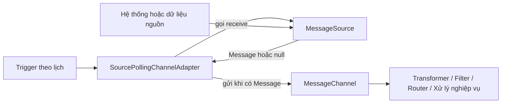

# Message source

## 1. Vị trí của message source trong luồng tích hợp

Trong chương **Channel adapter** của module **SPRING_INTEGRATION_CORE**, message source là điểm bắt đầu phù hợp khi ứng dụng cần chủ động lấy dữ liệu: kiểm tra tệp mới, truy vấn đơn hàng chờ xử lý hoặc gọi một dịch vụ theo lịch. Nguồn này cung cấp thông điệp để các thành phần tiếp theo có thể transformer, filter, router, aggregator hoặc xử lý nghiệp vụ mà không cần biết cách dữ liệu được lấy từ hệ thống gốc.

Xét một hệ thống cũ lưu các sự kiện đơn hàng chưa chuyển sang hệ thống mới. Ta muốn lấy các sự kiện theo từng đợt, đưa chúng vào `MessageChannel`, rồi mới chuẩn hóa và phân phối. Message source đảm nhiệm phần lấy dữ liệu và tạo thông điệp; endpoint và poller đảm nhiệm việc kích hoạt nguồn.

Sau bài học, bạn có thể:

- Cài đặt đúng hợp đồng `MessageSource<T>` và giải thích ý nghĩa của kết quả `null`.
- Phân biệt nguồn thông điệp, `SourcePollingChannelAdapter`, poller và channel đầu ra.
- Khai báo nguồn bằng Java DSL hoặc `@InboundChannelAdapter`.
- Chọn giới hạn polling, timeout và ranh giới xử lý lỗi phù hợp.
- Kiểm thử riêng nguồn và kiểm thử việc nối nguồn vào một integration flow.

## 2. Hợp đồng `MessageSource<T>`

### 2.1. Import đúng interface

Interface dùng trong bài là:

```java
import org.springframework.integration.core.MessageSource;
```

Đây là một functional interface có thao tác chính `receive()`, trả về `Message<T>` hoặc `null` khi chưa có thông điệp. Tham số `T` biểu diễn kiểu **payload**. Vì vậy, `MessageSource<OrderEvent>` cung cấp `Message<OrderEvent>`, không cung cấp trực tiếp `OrderEvent`. [API MessageSource của Spring Integration](https://docs.spring.io/spring-integration/api/org/springframework/integration/core/MessageSource.html).

Chữ ký rút gọn để ghi nhớ, đã lược bỏ annotation và phương thức mặc định:

```java
Message<T> receive();
```

Spring Framework còn có `org.springframework.context.MessageSource` để tra cứu văn bản theo mã và ngôn ngữ. Interface phục vụ quốc tế hóa này có mục đích khác. IDE tự import nhầm sẽ làm ví dụ nguồn thông điệp không biên dịch. [API MessageSource phục vụ quốc tế hóa](https://docs.spring.io/spring-framework/docs/current/javadoc-api/org/springframework/context/MessageSource.html).

### 2.2. Ba kết quả cần phân biệt

| Kết quả của `receive()` | Cách hiểu trong thiết kế nguồn | Ví dụ |
| --- | --- | --- |
| Một `Message<T>` | Có một thông điệp để phát vào flow | Tìm thấy sự kiện đơn hàng tiếp theo |
| `null` | Hiện tại không có thông điệp để phát | Hàng đợi nguồn đang rỗng |
| Ném exception | Thao tác lấy dữ liệu thất bại | Hết thời gian kết nối hệ thống nguồn |

Việc nguồn rỗng là trạng thái bình thường. Nguồn rỗng ở lần kiểm tra này vẫn có thể có dữ liệu ở lần kiểm tra sau. Đừng dùng một message có chuỗi rỗng, đối tượng giả hoặc payload `"NO_DATA"` để thay cho trạng thái rỗng: những giá trị đó vẫn đi vào luồng như dữ liệu thật.

Ngược lại, không bắt mọi exception rồi trả `null`. Nếu truy vấn cơ sở dữ liệu liên tục thất bại nhưng nguồn luôn báo rỗng, người vận hành sẽ khó phân biệt sự cố kết nối với một hệ thống đang nhàn rỗi.

### 2.3. Nguồn không quy định lịch chạy

Một bean cài đặt `MessageSource` không tự tạo lịch và không tự gửi message vào channel. Bạn có thể gọi `receive()` trực tiếp trong unit test. Khi đưa vào Spring Integration, hãy gắn nó với endpoint có poller.

Interface này không có `receive(timeout)`. Nếu cài đặt nguồn gọi HTTP, JDBC hoặc đọc mạng, hãy cấu hình timeout tại client hay driver tương ứng. Một cấu hình timeout cho việc nhận từ channel không tự trở thành timeout cho mọi thao tác I/O bên trong nguồn.

## 3. Nguồn, endpoint, poller và channel phối hợp thế nào?



Sơ đồ mô tả **inbound adapter dùng polling**. Những inbound adapter nhận callback, lắng nghe listener hoặc nhận request đến không nhất thiết sử dụng `MessageSource` và poller.

| Thành phần | Trách nhiệm chính | Câu hỏi nó trả lời |
| --- | --- | --- |
| `MessageSource<T>` | Lấy dữ liệu và cung cấp thông điệp tiếp theo | Có gì để đưa vào flow? |
| `SourcePollingChannelAdapter` | Nối nguồn với channel đầu ra | Lấy được message thì gửi đi đâu? |
| Poller | Cấu hình trigger, số message mỗi đợt và các chính sách polling | Khi nào và tối đa bao nhiêu lần? |
| `MessageChannel` | Chuyển hoặc giữ message theo loại channel | Các endpoint trao đổi message thế nào? |

Khi dùng `IntegrationFlow.from(messageSource, ...)`, Java DSL tạo phần cấu hình adapter để poll nguồn và đưa kết quả vào flow. Tham số cấu hình endpoint cho phép khai báo poller và vòng đời. [Inbound Channel Adapters trong Java DSL](https://docs.spring.io/spring-integration/reference/6.5/dsl/java-inbound-adapters.html).

### Hai loại polling dễ nhầm

`SourcePollingChannelAdapter` gọi `MessageSource.receive()` để đưa dữ liệu **vào** hệ thống messaging. `PollingConsumer` lấy message từ một `PollableChannel`, chẳng hạn `QueueChannel`, để đưa cho handler. Hai thành phần cùng dùng poller nhưng có đối tượng được poll khác nhau. [Tổng quan Poller](https://docs.spring.io/spring-integration/reference/polling-consumer.html).

Trong ví dụ phía sau, nguồn ghi vào `QueueChannel`. Thao tác `queue.receive(2000)` của chương trình đọc đầu ra là thao tác trên channel, không phải phương thức của nguồn. `PollableChannel` cung cấp biến thể nhận có timeout; giá trị timeout được tính bằng mili giây. [API PollableChannel](https://docs.spring.io/spring-framework/docs/current/javadoc-api/org/springframework/messaging/PollableChannel.html).

## 4. Ví dụ hoàn chỉnh: nguồn sự kiện đơn hàng

### 4.1. Phạm vi ví dụ

Ví dụ dùng Java 17 trở lên và Java DSL của Spring Integration 6.5.x. Thư viện chính là `org.springframework.integration:spring-integration-core`; phần kiểm thử dùng JUnit Jupiter. Chọn phiên bản dependency tương thích với Spring Framework hoặc BOM của ứng dụng.

Để tập trung vào hợp đồng nguồn, ta mô phỏng hệ thống cũ bằng hàng đợi trong bộ nhớ. Mỗi lần `receive()` lấy tối đa một sự kiện. Nguồn có thể nhận thêm sự kiện sau khi đã rỗng.

Lưu lớp dưới đây trong `OrderSourceConfiguration.java` khi thực hành. Toàn bộ kiểu dữ liệu và cấu hình cần cho ví dụ được đặt trong cùng lớp để dễ theo dõi.

```java
import java.time.Duration;
import java.util.Collection;
import java.util.List;
import java.util.Objects;
import java.util.Queue;
import java.util.concurrent.ConcurrentLinkedQueue;

import org.springframework.beans.factory.annotation.Qualifier;
import org.springframework.context.annotation.Bean;
import org.springframework.context.annotation.Configuration;
import org.springframework.integration.channel.QueueChannel;
import org.springframework.integration.config.EnableIntegration;
import org.springframework.integration.core.MessageSource;
import org.springframework.integration.dsl.IntegrationFlow;
import org.springframework.integration.dsl.Pollers;
import org.springframework.messaging.Message;
import org.springframework.messaging.support.MessageBuilder;

@Configuration
@EnableIntegration
public class OrderSourceConfiguration {

    public record OrderEvent(String eventId, String orderId) {
    }

    public static final class PendingOrderSource
            implements MessageSource<OrderEvent> {

        private final Queue<OrderEvent> pending =
                new ConcurrentLinkedQueue<>();

        public PendingOrderSource(Collection<OrderEvent> initialEvents) {
            pending.addAll(initialEvents);
        }

        public void enqueue(OrderEvent event) {
            pending.add(Objects.requireNonNull(event));
        }

        @Override
        public Message<OrderEvent> receive() {
            OrderEvent event = pending.poll();
            if (event == null) {
                return null;
            }

            return MessageBuilder.withPayload(event)
                    .setHeader("sourceSystem", "legacy-orders")
                    .setHeader("businessEventId", event.eventId())
                    .build();
        }
    }

    @Bean
    public PendingOrderSource pendingOrderSource() {
        return new PendingOrderSource(List.of(
                new OrderEvent("evt-1001", "order-101"),
                new OrderEvent("evt-1002", "order-102"),
                new OrderEvent("evt-1003", "order-103")
        ));
    }

    @Bean
    public QueueChannel collectedOrders() {
        return new QueueChannel(10);
    }

    @Bean
    public QueueChannel sourceErrors() {
        return new QueueChannel(10);
    }

    @Bean
    public IntegrationFlow ingestOrders(
            PendingOrderSource pendingOrderSource,
            @Qualifier("collectedOrders") QueueChannel output,
            @Qualifier("sourceErrors") QueueChannel errors) {

        return IntegrationFlow.from(pendingOrderSource, endpoint -> endpoint
                        .id("ordersInbound")
                        .autoStartup(false)
                        .sendTimeout(1000)
                        .poller(Pollers.fixedDelay(Duration.ofMillis(500))
                                .maxMessagesPerPoll(2)
                                .errorChannel(errors)))
                .channel(output)
                .get();
    }
}
```

`PendingOrderSource` chỉ biết hàng đợi và cách tạo message. Nó không biết `collectedOrders`, không giữ tham chiếu đến adapter và không tự chạy scheduler. Việc tách này giúp kiểm tra logic nguồn mà không cần khởi động Spring.

Hai header trong ví dụ phục vụ truy vết: `sourceSystem` chỉ hệ thống phát sinh dữ liệu, `businessEventId` là định danh nghiệp vụ của sự kiện. Khi thiết kế chống xử lý trùng, hãy chọn khóa ổn định từ hệ thống nguồn và xác định phạm vi duy nhất của nó. Đừng mặc nhiên coi định danh của một đối tượng `Message` mới tạo là định danh bền vững của sự kiện gốc.

`ConcurrentLinkedQueue` giúp thao tác thêm/lấy phần tử an toàn trong mô hình producer và poller của ví dụ. Điều đó không biến nguồn thành kho dữ liệu bền vững hoặc tự giải quyết thứ tự nghiệp vụ khi có nhiều luồng xử lý.

### 4.2. Khởi động và quan sát đầu ra

Adapter được đặt `autoStartup(false)` để thời điểm bắt đầu lấy dữ liệu do chương trình thực hành hoặc bài kiểm thử kiểm soát. Đoạn dưới chạy sau khi cấu hình đã được nạp; có thể đặt trong phương thức `main` của một lớp khác.

```java
import org.springframework.context.annotation.AnnotationConfigApplicationContext;
import org.springframework.integration.channel.QueueChannel;
import org.springframework.integration.endpoint.SourcePollingChannelAdapter;
import org.springframework.messaging.Message;

public class OrderSourceDemo {

    public static void main(String[] args) {
        try (var context = new AnnotationConfigApplicationContext(
                OrderSourceConfiguration.class)) {

            var adapter = context.getBean(
                    "ordersInbound", SourcePollingChannelAdapter.class);
            var output = context.getBean(
                    "collectedOrders", QueueChannel.class);

            adapter.start();
            try {
                for (int i = 0; i < 3; i++) {
                    Message<?> message = output.receive(2000);
                    if (message == null) {
                        throw new IllegalStateException(
                                "Không nhận đủ sự kiện trong thời gian chờ");
                    }
                    System.out.println(message.getPayload());
                }
            }
            finally {
                adapter.stop();
            }
        }
    }
}
```

Đầu ra payload kỳ vọng:

```text
OrderEvent[eventId=evt-1001, orderId=order-101]
OrderEvent[eventId=evt-1002, orderId=order-102]
OrderEvent[eventId=evt-1003, orderId=order-103]
```

Ở đợt polling đầu, nguồn có thể cung cấp hai message. Đợt kế tiếp lấy sự kiện còn lại rồi gặp `null` ở lần gọi tiếp theo. Khi không có sự kiện mới, các đợt sau vẫn có thể kiểm tra nguồn; adapter không tự kết thúc vì hàng đợi từng rỗng.

`collectedOrders` là điểm quan sát nên chương trình tự đọc channel. Nếu thay bằng `DirectChannel`, cần có subscriber xử lý message. Nếu tiếp tục nối một handler sau `QueueChannel`, handler đó cần poller để lấy message ra.

## 5. Thiết kế polling có giới hạn

### 5.1. Chu kỳ và số message mỗi đợt là hai quyết định khác nhau

`fixedDelay` quy định khoảng nghỉ sau khi một tác vụ polling hoàn tất trước khi tác vụ kế tiếp được lên lịch. `fixedRate` đặt nhịp theo khoảng thời gian định kỳ. Với polling đồng bộ như ví dụ, thời gian lấy và gửi message cũng ảnh hưởng thời gian thực tế giữa các đợt. Nếu thêm `taskExecutor`, cần xét riêng lịch dispatch và thời gian thực thi tác vụ. [Cấu hình Channel Adapter](https://docs.spring.io/spring-integration/reference/channel-adapter.html), [API PollerSpec](https://docs.spring.io/spring-integration/api/org/springframework/integration/dsl/PollerSpec.html).

`maxMessagesPerPoll` giới hạn việc lấy message trong một đợt, không phải kích thước toàn bộ dữ liệu cần đồng bộ:

| Giá trị | Ý nghĩa với source polling adapter |
| --- | --- |
| `1` | Tối đa một message mỗi đợt; đây là mặc định của adapter này |
| Số dương, ví dụ `2` | Lấy tối đa số message đó, dừng sớm nếu nguồn trả `null` |
| Số âm, ví dụ `-1` | Tiếp tục lấy đến khi nguồn trả `null` |
| `0` | Bỏ qua việc gọi nguồn trong đợt polling |

Nguồn luôn sinh dữ liệu có thể làm một đợt không kết thúc nếu đặt giới hạn âm. Giới hạn hữu hạn giúp dành thời gian cho lịch chạy và quản lý vòng đời. [API AbstractPollingEndpoint](https://www.springframework.org/spring-integration/docs/current/api/org/springframework/integration/endpoint/AbstractPollingEndpoint.html), [Mặc định của SourcePollingChannelAdapter](https://docs.spring.io/spring-integration/reference/channel-adapter.html).

### 5.2. Một message có thể chứa nhiều bản ghi

Một nguồn tùy biến có thể trả `Message<List<OrderEvent>>`. Với JDBC inbound adapter, payload thường là danh sách kết quả truy vấn; muốn một message cho mỗi dòng có thể dùng splitter phía sau. Vì vậy, `maxMessagesPerPoll(2)` không có nghĩa chỉ lấy hai dòng SQL. [JDBC Inbound Channel Adapter](https://docs.spring.io/spring-integration/reference/6.5/jdbc/inbound-channel-adapter.html).

Ví dụ suy luận: nếu mỗi lần đọc nguồn trả một message chứa tối đa 100 bản ghi, một đợt có giới hạn hai message có thể đưa tối đa 200 bản ghi vào flow khi cả hai lần đọc đều đầy. Với payload một sự kiện như ví dụ chính, hai message tương ứng hai sự kiện. Giới hạn fetch hoặc kích thước trang của hệ thống nguồn phải được thiết kế riêng.

### 5.3. Các timeout cần đặt đúng nơi

| Điểm chờ | Cấu hình cần xem xét | Tác dụng |
| --- | --- | --- |
| Kết nối và đọc dữ liệu gốc | Timeout của HTTP client, JDBC driver hoặc thư viện nguồn | Hạn chế thời gian I/O bên trong `receive()` |
| Adapter gửi vào channel có thể chặn | `sendTimeout` của source adapter | Giới hạn thời gian chờ gửi khi channel chưa nhận được |
| Chương trình hoặc consumer đọc queue | `QueueChannel.receive(timeout)` hoặc cấu hình consumer | Giới hạn thời gian chờ có message trong channel |

Trong ví dụ, `.sendTimeout(1000)` đặt thời gian chờ gửi vào queue, đơn vị mili giây. Nó không ngắt lời gọi HTTP bên trong một nguồn khác. Thuộc tính này thuộc `SourcePollingChannelAdapterSpec`. [API SourcePollingChannelAdapterSpec](https://docs.spring.io/spring-integration/api/org/springframework/integration/dsl/SourcePollingChannelAdapterSpec.html).

Với queue có sức chứa hữu hạn, việc không đọc đầu ra có thể khiến queue đầy. Hãy quan sát cả tốc độ lấy dữ liệu lẫn tốc độ tiêu thụ, thay vì chỉ tăng tần suất polling. Trong ví dụ chính có ba sự kiện và queue chứa được mười message nên chương trình đủ chỗ để minh họa.

## 6. Hai cách khai báo nguồn khác

### 6.1. Dùng `Supplier` khi chỉ cần trả payload

Nếu không cần tự xây dựng header, có thể để DSL bọc kết quả của `Supplier` thành message. Giả sử đã có một bean `Queue<OrderSourceConfiguration.OrderEvent>` chứa dữ liệu và bean channel tên `collectedOrders`:

```java
@Bean
public IntegrationFlow supplierOrders(
        Queue<OrderSourceConfiguration.OrderEvent> pendingEvents) {

    return IntegrationFlow.fromSupplier(
                    () -> pendingEvents.poll(),
                    endpoint -> endpoint.poller(
                            Pollers.fixedDelay(Duration.ofSeconds(1))
                                    .maxMessagesPerPoll(1)))
            .channel("collectedOrders")
            .get();
}
```

Đây là phương án thay cho flow nguồn chính. Khi cần metadata lấy từ hệ thống gốc, cài đặt `MessageSource<T>` tường minh thường giúp bạn nhìn rõ cách xây dựng message. Với `fromSupplier`, DSL tự bọc giá trị khác `null` nếu kết quả chưa phải một `Message`. [Nguồn inbound bằng Supplier](https://docs.spring.io/spring-integration/reference/6.5/dsl/java-inbound-adapters.html).

### 6.2. Dùng `@InboundChannelAdapter`

Một phương án thay thế khác là đặt annotation trên phương thức bean cung cấp nguồn. Trong cấu hình đã có `@EnableIntegration`, bean sau thay thế bean nguồn và flow `ingestOrders` của ví dụ chính:

```java
import org.springframework.integration.annotation.InboundChannelAdapter;
import org.springframework.integration.annotation.Poller;

@Bean
@InboundChannelAdapter(
        channel = "collectedOrders",
        poller = @Poller(fixedDelay = "500", maxMessagesPerPoll = "2"))
public MessageSource<OrderEvent> annotatedOrderSource() {
    return new PendingOrderSource(List.of(
            new OrderEvent("evt-2001", "order-201")
    ));
}
```

Đoạn này nằm trong `OrderSourceConfiguration` nên truy cập được các kiểu lồng `OrderEvent` và `PendingOrderSource`. Giữ lại bean `collectedOrders`. Adapter của phương án annotation dùng thiết lập tự khởi động mặc định; đây là cấu hình thay thế, không dùng chung đoạn khởi động theo tên `ordersInbound` ở trên.

Không đăng ký đồng thời hai adapter chỉ để thể hiện hai cách viết tương đương. Nếu cả hai cùng lấy từ một nguồn, chúng có thể tranh nhau dữ liệu; nếu mỗi adapter giữ một bản sao dữ liệu, bạn có thể phát ra sự kiện lặp. [Hỗ trợ annotation của Spring Integration](https://docs.spring.io/spring-integration/reference/configuration/annotations.html).

## 7. Lỗi ở nguồn và khả năng phục hồi dữ liệu

### 7.1. Phân biệt nơi phát sinh lỗi

Trong flow chính, `.errorChannel(errors)` cấu hình channel nhận lỗi polling. Lỗi trong tác vụ được poller quản lý có thể được phát dưới dạng `ErrorMessage`; payload chứa exception. Nếu `receive()` hỏng trước khi tạo được message, không nên giả định luôn có message gốc đầy đủ để phục hồi. [API cấu hình errorChannel của poller](https://docs.spring.io/spring-integration/api/org/springframework/integration/dsl/PollerSpec.html), [Error Handling](https://docs.spring.io/spring-integration/reference/error-handling.html).

`sourceErrors` là queue dùng để quan sát khi thực hành. Ứng dụng vận hành cần consumer đọc và xử lý queue lỗi. Không để queue lỗi tích đầy rồi cho rằng hệ thống đã có một cơ chế phục hồi hoàn chỉnh.

Với đoạn xử lý đồng bộ qua `DirectChannel`, exception downstream có thể quay về lời gọi gửi của adapter và được xử lý trong tác vụ polling. Khi đã bàn giao sang thread khác, lỗi xảy ra sau đó cần cơ chế của consumer tương ứng. Việc source adapter gửi thành công vào `QueueChannel` không có nghĩa handler chạy về sau đã thành công. [Ranh giới thread trong xử lý lỗi](https://docs.spring.io/spring-integration/reference/error-handling.html).

### 7.2. Gọi lại nguồn chưa chắc phát lại đúng sự kiện

Xét thiết kế nguồn trong ví dụ:

1. `pending.poll()` lấy và xóa sự kiện khỏi hàng đợi nguồn.
2. `receive()` trả về một message chứa sự kiện đó.
3. Adapter cố gửi message vào channel.
4. Nếu gửi thất bại, hàng đợi nguồn đã mất phần tử vừa lấy.

Do đó, chỉ gọi `receive()` thêm một lần có thể lấy **sự kiện kế tiếp**, thay vì khôi phục sự kiện trước. Tính an toàn của container đồng thời không giải quyết được khoảng hở này.

Đây là giới hạn có chủ đích của ví dụ bộ nhớ. Khi thay bằng nguồn thật, hãy xác định rõ thời điểm đánh dấu đã đọc, thời điểm xác nhận xử lý và cách phục hồi khi tiến trình dừng giữa hai thời điểm.

| Chiến lược thiết kế | Điều cần làm rõ |
| --- | --- |
| Đọc và đánh dấu trong transaction | Những tài nguyên nào thực sự tham gia cùng transaction? |
| Claim bản ghi rồi xử lý | Claim có hết hạn và có thể được thu hồi sau sự cố không? |
| Lưu vào đích bền vững trước khi xác nhận nguồn | Khi xác nhận thất bại sau khi lưu thành công, xử lý bản phát lại thế nào? |
| Checkpoint hoặc cursor | Khi nào tiến cursor, và sự kiện đến trễ có bị bỏ sót không? |
| Chống xử lý trùng ở consumer | Khóa nghiệp vụ và thời gian lưu dấu đã xử lý là gì? |

Đây là các câu hỏi thiết kế khi mở rộng ví dụ, không phải bảo đảm sẵn có của mọi `MessageSource`. Một transaction của cơ sở dữ liệu không tự bao phủ một HTTP request hoặc toàn bộ quá trình xử lý bất đồng bộ.

Một số message source chuyên biệt hỗ trợ acknowledgment. Hãy dùng hợp đồng của adapter đó khi có nhu cầu xác nhận hoặc phát lại; interface `MessageSource` cơ bản không cung cấp một phương thức acknowledge dùng chung cho mọi nguồn. [Deferred Acknowledgment Pollable Message Source](https://docs.spring.io/spring-integration/reference/polling-consumer.html#deferred-acknowledgment-pollable-message-source).

## 8. Kiểm thử theo hai tầng

Các đoạn kiểm thử dưới đây dành cho cấu hình Java DSL ở mục 4. Hai phương án thay thế ở mục 6 không được nạp cùng cấu hình đó. Đặt các lớp ví dụ trong cùng package, hoặc để cùng default package khi thực hành nhanh.

### 8.1. Kiểm thử hợp đồng nguồn không cần Spring context

```java
import java.util.List;

import org.junit.jupiter.api.Test;
import org.springframework.messaging.Message;

import static org.junit.jupiter.api.Assertions.*;

class PendingOrderSourceTest {

    @Test
    void returnsOneMessageThenNullAndCanReceiveNewEvents() {
        var firstEvent = new OrderSourceConfiguration.OrderEvent(
                "evt-test-1", "order-test-1");
        var source = new OrderSourceConfiguration.PendingOrderSource(
                List.of(firstEvent));

        Message<OrderSourceConfiguration.OrderEvent> first = source.receive();

        assertNotNull(first);
        assertEquals(firstEvent, first.getPayload());
        assertEquals("legacy-orders",
                first.getHeaders().get("sourceSystem"));
        assertEquals("evt-test-1",
                first.getHeaders().get("businessEventId"));
        assertNull(source.receive());

        var secondEvent = new OrderSourceConfiguration.OrderEvent(
                "evt-test-2", "order-test-2");
        source.enqueue(secondEvent);

        var second = source.receive();
        assertNotNull(second);
        assertEquals(secondEvent, second.getPayload());
        assertNull(source.receive());
    }
}
```

Bài kiểm thử xác nhận một phần tử được chuyển thành một message, header nghiệp vụ được giữ đúng, nguồn rỗng trả `null`, và nguồn có thể hoạt động tiếp khi có dữ liệu mới. Nó không cần đợi scheduler.

### 8.2. Kiểm thử nguồn được nối vào flow

```java
import java.util.List;

import org.junit.jupiter.api.Test;
import org.springframework.context.annotation.AnnotationConfigApplicationContext;
import org.springframework.integration.channel.QueueChannel;
import org.springframework.integration.endpoint.SourcePollingChannelAdapter;
import org.springframework.messaging.Message;

import static org.junit.jupiter.api.Assertions.*;

class OrderSourceFlowTest {

    @Test
    void pollsSourceAndSendsAllThreeEventsToOutputChannel() {
        try (var context = new AnnotationConfigApplicationContext(
                OrderSourceConfiguration.class)) {

            var adapter = context.getBean(
                    "ordersInbound", SourcePollingChannelAdapter.class);
            var output = context.getBean(
                    "collectedOrders", QueueChannel.class);
            var errors = context.getBean(
                    "sourceErrors", QueueChannel.class);

            assertFalse(adapter.isRunning());
            assertNull(output.receive(0));

            adapter.start();
            try {
                for (String expectedId : List.of(
                        "evt-1001", "evt-1002", "evt-1003")) {
                    Message<?> message = output.receive(2000);
                    assertNotNull(message,
                            "Không nhận được sự kiện " + expectedId);
                    var event = assertInstanceOf(
                            OrderSourceConfiguration.OrderEvent.class,
                            message.getPayload());
                    assertEquals(expectedId, event.eventId());
                    assertEquals(expectedId,
                            message.getHeaders().get("businessEventId"));
                }
            }
            finally {
                adapter.stop();
            }

            assertNull(output.receive(0));
            assertNull(errors.receive(0));
        }
    }
}
```

Nhận từ queue với timeout giúp chờ một kết quả cụ thể thay cho `Thread.sleep()` rồi đoán flow đã chạy xong. Không khẳng định message phải xuất hiện đúng tại một mốc mili giây vì scheduler còn phụ thuộc môi trường chạy.

Bài kiểm thử trên kiểm tra wiring, vòng đời khởi động và nội dung ba message. Nó không chứng minh chính xác số lần gọi nguồn trong từng đợt. Nếu cần kiểm chứng giới hạn đó, hãy dùng source có bộ đếm và cơ chế điều khiển đợt polling, tách khỏi kiểm thử tiến trình thông thường.

Khi nguồn thật truy cập hệ thống ngoài, bổ sung kiểm thử lỗi kết nối, dữ liệu không hợp lệ, phục hồi sau restart và việc phát lại. Với flow lỗi polling, nên có một source giả ném exception để kiểm tra `sourceErrors` nhận `ErrorMessage` và giữ được nguyên nhân; không chỉ kiểm tra luồng thành công.

## 9. Chẩn đoán những lỗi thường gặp

| Hiện tượng | Hướng kiểm tra |
| --- | --- |
| Nguồn có dữ liệu nhưng không có message đầu ra | Đã nối nguồn vào adapter chưa? Adapter có đang chạy không? Có cấu hình poller không? |
| Ví dụ mục 4 không phát dữ liệu sau khi tạo context | `autoStartup(false)` yêu cầu gọi `start()` trên `ordersInbound` |
| CPU tăng mạnh hoặc một đợt chạy mãi | Có dùng giới hạn âm với nguồn luôn trả message không? |
| Không thấy lỗi dù hệ thống nguồn đã mất kết nối | Có bắt exception rồi trả `null` không? Channel lỗi có được tiêu thụ không? |
| Flow phát nhiều message hơn số bản ghi dự kiến | Nguồn có đánh dấu, claim hoặc checkpoint không? Có nhiều adapter đọc cùng dữ liệu không? |
| Queue đầu ra đầy | Consumer có chạy và có theo kịp tốc độ nguồn không? |
| Gọi lại sau lỗi nhưng thiếu sự kiện cũ | Thao tác đọc có xóa hoặc tiến cursor trước khi giao nhận thành công không? |
| Số dòng đọc vượt `maxMessagesPerPoll` | Một message có đang chứa cả danh sách dữ liệu không? |
| Timeout của poller không ngắt truy vấn chậm | Đã đặt timeout ở client hoặc driver dùng bên trong nguồn chưa? |
| Import `MessageSource` nhưng không có `receive()` | Kiểm tra package, tránh nhầm interface quốc tế hóa của Spring Context |

Khi theo dõi vận hành, nên tách số lần poll rỗng, số message lấy được, thời gian truy cập nguồn, số lỗi và độ trễ dữ liệu. Một nguồn được poll thành công liên tục vẫn có thể xử lý chậm nếu backlog tăng hoặc consumer không theo kịp.

## 10. Bài tập thực hành

1. Đổi nguồn ban đầu thành danh sách rỗng. Khởi động adapter, thêm một sự kiện bằng `enqueue()` rồi nhận message từ `collectedOrders`. Giải thích vì sao `null` trước đó không kết thúc adapter.
2. Tạo bảy sự kiện và đổi `maxMessagesPerPoll` từ `1` sang `3`. Ghi nhận sự khác nhau giữa số sự kiện mỗi đợt và tổng số sự kiện được xử lý.
3. Viết source giả trả một message rồi ném exception ở lần tiếp theo. Quan sát riêng channel dữ liệu và channel lỗi; xác định những gì đã được giao trước khi lỗi xảy ra.
4. Thay payload một sự kiện bằng một danh sách ba sự kiện. Xác định cần splitter ở đâu nếu downstream yêu cầu mỗi message chỉ chứa một đơn hàng.
5. Thiết kế phiên bản dùng bảng đơn hàng thật: mô tả cách claim bản ghi, khóa chống trùng và phục hồi khi ứng dụng dừng sau khi đọc nhưng trước khi gửi. Nêu rõ những tài nguyên thuộc cùng transaction.

Điểm cần giữ khi chuyển sang bài toán thật: nguồn quyết định dữ liệu được lấy như thế nào; adapter và poller quyết định cách đưa dữ liệu vào flow; chính sách xác nhận, lưu bền vững và chống xử lý trùng quyết định khả năng phục hồi.
