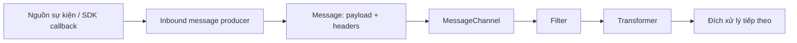
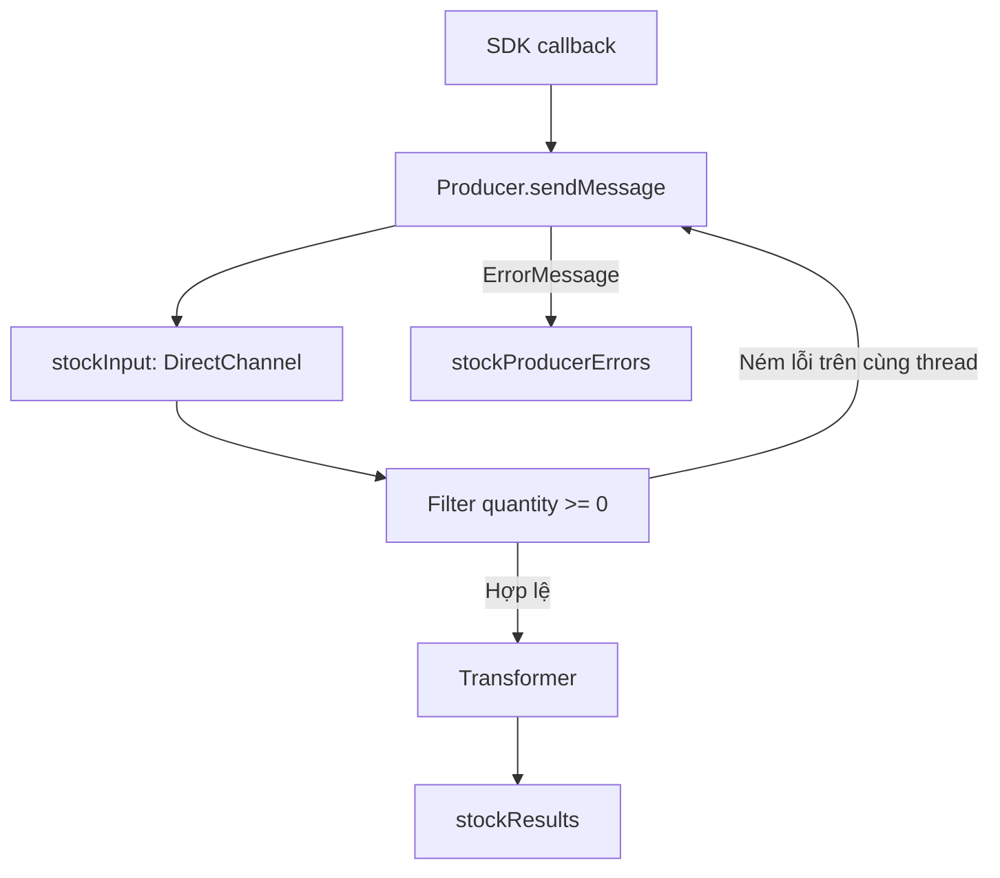

# Message producer

## 1. Mục tiêu và phạm vi

Trong chương **Channel adapter** của module **SPRING_INTEGRATION_CORE**, message producer là điểm nối đưa dữ liệu hoặc sự kiện vào luồng thông điệp. Hiểu điểm nối này giúp thiết kế đúng đường đi từ nguồn sự kiện tới `Message`, `MessageChannel` và các endpoint xử lý tiếp theo.

Sau bài này, bạn có thể:

- Phân biệt vai trò producer với `MessageSource`, consumer và messaging gateway.
- Xây dựng producer hướng sự kiện bằng `MessageProducerSupport`.
- Quản lý đăng ký callback theo vòng đời Spring.
- Nối producer vào Java DSL, filter và transformer.
- Xác định phạm vi xử lý lỗi, timeout và trách nhiệm xác nhận sự kiện.
- Viết kiểm thử cho việc phát message, dừng nguồn và chuyển lỗi sang error channel.

Ví dụ xuyên suốt là nguồn sự kiện thay đổi tồn kho. Nguồn giả lập chạy trong bộ nhớ để làm rõ cơ chế cốt lõi; không cần Kafka, JMS hay MQTT. Các đoạn Java dùng cú pháp Java 17 trở lên, cần thư viện `spring-integration-core`; đoạn kiểm thử dùng JUnit Jupiter. Phiên bản thư viện phải phù hợp với bộ dependency mà ứng dụng đang quản lý.

## 2. Message producer đứng ở đâu?

### 2.1. Vai trò trong kiến trúc

Producer nhận dữ liệu từ một nguồn, tạo hoặc tiếp nhận `Message<?>`, rồi gửi nó tới output channel. Consumer phía sau tiếp nhận message để thực hiện công việc của luồng.



Trong tình huống tồn kho:

1. SDK thông báo một sự kiện thay đổi số lượng.
2. Producer đóng gói sự kiện thành message.
3. Header ghi mã sự kiện và nguồn phát.
4. Filter kiểm tra dữ liệu được chấp nhận.
5. Transformer chuyển dữ liệu sang định dạng dành cho bước tiếp theo.

Producer không cần biết bean nghiệp vụ nào đang nhận message. Nó cần biết hợp đồng dữ liệu và output channel. Đây là ranh giới hữu ích khi thay nguồn SDK bằng một nguồn khác nhưng vẫn giữ luồng xử lý.

### 2.2. Phân biệt vai trò và API

`MessageProducer` trong package `org.springframework.integration.core` là interface cho thành phần có khả năng gửi message tới output channel. Hợp đồng này không chỉ dành cho adapter đầu vào; một số handler tạo message đầu ra cũng triển khai interface ấy. Vì vậy, không thể nhìn thấy `implements MessageProducer` rồi kết luận thành phần đó luôn là một nguồn sự kiện. Xem [API MessageProducer](https://docs.spring.io/spring-integration/api/org/springframework/integration/core/MessageProducer.html).

Trong phạm vi bài này, ta tập trung vào **producer ở đầu luồng**, đặc biệt là một inbound adapter hướng sự kiện kế thừa `MessageProducerSupport`.

| Thành phần | Trách nhiệm chính | Ai kích hoạt việc lấy hoặc gửi dữ liệu? |
|---|---|---|
| Producer hướng sự kiện | Đưa sự kiện nhận được vào output channel | Callback, listener hoặc cơ chế nhận của nguồn |
| `MessageSource<T>` | Cung cấp message qua `receive()` | Poller của adapter gọi nguồn |
| `SourcePollingChannelAdapter` | Điều phối polling và chuyển kết quả tới channel | Lịch polling |
| `MessageHandler` | Nhận message đã đi vào luồng | Cơ chế dispatch hoặc consumer endpoint |
| Messaging gateway | Cung cấp phương thức Java làm cửa vào hệ thống messaging | Mã ứng dụng gọi phương thức gateway |

Một adapter nhận dữ liệu là **inbound** theo góc nhìn của ứng dụng tích hợp. Việc nó “produce” message không làm nó trở thành outbound adapter. Chiều inbound/outbound nói về ranh giới ứng dụng; producer/consumer nói về vai trò đối với message.

## 3. Push và pull: chọn cơ chế theo hợp đồng của nguồn

### 3.1. Nguồn hỗ trợ polling

Nếu nguồn có thao tác “lấy dữ liệu tiếp theo”, `MessageSource` kết hợp `SourcePollingChannelAdapter` thường là mô hình phù hợp:

```text
Poller → MessageSource.receive() → Message hoặc null → output channel
```

Ví dụ ngắn, độc lập với ví dụ tồn kho:

```java
@Bean
IntegrationFlow heartbeatFlow() {
    return IntegrationFlow
            .fromSupplier(
                    () -> "heartbeat",
                    endpoint -> endpoint.poller(
                            poller -> poller.fixedDelay(1_000)))
            .channel("heartbeatInput")
            .get();
}
```

Trong ví dụ này, poller gọi supplier theo lịch. Cần có luồng hoặc subscriber tiếp nhận `heartbeatInput`. `fromSupplier` bọc kết quả khác null thành message nếu kết quả chưa phải message. Với nguồn polling, null có nghĩa là không có message cho lần lấy đó. Xem [Inbound Channel Adapters với Java DSL](https://docs.spring.io/spring-integration/reference/dsl/java-inbound-adapters.html).

### 3.2. Nguồn phát qua callback

Nếu SDK có hợp đồng dạng `subscribe(listener)`, nguồn chủ động gọi listener khi có sự kiện:

```text
Sự kiện đến → callback → producer.sendMessage(message) → output channel
```

Không cần đặt poller chỉ để kích hoạt producer này. Cấu hình poller ở đầu vào chỉ thích hợp khi thật sự có thao tác lấy dữ liệu. Một flow vẫn có thể cần poller ở bước phía sau nếu bước đó tiêu thụ từ `QueueChannel`.

Cũng không nên dùng `@InboundChannelAdapter` trên một phương thức rồi kỳ vọng annotation tự đăng ký callback cho SDK. Dạng adapter gọi phương thức của annotation này thuộc cơ chế polling; đăng ký listener là trách nhiệm riêng của adapter hướng sự kiện. Xem [Channel Adapter](https://docs.spring.io/spring-integration/reference/channel-adapter.html).

## 4. Message là hợp đồng mà producer đưa vào luồng

Với sự kiện tồn kho, ta chọn:

- **Payload:** bản ghi `StockChanged`.
- **Header `eventId`:** mã sự kiện nghiệp vụ, giữ ổn định khi cùng sự kiện được phát lại.
- **Header `sourceSystem`:** nguồn cung cấp sự kiện.
- **Header `eventOccurredAt`:** thời điểm sự kiện xảy ra tại nguồn.

```java
package example.integration.stock;

import java.time.Instant;
import java.util.Objects;

public record StockChanged(
        String eventId,
        String sku,
        int quantity,
        Instant occurredAt) {

    public StockChanged {
        Objects.requireNonNull(eventId, "eventId is required");
        Objects.requireNonNull(sku, "sku is required");
        Objects.requireNonNull(occurredAt, "occurredAt is required");
    }
}
```

Quantity âm được giữ lại để minh họa filter từ chối dữ liệu. Trong ứng dụng thực, cần xác định rõ miền nghiệp vụ có cho phép tồn kho âm hay không, rồi đặt quy tắc ở vị trí phù hợp.

`MessageBuilder` giúp tạo message cùng các header của nó. Với payload phức tạp, cần tránh sửa đối tượng sau khi phát vì nhiều thành phần có thể giữ cùng tham chiếu. Record ở đây chứa các kiểu dữ liệu bất biến nên dễ kiểm soát hơn.

Không dùng `MessageHeaders.ID` làm khóa chống trùng nghiệp vụ. Khi một sự kiện được đóng gói lại thành message mới, message ID có thể khác. Quyết định chống trùng nên dựa trên định danh từ nguồn, ví dụ `eventId`, cùng phạm vi nghiệp vụ cần thiết.

Cũng không tự đặt `correlationId`, `sequenceNumber` hay `sequenceSize` nếu chưa có quy tắc nhóm. Khi flow mở rộng tới router hoặc aggregator, các header điều khiển đó phải phản ánh đúng cách phân nhánh và gom nhóm; producer không thể suy ra chúng chỉ từ việc nhận một callback.

## 5. Tạo nguồn sự kiện giả lập

Các lớp dưới đây được đặt trong các file Java riêng, cùng package `example.integration.stock`. Nguồn giả lập chỉ mô phỏng hợp đồng SDK; đây không phải message broker và không cung cấp lưu bền hay xác nhận phân tán.

### 5.1. Hợp đồng nguồn

```java
package example.integration.stock;

import java.util.function.Consumer;

public interface StockEventSource {

    Subscription subscribe(Consumer<StockChanged> listener);

    @FunctionalInterface
    interface Subscription {
        void cancel();
    }
}
```

Đối tượng subscription giúp producer hủy đúng listener mà nó đã đăng ký. Hợp đồng nguồn thực tế còn cần nói rõ callback có thể chạy đồng thời hay không và việc hủy có chờ callback đang chạy kết thúc hay không.

### 5.2. Bản triển khai trong bộ nhớ

```java
package example.integration.stock;

import java.util.Objects;
import java.util.concurrent.CopyOnWriteArrayList;
import java.util.function.Consumer;

public final class InMemoryStockEventSource implements StockEventSource {

    private final CopyOnWriteArrayList<Consumer<StockChanged>> listeners =
            new CopyOnWriteArrayList<>();

    @Override
    public Subscription subscribe(Consumer<StockChanged> listener) {
        Objects.requireNonNull(listener, "listener is required");
        this.listeners.add(listener);

        return () -> {
            this.listeners.remove(listener);
        };
    }

    public void emit(StockChanged event) {
        Objects.requireNonNull(event, "event is required");

        for (Consumer<StockChanged> listener : this.listeners) {
            listener.accept(event);
        }
    }
}
```

`emit` gọi callback đồng bộ trên chính thread gọi nó. Nhờ vậy, kiểm thử có thể xác định kết quả ngay sau khi phát sự kiện.

`CopyOnWriteArrayList` hỗ trợ thao tác danh sách listener trong môi trường nhiều thread, nhưng không biến callback nghiệp vụ thành thao tác tuần tự toàn cục. Một vòng lặp đã lấy snapshot trước khi `cancel` xảy ra vẫn có thể gọi listener. Đặc điểm này sẽ quan trọng khi thiết kế shutdown cho SDK thật.

## 6. Xây dựng producer bằng MessageProducerSupport

`MessageProducerSupport` cung cấp nền tảng cho endpoint phát message: cấu hình output channel, thao tác gửi được bảo vệ, vòng đời và hỗ trợ error channel. Thay vì tự quản lý toàn bộ cơ chế gửi, lớp con tập trung vào hợp đồng với nguồn. Xem [API MessageProducerSupport](https://docs.spring.io/spring-integration/api/org/springframework/integration/endpoint/MessageProducerSupport.html).

```java
package example.integration.stock;

import java.util.Objects;

import org.springframework.integration.endpoint.MessageProducerSupport;
import org.springframework.messaging.Message;
import org.springframework.messaging.support.MessageBuilder;

public final class StockEventMessageProducer extends MessageProducerSupport {

    private final StockEventSource source;

    private StockEventSource.Subscription subscription;

    public StockEventMessageProducer(StockEventSource source) {
        this.source = Objects.requireNonNull(source, "source is required");
    }

    @Override
    protected void doStart() {
        super.doStart();
        this.subscription = this.source.subscribe(this::onEvent);
    }

    @Override
    protected void doStop() {
        StockEventSource.Subscription current = this.subscription;
        this.subscription = null;

        try {
            if (current != null) {
                current.cancel();
            }
        }
        finally {
            super.doStop();
        }
    }

    private void onEvent(StockChanged event) {
        Message<StockChanged> message = MessageBuilder
                .withPayload(event)
                .setHeader("eventId", event.eventId())
                .setHeader("sourceSystem", "inventory-sdk")
                .setHeader("eventOccurredAt", event.occurredAt())
                .build();

        sendMessage(message);
    }
}
```

Các điểm cần đọc đúng trong đoạn mã:

1. **Constructor chỉ giữ dependency.** Không đăng ký listener khi đối tượng mới được tạo, vì output channel và các bean khác có thể chưa sẵn sàng.
2. **`doStart` mở đường nhận sự kiện.** Mỗi lần endpoint được start lại, nó tạo một subscription mới.
3. **`doStop` giải phóng subscription.** Giữ handle riêng giúp hủy đúng đăng ký mà producer sở hữu.
4. **`onEvent` tạo message rồi gọi `sendMessage`.** Phương thức này là `protected`, trả về `void`; đây không phải API công khai để mã nghiệp vụ gọi tùy ý.
5. **Producer không giữ handler đích.** Chọn consumer là trách nhiệm của channel và flow.

Spring quản lý `start()` và `stop()` của endpoint. Không tự gọi `doStart()` hay `doStop()` từ controller hoặc service vì đó là các hook bên trong vòng đời.

Một nguồn có thể gọi callback ngay trong `subscribe`. Vì vậy, không thêm điều kiện `if (!isRunning()) return;` vào callback một cách máy móc: trạng thái vòng đời và thời điểm SDK gọi listener cần được xem xét cùng nhau. Trong ví dụ, việc đăng ký và hủy listener là cơ chế bật/tắt nguồn.

Với SDK thật, nếu thao tác đăng ký tạo tài nguyên rồi thất bại, adapter phải dọn phần tài nguyên đã tạo. Nếu cần chờ callback đang chạy kết thúc khi shutdown, phải thiết kế cơ chế chờ phù hợp với hợp đồng SDK; việc xóa handle khỏi biến chưa đáp ứng yêu cầu đó.

## 7. Nối producer vào Java DSL

### 7.1. Cấu hình hoàn chỉnh cho ví dụ

```java
package example.integration.stock;

import org.springframework.beans.factory.annotation.Qualifier;
import org.springframework.context.annotation.Bean;
import org.springframework.context.annotation.Configuration;
import org.springframework.integration.channel.DirectChannel;
import org.springframework.integration.channel.QueueChannel;
import org.springframework.integration.config.EnableIntegration;
import org.springframework.integration.dsl.IntegrationFlow;
import org.springframework.messaging.MessageChannel;

@Configuration
@EnableIntegration
public class StockIntegrationConfig {

    @Bean
    public InMemoryStockEventSource stockEventSource() {
        return new InMemoryStockEventSource();
    }

    @Bean
    public DirectChannel stockInput() {
        return new DirectChannel();
    }

    @Bean
    public QueueChannel stockResults() {
        return new QueueChannel(100);
    }

    @Bean
    public QueueChannel stockProducerErrors() {
        return new QueueChannel(20);
    }

    @Bean
    public StockEventMessageProducer stockProducer(
            InMemoryStockEventSource source,
            @Qualifier("stockProducerErrors") MessageChannel errors) {

        StockEventMessageProducer producer =
                new StockEventMessageProducer(source);

        producer.setErrorChannel(errors);
        producer.setSendTimeout(200);

        return producer;
    }

    @Bean
    public IntegrationFlow stockFlow(
            StockEventMessageProducer stockProducer) {

        return IntegrationFlow
                .from(stockProducer)
                .channel("stockInput")
                .<StockChanged>filter(
                        event -> event.quantity() >= 0,
                        spec -> spec.throwExceptionOnRejection(true))
                .<StockChanged, String>transform(
                        event -> event.sku() + "=" + event.quantity())
                .channel("stockResults")
                .get();
    }
}
```

`IntegrationFlow.from(stockProducer)` nhận một `MessageProducerSupport` làm đầu flow. Bước `.channel("stockInput")` nối output của producer với channel đó. Trong cách cấu hình này, không cần đặt lại output channel bằng tay. Xem [API IntegrationFlow](https://docs.spring.io/spring-integration/api/org/springframework/integration/dsl/IntegrationFlow.html).

Filter được cấu hình ném lỗi khi quantity âm. Quyết định này giúp phân biệt “dữ liệu bị từ chối cần xử lý” với “lọc bỏ dữ liệu có chủ đích”. Transformer đổi payload hợp lệ thành chuỗi như `SKU-42=7`.

Hai `QueueChannel` cuối ví dụ là nơi thu kết quả và lỗi để có thể quan sát hoặc kiểm thử. Chúng chưa có consumer tự động. Ứng dụng vận hành liên tục phải có bước tiêu thụ phù hợp, thay vì để hàng đợi tăng tới giới hạn.

### 7.2. Cấu hình channel trực tiếp là một lựa chọn khác

Nếu một flow khác đã bắt đầu bằng `stockInput`, producer có thể được cấu hình:

```java
producer.setOutputChannel(stockInput);
```

Hoặc dùng tên bean khi producer được Spring quản lý:

```java
producer.setOutputChannelName("stockInput");
```

Hãy chọn một cách nối nhất quán. Nếu đặt output bằng tay và đồng thời dùng producer làm đầu một flow khác, cần xác định rõ đầu ra thực tế; không tạo hai cấu hình cạnh tranh cho cùng endpoint.

### 7.3. Khởi động đúng thời điểm

Trong ví dụ, context quản lý cả producer và các endpoint downstream. Với nguồn SDK có vòng đời riêng, cần kiểm soát thứ tự để consumer sẵn sàng trước khi nguồn bắt đầu phát và để nguồn ngừng nhận trước khi tháo dỡ consumer.

Nếu cần điều khiển thủ công, có thể cấu hình `setAutoStartup(false)` trên producer rồi gọi `start()` sau khi điều kiện vận hành đã được đáp ứng. Đây là lựa chọn điều phối vòng đời, không phải cách khắc phục một output channel bị thiếu.

## 8. Thread và khả năng tiếp nhận của channel

Chọn channel là quyết định ảnh hưởng trực tiếp tới thread gọi callback, độ trễ và cách phản hồi khi luồng không theo kịp nguồn.

| Channel | Producer nhìn thấy điều gì? | Cần thiết kế thêm |
|---|---|---|
| `DirectChannel` | Handler thường chạy ngay trên thread gửi | Thời gian callback có thể bao gồm xử lý downstream |
| `ExecutorChannel` | Giao công việc cho executor theo cấu hình | Dung lượng executor, chính sách từ chối và lỗi bất đồng bộ |
| `QueueChannel` | Message được đưa vào hàng đợi nếu còn chỗ | Capacity, timeout, consumer và yêu cầu lưu bền |
| `PublishSubscribeChannel` | Phát tới các subscriber | Thread thực thi phụ thuộc việc có executor hay không |

Đặc điểm dispatch và lưu trữ của từng loại được mô tả tại [Message Channel Implementations](https://docs.spring.io/spring-integration/reference/channel/implementations.html).

Trong ví dụ chính, `stockInput` là `DirectChannel`. Callback đi qua filter và transformer trước khi đặt kết quả vào `stockResults`. Không có thread mới được tạo chỉ vì ta khai báo một `IntegrationFlow`.

`setSendTimeout(200)` trên producer giới hạn việc chờ gửi tại output khi loại channel hỗ trợ timeout. Nó **không** đặt thời hạn 200 ms cho toàn bộ xử lý nghiệp vụ. Nếu handler đồng bộ chạy lâu hoặc bước sâu hơn chờ một queue đầy, timeout gửi ở producer không tự ngắt đoạn xử lý đó.

Với ví dụ này, cần đọc hết kết quả và lỗi. Đặc biệt, `stockResults` có thể đầy khi không có consumer; chờ đợi ở đầu ra của transformer không được giải quyết chỉ bằng timeout của producer ở `stockInput`.

Nếu nguồn phát nhanh hơn tốc độ xử lý, hãy quyết định rõ:

- Có thể chặn thread callback trong bao lâu?
- Nguồn có hỗ trợ tạm dừng hoặc giới hạn tốc độ không?
- Queue có giới hạn bao nhiêu message và được tiêu thụ thế nào?
- Khi hết khả năng tiếp nhận, sự kiện được retry, lưu lại hay từ chối?
- Message đã nhận vào bộ nhớ có cần tồn tại sau khi tiến trình khởi động lại không?

Một queue trong bộ nhớ hoặc executor không tự cung cấp giao nhận bảo đảm sau sự cố tiến trình. Quyết định lưu bền phải được đưa vào kiến trúc, chẳng hạn thông qua broker hoặc message store phù hợp.

## 9. Xử lý lỗi đúng ranh giới

### 9.1. Lỗi khi producer đang gửi

Khi `sendMessage(message)` gặp lỗi runtime trong quá trình gửi, cơ chế của `MessageProducerSupport` có thể chuyển lỗi thành `ErrorMessage` tới error channel đã cấu hình. Nếu không có error channel cho producer, lỗi có thể truyền ngược về nguồn gọi callback. Đây là hành vi của lớp hỗ trợ, cần phân biệt với việc gọi `MessageChannel.send` trực tiếp. Xem [mã nguồn MessageProducerSupport](https://github.com/spring-projects/spring-integration/blob/main/spring-integration-core/src/main/java/org/springframework/integration/endpoint/MessageProducerSupport.java).

Với cấu hình của bài:



`stockProducerErrors` là error channel gắn riêng cho producer. Việc ứng dụng có bean toàn cục tên `errorChannel` không có nghĩa producer tùy biến luôn tự dùng bean ấy khi bạn chưa cấu hình.

Trong ví dụ, gửi thành công tới queue lỗi có thể khiến `emit` kết thúc bình thường dù dữ liệu đã bị filter từ chối. Đây là hệ quả phải tính đến khi nối với cơ chế ack của nguồn.

### 9.2. Lỗi trước khi gọi sendMessage

Nếu đoạn đọc metadata, chuyển đổi dữ liệu SDK hoặc tạo payload ném lỗi trước khi gọi `sendMessage`, lỗi đó nằm ngoài thao tác gửi của lớp cơ sở.

Khi mở rộng producer để xử lý loại lỗi này, có thể bắt riêng lỗi chuyển đổi và dùng `sendErrorMessageIfNecessary`. Nếu phương thức trả về false, adapter cần thực hiện chính sách lan truyền hoặc xử lý khác một cách tường minh. Khi chưa có message, ngữ cảnh lỗi phải lấy từ dữ liệu nguồn mà adapter còn giữ được.

Không bọc toàn bộ callback bằng một `catch` chung chỉ để lại gửi lỗi lần nữa. Khi lỗi đã được đường gửi xử lý hoặc bản thân việc gửi tới error channel thất bại, cách bọc như vậy có thể khiến logic lỗi lặp lại và che nguyên nhân ban đầu.

### 9.3. Lỗi sau ranh giới bất đồng bộ

Nếu output là `ExecutorChannel` hoặc message đã được một consumer khác lấy khỏi queue, lỗi có thể xảy ra sau khi producer đã trả về. Producer không thể bắt lỗi trên thread khác bằng `try/catch` của lần gửi trước đó.

Lúc này phải cấu hình đường lỗi tại tác vụ hoặc endpoint thực thi bất đồng bộ. Tùy cơ chế error handler, header `errorChannel` trên message và channel toàn cục có thể tham gia định tuyến lỗi. Không suy ra rằng setter `setErrorChannel` của producer tự bao phủ mọi lỗi trong toàn bộ flow. Xem [Error Handling](https://docs.spring.io/spring-integration/reference/error-handling.html).

### 9.4. Error channel không đồng nghĩa retry

Đưa `ErrorMessage` vào queue không tự tạo lần xử lý lại. Cần thiết kế consumer cho lỗi, phân loại lỗi và chính sách phục hồi:

| Loại tình huống | Hướng xử lý có thể chọn |
|---|---|
| Lỗi dữ liệu cố định | Lưu bản ghi bị từ chối kèm lý do, chuyển sang quy trình xử lý dữ liệu |
| Đích tạm thời không sẵn sàng | Retry có giới hạn, khoảng chờ và cơ chế chống trùng |
| Nguồn phát quá nhanh | Giới hạn tiếp nhận, tạm dừng nguồn hoặc lưu đệm có kiểm soát |
| Error channel cũng không nhận được | Bảo toàn ngữ cảnh lỗi, để nguồn hoặc lớp giám sát phát hiện thất bại |

Không nối luồng lỗi quay lại producer vô hạn. Các thông tin như `eventId`, nguồn phát và nguyên nhân thất bại cần được bảo toàn đủ để điều tra hoặc phát lại.

## 10. Ack, chống trùng và thứ tự sự kiện

Đối với nguồn có ack/nack hoặc offset, cần chọn mốc được xem là “đã nhận”:

1. Producer đã tạo message.
2. Output channel đã chấp nhận message.
3. Xử lý nghiệp vụ đã hoàn tất.
4. Kết quả nghiệp vụ đã được lưu bền.

Bốn mốc này có thể xảy ra ở các thời điểm khác nhau. Nếu output là queue, việc gửi xong chưa chứng minh consumer đã xử lý. Nếu lỗi đồng bộ đã được chuyển thành công sang error channel, callback có thể trả về bình thường nhưng nghiệp vụ chính vẫn thất bại.

Do đó, không đặt `ack()` ngay sau `sendMessage()` chỉ vì phương thức không ném exception mà chưa xem xét hợp đồng nguồn và kiến trúc flow. Trong trường hợp cần bảo đảm cao hơn, điểm ack phải gắn với kết quả xử lý hoặc cơ chế lưu nhận đáng tin cậy.

Khi retry, cùng `eventId` có thể xuất hiện nhiều lần. Ví dụ, nếu sự kiện mang trạng thái tuyệt đối “SKU-42 còn 7 sản phẩm”, xử lý lặp có thể dễ kiểm soát hơn thao tác “trừ thêm 3 sản phẩm”. Tuy vậy, cả hai vẫn cần quy tắc về phiên bản và thời điểm để tránh sự kiện cũ ghi đè trạng thái mới.

Một producer cũng không tự đảm bảo thứ tự toàn hệ thống. Nhiều callback chạy đồng thời, nhiều nguồn hoặc nhiều consumer có thể thay đổi thứ tự hoàn tất. Khi thứ tự theo SKU là yêu cầu nghiệp vụ, cần thiết kế đường xử lý theo khóa và cơ chế nhận biết sự kiện đến muộn.

## 11. Kiểm thử hành vi của ví dụ

Các kiểm thử sau dùng các lớp ở trên và khởi tạo Spring context thật. Chúng minh họa điều cần kiểm chứng; việc trình bày mã không có nghĩa các kiểm thử đã được chạy trong repository.

Không cần `Thread.sleep` vì nguồn giả lập gọi callback đồng bộ. Timeout ngắn ở thao tác nhận queue giúp kiểm thử có điểm kết thúc rõ ràng.

```java
package example.integration.stock;

import java.time.Instant;

import org.junit.jupiter.api.Test;
import org.springframework.context.annotation.AnnotationConfigApplicationContext;
import org.springframework.integration.channel.QueueChannel;
import org.springframework.messaging.Message;
import org.springframework.messaging.MessagingException;
import org.springframework.messaging.support.ErrorMessage;

import static org.junit.jupiter.api.Assertions.*;

class StockEventMessageProducerTest {

    @Test
    void publishesEventAndPreservesBusinessHeaders() {
        try (var context = new AnnotationConfigApplicationContext(
                StockIntegrationConfig.class)) {

            var source = context.getBean(InMemoryStockEventSource.class);
            var results = context.getBean("stockResults", QueueChannel.class);

            source.emit(event("evt-1", 7));

            Message<?> message = results.receive(1_000);

            assertNotNull(message);
            assertEquals("SKU-42=7", message.getPayload());
            assertEquals("evt-1", message.getHeaders().get("eventId"));
            assertEquals(
                    "inventory-sdk",
                    message.getHeaders().get("sourceSystem"));
            assertNull(results.receive(0));
        }
    }

    @Test
    void stopsAndRestartsWithoutDuplicateSubscription() {
        try (var context = new AnnotationConfigApplicationContext(
                StockIntegrationConfig.class)) {

            var source = context.getBean(InMemoryStockEventSource.class);
            var producer = context.getBean(StockEventMessageProducer.class);
            var results = context.getBean("stockResults", QueueChannel.class);

            producer.stop();
            source.emit(event("evt-stopped", 5));

            assertNull(results.receive(0));

            producer.start();
            producer.start();
            source.emit(event("evt-restarted", 8));

            Message<?> message = results.receive(1_000);

            assertNotNull(message);
            assertEquals(
                    "evt-restarted",
                    message.getHeaders().get("eventId"));
            assertNull(results.receive(0));
        }
    }

    @Test
    void routesSynchronousRejectionToProducerErrors() {
        try (var context = new AnnotationConfigApplicationContext(
                StockIntegrationConfig.class)) {

            var source = context.getBean(InMemoryStockEventSource.class);
            var results = context.getBean("stockResults", QueueChannel.class);
            var errors = context.getBean(
                    "stockProducerErrors", QueueChannel.class);

            source.emit(event("evt-invalid", -1));

            ErrorMessage error = assertInstanceOf(
                    ErrorMessage.class, errors.receive(1_000));

            MessagingException failure = assertInstanceOf(
                    MessagingException.class, error.getPayload());

            Message<?> failedMessage = failure.getFailedMessage();

            assertNotNull(failedMessage);
            assertEquals(
                    "evt-invalid",
                    failedMessage.getHeaders().get("eventId"));
            assertNull(results.receive(0));
            assertNull(errors.receive(0));
        }
    }

    private static StockChanged event(String eventId, int quantity) {
        return new StockChanged(
                eventId,
                "SKU-42",
                quantity,
                Instant.parse("2026-01-01T00:00:00Z"));
    }
}
```

Ba kiểm thử xác minh ba hành vi khác nhau:

- Sự kiện hợp lệ đi qua producer và transformer, đồng thời giữ được các header nghiệp vụ.
- Sau khi stop, nguồn giả lập không còn phát tới producer; start lại không tạo đăng ký trùng khi gọi start trên endpoint đang chạy.
- Dữ liệu bị từ chối trên đường đồng bộ tạo lỗi tại queue của producer và không tạo kết quả hợp lệ.

Kiểm thử stop/start này kiểm tra nguồn giả lập trong tình huống tuần tự. Nó chưa chứng minh adapter chờ được callback đang chạy, xử lý được sự cố kết nối hay bảo đảm không mất dữ liệu với SDK thật.

Khi thay bằng SDK thực, cần bổ sung kiểm thử đúng hợp đồng nguồn: lỗi đăng ký listener, mất kết nối, callback đồng thời, shutdown trong lúc xử lý, queue đầy và cơ chế ack. Mỗi kiểm thử nên gắn với một yêu cầu vận hành cụ thể.

## 12. Các lỗi thiết kế thường gặp

| Cách làm | Hệ quả | Cách điều chỉnh |
|---|---|---|
| Đăng ký callback trong constructor | Nguồn có thể phát trước khi cấu hình xong | Đăng ký tại hook start |
| Không lưu subscription | Không hủy được đúng listener | Giữ handle và giải phóng khi stop |
| Tạo lại producer bằng `new` ngoài context | Mất cấu hình và điều phối vòng đời dự kiến | Đưa endpoint vào Spring configuration |
| Gắn poller cho nguồn chỉ có callback | Trộn hai cơ chế kích hoạt | Dùng producer hướng sự kiện |
| Chặn lâu trên thread callback | Nguồn giảm thông lượng hoặc quá hạn theo hợp đồng SDK | Chọn mô hình dispatch và khả năng tiếp nhận phù hợp |
| Dùng queue không có consumer | Queue đầy hoặc giữ dữ liệu không được xử lý | Cấu hình đường tiêu thụ và giới hạn dung lượng |
| Cho rằng error channel tự retry | Message lỗi nằm lại mà không có lần xử lý tiếp | Thiết kế consumer và chính sách phục hồi |
| Dùng message ID để chống trùng nguồn | Sự kiện phát lại có thể mang ID message mới | Dùng định danh nghiệp vụ ổn định |
| Ack sau một lần enqueue mà cần bảo đảm nghiệp vụ | Nguồn có thể xem sự kiện đã xong quá sớm | Chọn mốc xác nhận theo yêu cầu giao nhận |

## 13. Liên hệ với các thành phần cốt lõi khác

Producer tạo ranh giới nhận dữ liệu. Những quyết định tiếp theo thuộc về flow:

- **Transformer** chuyển biểu diễn payload hoặc làm giàu dữ liệu theo một hợp đồng rõ ràng.
- **Filter** quyết định message được đi tiếp, bị bỏ qua có chủ đích hay bị từ chối thành lỗi.
- **Router** chọn đường xử lý dựa trên nội dung hoặc metadata.
- **Aggregator** cần quy tắc tương quan và hoàn tất nhóm; không thể chỉ dựa vào việc nhiều message cùng đi từ một producer.
- **Gateway** hữu ích khi mã ứng dụng muốn gọi một phương thức Java để đi vào messaging, đặc biệt khi cần hợp đồng request/reply.

Nếu ứng dụng chỉ cần gọi một phương thức để gửi lệnh từ service vào channel, messaging gateway thường giúp thể hiện cửa vào đó rõ hơn. Chỉ xây producer tùy biến khi cần nối một cơ chế phát dữ liệu có hợp đồng riêng, chẳng hạn listener của SDK chưa có adapter phù hợp.

Giữ xử lý nghiệp vụ ở các endpoint downstream giúp producer tập trung vào nhận dữ liệu, đóng gói metadata và quản lý nguồn. Nhờ đó, bạn có thể thay nguồn nhận mà vẫn kiểm thử độc lập transformer, router hoặc filter.

## 14. Bài tập thực hành

1. Đổi `sourceSystem` thành tham số cấu hình của producer. Kiểm chứng mỗi instance gắn đúng tên nguồn vào header.
2. Thay filter ném lỗi bằng filter bỏ qua dữ liệu âm. Quan sát sự thay đổi ở kết quả, queue lỗi và cách diễn giải việc callback kết thúc.
3. Nối trực tiếp output producer tới `QueueChannel` capacity bằng 1, cấu hình send timeout hữu hạn, rồi phát hai sự kiện khi chưa có consumer. Kiểm tra sự kiện đầu được giữ và lần gửi sau thất bại theo chính sách lỗi đã chọn.
4. Thêm consumer bất đồng bộ ném exception sau khi producer đã gửi xong. Chỉ ra endpoint nào chịu trách nhiệm phát lỗi và tại sao callback ban đầu không thể bắt lỗi đó.
5. Thiết kế quy tắc chống trùng theo `eventId` cho một tác vụ có tác dụng phụ. Xác định thời điểm ghi dấu đã xử lý và điều xảy ra nếu tiến trình dừng ở giữa.

Ở bài tập queue đầy, hãy đặt queue ngay tại output của producer để kiểm tra đúng `sendTimeout` của producer. Nếu queue nằm sau một handler khác, timeout có thể thuộc thao tác gửi của handler đó.

## 15. Ghi nhớ

Message producer ở đầu luồng biến sự kiện của nguồn thành message cho hệ thống tích hợp. `MessageProducerSupport` cung cấp cơ chế gửi và vòng đời, còn adapter tùy biến phải quản lý hợp đồng callback, tài nguyên nguồn và chính sách khi không thể tiếp nhận.

Một thiết kế đủ rõ cần trả lời được ba điều: **ai kích hoạt việc phát**, **channel chấp nhận message có ý nghĩa gì** và **thất bại được phát hiện ở đâu**. Từ đó mới có thể nối producer với filter, transformer, router hoặc aggregator mà vẫn giữ đúng yêu cầu giao nhận của ứng dụng.
