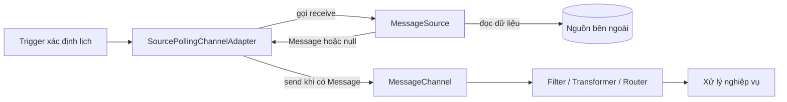

# Polling inbound adapter

## 1. Bài toán: chủ động lấy dữ liệu để mở đầu luồng thông điệp

Một hệ thống bán hàng cũ chỉ cung cấp danh sách đơn hàng đang chờ xử lý. Nó không phát sự kiện khi có đơn mới. Ứng dụng tích hợp phải định kỳ hỏi hệ thống đó, chuyển dữ liệu nhận được thành thông điệp rồi đưa vào luồng xử lý.

Trong chương **Channel adapter** của module **SPRING_INTEGRATION_CORE**, polling inbound adapter là điểm nối giữa một nguồn được đọc chủ động và hệ thống thông điệp của Spring Integration. Adapter mở đầu luồng bằng cách lấy dữ liệu từ nguồn; các transformer, filter, router hoặc service activator phía sau tiếp tục xử lý dữ liệu theo nghiệp vụ.

Sau bài học, bạn có thể:

- Phân biệt polling nguồn dữ liệu với polling một channel nội bộ.
- Xây dựng `MessageSource<T>` và khai báo inbound adapter bằng Java DSL.
- Chọn lịch polling, giới hạn số thông điệp và hiểu ảnh hưởng của channel đến luồng thực thi.
- Thiết kế đường xử lý lỗi, khả năng đọc lại và chống xử lý trùng.
- Kiểm thử nguồn và đầu ra của adapter mà không dựa vào một khoảng `Thread.sleep()` cố định.

Các ví dụ dùng Java 17 trở lên và các API có trong Spring Integration 6.5. Dự án cần quản lý phiên bản Spring đồng bộ bằng Spring Boot hoặc BOM tương ứng; bài học không yêu cầu một phiên bản mới nhất cụ thể.

## 2. Các thành phần và hướng di chuyển của thông điệp



| Thành phần | Trách nhiệm |
| --- | --- |
| `MessageSource<T>` | Trả về thông điệp tiếp theo hoặc `null` khi hiện chưa có dữ liệu. |
| `SourcePollingChannelAdapter` | Điều phối việc lấy thông điệp từ nguồn và gửi vào channel đầu ra. |
| Poller | Mang cấu hình trigger, giới hạn số thông điệp, executor, transaction hoặc advice nếu có. |
| `TaskScheduler` | Lập lịch thực thi tác vụ polling. |
| `MessageChannel` | Chuyển tiếp hoặc lưu đệm thông điệp theo loại channel. |
| Endpoint phía sau | Thực hiện từng bước như lọc, chuyển đổi, định tuyến và gọi dịch vụ. |

Tên lớp biểu thị hai vai trò riêng: `MessageSource` biết lấy gì và lấy bằng cách nào; adapter biết khi nào gọi nguồn và chuyển kết quả đi đâu. Adapter nối nguồn với `MessageChannel`, còn nguồn có thể được kiểm thử độc lập với lịch chạy. Xem [API SourcePollingChannelAdapter](https://docs.spring.io/spring-integration/docs/6.5.0/api/org/springframework/integration/endpoint/SourcePollingChannelAdapter.html).

### 2.1. Polling inbound adapter khác polling consumer

Hai cấu hình sau đều có poller nhưng đọc từ hai nơi khác nhau:

```text
Nguồn dữ liệu → SourcePollingChannelAdapter → DirectChannel → Handler

Producer → QueueChannel → PollingConsumer → Handler
```

Ở luồng đầu, adapter gọi `MessageSource.receive()`. Ở luồng sau, consumer gọi `receive()` trên một `PollableChannel`. Một handler nhận dữ liệu từ `DirectChannel` thường hoạt động theo cơ chế đăng ký nhận thông điệp, không cần poller riêng. Sự phân biệt này được mô tả trong [Poller của Spring Integration](https://docs.spring.io/spring-integration/reference/polling-consumer.html).

Việc inbound adapter có poller không bắt buộc channel đầu ra phải là `QueueChannel`. Nó có thể gửi vào `DirectChannel`; khi đó việc lấy dữ liệu và xử lý đồng bộ phía sau có thể diễn ra trên cùng luồng thực thi.

### 2.2. Adapter và gateway trả lời hai nhu cầu khác nhau

Polling inbound adapter phát sinh thông điệp theo lịch và không chờ một phản hồi nghiệp vụ để trả về cho bên gọi bên ngoài. Gateway phù hợp với tương tác có hợp đồng request–reply. Việc nguồn gọi một HTTP API để đọc dữ liệu vẫn có thể nằm bên trong một polling inbound adapter; giao thức đọc nguồn không tự quyết định endpoint phải là gateway.

## 3. Hợp đồng của MessageSource

Giao diện cốt lõi có thể hình dung như sau:

```java
public interface MessageSource<T> {
    Message<T> receive();
}
```

Đây là lược đồ của phương thức cần triển khai, không phải bản sao đầy đủ giao diện framework. `receive()` có thể trả về `null`; `T` là kiểu payload của `Message<T>`. Hợp đồng này được nêu trong [API MessageSource](https://docs.spring.io/spring-integration/api/org/springframework/integration/core/MessageSource.html).

| Kết quả một lần gọi nguồn | Ý nghĩa đối với adapter |
| --- | --- |
| Một `Message<T>` | Có dữ liệu để gửi vào luồng. |
| `null` | Hiện không có thông điệp; lượt polling kết thúc. |
| Ném exception | Thao tác thất bại; chuyển sang cơ chế xử lý lỗi của tác vụ. |

`null` là kết quả bình thường khi nguồn rỗng. Nó không biểu thị lỗi và không có nghĩa adapter dừng vĩnh viễn: trigger vẫn có thể kích hoạt lượt tiếp theo.

Ngược lại, timeout kết nối, lỗi xác thực hoặc phản hồi nguồn không hợp lệ cần được biểu diễn thành lỗi thích hợp. Nếu bắt mọi exception rồi trả về `null`, hệ thống giám sát sẽ khó phân biệt “nguồn không có dữ liệu” với “nguồn đang hỏng”.

Một lần `receive()` trả về tối đa một **thông điệp**, nhưng payload có thể là một đối tượng hoặc một danh sách. Nếu nguồn trả về `Message<List<Order>>`, một thông điệp có thể chứa hàng trăm đơn hàng. Muốn xử lý từng đơn, có thể đặt splitter phía sau.

## 4. Một lượt polling hoạt động như thế nào?

Giả sử cấu hình `maxMessagesPerPoll = 3`. Mô hình đơn giản của một lượt thành công là:

```text
Được trigger kích hoạt
    ↓
receive() → Message A → gửi đi
receive() → Message B → gửi đi
receive() → null      → kết thúc lượt
    ↓
Chờ lần kích hoạt tiếp theo
```

Nếu cả ba lần nhận đều có thông điệp, lượt kết thúc sau thông điệp thứ ba. Nếu một lần đọc hoặc gửi phát sinh lỗi chưa được xử lý, không nên giả định các lần còn lại trong lượt đó vẫn tiếp tục như trường hợp thành công.

Các giá trị cần nhớ đối với `SourcePollingChannelAdapter`:

| `maxMessagesPerPoll` | Hành vi |
| --- | --- |
| Số dương `N` | Lấy tối đa `N` thông điệp trong một lượt; có thể dừng sớm khi nguồn trả `null`. |
| `1` | Giá trị mặc định của polling inbound adapter. |
| Số âm, thường là `-1` | Tiếp tục lấy cho đến khi nguồn trả `null`, nếu không có lỗi hoặc điều kiện dừng khác. |
| `0` | Bỏ qua thao tác nhận; ý nghĩa này được hỗ trợ từ Spring Integration 5.5. |

Đặc biệt, mặc định của `PollingConsumer` là `-1`, khác với inbound adapter. Nguồn luôn sinh dữ liệu mà không bao giờ trả `null` có thể khiến một lượt chạy rất lâu nếu đặt `-1`. Vì vậy, nên khai báo giới hạn hữu hạn khi xây dựng nguồn tự viết. Xem [cấu hình inbound channel adapter](https://docs.spring.io/spring-integration/reference/channel-adapter.html).

Giới hạn này đếm số thông điệp adapter lấy từ nguồn, không đếm số bản ghi trong payload hoặc số kết quả cuối cùng. Chẳng hạn, adapter lấy hai thông điệp nhưng filter loại một thông điệp thì đầu ra chỉ có một kết quả; lượt đó vẫn đã lấy hai thông điệp.

## 5. Chọn lịch polling

### 5.1. Fixed delay

```java
Pollers.fixedDelay(Duration.ofSeconds(1))
       .maxMessagesPerPoll(10)
```

Với cách thực thi đồng bộ thông thường, lượt tiếp theo được lên lịch sau khi tác vụ trước hoàn tất rồi chờ thêm khoảng delay. Nếu một lượt tốn 800 ms và delay là 1 giây, hai thời điểm bắt đầu cách nhau xấp xỉ 1,8 giây.

Fixed delay phù hợp khi cần chừa khoảng nghỉ giữa các lượt đọc, nhất là với nguồn có thời gian phản hồi biến động.

### 5.2. Fixed rate

```java
Pollers.fixedRate(Duration.ofSeconds(1))
       .maxMessagesPerPoll(10)
```

Fixed rate xác định nhịp dựa trên các thời điểm bắt đầu theo lịch. Nó không bảo đảm dữ liệu được xử lý xong mỗi giây, cũng không tự tạo thêm năng lực xử lý khi tác vụ chậm. Các overload và ý nghĩa lịch được mô tả trong [API Pollers 6.5](https://docs.spring.io/spring-integration/docs/6.5.0/api/org/springframework/integration/dsl/Pollers.html).

### 5.3. Cron và lần chạy đầu

```java
Pollers.cron(
        "0 */5 * * * *",
        TimeZone.getTimeZone("Asia/Ho_Chi_Minh"))
       .maxMessagesPerPoll(50)
```

Ví dụ kích hoạt vào giây `0` của mỗi mốc 5 phút. Cron của Spring ở đây có sáu trường, gồm trường giây. Đặt múi giờ tường minh giúp lịch nghiệp vụ không phụ thuộc múi giờ mặc định trên máy chạy.

Khi muốn chờ trước lần đọc đầu tiên, có thể dùng overload:

```java
Pollers.fixedDelay(Duration.ofSeconds(1), Duration.ofSeconds(5))
```

Trong các đoạn trên cần import `java.time.Duration`, `java.util.TimeZone` khi dùng cron và `org.springframework.integration.dsl.Pollers`.

### 5.4. Các cấu hình thường bị hiểu sai

| Cấu hình | Cần hiểu đúng |
| --- | --- |
| `maxMessagesPerPoll(10)` | Không có nghĩa mỗi lần gọi nguồn sẽ fetch đúng 10 bản ghi. |
| `receiveTimeout` của poller | Dùng cho polling consumer đọc channel; không đặt timeout cho HTTP/JDBC bên trong `MessageSource`. |
| `taskExecutor` | Chuyển công việc polling sang executor; phải xem xét số tác vụ đồng thời và khả năng chịu tải của nguồn. |
| Poller mặc định dùng chung | Cần được cấu hình phù hợp nếu endpoint dựa vào nó; ví dụ trong bài khai báo poller riêng để lịch và giới hạn rõ ràng. |

Với inbound adapter, khả năng một lần nhận bị block phụ thuộc implementation của nguồn. Timeout HTTP, socket hoặc truy vấn cần đặt ở client tương ứng. Phạm vi của `receiveTimeout` được ghi rõ trong [API @Poller](https://docs.spring.io/spring-integration/api/org/springframework/integration/annotation/Poller.html).

Nếu thêm executor bất đồng bộ cho poller, thời điểm tác vụ lập lịch hoàn tất có thể chỉ phản ánh việc giao công việc cho executor. Khi đó không thể dùng fixed delay để suy ra rằng mọi xử lý nghiệp vụ của lượt trước đã hoàn thành.

## 6. Ví dụ Java DSL: đọc đơn hàng, lọc và chuyển đổi

Ví dụ sau dùng nguồn trong bộ nhớ để quan sát toàn bộ cơ chế mà không cần máy chủ bên ngoài. Dependency chính là `org.springframework.integration:spring-integration-core`; Java DSL đã nằm trong core.

Đặt lớp trong package `example.integration`:

```java
package example.integration;

import java.math.BigDecimal;
import java.time.Duration;
import java.util.Queue;
import java.util.concurrent.ConcurrentLinkedQueue;

import org.springframework.context.annotation.Bean;
import org.springframework.context.annotation.Configuration;
import org.springframework.integration.channel.QueueChannel;
import org.springframework.integration.config.EnableIntegration;
import org.springframework.integration.core.MessageSource;
import org.springframework.integration.dsl.IntegrationFlow;
import org.springframework.integration.dsl.Pollers;
import org.springframework.messaging.Message;
import org.springframework.messaging.support.MessageBuilder;

@Configuration
@EnableIntegration
public class PollingInboundConfig {

    public record OrderEvent(
            String eventId,
            String orderId,
            BigDecimal amount) {
    }

    public record OrderAccepted(
            String orderId,
            BigDecimal amount) {
    }

    public static class OrderSource implements MessageSource<OrderEvent> {

        private final Queue<OrderEvent> pending =
                new ConcurrentLinkedQueue<>();

        public void offer(OrderEvent event) {
            pending.add(event);
        }

        @Override
        public Message<OrderEvent> receive() {
            OrderEvent event = pending.poll();
            if (event == null) {
                return null;
            }

            return MessageBuilder.withPayload(event)
                    .setHeader("eventId", event.eventId())
                    .setHeader("sourceSystem", "demo-orders")
                    .build();
        }
    }

    @Bean
    public OrderSource orderSource() {
        OrderSource source = new OrderSource();
        source.offer(new OrderEvent(
                "evt-001", "ord-101", new BigDecimal("150000")));
        source.offer(new OrderEvent(
                "evt-002", "ord-102", new BigDecimal("-5000")));
        source.offer(new OrderEvent(
                "evt-003", "ord-103", new BigDecimal("240000")));
        return source;
    }

    @Bean
    public QueueChannel orderResults() {
        return new QueueChannel(10);
    }

    @Bean
    public QueueChannel rejectedOrders() {
        return new QueueChannel(10);
    }

    @Bean
    public QueueChannel pollingErrors() {
        return new QueueChannel(10);
    }

    @Bean
    public IntegrationFlow orderPollingFlow(OrderSource orderSource) {
        return IntegrationFlow
                .from(orderSource, endpoint -> endpoint
                        .id("orderPollingAdapter")
                        .poller(Pollers.fixedDelay(Duration.ofSeconds(1))
                                .maxMessagesPerPoll(2)
                                .errorChannel("pollingErrors")))
                .filter(OrderEvent.class,
                        event -> event.amount().signum() > 0,
                        filter -> filter.discardChannel("rejectedOrders"))
                .transform(OrderEvent.class,
                        event -> new OrderAccepted(
                                event.orderId(), event.amount()))
                .channel("orderResults")
                .get();
    }
}
```

### 6.1. Diễn giải luồng chạy

Khi application context khởi động, endpoint `orderPollingAdapter` tự chạy theo lịch đã khai báo. Các kết nối do DSL tạo giữa nguồn, filter và transformer trong cấu hình này xử lý đồng bộ; các `QueueChannel` được khai báo là điểm lưu kết quả để người đọc hoặc kiểm thử nhận về.

| Lượt | Thông điệp đọc từ nguồn | Kết quả |
| --- | --- | --- |
| Lượt đầu | `evt-001`, `evt-002` | `ord-101` đến `orderResults`; `evt-002` đến `rejectedOrders`. |
| Lượt sau | `evt-003`, rồi nguồn trả `null` | `ord-103` đến `orderResults`; lượt dừng sớm. |
| Khi nguồn đã rỗng | `null` | Không phát sinh thông điệp đầu ra; lịch vẫn tiếp tục. |

Filter từ chối số tiền không dương là một quyết định nghiệp vụ chủ động. Nó không phải lỗi kỹ thuật và không tự tạo `ErrorMessage`. Đường discard riêng giúp quan sát dữ liệu bị loại mà không trộn nó vào lỗi kết nối hoặc lỗi xử lý.

Sau transformer, payload đổi từ `OrderEvent` sang `OrderAccepted`; header nghiệp vụ `eventId` vẫn phục vụ đối chiếu thông điệp. Khi mở rộng luồng bằng router hoặc aggregator, nên chọn các khóa nghiệp vụ cần giữ ngay từ lúc tạo message.

### 6.2. Giới hạn của nguồn trong bộ nhớ

`pending.poll()` lấy và loại phần tử khỏi hàng đợi ngay trong `receive()`. Nếu filter, transformer hoặc thao tác gửi phía sau thất bại, dữ liệu đã lấy không tự quay lại hàng đợi này.

Nguồn minh họa cho phép kiểm tra cơ chế polling, nhưng chưa cung cấp lưu trữ bền vững hay acknowledgment. Khi thay bằng nguồn thật, cần xác định rõ:

- Thời điểm bản ghi được đánh dấu đã đọc hoặc đã xử lý.
- Cách lấy lại dữ liệu sau lỗi hoặc khi ứng dụng khởi động lại.
- Khóa nhận diện sự kiện để xử lý trùng an toàn.
- Cách nhiều instance chia việc mà không cùng nhận một bản ghi.

## 7. Biến thể dùng annotation

Nếu hệ thống đã có một bean cung cấp phương thức đọc không tham số, có thể dùng `@InboundChannelAdapter` thay cho phần khởi tạo nguồn bằng DSL:

```java
@InboundChannelAdapter(
        channel = "rawOrders",
        poller = @Poller(
                fixedDelay = "1000",
                maxMessagesPerPoll = "2",
                errorChannel = "pollingErrors"))
public Message<OrderEvent> readNextOrder() {
    return orderSource.receive();
}
```

Đây là một phương thức của bean được Spring quản lý, với `orderSource` đã được inject. Cần import `org.springframework.integration.annotation.InboundChannelAdapter` và `org.springframework.integration.annotation.Poller`; `Message` và `OrderEvent` lấy như ví dụ trước. Đồng thời phải có channel `rawOrders`, `pollingErrors` và cấu hình tiếp nhận đầu ra phù hợp.

Phương thức được gắn annotation không nhận tham số. Nếu trả về một POJO khác `Message`, framework tạo message với đối tượng đó làm payload; nếu trả `null`, không có thông điệp mới. Chi tiết nằm trong [API @InboundChannelAdapter](https://docs.spring.io/spring-integration/api/org/springframework/integration/annotation/InboundChannelAdapter.html).

Chọn annotation này hoặc DSL để khai báo điểm polling cho cùng nguồn. Nếu đăng ký cả hai một cách vô ý, hai adapter có thể cùng đọc nguồn, làm thay đổi thứ tự hoặc phân chia dữ liệu ngoài dự kiến.

## 8. Channel quyết định ranh giới xử lý

### 8.1. DirectChannel: xử lý trên cùng thread

```text
Poller thread
  → source.receive()
  → DirectChannel.send()
  → transformer
  → handler
  → hoàn tất thao tác đồng bộ
```

Handler chậm làm tác vụ polling lâu hơn. Đổi lại, exception của handler có thể lan ngược về thao tác gửi đang chạy, và transaction theo thread có thể bao phủ các tài nguyên tham gia thích hợp.

### 8.2. QueueChannel: lưu vào hàng đợi rồi xử lý sau

```text
Poller thread → source.receive() → QueueChannel
                                      ↓
                         Consumer nhận ở bước khác
                                      ↓
                              Xử lý nghiệp vụ
```

Việc gửi thành công vào queue cho biết thông điệp được nhận vào queue; nó chưa chứng minh nghiệp vụ cuối cùng đã hoàn tất. Một `QueueChannel` mặc định lưu trong bộ nhớ; cần cấu hình cơ chế lưu trữ phù hợp nếu yêu cầu dữ liệu tồn tại qua việc khởi động lại.

Queue có dung lượng hữu hạn giúp giới hạn lượng dữ liệu chờ. Khi queue đầy, thao tác gửi có thể chờ tùy timeout, khiến nguồn cũng đọc chậm lại. Nếu bổ sung handler để đọc từ `orderResults`, handler đó cần poller vì đầu vào của nó là `PollableChannel`. Xem [các implementation của MessageChannel](https://docs.spring.io/spring-integration/reference/6.5/channel/implementations.html).

### 8.3. TaskScheduler khác TaskExecutor

Scheduler xác định thời điểm có tác vụ; executor có thể thực hiện công việc được giao. Tăng số thread không giải quyết việc nguồn thiếu cơ chế claim hoặc khóa bản ghi.

Trước khi cho phép nhiều tác vụ đọc đồng thời, cần kiểm tra source có thread-safe không, client có đủ connection không, thứ tự nghiệp vụ có được phép thay đổi không và downstream có theo kịp không. Hai instance ứng dụng là hai scheduler độc lập; cấu hình fixed delay không tạo khóa phân tán giữa chúng.

## 9. Xử lý lỗi và retry đúng phạm vi

Trong ví dụ, `.errorChannel("pollingErrors")` cấu hình đường nhận lỗi polling. DSL hỗ trợ cấu hình error channel, advice, executor và transaction qua [API PollerSpec](https://docs.spring.io/spring-integration/api/org/springframework/integration/dsl/PollerSpec.html).

### 9.1. Phân biệt nơi lỗi phát sinh

| Vị trí lỗi | Dữ liệu thường còn có thể dùng để điều tra | Hướng xử lý |
| --- | --- | --- |
| Trong `source.receive()` trước khi có message | Exception và ngữ cảnh truy vấn nguồn; có thể chưa có failed message | Theo dõi nguồn, retry đọc với giới hạn, kiểm tra kết nối. |
| Trong transformer/handler đồng bộ sau nguồn | Có thể có message thất bại trong `MessagingException` | Đối chiếu `eventId`, xác định có thể xử lý lại không. |
| Trong consumer sau `QueueChannel` | Lỗi thuộc thao tác xử lý sau khi đã nhận từ queue | Cấu hình cơ chế lỗi và phục hồi cho consumer đó. |

Không nên giả định error channel của inbound poller sẽ bắt mọi lỗi xuất hiện về sau trong một luồng đã tách thread.

`ErrorMessage` mang một `Throwable` làm payload. Khi throwable là `MessagingException`, có thể xem `getFailedMessage()` nhưng vẫn phải xử lý trường hợp giá trị này là `null`. Nguyên tắc exception trên cùng thread và việc phát lỗi thành message được giải thích trong [Error Handling](https://docs.spring.io/spring-integration/reference/error-handling.html).

### 9.2. Retry không tự đồng nghĩa đọc lại an toàn

Một request-handler retry advice bao quanh handler phía sau không tự retry được lỗi xảy ra trước đó trong `MessageSource.receive()`. Muốn retry thao tác đọc, phải đặt cơ chế retry ở nguồn hoặc dùng advice bao đúng điểm polling cần bảo vệ.

Cũng cần phân biệt hai tình huống:

- **Lặp lại việc đọc nguồn:** có thể nhận cùng bản ghi, bản ghi khác hoặc không còn dữ liệu tùy hợp đồng nguồn.
- **Lặp lại xử lý một message đã có:** giữ được khóa sự kiện nhưng có thể lặp tác dụng phụ như gửi email hoặc gọi thanh toán.

Với nguồn trong ví dụ, trigger chạy lại không làm xuất hiện lại phần tử đã bị `poll()` lấy đi. Việc ghi log exception hoặc nhận một `ErrorMessage` cũng không khôi phục phần tử đó.

Trong vận hành, đường lỗi cần có consumer, dung lượng và cơ chế lưu phù hợp. `pollingErrors` trong bài là queue để kiểm thử; khi mở rộng ứng dụng có thể nối nó đến luồng phân loại lỗi, lưu sự kiện cần xử lý lại và cảnh báo theo nguồn.

## 10. Transaction, acknowledgment và xử lý trùng

### 10.1. Đặt transaction bao quanh thao tác nhận

Với nguồn tham gia được vào transaction, poller có thể mở transaction trước thao tác đọc. Ví dụ cấu hình khi đã có transaction manager phù hợp:

```java
// Fragment cấu hình: transactionManager là bean quản lý tài nguyên nguồn.
endpoint.poller(Pollers.fixedDelay(Duration.ofSeconds(1))
        .maxMessagesPerPoll(1)
        .transactional(transactionManager));
```

Đặt giới hạn `1` giúp ví dụ tập trung vào một thông điệp mỗi lượt. Hiệu lực rollback phụ thuộc tài nguyên, transaction manager và phạm vi thực thi đồng bộ tham gia transaction. Poller cung cấp điểm mở transaction cho cả việc nhận dữ liệu; xem [Poller Transaction Support](https://docs.spring.io/spring-integration/reference/6.5/transactions.html).

Một `ConcurrentLinkedQueue` không tự trở thành tài nguyên transactional khi thêm `.transactional(...)`. Tương tự, rollback database không tự hoàn tác một HTTP request đã thành công, và transaction theo thread không tự đi xuyên qua một queue để bao phủ xử lý ở thread khác.

### 10.2. Định nghĩa thành công trước khi cập nhật trạng thái nguồn

Giả sử bảng nguồn có trạng thái `NEW`, `PROCESSING`, `DONE`. Một thiết kế có thể claim bản ghi trước khi xử lý rồi đánh dấu `DONE` khi hoàn tất. Tuy nhiên, cần có quy tắc thu hồi claim hết hạn để bản ghi không mắc kẹt nếu instance chết giữa chừng.

| Cách cập nhật trạng thái | Rủi ro cần giải quyết |
| --- | --- |
| Đánh dấu `DONE` trước khi gửi message | Có thể mất việc nếu quá trình gửi hoặc xử lý sau đó thất bại. |
| Chỉ đánh dấu `DONE` sau khi nghiệp vụ hoàn tất | Có thể xử lý trùng nếu ứng dụng chết sau tác dụng phụ nhưng trước khi cập nhật trạng thái. |
| Đánh dấu `DONE` ngay sau khi gửi vào queue | Phải xác định queue có bền vững không và ai chịu trách nhiệm khi consumer lỗi. |

Đây là lựa chọn thiết kế dựa trên bảo đảm của nguồn và nơi nhận, không phải một thuộc tính mà lịch polling có thể tự cung cấp.

### 10.3. Chọn khóa idempotency theo sự kiện nghiệp vụ

Header `eventId` của ví dụ được lấy từ nguồn và ổn định cho một sự kiện. Nó phù hợp hơn để nhận diện lần phát lại so với `MessageHeaders.ID`, vốn có thể được tạo mới khi xây dựng một message khác.

Nếu một đơn hàng có nhiều lần cập nhật hợp lệ, chỉ dùng `orderId` có thể làm mất các lần cập nhật tiếp theo. Có thể chọn `eventId` hoặc cặp `(orderId, version)` tùy hợp đồng nghiệp vụ.

Kho kiểm tra idempotency cần đủ bền vững và có thao tác nguyên tử khi nhiều instance cùng xử lý. Cách phối hợp giữa việc ghi nhận khóa và thực hiện tác dụng phụ cũng phải được thiết kế để không tạo một khoảng trống gây mất việc hoặc lặp việc.

## 11. Điều chỉnh tải và quan sát hoạt động

Giả sử nguồn luôn đủ dữ liệu, xử lý tuần tự, không có retry và thời gian trung bình của một lần đọc cộng xử lý đồng bộ là `t`. Với fixed delay `d` và giới hạn `n` thông điệp:

```text
Thời gian một chu kỳ ≈ n × t + d
Thông lượng trung bình ≈ n / (n × t + d)
```

Ví dụ `n = 10`, `t = 80 ms`, `d = 1.000 ms` cho thông lượng khoảng `10 / 1,8 = 5,56` thông điệp/giây. Đây là ước lượng với giả định trên, bỏ qua chi phí lập lịch và lần đọc rỗng cuối lượt; nó không phải cam kết hiệu năng của framework.

Tăng `n` có thể giảm phần thời gian nghỉ trên mỗi thông điệp nhưng cũng giữ thread và tài nguyên lâu hơn. Giảm delay có thể tăng số truy vấn rỗng khi nguồn ít dữ liệu. Nếu mỗi lần `receive()` thực hiện một HTTP request thì giới hạn `10` có thể tạo đến mười request trong lượt, chứ không biến chúng thành một request batch.

Những tín hiệu nên theo dõi:

- Thời điểm có lần polling thành công gần nhất và thời gian chạy mỗi lượt.
- Số message lấy được, số lượt nguồn rỗng, số lỗi và số lần retry.
- Số bản ghi chờ tại nguồn, độ tuổi bản ghi cũ nhất và độ sâu queue đầu ra.
- Số message bị filter loại và số sự kiện bị nhận diện là trùng.

Theo dõi riêng “lần đọc thành công” với “lần đọc có dữ liệu” giúp tránh coi một nguồn yên lặng là nguồn bị lỗi. Ngược lại, queue rỗng không chứng minh nguồn hoạt động tốt nếu mọi lần đọc đều đang thất bại.

## 12. Kiểm thử nguồn và luồng tích hợp

Các đoạn kiểm thử dưới đây dùng JUnit Jupiter. Chúng minh họa cách xác minh hành vi của cấu hình ở mục 6; cần dependency JUnit 5 tương ứng trong dự án thực hành.

### 12.1. Kiểm thử hợp đồng của source

```java
package example.integration;

import java.math.BigDecimal;

import org.junit.jupiter.api.Test;
import org.springframework.messaging.Message;

import static org.junit.jupiter.api.Assertions.*;

class OrderSourceTest {

    @Test
    void returnsNullWhenNoOrderIsAvailable() {
        var source = new PollingInboundConfig.OrderSource();

        assertNull(source.receive());
    }

    @Test
    void returnsAnOrderWithItsBusinessEventId() {
        var source = new PollingInboundConfig.OrderSource();
        var event = new PollingInboundConfig.OrderEvent(
                "evt-test", "ord-test", new BigDecimal("100000"));
        source.offer(event);

        Message<PollingInboundConfig.OrderEvent> message = source.receive();

        assertNotNull(message);
        assertEquals(event, message.getPayload());
        assertEquals("evt-test", message.getHeaders().get("eventId"));
        assertEquals("demo-orders", message.getHeaders().get("sourceSystem"));
        assertNull(source.receive());
    }
}
```

Kiểm thử này không cần scheduler hay application context. Nó xác nhận rõ nguồn rỗng trả `null`, header nghiệp vụ được gắn đúng và phần tử đã lấy không còn trong nguồn minh họa.

### 12.2. Kiểm thử đầu ra thật của adapter

```java
package example.integration;

import org.junit.jupiter.api.Test;
import org.springframework.context.annotation.AnnotationConfigApplicationContext;
import org.springframework.integration.channel.QueueChannel;
import org.springframework.messaging.Message;

import static org.junit.jupiter.api.Assertions.*;

class PollingInboundFlowTest {

    @Test
    void pollsFiltersAndTransformsOrders() {
        try (var context = new AnnotationConfigApplicationContext(
                PollingInboundConfig.class)) {

            QueueChannel results = context.getBean(
                    "orderResults", QueueChannel.class);
            QueueChannel rejected = context.getBean(
                    "rejectedOrders", QueueChannel.class);
            QueueChannel errors = context.getBean(
                    "pollingErrors", QueueChannel.class);

            Message<?> first = results.receive(5000);
            Message<?> second = results.receive(5000);
            Message<?> invalid = rejected.receive(5000);

            assertNotNull(first);
            assertNotNull(second);
            assertNotNull(invalid);

            var firstOrder = assertInstanceOf(
                    PollingInboundConfig.OrderAccepted.class,
                    first.getPayload());
            var secondOrder = assertInstanceOf(
                    PollingInboundConfig.OrderAccepted.class,
                    second.getPayload());
            var invalidOrder = assertInstanceOf(
                    PollingInboundConfig.OrderEvent.class,
                    invalid.getPayload());

            assertEquals("ord-101", firstOrder.orderId());
            assertEquals("ord-103", secondOrder.orderId());
            assertEquals("ord-102", invalidOrder.orderId());
            assertEquals("evt-001", first.getHeaders().get("eventId"));
            assertEquals("evt-003", second.getHeaders().get("eventId"));
            assertNull(results.receive(0));
            assertNull(errors.receive(0));
        }
    }
}
```

`receive(5000)` chờ tối đa 5 giây cho một message và trả ngay khi có kết quả. Cách này xác minh điều quan sát được ở đầu ra, tránh giả định scheduler phải hoàn thành chính xác sau một khoảng ngủ cố định. Context được đóng sau kiểm thử để dừng endpoint và tài nguyên liên quan.

Kiểm thử trên xác minh adapter lấy dữ liệu, filter đưa đơn không hợp lệ sang discard channel và transformer tạo payload mới. Nó không chứng minh chính xác có hai lần nhận trong từng lượt; muốn kiểm tra giới hạn đó, cần kiểm soát trigger/lịch thực thi và đếm lời gọi source trong một lượt riêng biệt.

### 12.3. Các kịch bản lỗi cần bổ sung khi thay bằng nguồn thật

| Kịch bản | Điều cần xác minh |
| --- | --- |
| Nguồn không có dữ liệu | Không sinh message nghiệp vụ hoặc báo lỗi giả. |
| Nguồn ném exception | Có lỗi quan sát được ở đường lỗi được cấu hình. |
| Handler đồng bộ thất bại | Xác định message thất bại và hành vi đọc lại/rollback của nguồn thật. |
| Consumer sau queue thất bại | Lỗi được xử lý tại consumer; dữ liệu không bị bỏ quên trong trạng thái trung gian. |
| Nhận lại cùng `eventId` | Tác dụng phụ nghiệp vụ không bị lặp ngoài chủ đích. |
| Khởi động lại giữa quá trình xử lý | Tiến độ đọc và bản ghi đang claim được phục hồi theo thiết kế. |
| Hai instance cùng polling | Cơ chế phân chia hoặc claim bản ghi hoạt động nguyên tử. |

## 13. Bài tập thực hành

1. Giữ nguyên dữ liệu mẫu, đổi `maxMessagesPerPoll` từ `2` thành `1`. Ghi lại ID thông điệp tại lúc source nhận để quan sát số lượt cần thiết; không suy ra giới hạn chỉ từ số message hợp lệ ở đầu ra.
2. Thêm một sự kiện hợp lệ vào `OrderSource` sau khi ba sự kiện ban đầu đã được lấy hết. Xác minh adapter tiếp tục nhận nó mà không phải khởi động lại context.
3. Tạo source thử nghiệm ném exception ở lần đọc đầu rồi trả một message ở lần sau. Quan sát error channel và xác minh lịch polling vẫn có thể thực hiện lượt tiếp theo.
4. Thay nguồn bộ nhớ bằng một repository giả có trạng thái claim. Mô phỏng tiến trình dừng sau claim, trước khi hoàn tất, rồi thiết kế cách thu hồi bản ghi.
5. Cho nguồn phát lại cùng một `eventId`. Bổ sung cơ chế idempotency và kiểm tra số lần thực hiện tác dụng phụ thực tế.

Khi hoàn thành bài tập, bạn cần giải thích được ba mốc độc lập trong luồng của mình: **đã lấy được dữ liệu**, **đã gửi được thông điệp** và **đã hoàn thành nghiệp vụ**. Việc xác định rõ từng mốc giúp chọn channel, transaction và chiến lược phục hồi phù hợp khi dùng polling inbound adapter trong một hệ thống tích hợp thực tế.
