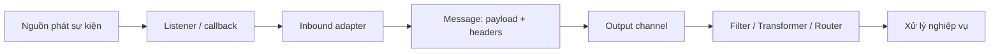
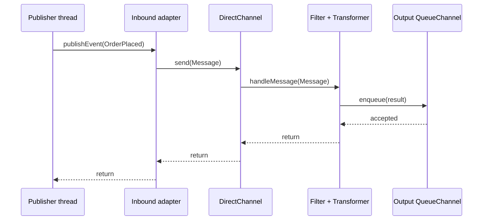

# Event-driven inbound adapter

## 1. Mục tiêu và bối cảnh

Trong chương **Channel adapter** của module **SPRING_INTEGRATION_CORE**, bài này giải thích cách đưa một sự kiện vào luồng Spring Integration ngay khi nguồn phát gọi listener hoặc callback. Đây là điểm bắt đầu để nối dữ liệu bên ngoài với `Message`, `MessageChannel`, transformer, filter, router và các endpoint xử lý nghiệp vụ.

Sau bài học, bạn có thể:

- Phân biệt inbound adapter nhận sự kiện với inbound adapter polling và messaging gateway.
- Xác định nơi tạo thông điệp, thread thực thi và ranh giới xử lý lỗi.
- Cấu hình một adapter nhận Spring ApplicationEvent, nối vào Java DSL và kiểm thử đầu ra.
- Đánh giá ảnh hưởng của hàng đợi, concurrency, lifecycle, retry và khả năng phát lại sự kiện.

Kiến thức nền cần có: cấu trúc payload/header của `Message<?>`, Spring bean, Java lambda và ý nghĩa cơ bản của `DirectChannel`, `QueueChannel`.

## 2. Event-driven inbound adapter là gì?

**Event-driven inbound adapter** là endpoint nhận thông báo từ một nguồn sự kiện, chuyển thông báo đó thành thông điệp của Spring Integration và gửi thông điệp vào output channel. Từ *inbound* được nhìn từ luồng tích hợp: dữ liệu đi **vào** hệ thống messaging.

Nguồn có thể là một Spring application event, callback của SDK, listener từ thư viện messaging hoặc dữ liệu đến qua một kết nối. Với mô hình này, ứng dụng đăng ký việc nhận sự kiện; nó không cần một poller của Spring Integration định kỳ gọi phương thức lấy dữ liệu.



Adapter chịu trách nhiệm nối hai mô hình: API sự kiện của nguồn và API thông điệp của Spring Integration. Nghiệp vụ phía sau chỉ cần hiểu thông điệp, thay vì phụ thuộc vào đối tượng callback của một SDK cụ thể.

Một adapter thuộc nhóm message-driven không có nghĩa rằng mọi lớp bên dưới đều dùng cơ chế push của hệ điều hành hoặc broker. Một client có thể tự chạy vòng lặp nhận dữ liệu. Điều cần phân biệt ở đây là **hợp đồng tại ranh giới Spring Integration**: nguồn gọi listener, hay poller của Spring Integration gọi `MessageSource.receive()`.

Ví dụ thực tế về họ adapter này là MQTT inbound message-driven adapter. Cách kết nối, chuyển đổi payload và xác nhận nhận dữ liệu phải theo tài liệu của adapter tương ứng. [MQTT Support](https://docs.spring.io/spring-integration/reference/mqtt.html).

## 3. Phân biệt các cách đưa dữ liệu vào flow

| Tiêu chí | Event-driven inbound adapter | Polling inbound adapter | Messaging gateway |
| --- | --- | --- | --- |
| Tác nhân khởi động | Nguồn gọi listener hoặc callback | Poller kích hoạt việc đọc nguồn | Mã ứng dụng gọi phương thức hoặc bên ngoài gửi request |
| Cầu nối thường gặp | `MessageProducerSupport` hoặc adapter chuyên biệt | `SourcePollingChannelAdapter` và `MessageSource<?>` | Proxy interface hoặc gateway của giao thức |
| Poller tại điểm nhận nguồn | Không cần cho cơ chế callback | Cần cấu hình trực tiếp hoặc default poller phù hợp | Không phải đặc tính định nghĩa gateway |
| Ý nghĩa trao đổi | Đưa thông báo vào flow một chiều | Đưa kết quả đọc vào flow một chiều | Đóng gói lời gọi; có thể hỗ trợ request-reply hoặc phương thức một chiều |
| Ví dụ | Nhận Spring application event | Định kỳ lấy bản ghi cần xử lý | Gọi interface để gửi yêu cầu và nhận kết quả |

Một channel adapter là cầu nối giữa một phía gửi/nhận với message channel. Với inbound adapter dạng gọi phương thức, Spring Integration dùng poller để đọc kết quả rồi tạo thông điệp. [Channel Adapter](https://docs.spring.io/spring-integration/reference/channel-adapter.html).

### 3.1. `@InboundChannelAdapter` không phải annotation đăng ký callback

Trong core Spring Integration, annotation này tạo `SourcePollingChannelAdapter` dựa trên phương thức được chú thích. Phương thức nguồn không nhận tham số và phải trả về giá trị khác `void`.

Ví dụ sau là **polling**, dù phương thức có tên `nextEvent`:

```java
@InboundChannelAdapter(
    channel = "incomingEvents",
    poller = @Poller(fixedDelay = "1000")
)
public String nextEvent() {
    return eventBuffer.poll();
}
```

Mỗi lần poller chạy, phương thức được gọi để lấy dữ liệu. Khi không có dữ liệu, nguồn có thể trả về `null`, nghĩa là không có thông điệp mới cho lượt đọc đó. Bỏ annotation `@Poller` không biến phương thức thành listener; cấu hình vẫn phải có poller mặc định phù hợp. [Annotation Support](https://docs.spring.io/spring-integration/reference/configuration/annotations.html).

### 3.2. Adapter một chiều vẫn có thể có acknowledgment

Xác nhận của giao thức, chẳng hạn xác nhận đã nhận bản tin, không đồng nghĩa với phản hồi nghiệp vụ. Luồng nhận một sự kiện có thể không trả kết quả nghiệp vụ cho nguồn nhưng vẫn phải tuân theo quy tắc acknowledgment của transport.

Tương tự, publisher gọi xong một phương thức `void` không đủ để kết luận dữ liệu đã được lưu bền hoặc nghiệp vụ đã hoàn tất. Phải xem toàn bộ ranh giới thực thi và quy ước của nguồn.

## 4. Vai trò của Message, channel và endpoint

Hãy xét thông báo đặt hàng:

```text
OrderPlaced(
    eventId = "evt-1001",
    orderId = "order-501",
    totalText = "125000.00"
)
```

Ba lớp trách nhiệm nên được giữ rõ:

1. **Adapter:** nhận thông báo đúng loại, chuyển thành `Message` và đưa vào channel.
2. **Các endpoint biến đổi/định tuyến:** kiểm tra dữ liệu, chuẩn hóa kiểu tiền, thêm metadata và chọn nhánh xử lý.
3. **Nghiệp vụ:** lưu đơn, cập nhật kho, gọi dịch vụ hoặc tổng hợp kết quả theo yêu cầu của ứng dụng.

Với adapter tự viết, phần lõi có thể kế thừa `MessageProducerSupport`. Lớp hỗ trợ này cung cấp output channel, error channel và phương thức `sendMessage(...)`; phần đăng ký callback và quản lý tài nguyên vẫn do adapter cụ thể thực hiện. [MessageProducerSupport API](https://docs.spring.io/spring-integration/api/org/springframework/integration/endpoint/MessageProducerSupport.html).

Metadata cần thiết thường gồm mã sự kiện từ nguồn, mã đối tượng nghiệp vụ, nguồn phát và thông tin tương quan. `MessageHeaders.ID` nhận diện một thông điệp trong Spring Messaging; không nên dùng nó thay cho `eventId` ổn định từ nguồn khi phát hiện sự kiện trùng hoặc phát lại.

Khi payload được biến đổi, cần giữ các header nghiệp vụ cần thiết. Không nên đưa toàn bộ đối tượng session, connection hoặc callback có trạng thái vào payload nghiệp vụ chỉ để thuận tiện truy cập về sau.

## 5. Ví dụ hoàn chỉnh: nhận Spring ApplicationEvent bằng Java DSL

### 5.1. Bài toán và dependency

Ứng dụng checkout phát `OrderPlaced`. Luồng tích hợp sẽ:

- Chỉ nhận sự kiện đúng loại.
- Thêm header `eventId` và `sourceSystem`.
- Đưa sự kiện thiếu mã định danh vào nhánh loại bỏ.
- Chuyển `totalText` thành `BigDecimal` và tạo `OrderCommand`.
- Đưa lỗi chuyển đổi vào một error channel riêng.

Ví dụ dùng Java 17 trở lên vì có `record`. Các dependency Spring phải được quản lý theo BOM tương thích của dự án, chẳng hạn dependency management của Spring Boot. Đoạn Maven sau giả định phần quản lý phiên bản đã có; nó không phải toàn bộ `pom.xml`:

```xml
<dependencies>
    <dependency>
        <groupId>org.springframework.integration</groupId>
        <artifactId>spring-integration-core</artifactId>
    </dependency>
    <dependency>
        <groupId>org.springframework.integration</groupId>
        <artifactId>spring-integration-event</artifactId>
    </dependency>
    <dependency>
        <groupId>org.junit.jupiter</groupId>
        <artifactId>junit-jupiter</artifactId>
        <scope>test</scope>
    </dependency>
</dependencies>
```

Mã kiểm thử ở phần sau cần test runner hỗ trợ JUnit Jupiter. Ví dụ không cần broker bên ngoài hay `spring-integration-test`, vì dùng application context thật và đọc trực tiếp các queue đầu ra.

`ApplicationEventListeningMessageProducer` thuộc module `spring-integration-event`. Nó có thể lọc theo kiểu sự kiện; với sự kiện POJO được Spring bọc thành `PayloadApplicationEvent`, payload được đưa vào thông điệp là đối tượng POJO đó. [Spring ApplicationEvent Support](https://docs.spring.io/spring-integration/reference/event.html).

### 5.2. Cấu hình các bean

Lưu mã sau trong `EventInboundConfig.java`, thuộc package minh họa `example.integration`:

```java
package example.integration;

import java.math.BigDecimal;

import org.springframework.beans.factory.annotation.Qualifier;
import org.springframework.context.annotation.Bean;
import org.springframework.context.annotation.Configuration;
import org.springframework.integration.channel.DirectChannel;
import org.springframework.integration.channel.QueueChannel;
import org.springframework.integration.config.EnableIntegration;
import org.springframework.integration.dsl.IntegrationFlow;
import org.springframework.integration.event.inbound.ApplicationEventListeningMessageProducer;
import org.springframework.messaging.MessageChannel;

@Configuration(proxyBeanMethods = false)
@EnableIntegration
public class EventInboundConfig {

    public record OrderPlaced(
            String eventId,
            String orderId,
            String totalText) {
    }

    public record OrderCommand(
            String eventId,
            String orderId,
            BigDecimal total) {
    }

    @Bean
    public DirectChannel orderEvents() {
        return new DirectChannel();
    }

    @Bean
    public QueueChannel orderCommands() {
        return new QueueChannel(10);
    }

    @Bean
    public QueueChannel rejectedOrderEvents() {
        return new QueueChannel(10);
    }

    @Bean
    public QueueChannel orderEventErrors() {
        return new QueueChannel(10);
    }

    @Bean
    public ApplicationEventListeningMessageProducer orderEventInbound(
            @Qualifier("orderEvents") MessageChannel output,
            @Qualifier("orderEventErrors") MessageChannel errors) {

        var producer = new ApplicationEventListeningMessageProducer();
        producer.setEventTypes(OrderPlaced.class);
        producer.setOutputChannel(output);
        producer.setErrorChannel(errors);
        producer.setSendTimeout(1000);
        return producer;
    }

    @Bean
    public IntegrationFlow orderEventFlow(
            @Qualifier("orderEvents") MessageChannel input,
            @Qualifier("orderCommands") MessageChannel commands,
            @Qualifier("rejectedOrderEvents") MessageChannel rejected) {

        return IntegrationFlow.from(input)
                .enrichHeaders(headers -> headers
                        .headerFunction("eventId", message ->
                                ((OrderPlaced) message.getPayload()).eventId())
                        .header("sourceSystem", "checkout"))
                .filter(OrderPlaced.class,
                        event -> hasText(event.eventId())
                                && hasText(event.orderId()),
                        endpoint -> endpoint.discardChannel(rejected))
                .<OrderPlaced, OrderCommand>transform(event ->
                        new OrderCommand(
                                event.eventId(),
                                event.orderId(),
                                new BigDecimal(event.totalText())))
                .channel(commands)
                .get();
    }

    private static boolean hasText(String value) {
        return value != null && !value.isBlank();
    }
}
```

`@EnableIntegration` đăng ký hạ tầng tích hợp khi dùng cấu hình Java thuần. Các `@Qualifier` làm rõ channel được inject vì trong context có nhiều bean cùng kiểu `MessageChannel`.

### 5.3. Cách sự kiện đi qua cấu hình

Giả sử context đã khởi động, ứng dụng phát:

```java
publisher.publishEvent(
        new EventInboundConfig.OrderPlaced(
                "evt-1001", "order-501", "125000.00"));
```

Trong đó `publisher` là `ApplicationEventPublisher` được inject bởi Spring. Kết quả mong đợi là một message trong `orderCommands`:

```text
payload:
  OrderCommand("evt-1001", "order-501", BigDecimal("125000.00"))

headers nghiệp vụ:
  eventId = "evt-1001"
  sourceSystem = "checkout"
```

`orderEventInbound` nhận callback từ hệ thống application event, còn `orderEventFlow` bắt đầu từ `orderEvents`. Không có poller đọc nguồn trong cấu hình này.

Các queue đầu ra là nơi quan sát kết quả cho bài thực hành, chưa có consumer nghiệp vụ. Chúng có dung lượng hữu hạn để không che giấu việc tích tụ dữ liệu. Trong ứng dụng chạy lâu dài, phải có thành phần đọc và xử lý từng nhánh.

`setSendTimeout(1000)` áp dụng cho thao tác gửi do producer thực hiện khi channel hỗ trợ chờ theo timeout. Nó không phải giới hạn một giây cho toàn bộ flow. Đặc biệt, producer gửi vào `DirectChannel` không thể dùng thuộc tính này để ngắt một transformer hoặc thao tác gửi vào queue ở sâu hơn trong call stack.

### 5.4. Ba đầu ra có ý nghĩa khác nhau

| Đầu vào | Đầu ra | Ý nghĩa |
| --- | --- | --- |
| Mã sự kiện, mã đơn hợp lệ và tiền chuyển đổi được | `orderCommands` chứa `OrderCommand` | Chuẩn hóa thành công |
| `eventId` hoặc `orderId` thiếu/trống | `rejectedOrderEvents` chứa `OrderPlaced` | Filter chủ động từ chối |
| Mã định danh hợp lệ nhưng `totalText = "invalid"` | `orderEventErrors` chứa `ErrorMessage` | Transformer phát sinh exception |
| Sự kiện thuộc kiểu khác | Không vào flow này | Adapter không đăng ký nhận kiểu đó |

Discard channel nhận thông điệp mà filter từ chối; đây không tự động là một lỗi thực thi. Ví dụ chỉ kiểm tra sự hiện diện của mã định danh và khả năng chuyển đổi tiền, chưa mô hình hóa đầy đủ quy tắc nghiệp vụ như số tiền tối thiểu. [Filter](https://docs.spring.io/spring-integration/reference/filter.html).

## 6. Event-driven không đồng nghĩa với bất đồng bộ

Nguồn kích hoạt theo sự kiện và cách channel phân phối message là hai quyết định riêng.

Trong cấu hình mặc định của Spring application event, listener được gọi đồng bộ trên thread phát sự kiện. `DirectChannel` tiếp tục thực thi handler trên thread gửi. Vì vậy, ở ví dụ trên, kiểm tra và chuyển đổi diễn ra trước khi lời gọi `publishEvent(...)` trở về. [ApplicationContext events](https://docs.spring.io/spring-framework/reference/core/beans/context-introduction.html), [Error Handling](https://docs.spring.io/spring-integration/reference/error-handling.html).



Queue cuối flow lưu kết quả cho nơi khác đọc. Nó không chuyển các bước **đã thực hiện trước queue** sang thread mới.

Các lựa chọn phổ biến:

- **`DirectChannel`:** phù hợp khi muốn xử lý liền mạch trong cùng thread và chấp nhận nguồn phải chờ.
- **`ExecutorChannel`:** thường chuyển việc gọi handler sang executor; cần cấu hình pool, dung lượng chờ và cách xử lý khi executor từ chối task.
- **`QueueChannel`:** tạo điểm đệm; phía sau cần consumer lấy message. Một endpoint đọc từ pollable channel cần poller, dù adapter đầu nguồn vẫn nhận theo sự kiện.
- **`PublishSubscribeChannel`:** phù hợp khi nhiều subscriber đều cần nhận một sự kiện; cách chạy đồng bộ hay qua executor phụ thuộc cấu hình.

`DirectChannel` là point-to-point; nhiều subscriber không biến nó thành broadcast. `ExecutorChannel` cũng có thể thực thi trên thread gửi khi chính sách executor cho phép caller chạy task, nên không nên suy luận ranh giới thread chỉ từ tên channel. [Message Channel Implementations](https://docs.spring.io/spring-integration/reference/channel/implementations.html).

## 7. Xử lý lỗi theo đúng ranh giới

### 7.1. Lỗi đồng bộ trong ví dụ

Nếu `new BigDecimal("invalid")` ném exception, lỗi đi ngược call stack qua `DirectChannel` đến producer. Producer đã được cấu hình error channel nên có thể phát `ErrorMessage` vào `orderEventErrors`.

Payload của error message là exception. Khi đó là `MessagingException`, `getFailedMessage()` cho phép tìm message gây lỗi. Không nên giả định mọi `Throwable` đều cung cấp phương thức này; cần kiểm tra kiểu trước khi đọc.

Trong điều kiện error message được gửi thành công, publisher có thể trở về bình thường dù nhánh nghiệp vụ thất bại. Nếu bỏ `setErrorChannel(...)`, lỗi đồng bộ có thể truyền về caller. Error channel nhận lỗi không phải cơ chế retry và cũng không tự phát lại sự kiện. [Spring ApplicationEvent Support](https://docs.spring.io/spring-integration/reference/event.html).

### 7.2. Sau ranh giới bất đồng bộ

Khi downstream chạy trên một worker khác, exception không thể tự quay về call stack của publisher đã kết thúc. Phải cấu hình cơ chế xử lý lỗi tại nơi công việc bất đồng bộ thực sự chạy.

Không được suy ra rằng `producer.setErrorChannel(errors)` tự thêm header `errorChannel` vào mọi message. Trong ví dụ, đó là cấu hình lỗi của producer cho thao tác gửi mà nó quan sát được. Nếu thêm executor hoặc consumer polling ở phía sau, cần kiểm tra error handler của thành phần đó; tùy cấu hình, nó giải quyết channel từ header `MessageHeaders.ERROR_CHANNEL` hoặc channel lỗi toàn cục. [Error Handling](https://docs.spring.io/spring-integration/reference/error-handling.html), [MessageProducerSupport source](https://github.com/spring-projects/spring-integration/blob/main/spring-integration-core/src/main/java/org/springframework/integration/endpoint/MessageProducerSupport.java).

### 7.3. Lỗi trước khi có Message và lỗi của nhánh lỗi

Một adapter tự viết có thể thất bại khi giải mã callback, trước khi gọi `sendMessage(...)`. Khối xử lý lỗi bên trong thao tác gửi không bao phủ phần giải mã này; adapter phải có đường báo lỗi rõ ràng theo hợp đồng của nguồn.

Ngược lại, error channel cũng có thể đầy, không có subscriber phù hợp hoặc có handler tiếp tục ném lỗi. Việc chuyển lỗi sang channel chỉ thành công khi đường gửi lỗi hoạt động. Không nên coi cấu hình error channel là bảo đảm mọi exception đều được hấp thụ.

## 8. Lifecycle và adapter tự viết

Một adapter dùng SDK thường cần ba pha: đăng ký nhận khi khởi động, chuyển dữ liệu khi có callback và hủy đăng ký khi dừng.

```text
Khởi tạo bean:
    kiểm tra cấu hình và các dependency

Start:
    đăng ký listener / mở subscription

Callback:
    đọc sự kiện -> chuyển đổi -> tạo Message -> sendMessage

Stop:
    ngừng nhận mới -> hủy listener / đóng subscription
    xử lý các callback đang chạy theo chính sách đã chọn
```

Với lớp kế thừa `MessageProducerSupport`, các hook lifecycle như `doStart()` và `doStop()` là nơi tổ chức tài nguyên tương ứng. Cần giữ tham chiếu subscription để có thể hủy đúng đăng ký và tránh tạo listener trùng khi start nhiều lần. [MessageProducerSupport API](https://docs.spring.io/spring-integration/api/org/springframework/integration/endpoint/MessageProducerSupport.html).

Không đăng ký nguồn có thể phát dữ liệu ngay trong constructor nếu các channel và consumer còn chưa sẵn sàng. Với SDK gọi callback đồng thời, các biến chia sẻ, đối tượng converter và handler nghiệp vụ cũng phải phù hợp với mức concurrency đã chọn.

Dừng adapter không đương nhiên hủy hoặc hoàn tác nghiệp vụ đang xử lý. Nếu nguồn không lưu sự kiện khi không có listener, thời gian adapter dừng có thể là khoảng mất dữ liệu. Chính sách drain, hoàn tất callback đang chạy và phát lại thuộc về thiết kế kết hợp giữa adapter, nguồn và ứng dụng.

Trong ví dụ Spring application event, listener do application context quản lý; không cần tự đăng ký thêm một listener thứ hai. Mã nguồn producer kiểm tra trạng thái hoạt động trước khi gửi các sự kiện nghiệp vụ vào channel. [ApplicationEventListeningMessageProducer source](https://github.com/spring-projects/spring-integration/blob/main/spring-integration-event/src/main/java/org/springframework/integration/event/inbound/ApplicationEventListeningMessageProducer.java).

## 9. Tải, thứ tự và khả năng khôi phục

### 9.1. Nguồn phát nhanh hơn consumer

Giả sử nguồn phát 500 sự kiện/giây, trong khi nghiệp vụ xử lý 200 sự kiện/giây. Khi chưa có cơ chế giảm tải, số sự kiện chờ tăng khoảng 300 mỗi giây. Một buffer trống có 3.000 chỗ sẽ đầy sau khoảng 10 giây theo giả định tốc độ ổn định này.

Đổi sang executor hoặc queue không làm năng lực xử lý tự tăng. Thiết kế phải quyết định rõ: chặn nguồn, giới hạn đồng thời, từ chối, lưu bền để xử lý sau hay cho phép bỏ dữ liệu theo nghiệp vụ. Timeout gửi chỉ có ý nghĩa khi phía gọi xử lý được kết quả timeout hoặc exception tương ứng.

Một callback thông thường cũng không tự có backpressure của Reactive Streams. Muốn cơ chế điều tiết phản hồi đến tận nguồn, cả API nguồn và chuỗi xử lý phải có khả năng phối hợp.

### 9.2. Thứ tự và sự kiện trùng

Khi nhiều thread xử lý song song, thứ tự hoàn tất có thể khác thứ tự nhận. Nếu một đơn hàng có nhiều sự kiện phụ thuộc nhau, có thể cần phân nhóm theo `orderId`, kiểm tra số thứ tự hoặc phiên bản trạng thái trước khi cập nhật.

Sự kiện được gửi lại sau lỗi kết nối hoặc thao tác retry có thể có cùng `eventId`. Consumer gây tác dụng phụ nên có chiến lược idempotency dựa trên mã sự kiện/nghiệp vụ ổn định. Quyết định ghi nhận đã xử lý và cập nhật dữ liệu cần tránh tạo khe hở khiến mất sự kiện hoặc thực hiện lặp tác dụng phụ.

### 9.3. Độ bền và transaction

Spring application event là cơ chế thông báo trong application context, không phải hàng đợi bền. `QueueChannel` mặc định lưu trong bộ nhớ; cần message store hoặc transport có lưu bền nếu yêu cầu khôi phục sau khi tiến trình mất. [Message Channel Implementations](https://docs.spring.io/spring-integration/reference/channel/implementations.html).

Từ đó, ví dụ trong bài phù hợp để học cách nối endpoint và kiểm thử flow. Với yêu cầu không mất sự kiện đặt hàng khi ứng dụng dừng đột ngột, cần thiết kế thêm điểm lưu bền và cách phát lại, chẳng hạn transactional outbox khi phải gắn sự kiện với một cập nhật cơ sở dữ liệu.

Cùng thread có thể cho phép các thành phần tham gia transaction đang có, nhưng không tự làm mọi tài nguyên trở thành một transaction. Chuyển qua executor hoặc queue cũng không tự mang transaction của publisher sang worker. Nếu adapter có acknowledgment của broker, phải xác định thời điểm ack so với lưu bền và nghiệp vụ; không có một bảo đảm exactly-once chung chỉ từ việc dùng inbound adapter.

## 10. Kiểm thử ví dụ bằng JUnit Jupiter

Đặt lớp kiểm thử cùng package với cấu hình. Mỗi test tạo context riêng để các queue và trạng thái lifecycle không bị chia sẻ giữa các test.

```java
package example.integration;

import java.math.BigDecimal;

import org.junit.jupiter.api.AfterEach;
import org.junit.jupiter.api.BeforeEach;
import org.junit.jupiter.api.Test;
import org.springframework.context.annotation.AnnotationConfigApplicationContext;
import org.springframework.integration.channel.QueueChannel;
import org.springframework.integration.event.inbound.ApplicationEventListeningMessageProducer;
import org.springframework.messaging.MessagingException;
import org.springframework.messaging.support.ErrorMessage;

import static org.junit.jupiter.api.Assertions.*;

class EventInboundConfigTest {

    private AnnotationConfigApplicationContext context;
    private QueueChannel commands;
    private QueueChannel rejected;
    private QueueChannel errors;

    @BeforeEach
    void startContext() {
        context = new AnnotationConfigApplicationContext(
                EventInboundConfig.class);
        commands = context.getBean("orderCommands", QueueChannel.class);
        rejected = context.getBean("rejectedOrderEvents", QueueChannel.class);
        errors = context.getBean("orderEventErrors", QueueChannel.class);
    }

    @AfterEach
    void closeContext() {
        context.close();
    }

    @Test
    void receivesAndTransformsOrderEvent() {
        context.publishEvent(new EventInboundConfig.OrderPlaced(
                "evt-1001", "order-501", "125000.00"));

        var message = commands.receive(1000);
        assertNotNull(message);
        assertEquals(new EventInboundConfig.OrderCommand(
                "evt-1001", "order-501", new BigDecimal("125000.00")),
                message.getPayload());
        assertEquals("evt-1001", message.getHeaders().get("eventId"));
        assertEquals("checkout", message.getHeaders().get("sourceSystem"));
        assertNull(rejected.receive(0));
        assertNull(errors.receive(0));
    }

    @Test
    void ignoresOtherEventTypes() {
        context.publishEvent("an unrelated event");

        assertNull(commands.receive(0));
        assertNull(rejected.receive(0));
        assertNull(errors.receive(0));
    }

    @Test
    void sendsRejectedEventToDiscardChannel() {
        var event = new EventInboundConfig.OrderPlaced(
                "evt-1002", " ", "125000.00");
        context.publishEvent(event);

        var message = rejected.receive(1000);
        assertNotNull(message);
        assertEquals(event, message.getPayload());
        assertNull(commands.receive(0));
        assertNull(errors.receive(0));
    }

    @Test
    void publishesConversionFailureAsErrorMessage() {
        var event = new EventInboundConfig.OrderPlaced(
                "evt-1003", "order-503", "invalid");

        assertDoesNotThrow(() -> context.publishEvent(event));

        var message = errors.receive(1000);
        assertNotNull(message);
        assertTrue(message instanceof ErrorMessage);
        assertTrue(message.getPayload() instanceof MessagingException);
        var failure = (MessagingException) message.getPayload();
        assertNotNull(failure.getFailedMessage());
        assertEquals(event, failure.getFailedMessage().getPayload());
        assertNull(commands.receive(0));
        assertNull(rejected.receive(0));
    }

    @Test
    void stopsAndRestartsReceivingBusinessEvents() {
        var adapter = context.getBean("orderEventInbound",
                ApplicationEventListeningMessageProducer.class);
        var event = new EventInboundConfig.OrderPlaced(
                "evt-1004", "order-504", "1000.00");

        adapter.stop();
        context.publishEvent(event);
        assertNull(commands.receive(0));

        adapter.start();
        context.publishEvent(event);
        assertNotNull(commands.receive(1000));
        assertNull(commands.receive(0));
        assertNull(errors.receive(0));
    }
}
```

Các phép `receive(0)` kiểm tra ngay trạng thái queue. Chúng phù hợp với ví dụ vì toàn bộ đoạn trước queue chạy đồng bộ theo cấu hình mặc định. Nếu đổi sang executor hoặc multicaster bất đồng bộ, cần đợi theo một điều kiện có giới hạn thời gian thay vì giả định công việc đã xong ngay sau `publishEvent(...)`.

Các test đi qua nguồn phát sự kiện thật của application context. Gửi thẳng vào `orderEvents` chỉ kiểm tra phần downstream, không chứng minh adapter đã lọc kiểu sự kiện hoặc tham gia lifecycle đúng.

Với adapter nối hệ thống bên ngoài, bổ sung kiểm thử ở ranh giới transport: đăng ký nhận, mất kết nối, reconnect, acknowledgment và phát lại theo khả năng của nguồn. Spring Integration có các công cụ hỗ trợ mock hoặc kiểm thử từng phần của flow khi cần cô lập các endpoint. [Testing Support](https://docs.spring.io/spring-integration/reference/testing.html).

## 11. Ghép với các mẫu tích hợp doanh nghiệp

Điểm nhận sự kiện thường chỉ là đầu của chuỗi xử lý:

| Mẫu xử lý phía sau | Vai trò trong một flow nhận sự kiện |
| --- | --- |
| Transformer | Chuyển payload của nguồn sang mô hình nội bộ ổn định |
| Filter | Loại dữ liệu ngoài phạm vi, đồng thời giữ dấu vết qua discard channel khi cần |
| Router | Chọn nhánh xử lý dựa trên loại sự kiện, nguồn hoặc trạng thái nghiệp vụ |
| Service activator | Gọi nghiệp vụ gây tác dụng phụ hoặc tính kết quả |
| Aggregator | Gom những sự kiện có chung khóa tương quan và phát kết quả khi đủ điều kiện |

Chẳng hạn, thông báo thanh toán và giao hàng có thể đi vào các adapter khác nhau, được chuẩn hóa rồi gom theo `orderId`. Aggregator cần quy tắc correlation, release và timeout riêng; việc đầu vào nhận theo sự kiện không bảo đảm mọi thành phần của nhóm sẽ đến đầy đủ.

Gateway hữu ích khi mã gọi cần một giao diện phương thức hoặc cần chờ phản hồi. Nếu nguồn chỉ thông báo rằng một sự kiện đã xảy ra, inbound adapter thường mô tả đúng hơn vai trò tiếp nhận. Một gateway vẫn có thể có phương thức một chiều; lựa chọn dựa vào hợp đồng trao đổi, không chỉ vào kiểu trả về. [IntegrationFlow as a Gateway](https://docs.spring.io/spring-integration/reference/dsl/integration-flow-as-gateway.html).

## 12. Những lỗi thường gặp và cách xác định nguyên nhân

| Hiện tượng | Điểm cần kiểm tra |
| --- | --- |
| Không nhận sự kiện | Adapter có là bean, context đã sẵn sàng, đang chạy và đăng ký đúng kiểu sự kiện không? |
| Publisher bị chậm | Downstream có đang chạy trên cùng thread qua `DirectChannel` hay đang chờ queue còn chỗ không? |
| Có lỗi nhưng caller không thấy exception | Producer có chuyển lỗi vào error channel thành công hoặc flow đã đi qua ranh giới bất đồng bộ không? |
| Error channel của producer không nhận lỗi worker | Lỗi xảy ra sau ranh giới thread; kiểm tra error handler và header của message tại worker |
| Nhánh loại bỏ không có ErrorMessage | Filter discard là quyết định từ chối; kiểm tra cấu hình nhánh discard và yêu cầu ném lỗi |
| Dữ liệu mất sau restart | Nguồn và queue có lưu bền, có offset/checkpoint hoặc cơ chế phát lại không? |
| Nghiệp vụ chạy lặp | Kiểm tra listener trùng, redelivery, retry và cơ chế idempotency theo `eventId` |
| Thứ tự xử lý sai | Kiểm tra concurrency, thứ tự hoàn tất và yêu cầu tuần tự theo khóa nghiệp vụ |

Khi quan sát vận hành, nên phân biệt số sự kiện nguồn phát, số message vào flow, số bị filter loại, số lỗi và số nghiệp vụ hoàn tất. Chênh lệch giữa các con số giúp xác định dữ liệu dừng ở ranh giới nào. Với từng sự kiện, dùng `eventId` và khóa nghiệp vụ để liên kết dấu vết qua adapter và các endpoint.

## 13. Thực hành mở rộng

1. Thêm `receivedAt` vào headers và xác minh transformer vẫn giữ metadata này.
2. Thêm router sau transformer để chia đơn theo ngưỡng tiền; giữ một nguồn sự kiện duy nhất.
3. Thay channel đầu vào bằng một channel qua executor, rồi xác định lại nơi lỗi được quan sát và cách kiểm thử bất đồng bộ.
4. Đưa một queue vào giữa flow; chỉ rõ poller nào đọc queue và giải thích vì sao adapter nguồn vẫn là event-driven.
5. Phát hai sự kiện có cùng `eventId`, thiết kế cách ngăn một tác dụng phụ nghiệp vụ bị thực hiện hai lần.

Với mỗi thay đổi, cần mô tả được nguồn kích hoạt, thread xử lý, điều kiện coi là thành công và nơi dữ liệu tồn tại nếu ứng dụng dừng. Bốn thông tin này giúp đánh giá đúng một event-driven inbound adapter trong toàn bộ luồng thông điệp.
