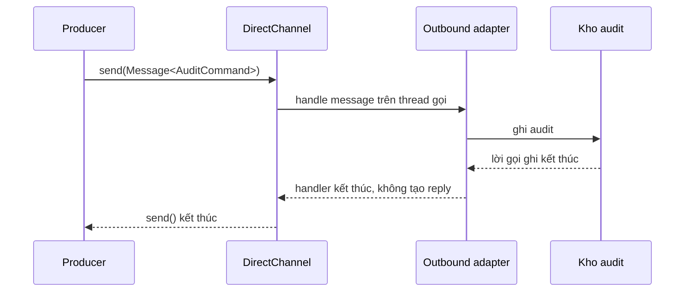

# Outbound adapter không có reply

Trong chương **Channel adapter** của module **SPRING_INTEGRATION_CORE**, bài này tập trung vào điểm kết thúc của một luồng thông điệp: nhận `Message`, thực hiện tác vụ tại hệ thống đích và kết thúc mà không tạo thông điệp trả lời cho luồng gọi.

Sau bài học, bạn có thể thiết kế một outbound adapter theo hợp đồng one-way, triển khai bằng Java DSL hoặc annotation, chọn cách xử lý lỗi phù hợp với loại channel và kiểm thử tác dụng phụ mà không chờ một reply không tồn tại.

## 1. “Không có reply” nghĩa là gì?

Outbound channel adapter nối một channel trong ứng dụng với phía nhận bên ngoài luồng, chẳng hạn nơi lưu audit, máy chủ gửi thư hoặc hệ thống nhận sự kiện. Với hợp đồng one-way đang xét, đầu vào là thông điệp yêu cầu thực hiện công việc; đầu ra là **tác dụng phụ**, không phải một `Message` kết quả đưa về caller. Spring Integration cho phép dùng một phương thức POJO làm điểm nhận này. Xem [Channel Adapter](https://docs.spring.io/spring-integration/reference/channel-adapter.html).

Ví dụ, hệ thống bán hàng muốn ghi lại sự kiện xác nhận đơn:

```text
AuditCommand(eventId="evt-007", orderId="ORD-1042", action="CONFIRMED")
    → auditOutbound
    → outbound adapter
    → kho audit
```

Sau khi adapter ghi audit, nhánh xử lý kết thúc. Nó không tự tạo ra `AuditResult`, không trả lại thông điệp đầu vào và không phát sinh một message rỗng để báo đã xong.

Nếu yêu cầu thực tế là “ghi audit rồi trả về mã bản ghi để tiếp tục xử lý”, cần thiết kế một endpoint có output hoặc một outbound gateway phù hợp với giao thức và thư viện đang dùng.

### 1.1. Phân biệt các loại kết quả

| Dấu hiệu quan sát được | Ý nghĩa cần xác định | Có phải business reply của adapter không? |
| --- | --- | --- |
| Phương thức đích trả `void` | Không có giá trị Java để chuyển thành reply | Không |
| `MessageChannel.send(...)` trả `true` | Message đã được gửi theo hợp đồng của channel | Không |
| Client mạng nhận ACK hoặc mã trạng thái | Có xác nhận ở một tầng giao tiếp cụ thể | Không tự động trở thành reply trong flow |
| Có exception | Một bước gửi hoặc xử lý đã thất bại | Không; đây là đường lỗi |
| Có `ErrorMessage` | Lỗi được biểu diễn và chuyển qua messaging | Không phải kết quả thành công |
| Hệ thống đích phát một sự kiện hoàn tất sau đó | Có một thông điệp nghiệp vụ riêng | Cần thiết kế một luồng nhận riêng |

`send(...)` có thể trả `false` hoặc ném exception tùy tình huống. Giá trị boolean không chứa kết quả nghiệp vụ. Hợp đồng API được mô tả tại [MessageChannel](https://docs.spring.io/spring-framework/docs/current/javadoc-api/org/springframework/messaging/MessageChannel.html).

### 1.2. One-way và bất đồng bộ là hai lựa chọn khác nhau

“Không chờ reply” không có nghĩa là “caller lập tức được giải phóng”. Một adapter ghi dữ liệu bằng client blocking vẫn phải đợi client đó hoàn tất lời gọi.

Ví dụ giả định thao tác ghi audit mất hai giây:

- Nếu handler chạy trên thread gọi, caller có thể bị giữ hai giây dù không nhận reply.
- Nếu việc xử lý được chuyển sang worker, caller có thể quay lại sớm hơn; lỗi xảy ra sau đó cần một cơ chế quan sát khác.

Vì vậy, hãy xác định riêng hai câu hỏi: **có cần kết quả để xử lý tiếp không**, và **thread nào thực hiện công việc**.

## 2. Vòng đời của message tại outbound adapter



Các mũi tên quay về trong sơ đồ biểu diễn việc trả quyền điều khiển của lời gọi. Chúng không biểu diễn các `Message` trả lời.

Trong ví dụ này, adapter đọc payload để lấy dữ liệu cần ghi. Header có thể mang `eventId`, thông tin truy vết hoặc metadata điều khiển. Nếu header `replyChannel` tồn tại, sự hiện diện của nó không tự tạo ra kết quả: vẫn phải có một thành phần thực sự sản xuất và gửi reply.

Về mặt thiết kế, có thể xem nhánh này là:

```text
message đầu vào → xử lý → tác dụng phụ → kết thúc nhánh
```

Không nên vẽ một đường nối ngầm từ adapter đến bước tiếp theo nếu hợp đồng của adapter không có output.

## 3. Ví dụ đầy đủ bằng Java DSL: ghi audit

Ví dụ sử dụng `spring-integration-core`, Java configuration và Java DSL. Cú pháp Java có `record`; JDK thực thi cần đáp ứng yêu cầu của phiên bản Spring được dự án quản lý. Phần kiểm thử phía sau dùng JUnit Jupiter. Không cần broker hoặc cơ sở dữ liệu để quan sát cơ chế one-way trong ví dụ này.

`InMemoryAuditSink` mô phỏng phía nhận audit để việc học và kiểm thử có thể thực hiện trong một application context nhỏ. Khi tích hợp thực tế, thay phần ghi trong sink bằng client hoặc adapter của tài nguyên đích.

```java
package example.integration;

import java.util.concurrent.ConcurrentHashMap;
import java.util.concurrent.ConcurrentMap;

import org.springframework.context.annotation.Bean;
import org.springframework.context.annotation.Configuration;
import org.springframework.integration.channel.DirectChannel;
import org.springframework.integration.config.EnableIntegration;
import org.springframework.integration.dsl.IntegrationFlow;

@Configuration
@EnableIntegration
public class AuditOutboundConfiguration {

    public record AuditCommand(
            String eventId,
            String orderId,
            String action) {
    }

    public static class InMemoryAuditSink {

        private final ConcurrentMap<String, AuditCommand> entries =
                new ConcurrentHashMap<>();

        public void write(AuditCommand command) {
            if (command.eventId() == null || command.eventId().isBlank()) {
                throw new IllegalArgumentException("eventId is required");
            }

            AuditCommand previous =
                    entries.putIfAbsent(command.eventId(), command);

            if (previous != null && !previous.equals(command)) {
                throw new IllegalStateException(
                        "eventId already exists with different content");
            }
        }

        public AuditCommand find(String eventId) {
            return entries.get(eventId);
        }

        public int size() {
            return entries.size();
        }
    }

    @Bean
    public DirectChannel auditOutbound() {
        return new DirectChannel();
    }

    @Bean
    public InMemoryAuditSink auditSink() {
        return new InMemoryAuditSink();
    }

    @Bean
    public IntegrationFlow auditOutboundFlow(
            DirectChannel auditOutbound,
            InMemoryAuditSink auditSink) {

        return IntegrationFlow.from(auditOutbound)
                .handle(auditSink, "write")
                .get();
    }
}
```

Trong cấu hình này:

1. `auditOutbound` là channel nhận lệnh ghi audit.
2. `.handle(auditSink, "write")` gọi phương thức đích với payload của message.
3. `write(...)` trả `void`, nên nhánh không có kết quả để gửi tiếp.
4. `.get()` kết thúc khai báo flow; nó không tạo một thông điệp thành công.

Hai lần gửi cùng một `eventId` và cùng nội dung chỉ tạo một mục trong sink. Dùng lại `eventId` với nội dung khác là lỗi. Quy tắc này giúp ví dụ thể hiện được cả đường thành công, gửi lặp và xung đột dữ liệu.

Đây là cơ chế chống trùng trong bộ nhớ để minh họa. Dữ liệu sẽ mất khi tiến trình kết thúc; nó không thay thế cơ chế lưu bền và kiểm soát đồng thời tại hệ thống đích.

### 3.1. Hành vi trả kết quả của service activator

Một service activator có thể kết thúc khi phương thức trả `void` hoặc `null`, miễn không yêu cầu reply. Ngược lại, một giá trị khác `null` có thể được gửi tới output channel hoặc `replyChannel`. `requiresReply=true` khiến việc không có kết quả trở thành lỗi; nó không tạo ra kết quả thay cho phương thức đích. Xem [Service Activator](https://docs.spring.io/spring-integration/reference/service-activator.html).

Vì vậy, không nên đổi chữ ký của `write(...)` từ `void` sang một đối tượng kết quả chỉ để tiện ghi log. Thay đổi đó có thể làm hợp đồng của endpoint khác đi. Nếu cần dữ liệu trả về, hãy thiết kế và kiểm thử đường output một cách tường minh.

## 4. Những cách biểu diễn tương đương

### 4.1. Dùng annotation trên phương thức `void`

Có thể thay phần đăng ký flow trong ví dụ bằng một bean chứa phương thức sau:

```java
import org.springframework.integration.annotation.ServiceActivator;

public class AuditEndpoint {

    private final AuditOutboundConfiguration.InMemoryAuditSink sink;

    public AuditEndpoint(
            AuditOutboundConfiguration.InMemoryAuditSink sink) {
        this.sink = sink;
    }

    @ServiceActivator(inputChannel = "auditOutbound")
    public void accept(
            AuditOutboundConfiguration.AuditCommand command) {
        sink.write(command);
    }
}
```

Đăng ký `AuditEndpoint` như một Spring bean trong context có `@EnableIntegration`. Đây là phương án thay thế cho `auditOutboundFlow`; không đăng ký cả hai consumer vào cùng `DirectChannel` rồi kỳ vọng mỗi message đi qua cả hai.

### 4.2. Dùng `MessageHandler` khi cần đọc cả message

Nếu cần truy cập trực tiếp payload và header, có thể khai báo một handler theo hợp đồng `MessageHandler`:

```java
MessageHandler auditHandler = message -> {
    var command = (AuditOutboundConfiguration.AuditCommand)
            message.getPayload();
    auditSink.write(command);
};

return IntegrationFlow.from(auditOutbound)
        .handle(auditHandler)
        .get();
```

Đoạn này thay phần thân của phương thức bean tạo flow và cần import `org.springframework.messaging.MessageHandler`. Phương thức `handleMessage(...)` của interface trả `void`. Tuy nhiên, một handler tùy biến vẫn có thể chủ động gửi message khác; việc không sinh reply còn phụ thuộc cách triển khai. Xem [MessageHandler](https://docs.spring.io/spring-framework/docs/current/javadoc-api/org/springframework/messaging/MessageHandler.html).

### 4.3. Dùng lambda nhận payload và headers

```java
return IntegrationFlow.from(auditOutbound)
        .handle(AuditOutboundConfiguration.AuditCommand.class,
                (command, headers) -> {
                    auditSink.write(command);
                    return null;
                })
        .get();
```

Overload này dùng `GenericHandler`, có giá trị trả về. `null` thể hiện rằng nhánh không cung cấp kết quả. Nó khác lambda `MessageHandler` nhận một `Message<?>` ở trên. Cách chọn overload và cung cấp kiểu payload được giải thích tại [Service Activators and the .handle() method](https://docs.spring.io/spring-integration/reference/dsl/java-handle.html).

## 5. Chọn channel: ảnh hưởng tới thread và cách quan sát hoàn tất

| Lựa chọn | Mốc mà producer quan sát | Hệ quả đối với ví dụ audit |
| --- | --- | --- |
| `DirectChannel` | Handler được gọi trực tiếp trong quá trình gửi | Có thể kiểm tra sink ngay sau khi `send()` kết thúc thành công |
| `ExecutorChannel` với executor bất đồng bộ | Công việc được giao cho executor | Cần đợi một tín hiệu hoặc trạng thái xử lý riêng |
| `QueueChannel` và polling consumer | Message được đưa vào hàng đợi | Có khoảng thời gian giữa lúc gửi và lúc sink được gọi |

`DirectChannel` gọi handler trên thread gửi. `ExecutorChannel` giao việc cho executor, nhưng hành vi thread cụ thể còn phụ thuộc executor và chính sách từ chối. `QueueChannel` cần consumer đọc hàng đợi; dữ liệu của queue mặc định nằm trong bộ nhớ. Xem [Message Channel Implementations](https://docs.spring.io/spring-integration/reference/channel/implementations.html).

### 5.1. Biến thể dùng queue và poller

Nếu cần đệm lệnh ghi audit, có thể thay bean channel và flow bằng cấu hình sau. Đây là một biến thể riêng; bỏ hai bean `auditOutbound` và `auditOutboundFlow` cũ khi áp dụng:

```java
import org.springframework.integration.channel.QueueChannel;
import org.springframework.integration.dsl.Pollers;

@Bean
public QueueChannel auditQueue() {
    return new QueueChannel(100);
}

@Bean
public IntegrationFlow queuedAuditFlow(
        QueueChannel auditQueue,
        InMemoryAuditSink auditSink) {

    return IntegrationFlow.from(auditQueue)
            .handle(auditSink, "write", endpoint -> endpoint
                    .poller(Pollers.fixedDelay(200)
                            .maxMessagesPerPoll(10)))
            .get();
}
```

Các phương thức trên đặt trong `AuditOutboundConfiguration`, nên dùng được tên lớp lồng `InMemoryAuditSink`. Producer của biến thể này gửi vào `auditQueue`.

Với cấu hình minh họa:

- Queue có sức chứa 100 message; cần quyết định cách producer phản ứng khi queue đầy.
- Poller có chu kỳ fixed delay 200 ms và giới hạn 10 message mỗi lượt.
- `send()` thành công không đủ để kết luận audit đã được ghi.
- Nếu tiến trình dừng trước khi poller xử lý, bộ đệm trong bộ nhớ không cung cấp khả năng phục hồi dữ liệu.

Timeout truyền cho `send(...)` kiểm soát việc gửi theo khả năng của channel. Nó không tự đặt timeout cho HTTP client, JDBC driver hoặc thao tác I/O bên trong sink. Các timeout đó cần cấu hình tại client hoặc tài nguyên tương ứng.

## 6. Gọi flow qua messaging gateway one-way

Ứng dụng có thể che API `MessageChannel` sau một interface:

```java
import org.springframework.integration.annotation.MessagingGateway;

@MessagingGateway(defaultRequestChannel = "auditOutbound")
public interface AuditGateway {

    void record(AuditOutboundConfiguration.AuditCommand command);
}
```

Khi dùng phương án này, bật quét gateway tại package chứa interface, chẳng hạn với `@IntegrationComponentScan(basePackageClasses = AuditGateway.class)` trong cấu hình. Annotation này thuộc package `org.springframework.integration.annotation`.

Phương thức `record(...)` trả `void`, thể hiện caller không cần kết quả nghiệp vụ. Messaging gateway là cửa vào của mã Java; outbound adapter vẫn là điểm ghi audit ở cuối luồng. Hai thành phần có vai trò khác nhau dù cùng tham gia một lời gọi. Tham khảo [Messaging Gateways](https://docs.spring.io/spring-integration/reference/gateway.html).

Nếu gateway khai báo `AuditReceipt record(...)` nhưng cuối flow là `write(...)` trả `void`, hợp đồng hai đầu không khớp. Tùy cấu hình, caller có thể phải chờ hết timeout mà vẫn không có kết quả.

Giảm reply timeout không sửa được thiết kế đó. Hãy chọn một trong hai hướng:

1. Giữ hợp đồng one-way và dùng phương thức gateway `void`.
2. Thiết kế bước tạo `AuditReceipt` và một đường trả kết quả thực sự.

Một gateway `void` kết nối tới `DirectChannel` vẫn có thể bị giữ trong lúc sink ghi dữ liệu. Kiểu trả về không quyết định executor.

## 7. Xử lý lỗi khi không có reply

Không có reply không đồng nghĩa với bỏ qua lỗi. Cần thiết kế riêng đường thành công và đường lỗi.

Với handler chạy đồng bộ qua `DirectChannel`, exception có thể truyền về caller của `send()`. Với tác vụ Spring Integration chạy bất đồng bộ hoặc qua poller, cơ chế xử lý lỗi có thể phát `ErrorMessage` đến channel trong header `errorChannel`, hoặc channel lỗi toàn cục. Chỉ thêm header `errorChannel` vào một lời gọi `send()` đồng bộ không tự chuyển exception sang channel đó. Xem [Error Handling](https://docs.spring.io/spring-integration/reference/7.0/error-handling.html).

Áp dụng vào ví dụ audit:

| Tình huống | Cách ứng dụng cần phản ứng |
| --- | --- |
| Thiếu `eventId` trong luồng đồng bộ | Caller nhận lỗi, sửa dữ liệu đầu vào; không retry vô hạn |
| Mất kết nối tới kho audit | Thử lại theo chính sách hữu hạn nếu lỗi được phân loại là tạm thời |
| Xung đột cùng khóa nhưng khác nội dung | Giữ thông tin để điều tra; không coi là gửi lặp hợp lệ |
| Poller ghi audit thất bại | Theo dõi error flow, lưu message lỗi nếu cần xử lý lại |
| Gửi vào queue thành công rồi worker thất bại | Không báo producer rằng audit đã hoàn tất chỉ dựa trên `send()` |

Nếu xây error flow, nên giữ được khóa sự kiện, nguyên nhân lỗi và thông tin cần thiết để đối chiếu message gốc. Chỉ ghi log rồi bỏ message có thể khiến lỗi khó phục hồi. Ngược lại, một error handler ném lỗi hoặc gửi lại vô hạn cũng có thể làm hệ thống quá tải.

### 7.1. Retry là chính sách của thao tác, không phải reply

Spring Integration cung cấp `RequestHandlerRetryAdvice` để áp chính sách thử lại cho handler. Có thể kết hợp recovery khi hết lượt thử. Cách cấu hình chi tiết và thư viện retry liên quan cần khớp phiên bản Spring của dự án. Xem [Provided Advice Classes](https://docs.spring.io/spring-integration/reference/handler-advice/classes.html).

Trong thiết kế audit này, hãy xác định rõ:

- Lỗi nào được retry: mất kết nối có thể khác với dữ liệu không hợp lệ.
- Giới hạn số lượt, thời gian chờ và thời gian xử lý tối đa.
- Message đi đâu khi hết lượt thử.
- Ghi lặp có gây thêm bản ghi hoặc tác động không mong muốn không.

Recovery gửi một `ErrorMessage` không có nghĩa là yêu cầu ghi audit đã thành công. Hệ thống cần phân biệt “đã nhận”, “đã ghi” và “cần xử lý lại” khi các trạng thái đó có ý nghĩa nghiệp vụ.

## 8. Độ tin cậy: thiết kế quanh tác dụng phụ

Các khuyến nghị sau là suy luận thiết kế từ ví dụ audit và ranh giới giữa gửi message với thực hiện tác vụ.

### 8.1. Chuẩn bị cho kết quả chưa xác định

Giả sử client đã gửi lệnh ghi, hệ thống đích đã lưu nhưng kết nối bị ngắt trước khi client quan sát được việc hoàn tất. Caller nhận lỗi không đủ để kết luận chưa có tác dụng phụ.

Nếu thử lại bằng một khóa mới, có thể tạo hai bản ghi. Với audit, giải pháp hợp lý là giữ nguyên khóa nghiệp vụ của cùng một sự kiện qua các lần thử, đồng thời để nơi lưu thực thi quy tắc chống trùng.

Khóa của ví dụ là `eventId`. `MessageHeaders.ID` phục vụ định danh message của framework; không nên mặc định rằng nó luôn giữ nguyên qua mọi lần tạo lại message, khởi động lại hoặc gửi lại từ nguồn.

### 8.2. Chống trùng phải gắn với thao tác ghi

Trong hệ thống thực tế, có thể dùng ràng buộc duy nhất trên `eventId`, hoặc khả năng idempotency của API đích. Việc kiểm tra “đã tồn tại chưa” rồi ghi trong hai bước không được bảo vệ có thể gặp race condition.

Đặc biệt, đừng đánh dấu “đã xử lý” trước khi tác dụng phụ thành công rồi bỏ qua mọi lần gửi lại. Nếu tác vụ thất bại ở giữa hai bước, sự kiện có thể bị đánh dấu xong dù chưa được ghi audit.

Lựa chọn cụ thể tùy tài nguyên: giao dịch tại kho dữ liệu, thao tác ghi nguyên tử hoặc giao thức hỗ trợ idempotency. Một tập khóa trong bộ nhớ không giải quyết được toàn bộ những ranh giới này.

### 8.3. Không mặc định có giao dịch xuyên hệ thống

Nếu cập nhật đơn hàng và ghi audit tới một dịch vụ khác, cần xác định điều gì xảy ra khi chỉ một thao tác thành công. Cùng chạy trên một thread không tự tạo giao dịch phân tán cho cả hai hệ thống.

Khi yêu cầu không được mất sự kiện phát sinh từ một cập nhật cơ sở dữ liệu, có thể cân nhắc transactional outbox: lưu sự kiện chờ gửi trong cùng giao dịch dữ liệu nguồn, rồi có tiến trình chuyển đi và quản lý trạng thái gửi. Đây là một thiết kế bổ sung, không phải tính năng tự có của mọi outbound adapter.

Nếu cần người dùng theo dõi việc hoàn tất sau khi đã nhận yêu cầu, có thể lưu trạng thái theo `eventId` hoặc thiết kế sự kiện hoàn tất tương quan. Khi đó hệ thống có một giao thức nghiệp vụ bổ sung, thay vì giả định adapter one-way sẽ tự trả reply.

## 9. Kiểm thử đúng hợp đồng one-way

Với cấu hình `AuditOutboundConfiguration` ở mục 3, cần kiểm tra hai điều độc lập:

1. Tác dụng phụ mong muốn đã xảy ra.
2. Endpoint không phát reply dù message có cung cấp địa chỉ trả lời.

Ví dụ kiểm thử sau dùng cùng package với lớp cấu hình:

```java
package example.integration;

import org.junit.jupiter.api.Test;
import org.springframework.context.annotation.AnnotationConfigApplicationContext;
import org.springframework.integration.channel.DirectChannel;
import org.springframework.integration.channel.QueueChannel;
import org.springframework.messaging.Message;
import org.springframework.messaging.MessagingException;
import org.springframework.messaging.support.MessageBuilder;

import example.integration.AuditOutboundConfiguration.AuditCommand;
import example.integration.AuditOutboundConfiguration.InMemoryAuditSink;

import static org.junit.jupiter.api.Assertions.*;

class AuditOutboundConfigurationTest {

    @Test
    void writesOnceAndDoesNotProduceReply() {
        try (var context = new AnnotationConfigApplicationContext(
                AuditOutboundConfiguration.class)) {

            var input = context.getBean("auditOutbound", DirectChannel.class);
            var sink = context.getBean(InMemoryAuditSink.class);
            var replies = new QueueChannel(10);
            var command = new AuditCommand(
                    "evt-007", "ORD-1042", "CONFIRMED");

            Message<AuditCommand> message = MessageBuilder
                    .withPayload(command)
                    .setReplyChannel(replies)
                    .build();

            assertTrue(input.send(message, 1000));
            assertTrue(input.send(message, 1000));

            assertEquals(command, sink.find("evt-007"));
            assertEquals(1, sink.size());
            assertNull(replies.receive(0));
        }
    }

    @Test
    void propagatesFailureToSynchronousSender() {
        try (var context = new AnnotationConfigApplicationContext(
                AuditOutboundConfiguration.class)) {

            var input = context.getBean("auditOutbound", DirectChannel.class);
            var sink = context.getBean(InMemoryAuditSink.class);
            var invalid = new AuditCommand(
                    "", "ORD-1042", "CONFIRMED");

            MessagingException failure = assertThrows(
                    MessagingException.class,
                    () -> input.send(MessageBuilder
                            .withPayload(invalid)
                            .build(), 1000));

            assertInstanceOf(IllegalArgumentException.class,
                    failure.getCause());
            assertEquals(0, sink.size());
        }
    }
}
```

Kiểm tra `replies.receive(0)` phù hợp ở đây vì `DirectChannel` và sink đồng bộ đã xử lý xong trước khi `send()` trả về. Nó không dùng thời gian chờ để suy đoán worker đã hoàn tất.

Khi đổi sang queue hoặc executor, cần đợi một tín hiệu xác định như latch của test double, trạng thái được cập nhật hoặc cơ chế chờ có giới hạn trước khi kiểm tra kết quả. Không dùng `Thread.sleep(...)` tùy ý rồi coi chưa thấy reply là bằng chứng công việc đã chạy.

Hai kiểm thử trên chỉ xác minh cơ chế với sink trong bộ nhớ. Khi thay bằng tài nguyên thật, cần kiểm chứng thêm hợp đồng của client, hành vi khi đích đã ghi nhưng kết nối lỗi, và khả năng phục hồi qua việc dừng hoặc khởi động lại tiến trình.

## 10. Các lỗi thiết kế thường gặp

| Hiện tượng | Điểm cần kiểm tra | Cách điều chỉnh |
| --- | --- | --- |
| Gateway chờ rồi hết timeout | Chữ ký gateway cần kết quả nhưng sink trả `void` | Thống nhất hợp đồng hai đầu |
| Bước sau adapter không chạy | Adapter không sinh output để kích hoạt bước tiếp | Đặt việc chuẩn bị trước sink; dùng endpoint có output nếu cần tiếp tục |
| Không tìm được output hoặc reply channel | Phương thức đích vô tình trả một giá trị | Giữ `void` nếu là one-way; thiết kế output nếu cần kết quả |
| Có `ReplyRequiredException` | Cấu hình bắt buộc reply trong nhánh không có kết quả | Bỏ yêu cầu reply hoặc đổi thiết kế endpoint |
| Có header `errorChannel` nhưng caller vẫn nhận exception | Luồng được gọi trực tiếp, đồng bộ | Xử lý exception tại caller hoặc cấu hình cơ chế chuyển lỗi tường minh |
| Không nhận lỗi sau khi producer gửi vào queue | Lỗi xuất hiện ở giai đoạn worker xử lý | Quan sát và xử lý error flow của tác vụ |
| Ghi audit hai lần khi retry | Đích thiếu quy tắc idempotency | Giữ khóa sự kiện ổn định và chống trùng tại nơi ghi |
| Audit mất sau khi ứng dụng dừng | Dữ liệu chưa xử lý chỉ nằm trong bộ nhớ | Chọn lưu bền phù hợp với yêu cầu phục hồi |
| Hai consumer không cùng nhận một message | Đang dùng channel point-to-point để mong phát cho nhiều bên | Chọn mô hình phân phối phù hợp với các nhánh |

Một thao tác audit bổ sung có thể nằm ở nhánh riêng, còn nhánh chính tiếp tục xử lý. Khi thiết kế như vậy, cần quyết định rõ lỗi audit có làm thất bại nhánh chính không và mỗi nhánh có yêu cầu độ bền nào. Việc tách nhánh tự nó không quyết định cách ly lỗi hay tính bất đồng bộ.

## 11. Thực hành trên luồng ghi audit

Thực hiện tuần tự với các biến thể, không đăng ký đồng thời những cấu hình thay thế nhau:

1. Dùng cấu hình đồng bộ ở mục 3; gửi một lệnh hợp lệ và quan sát sink.
2. Cung cấp một `replyChannel` khi gửi; xác nhận không có reply sau khi handler hoàn tất.
3. Gửi lại cùng sự kiện; kiểm tra quy tắc chống trùng.
4. Gửi cùng khóa nhưng khác nội dung; kiểm tra lỗi xung đột không bị nuốt.
5. Đổi sang biến thể queue ở mục 5; bổ sung cơ chế chờ hoàn tất xác định trong kiểm thử.
6. Thay sink bằng một test double có thể thất bại; xác nhận đường lỗi tương ứng với cách thực thi.

Kết quả mong muốn là một luồng có hợp đồng rõ ràng: producer gửi yêu cầu, adapter thực hiện tác dụng phụ, còn việc theo dõi hoàn tất và phục hồi lỗi được thiết kế theo yêu cầu của ứng dụng.
