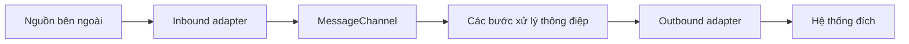
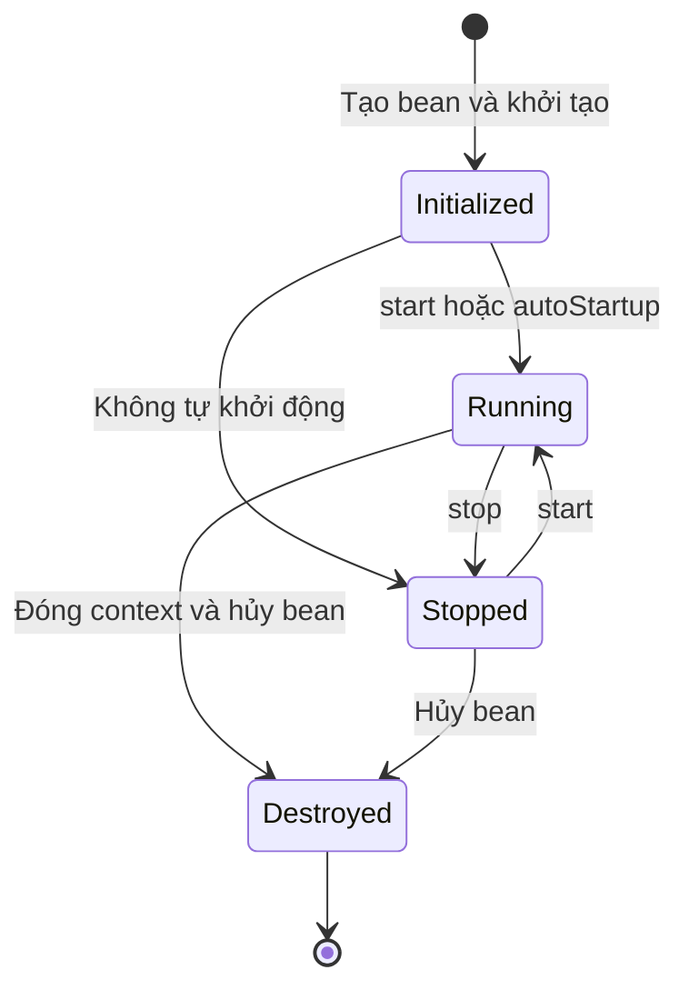
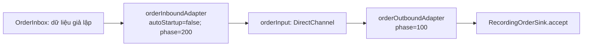
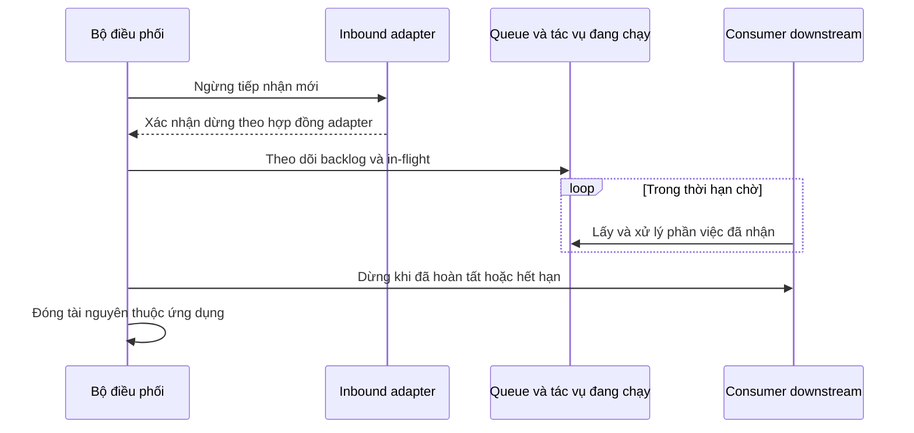

# Adapter và lifecycle

## 1. Vì sao adapter cần được quản lý vòng đời?

Trong Spring Integration Core, một luồng thông điệp có thể được mô tả rất ngắn: nguồn dữ liệu tạo `Message`, đưa vào `MessageChannel`, rồi các endpoint thực hiện biến đổi, định tuyến hoặc chuyển dữ liệu ra hệ thống đích. Khi vận hành, cần trả lời thêm: nguồn bắt đầu đọc lúc nào, có thể tạm dừng nhận đơn hàng hay không, và điều gì xảy ra với thông điệp đang xử lý khi ứng dụng dừng?

Lifecycle, tức vòng đời hoạt động, giúp điều khiển những thời điểm đó. Với channel adapter, cần phân biệt việc **bean đã được tạo** với việc **endpoint đang tham gia luồng thông điệp**.

Ví dụ, hệ thống nhập đơn hàng có hai yêu cầu:

- Ứng dụng khởi động để kiểm tra cấu hình, nhưng chưa đọc đơn từ nguồn cho đến khi người vận hành cho phép.
- Khi bảo trì, ngừng tiếp nhận đơn mới trước, giữ phần xử lý đơn đang chạy cho đến khi hoàn thành trong thời hạn cho phép.

Sau bài này, bạn có thể xác định đúng đối tượng cần `start()` hoặc `stop()`, cấu hình `autoStartup` và `phase`, điều khiển endpoint bằng Java DSL, đồng thời kiểm thử trạng thái và tác động lên việc truyền thông điệp.

Các ví dụ Java dùng Java 17 và API Spring Integration 6.5. Chúng minh họa lifecycle ở tầng core, không yêu cầu broker, cơ sở dữ liệu hoặc kết nối mạng. Khi dùng adapter theo giao thức, cần đọc thêm quy ước dừng listener, đóng kết nối và xác nhận thông điệp của adapter tương ứng.

## 2. Adapter, endpoint và đối tượng nghiệp vụ là những thành phần khác nhau

Channel adapter nối một nguồn hoặc một đích với một channel. Inbound adapter đưa dữ liệu vào luồng; outbound adapter nhận thông điệp từ luồng để thực hiện tác động ở đích. Mô hình adapter không định nghĩa một cuộc trao đổi request/reply như gateway. Một thao tác gửi ra ngoài vẫn có thể có xác nhận ở tầng giao thức; xác nhận đó không tự biến adapter thành messaging gateway. [Tham khảo Channel Adapter](https://docs.spring.io/spring-integration/reference/7.0/channel-adapter.html).



Không phải tất cả adapter đều có cùng cấu trúc thực thi:

| Trường hợp | Thành phần chính | Ý nghĩa khi hoạt động |
| --- | --- | --- |
| Inbound dùng polling | `SourcePollingChannelAdapter` và một `MessageSource` | Scheduler kích hoạt poller để gọi nguồn và phát thông điệp |
| Inbound nhận sự kiện | Một message producer, thường quản lý listener hoặc subscription | Sự kiện từ bên ngoài được chuyển thành thông điệp |
| Outbound đọc `DirectChannel` | `EventDrivenConsumer` bao quanh `MessageHandler` | Consumer đăng ký nhận thông điệp từ channel |
| Outbound đọc `QueueChannel` | `PollingConsumer` bao quanh `MessageHandler` | Poller lấy thông điệp trong hàng đợi rồi gọi handler |

Riêng `EventDrivenConsumer` là endpoint kết nối một `MessageHandler` với `SubscribableChannel`. Vì vậy, trong một cấu hình outbound, đối tượng ghi đơn hàng và endpoint đăng ký nhận thông điệp là hai đối tượng khác nhau. [API EventDrivenConsumer](https://docs.spring.io/spring-integration/docs/6.5.0/api/org/springframework/integration/endpoint/EventDrivenConsumer.html).

Giả sử có một bean `orderSink` với phương thức `accept(String orderId)`. Gọi trực tiếp `orderSink.accept(...)` là gọi Java thông thường. Dừng endpoint bao quanh bean này không làm cho mọi lời gọi Java trực tiếp tới bean bị vô hiệu hóa. Lifecycle kiểm soát sự tham gia của endpoint trong luồng tích hợp.

Tương tự, dừng inbound adapter không có nghĩa đã dừng tất cả transformer, router, filter hoặc outbound endpoint phía sau. Những endpoint đó có thể vẫn phục vụ nguồn thông điệp khác.

## 3. Phân biệt khởi tạo, chạy, dừng và hủy

### 3.1. Một mô hình trạng thái để suy luận



Đây là mô hình giải thích, không phải một enum trạng thái chung của mọi adapter. Khi context đóng bình thường, Spring điều phối dừng các thành phần lifecycle trước khi hủy bean. Một adapter cụ thể còn có thể có trạng thái kết nối, khôi phục hoặc dừng riêng.

| Thời điểm | Điều cần hiểu |
| --- | --- |
| Tạo và khởi tạo bean | Dependency được gán; cấu hình được kiểm tra; callback khởi tạo có thể chạy |
| `start()` | Endpoint bắt đầu cơ chế hoạt động của nó, chẳng hạn lập lịch polling hoặc đăng ký consumer |
| `isRunning()` | Cho biết trạng thái lifecycle mà component báo cáo |
| `stop()` | Yêu cầu endpoint ngừng hoạt động theo cơ chế triển khai của nó |
| Hủy bean/context | Kết thúc phạm vi sống của bean, giải phóng tài nguyên thuộc quyền sở hữu của bean |

`stop()` thường phục vụ nhu cầu dừng rồi chạy lại cùng instance. Sau khi bean bị hủy, không nên dùng `start()` trên tham chiếu cũ như một cách tái tạo tài nguyên; hãy tạo lại thành phần thông qua container hoặc cơ chế đăng ký flow thích hợp.

### 3.2. `Lifecycle` và `SmartLifecycle`

`Lifecycle` cung cấp ba thao tác cơ bản:

```java
void start();
void stop();
boolean isRunning();
```

`SmartLifecycle` bổ sung khả năng tự khởi động, thứ tự phase và `stop(Runnable callback)`. Với dừng bất đồng bộ, implementation phải gọi callback khi việc dừng thực sự hoàn tất để lifecycle processor có thể tiếp tục. Không gọi callback có thể khiến quá trình đóng context chờ đến timeout. [API SmartLifecycle](https://docs.spring.io/spring-framework/docs/current/javadoc-api/org/springframework/context/SmartLifecycle.html).

Nhiều endpoint Spring Integration kế thừa `AbstractEndpoint`, lớp cung cấp cơ chế lifecycle và mặc định cho phép tự khởi động. Khi endpoint được Spring quản lý, việc tự chạy được điều phối trong lifecycle của application context, không đồng nghĩa với việc gọi nghiệp vụ ngay trong constructor. [API AbstractEndpoint](https://docs.spring.io/spring-integration/docs/current/api/org/springframework/integration/endpoint/AbstractEndpoint.html).

### 3.3. `running` khác với sẵn sàng nghiệp vụ

Một inbound endpoint báo `isRunning() == true` vẫn có thể đang chờ dữ liệu, gặp lỗi xác thực ở lần truy cập tiếp theo hoặc đang khôi phục kết nối. Một outbound endpoint đang chạy cũng có thể gửi thất bại vì hệ thống đích ngừng phục vụ.

Ví dụ, màn hình vận hành nhập đơn nên trình bày riêng:

- Trạng thái lifecycle: có cho phép endpoint hoạt động không?
- Trạng thái kết nối hoặc lần truy cập nguồn gần nhất.
- Thời điểm xử lý thành công đơn gần nhất.
- Số đơn đang chờ, số đơn đang xử lý và số lỗi liên tiếp.

Các chỉ số này trả lời những câu hỏi khác nhau. Không dùng riêng cờ `running` để khẳng định rằng toàn bộ quy trình nhập đơn đang khỏe.

## 4. `autoStartup`: quyết định có tự chạy khi context khởi động

Đặt `autoStartup(false)` khi cần chủ động mở luồng sau bước chuẩn bị, chỉ chạy một adapter trên node được chọn, hoặc ngăn nguồn thật hoạt động trong một môi trường thử nghiệm.

```java
// Fragment cấu hình endpoint của một polling inbound adapter.
e -> e.id("orderInboundAdapter")
      .autoStartup(false)
      .poller(Pollers.fixedDelay(Duration.ofSeconds(1)))
```

`autoStartup(false)` không có nghĩa bean chưa tồn tại, không được khởi tạo hoặc không cấp phát tài nguyên nào. Nó điều khiển việc tự bắt đầu hoạt động lifecycle. Constructor, callback khởi tạo và những tài nguyên khác trong context vẫn có thể được tạo.

Thuộc tính này cũng không phải công tắc khóa endpoint vĩnh viễn. Khi có yêu cầu chạy, mã quản trị vẫn gọi được `start()`. Sau một lần `stop()`, cờ tự khởi động không phải lịch hẹn để tự bật lại endpoint; cần một tác nhân điều khiển rõ ràng.

Trong Java DSL, `id(...)` tại phần cấu hình endpoint cho phép đặt tên bean endpoint. Đây là tên dùng để tra cứu và điều khiển lifecycle; nó khác tên bean của toàn bộ `IntegrationFlow` và tên bean xử lý nghiệp vụ. [DSL và Endpoint Configuration](https://docs.spring.io/spring-integration/reference/7.1-SNAPSHOT/dsl/java-endpoints.html).

## 5. `phase`: phối hợp thứ tự khởi động và dừng

Khi application context điều phối lifecycle, phase thấp khởi động trước, phase cao khởi động sau; khi dừng thì theo chiều ngược lại. Quan hệ phụ thuộc bean được khai báo có thể chi phối thứ tự này, vì dependency cần tồn tại trước thành phần phụ thuộc và dừng sau nó. Những bean cùng phase không nên được xem là có thứ tự nghiệp vụ xác định. [DefaultLifecycleProcessor](https://docs.spring.io/spring-framework/docs/current/javadoc-api/org/springframework/context/support/DefaultLifecycleProcessor.html).

Một phương án thiết kế cho luồng nhập đơn là:

| Thành phần | Phase minh họa | Khởi động | Dừng |
| --- | --- | --- | --- |
| Consumer chuyển đơn đến đích | `100` | Sẵn sàng trước nguồn | Dừng sau nguồn |
| Inbound adapter tiếp nhận đơn | `200` | Bắt đầu sau consumer | Ngừng tiếp nhận trước consumer |

Các số `100` và `200` là lựa chọn của ví dụ, không phải giá trị mặc định bắt buộc của framework. Hãy đặt phase tường minh khi cần diễn đạt quan hệ vận hành; không suy ra phase mặc định của mọi loại component chỉ từ interface `SmartLifecycle`.

Có ba giới hạn cần nhớ khi áp dụng bảng trên:

1. **Gọi trực tiếp một endpoint không điều phối cả hệ thống.** `source.start()` chỉ bắt đầu source. Người gọi phải bảo đảm downstream đã sẵn sàng.
2. **Phase không phải tín hiệu hoàn thành khôi phục kết nối.** Một thao tác `start()` có thể trả về trước khi tài nguyên từ xa phục vụ được nghiệp vụ.
3. **Phase không tự drain hàng đợi.** Dừng source trước consumer tạo điều kiện xử lý tiếp, nhưng vẫn cần chính sách chờ phần việc tồn đọng.

Không nên dùng `Thread.sleep(...)` trong constructor hoặc `@PostConstruct` để giả lập thứ tự này. Thời gian chờ cố định không diễn đạt dependency và dễ sai khi tốc độ khởi động thay đổi.

## 6. Ví dụ Java DSL: chủ động mở và đóng nguồn nhập đơn

### 6.1. Thiết kế ví dụ

Ví dụ mô phỏng một nguồn đơn bên ngoài bằng `OrderInbox`, dùng inbound polling adapter lấy từng mã đơn, gửi qua `DirectChannel`, rồi gọi một đích ghi nhận `RecordingOrderSink`.



`RecordingOrderSink` là đích mô phỏng một tác động outbound một chiều. Khi áp dụng thực tế, có thể thay bằng handler ghi file, gửi thông báo hoặc gọi API; mỗi giao thức cần timeout và cơ chế xử lý lỗi riêng.

### 6.2. Cấu hình đầy đủ

Đặt lớp sau trong package `example.integration.lifecycle`. Ví dụ cần dependency `org.springframework.integration:spring-integration-core` cùng các dependency Spring tương ứng. Trong dự án dùng Spring Boot, lấy bộ phiên bản đồng bộ từ dependency management của dự án.

```java
package example.integration.lifecycle;

import java.time.Duration;
import java.util.Queue;
import java.util.concurrent.BlockingQueue;
import java.util.concurrent.ConcurrentLinkedQueue;
import java.util.concurrent.LinkedBlockingQueue;
import java.util.concurrent.TimeUnit;

import org.springframework.context.annotation.Bean;
import org.springframework.context.annotation.Configuration;
import org.springframework.integration.channel.DirectChannel;
import org.springframework.integration.config.EnableIntegration;
import org.springframework.integration.dsl.IntegrationFlow;
import org.springframework.integration.dsl.Pollers;

@Configuration
@EnableIntegration
public class AdapterLifecycleConfiguration {

    @Bean
    public OrderInbox orderInbox() {
        return new OrderInbox();
    }

    @Bean
    public RecordingOrderSink orderSink() {
        return new RecordingOrderSink();
    }

    @Bean
    public DirectChannel orderInput() {
        return new DirectChannel();
    }

    @Bean
    public IntegrationFlow orderFlow(
            OrderInbox inbox,
            DirectChannel orderInput,
            RecordingOrderSink sink) {

        return IntegrationFlow
                .fromSupplier(inbox::poll, e -> e
                        .id("orderInboundAdapter")
                        .autoStartup(false)
                        .phase(200)
                        .poller(Pollers
                                .fixedDelay(Duration.ofMillis(100))
                                .maxMessagesPerPoll(1)))
                .channel(orderInput)
                .handle(sink, "accept", e -> e
                        .id("orderOutboundAdapter")
                        .phase(100))
                .get();
    }

    public static class OrderInbox {

        private final Queue<String> pending = new ConcurrentLinkedQueue<>();

        public void offer(String orderId) {
            pending.add(orderId);
        }

        public String poll() {
            return pending.poll();
        }
    }

    public static class RecordingOrderSink {

        private final BlockingQueue<String> received = new LinkedBlockingQueue<>();

        public void accept(String orderId) {
            received.add(orderId);
        }

        public String awaitReceived(long timeoutMillis) throws InterruptedException {
            return received.poll(timeoutMillis, TimeUnit.MILLISECONDS);
        }
    }
}
```

`IntegrationFlow.fromSupplier(...)` tạo đầu vào được kích hoạt bằng polling. Supplier trả payload khi có dữ liệu; khi không có dữ liệu, ví dụ trả `null` để không tạo thông điệp ở lần gọi đó. API này cho phép cấu hình `SourcePollingChannelAdapter` qua lambda thứ hai. [API IntegrationFlow](https://docs.spring.io/spring-integration/docs/6.5.0/api/org/springframework/integration/dsl/IntegrationFlow.html).

Ở đây, `DirectChannel` chuyển xử lý đồng bộ trên thread gửi. Không có hàng đợi trung gian giữa inbound và outbound. Phương thức `accept` trả `void`, phù hợp với đích một chiều của ví dụ.

Hai hàng đợi Java trong các bean mô phỏng chỉ phục vụ quan sát ví dụ. Chúng không phải kho lưu bền, transaction log hoặc cơ chế khôi phục sau khi tiến trình chết. Đặc biệt, `OrderInbox.poll()` đã lấy phần tử ra trước khi downstream hoàn tất; nếu downstream thất bại, ví dụ không tự đưa đơn trở lại nguồn.

### 6.3. Điều khiển đúng bean endpoint

Đoạn sau là chương trình minh họa độc lập, cùng package với lớp cấu hình:

```java
package example.integration.lifecycle;

import org.springframework.context.annotation.AnnotationConfigApplicationContext;
import org.springframework.integration.endpoint.SourcePollingChannelAdapter;

import example.integration.lifecycle.AdapterLifecycleConfiguration.OrderInbox;
import example.integration.lifecycle.AdapterLifecycleConfiguration.RecordingOrderSink;

public class AdapterLifecycleDemo {

    public static void main(String[] args) throws InterruptedException {
        try (var context = new AnnotationConfigApplicationContext(
                AdapterLifecycleConfiguration.class)) {

            var inbound = context.getBean(
                    "orderInboundAdapter", SourcePollingChannelAdapter.class);
            var inbox = context.getBean(OrderInbox.class);
            var sink = context.getBean(RecordingOrderSink.class);

            inbox.offer("ORDER-001");
            System.out.println("Trước start: " + inbound.isRunning());

            inbound.start();
            System.out.println("Đơn nhận được: " + sink.awaitReceived(2000));

            inbound.stop();
            System.out.println("Sau stop: " + inbound.isRunning());
        }
    }
}
```

Trong điều kiện thực thi bình thường, ba dòng lần lượt cho thấy `false`, mã `ORDER-001` và `false`. Nếu hết thời gian chờ mà chưa nhận được đơn, `awaitReceived` trả `null`; chương trình minh họa không biến timeout thành một xác nhận thành công.

Tên bean `orderInboundAdapter` đến từ `id(...)` trong DSL. Tên `orderFlow` chỉ bean định nghĩa flow; tên `orderInbox` chỉ đối tượng nguồn. Lấy đúng bean endpoint giúp thao tác quản trị không phụ thuộc vào tên tự sinh của framework.

Không đóng toàn bộ context chỉ để tạm ngưng một nguồn. Context trong chương trình trên được đóng khi kết thúc demo vì nó thuộc quyền sở hữu của chương trình.

## 7. `stop()` tác động thế nào đến thông điệp?

### 7.1. Dừng polling inbound adapter

Khi dừng một polling inbound adapter, mục tiêu là ngừng những lần lấy dữ liệu tiếp theo. Tuy nhiên, một lần polling hoặc lời gọi I/O đã bắt đầu có thể vẫn còn trong tiến trình dừng. Không diễn giải `stop()` như lệnh rollback mọi thao tác nguồn vừa thực hiện.

Với ví dụ nhập đơn, hãy xét chuỗi sự kiện:

1. Poller lấy `ORDER-010` khỏi `OrderInbox`.
2. Handler bắt đầu ghi nhận đơn.
3. Một thread quản trị gọi `inbound.stop()`.
4. Handler có thể vẫn hoàn tất công việc đã nhận, tùy cơ chế dừng và trạng thái thực thi.

Vì vậy, yêu cầu nghiệp vụ nên là “ngừng nhận thêm và chờ phần việc đang thực hiện kết thúc”, kèm định nghĩa rõ thế nào là đã ngừng nhận. Nếu cần một ranh giới tuyệt đối, phải phối hợp với cơ chế khóa, claim, transaction hoặc khả năng pause/acknowledgment của nguồn.

### 7.2. Dừng consumer phía outbound

Với consumer thông thường của một `DirectChannel`, dừng endpoint sẽ hủy đăng ký handler khỏi channel. Nếu không còn subscriber khác, gửi thông điệp mới có thể thất bại với `MessageDeliveryException`. Channel không tự biến thành bộ đệm khi consumer dừng.

Nếu đầu vào là `QueueChannel`, consumer dùng polling. Dừng consumer làm ngừng việc lấy thông điệp theo lifecycle của poller; những thông điệp còn nằm trong queue vẫn thuộc queue. Queue có thể đầy nếu phía gửi tiếp tục hoạt động.

```text
DirectChannel, chỉ một consumer:
    stop consumer -> không còn nơi nhận -> lần gửi mới thất bại

QueueChannel:
    stop consumer -> thông điệp chờ tích lũy -> cần xử lý dung lượng và timeout
```

Với `ExecutorChannel` hoặc listener bất đồng bộ, còn phải xét các task đã được giao cho executor. Ngừng đăng ký nhận mới không đồng nghĩa đã hủy toàn bộ task đang chờ hoặc đang chạy.

### 7.3. `null`, pause và stop là các quyết định khác nhau

| Tình huống | Ý nghĩa |
| --- | --- |
| Nguồn trả `null` | Lần gọi hiện tại không có thông điệp; endpoint có thể vẫn đang chạy |
| `maxMessagesPerPoll(1)` | Giới hạn một thông điệp mỗi chu kỳ polling trong ví dụ |
| `maxMessagesPerPoll(0)` | Với polling inbound adapter hỗ trợ thiết lập này, bỏ qua gọi nguồn nhưng không đồng nghĩa endpoint đã stop |
| `stop()` | Chuyển endpoint sang trạng thái dừng theo hợp đồng lifecycle |
| Hủy bean | Kết thúc việc sử dụng instance trong phạm vi container hiện tại |

Đặt giá trị âm cho `maxMessagesPerPoll` có thể cho phép một chu kỳ lấy nhiều thông điệp cho đến khi nguồn trả `null`. Nếu nguồn luôn trả dữ liệu và lời gọi không thể ngắt, việc phản ứng với dừng có thể khó khăn hơn. Trong bài này, giới hạn là `1` để mỗi chu kỳ có phạm vi nhỏ, dễ quan sát. [Poller và Channel Adapter](https://docs.spring.io/spring-integration/reference/7.0/channel-adapter.html).

## 8. Thiết kế dừng có kiểm soát

### 8.1. Tách ngừng tiếp nhận khỏi ngừng xử lý

Với một luồng có hàng đợi trung gian, có thể thiết kế quy trình bảo trì như sau:



Đây là thiết kế điều phối ở mức ứng dụng, không phải cam kết rằng một lần gọi `stop()` tự thực hiện toàn bộ các bước.

Giả sử hệ thống có 40 đơn chờ, hai worker và mỗi đơn mất khoảng 100 ms. Ước lượng sơ bộ để xử lý hết là `40 × 100 / 2 = 2000 ms`, chưa kể I/O chậm, retry và đơn đang chạy. Thời hạn dừng nên có phần dự phòng và được đo lại bằng tải thực tế.

Chỉ kiểm tra `queueSize == 0` là chưa đủ: worker có thể đã lấy đơn ra khỏi queue nhưng chưa ghi xong. Cần theo dõi cả số tác vụ đang xử lý hoặc số xác nhận hoàn thành. Với aggregator, còn phải xét message group chưa đủ điều kiện release; với retry, còn phải xét tác vụ đang chờ thử lại.

### 8.2. Hỗ trợ orderly shutdown của Spring Integration

Spring Integration có cơ chế orderly shutdown thông qua `IntegrationMBeanExporter.stopActiveComponents(...)`. Cơ chế này phối hợp các component có hợp đồng `OrderlyShutdownCapable`, ngừng nguồn tiếp nhận và dành thời gian cho thông điệp đang xử lý. Tài liệu mô tả việc giữ poller downstream hoạt động để xử lý thông điệp còn trong queue. [Orderly Shutdown](https://docs.spring.io/spring-integration/reference/shutdown.html).

Khi chọn cơ chế này, cần cấu hình thành phần quản lý tương ứng và kiểm tra adapter đang dùng có hỗ trợ những bước nào. Không giả định đóng application context thông thường luôn chạy đúng quy trình chuyên biệt của MBean exporter.

### 8.3. Timeout và quyền sở hữu tài nguyên

Một kế hoạch dừng chỉ có giới hạn thực tế khi các thao tác đang chạy cũng có giới hạn:

- Lời gọi tới hệ thống đích cần connect/read timeout thích hợp.
- Gửi vào queue hữu hạn cần chính sách chờ hoặc từ chối rõ ràng.
- Retry cần giới hạn hoặc có cách kết thúc trong thời hạn bảo trì.
- Shutdown cần quyết định đối với phần việc chưa hoàn tất khi hết thời hạn.

Nếu inbound adapter gửi vào channel có khả năng chặn, Java DSL cung cấp `sendTimeout(...)` trên `SourcePollingChannelAdapterSpec`, với giá trị thời gian tính bằng mili giây. Thuộc tính này giới hạn chờ gửi vào channel có hỗ trợ timeout; nó không thay timeout mạng của handler và không ngắt mọi đoạn mã downstream đang chạy đồng bộ. [API SourcePollingChannelAdapterSpec](https://docs.spring.io/spring-integration/docs/6.5.0/api/org/springframework/integration/dsl/SourcePollingChannelAdapterSpec.html).

Không tùy tiện đóng scheduler, executor hoặc connection factory dùng chung chỉ để dừng một adapter. Tài nguyên dùng chung phải được dừng bởi thành phần sở hữu nó, sau khi các bên còn sử dụng đã kết thúc.

### 8.4. Lifecycle không bảo đảm xử lý đúng một lần

Trong một nguồn thực tế, đơn có thể đã được đọc nhưng chưa xác nhận; hệ thống đích có thể đã ghi thành công nhưng phản hồi bị mất. Sau khi restart, đơn có thể xuất hiện lại.

Ví dụ, với đơn `ORDER-025`, adapter gửi yêu cầu tạo hóa đơn thành công nhưng ứng dụng dừng trước khi lưu dấu hoàn tất. Lần chạy sau có thể gửi lại yêu cầu. Endpoint start/stop đúng thứ tự vẫn không loại bỏ tình huống này.

Nếu nghiệp vụ yêu cầu tránh tạo hóa đơn trùng, có thể dùng mã đơn làm khóa idempotency ở đích và thiết kế transaction hoặc kho trạng thái phù hợp. Lifecycle giải quyết thời điểm hoạt động; độ bền thông điệp và ngữ nghĩa giao nhận cần được thiết kế riêng.

## 9. Lỗi xử lý không tự đồng nghĩa endpoint đã dừng

Trong luồng dùng polling ở ví dụ, lỗi phát sinh từ nguồn hoặc downstream xảy ra trên tác vụ do scheduler kích hoạt. Error handler của polling có thể đưa lỗi vào error flow. Một thông điệp xử lý thất bại không có nghĩa endpoint tự chuyển sang stopped.

Ngược lại, nếu một thread ứng dụng gửi trực tiếp vào `DirectChannel` và handler ném lỗi, lỗi có thể được trả về ngay trên thread gửi. Không mặc định rằng mọi lỗi của mọi cách gửi đều tự đến `errorChannel`.

Ví dụ vận hành có thể áp dụng chính sách: sau một chuỗi lỗi xác thực liên tiếp, bộ điều phối ngừng inbound adapter, phát cảnh báo và chỉ bật lại sau khi sửa cấu hình. Chính sách đó phải được cài đặt và kiểm thử; nó không phải tác dụng tự động của `isRunning()`.

Khi thiết kế error flow, giữ nó hoạt động đủ lâu để ghi nhận lỗi của các tác vụ còn chạy. Dừng đầu vào quá trình xử lý lỗi trước khi phần việc chính kết thúc có thể làm mất thông tin cần điều tra.

## 10. Điều khiển endpoint, nhóm endpoint và toàn bộ flow

Chọn phạm vi thao tác theo mục tiêu:

| Mục tiêu | Phạm vi phù hợp |
| --- | --- |
| Tạm ngưng một nguồn nhập đơn | Inbound endpoint của nguồn đó |
| Tắt riêng một đích đang bảo trì | Outbound endpoint, đồng thời xử lý ảnh hưởng ở phía gửi |
| Điều phối nhiều endpoint cùng trách nhiệm | Nhóm lifecycle role và `SmartLifecycleRoleController` |
| Dừng flow được đăng ký động | Registration của flow thông qua `IntegrationFlowContext` |
| Kết thúc toàn bộ ứng dụng | Lifecycle và quá trình đóng application context |

Role giúp nhóm các endpoint để quản trị, nhưng việc gộp chung inbound và downstream rồi dừng đồng loạt chưa đủ để diễn đạt một quy trình drain có nhiều bước. Có thể tách nhóm tiếp nhận và nhóm xử lý nếu nghiệp vụ yêu cầu.

Đối với Java DSL, `StandardIntegrationFlow` là đối tượng chứa các component của flow và có thể điều khiển lifecycle của chúng. Với flow khai báo tĩnh, việc tự khởi động ban đầu được lifecycle processor áp dụng cho các bean thành phần. Với flow đăng ký động, `IntegrationFlowContext` và registration điều phối việc bắt đầu; không nên suy luận rằng khai báo bean và đăng ký runtime có cùng đường đi lifecycle. [API StandardIntegrationFlow](https://docs.spring.io/spring-integration/docs/current/api/org/springframework/integration/dsl/StandardIntegrationFlow.html).

Nếu một handler hoặc tài nguyên được dùng chung giữa nhiều flow, phải xem xét quyền sở hữu trước khi dừng hoặc hủy cả nhóm. Tên flow không tự tạo ra ranh giới tài nguyên độc lập.

## 11. Kiểm thử lifecycle bằng trạng thái và tác động

### 11.1. Kiểm thử nguồn không tự chạy và có thể chạy lại

Lớp kiểm thử sau dùng lại cấu hình ở mục 6 và JUnit Jupiter, với dependency `org.junit.jupiter:junit-jupiter`. Mỗi test tạo context riêng và đóng context sau khi thực hiện để không để lại poller hoặc subscriber ảnh hưởng test khác.

```java
package example.integration.lifecycle;

import org.junit.jupiter.api.Test;
import org.springframework.context.annotation.AnnotationConfigApplicationContext;
import org.springframework.integration.channel.DirectChannel;
import org.springframework.integration.endpoint.EventDrivenConsumer;
import org.springframework.integration.endpoint.SourcePollingChannelAdapter;
import org.springframework.messaging.MessageDeliveryException;
import org.springframework.messaging.support.MessageBuilder;

import example.integration.lifecycle.AdapterLifecycleConfiguration.OrderInbox;
import example.integration.lifecycle.AdapterLifecycleConfiguration.RecordingOrderSink;

import static org.junit.jupiter.api.Assertions.assertEquals;
import static org.junit.jupiter.api.Assertions.assertFalse;
import static org.junit.jupiter.api.Assertions.assertThrows;
import static org.junit.jupiter.api.Assertions.assertTrue;

class AdapterLifecycleTest {

    @Test
    void sourceStartsOnlyWhenRequestedAndCanRestart() throws Exception {
        try (var context = new AnnotationConfigApplicationContext(
                AdapterLifecycleConfiguration.class)) {

            var inbound = context.getBean(
                    "orderInboundAdapter", SourcePollingChannelAdapter.class);
            var inbox = context.getBean(OrderInbox.class);
            var sink = context.getBean(RecordingOrderSink.class);

            assertFalse(inbound.isRunning());
            inbox.offer("ORDER-001");

            inbound.start();
            assertTrue(inbound.isRunning());
            assertEquals("ORDER-001", sink.awaitReceived(2000));

            inbound.stop();
            assertFalse(inbound.isRunning());

            inbound.start();
            inbox.offer("ORDER-002");
            assertEquals("ORDER-002", sink.awaitReceived(2000));
        }
    }

    @Test
    void stoppedDirectChannelConsumerDoesNotReceiveNewMessages() throws Exception {
        try (var context = new AnnotationConfigApplicationContext(
                AdapterLifecycleConfiguration.class)) {

            var outbound = context.getBean(
                    "orderOutboundAdapter", EventDrivenConsumer.class);
            var input = context.getBean("orderInput", DirectChannel.class);
            var sink = context.getBean(RecordingOrderSink.class);
            var message = MessageBuilder.withPayload("ORDER-003").build();

            // Nguồn vẫn chưa chạy; test gửi trực tiếp để không có race với poller.
            outbound.stop();
            assertFalse(outbound.isRunning());
            assertThrows(MessageDeliveryException.class, () -> input.send(message));

            outbound.start();
            assertTrue(outbound.isRunning());
            assertTrue(input.send(message));
            assertEquals("ORDER-003", sink.awaitReceived(1000));
        }
    }
}
```

Test thứ nhất kiểm tra cấu hình không tự chạy, khả năng phát thông điệp và khả năng start lại sau stop. Nó không chứng minh rằng mọi adapter đều đã kết thúc toàn bộ I/O ngay khi `stop()` trả về. Test thứ hai kiểm tra tác động cụ thể của lifecycle lên consumer duy nhất của `DirectChannel`.

Chờ bằng `BlockingQueue.poll` có timeout giúp test kết thúc ngay khi có kết quả. Nó hữu ích hơn một khoảng ngủ cố định rồi phỏng đoán rằng hệ thống đã xử lý xong.

### 11.2. Khi kiểm thử adapter kết nối hệ thống thật

Nếu dùng Spring Integration Test, có thể áp dụng `@SpringIntegrationTest(noAutoStartup = "orderInboundAdapter")` trên lớp test có Spring Test context phù hợp để ngăn endpoint tự chạy. `MockIntegrationContext` hỗ trợ thay message source hoặc handler bằng đối tượng thử nghiệm. Tên truyền vào các thao tác thay thế là tên endpoint tương ứng. [Testing Support](https://docs.spring.io/spring-integration/reference/7.0/testing.html).

Với adapter có listener hoặc giao dịch, cần bổ sung kiểm thử đặc thù: dừng khi đang xử lý một message, restart sau lỗi kết nối, xác nhận hoặc đọc lại dữ liệu, và hành vi khi hết timeout dừng. Dùng latch hoặc tín hiệu đồng bộ để chủ động đặt tác vụ vào trạng thái đang xử lý; tránh dựa vào may rủi của thời điểm thread chạy.

## 12. Những lỗi thiết kế thường gặp

| Biểu hiện | Nguyên nhân có thể có | Hướng xử lý |
| --- | --- | --- |
| Ứng dụng đã lên nhưng không nhập đơn | Inbound đặt `autoStartup(false)` và chưa có tác nhân gọi start | Kiểm tra endpoint theo ID và quy trình mở nguồn |
| Dừng adapter nhưng vẫn thấy một đơn hoàn tất | Đơn đã được nhận trước lúc dừng | Theo dõi in-flight và xác định rõ ranh giới tiếp nhận |
| Gửi vào `DirectChannel` thất bại sau bảo trì | Consumer duy nhất đang dừng | Mở consumer trước nguồn hoặc thiết kế bộ đệm thích hợp |
| Queue đầy khi dừng đích | Upstream vẫn gửi trong khi consumer không lấy | Phối hợp ngừng nguồn, giới hạn dung lượng và timeout |
| Shutdown kéo dài | I/O không có timeout, retry kéo dài hoặc callback dừng không hoàn tất | Đo vị trí đang chờ và kiểm tra hợp đồng dừng của component |
| Cờ running đúng nhưng dữ liệu không đi | Lỗi nguồn, lỗi downstream hoặc không có dữ liệu | Quan sát kết nối, lỗi và thời điểm thành công gần nhất |
| Một flow dừng làm flow khác lỗi | Có tài nguyên hoặc component dùng chung bị đóng | Xác định lại quyền sở hữu và phạm vi thao tác |
| Restart tạo tác động nghiệp vụ trùng | Dữ liệu đã gửi nhưng chưa lưu dấu hoàn tất | Thiết kế idempotency và ngữ nghĩa giao nhận |

## 13. Bài tập áp dụng

1. Với cấu hình ở mục 6, giữ inbound dừng, gọi trực tiếp `orderInput.send(...)` và giải thích vì sao outbound vẫn xử lý được.
2. Chuyển điểm nối giữa hai adapter sang `QueueChannel` hữu hạn, thêm poller cho outbound consumer và cấu hình thời gian chờ gửi ở inbound. Quan sát điều gì xảy ra khi dừng outbound nhưng nguồn tiếp tục chạy.
3. Tạo handler giả chờ một `CountDownLatch`. Chỉ khi handler báo đã bắt đầu, hãy yêu cầu dừng inbound. Xác định điều kiện nào mới đủ để khẳng định công việc đang chạy đã kết thúc.
4. Thiết kế quy trình bảo trì cho luồng có transformer, router và hai outbound endpoint. Chỉ rõ nguồn nào cần dừng, nhánh nào phải tiếp tục phục vụ và chỉ số nào xác nhận đã xử lý hết.
5. Mô tả cách phục hồi khi ứng dụng chết sau khi đích nhận đơn nhưng trước khi nguồn được xác nhận. Chọn nơi lưu khóa idempotency và giải thích vì sao start/stop không giải quyết được việc này.

Kết quả thực hành cần thể hiện được cả trạng thái endpoint, đường đi của thông điệp và phần việc còn tồn đọng. Một thiết kế lifecycle rõ ràng cho phép mở nguồn khi downstream sẵn sàng, dừng tiếp nhận khi cần và kết thúc phần việc đang chạy theo một chính sách có thể kiểm chứng.
