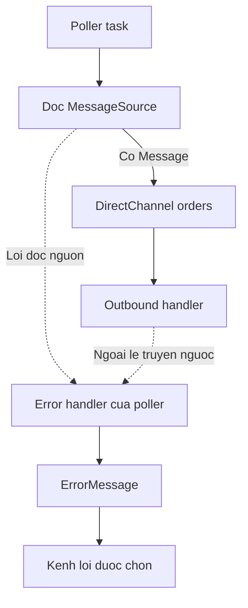

# Adapter error channel

## 1. Mục tiêu và phạm vi

Trong chương **Channel adapter** của module **SPRING_INTEGRATION_CORE**, bài này giải thích cách thiết kế nhánh lỗi cho endpoint nối hệ thống bên ngoài với luồng thông điệp. Tình huống xuyên suốt là đọc đơn hàng từ một nguồn rồi gửi sang hệ thống nhận: đọc nguồn có thể thất bại trước khi có `Message`, còn hệ thống nhận có thể từ chối một thông điệp đã được tạo.

Sau bài học, bạn có thể:

- Chọn nơi cấu hình kênh lỗi cho adapter có poller và cho từng thông điệp.
- Xác định ngoại lệ quay về bên gửi hay được đóng gói thành `ErrorMessage`.
- Lấy thông điệp thất bại, nguyên nhân lỗi và khóa nghiệp vụ để xử lý tiếp.
- Viết Java DSL và kiểm thử đường đi của lỗi bằng các channel có thể quan sát.
- Phân biệt việc nhận lỗi với retry, rollback, redelivery và lưu thông điệp lỗi bền vững.

Ví dụ chọn **Java 17 và Spring Integration 6.5.x** làm mốc API. Cần `spring-integration-core`; phần kiểm thử dùng JUnit Jupiter. Hãy để BOM của dự án quản lý phiên bản tương thích giữa Spring Framework và Spring Integration. Các đoạn Java bên dưới là mã học tập; bài không giả định dự án hiện tại đã khai báo các dependency này.

## 2. Error channel là một channel có vai trò nhận lỗi

Channel adapter là endpoint kết nối một nguồn hoặc một đích với `MessageChannel`. Adapter inbound đưa dữ liệu vào luồng; adapter outbound tiêu thụ thông điệp để thực hiện tác vụ với đích. Với inbound dựa trên polling, `SourcePollingChannelAdapter` gọi `MessageSource` theo lịch và gửi kết quả khác `null` vào channel. Với outbound nhận từ một `PollableChannel`, endpoint cần poller để lấy thông điệp. [Tài liệu Channel Adapter](https://docs.spring.io/spring-integration/reference/channel-adapter.html).

**Error channel** là vai trò của một `MessageChannel` khi nó nhận thông điệp mô tả lỗi. Không có quy tắc bắt buộc mọi kênh lỗi phải dùng cùng một lớp channel.

Có bốn tên gần giống nhau cần tách biệt:

| Thành phần | Ví dụ | Ý nghĩa |
|---|---|---|
| Bean kênh lỗi dùng chung | `errorChannel` | Đích dùng chung của cơ chế báo lỗi mặc định |
| Bean kênh lỗi riêng | `adapterErrors` | Đích do ứng dụng đặt tên cho một nhóm lỗi |
| Header của thông điệp | `MessageHeaders.ERROR_CHANNEL` | Chỉ dẫn nơi nhận lỗi gắn với thông điệp đó |
| Cấu hình poller trong DSL | `.errorChannel("adapterErrors")` | Chọn kênh lỗi mặc định cho tác vụ polling tương ứng |

Chỉ tạo bean tên `adapterErrors` chưa khiến mọi exception tự động tới bean đó. Phải có cơ chế bắt ngoại lệ và phát lỗi, chẳng hạn error handler của poller hoặc cơ chế riêng của một adapter.

Một error channel nhận được lỗi cũng chưa có nghĩa là tác vụ nghiệp vụ đã được khôi phục. Chẳng hạn, nhận được lỗi gửi đơn hàng chỉ cho biết đường báo lỗi đã hoạt động; đơn hàng vẫn cần quyết định retry, cách ly hoặc xử lý thủ công.

## 3. Ranh giới thực thi quyết định nơi bắt ngoại lệ

### 3.1. Gửi trực tiếp từ mã gọi

Khi mã ứng dụng gọi `DirectChannel.send(...)`, handler chạy trên luồng gọi. Nếu handler ném ngoại lệ, ngoại lệ truyền ngược về lời gọi `send`. Header `errorChannel` tự nó không bọc lời gọi trong `try/catch` và không tự phát `ErrorMessage`. Với xử lý bất đồng bộ hoặc tác vụ poller, cần xem cơ chế bắt lỗi của tác vụ đang thực thi. [Cơ chế xử lý lỗi của Spring Integration](https://docs.spring.io/spring-integration/reference/error-handling.html).

```text
Luồng gọi của ứng dụng
  -> DirectChannel.send(message)
     -> outbound handler
        -> ném ngoại lệ
  <- ngoại lệ quay lại lời gọi send
```

Bởi vậy, việc thêm `errorChannel` vào header không thay thế được xử lý ngoại lệ ở bên gọi trong một luồng hoàn toàn đồng bộ.

### 3.2. DirectChannel bên trong tác vụ poller

Xét một cấu trúc khác:



Ở đây handler vẫn chạy đồng bộ với bên gửi của `DirectChannel`, nhưng bên gửi nằm trong tác vụ poller. Ngoại lệ có thể truyền ngược tới lớp bao của tác vụ rồi được phát thành thông điệp lỗi. Vì vậy, kết luận “dùng `DirectChannel` thì lỗi không bao giờ tới error channel” là thiếu điều kiện.

Có thể hình dung poller là nơi gọi và quản lý toàn bộ chuỗi xử lý đồng bộ trong lần poll đó. Phạm vi này kết thúc khi chuỗi chuyển công việc sang một cơ chế thực thi khác. [Mã nguồn AbstractPollingEndpoint 6.5.4](https://raw.githubusercontent.com/spring-projects/spring-integration/v6.5.4/spring-integration-core/src/main/java/org/springframework/integration/endpoint/AbstractPollingEndpoint.java).

### 3.3. Khi luồng đi qua QueueChannel hoặc ExecutorChannel

| Đoạn luồng | Bên gửi biết điều gì khi gửi xong? | Nơi cần xem cấu hình xử lý lỗi |
|---|---|---|
| Ứng dụng → `DirectChannel` → handler | Handler đã chạy hoặc đã ném lỗi | Bên gọi `send`, gateway hoặc lớp bao đang gọi |
| Poller inbound → `DirectChannel` → handler | Công việc đồng bộ thuộc lần poll đó | Error handler của poller inbound |
| Poller inbound → `QueueChannel` | Thông điệp đã được đưa vào queue khi gửi thành công | Poller của consumer lấy thông điệp khỏi queue |
| Producer → `ExecutorChannel` → handler | Tác vụ đã được bàn giao để xử lý, tùy executor | Cơ chế báo lỗi của tác vụ executor/channel |

Ví dụ, một inbound adapter đã gửi thành công vào `QueueChannel` thì không thể bắt lại lỗi xảy ra sau đó trong poller của consumer. Cấu hình kênh lỗi riêng cho consumer, hoặc bảo toàn header lỗi phù hợp trước ranh giới bất đồng bộ. Kiểu channel và dispatcher cũng ảnh hưởng cách phân phối thông điệp tới các subscriber. [Cấu hình Message Channels](https://docs.spring.io/spring-integration/reference/6.5/channel/configuration.html).

Các adapter dựa trên listener/callback có cơ chế nhận lỗi và xác nhận dữ liệu riêng. Không áp nguyên xi cấu hình poller cho loại endpoint không có poller; cần đọc hợp đồng của adapter cụ thể.

## 4. Chọn kênh lỗi: header, poller và kênh dùng chung

Với `MessagePublishingErrorHandler` thông thường của poller, cách suy luận hữu ích là:

```text
Có failedMessage và header errorChannel hợp lệ?
  Có    -> giải quyết channel từ header
  Không -> dùng default error channel của error handler
           -> nếu chưa cấu hình riêng, dùng bean errorChannel
```

Header có thể chứa một `MessageChannel` hoặc tên bean channel dạng `String`. Kênh cấu hình tại poller là mặc định cho error handler đó; header trên thông điệp thất bại có thể được ưu tiên hơn. Đây là hành vi của cơ chế này, không phải lời hứa cho mọi implementation tùy biến. [Mã nguồn MessagePublishingErrorHandler 6.5.4](https://raw.githubusercontent.com/spring-projects/spring-integration/v6.5.4/spring-integration-core/src/main/java/org/springframework/integration/channel/MessagePublishingErrorHandler.java).

Ví dụ gắn header bằng tên bean:

```java
Message<String> order = MessageBuilder.withPayload("ORDER-42")
        .setHeader(MessageHeaders.ERROR_CHANNEL, "priorityErrors")
        .setHeader("businessKey", "ORDER-42")
        .build();
```

Đoạn này cần các import `org.springframework.messaging.Message`, `org.springframework.messaging.MessageHeaders` và `org.springframework.messaging.support.MessageBuilder`.

Có ba hệ quả thiết kế:

1. **Lỗi trước khi tạo thông điệp cần đích mặc định.** Khi nguồn chưa trả về `Message`, không có header nghiệp vụ để chọn kênh lỗi. Kênh lỗi của poller là điểm cấu hình phù hợp cho trường hợp này.
2. **Header phải còn tồn tại tại điểm thất bại.** Một transformer tự tạo thông điệp mới và bỏ các header có thể làm thay đổi cách định tuyến lỗi về sau. Khi thay payload, cần chủ động quyết định giữ những header nào.
3. **Kênh riêng không tự sao chép sang kênh dùng chung.** Nếu cần cả báo cáo riêng lẫn giám sát tập trung, hãy thiết kế nhánh chuyển tiếp hoặc phát sự kiện giám sát rõ ràng.

Không coi sai tên bean hoặc kiểu header không hợp lệ là một cơ chế fallback an toàn. Đó là lỗi cấu hình cần phát hiện bằng kiểm thử.

## 5. Đọc ErrorMessage đúng cấu trúc

`ErrorMessage` là một `Message<Throwable>`. Payload thường là ngoại lệ thuộc nhóm `MessagingException`; thuộc tính `failedMessage` của ngoại lệ biểu diễn thông điệp tại điểm thất bại. `ErrorMessage.originalMessage`, nếu có, biểu diễn thông điệp ở điểm tạo thông điệp lỗi; hai thông điệp có thể khác nhau sau các bước biến đổi. [Javadoc ErrorMessage](https://docs.spring.io/spring-framework/docs/current/javadoc-api/org/springframework/messaging/support/ErrorMessage.html).

```text
ErrorMessage
  ├─ payload: Throwable
  │    └─ nếu là MessagingException: failedMessage có thể có hoặc không
  ├─ headers: metadata của thông điệp lỗi
  └─ originalMessage: thông điệp gốc nếu cơ chế phát lỗi cung cấp
```

Khi xây nhánh xử lý lỗi, cần phân biệt ba dữ liệu:

| Dữ liệu | Mục đích trong ví dụ đơn hàng |
|---|---|
| Nguyên nhân lỗi và chuỗi `cause` | Phân biệt nguồn không sẵn sàng với dữ liệu bị từ chối |
| Thông điệp tại điểm thất bại | Lấy payload hoặc header phục vụ quyết định xử lý |
| Khóa nghiệp vụ | Đối chiếu `ORDER-42` với hệ thống nhận và chống xử lý trùng |

Không ép kiểu payload thành `Exception` rồi mặc định có `getFailedMessage()`. Trước hết kiểm tra `MessagingException`, sau đó xử lý khả năng thiếu thông điệp. Cũng không mặc định khóa nghiệp vụ được chép lên header ngoài cùng của `ErrorMessage`; hãy lấy nó từ thông điệp nghiệp vụ phù hợp.

Khi không lấy được `failedMessage`, `originalMessage` có thể cung cấp ngữ cảnh dự phòng, nhưng không được coi là bản sao chắc chắn của dữ liệu tại điểm lỗi. Đặc biệt, lỗi kết nối nguồn trước khi đọc được đơn hàng có thể không gắn với đơn hàng nào.

## 6. Ví dụ Java DSL hoàn chỉnh

### 6.1. Kịch bản có thể quan sát

Nguồn mô phỏng tạo ra bốn lần thực thi có ý nghĩa:

| Lần gọi nguồn | Hành vi | Kết quả mong đợi |
|---|---|---|
| 1 | Nguồn ném lỗi trước khi có `Message` | Một `ErrorMessage` vào `adapterErrors` |
| 2 | Tạo `ORDER-2`, handler đích thất bại | Một `ErrorMessage` vào `adapterErrors` |
| 3 | Tạo `ORDER-3` với header kênh lỗi riêng, handler thất bại | Một `ErrorMessage` vào `priorityErrors` |
| 4 | Tạo `ORDER-4`, handler thành công | Thông điệp vào `acceptedOrders` |
| Từ lần 5 | Nguồn trả về `null` | Không tạo thông điệp mới và không tạo lỗi |

Các queue trong ví dụ chỉ giúp kiểm thử đọc được kết quả. Đây là dữ liệu trong bộ nhớ, không phải kho lưu lỗi bền vững. Poller đặt `maxMessagesPerPoll(1)` để mỗi lần kích hoạt chỉ thực hiện tối đa một lần đọc nguồn. DSL hỗ trợ chọn kênh lỗi theo tên bean hoặc đối tượng channel. [Javadoc PollerSpec](https://docs.spring.io/spring-integration/api/org/springframework/integration/dsl/PollerSpec.html).

### 6.2. Cấu hình

```java
import java.time.Duration;
import java.util.concurrent.atomic.AtomicInteger;

import org.springframework.beans.factory.annotation.Qualifier;
import org.springframework.context.annotation.Bean;
import org.springframework.context.annotation.Configuration;
import org.springframework.integration.channel.DirectChannel;
import org.springframework.integration.channel.QueueChannel;
import org.springframework.integration.config.EnableIntegration;
import org.springframework.integration.dsl.IntegrationFlow;
import org.springframework.messaging.MessageDeliveryException;
import org.springframework.messaging.MessageHandler;
import org.springframework.messaging.MessageHandlingException;
import org.springframework.messaging.MessageHeaders;
import org.springframework.messaging.support.MessageBuilder;

@Configuration
@EnableIntegration
public class AdapterErrorsConfig {

    @Bean
    public DirectChannel orders() {
        return new DirectChannel();
    }

    @Bean
    public QueueChannel adapterErrors() {
        return new QueueChannel(10);
    }

    @Bean
    public QueueChannel priorityErrors() {
        return new QueueChannel(10);
    }

    @Bean
    public QueueChannel acceptedOrders() {
        return new QueueChannel(10);
    }

    @Bean
    public IntegrationFlow ordersAdapterFlow(
            @Qualifier("adapterErrors") QueueChannel adapterErrors,
            @Qualifier("priorityErrors") QueueChannel priorityErrors,
            @Qualifier("acceptedOrders") QueueChannel acceptedOrders) {

        AtomicInteger sourceCalls = new AtomicInteger();

        return IntegrationFlow.fromSupplier(() -> {
                    int n = sourceCalls.incrementAndGet();

                    if (n == 1) {
                        throw new IllegalStateException("SOURCE_UNAVAILABLE");
                    }
                    if (n > 4) {
                        return null;
                    }

                    MessageBuilder<String> builder = MessageBuilder
                            .withPayload("ORDER-" + n)
                            .setHeader("adapterId", "ordersInboundAdapter")
                            .setHeader("businessKey", "ORDER-" + n);

                    if (n == 3) {
                        builder.setHeader(
                                MessageHeaders.ERROR_CHANNEL, priorityErrors);
                    }

                    return builder.build();
                }, endpoint -> endpoint
                        .id("ordersInboundAdapter")
                        .autoStartup(false)
                        .poller(poller -> poller
                                .fixedDelay(Duration.ofMillis(100))
                                .maxMessagesPerPoll(1)
                                .errorChannel(adapterErrors)))
                .channel("orders")
                .handle((MessageHandler) message -> {
                    String orderId = (String) message.getPayload();

                    if (orderId.equals("ORDER-2")
                            || orderId.equals("ORDER-3")) {
                        throw new MessageHandlingException(
                                message,
                                "Khong gui duoc don hang sang he thong dich",
                                new IllegalArgumentException("ERP_REJECTED"));
                    }

                    if (!acceptedOrders.send(message, 0)) {
                        throw new MessageDeliveryException(
                                message, "ACCEPTED_QUEUE_FULL");
                    }
                })
                .get();
    }
}
```

Handler cuối có vai trò outbound adapter: nhận thông điệp và thực hiện tác vụ, không tạo reply cho người gửi. Trong ví dụ, tác vụ thành công được mô phỏng bằng việc đưa thông điệp vào `acceptedOrders`. Với hệ thống thật, đây có thể là lời gọi client của hệ thống nhận.

`MessageHandlingException` được tạo rõ ràng để ví dụ luôn mang theo thông điệp thất bại. Trong mã nghiệp vụ thực tế, framework cũng có thể bọc ngoại lệ từ handler; luôn xem kiểu ngoại lệ thực tế thay vì dựa vào giả định rằng payload lỗi là nguyên nhân gốc.

`autoStartup(false)` cho phép bài kiểm thử chủ động bắt đầu adapter sau khi đã lấy các channel. Nếu dùng cấu hình này để chạy ứng dụng minh họa, phải gọi `start()` cho endpoint hoặc đổi thành `true`.

Nguồn trả về `null` chỉ biểu thị lần đọc hiện tại không có dữ liệu. Poller vẫn có thể được kích hoạt ở các chu kỳ sau; nó không tự dừng vì nguồn hết bốn đơn hàng mô phỏng.

## 7. Kiểm thử đường đi của lỗi

Bài kiểm thử dưới đây khởi tạo Spring context thật với cấu hình ở mục 6. Nó chờ thông điệp bằng `receive(timeout)` có giới hạn thay vì đoán thời điểm bằng `Thread.sleep()`.

```java
import org.junit.jupiter.api.Test;
import org.springframework.context.annotation.AnnotationConfigApplicationContext;
import org.springframework.integration.channel.DirectChannel;
import org.springframework.integration.channel.QueueChannel;
import org.springframework.integration.endpoint.SourcePollingChannelAdapter;
import org.springframework.messaging.Message;
import org.springframework.messaging.MessageHandlingException;
import org.springframework.messaging.MessageHeaders;
import org.springframework.messaging.MessagingException;
import org.springframework.messaging.support.ErrorMessage;
import org.springframework.messaging.support.MessageBuilder;

import static org.junit.jupiter.api.Assertions.*;

class AdapterErrorsConfigTest {

    @Test
    void routesSourceAndSinkErrorsAndAllowsLaterSuccess() {
        try (var context = new AnnotationConfigApplicationContext(
                AdapterErrorsConfig.class)) {

            var errors = context.getBean("adapterErrors", QueueChannel.class);
            var priority = context.getBean("priorityErrors", QueueChannel.class);
            var accepted = context.getBean("acceptedOrders", QueueChannel.class);
            var adapter = context.getBean(
                    "ordersInboundAdapter", SourcePollingChannelAdapter.class);

            adapter.start();
            try {
                ErrorMessage sourceError = requireError(errors.receive(5000));
                ErrorMessage sinkError = requireError(errors.receive(5000));
                ErrorMessage priorityError = requireError(priority.receive(5000));
                Message<?> success = accepted.receive(5000);

                assertEquals("SOURCE_UNAVAILABLE",
                        rootCause(sourceError.getPayload()).getMessage());
                assertNull(failedMessage(sourceError));

                Message<?> failedOrder = failedMessage(sinkError);
                assertNotNull(failedOrder);
                assertEquals("ORDER-2", failedOrder.getPayload());
                assertEquals("ORDER-2",
                        failedOrder.getHeaders().get("businessKey"));
                assertEquals("ERP_REJECTED",
                        rootCause(sinkError.getPayload()).getMessage());

                Message<?> priorityOrder = failedMessage(priorityError);
                assertNotNull(priorityOrder);
                assertEquals("ORDER-3", priorityOrder.getPayload());
                assertSame(priority,
                        priorityOrder.getHeaders().get(
                                MessageHeaders.ERROR_CHANNEL));

                assertNotNull(success);
                assertEquals("ORDER-4", success.getPayload());

                // ORDER-4 chứng minh ba lần trước đã được thực hiện xong.
                assertNull(errors.receive(0));
                assertNull(priority.receive(0));
            }
            finally {
                adapter.stop();
            }
        }
    }

    @Test
    void errorHeaderAloneDoesNotCatchDirectSendFailure() {
        DirectChannel input = new DirectChannel();
        QueueChannel errors = new QueueChannel(10);

        input.subscribe(message -> {
            throw new MessageHandlingException(message, "SYNC_FAILURE");
        });

        Message<String> request = MessageBuilder.withPayload("ORDER-99")
                .setHeader(MessageHeaders.ERROR_CHANNEL, errors)
                .build();

        assertThrows(MessagingException.class, () -> input.send(request));
        assertNull(errors.receive(0));
    }

    private static ErrorMessage requireError(Message<?> message) {
        assertNotNull(message, "Khong nhan duoc thong diep loi trong timeout");
        assertTrue(message instanceof ErrorMessage);
        return (ErrorMessage) message;
    }

    private static Message<?> failedMessage(ErrorMessage error) {
        if (error.getPayload() instanceof MessagingException exception) {
            return exception.getFailedMessage();
        }
        return null;
    }

    private static Throwable rootCause(Throwable failure) {
        Throwable current = failure;
        while (current.getCause() != null
                && current.getCause() != current) {
            current = current.getCause();
        }
        return current;
    }
}
```

Các assertion kiểm tra hợp đồng của ví dụ: lỗi nguồn không có thông điệp thất bại, lỗi đích giữ được khóa đơn hàng, header riêng được ưu tiên, và một đơn hàng tiếp theo vẫn thành công. Bài kiểm thử thứ hai cô lập trường hợp gửi đồng bộ để tránh hiểu nhầm rằng header tự bắt lỗi.

Không khái quát việc `failedMessage` rỗng trong lỗi nguồn thành quy tắc cho tất cả adapter. Một nguồn hoặc cơ chế phát lỗi khác có thể cung cấp thêm ngữ cảnh.

Nếu bổ sung `ExecutorChannel`, cần một bài kiểm thử riêng xác nhận đường lỗi sau điểm chuyển luồng; kết quả của bài kiểm thử poller đồng bộ không chứng minh nhánh bất đồng bộ đó đúng.

## 8. Cấu hình tương đương bằng annotation và XML

### 8.1. Annotation

Khi phương thức nguồn được Spring quản lý, có thể đặt kênh lỗi trên `@Poller`:

```java
import org.springframework.integration.annotation.InboundChannelAdapter;
import org.springframework.integration.annotation.Poller;
import org.springframework.messaging.Message;
import org.springframework.messaging.support.MessageBuilder;
import org.springframework.stereotype.Component;

@Component
public class OrdersSource {

    @InboundChannelAdapter(
            channel = "orders",
            poller = @Poller(
                    fixedDelay = "1000",
                    maxMessagesPerPoll = "1",
                    errorChannel = "adapterErrors"))
    public Message<String> read() {
        return MessageBuilder.withPayload("ORDER-42")
                .setHeader("businessKey", "ORDER-42")
                .build();
    }
}
```

Đây là lựa chọn thay thế cho nguồn DSL, cần các bean `orders`, `adapterErrors`, handler đích và hạ tầng `@EnableIntegration`. Không bật đồng thời cả hai nguồn khi chỉ muốn một adapter. Phương thức trên luôn trả cùng đơn hàng để rút gọn minh họa; nguồn thật phải quản lý dữ liệu đã đọc và thời điểm trả `null`.

Annotation `@Poller.errorChannel` cấu hình error handler tương ứng của poller. Với outbound nhận từ `QueueChannel`, có thể đặt `@Poller` trên `@ServiceActivator` của consumer. [Annotation Support](https://docs.spring.io/spring-integration/reference/6.5/configuration/annotations.html).

### 8.2. XML

Fragment XML tương ứng, đặt trong cấu hình đã khai báo namespace `int` của Spring Integration và các bean nguồn/đích:

```xml
<int:channel id="orders"/>
<int:channel id="adapterErrors">
    <int:queue capacity="100"/>
</int:channel>

<int:inbound-channel-adapter id="ordersInboundAdapter"
                             ref="ordersSource"
                             method="read"
                             channel="orders">
    <int:poller fixed-delay="1000"
                max-messages-per-poll="1"
                error-channel="adapterErrors"/>
</int:inbound-channel-adapter>

<int:outbound-channel-adapter id="ordersOutboundAdapter"
                              channel="orders"
                              ref="ordersTarget"
                              method="send"/>
```

Thuộc tính `error-channel` nằm trên poller trong ví dụ này. Không suy ra rằng mọi thẻ outbound adapter của mọi giao thức đều có cùng thuộc tính `error-channel`; khả năng đó phụ thuộc endpoint và namespace cụ thể.

## 9. Xây consumer cho kênh lỗi

Trong kiểm thử, test đóng vai trò consumer của các queue lỗi. Trong ứng dụng, cần endpoint xử lý chúng. Nếu thêm consumer vào cùng context kiểm thử ở mục 7, consumer sẽ cạnh tranh lấy thông điệp với test; hãy dùng cấu hình riêng cho từng mục đích.

Ví dụ fragment phương thức trong một bean được Spring quản lý:

```java
import org.springframework.integration.annotation.Poller;
import org.springframework.integration.annotation.ServiceActivator;
import org.springframework.messaging.Message;
import org.springframework.messaging.MessagingException;
import org.springframework.messaging.support.ErrorMessage;

// Đặt phương thức này trong một bean của cấu hình chạy ứng dụng.
@ServiceActivator(
        inputChannel = "adapterErrors",
        poller = @Poller(fixedDelay = "500", maxMessagesPerPoll = "10"))
public void observe(ErrorMessage error) {
    Throwable failure = error.getPayload();
    Message<?> failed = null;

    if (failure instanceof MessagingException exception) {
        failed = exception.getFailedMessage();
    }
    if (failed == null) {
        failed = error.getOriginalMessage();
    }

    Object businessKey = failed == null
            ? "unknown"
            : failed.getHeaders().getOrDefault("businessKey", "unknown");

    System.getLogger("adapter-errors").log(
            System.Logger.Level.ERROR,
            "Loi tich hop, businessKey=" + businessKey,
            failure);
}
```

Ở đây consumer có poller vì `adapterErrors` là `QueueChannel`. Phương thức trả `void` để kết thúc việc quan sát lỗi. Nếu nó trả về đối tượng mà không có nơi nhận reply phù hợp, nhánh lỗi có thể lại phát sinh lỗi gửi kết quả.

Ví dụ chỉ ghi log. Với yêu cầu phục hồi nghiệp vụ, có thể dùng một chuỗi riêng:

```text
ErrorMessage
  -> trích xuất thông tin lỗi và ngữ cảnh nghiệp vụ
  -> phân loại
       -> sự cố kết nối: cảnh báo, cân nhắc retry có giới hạn
       -> dữ liệu bị từ chối: cách ly để sửa
       -> chưa phân loại: lưu thông tin và chuyển xử lý thủ công
```

Transformer có thể chuẩn hóa lỗi thành bản ghi của ứng dụng; router chọn nhánh xử lý; filter chỉ loại các sự kiện mà yêu cầu nghiệp vụ cho phép bỏ qua. Nếu dùng aggregator để gom cảnh báo theo cửa sổ thời gian, giữ được liên kết tới từng lỗi cần phục hồi để việc gom cảnh báo không che mất đơn hàng thất bại.

Khi phân loại, chuỗi nguyên nhân hữu ích hơn việc chỉ xem lớp bọc bên ngoài. Đồng thời cần xem mã lỗi của hệ thống nhận: một timeout sau khi gửi có thể chưa cho biết hệ thống nhận đã thực hiện tác vụ hay chưa.

## 10. Error channel, retry và transaction giải quyết các việc khác nhau

| Cơ chế | Câu hỏi nó giải quyết | Điều không được tự suy ra |
|---|---|---|
| Error channel | Ai nhận và xử lý thông tin thất bại? | Đơn hàng đã được thực hiện lại |
| Retry tại handler | Thử lại thao tác nào, bao nhiêu lần? | Mọi thao tác trước handler đều được chạy lại |
| Recovery sau retry | Làm gì khi hết lượt thử? | Ngoại lệ chắc chắn tiếp tục tới error handler bên ngoài |
| Transaction | Những thay đổi nào cùng commit hoặc rollback? | Lời gọi hệ thống từ xa tự rollback theo transaction cục bộ |
| Redelivery | Nguồn nào gửi lại thông điệp và theo chính sách nào? | Nhận được `ErrorMessage` đồng nghĩa nguồn sẽ gửi lại |
| Lưu lỗi bền vững | Sau khi tiến trình dừng còn dữ liệu để xử lý lại không? | `QueueChannel` trong bộ nhớ là đủ |

Trong Spring Integration 6.5, `RequestHandlerRetryAdvice` có thể dùng `RetryTemplate` và recovery callback. `ErrorMessageSendingRecoverer` là một cách chuyển lỗi sang recovery channel sau khi hết lượt thử. Nếu recovery đã xử lý và không ném lại ngoại lệ, lớp bắt lỗi bên ngoài không nhất thiết nhận thêm cùng lỗi đó. Cần chọn nơi chịu trách nhiệm phục hồi để tránh gửi lỗi hoặc retry hai lần. [Retry Advice cho dòng 6.5](https://docs.spring.io/spring-integration/reference/6.5/handler-advice/classes.html).

Một chính sách phù hợp cho ví dụ đơn hàng có thể là:

- Lỗi không kết nối được nguồn: theo dõi tình trạng nguồn và giãn tần suất thử phù hợp.
- Lỗi dữ liệu bị hệ thống nhận từ chối: đưa vào nhánh sửa dữ liệu thay vì gửi lại vô hạn.
- Lỗi timeout khi gửi: tra cứu trạng thái theo khóa nghiệp vụ trước khi gửi lại nếu hệ thống nhận hỗ trợ.

Thao tác retry ở handler đích không thể khắc phục ngoại lệ xảy ra trước đó trong lần đọc nguồn. Muốn thử lại thao tác đọc, chính sách phải bao quanh thao tác đọc hoặc dựa trên lần poll tiếp theo với ngữ nghĩa nguồn phù hợp.

Trong ví dụ, `ORDER-2` không tự xuất hiện lại sau lỗi; biến đếm nguồn đã chuyển sang lần tiếp theo. Nhận lỗi vào queue chỉ giúp quan sát sự thất bại. Đây là lý do cần xác định rõ nguồn có khả năng đọc lại, nguồn có giao dịch hay có acknowledgment, và ứng dụng có chống trùng hay không.

Nếu thêm transaction cho poller, hãy kiểm tra trực tiếp vị trí advice, tài nguyên tham gia transaction và kết quả commit/rollback. Không dùng sự hiện diện của một `ErrorMessage` làm bằng chứng về trạng thái giao dịch. Với adapter có acknowledgment, thời điểm và cách xác nhận cũng thuộc hợp đồng của adapter/nguồn.

## 11. Chọn loại channel cho nhánh lỗi

| Loại channel | Phù hợp khi | Điểm thiết kế cần quyết định |
|---|---|---|
| `DirectChannel` | Xử lý lỗi ngắn, cần thực hiện ngay trên luồng phát lỗi | Thời gian xử lý và ảnh hưởng nếu handler lỗi tiếp tục thất bại |
| `QueueChannel` | Muốn đệm và để consumer lấy lỗi riêng | Dung lượng, timeout gửi, tốc độ consumer và tính bền vững |
| `PublishSubscribeChannel` | Cần nhiều subscriber, chẳng hạn quan sát và chuyển xử lý | Executor, thứ tự subscriber và ảnh hưởng giữa các subscriber |

Theo cấu hình mặc định, bean `errorChannel` dùng `PublishSubscribeChannel` và có subscriber ghi log. Khi thay bằng channel tự định nghĩa, phải chủ động cung cấp consumer và cách quan sát tương ứng; đừng mặc định hành vi ghi log cũ vẫn còn nguyên. [Error Handling](https://docs.spring.io/spring-integration/reference/error-handling.html).

Một queue có dung lượng giới hạn giúp nhận biết tình trạng consumer không theo kịp. Tuy nhiên, khi queue đầy, việc gửi có thể chờ hoặc thất bại tùy timeout và cơ chế gửi. Vì vậy, cần theo dõi cả lỗi nghiệp vụ và lỗi phát thông điệp lỗi.

Không dùng một nhánh lỗi gửi lại chính nó như vòng retry không giới hạn. Nếu muốn phát lại đơn hàng, tạo thông điệp nghiệp vụ phù hợp từ dữ liệu đã xác định, đặt giới hạn và chính sách chống trùng. Gửi nguyên `ErrorMessage` vào channel xử lý đơn hàng sẽ đưa payload `Throwable` tới nơi đang chờ dữ liệu đơn hàng.

Với `MessagePublishingErrorHandler` ở mốc mã nguồn 6.5.4, ngoại lệ khi chuyển lỗi tới channel được ghi log; không nên giả định tất cả trường hợp handler lỗi thất bại đều làm nguồn tự gửi lại dữ liệu. Các cơ chế phát lỗi khác có thể có cách truyền ngoại lệ khác. Đây là chi tiết cần kiểm thử theo endpoint đang dùng. [Mã nguồn MessagePublishingErrorHandler](https://raw.githubusercontent.com/spring-projects/spring-integration/v6.5.4/spring-integration-core/src/main/java/org/springframework/integration/channel/MessagePublishingErrorHandler.java).

## 12. Chẩn đoán những hiểu nhầm thường gặp

| Hiện tượng | Khả năng cần kiểm tra | Hướng xác minh |
|---|---|---|
| Có header lỗi nhưng `send` vẫn ném ngoại lệ | Luồng đồng bộ chưa có cơ chế phát lỗi bao quanh | Cô lập bằng bài kiểm thử gửi `DirectChannel` |
| Lỗi nguồn thiếu payload đơn hàng | Lỗi xảy ra trước khi tạo thông điệp | Kiểm tra thao tác đọc và metadata của adapter |
| `adapterErrors` không có lỗi của một đơn hàng | Header đã chọn kênh khác | Đọc header từ thông điệp tại điểm thất bại |
| Lỗi consumer không tới kênh lỗi của inbound | Luồng đã đi qua queue hoặc executor | Xem cấu hình tại điểm thực thi mới |
| Queue lỗi tăng liên tục | Chưa có consumer hoặc consumer quá chậm | Đo số lỗi vào/ra và thời gian chờ |
| Log có lỗi nhưng không có dữ liệu để phát lại | Chỉ lưu log, thông điệp hoặc khóa nghiệp vụ không còn | Thiết kế nơi lưu dữ liệu phục hồi |
| Đơn hàng bị gửi trùng sau retry | Hệ thống nhận đã thực hiện trước khi timeout | Đối chiếu khóa nghiệp vụ và chính sách idempotency |
| Nhánh xử lý lỗi lại sinh lỗi | Sai kiểu payload, trả reply không có đích hoặc kho lỗi không sẵn sàng | Quan sát lỗi của chính consumer lỗi |

Một bản ghi vận hành hữu ích cho tình huống này nên có: thời điểm, tên endpoint, loại lỗi, khóa nghiệp vụ nếu có, correlation ID nếu luồng cung cấp, và quyết định xử lý đã chọn. Đối với lỗi đọc nguồn chưa có đơn hàng, dùng định danh adapter và nguồn để tra cứu thay vì tự gán một khóa đơn hàng không tồn tại.

## 13. Các điểm cần ghi nhớ khi thiết kế

Error channel là một phần của hợp đồng xử lý lỗi. Hãy bắt đầu bằng việc xác định ai đang thực thi thao tác có thể thất bại, rồi chọn nơi phát lỗi, nơi nhận lỗi và dữ liệu cần giữ để phục hồi.

Với adapter có poller, đích lỗi mặc định giúp nhận cả lỗi đọc nguồn khi chưa có thông điệp. Với lỗi gắn với thông điệp, header có thể chỉ định đích riêng. Khi luồng vượt qua ranh giới queue hoặc executor, cần xem lại cơ chế bắt lỗi ở đoạn mới.

Cuối cùng, một nhánh lỗi được kiểm thử tốt phải chứng minh được cả đường đi của `ErrorMessage` và kết quả nghiệp vụ mong muốn sau thất bại. Ví dụ trong bài chứng minh việc định tuyến lỗi và tiếp tục xử lý đơn hàng sau; các yêu cầu retry, lưu bền vững hoặc rollback cần cấu hình và kiểm thử riêng tương ứng.
