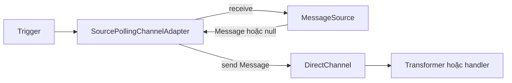
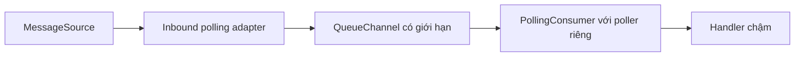

# Adapter với poller

## 1. Mục tiêu và bối cảnh

Trong chương **Channel adapter** của module **SPRING_INTEGRATION_CORE**, bài này hướng dẫn đưa dữ liệu từ một nguồn được thăm dò vào luồng thông điệp. Sau bài học, bạn có thể xác định vị trí cần poller, cấu hình lịch và số thông điệp mỗi lượt, giải thích đường đi của lỗi và viết kiểm thử có kiểm soát.

Giả sử một hệ thống bán hàng cũ chỉ cung cấp danh sách đơn chờ xử lý. Hệ thống đó không chủ động gửi sự kiện. Ứng dụng tích hợp cần định kỳ lấy đơn, chuyển thành `Message<Order>` rồi đưa vào channel để transformer, router, filter hoặc các endpoint khác xử lý. Gateway hữu ích khi có lời gọi chủ động từ ứng dụng; trường hợp này điểm khởi đầu là adapter được scheduler kích hoạt.

Bài sử dụng Java 17+ và cách cấu hình của Spring Integration 6.5.x làm mốc minh họa. Các dependency phải thuộc cùng bộ phiên bản tương thích do dự án quản lý; không trộn tùy ý Spring Framework, Spring Integration và Spring Boot. Ví dụ không yêu cầu kết nối cơ sở dữ liệu, máy chủ file hay dịch vụ bên ngoài.

## 2. Poller đứng ở đâu trong luồng?

Poller trả lời hai câu hỏi: **khi nào thử lấy dữ liệu** và **thực hiện bao nhiêu lần lấy trong một lượt**. Nó là cấu hình điều khiển hoạt động của polling endpoint, không phải một loại message channel.

Có hai tình huống polling và một tình huống nhận theo sự kiện:

| Tình huống | Endpoint chịu trách nhiệm | Đối tượng được đọc | Điều kiện kích hoạt |
| --- | --- | --- | --- |
| Đưa dữ liệu từ nguồn vào luồng | `SourcePollingChannelAdapter` | `MessageSource<?>` | Trigger của adapter |
| Lấy thông điệp đã nằm trong channel | `PollingConsumer` | `PollableChannel`, chẳng hạn `QueueChannel` | Trigger của consumer |
| Nhận thông điệp trên channel có cơ chế đăng ký | `EventDrivenConsumer` | `SubscribableChannel`, chẳng hạn `DirectChannel` | Một bên gửi thông điệp vào channel |

Phân biệt này được mô tả trong [tài liệu Poller của Spring Integration](https://docs.spring.io/spring-integration/reference/6.5/polling-consumer.html).



`MessageSource` là vai trò logic: nó có thể đọc một file, gọi một repository hoặc lấy một phần tử trong bộ nhớ. Poller không tự biết cách truy cập những tài nguyên đó; adapter và source đảm nhận việc chuyển kết quả thành thông điệp.

Một inbound adapter cần polling vì nguồn của nó cần được thăm dò, kể cả khi channel đầu ra là `DirectChannel`. Ngược lại, một outbound adapter nối với `DirectChannel` có thể xử lý ngay khi nhận thông điệp và không cần poller. Nếu đầu vào của outbound adapter là `QueueChannel`, consumer cần polling để lấy thông điệp ra.

Cũng không nên suy rằng mọi inbound adapter đều polling. Adapter nhận callback hoặc sự kiện từ hệ thống ngoài có mô hình kích hoạt riêng. Hãy xác định cơ chế của adapter cụ thể trước khi thêm poller.

## 3. Một lượt poll diễn ra như thế nào?

Với một inbound polling adapter, có thể hình dung quy trình sau:

1. Scheduler xác định đến thời điểm trigger cho phép thực thi.
2. Endpoint bắt đầu một lượt polling.
3. Endpoint gọi `MessageSource.receive()`.
4. Nếu nhận được `Message`, endpoint gửi nó vào output channel.
5. Nếu còn hạn mức của lượt hiện tại, endpoint tiếp tục lấy thông điệp.
6. Nếu source trả về `null`, lượt hiện tại kết thúc sớm; nếu có lỗi không được xử lý bên trong, lỗi đi qua cơ chế xử lý lỗi của poller.
7. Trigger quyết định lần thực thi kế tiếp.

Tài liệu [Channel Adapter](https://docs.spring.io/spring-integration/reference/6.5/channel-adapter.html) giải thích cách `SourcePollingChannelAdapter` lấy dữ liệu và giới hạn số lần nhận trong mỗi lượt.

### 3.1. Ý nghĩa của `null`

Trong hợp đồng `MessageSource.receive()`, `null` có nghĩa là **chưa có thông điệp trong lần nhận này**. Nó không phải thông điệp có payload rỗng và không tự làm adapter dừng vĩnh viễn.

```java
@Override
public Message<Order> receive() {
    Order order = pending.poll();
    return order == null
            ? null
            : MessageBuilder.withPayload(order).build();
}
```

Không bắt mọi ngoại lệ rồi trả `null`. Làm như vậy khiến lỗi kết nối trông giống nguồn đang trống và che mất tín hiệu vận hành cần thiết.

### 3.2. Một thông điệp có thể chứa nhiều bản ghi

Nếu source trả `Message<List<Order>>`, một lần `receive()` vẫn chỉ tạo một thông điệp. `maxMessagesPerPoll(3)` không có nghĩa là tối đa ba `Order` trong danh sách.

Khi muốn xử lý từng đơn độc lập, bạn có thể thiết kế source trả từng `Message<Order>`, hoặc dùng splitter sau adapter. Khi chọn cách thứ hai, cần tính thêm số thông điệp mà splitter tạo ra cho downstream.

### 3.3. Polling không cung cấp sẵn cơ chế xác nhận

Quy trình “đọc → gửi” không tự đảm bảo bản ghi sẽ được khôi phục nếu bước sau thất bại. Ví dụ `Queue.poll()` đã loại phần tử khỏi hàng đợi trong bộ nhớ. Nếu gửi thông điệp lỗi, phần tử đó không tự quay lại hàng đợi.

Do đó, ví dụ trong bộ nhớ giúp quan sát cơ chế polling; hệ thống thật còn cần thiết kế xác nhận, transaction hoặc cơ chế lấy lại dữ liệu theo đặc tính nguồn.

## 4. Chọn lịch: fixed delay, fixed rate và cron

| Lịch | Cách hiểu | Khi phù hợp |
| --- | --- | --- |
| Fixed delay | Chờ một khoảng sau khi lần thực thi trước hoàn tất | Muốn có khoảng nghỉ giữa các lượt |
| Fixed rate | Tính chu kỳ theo các mốc thực thi định kỳ | Muốn nhịp thăm dò tương đối đều |
| Cron | Tính thời điểm theo biểu thức lịch | Chỉ chạy trong các khung giờ nghiệp vụ |
| Custom trigger | Tự quyết định thời điểm tiếp theo | Có yêu cầu lịch thích ứng riêng |

Với polling chạy trực tiếp trên scheduler, không có `taskExecutor` riêng, giả sử một lượt mất 700 ms và khoảng cấu hình là 2 giây:

```text
Fixed delay:
0.0s bắt đầu → 0.7s xong → nghỉ 2s → 2.7s bắt đầu tiếp

Fixed rate, khi scheduler đáp ứng kịp:
0.0s bắt đầu → 0.7s xong → 2.0s bắt đầu tiếp
```

Fixed rate không tự có nghĩa là nhiều thông điệp được xử lý song song. Nếu tác vụ chậm hoặc scheduler bận, thời điểm thực tế có thể trễ. Khi cấu hình executor riêng cho poller, lịch còn chịu ảnh hưởng của việc bàn giao tác vụ sang executor; không áp dụng máy móc sơ đồ thời gian trên cho mô hình đó. Các khái niệm trigger và scheduler được trình bày trong [Task Execution and Scheduling](https://docs.spring.io/spring-framework/reference/integration/scheduling.html).

Các lựa chọn Java DSL sau là những phương án thay thế nhau:

```java
Pollers.fixedDelay(Duration.ofSeconds(2)).maxMessagesPerPoll(3);

Pollers.fixedRate(Duration.ofSeconds(2)).maxMessagesPerPoll(3);

Pollers.cron("0 */5 * * * *").maxMessagesPerPoll(3);
```

Biểu thức cron trên có sáu trường theo cú pháp Spring, bắt đầu bằng giây: chạy ở giây 0 của mỗi mốc 5 phút. Khi yêu cầu gắn với giờ Việt Nam, cần cấu hình múi giờ cho trigger thay vì phụ thuộc ngầm vào múi giờ máy chủ:

```java
import java.time.ZoneId;
import org.springframework.scheduling.support.CronTrigger;

Pollers.trigger(new CronTrigger(
        "0 */5 * * * *",
        ZoneId.of("Asia/Ho_Chi_Minh")))
    .maxMessagesPerPoll(3);
```

Lịch polling trong một ứng dụng không tự trở thành lịch duy nhất trên toàn cụm. Nếu triển khai ba replica cùng cấu hình, phải xem chúng có cùng truy cập một tập dữ liệu hay không.

## 5. Giới hạn một lượt bằng `maxMessagesPerPoll`

Đối với `SourcePollingChannelAdapter`:

| Giá trị | Hành vi |
| --- | --- |
| Số dương `N` | Nhận và chuyển tiếp tối đa `N` thông điệp trong một lượt; dừng sớm nếu gặp `null` |
| Số âm, thường dùng `-1` | Không đặt giới hạn số thông điệp; tiếp tục cho đến khi source trả `null` hoặc lượt bị gián đoạn bởi lỗi |
| `0` | Bỏ qua việc gọi source; trong Spring Integration từ 5.5, có thể dùng để tạm ngưng nhận khi thay đổi cấu hình runtime |
| Không chỉ định | Inbound polling adapter mặc định nhận tối đa một thông điệp mỗi lượt |

Mặc định của `PollingConsumer` lại là `-1`. Vì vậy, hãy đặt giới hạn tường minh để dễ đọc cấu hình và tránh thay đổi hành vi ngoài dự kiến khi đổi loại endpoint. Các giá trị và sự khác biệt mặc định được nêu trong [Channel Adapter — Poller Configuration](https://docs.spring.io/spring-integration/reference/6.5/channel-adapter.html).

Ví dụ source đang có năm đơn và giới hạn là ba:

```text
Lượt 1: nhận A → nhận B → nhận C → hết hạn mức
Lượt 2: nhận D → nhận E → nhận null → kết thúc sớm
Lượt 3: nhận null → kết thúc sớm
```

Đây là giới hạn của một lượt polling, không phải tổng số thông điệp suốt vòng đời adapter, không phải kích thước thread pool và không phải số phần tử trong payload dạng danh sách.

Giá trị `-1` cần được dùng có chủ đích. Một source liên tục sinh dữ liệu và không bao giờ trả `null` có thể giữ lượt polling chạy quá lâu. Với một nguồn sinh số ngẫu nhiên mỗi lần gọi, giới hạn hữu hạn thường dễ kiểm soát hơn.

Giả sử xử lý đồng bộ mỗi thông điệp mất trung bình 150 ms, giới hạn là 10 và fixed delay là 1 giây. Một ước lượng đơn giản khi nguồn luôn có dữ liệu là:

```text
Thời gian lượt ≈ 10 × 0,15 = 1,5 giây
Chu kỳ hoàn chỉnh ≈ 1,5 + 1 = 2,5 giây
Thông lượng ≈ 10 / 2,5 = 4 thông điệp/giây
```

Ước lượng này bỏ qua thời gian đọc nguồn, truyền dữ liệu và biến động tải. Nó cho thấy vì sao “poll mỗi giây” không đồng nghĩa “mỗi giây hoàn tất một lượt”, đồng thời giúp chọn giá trị ban đầu để đo thực tế.

## 6. Ví dụ đầy đủ bằng Java DSL

Ví dụ gồm nguồn đơn hàng trong bộ nhớ, một inbound adapter, `DirectChannel`, transformer và channel chứa kết quả để quan sát.

Để dùng với Spring Boot đã có dependency management tương thích, cần starter `org.springframework.boot:spring-boot-starter-integration`. Với ứng dụng Spring thuần, dùng `org.springframework.integration:spring-integration-core` cùng bộ dependency Spring tương thích. Java DSL thuộc core; không cần một artifact Java DSL riêng cho ví dụ này.

Lưu lớp ví dụ dưới tên `PollingOrdersConfiguration.java` trong một dự án Java đã cấu hình dependency:

```java
import java.math.BigDecimal;
import java.time.Duration;
import java.util.Queue;
import java.util.concurrent.ConcurrentLinkedQueue;

import org.springframework.context.annotation.Bean;
import org.springframework.context.annotation.Configuration;
import org.springframework.context.annotation.AnnotationConfigApplicationContext;
import org.springframework.integration.channel.DirectChannel;
import org.springframework.integration.channel.QueueChannel;
import org.springframework.integration.config.EnableIntegration;
import org.springframework.integration.core.MessageSource;
import org.springframework.integration.dsl.IntegrationFlow;
import org.springframework.integration.dsl.Pollers;
import org.springframework.integration.endpoint.SourcePollingChannelAdapter;
import org.springframework.integration.support.MessageBuilder;
import org.springframework.messaging.Message;

@Configuration(proxyBeanMethods = false)
@EnableIntegration
public class PollingOrdersConfiguration {

    public record Order(String id, BigDecimal total) { }

    public static class OrderSource implements MessageSource<Order> {
        private final Queue<Order> pending = new ConcurrentLinkedQueue<>();

        public void add(Order order) {
            pending.add(order);
        }

        @Override
        public Message<Order> receive() {
            Order order = pending.poll();
            if (order == null) {
                return null;
            }
            return MessageBuilder.withPayload(order)
                    .setHeader("orderId", order.id())
                    .setHeader("sourceSystem", "legacy-sales")
                    .build();
        }
    }

    @Bean
    public OrderSource orderSource() {
        return new OrderSource();
    }

    @Bean
    public DirectChannel orders() {
        return new DirectChannel();
    }

    @Bean
    public QueueChannel observedOrders() {
        return new QueueChannel(20);
    }

    @Bean
    public QueueChannel pollingErrors() {
        return new QueueChannel(20);
    }

    @Bean
    public IntegrationFlow ordersPollingFlow(OrderSource orderSource) {
        return IntegrationFlow
                .from(orderSource, endpoint -> endpoint
                        .id("ordersPollingAdapter")
                        .autoStartup(false)
                        .poller(Pollers.fixedDelay(Duration.ofSeconds(2))
                                .maxMessagesPerPoll(3)
                                .errorChannel("pollingErrors")))
                .channel("orders")
                .get();
    }

    @Bean
    public IntegrationFlow orderProcessingFlow() {
        return IntegrationFlow.from("orders")
                .<Order, String>transform(order ->
                        order.id() + ":" + order.total().toPlainString())
                .channel("observedOrders")
                .get();
    }

    public static void main(String[] args) {
        try (var context = new AnnotationConfigApplicationContext(
                PollingOrdersConfiguration.class)) {
            OrderSource source = context.getBean(OrderSource.class);
            for (int i = 1; i <= 5; i++) {
                source.add(new Order("ORD-" + i, new BigDecimal("100.00")));
            }

            QueueChannel output = context.getBean(
                    "observedOrders", QueueChannel.class);
            SourcePollingChannelAdapter adapter = context.getBean(
                    "ordersPollingAdapter", SourcePollingChannelAdapter.class);

            adapter.start();
            try {
                for (int i = 0; i < 5; i++) {
                    Message<?> message = output.receive(5_000);
                    if (message == null) {
                        throw new IllegalStateException("Không nhận đủ kết quả");
                    }
                    System.out.println(message.getPayload());
                }
            }
            finally {
                adapter.stop();
            }
        }
    }
}
```

Kết quả payload dự kiến:

```text
ORD-1:100.00
ORD-2:100.00
ORD-3:100.00
ORD-4:100.00
ORD-5:100.00
```

Ba đơn đầu được lấy trong lượt đầu; hai đơn còn lại được lấy trong lượt sau. Thời điểm in thực tế phụ thuộc scheduler và môi trường chạy.

Những điểm cần theo dõi trong ví dụ:

- `OrderSource` chỉ chịu trách nhiệm trả một thông điệp hoặc `null`.
- `.id("ordersPollingAdapter")` đặt tên endpoint để có thể điều khiển vòng đời.
- `.autoStartup(false)` cho phép nạp dữ liệu và chuẩn bị bộ quan sát trước khi gọi `start()`.
- Poller được gắn tại `.from(orderSource, ...)`, vì đây là vị trí nhận dữ liệu từ source.
- `orders` là `DirectChannel`, nên transformer chạy đồng bộ trong đường gọi của adapter.
- `observedOrders` là điểm quan sát; chương trình chính chủ động gọi `receive()`, vì vậy không cần tạo thêm consumer polling ở đây.

`@EnableIntegration` khởi tạo hạ tầng Spring Integration trong cấu hình Spring thuần này. Không cần thêm `@EnableScheduling` chỉ để poller Spring Integration hoạt động.

Các channel dạng queue trong ví dụ có dung lượng hữu hạn và chỉ phục vụ số lượng nhỏ dữ liệu minh họa. Nếu áp dụng cho luồng liên tục, phải có consumer rút kết quả và lỗi, đồng thời thiết kế timeout gửi phù hợp để tránh chờ khi queue đầy.

Factory `Pollers` và đối tượng cấu hình được mô tả trong [Java DSL — Pollers](https://docs.spring.io/spring-integration/reference/6.5/dsl/java-pollers.html).

## 7. Cấu hình bằng annotation và default poller

### 7.1. Annotation cho nguồn đơn giản

Đây là phương án thay cho inbound flow ở trên. Đặt phương thức sau trong một Spring bean được quản lý, với bean `orderSource` và channel `orders` đã tồn tại:

```java
import org.springframework.integration.annotation.InboundChannelAdapter;
import org.springframework.integration.annotation.Poller;
import org.springframework.messaging.Message;

@InboundChannelAdapter(
        channel = "orders",
        poller = @Poller(
                fixedDelay = "2000",
                maxMessagesPerPoll = "3",
                errorChannel = "pollingErrors"))
public Message<PollingOrdersConfiguration.Order> nextOrder() {
    return orderSource.receive();
}
```

Ở đây `orderSource` là field được inject kiểu `PollingOrdersConfiguration.OrderSource`. Con số `2000` trong cấu hình này là mili giây. Có thể dùng placeholder để đưa cấu hình ra môi trường:

```java
@Poller(
        fixedDelay = "${orders.poll.delay-ms:2000}",
        maxMessagesPerPoll = "${orders.poll.max-messages:3}")
```

Không đăng ký đồng thời cả annotation adapter và DSL adapter nếu bạn chỉ muốn một endpoint đọc nguồn. Hai khai báo là hai consumer riêng, không phải hai cách diễn đạt tự động hợp nhất. Xem cơ chế annotation và placeholder trong [Annotation Support](https://docs.spring.io/spring-integration/reference/6.5/configuration/annotations.html).

### 7.2. Default poller dùng chung

Khi nhiều endpoint thật sự có chung chính sách, có thể khai báo một default poller:

```java
import java.time.Duration;

import org.springframework.context.annotation.Bean;
import org.springframework.integration.dsl.PollerSpec;
import org.springframework.integration.dsl.Pollers;
import org.springframework.integration.scheduling.PollerMetadata;

@Bean(name = PollerMetadata.DEFAULT_POLLER)
public PollerSpec defaultPoller() {
    return Pollers.fixedDelay(Duration.ofSeconds(2))
            .maxMessagesPerPoll(3);
}
```

Endpoint không có poller riêng có thể dùng cấu hình mặc định đó. Chỉ khai báo một default poller trong application context. Với một endpoint có yêu cầu riêng, cấu hình local giúp thể hiện rõ ý định.

Khi trả `PollerSpec` từ phương thức `@Bean`, trả trực tiếp spec để Spring thực hiện vòng đời `FactoryBean`; không tự gọi `getObject()` trong phương thức đó. Xem [hướng dẫn cấu hình PollerSpec](https://docs.spring.io/spring-integration/reference/6.5/dsl/java-pollers.html).

Default poller cung cấp metadata chung; không có nghĩa mọi endpoint chia sẻ một tiến trình polling duy nhất hoặc lần lượt dùng chung một hạn mức toàn hệ thống.

## 8. Outbound adapter có cần poller không?

Giả sử phải gửi đơn đã chuẩn hóa sang một hệ thống khác. Nếu đầu vào là `DirectChannel`, handler nhận ngay trong lúc bên gửi gọi `send()`. Nếu đầu vào là `QueueChannel`, cần endpoint lấy thông điệp từ queue rồi gọi handler.

Ví dụ độc lập dưới đây dùng kiểu `Order` ở phần trước. Bean `legacySender` là đối tượng do ứng dụng cung cấp, có phương thức `void send(Order order)`:

```java
@Bean
public QueueChannel outboundOrders() {
    return new QueueChannel(100);
}

@Bean
public IntegrationFlow legacyOutboundFlow(LegacySender legacySender) {
    return IntegrationFlow.from("outboundOrders")
            .handle(legacySender, "send", endpoint -> endpoint
                    .id("legacyOutboundAdapter")
                    .poller(Pollers.fixedDelay(Duration.ofMillis(500))
                            .maxMessagesPerPoll(5)
                            .receiveTimeout(100)
                            .errorChannel("outboundErrors")))
            .get();
}
```

Cần khai báo channel `outboundErrors` và consumer xử lý lỗi tương ứng trong ứng dụng. Ví dụ này là một cấu hình bổ sung, không phải phần tự động có sẵn của lớp minh họa trước.

Điểm khác biệt nằm ở vị trí poller: poller gắn vào consumer `.handle(...)`, vì consumer đọc `outboundOrders`. Nó không làm hệ thống đích tự được gọi theo lịch khi queue không có thông điệp.

`receiveTimeout(100)` giới hạn thời gian chờ của thao tác nhận từ channel trong ví dụ. Nó không đặt timeout kết nối hoặc timeout đọc của HTTP client, JDBC driver hay SFTP client. API mô tả riêng các thuộc tính này trong [PollerSpec](https://docs.spring.io/spring-integration/api/org/springframework/integration/dsl/PollerSpec.html).

Với `MessageSource` chỉ hỗ trợ `receive()` và trả ngay, tăng `receiveTimeout` không biến thao tác đó thành blocking hay giới hạn thời gian I/O. Timeout truy cập hệ thống ngoài phải cấu hình tại client hoặc adapter tương ứng.

## 9. Thread, độ trễ và áp lực lên downstream

Trong ví dụ chính, đường xử lý là:

```text
Thread polling
  → source.receive()
  → DirectChannel.send()
  → transformer
  → đưa kết quả vào observedOrders
  → quay lại vòng nhận kế tiếp
```

Nếu transformer mất nhiều thời gian, lượt polling cũng mất nhiều thời gian. Có thể cân nhắc tách bước xử lý nặng, nhưng phải hiểu hệ quả của ranh giới bất đồng bộ:



Khi adapter gửi thành công vào queue, điều đó chỉ chứng minh thông điệp đã được bàn giao vào queue. Nó chưa chứng minh handler phía sau hoàn tất nghiệp vụ. Nếu không cấu hình persistent message store, `QueueChannel` thông thường cũng không phải nơi lưu trữ bền vững khi tiến trình dừng.

Một cách chọn cấu hình ban đầu cho tình huống thực tế là ghi rõ các giả định:

| Giả định vận hành | Quyết định cần cân nhắc |
| --- | --- |
| Hệ thống nguồn chỉ chấp nhận ít yêu cầu mỗi giây | Tăng khoảng polling; đo cả số lần đọc rỗng |
| Downstream xử lý chậm và không chịu được burst lớn | Giới hạn lượt; giới hạn queue; kiểm soát tốc độ lấy |
| Source có backlog lớn nhưng mỗi lần đọc nhanh | Tăng hạn mức từng bước và đo thời gian mỗi lượt |
| Cần giữ thứ tự theo một đơn hàng | Tránh thêm concurrency tùy tiện; cân nhắc phân vùng theo khóa |
| Nhiều replica có thể đọc cùng bản ghi | Thiết kế claim, khóa hoặc chia phân vùng tại nguồn |

Spring Integration cho phép cấu hình `taskExecutor` cho poller. Khi làm vậy, phải điều chỉnh đồng thời chu kỳ, số worker và dung lượng hàng đợi tác vụ. Scheduler có thể tiếp tục bàn giao tác vụ trong lúc các worker còn bận, làm backlog tăng. Cấu hình executor cũng không tự làm source hay handler an toàn khi truy cập đồng thời. Xem [Message Endpoints — TaskExecutor Support và Asynchronous Polling](https://docs.spring.io/spring-integration/reference/6.5/endpoint.html).

Đừng chọn executor chỉ dựa trên mong muốn “chạy nhanh hơn”. Trước tiên cần biết thời gian nằm ở đọc nguồn, biến đổi dữ liệu, gọi hệ thống đích hay chờ queue. Kết quả đo đó mới cho biết có nên tăng song song hoặc giảm tốc độ lấy dữ liệu.

## 10. Xử lý lỗi: phân biệt lỗi lấy dữ liệu và lỗi xử lý

Có ít nhất hai điểm thất bại:

| Điểm lỗi | Ví dụ | Thông tin có thể có |
| --- | --- | --- |
| Trước khi tạo được message | Repository mất kết nối trong `receive()` | Ngoại lệ nguồn; có thể chưa có `failedMessage` |
| Sau khi nhận được message | Transformer không đọc được dữ liệu; handler từ chối đơn | Ngoại lệ xử lý và thường có thông điệp liên quan |

Với tác vụ polling được lập lịch, cơ chế xử lý lỗi có thể chuyển ngoại lệ thành `ErrorMessage`. Trong ví dụ chính, `.errorChannel("pollingErrors")` chỉ định nơi nhận lỗi của poller. Không nên giả định mọi exception trong mọi thread đều tự đi vào cùng channel này. Xem [Error Handling](https://docs.spring.io/spring-integration/reference/6.5/error-handling.html).

Ví dụ quan sát lỗi sau khi đã chủ động tạo một tình huống lỗi trong source hoặc transformer:

```java
import org.springframework.messaging.support.ErrorMessage;

QueueChannel errors = context.getBean("pollingErrors", QueueChannel.class);
Message<?> message = errors.receive(2_000);

if (message instanceof ErrorMessage errorMessage) {
    Throwable failure = errorMessage.getPayload();
    System.err.println(failure.getMessage());
}
```

Trong ứng dụng chạy lâu dài, hãy có consumer đọc error channel và lưu thông tin đủ để điều tra hoặc tái xử lý. Chỉ khai báo queue lỗi mà không rút dữ liệu ra sẽ làm lỗi tích tụ.

Khi chuyển sang `QueueChannel` ở giữa luồng, lỗi của consumer phía sau cần được xử lý tại ranh giới consumer đó. Bên gửi vào queue đã hoàn tất lời gọi gửi; ngoại lệ ở thread khác không thể quay ngược qua call stack cũ.

### 10.1. Một lượt poll mới không đồng nghĩa retry thông điệp cũ

Nếu source lỗi trước khi lấy dữ liệu, lượt sau có thể thử đọc lại. Nhưng nếu source đã đánh dấu bản ghi là xử lý xong rồi handler mới lỗi, lượt sau có thể không còn đọc được bản ghi đó.

Thiết kế retry phải chỉ rõ:

- Thao tác nào được chạy lại: đọc source, gọi handler hay toàn bộ một đoạn flow.
- Ngoại lệ nào là tạm thời, ngoại lệ nào là lỗi dữ liệu.
- Số lần thử, thời gian chờ và điểm chuyển sang xử lý thủ công.
- Khóa nghiệp vụ dùng để tránh thực hiện tác dụng phụ nhiều lần.

Ví dụ, timeout khi gửi yêu cầu thanh toán có thể xảy ra sau khi phía nhận đã ghi nhận thanh toán. Nếu chạy lại, khóa idempotency của giao dịch có giá trị hơn việc chỉ tăng số lần retry.

## 11. Transaction và tính nhất quán dữ liệu

Một vấn đề thường gặp với nguồn cơ sở dữ liệu:

```text
Đọc đơn NEW
→ đánh dấu DONE
→ gửi sang hệ thống ngoài
→ mất kết nối khi gửi
```

Nếu không có thiết kế khôi phục, đơn có thể bị bỏ qua trong các lượt sau dù chưa hoàn tất nghiệp vụ.

Poller có thể được cấu hình transaction để bao gồm thao tác nhận từ tài nguyên có hỗ trợ transaction và phần xử lý đồng bộ liên quan. Với Java DSL, khi đã có transaction manager thích hợp:

```java
Pollers.fixedDelay(Duration.ofSeconds(2))
        .maxMessagesPerPoll(3)
        .transactional(transactionManager);
```

Cần hiểu giới hạn:

- Resource và thao tác dữ liệu phải thực sự tham gia transaction manager đó.
- Transaction gắn với thread không tự đi qua ranh giới `QueueChannel` hoặc `ExecutorChannel`.
- Một transaction cơ sở dữ liệu không tự rollback được tác dụng phụ của một HTTP request đã được hệ thống khác chấp nhận.
- Không suy rằng `maxMessagesPerPoll(3)` tạo một transaction nguyên tử chung cho ba thông điệp; phải xem ranh giới receive-and-send và advice thực tế của endpoint.

Cơ chế và ranh giới này được trình bày trong [Transaction Support](https://docs.spring.io/spring-integration/reference/6.5/transactions.html).

Với nguồn thật, có thể thiết kế một vòng đời như `NEW → PROCESSING → DONE`, trong đó thao tác claim phải nguyên tử giữa các worker. Cần có cách xử lý bản ghi kẹt ở `PROCESSING`, chẳng hạn lease có thời hạn và quy trình lấy lại. Đây là lựa chọn thiết kế của hệ thống, không phải tính năng tự xuất hiện khi thêm poller.

Nếu nghiệp vụ phải cập nhật cơ sở dữ liệu và phát sự kiện đáng tin cậy, hãy đánh giá mẫu transactional outbox. Nếu phía nhận có thể thấy cùng một đơn nhiều lần, dùng khóa nghiệp vụ ổn định để xử lý idempotent. Poller chỉ là một thành phần trong cơ chế đảm bảo xử lý này.

## 12. Kiểm thử polling với lịch được kiểm soát

Nên tách mục tiêu kiểm thử:

| Mục tiêu | Cách tiếp cận |
| --- | --- |
| Hợp đồng source | Gọi `receive()` với dữ liệu có sẵn và khi rỗng |
| Hạn mức một lượt | Dùng trigger chỉ chạy một lần và đếm thông điệp |
| Nhánh lỗi | Cho source hoặc downstream ném exception rồi đọc error channel |
| Lifecycle | Kiểm soát thời điểm `start()` và `stop()` |
| Tích hợp với hệ thống ngoài | Kiểm thử thêm cơ chế claim, ack và timeout bằng môi trường phù hợp |

Thay vì ngủ một khoảng rồi đoán scheduler đã chạy đủ hay chưa, có thể dùng `OnlyOnceTrigger` để giới hạn một lần kích hoạt. Tiện ích này thuộc hỗ trợ kiểm thử Spring Integration; xem [Testing support — OnlyOnceTrigger](https://docs.spring.io/spring-integration/reference/6.5/testing.html).

Ví dụ JUnit 5 dưới đây độc lập với lớp cấu hình chính. Nó cần `spring-integration-test` và JUnit Jupiter ở test scope, dùng phiên bản tương thích với core:

```java
import static org.junit.jupiter.api.Assertions.assertEquals;
import static org.junit.jupiter.api.Assertions.assertNotNull;
import static org.junit.jupiter.api.Assertions.assertNull;

import java.util.Queue;
import java.util.concurrent.ConcurrentLinkedQueue;
import java.util.concurrent.atomic.AtomicInteger;

import org.junit.jupiter.api.Test;
import org.springframework.context.annotation.AnnotationConfigApplicationContext;
import org.springframework.context.annotation.Bean;
import org.springframework.context.annotation.Configuration;
import org.springframework.integration.channel.QueueChannel;
import org.springframework.integration.config.EnableIntegration;
import org.springframework.integration.core.MessageSource;
import org.springframework.integration.dsl.IntegrationFlow;
import org.springframework.integration.dsl.Pollers;
import org.springframework.integration.endpoint.SourcePollingChannelAdapter;
import org.springframework.integration.support.MessageBuilder;
import org.springframework.integration.test.util.OnlyOnceTrigger;

class AdapterWithPollerTest {

    @Configuration(proxyBeanMethods = false)
    @EnableIntegration
    static class TestFlow {
        final Queue<String> pending = new ConcurrentLinkedQueue<>();
        final AtomicInteger receiveCalls = new AtomicInteger();

        @Bean
        OnlyOnceTrigger trigger() {
            return new OnlyOnceTrigger();
        }

        @Bean
        QueueChannel results() {
            return new QueueChannel(10);
        }

        @Bean
        MessageSource<String> source() {
            return () -> {
                receiveCalls.incrementAndGet();
                String value = pending.poll();
                return value == null
                        ? null
                        : MessageBuilder.withPayload(value).build();
            };
        }

        @Bean
        IntegrationFlow flow(MessageSource<String> source,
                             OnlyOnceTrigger trigger) {
            return IntegrationFlow.from(source, endpoint -> endpoint
                            .id("testAdapter")
                            .autoStartup(false)
                            .poller(Pollers.trigger(trigger)
                                    .maxMessagesPerPoll(3)))
                    .channel("results")
                    .get();
        }
    }

    @Test
    void oneTriggerReceivesAtMostThreeMessages() {
        try (var context = new AnnotationConfigApplicationContext(TestFlow.class)) {
            TestFlow fixture = context.getBean(TestFlow.class);
            fixture.pending.addAll(java.util.List.of("A", "B", "C", "D"));
            QueueChannel output = context.getBean("results", QueueChannel.class);
            SourcePollingChannelAdapter adapter = context.getBean(
                    "testAdapter", SourcePollingChannelAdapter.class);

            adapter.start();
            try {
                for (String expected : java.util.List.of("A", "B", "C")) {
                    var message = output.receive(2_000);
                    assertNotNull(message);
                    assertEquals(expected, message.getPayload());
                }
                assertNull(output.receive(100));
                assertEquals(3, fixture.receiveCalls.get());
                assertEquals("D", fixture.pending.peek());
            }
            finally {
                adapter.stop();
            }
        }
    }
}
```

`OnlyOnceTrigger` tạo một lần kích hoạt, còn `maxMessagesPerPoll(3)` cho phép ba lần nhận trong lần kích hoạt đó. Đây là hai tầng kiểm soát khác nhau. Các lệnh `receive(timeout)` chỉ chờ kết quả trong giới hạn kiểm thử; giá trị cụ thể có thể điều chỉnh cho môi trường CI.

Các trường hợp nên bổ sung khi áp dụng vào bài toán thật:

- Source chỉ có hai phần tử: nhận hai thông điệp rồi một lần `null`, lượt kết thúc trước hạn mức ba.
- Source luôn rỗng: không có message đầu ra và không phát lỗi chỉ vì trả `null`.
- Source lỗi trước khi tạo message: error channel có ngoại lệ nhưng không mặc định có thông điệp thất bại.
- Handler lỗi sau khi đọc một phần tử: xác minh cơ chế khôi phục thực tế của nguồn.
- Nhiều instance cùng đọc: xác minh một bản ghi chỉ được claim bởi worker hợp lệ.

## 13. Vận hành và chẩn đoán

Đặt tên endpoint rõ ràng giúp truy tìm cấu hình và điều khiển vòng đời. Ví dụ chính dùng `ordersPollingAdapter`; ứng dụng có thể lấy bean đó để gọi `start()` hoặc `stop()` khi cần. Dừng polling không có nghĩa tự hoàn tác những tác dụng phụ đã xảy ra; lời gọi I/O đang chạy còn chịu quy tắc timeout và shutdown của thành phần tương ứng.

Một bảng quan sát nhỏ thường đủ để nhận biết hướng điều tra:

| Dấu hiệu | Điều cần kiểm tra |
| --- | --- |
| Không có thông điệp, không thấy lỗi | Endpoint đã start chưa; trigger có đúng giờ không; source có trả `null` không |
| Có dữ liệu tồn nhưng mỗi lượt chỉ lấy một message | Giá trị `maxMessagesPerPoll` của inbound adapter |
| Polling dường như không nghỉ | Source có luôn trả dữ liệu và hạn mức có đang là `-1` không |
| Đổi `receiveTimeout` nhưng HTTP vẫn treo | Timeout kết nối/đọc của HTTP client |
| Dữ liệu vào queue tăng, kết quả xử lý không tăng | Tốc độ consumer, poller phía consumer và dung lượng queue |
| Không thấy lỗi ở poller đầu luồng | Có ranh giới bất đồng bộ; kiểm tra consumer và error channel phía sau |
| Nhiều replica tạo kết quả trùng | Cơ chế claim, khóa, phân vùng và idempotency |

Khi theo dõi tải, nên tách số lượt polling, số lần đọc rỗng, số message nhận được, thời gian một lượt, số lỗi và tuổi bản ghi chờ lâu nhất. Chỉ nhìn số lượt polling thành công có thể bỏ sót việc source liên tục trả `null` trong khi dữ liệu bị kẹt do sai điều kiện truy vấn.

## 14. Bài thực hành

Dựa trên ví dụ chính, thực hiện lần lượt:

1. Nạp bảy đơn, đặt `maxMessagesPerPoll(2)` và giải thích số lượt có dữ liệu tối thiểu cần thiết.
2. Thêm bộ đếm vào `receive()`; phân biệt số lần trả message và số lần trả `null`.
3. Cho transformer ném lỗi với `ORD-3`; đọc error channel rồi kiểm tra nguồn trong bộ nhớ còn phần tử nào. Giải thích vì sao không được kỳ vọng `ORD-3` tự xuất hiện lại.
4. Thay `DirectChannel` giữa source và xử lý bằng `QueueChannel`, rồi cấu hình poller cho consumer đầu tiên đọc queue đó.
5. Viết một kiểm thử dùng `OnlyOnceTrigger` cho trường hợp source trả `null` trước khi đạt hạn mức.

Kết quả mong đợi ở bước một là bốn lượt có dữ liệu, với số lượng lần lượt `2, 2, 2, 1`, trong điều kiện không có lỗi và không có dữ liệu mới được thêm. Ở bước bốn, hãy mô tả riêng thời điểm adapter giao thành công vào queue và thời điểm consumer hoàn tất xử lý.

## 15. Ghi nhớ

- Xác định endpoint đang đọc source hay đọc channel trước khi đặt poller.
- Trigger chọn thời điểm; `maxMessagesPerPoll` giới hạn công việc trong một lượt; hai thiết lập không thay thế nhau.
- `null` kết thúc lượt hiện tại, không phải dừng adapter vĩnh viễn.
- Chọn giới hạn hữu hạn ban đầu, quan sát thời gian xử lý rồi điều chỉnh theo tải thực tế.
- Phân định ranh giới thread để hiểu lỗi và transaction đi đến đâu.
- Thiết kế retry, khôi phục và chống xử lý trùng theo tài nguyên thật; lịch polling không tự cung cấp các bảo đảm đó.
