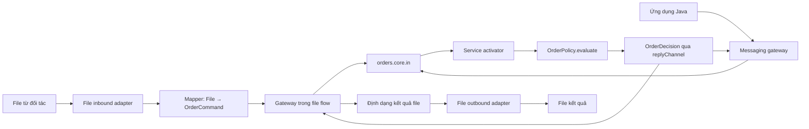

# Tách adapter khỏi core handler

Trong module **SPRING_INTEGRATION_CORE**, mục tiêu của bài này là thiết kế một luồng thông điệp mà phần giao tiếp với hệ thống bên ngoài có thể thay đổi mà không làm thay đổi quy tắc nghiệp vụ. Chủ đề thuộc chương **Channel adapter**, gắn trực tiếp với cách dùng `Message`, `MessageChannel`, endpoint, gateway và Java DSL.

Ví dụ xuyên suốt là tiếp nhận đơn hàng, quyết định đơn được duyệt tự động hay cần xem xét, rồi chuyển kết quả về nơi gọi. Đơn hàng có thể đến từ file hoặc từ một lời gọi Java qua messaging gateway. Cả hai đường vào sử dụng cùng một core handler.

## 1. Kết quả cần đạt

Sau bài học, bạn có thể:

- Phân biệt trách nhiệm của adapter, lớp điều phối thông điệp và core nghiệp vụ.
- Xây dựng hợp đồng đầu vào, đầu ra ổn định thay cho việc truyền `File`, HTTP request hoặc đối tượng thư viện giao thức vào core.
- Gắn một POJO vào luồng bằng service activator và Java DSL.
- Dùng gateway để tái sử dụng core flow mà vẫn đưa kết quả về đúng nơi gọi.
- Phân bổ trách nhiệm kiểm tra dữ liệu, xử lý lỗi, retry và chống xử lý trùng.
- Kiểm thử core, mapping, cấu hình flow và adapter theo những phạm vi riêng.

Kiến thức nền cần có là payload/header của `Message`, thao tác gửi vào channel và khác biệt cơ bản giữa xử lý đồng bộ với xử lý qua hàng đợi.

## 2. Hiểu đúng adapter, endpoint và core handler

### 2.1. Channel adapter nằm ở ranh giới giao tiếp

Channel adapter nối message channel với hệ thống hoặc tài nguyên bên ngoài. Inbound adapter đưa dữ liệu vào hệ thống thông điệp; outbound adapter đưa dữ liệu từ channel ra ngoài. Ví dụ là nhận file, đọc từ broker hoặc ghi kết quả ra một thư mục. [Spring Integration — Overview](https://docs.spring.io/spring-integration/reference/overview.html).

Hướng inbound/outbound được nhìn từ ứng dụng đang xây dựng. Một tiến trình đối tác ghi file; ứng dụng của ta đọc file đó bằng inbound adapter. Khi ứng dụng ghi kết quả cho đối tác, phía ghi là outbound adapter.

Một adapter có thể bao gồm nhiều thành phần phối hợp:

```text
Kết nối tài nguyên bên ngoài
    → đọc dữ liệu
    → giải mã định dạng
    → ánh xạ sang hợp đồng nội bộ
    → gửi vào channel
```

Không cần nhồi tất cả công việc vào một lớp. Trong Java DSL, file adapter, transformer và header enricher có thể là các endpoint riêng nhưng cùng thuộc một ranh giới giao tiếp về mặt kiến trúc.

### 2.2. Core handler là vai trò kiến trúc

Trong bài này, **core handler** là đối tượng thực thi ca sử dụng hoặc quy tắc nghiệp vụ. Đây không phải tên một interface bắt buộc của Spring Integration.

Core handler có thể là một POJO:

```java
public OrderDecision evaluate(OrderCommand command) {
    // Áp dụng chính sách nghiệp vụ.
}
```

Nó không bắt buộc phải:

- Implement `org.springframework.messaging.MessageHandler`.
- Nhận `Message<?>` hoặc đọc các header giao thức.
- Biết tên channel, vị trí thư mục, địa chỉ broker hay HTTP status.

Service activator làm cầu nối từ message đến lời gọi phương thức của POJO. Java DSL biểu diễn việc này qua `.handle(...)`. [Spring Integration — Service Activators and the .handle() method](https://docs.spring.io/spring-integration/reference/dsl/java-handle.html).

Nếu nghiệp vụ cần lưu dữ liệu hoặc gọi một dịch vụ khác, core có thể phụ thuộc vào interface do ứng dụng định nghĩa. Lớp triển khai interface đó thực hiện JDBC, HTTP hay giao thức tương ứng. Tách adapter không có nghĩa mọi nghiệp vụ đều phải là hàm thuần; điều cần giữ là phụ thuộc đi qua một hợp đồng có ý nghĩa nghiệp vụ.

### 2.3. Tách ba trách nhiệm

| Phần | Trả lời câu hỏi | Ví dụ |
| --- | --- | --- |
| Adapter và mapper ở biên | Giao tiếp bằng cách nào, dữ liệu bên ngoài được hiểu ra sao? | Poll thư mục; đọc UTF-8; parse `ORD-1001\|1250000` |
| Lớp điều phối thông điệp | Dữ liệu đi qua đâu, gọi thành phần nào, trả lời thế nào? | Channel; transformer; service activator; gateway; router |
| Core nghiệp vụ | Với một yêu cầu hợp lệ, quyết định nghiệp vụ là gì? | Đơn trên 50 triệu VND cần xem xét |

Tên lớp hoặc tên package chỉ giúp tổ chức. Ranh giới thực sự thể hiện ở kiểu tham số, kiểu kết quả, phụ thuộc và cách các phần được kiểm thử.

## 3. Dấu hiệu adapter đang lấn vào core

Xem đoạn mã minh họa thiết kế bị trộn trách nhiệm sau. Đây là ví dụ để phân tích, không thuộc bộ mã triển khai ở các mục sau.

```java
public void handle(Message<File> message) throws IOException {
    File source = message.getPayload();
    String text = java.nio.file.Files.readString(source.toPath());
    String[] fields = text.strip().split("\\|");

    String orderId = fields[0];
    BigDecimal total = new BigDecimal(fields[1]);

    String status = total.compareTo(new BigDecimal("50000000")) <= 0
            ? "APPROVED"
            : "REVIEW_REQUIRED";

    java.nio.file.Files.writeString(
            Path.of("data/out", orderId + ".decision"),
            orderId + "|" + status
    );
}
```

Phương thức này biết cả kiểu message, tài nguyên file, định dạng bản ghi, quy tắc phê duyệt và nơi lưu kết quả. Hệ quả là:

- Đổi file sang HTTP buộc phải chỉnh lại đối tượng chứa chính sách phê duyệt.
- Kiểm thử điều kiện 50 triệu phải chuẩn bị filesystem.
- Lỗi đọc file, lỗi parse và lỗi xử lý nghiệp vụ khó được phân loại.
- Retry cả phương thức có thể lặp lại tác dụng phụ khi phần đầu đã thành công.
- Đường dẫn và cách đặt tên file trở thành chi tiết mà nghiệp vụ phải hiểu.

Cách xử lý là xác định hợp đồng nội bộ trước, rồi để từng thành phần thực hiện đúng phần việc của mình.

## 4. Kiến trúc đích và chiều phụ thuộc



Sơ đồ biểu diễn hai lời gọi độc lập. Mỗi gateway có đường trả lời riêng; một kết quả không đồng thời được gửi cho cả hai gateway.

Hợp đồng tại ranh giới core là:

```text
OrderCommand → OrderDecision
```

Chiều phụ thuộc mã nguồn nên đi như sau:

```text
file adapter ─────┐
                 ├──→ hợp đồng core và core nghiệp vụ
integration config┤
Java gateway ────┘

core nghiệp vụ ─────→ Java chuẩn và các interface nghiệp vụ cần thiết
```

Core không import ngược cấu hình flow hoặc lớp adapter. Cấu hình Spring là nơi lắp ráp các phần.

## 5. Xây dựng hợp đồng nghiệp vụ ổn định

### 5.1. Quy ước cho ví dụ

Ta chọn một hợp đồng nhỏ, đủ làm rõ ranh giới:

| Nội dung | Quy ước |
| --- | --- |
| Mã đơn | 1–40 ký tự; chữ in hoa, chữ số hoặc dấu `-`; ký tự đầu là chữ hoặc số |
| Tổng tiền | Số dương, tính bằng VND, không có phần lẻ có giá trị |
| Duyệt tự động | Tổng tiền nhỏ hơn hoặc bằng `50000000` |
| Cần xem xét | Tổng tiền lớn hơn `50000000` |
| Đầu vào file | Mỗi file chứa đúng một bản ghi `orderId\|total` |
| Đầu ra file | Một bản ghi `orderId\|status` |

Đây là chính sách của ví dụ, không phải mặc định do Spring Integration cung cấp. Khi bài toán có nhiều tiền tệ, hợp đồng cần mang thêm tiền tệ và quy tắc làm tròn rõ ràng.

Các đoạn mã triển khai dưới đây dùng cú pháp Spring Integration Java DSL hiện đại, với `record` của Java. Chọn JDK và phiên bản dependency tương thích theo BOM của ứng dụng; không ghép tùy ý các phiên bản Spring Framework, Spring Integration và Spring Boot.

Các artifact cần cho ví dụ:

- `org.springframework.integration:spring-integration-core`.
- `org.springframework.integration:spring-integration-file` khi dùng đường vào/ra file.
- JUnit Jupiter cho các ví dụ kiểm thử.

Ví dụ dùng cấu hình Spring trực tiếp, không yêu cầu Spring Boot. Mỗi kiểu `public` bên dưới nằm trong một file Java tương ứng; mã được trình bày trong bài để học và ghép vào một ứng dụng.

### 5.2. Command giữ các bất biến dùng chung

```java
package example.order.core;

import java.math.BigDecimal;
import java.math.RoundingMode;
import java.util.Objects;

public record OrderCommand(String orderId, BigDecimal total) {

    public OrderCommand {
        Objects.requireNonNull(orderId, "orderId");
        Objects.requireNonNull(total, "total");

        orderId = orderId.strip();

        if (!orderId.matches("[A-Z0-9][A-Z0-9-]{0,39}")) {
            throw new IllegalArgumentException("Mã đơn không hợp lệ");
        }

        if (total.signum() <= 0) {
            throw new IllegalArgumentException("Tổng tiền phải lớn hơn 0");
        }

        try {
            total = total.setScale(0, RoundingMode.UNNECESSARY);
        }
        catch (ArithmeticException ex) {
            throw new IllegalArgumentException(
                    "Tổng tiền VND phải có giá trị nguyên", ex);
        }
    }
}
```

`setScale(0, UNNECESSARY)` cho phép biểu diễn như `1250000.00` vì không mất giá trị, nhưng từ chối `1250000.50`. Hợp đồng không phụ thuộc việc số tiền được đọc từ file hay được tạo trực tiếp bằng Java.

### 5.3. Kết quả thể hiện quyết định

```java
package example.order.core;

public enum DecisionStatus {
    APPROVED,
    REVIEW_REQUIRED
}
```

```java
package example.order.core;

public record OrderDecision(String orderId, DecisionStatus status) {
}
```

`REVIEW_REQUIRED` là kết quả nghiệp vụ bình thường. Không cần ném exception chỉ vì đơn vượt hạn mức duyệt tự động.

### 5.4. Core handler không biết giao thức

```java
package example.order.core;

import java.math.BigDecimal;
import java.util.Objects;

public final class OrderPolicy {

    private static final BigDecimal AUTO_APPROVAL_LIMIT =
            new BigDecimal("50000000");

    public OrderDecision evaluate(OrderCommand command) {
        Objects.requireNonNull(command, "command");

        DecisionStatus status =
                command.total().compareTo(AUTO_APPROVAL_LIMIT) <= 0
                        ? DecisionStatus.APPROVED
                        : DecisionStatus.REVIEW_REQUIRED;

        return new OrderDecision(command.orderId(), status);
    }
}
```

`OrderPolicy` không có trạng thái thay đổi theo từng yêu cầu, nên có thể dùng lại một instance cho nhiều lời gọi. Với core có trạng thái hoặc truy cập dữ liệu, cần xem xét thread safety và ranh giới transaction riêng.

Điểm kiểm tra ranh giới là: để chạy `evaluate`, ta chỉ cần tạo `OrderCommand` và gọi một phương thức Java.

## 6. Gắn core vào Spring Integration

Đăng ký một channel đầu vào và dùng service activator gọi POJO:

```java
package example.order.integration;

import example.order.core.OrderPolicy;
import org.springframework.context.annotation.Bean;
import org.springframework.context.annotation.Configuration;
import org.springframework.integration.channel.DirectChannel;
import org.springframework.integration.config.EnableIntegration;
import org.springframework.integration.dsl.IntegrationFlow;
import org.springframework.messaging.MessageChannel;

@Configuration
@EnableIntegration
public class OrderCoreFlowConfig {

    @Bean("orders.core.in")
    public MessageChannel orderCoreInput() {
        return new DirectChannel();
    }

    @Bean
    public OrderPolicy orderPolicy() {
        return new OrderPolicy();
    }

    @Bean
    public IntegrationFlow orderCoreFlow(OrderPolicy orderPolicy) {
        return IntegrationFlow.from("orders.core.in")
                .handle(orderPolicy, "evaluate",
                        endpoint -> endpoint
                                .id("orderPolicyEndpoint")
                                .requiresReply(true))
                .get();
    }
}
```

Luồng này có một điểm vào rõ ràng và không gắn cứng một outbound adapter. `requiresReply(true)` làm lỗi lộ ra nếu phương thức kết thúc mà không trả kết quả. Khi không cấu hình output channel, service activator có thể trả kết quả qua header `replyChannel` của yêu cầu. [Spring Integration — Service Activator](https://docs.spring.io/spring-integration/reference/service-activator.html).

Đừng thêm annotation `@ServiceActivator(inputChannel = "orders.core.in")` lên `evaluate` đồng thời với cấu hình `.handle(orderPolicy, "evaluate")` này. Làm vậy có thể đăng ký hai endpoint cùng nhận từ channel, trong khi ý định chỉ có một bước xử lý.

### Vì sao dùng DirectChannel ở đây?

`DirectChannel` gọi subscriber trên thread gửi và có ngữ nghĩa point-to-point. `QueueChannel` đệm message để consumer nhận sau; mặc định bộ đệm ở bộ nhớ. Thay channel sẽ thay đổi cách thực thi, chờ đợi và lan truyền lỗi. [Spring Integration — Message Channel Implementations](https://docs.spring.io/spring-integration/reference/channel/implementations.html).

Trong ví dụ, ta chọn `DirectChannel` vì core xử lý nhanh và cần request–reply đơn giản. Việc tách adapter khỏi core đã đạt được qua hợp đồng và cấu hình; không cần thêm hàng đợi để tạo ra ranh giới này.

Nếu có nhiều subscriber trên cùng `DirectChannel`, không nên kỳ vọng tất cả đều nhận một bản sao. Muốn nhân bản thông điệp cho nhiều mục đích, cần thiết kế fan-out rõ ràng và xác định tác động khi một nhánh lỗi.

## 7. Adapter file: ánh xạ trước khi gọi core

### 7.1. Mapper chịu trách nhiệm định dạng ngoài

Tạo mapper trong package adapter:

```java
package example.order.adapter.file;

import example.order.core.OrderCommand;
import java.io.File;
import java.io.IOException;
import java.math.BigDecimal;
import java.nio.charset.StandardCharsets;
import java.util.Objects;

public final class FileOrderMapper {

    public OrderCommand read(File source) throws IOException {
        String text = java.nio.file.Files.readString(
                source.toPath(), StandardCharsets.UTF_8);
        return parse(text);
    }

    public OrderCommand parse(String text) {
        Objects.requireNonNull(text, "text");

        String[] fields = text.strip().split("\\|", -1);
        if (fields.length != 2) {
            throw new IllegalArgumentException(
                    "Bản ghi phải có dạng orderId|total");
        }

        BigDecimal total;
        try {
            total = new BigDecimal(fields[1].strip());
        }
        catch (NumberFormatException ex) {
            throw new IllegalArgumentException(
                    "Tổng tiền không đúng định dạng số", ex);
        }

        return new OrderCommand(fields[0].strip(), total);
    }
}
```

Dùng `split("\\|", -1)` để không làm mất trường rỗng ở cuối. Bản ghi `ORD-1001|` phải bị phát hiện là thiếu số tiền, thay vì vô tình biến thành một cấu trúc khác.

Ví dụ này không phải parser CSV tổng quát: không có quy ước escape, dấu nháy hay nhiều dòng. Nếu giao thức đầu vào cần các khả năng đó, dùng parser phù hợp và giữ thay đổi bên trong adapter.

Ranh giới kiểm tra dữ liệu được chia như sau:

- `FileOrderMapper` kiểm tra cấu trúc bản ghi và cách biểu diễn số.
- `OrderCommand` bảo đảm các bất biến chung như mã đơn hợp lệ, số tiền dương.
- `OrderPolicy` áp dụng chính sách duyệt.

Nhờ vậy, lời gọi Java không thể bỏ qua các bất biến chỉ vì nó không đi qua file mapper.

### 7.2. File flow gọi core rồi tự định dạng kết quả

```java
package example.order.adapter.file;

import example.order.core.OrderDecision;
import java.io.File;
import org.springframework.beans.factory.annotation.Value;
import org.springframework.context.annotation.Bean;
import org.springframework.context.annotation.Configuration;
import org.springframework.integration.dsl.IntegrationFlow;
import org.springframework.integration.dsl.Pollers;
import org.springframework.integration.file.dsl.Files;
import org.springframework.integration.file.support.FileExistsMode;

@Configuration
public class FileOrderFlowConfig {

    @Bean
    public FileOrderMapper fileOrderMapper() {
        return new FileOrderMapper();
    }

    @Bean
    public IntegrationFlow fileOrderFlow(
            FileOrderMapper mapper,
            @Value("${orders.file.in:data/orders-in}") String inputDirectory,
            @Value("${orders.file.out:data/orders-out}") String outputDirectory) {

        return IntegrationFlow
                .from(Files.inboundAdapter(new File(inputDirectory))
                                .autoCreateDirectory(true)
                                .patternFilter("*.order"),
                        endpoint -> endpoint
                                .id("fileOrderInbound")
                                .poller(Pollers.fixedDelay(1000)
                                        .maxMessagesPerPoll(10)))
                .transform(mapper, "read")
                .gateway("orders.core.in")
                .enrichHeaders(headers -> headers.headerExpression(
                        "decisionFileName",
                        "payload.orderId() + '.decision'"))
                .<OrderDecision, String>transform(decision ->
                        decision.orderId() + "|"
                                + decision.status().name() + "\n")
                .handle(Files.outboundAdapter(new File(outputDirectory))
                        .autoCreateDirectory(true)
                        .charset("UTF-8")
                        .fileNameGenerator(message ->
                                message.getHeaders().get(
                                        "decisionFileName", String.class))
                        .fileExistsMode(FileExistsMode.REPLACE))
                .get();
    }
}
```

Tên thư mục là cấu hình của adapter. Core không cần đọc các property này.

Chuỗi xử lý có thể đọc theo từng bước:

1. File inbound adapter phát hiện các file đuôi `.order`.
2. Poller nhận tối đa 10 message trong một lượt poll của cấu hình này.
3. Transformer gọi `mapper.read(File)` và tạo payload `OrderCommand`.
4. `gateway("orders.core.in")` gọi core flow, chờ `OrderDecision`.
5. Header `decisionFileName` được tạo từ kết quả trước khi payload chuyển thành chuỗi.
6. Transformer xuất bản ghi kết quả.
7. File outbound adapter ghi chuỗi UTF-8 ra thư mục đích và kết thúc nhánh.

File inbound source tạo message có payload `File`, nên cần bước mapping trước core. Tài liệu file adapter mô tả cách kết hợp file source với poller trong Java DSL. [Spring Integration — Reading Files](https://docs.spring.io/spring-integration/reference/file/reading.html).

`Files.outboundAdapter(...)` tạo handler gửi một chiều; `Files.outboundGateway(...)` dành cho trường hợp cần nhận kết quả ghi file để xử lý tiếp. [Spring Integration — Files API](https://docs.spring.io/spring-integration/api/org/springframework/integration/file/dsl/Files.html).

Ta chủ động đặt tên output bằng `decisionFileName`, không dùng lại tên input `ORD-1001.order`. `REPLACE` được chọn cho ví dụ: một đơn được xử lý lại sẽ ghi đè file quyết định cùng tên. Chính sách ghi đè thuộc adapter và cần được thống nhất với hệ thống nhận. [Spring Integration — Writing files](https://docs.spring.io/spring-integration/reference/file/writing.html).

### 7.3. Vì sao dùng gateway thay vì nối channel thẳng?

Một sơ đồ dễ gây hiểu nhầm là:

```text
file ingress → orders.core.in → core handler → ?
```

Nếu đặt output channel của core cố định thành `files.out`, mọi lời gọi khác cũng bị buộc về file. Nếu không có output channel và yêu cầu không cung cấp `replyChannel`, kết quả không có nơi trả về hợp lệ.

`.gateway("orders.core.in")` thiết lập tương tác request–reply với flow khác rồi đưa reply trở lại bước tiếp theo trong file flow. Vì vậy, core không phải biết phần định dạng kết quả của caller. [Spring Integration — Operator gateway()](https://docs.spring.io/spring-integration/reference/dsl/java-gateway.html).

Chỉ dùng `.channel("orders.core.in")` khi thiết kế chủ động chuyển tiếp message và đã xác định đường đi sau core. `.channel(...)` không tự tạo ngữ nghĩa gọi rồi quay lại bước kế tiếp của caller như gateway.

### 7.4. Một lần chạy minh họa

File `data/orders-in/ORD-1001.order` chứa:

```text
ORD-1001|1250000
```

Sau khi flow xử lý, `data/orders-out/ORD-1001.decision` chứa:

```text
ORD-1001|APPROVED
```

Nếu tổng tiền là `50000001`, trạng thái là `REVIEW_REQUIRED`. Input gốc vẫn được giữ trong ví dụ; chưa có bước archive hay di chuyển file lỗi.

Khi chạy thực tế, nên đưa file vào dưới tên tạm rồi đổi sang đuôi `.order` khi đã ghi xong. Việc chỉ lọc phần mở rộng không bảo đảm một file đang được ghi trực tiếp dưới tên cuối đã hoàn tất.

## 8. Thêm đường vào Java bằng messaging gateway

Ứng dụng khác trong cùng tiến trình có thể gọi core qua một interface:

```java
package example.order.adapter.gateway;

import example.order.core.OrderCommand;
import example.order.core.OrderDecision;
import org.springframework.integration.annotation.MessagingGateway;

@MessagingGateway(defaultRequestChannel = "orders.core.in")
public interface OrderGateway {

    OrderDecision evaluate(OrderCommand command);
}
```

Đăng ký cơ chế quét gateway riêng:

```java
package example.order.adapter.gateway;

import org.springframework.context.annotation.Configuration;
import org.springframework.integration.config.IntegrationComponentScan;

@Configuration
@IntegrationComponentScan(basePackageClasses = OrderGateway.class)
public class OrderGatewayConfig {
}
```

Messaging gateway che API thông điệp phía sau một interface Java. Với request–reply thông thường, gateway cung cấp reply channel tạm cho yêu cầu. [Spring Integration — Messaging Gateways](https://docs.spring.io/spring-integration/reference/gateway.html).

Lắp ráp cấu hình trong một ứng dụng Spring trực tiếp:

```java
package example.order;

import example.order.adapter.file.FileOrderFlowConfig;
import example.order.adapter.gateway.OrderGateway;
import example.order.adapter.gateway.OrderGatewayConfig;
import example.order.core.OrderCommand;
import example.order.core.OrderDecision;
import example.order.integration.OrderCoreFlowConfig;
import java.math.BigDecimal;
import org.springframework.context.annotation.AnnotationConfigApplicationContext;

public final class OrderDemo {

    public static void main(String[] args) {
        try (var context = new AnnotationConfigApplicationContext(
                OrderCoreFlowConfig.class,
                OrderGatewayConfig.class,
                FileOrderFlowConfig.class)) {

            OrderGateway gateway = context.getBean(OrderGateway.class);

            OrderDecision decision = gateway.evaluate(
                    new OrderCommand(
                            "ORD-2001", new BigDecimal("60000000")));

            System.out.println(decision);
        }
    }
}
```

Lời gọi trên trả `OrderDecision` cho Java caller; nó không đi qua file output. Khi `try` kết thúc, context đóng và poller file cũng dừng. Muốn quan sát file flow lâu dài, chạy trong ứng dụng có vòng đời phục vụ liên tục hoặc giữ context sống theo cơ chế của ứng dụng.

Không cần sửa `OrderPolicy` hoặc `OrderCoreFlowConfig` khi thêm gateway này. Đó là lợi ích cụ thể của việc chọn hợp đồng core ổn định.

### Adapter và gateway có vai trò khác nhau

| Thành phần | Hợp đồng giao tiếp trong ví dụ |
| --- | --- |
| File inbound adapter | Đưa file vào luồng |
| File outbound adapter | Ghi kết quả, không tạo reply để tiếp tục luồng |
| Messaging gateway Java | Gửi command và nhận decision qua interface |
| `.gateway(...)` trong DSL | Gọi core flow và tiếp tục caller flow với reply |

Một outbound channel adapter vẫn có thể thực hiện I/O đồng bộ. Gửi một chiều nói về hợp đồng message, không tự đồng nghĩa với chạy trên thread khác.

## 9. Quản lý payload và header ở đúng ranh giới

### 9.1. Dữ liệu quyết định nghiệp vụ nên được thể hiện rõ

Nếu hạn mức duyệt khác nhau theo khách hàng, core cần nhận định danh khách hàng dưới dạng trường của command hoặc một context nghiệp vụ có kiểu.

Tránh để core tự suy luận:

```java
// Ví dụ thiết kế khó tái sử dụng:
if (message.getHeaders().containsKey("http_requestMethod")) {
    // Áp dụng một chính sách duyệt khác.
}
```

Đường truyền dữ liệu không nên ngầm quyết định chính sách. Nếu có quy tắc riêng cho kênh bán hàng, hãy biểu diễn `salesChannel` như một khái niệm nghiệp vụ và xác định nguồn dữ liệu đáng tin cậy cho nó.

### 9.2. Header kỹ thuật phục vụ điều phối

| Loại thông tin | Vị trí thường phù hợp |
| --- | --- |
| Mã đơn, tổng tiền, khách hàng | Command hoặc context nghiệp vụ |
| Tên file gốc, đường dẫn file | Metadata của adapter |
| Đường trả lời, đường lỗi | Header `replyChannel`, `errorChannel` trong flow |
| Thông tin theo dõi một lần xử lý | Header kỹ thuật có quy ước của ứng dụng |
| Khóa chống thực hiện lại một lệnh | Trường hợp đồng hoặc context có thiết kế rõ ràng |

Không đồng nhất mã theo dõi với khóa chống trùng. Một message phát lại có thể có lần theo dõi mới nhưng vẫn đại diện cho cùng một lệnh nghiệp vụ.

Nếu một transformer tự dựng lại `Message`, cần kiểm tra việc giữ các header điều phối mà phần sau còn sử dụng. Trong ví dụ, mapper trả payload nên framework quản lý việc bọc message; core không tự tạo header.

### 9.3. Ranh giới nội bộ và ranh giới ra ngoài khác nhau

Bên trong cùng ứng dụng, `replyChannel` có thể là đối tượng channel trong bộ nhớ. Khi đưa message ra broker hoặc serialize sang JSON, không xuất nguyên một map header chứa các đối tượng runtime.

Outbound mapper nên liệt kê các trường nghiệp vụ và metadata cho phép đưa ra ngoài. Việc ánh xạ đó cũng giúp hợp đồng với đối tác không phụ thuộc chi tiết triển khai Spring.

## 10. Xử lý lỗi theo nơi phát sinh và nơi thực thi

### 10.1. Tách lỗi kỹ thuật khỏi kết quả nghiệp vụ

| Tình huống | Nơi nhận biết | Hướng xử lý phù hợp |
| --- | --- | --- |
| Không đọc được file | Adapter đọc file | Phân loại quyền truy cập, tài nguyên mất, lỗi tạm thời |
| Sai số trường hoặc số tiền không parse được | Mapper | Đánh dấu dữ liệu đầu vào không hợp lệ |
| Tổng tiền không dương | Hợp đồng core | Từ chối yêu cầu không hợp lệ |
| Tổng tiền vượt 50 triệu | Core policy | Trả `REVIEW_REQUIRED` |
| Không ghi được file kết quả | Outbound adapter | Bảo toàn kết quả cần gửi và có phương án gửi lại |

Không gom mọi trường hợp thành `catch (Exception) { return null; }`. Với request–reply, cách đó làm mất lý do lỗi và có thể khiến caller chờ một kết quả không được tạo.

### 10.2. Thread quyết định lỗi quay về đâu

Với chuỗi `DirectChannel`, exception thường truyền theo call stack về caller. Với tác vụ bất đồng bộ hoặc tác vụ poller do framework quản lý, cơ chế error handler có thể phát `ErrorMessage` đến error channel. Chỉ gắn header `errorChannel` không tự biến mọi exception đồng bộ thành message lỗi. [Spring Integration — Error Handling](https://docs.spring.io/spring-integration/reference/error-handling.html).

Áp dụng vào ví dụ:

- Java caller gọi gateway vào core trên đường đồng bộ. Lỗi xử lý được gateway truyền về theo chính sách lỗi của gateway; mặc định không có một file lỗi được tạo.
- File input bắt đầu từ poller. Lỗi trong đường xử lý đồng bộ phía sau, gồm mapper, core hoặc ghi output, có thể đi ngược về tác vụ poller.
- Bộ mã mẫu chưa cấu hình error flow riêng để quarantine hoặc replay. Cần bổ sung quy trình đó khi đưa vào vận hành.

Một lỗi tại bước tạo quyết định và một lỗi tại bước xuất file cần được theo dõi như hai giai đoạn khác nhau. Không thể kết luận core thất bại chỉ vì outbound adapter không ghi được kết quả.

### 10.3. Các yêu cầu cho error flow thực tế

Một error flow phục vụ vận hành nên xác định:

1. Cách tìm message và tài nguyên gốc liên quan đến lỗi.
2. Phân loại lỗi dữ liệu, lỗi nghiệp vụ bất thường và lỗi hạ tầng.
3. Nơi lưu thông tin để con người xử lý hoặc để hệ thống replay.
4. Điều kiện kết thúc retry và quy trình chuyển sang trạng thái cần can thiệp.
5. Mã đơn hoặc khóa yêu cầu dùng để liên hệ với trạng thái xử lý.

Không giả định mọi `Throwable` đều có cùng một cấu trúc hoặc luôn chứa file gốc. Khi xử lý `MessagingException`, kiểm tra `failedMessage` có tồn tại; với lỗi ở giai đoạn nhận dữ liệu, message nghiệp vụ có thể chưa được tạo.

## 11. Retry, idempotency và transaction

Tách lớp giúp đặt các chính sách này đúng chỗ, nhưng không tự tạo ra bảo đảm xử lý đúng một lần.

### 11.1. Retry theo thao tác có thể lặp lại

Ví dụ core đã ghi trạng thái đơn vào database, sau đó outbound adapter ghi file lỗi. Nếu retry toàn bộ luồng từ đầu, thao tác ghi database có thể bị gọi lại.

Một thiết kế cần lựa chọn rõ:

- Retry thao tác giao tiếp thất bại khi có thể xác định nó an toàn để lặp.
- Hoặc retry toàn bộ ca sử dụng với một cơ chế idempotency được thiết kế cho việc đó.
- Lưu trạng thái trung gian khi kết quả đã tạo nhưng chưa giao được cho hệ thống nhận.

Với `OrderPolicy` của bài này, việc tính lại decision không có tác dụng phụ. Tính chất đó không áp dụng tự động cho một handler gửi email, trừ tiền hoặc ghi sổ.

### 11.2. Chống nhận lại file khác chống thực hiện lại nghiệp vụ

File adapter có thể dùng bộ lọc chống nhận lại cùng file. Trạng thái của `AcceptOnceFileListFilter` mặc định nằm trong bộ nhớ; yêu cầu sống qua lần khởi động cần cách lưu bền phù hợp. Đây là cơ chế nhận file, không phải bằng chứng rằng toàn bộ nghiệp vụ đã hoàn tất. [Spring Integration — Reading Files](https://docs.spring.io/spring-integration/reference/file/reading.html).

Cùng một lệnh có thể được đối tác gửi dưới tên file mới. Ngược lại, một file được đánh dấu đã nhận nhưng xử lý phía sau lại thất bại. Vì vậy cần thiết kế trạng thái xử lý/replay và khóa yêu cầu theo ý nghĩa nghiệp vụ.

Không mặc định dùng `orderId` làm khóa chống trùng cho mọi lệnh. Cùng một đơn có thể có lệnh tạo mới, cập nhật, hủy hoặc gửi lại với phiên bản khác nhau. Khóa phù hợp có thể là `requestId`, hoặc tổ hợp loại lệnh và phiên bản theo hợp đồng hệ thống.

### 11.3. Transaction không mở rộng chỉ vì các bước đứng cạnh nhau

`DirectChannel` có thể giữ các bước trên cùng thread, nhưng bản thân channel không mở transaction. Một transaction database cục bộ cũng không tự bao trùm việc ghi file hay gọi HTTP.

Nếu cần cập nhật database và phát kết quả tin cậy, có thể thiết kế outbox cùng transaction database rồi để một luồng gửi riêng xử lý delivery. Core biểu diễn ý định nghiệp vụ; adapter gửi xử lý giao thức, retry và theo dõi kết quả giao nhận.

### 11.4. Hai lưu ý riêng của ví dụ file

- `REPLACE` chỉ làm kết quả ở cùng tên file được ghi lại. Nó không ngăn việc core được gọi nhiều lần.
- Bộ mã mẫu không tự di chuyển input sau thành công hoặc khôi phục bộ lọc khi downstream thất bại. Cần thêm cơ chế archive, quarantine và replay trước khi kỳ vọng xử lý file tin cậy qua restart.

## 12. Kiểm thử theo từng ranh giới

Mục tiêu không chỉ là xác nhận có một phương thức được gọi. Mỗi nhóm kiểm thử phải phát hiện được một loại sai lệch cụ thể.

### 12.1. Kiểm thử quy tắc core không khởi động Spring

```java
package example.order.core;

import java.math.BigDecimal;
import org.junit.jupiter.api.Test;

import static org.junit.jupiter.api.Assertions.assertEquals;
import static org.junit.jupiter.api.Assertions.assertThrows;

class OrderPolicyTest {

    private final OrderPolicy policy = new OrderPolicy();

    @Test
    void approvesAtTheLimit() {
        OrderDecision decision = policy.evaluate(
                new OrderCommand(
                        "ORD-3001", new BigDecimal("50000000")));

        assertEquals(
                new OrderDecision("ORD-3001", DecisionStatus.APPROVED),
                decision);
    }

    @Test
    void requestsReviewAboveTheLimit() {
        OrderDecision decision = policy.evaluate(
                new OrderCommand(
                        "ORD-3002", new BigDecimal("50000001")));

        assertEquals(DecisionStatus.REVIEW_REQUIRED, decision.status());
    }

    @Test
    void rejectsNonPositiveTotal() {
        assertThrows(IllegalArgumentException.class,
                () -> new OrderCommand("ORD-3003", BigDecimal.ZERO));
    }

    @Test
    void rejectsFractionalVndValue() {
        assertThrows(IllegalArgumentException.class,
                () -> new OrderCommand(
                        "ORD-3004", new BigDecimal("1000.50")));
    }
}
```

Các giá trị ngay tại và ngay trên hạn mức phát hiện được lỗi nhầm `<` với `<=`. Đây là kiểm thử quy tắc nghiệp vụ; nó không cần channel hoặc file.

### 12.2. Kiểm thử mapping ở biên

```java
package example.order.adapter.file;

import example.order.core.OrderCommand;
import java.math.BigDecimal;
import org.junit.jupiter.api.Test;

import static org.junit.jupiter.api.Assertions.assertEquals;
import static org.junit.jupiter.api.Assertions.assertThrows;

class FileOrderMapperTest {

    private final FileOrderMapper mapper = new FileOrderMapper();

    @Test
    void mapsAnExternalRecordToTheCoreContract() {
        assertEquals(
                new OrderCommand(
                        "ORD-4001", new BigDecimal("1250000")),
                mapper.parse(" ORD-4001 | 1250000.00 \n"));
    }

    @Test
    void rejectsAMissingAmount() {
        assertThrows(IllegalArgumentException.class,
                () -> mapper.parse("ORD-4001|"));
    }

    @Test
    void rejectsAnUnexpectedExtraField() {
        assertThrows(IllegalArgumentException.class,
                () -> mapper.parse("ORD-4001|1250000|EXTRA"));
    }
}
```

Để kiểm thử `read(File)`, bổ sung một kiểm thử sử dụng thư mục tạm và nội dung UTF-8. Nhóm đó xác nhận việc đọc tài nguyên; không cần lặp lại toàn bộ ma trận chính sách duyệt.

### 12.3. Kiểm thử core flow thực sự gửi reply

Kiểm thử sau chỉ nạp cấu hình core, gửi vào channel thật và thu reply. Nó phát hiện lỗi nối sai channel hoặc mất đường trả lời mà unit test `OrderPolicy` không thể phát hiện.

```java
package example.order.integration;

import example.order.core.DecisionStatus;
import example.order.core.OrderCommand;
import example.order.core.OrderDecision;
import java.math.BigDecimal;
import org.junit.jupiter.api.Test;
import org.springframework.context.annotation.AnnotationConfigApplicationContext;
import org.springframework.integration.channel.QueueChannel;
import org.springframework.messaging.Message;
import org.springframework.messaging.MessageChannel;
import org.springframework.messaging.support.MessageBuilder;

import static org.junit.jupiter.api.Assertions.assertEquals;
import static org.junit.jupiter.api.Assertions.assertNotNull;
import static org.junit.jupiter.api.Assertions.assertTrue;

class OrderCoreFlowTest {

    @Test
    void repliesToTheCallerProvidedChannel() {
        try (var context = new AnnotationConfigApplicationContext(
                OrderCoreFlowConfig.class)) {

            MessageChannel input = context.getBean(
                    "orders.core.in", MessageChannel.class);
            QueueChannel replies = new QueueChannel(1);

            Message<OrderCommand> request = MessageBuilder
                    .withPayload(new OrderCommand(
                            "ORD-5001", new BigDecimal("900000")))
                    .setReplyChannel(replies)
                    .build();

            assertTrue(input.send(request));

            Message<?> reply = replies.receive(0);
            assertNotNull(reply);
            assertEquals(
                    new OrderDecision(
                            "ORD-5001", DecisionStatus.APPROVED),
                    reply.getPayload());
        }
    }
}
```

`receive(0)` phù hợp ở kiểm thử này vì toàn bộ core flow chạy đồng bộ qua `DirectChannel`; reply đã được tạo trước khi `send` trả về. Không sao chép giả định đó sang flow có executor hoặc poller.

### 12.4. Kiểm thử hai caller không lấy nhầm kết quả

Một kiểm thử tích hợp hữu ích tiếp theo là:

1. Nạp core, gateway và file flow với hai thư mục tạm.
2. Gọi `OrderGateway` với `ORD-JAVA-1`.
3. Đưa file của `ORD-FILE-1` vào thư mục input.
4. Xác nhận Java nhận decision đúng mã đơn.
5. Chờ có giới hạn để kiểm tra file `ORD-FILE-1.decision`.
6. Xác nhận không xuất hiện file kết quả của `ORD-JAVA-1`.

Kiểm thử này đánh giá đúng lợi ích của cấu trúc gateway: adapter file tiếp tục nhánh riêng, trong khi caller Java nhận reply riêng.

### 12.5. Kiểm soát lifecycle của adapter trong test

Khi chỉ kiểm thử core, không nạp cấu hình adapter là cách đơn giản để tránh poller tự chạy. Với một test context lớn, `@SpringIntegrationTest(noAutoStartup = ...)` cho phép ngăn endpoint tự khởi động, và `MockIntegrationContext` hỗ trợ thay thành phần tích hợp. [Spring Integration — Testing support](https://docs.spring.io/spring-integration/reference/testing.html).

Nên đặt endpoint ID ổn định, như `fileOrderInbound` trong ví dụ, để kiểm thử và vận hành tham chiếu rõ thành phần cần điều khiển. Với kiểm thử file thật, dùng thời gian chờ có giới hạn hoặc cơ chế await điều kiện; tránh dựa vào một khoảng `sleep` cố định rồi suy ra hệ thống chắc chắn đã hoàn thành.

Các đoạn kiểm thử trong bài là mã minh họa cần chạy trong ứng dụng đã khai báo dependency phù hợp; việc trình bày mã không thay thế cho kết quả thực thi trên dự án cụ thể.

## 13. Đặt transformer, filter, router và aggregator ở đâu?

Tách adapter khỏi core không loại bỏ các mẫu tích hợp doanh nghiệp. Nó giúp lựa chọn đúng đầu vào và trách nhiệm của từng mẫu.

| Mẫu | Cách đặt trong kiến trúc này |
| --- | --- |
| Transformer | Parse định dạng ngoài thành command; serialize decision sang định dạng đối tác |
| Filter | Loại dữ liệu ngoài phạm vi tiếp nhận theo hợp đồng, kèm chính sách discard rõ ràng |
| Router | Chọn đường xử lý hoặc nơi gửi dựa trên dữ liệu đã chuẩn hóa |
| Aggregator | Gom các phần liên quan trước khi gọi một ca sử dụng, hoặc gom kết quả sau xử lý |
| Service activator | Gọi core handler và chuyển kết quả trở lại hệ thống thông điệp |
| Gateway | Đưa caller vào flow hoặc gọi một flow dùng chung theo hợp đồng request–reply |

Ví dụ mở rộng: core trả `REVIEW_REQUIRED`, sau đó một router đưa kết quả đến hệ thống xét duyệt. Core vẫn quyết định trạng thái, còn router quyết định thông điệp đi đến endpoint nào.

Nếu dùng filter trên đường request–reply, phải xác định caller nhận gì khi message bị lọc. Việc biến mất khỏi luồng không tự tạo một kết quả từ chối nghiệp vụ.

Nếu gom nhiều dòng đơn hàng trước khi gọi core, cần xác định khóa tương quan, điều kiện đủ nhóm, timeout và cách xử lý nhóm thiếu. Những quy tắc vòng đời nhóm thuộc thiết kế flow; các bất biến của một đơn hàng hoàn chỉnh vẫn cần được core bảo vệ.

Không cần thêm đủ mọi mẫu vào một flow. Chỉ dùng thành phần giải quyết một yêu cầu cụ thể.

## 14. Tổ chức mã nguồn và cấu hình

Một cách tổ chức cho ví dụ:

```text
example.order
├── core
│   ├── OrderCommand
│   ├── OrderDecision
│   ├── DecisionStatus
│   └── OrderPolicy
├── integration
│   └── OrderCoreFlowConfig
└── adapter
    ├── file
    │   ├── FileOrderMapper
    │   └── FileOrderFlowConfig
    └── gateway
        ├── OrderGateway
        └── OrderGatewayConfig
```

`OrderCoreFlowConfig` biết Spring Integration nhưng `OrderPolicy` không biết. Các mapper biết kiểu dữ liệu của core để chuyển đổi; core không biết các mapper đó tồn tại.

Các giá trị như thư mục, poll interval, số message mỗi lượt, timeout kết nối hoặc endpoint address nên được cấu hình ở phần giao tiếp/điều phối phù hợp. Một con số như hạn mức phê duyệt là chính sách nghiệp vụ; nếu cần cấu hình động, đưa nó vào core bằng một cơ chế có hợp đồng và kiểm thử rõ ràng.

Tên channel cũng là một phần hợp đồng tích hợp nội bộ. Khi đổi tên `orders.core.in`, cần cập nhật cấu hình các caller và kiểm thử kết nối; tách adapter không khiến thay đổi hợp đồng trở thành miễn phí.

## 15. Cách chuyển từ handler bị trộn sang thiết kế tách biệt

Có thể thực hiện từng bước để giữ hành vi dễ đối chiếu:

1. Ghi nhận hành vi hiện tại với dữ liệu hợp lệ, dữ liệu lỗi và trường hợp downstream thất bại.
2. Định nghĩa command và result theo ý nghĩa nghiệp vụ.
3. Tách parse/serialize ra mapper ở biên.
4. Đưa quy tắc quyết định vào POJO, kiểm thử trực tiếp các điều kiện biên.
5. Tạo core flow chỉ gọi POJO từ một channel đầu vào.
6. Cho adapter hiện có gọi core qua gateway hoặc một hợp đồng gửi một chiều được thiết kế rõ ràng.
7. Kiểm tra reply, header cần thiết, lỗi và tác dụng phụ khi phát lại.
8. Thêm một đường vào thứ hai để kiểm chứng khả năng dùng lại core.

Sau khi tách, đọc chữ ký phương thức core. Nếu vẫn nhận `File`, HTTP request hay đối tượng client giao thức chỉ để lấy vài trường nghiệp vụ, việc chuẩn hóa hợp đồng còn chưa hoàn tất.

Ngược lại, không cần tạo một lớp bọc cho mọi bước cộng chuỗi hoặc chuyển kiểu đơn giản. Giữ mapper và flow đủ nhỏ để ranh giới dễ thấy, tránh tăng số abstraction mà không có trách nhiệm riêng.

## 16. Những lỗi thiết kế thường gặp

| Lỗi | Hệ quả | Cách điều chỉnh |
| --- | --- | --- |
| Đổi package nhưng core vẫn nhận `Message<File>` | Phụ thuộc giao thức vẫn tồn tại | Đổi hợp đồng sang command nghiệp vụ |
| Core tự gửi kết quả ra file hoặc broker | Không tái sử dụng được đường trả lời | Trả result hoặc gọi port nghiệp vụ phù hợp |
| Core flow có output channel gắn cứng với một adapter | Caller mới nhận kết quả sai đường | Dùng reply của caller hoặc tách nhánh xuất rõ ràng |
| Dùng `null` cho mọi trường hợp không chấp nhận | Caller khó phân biệt lỗi, từ chối và mất reply | Trả decision rõ nghĩa hoặc ném lỗi đã phân loại |
| Đưa hàng đợi vào chỉ để “giảm coupling” | Thêm vấn đề chờ, lỗi và lưu bền chưa giải quyết | Chọn channel theo yêu cầu thực thi |
| Retry cả flow sau khi đã tạo tác dụng phụ | Lặp tác dụng phụ | Thiết kế phạm vi retry và idempotency |
| Chỉ kiểm thử core bằng cách gọi trực tiếp | Không phát hiện lỗi nối message | Có thêm test channel/reply và test adapter |
| Tin bộ lọc file là trạng thái hoàn tất nghiệp vụ | Bỏ sót hoặc xử lý trùng khi lỗi/restart | Quản lý trạng thái và replay theo yêu cầu thực tế |

## 17. Tự đánh giá thiết kế

Với luồng của mình, hãy đối chiếu các tiêu chí sau:

- Có thể kiểm thử chính sách nghiệp vụ mà không mở kết nối hay chuẩn bị file.
- Mỗi adapter chuyển dữ liệu ngoài về cùng một hợp đồng core.
- Thêm một adapter không đòi hỏi core kiểm tra loại giao thức nguồn.
- Mỗi caller có đường nhận kết quả hoặc hợp đồng gửi một chiều rõ ràng.
- Lỗi đọc/ghi dữ liệu được phân biệt với kết quả nghiệp vụ.
- Có cách giải thích điều gì xảy ra khi core thành công nhưng outbound adapter thất bại.
- Các kiểm thử xác nhận dữ liệu đi đúng đường, không chỉ xác nhận một hàm đã được gọi.

Trong ví dụ, `OrderPolicy` giữ quy tắc quyết định; channel và service activator đưa command đến đúng nơi; gateway quản lý tương tác với caller; file adapter và mapper giữ toàn bộ chi tiết file. Khi đổi cách nhận đơn hàng, phần cần sửa tập trung ở ranh giới giao tiếp.
