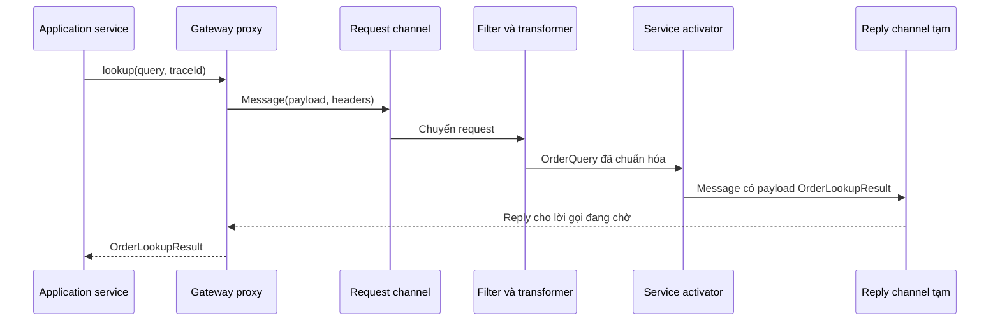

# Messaging gateway là gì

## 1. Mục tiêu và phạm vi bài học

Trong chương **Messaging gateway** của module **SPRING_INTEGRATION_CORE**, gateway là điểm nối giữa mã ứng dụng và một luồng xử lý thông điệp. Bài học này tập trung vào gateway dựa trên interface Java: ứng dụng gọi một phương thức nghiệp vụ, còn Spring Integration chuyển lời gọi đó thành trao đổi `Message` qua `MessageChannel`.

Sau bài học, bạn có thể:

- Giải thích trách nhiệm của gateway so với channel, endpoint và service activator.
- Theo dõi một lời gọi từ tham số Java, qua payload/header, đến giá trị trả về.
- Khai báo `@MessagingGateway`, đăng ký proxy và nối nó với `IntegrationFlow` bằng Java DSL.
- Thiết kế hợp đồng phản hồi, timeout và lỗi cho luồng request–reply.
- Viết kiểm thử đi qua gateway thật để quan sát filter, transformer và handler.

Ví dụ dùng tra cứu trạng thái đơn hàng. Các phần router, aggregator và tích hợp hệ thống ngoài chỉ được nhắc đến khi ảnh hưởng đến hợp đồng của gateway; cách cấu hình chi tiết thuộc các chủ đề riêng trong module.

## 2. Bài toán: gọi nghiệp vụ mà không tự điều khiển messaging

Giả sử một chức năng cần tra cứu đơn hàng. Phía gọi muốn biểu đạt yêu cầu như sau:

```java
OrderLookupResult result = gateway.lookup(
        new OrderQuery(" ord-42 "),
        "trace-001"
);
```

Trong khi đó, luồng xử lý cần kiểm tra mã đơn, chuẩn hóa dữ liệu và gọi thành phần tra cứu. Nếu mỗi nơi gọi đều tự dựng message, chọn channel, thiết lập địa chỉ phản hồi và nhận kết quả, chi tiết messaging sẽ lan sang controller hoặc application service.

**Messaging gateway đóng gói việc giao tiếp với hệ thống messaging sau một giao diện có ý nghĩa nghiệp vụ.** Đây là một mẫu Enterprise Integration Patterns: phía sử dụng thao tác với phương thức của miền bài toán, còn gateway quản lý các thao tác đặc thù của messaging. [Nguồn: Messaging Gateway pattern](https://www.enterpriseintegrationpatterns.com/patterns/messaging/MessagingGateway.html).

Trong Spring Integration, `GatewayProxyFactoryBean` tạo proxy cho interface. Bean mà ứng dụng được inject là proxy đó; khi phương thức được gọi, proxy điều phối việc gửi yêu cầu và nhận phản hồi. Không cần tự viết lớp `implements OrderLookupGateway` cho cách cấu hình này. [Nguồn: Spring Integration — Messaging Gateways](https://docs.spring.io/spring-integration/reference/gateway.html).

Một cách phân chia trách nhiệm phù hợp cho ví dụ:

| Thành phần | Câu hỏi nó giải quyết | Trong ví dụ |
| --- | --- | --- |
| Application service | Chức năng đang cần thực hiện là gì? | Gọi `lookup(...)` |
| Messaging gateway | Ánh xạ lời gọi Java sang trao đổi thông điệp như thế nào? | `OrderLookupGateway` |
| Message | Dữ liệu và ngữ cảnh đi cùng yêu cầu là gì? | Payload `OrderQuery`, header `traceId` |
| MessageChannel | Message đi vào điểm nào của luồng? | `orders.lookup.requests` |
| Filter | Yêu cầu có đủ điều kiện đi tiếp không? | Loại mã đơn trống |
| Transformer | Dữ liệu cần được chuẩn hóa thế nào? | Bỏ khoảng trắng và viết hoa mã đơn |
| Service activator | Gọi đối tượng xử lý nghiệp vụ nào? | Endpoint tạo bởi `.handle(...)` |
| Đối tượng nghiệp vụ | Tra cứu và tạo kết quả ra sao? | `OrderLookupService` |

Gateway đặt ra cửa vào của chức năng; cấu trúc xử lý bên trong vẫn do các endpoint và channel thực hiện.

## 3. Từ lời gọi Java đến phản hồi

### 3.1. Ánh xạ hợp đồng phương thức

Với hợp đồng minh họa:

```java
OrderLookupResult lookup(OrderQuery query,
                         @Header("traceId") String traceId);
```

Ta thiết kế ánh xạ như sau:

| Phần của lời gọi | Phần của trao đổi messaging |
| --- | --- |
| `query` | Payload của request message |
| Tham số có `@Header("traceId")` | Header `traceId` |
| Channel cấu hình cho gateway | Nơi gửi request |
| Kết quả do flow tạo ra | Payload của reply message |
| `OrderLookupResult` | Kiểu giá trị trả về cho bên gọi |

`@Gateway` cho phép ghi đè cấu hình trên từng phương thức. Tham số `@Header` ánh xạ từng header, còn `@Headers` có thể nhận một map header. Nếu phương thức trả về kiểu dữ liệu thông thường, gateway lấy payload của reply và áp dụng chuyển đổi kiểu được hỗ trợ khi cần. Có thể dùng `Message<?>` trong hợp đồng khi thực sự cần truy cập toàn bộ message. [Nguồn: Javadoc — Gateway](https://docs.spring.io/spring-integration/docs/current/api/org/springframework/integration/annotation/Gateway.html).

Trong ví dụ này, dùng DTO cho yêu cầu và kết quả giúp người gọi hiểu hợp đồng bằng các khái niệm `OrderQuery` và `OrderLookupResult`. `traceId` là thông tin theo dõi, vì vậy được đặt vào header. Nhiều trường nghiệp vụ cùng tạo thành một yêu cầu nên được nhóm trong DTO, thay vì để gateway tự suy luận nhiều tham số payload.

### 3.2. Địa chỉ phản hồi và vai trò của endpoint cuối

Ở luồng request–reply thông thường, gateway tạo một reply channel tạm và đưa địa chỉ đó vào header `replyChannel`. Thường không cần khai báo thêm một bean reply channel riêng. [Nguồn: Setting the Default Reply Channel](https://docs.spring.io/spring-integration/reference/gateway.html#gateway-default-reply-channel).

Endpoint có đầu ra sẽ ưu tiên output channel được cấu hình. Nếu không có output channel, một service activator có thể dùng header `replyChannel` trên request để gửi kết quả về nơi đang chờ. Trong Java DSL, `.handle(...)` biểu diễn một service activator. [Nguồn: Spring Integration — Service Activator](https://docs.spring.io/spring-integration/reference/service-activator.html).



Sơ đồ mô tả đường đi logic của thông điệp, không ngụ ý mỗi cột chạy trên một thread khác nhau. Trong cấu hình `DirectChannel` ở phần thực hành, các bước xử lý đều chạy trên thread gọi gateway.

Khi bổ sung transformer hoặc handler tự tạo message, hãy giữ đường phản hồi của request. Annotation endpoint hỗ trợ nhận payload, header hoặc cả message; các endpoint có đầu ra phối hợp output channel và header phản hồi để tạo pipeline. [Nguồn: Spring Integration — Annotation Support](https://docs.spring.io/spring-integration/reference/configuration/annotations.html).

## 4. Chọn đúng dạng hợp đồng gateway

| Hợp đồng | Ý nghĩa mong đợi | Điều cần thiết kế |
| --- | --- | --- |
| `OrderLookupResult lookup(OrderQuery query)` | Có một kết quả cho yêu cầu | Kiểu kết quả, lỗi và thời gian chờ |
| `void submit(OrderCommand command)` | Không có giá trị phản hồi nghiệp vụ | Cách theo dõi lỗi và xác nhận hoàn tất nếu cần |
| `CompletableFuture<OrderLookupResult> lookupAsync(OrderQuery query)` | Nhận một đối tượng biểu diễn kết quả sẽ có sau | Executor, cách xử lý completion và lỗi |

Một phương thức `void` chỉ tuyên bố rằng người gọi không nhận giá trị trả về. Nó không bảo đảm tác vụ được đưa sang thread khác. Với `DirectChannel`, handler vẫn được gọi trong thread gửi message; với `ExecutorChannel`, việc dispatch được giao cho executor; `QueueChannel` lưu message để consumer nhận. Queue dạng bộ nhớ mặc định cũng không tạo cam kết lưu bền. [Nguồn: Message Channel Implementations](https://docs.spring.io/spring-integration/reference/channel/implementations.html).

Đối với `CompletableFuture`, chế độ thông thường dùng async executor của gateway để thực hiện lời gọi. Nếu tắt executor một cách tường minh, hợp đồng lại có thể yêu cầu downstream trả về một future trong payload. Vì vậy cần xác định chế độ sử dụng trước khi đổi kiểu trả về. [Nguồn: Asynchronous Gateway](https://docs.spring.io/spring-integration/reference/gateway.html#async-gateway).

Đối với bài tra cứu ngắn này, chọn `OrderLookupResult` giúp thấy rõ hợp đồng một yêu cầu → một kết quả. Nếu chuyển sang xử lý đơn hàng kéo dài nhiều phút, một thiết kế hợp lý có thể trả mã tác vụ và cung cấp luồng theo dõi trạng thái riêng; việc đổi sang `void` tự nó chưa giải quyết bài toán xác nhận hoàn tất.

## 5. Thực hành: interface gateway và Java DSL

### 5.1. Điều kiện cho ví dụ

Mốc API của ví dụ là **Java 17 và Spring Integration 6.2.x**, với thư viện Spring tương thích. `errorOnTimeout` trên `@MessagingGateway` có từ Spring Integration 6.2. Nếu dùng Spring Boot, để parent/BOM phù hợp quản lý các phiên bản phụ thuộc. Không coi phiên bản thư viện trong ví dụ là kết quả kiểm tra dự án hiện tại. [Nguồn: Javadoc — MessagingGateway](https://docs.spring.io/spring-integration/docs/current/api/org/springframework/integration/annotation/MessagingGateway.html).

Trong một dự án đã có Spring Boot parent/BOM, các dependency tối thiểu cho phần minh họa và kiểm thử là:

```xml
<dependencies>
    <dependency>
        <groupId>org.springframework.boot</groupId>
        <artifactId>spring-boot-starter-integration</artifactId>
    </dependency>
    <dependency>
        <groupId>org.springframework.boot</groupId>
        <artifactId>spring-boot-starter-test</artifactId>
        <scope>test</scope>
    </dependency>
</dependencies>
```

Đây là đoạn dependency để đặt vào cấu hình Maven hiện có, không phải toàn bộ `pom.xml`. Phần chạy bên dưới dùng `AnnotationConfigApplicationContext`, vì vậy không cần tạo web server, database hoặc message broker.

Mỗi lớp/interface `public` đặt trong tệp `.java` tương ứng, cùng package `example.messaginggateway`. Các tên tệp trong bài là chỉ dẫn cho người học tạo ví dụ, không phải các tệp mã nguồn được tạo sẵn bởi tài liệu này.

### 5.2. Hai kiểu dữ liệu của hợp đồng

`OrderQuery.java`:

```java
package example.messaginggateway;

public record OrderQuery(String orderId) {
}
```

`OrderLookupResult.java`:

```java
package example.messaginggateway;

public record OrderLookupResult(
        String orderId,
        String state,
        String traceId
) {
}
```

Ví dụ trả lại `traceId` trong DTO để người học nhìn thấy kết quả ánh xạ header. Trong một ứng dụng thực tế, việc đưa thông tin theo dõi vào hợp đồng kết quả là quyết định thiết kế riêng.

### 5.3. Khai báo cửa vào

`OrderLookupGateway.java`:

```java
package example.messaginggateway;

import org.springframework.integration.annotation.MessagingGateway;
import org.springframework.messaging.handler.annotation.Header;

@MessagingGateway(
        defaultRequestChannel = "orders.lookup.requests",
        defaultRequestTimeout = "1000",
        defaultReplyTimeout = "2000",
        errorOnTimeout = true
)
public interface OrderLookupGateway {

    OrderLookupResult lookup(
            OrderQuery query,
            @Header("traceId") String traceId
    );
}
```

Các giá trị timeout là mili giây. Ở annotation cấp interface, hai thuộc tính timeout trên được khai báo bằng chuỗi. `defaultRequestChannel` là tên bean channel mà cấu hình phía dưới sẽ cung cấp. Ví dụ chủ động chọn các giá trị này để hợp đồng có giới hạn chờ rõ ràng; chúng không phải cam kết tổng thời gian thực thi luôn dưới hai giây.

`errorOnTimeout = true` giúp trường hợp hết thời gian chờ phản hồi được biểu diễn bằng lỗi thay vì trả `null` trong cấu hình này. Không có `errorChannel` riêng ở ví dụ chính, nên lỗi đi về phía gọi. [Nguồn: Javadoc — MessagingGateway](https://docs.spring.io/spring-integration/docs/current/api/org/springframework/integration/annotation/MessagingGateway.html).

### 5.4. Thành phần mô phỏng nghiệp vụ

`OrderLookupService.java`:

```java
package example.messaginggateway;

import org.springframework.messaging.handler.annotation.Header;

public class OrderLookupService {

    public OrderLookupResult lookup(
            OrderQuery query,
            @Header("traceId") String traceId
    ) {
        if ("FAIL".equals(query.orderId())) {
            throw new IllegalStateException("Order backend unavailable");
        }

        String state = "ORD-42".equals(query.orderId())
                ? "READY"
                : "NOT_FOUND";

        return new OrderLookupResult(query.orderId(), state, traceId);
    }
}
```

Đây là dữ liệu giả lập: chỉ `ORD-42` được xem là có sẵn; `FAIL` mô phỏng backend lỗi. Một mã khác tạo kết quả `NOT_FOUND`, không trả `null`. Như vậy, việc không có đơn hàng là một kết quả có nghĩa trong hợp đồng, tách được khỏi tình huống không nhận được reply.

### 5.5. Đăng ký proxy, channel và các endpoint

`OrderGatewayConfiguration.java`:

```java
package example.messaginggateway;

import java.util.Locale;

import org.springframework.context.annotation.Bean;
import org.springframework.context.annotation.Configuration;
import org.springframework.integration.annotation.IntegrationComponentScan;
import org.springframework.integration.channel.DirectChannel;
import org.springframework.integration.config.EnableIntegration;
import org.springframework.integration.dsl.IntegrationFlow;

@Configuration
@EnableIntegration
@IntegrationComponentScan(basePackageClasses = OrderLookupGateway.class)
public class OrderGatewayConfiguration {

    @Bean(name = "orders.lookup.requests")
    public DirectChannel orderLookupRequests() {
        return new DirectChannel();
    }

    @Bean
    public OrderLookupService orderLookupService() {
        return new OrderLookupService();
    }

    @Bean
    public IntegrationFlow orderLookupFlow(OrderLookupService service) {
        return IntegrationFlow
                .from("orders.lookup.requests")
                .filter(
                        OrderQuery.class,
                        query -> query.orderId() != null
                                && !query.orderId().isBlank(),
                        spec -> spec.throwExceptionOnRejection(true)
                )
                .<OrderQuery, OrderQuery>transform(query ->
                        new OrderQuery(
                                query.orderId().strip()
                                        .toUpperCase(Locale.ROOT)
                        )
                )
                .handle(service, "lookup", spec -> spec.requiresReply(true))
                .get();
    }
}
```

Có ba việc đăng ký khác nhau trong cấu hình:

1. `@EnableIntegration` kích hoạt hạ tầng Spring Integration cho context Java thuần được dùng ở đây.
2. `@IntegrationComponentScan` tìm interface có `@MessagingGateway` và đăng ký proxy. `basePackageClasses` chọn package theo một kiểu Java, giúp tránh chuỗi tên package bị sai khi đổi tên. Component scan thông thường không đủ để xử lý interface gateway. [Nguồn: IntegrationComponentScan](https://docs.spring.io/spring-integration/docs/current/api/org/springframework/integration/annotation/IntegrationComponentScan.html).
3. Các phương thức `@Bean` cung cấp channel, đối tượng nghiệp vụ và flow. Java DSL mô tả việc ghép các thành phần thành luồng xử lý. [Nguồn: Spring Integration — Java DSL](https://docs.spring.io/spring-integration/reference/dsl.html).

Từ đầu vào `" ord-42 "`, filter cho đi tiếp, transformer tạo `OrderQuery("ORD-42")`, rồi service trả `OrderLookupResult("ORD-42", "READY", "trace-001")`.

Filter được cấu hình ném lỗi khi từ chối. Nếu chỉ loại message và kết thúc đường xử lý, lời gọi request–reply sẽ thiếu phản hồi. Spring Integration hỗ trợ cả hành vi từ chối bằng exception và chuyển message sang discard channel; lựa chọn ở đây là báo lỗi ngay. [Nguồn: Spring Integration — Filter](https://docs.spring.io/spring-integration/reference/filter.html).

`requiresReply(true)` thể hiện rằng service activator này phải tạo phản hồi. Nó phát hiện trường hợp handler trả `null`, nhưng không tạo ra một deadline để ngắt handler đang chạy. [Nguồn: Spring Integration — Service Activator](https://docs.spring.io/spring-integration/reference/service-activator.html).

### 5.6. Gọi thử qua Spring context

`GatewayDemo.java`:

```java
package example.messaginggateway;

import org.springframework.context.annotation.AnnotationConfigApplicationContext;

public class GatewayDemo {

    public static void main(String[] args) {
        try (var context = new AnnotationConfigApplicationContext(
                OrderGatewayConfiguration.class)) {
            OrderLookupGateway gateway =
                    context.getBean(OrderLookupGateway.class);

            OrderLookupResult result = gateway.lookup(
                    new OrderQuery(" ord-42 "),
                    "trace-001"
            );

            System.out.println(result);
        }
    }
}
```

Kết quả mong đợi khi chạy ví dụ trong dự án đã cấu hình dependency phù hợp:

```text
OrderLookupResult[orderId=ORD-42, state=READY, traceId=trace-001]
```

Bên gọi chỉ cần biết gateway và các kiểu dữ liệu của hợp đồng. Khi chuyển tra cứu từ dữ liệu giả sang một backend thật, có thể thay thành phần xử lý trong flow, miễn vẫn giữ ý nghĩa yêu cầu, phản hồi và lỗi đã công bố.

## 6. Timeout: phân biệt gửi yêu cầu với chờ phản hồi

`requestTimeout` liên quan đến việc gửi message vào request channel khi thao tác gửi có thể bị chặn, chẳng hạn queue hữu hạn đã đầy. `replyTimeout` liên quan đến việc chờ reply; bộ đếm chờ bắt đầu khi quyền điều khiển trở về gateway sau thao tác gửi. Cấu hình trên phương thức có thể ghi đè cấu hình chung. [Nguồn: Javadoc — Gateway timeout attributes](https://docs.spring.io/spring-integration/docs/current/api/org/springframework/integration/annotation/Gateway.html).

Vì ví dụ dùng `DirectChannel`, handler chạy trên cùng thread gọi. Nếu backend mất 10 giây mới trả về, đặt `defaultReplyTimeout = "2000"` không khiến lời gọi tự dừng ở giây thứ hai. Giới hạn chờ reply phát huy tác dụng khi thread đã trở về gateway để đợi kết quả từ phần xử lý khác. [Nguồn: Gateway Behavior When No Response Arrives](https://docs.spring.io/spring-integration/reference/gateway.html#gateway-behavior-no-response).

Hai tình huống giúp đọc cấu hình:

| Tình huống minh họa | Diễn giải |
| --- | --- |
| Queue request đã đầy, `requestTimeout = 1000` | Gateway chỉ có thể chờ khả năng gửi trong khoảng thời gian đã cấu hình; đây chưa phải thời gian backend được phép chạy |
| Request đã được giao cho worker, `replyTimeout = 2000` | Thread chờ reply có giới hạn; worker vẫn có thể đang xử lý sau khi phía gọi hết chờ |

Khi thay service giả bằng HTTP hoặc JDBC, cần thiết kế thêm timeout của chính thao tác I/O. Khi một lời gọi hết chờ, hãy tránh suy luận rằng thao tác ghi ở backend chắc chắn chưa xảy ra. Nếu nghiệp vụ có tác dụng phụ và cho phép retry, cần xác định cách nhận diện yêu cầu trùng và cách tra cứu kết quả đã thực hiện.

Các giá trị âm, bằng không và mặc định có thể làm thay đổi hành vi chờ. Đối với hợp đồng ứng dụng, nên đặt rõ giá trị mong muốn và đối chiếu API của phiên bản đang dùng thay vì dựa vào một con số mặc định nhớ từ trước.

## 7. Hợp đồng lỗi và các nhánh làm mất phản hồi

### 7.1. Lỗi ở cùng thread và lỗi sau khi tách thread

Với luồng đồng bộ trong ví dụ, exception từ handler có thể quay về bên gọi qua gateway. Nếu tách xử lý sang executor hoặc poller, lỗi không thể đi ngược lại bằng call stack Java thông thường. Hạ tầng xử lý lỗi của Spring Integration dùng `ErrorMessage`, với payload là exception; thông thường ưu tiên header `errorChannel` của message rồi mới đến channel lỗi toàn cục. [Nguồn: Spring Integration — Error Handling](https://docs.spring.io/spring-integration/reference/error-handling.html).

Nếu khai báo `errorChannel` cho gateway, error flow có thể chuyển lỗi thành một kết quả phù hợp với hợp đồng phương thức. Chỉ ghi log rồi kết thúc error flow có thể để phía gọi không có reply. Nếu chọn cách trả một kết quả lỗi, kết quả đó cũng phải dùng kiểu mà gateway có thể trả cho caller. [Nguồn: Messaging Gateways — Error Handling](https://docs.spring.io/spring-integration/reference/gateway.html#gateway-error-handling).

Với ví dụ chính, chưa có error flow riêng:

| Đầu vào | Kết quả thiết kế |
| --- | --- |
| `OrderQuery(" ord-42 ")` | `OrderLookupResult` có state `READY` |
| `OrderQuery("missing")` | `OrderLookupResult` có state `NOT_FOUND` |
| `OrderQuery("   ")` | Filter từ chối bằng lỗi |
| `OrderQuery("fail")` | Service ném lỗi backend sau khi mã được chuẩn hóa |
| Không nhận reply trong giới hạn chờ | Lỗi timeout theo cấu hình gateway, không phải `NOT_FOUND` |

Không nên biến mọi exception thành `NOT_FOUND`: việc backend không hoạt động và việc không tồn tại đơn hàng dẫn đến những hành động xử lý khác nhau cho người dùng.

### 7.2. Suy luận khi flow có thêm router hoặc aggregator

Khi mở rộng luồng, hãy xem mỗi nhánh như một đường thực hiện của phương thức `lookup`:

- **Filter:** nhánh bị loại phải có chính sách lỗi hoặc phản hồi rõ ràng.
- **Router:** mọi nhánh có thể chọn cần đi đến nơi trả một kết quả phù hợp; nhánh không tìm được đích cũng phải có cách xử lý.
- **Splitter/aggregator:** nếu một lời gọi tạo nhiều phần việc, cần xác định điều kiện gom đủ và cách xử lý nhóm không hoàn tất. Phía gọi vẫn cần biết khi nào nhận được kết quả cuối.
- **Handler trả `void`:** nếu đó là điểm cuối, hợp đồng request–reply chưa có thành phần tạo kết quả.
- **Message tự dựng:** cần xem lại các header phục vụ phản hồi và lỗi khi thay message gốc.

Đây là cách rà soát hợp đồng của chính luồng tra cứu: từ một request, xác định kết quả quan sát được của từng đường đi. Gateway không thay thế quyết định nghiệp vụ cho các nhánh đó.

## 8. Kiểm thử qua gateway thật

Mock `OrderLookupGateway` phù hợp khi kiểm thử riêng application service, nhưng không kiểm tra được việc tạo proxy, tên channel hoặc ánh xạ payload/header. Phần này dùng context thật và handler giả lập ở trên để kiểm tra đường đi tích hợp. Spring Integration còn có `spring-integration-test` cho các tình huống cần mock endpoint hoặc thay một phần flow; ví dụ này chỉ cần Spring Test và JUnit. [Nguồn: Spring Integration — Testing Support](https://docs.spring.io/spring-integration/reference/testing.html).

Đặt `OrderLookupGatewayTest.java` trong nguồn kiểm thử, cùng package:

```java
package example.messaginggateway;

import org.junit.jupiter.api.Test;
import org.springframework.beans.factory.annotation.Autowired;
import org.springframework.integration.MessageRejectedException;
import org.springframework.test.context.junit.jupiter.SpringJUnitConfig;

import static org.junit.jupiter.api.Assertions.assertEquals;
import static org.junit.jupiter.api.Assertions.assertThrows;

@SpringJUnitConfig(OrderGatewayConfiguration.class)
class OrderLookupGatewayTest {

    @Autowired
    private OrderLookupGateway gateway;

    @Test
    void normalizesPayloadAndMapsTraceHeader() {
        OrderLookupResult result = gateway.lookup(
                new OrderQuery(" ord-42 "),
                "trace-001"
        );

        assertEquals("ORD-42", result.orderId());
        assertEquals("READY", result.state());
        assertEquals("trace-001", result.traceId());
    }

    @Test
    void representsMissingOrderAsBusinessResult() {
        OrderLookupResult result = gateway.lookup(
                new OrderQuery("missing"),
                "trace-002"
        );

        assertEquals("MISSING", result.orderId());
        assertEquals("NOT_FOUND", result.state());
    }

    @Test
    void rejectsBlankOrderId() {
        assertThrows(MessageRejectedException.class, () ->
                gateway.lookup(new OrderQuery("   "), "trace-003")
        );
    }

    @Test
    void propagatesBackendFailure() {
        IllegalStateException error = assertThrows(
                IllegalStateException.class,
                () -> gateway.lookup(new OrderQuery("fail"), "trace-004")
        );

        assertEquals("Order backend unavailable", error.getMessage());
    }
}
```

`MessageRejectedException` là exception biểu diễn việc selector từ chối message. Trong ví dụ không có error flow và phương thức gateway không khai báo `throws`, lỗi runtime từ service được gateway tìm trong chuỗi nguyên nhân để đưa về caller; vì vậy test backend kỳ vọng `IllegalStateException`. [Nguồn: MessageRejectedException API](https://docs.spring.io/spring-integration/docs/current/api/org/springframework/integration/MessageRejectedException.html), [Gateway Error Handling](https://docs.spring.io/spring-integration/reference/gateway.html#gateway-error-handling).

Bốn test trên xác nhận hợp đồng mẫu, chưa kiểm tra timeout khi tách thread. Để thử trường hợp đó, cần một context kiểm thử riêng có ranh giới executor/queue và một handler được điều khiển bằng tín hiệu đồng bộ. Cho handler giữ phản hồi, gọi gateway với giới hạn chờ ngắn rồi kiểm tra kết quả timeout; sau đó giải phóng handler trong phần dọn dẹp. Cách này cho phép kiểm soát điều kiện thử nghiệm, tránh dựa vào một khoảng `sleep` ngẫu nhiên.

Mã trong phần này là ví dụ để người học thực thi trong dự án tương thích; bài viết không xác nhận rằng các test đã được biên dịch hoặc chạy trong repository hiện tại.

## 9. Phân biệt các cách dùng tên “gateway”

| Khái niệm | Vị trí và trách nhiệm |
| --- | --- |
| Interface `@MessagingGateway` | Cửa vào để mã Java gọi một luồng messaging bằng hợp đồng phương thức |
| Service activator | Endpoint nhận message và gọi đối tượng xử lý trong flow |
| Channel adapter | Nối messaging với một nguồn/đích theo hướng truyền một chiều |
| Gateway theo giao thức, như HTTP/JMS outbound gateway | Trao đổi request–reply với hệ thống hoặc giao thức bên ngoài |
| Toán tử `.gateway(...)` trong Java DSL | Gọi flow/endpoint khác và nhận reply để tiếp tục flow hiện tại |
| API gateway ở biên hệ thống | Vai trò định tuyến/chính sách cho API; khác vị trí và trách nhiệm với interface gateway trong bài |

Toán tử DSL `.gateway(...)` hữu ích khi một flow cần sử dụng lại chức năng của flow khác theo kiểu request–reply. Việc dùng `.from("orders.lookup.requests")` trong ví dụ chỉ chọn đầu vào của flow, không tự tạo một interface gateway; proxy đã được đăng ký qua `@IntegrationComponentScan`. [Nguồn: Spring Integration — Operator gateway()](https://docs.spring.io/spring-integration/reference/dsl/java-gateway.html).

Trong phạm vi Spring Integration Core, có thể thực hành đầy đủ gateway, channel và endpoint ngay trong một JVM. Khi bổ sung broker hoặc HTTP gateway, cần thiết kế thêm hợp đồng dữ liệu, địa chỉ phản hồi và lỗi theo ranh giới tích hợp tương ứng.

## 10. Chọn gateway trong thiết kế ứng dụng

Gateway phù hợp khi một chức năng ứng dụng cần gọi vào flow nhưng người gọi nên phụ thuộc vào hợp đồng nghiệp vụ ổn định. Trong ví dụ, phương thức `lookup` vẫn có ý nghĩa khi nội bộ chuyển từ một handler đơn lẻ sang các bước chuẩn hóa, định tuyến hoặc tổng hợp.

Nếu chức năng chỉ là một phép tính cục bộ đơn giản, không có nhu cầu điều phối messaging, hãy cân nhắc chi phí cấu hình trước khi đưa nó vào flow. Giá trị của gateway thể hiện rõ khi nó tạo ranh giới hữu ích cho một luồng tích hợp thực sự.

Trước khi dùng hợp đồng mẫu vào một chức năng cụ thể, cần quyết định được:

1. Một yêu cầu nghiệp vụ gồm những trường nào và thông tin nào là header.
2. Kết quả thành công, kết quả không tìm thấy và lỗi kỹ thuật được biểu diễn thế nào.
3. Flow chạy ở thread nào và thao tác nào có thể chặn.
4. Mỗi nhánh sẽ tạo reply, báo lỗi hay kết thúc theo hợp đồng một chiều.
5. Khi hết chờ, phía gọi sẽ tra cứu lại, thử lại hay trả trạng thái đang xử lý.
6. Kiểm thử nào chứng minh proxy, channel, payload/header và lỗi phối hợp đúng.

Với các quyết định đó, một phương thức Java ngắn như `lookup(query, traceId)` trở thành cửa vào có hợp đồng rõ ràng cho luồng `Message` → `MessageChannel` → endpoint → reply của Spring Integration.