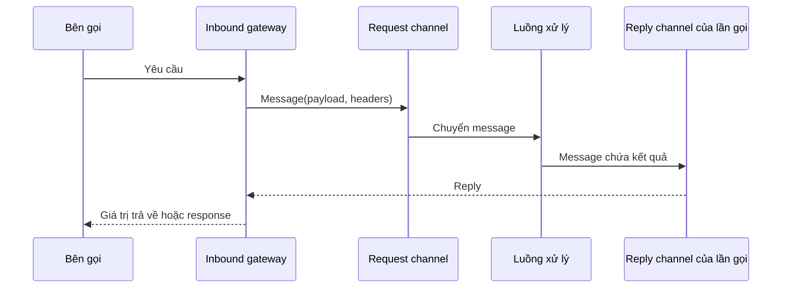

# Inbound gateway

## Mục tiêu

Trong chương Messaging gateway của module SPRING_INTEGRATION_CORE, inbound gateway là điểm vào để một bên gọi gửi yêu cầu tới luồng thông điệp và nhận kết quả. Bài học nối các thành phần `Message`, `MessageChannel`, endpoint và Java DSL thành một luồng request–reply có thể gọi từ Java hoặc HTTP.

Sau bài học, bạn có thể xác định đúng chiều inbound, dựng một luồng báo giá, giải thích đường phản hồi, thiết kế timeout và nhận biết những nhánh khiến bên gọi không nhận được kết quả.

## 1. Hiểu inbound từ phía hệ thống tích hợp

Hãy lấy luồng Spring Integration làm mốc:

- **Inbound gateway** nhận yêu cầu từ phía ngoài luồng, đưa yêu cầu vào channel và chuyển phản hồi của luồng về bên gọi.
- **Outbound gateway** nhận message trong luồng, gọi một hệ thống bên ngoài rồi đưa kết quả trở lại luồng.
- **Inbound channel adapter** đưa dữ liệu vào luồng theo hợp đồng một chiều; luồng không phải tạo phản hồi nghiệp vụ cho chính lần gửi đó.

“Phía ngoài” có thể là một ứng dụng từ xa hoặc một service Java trong cùng ứng dụng. Nó chỉ cần nằm ngoài luồng thông điệp đang được xét. Một interface `@MessagingGateway` là cửa vào bằng lời gọi Java; HTTP inbound gateway là cửa vào bằng giao thức HTTP. Hai cách này có thể dùng chung một channel xử lý.

| Tình huống | Lựa chọn phù hợp | Kết quả bên gọi cần |
| --- | --- | --- |
| Service Java hỏi giá của một giỏ hàng | Messaging gateway dạng interface | Đối tượng báo giá hoặc lỗi |
| Đối tác gửi HTTP request để tính phí | HTTP inbound gateway | HTTP response mang kết quả hoặc lỗi |
| Ứng dụng nhận sự kiện chỉ để xử lý về sau | Inbound channel adapter | Không cần kết quả nghiệp vụ của luồng trong lần gửi |
| Luồng gọi API của đơn vị vận chuyển | HTTP outbound gateway | Kết quả API để tiếp tục xử lý |

Một HTTP adapter vẫn phải kết thúc trao đổi HTTP bằng một response ở tầng giao thức. Điều phân biệt gateway là response nghiệp vụ được tạo từ reply của luồng. Tài liệu [HTTP Namespace Support](https://docs.spring.io/spring-integration/reference/http/namespace.html) mô tả hai hợp đồng này.

Gateway trong bài cũng không mang nghĩa một sản phẩm quản lý API như một reverse proxy. Nó là thành phần chuyển đổi giữa giao diện bên gọi và hệ thống message.

## 2. Vòng đời một yêu cầu



Một lần trao đổi có năm bước:

1. Gateway chuyển tham số Java hoặc request của giao thức thành message.
2. Gateway gửi message vào request channel.
3. Transformer, router và các endpoint xử lý payload.
4. Endpoint cuối tạo reply và gửi theo địa chỉ phản hồi.
5. Gateway chuyển reply sang giá trị mà hợp đồng bên gọi yêu cầu.

Với gateway Java, framework thường tạo reply channel tạm cho từng lần gọi và đặt địa chỉ đó trong header `replyChannel`. Vì vậy, ví dụ cơ bản không cần một bean `quoteReplies` dùng chung. Cơ chế này được trình bày trong [Messaging Gateways — Setting the Default Reply Channel](https://docs.spring.io/spring-integration/reference/gateway.html#gateway-default-reply-channel).

Phân biệt ba loại thông tin:

| Thông tin | Vai trò |
| --- | --- |
| Payload | Dữ liệu nghiệp vụ, chẳng hạn mã hàng và số lượng |
| `replyChannel` | Địa chỉ trả lời của trao đổi đang diễn ra |
| `requestId` do ứng dụng đặt | Mã truy vết hoặc đối chiếu nghiệp vụ |

`requestId` không thay thế `replyChannel`. Một header tương quan cũng không tự tạo cơ chế lưu trữ bền vững hay bảo đảm xử lý đúng một lần.

## 3. Ví dụ Java DSL: cửa vào báo giá

Ví dụ dùng Java 17 và API của Spring Integration 6.5. Phần core cần `org.springframework.integration:spring-integration-core`; phần kiểm thử cần JUnit Jupiter và `spring-test`. Dùng BOM hoặc cơ chế quản lý dependency của dự án để đồng bộ phiên bản Spring.

Các lớp được đặt trong cùng một lớp cấu hình để có thể theo dõi toàn bộ ví dụ. Trong ứng dụng thực tế, có thể tách DTO, interface gateway và dịch vụ báo giá thành các tệp riêng.

### 3.1. Cấu hình hoàn chỉnh cho cửa vào Java

```java
package lesson.gateway;

import java.math.BigDecimal;
import java.util.Locale;

import org.springframework.context.annotation.Bean;
import org.springframework.context.annotation.Configuration;
import org.springframework.context.annotation.Import;
import org.springframework.integration.annotation.MessagingGateway;
import org.springframework.integration.channel.DirectChannel;
import org.springframework.integration.config.EnableIntegration;
import org.springframework.integration.dsl.IntegrationFlow;
import org.springframework.messaging.MessageChannel;
import org.springframework.messaging.handler.annotation.Header;
import org.springframework.messaging.handler.annotation.Payload;

@Configuration
@EnableIntegration
@Import(QuoteIntegrationConfig.QuoteGateway.class)
public class QuoteIntegrationConfig {

    public record QuoteRequest(String sku, int quantity) {
    }

    public record QuoteReply(
            String sku,
            int quantity,
            BigDecimal total,
            String currency) {
    }

    @MessagingGateway(
            defaultRequestChannel = "quoteRequests",
            defaultRequestTimeout = "200",
            defaultReplyTimeout = "1500")
    public interface QuoteGateway {

        QuoteReply quote(
                @Payload QuoteRequest request,
                @Header("requestId") String requestId);
    }

    @Bean
    public MessageChannel quoteRequests() {
        return new DirectChannel();
    }

    @Bean
    public IntegrationFlow quoteFlow() {
        return IntegrationFlow.from("quoteRequests")
                .transform(
                        QuoteRequest.class,
                        QuoteIntegrationConfig::normalize)
                .handle(
                        QuoteRequest.class,
                        (request, headers) -> calculate(request),
                        endpoint -> endpoint.requiresReply(true))
                .get();
    }

    private static QuoteRequest normalize(QuoteRequest request) {
        if (request.sku() == null || request.sku().isBlank()) {
            throw new IllegalArgumentException("sku must not be blank");
        }
        if (request.quantity() <= 0) {
            throw new IllegalArgumentException("quantity must be positive");
        }

        return new QuoteRequest(
                request.sku().trim().toUpperCase(Locale.ROOT),
                request.quantity());
    }

    private static QuoteReply calculate(QuoteRequest request) {
        if (!"BOOK-001".equals(request.sku())) {
            throw new IllegalArgumentException("unknown sku");
        }

        BigDecimal unitPrice = new BigDecimal("125000");
        BigDecimal total = unitPrice.multiply(
                BigDecimal.valueOf(request.quantity()));

        return new QuoteReply(
                request.sku(),
                request.quantity(),
                total,
                "VND");
    }
}
```

`@EnableIntegration` đăng ký hạ tầng tích hợp trong cấu hình Java độc lập. `@Import` đăng ký interface gateway theo cơ chế được hỗ trợ từ Spring Integration 6.0. Một lựa chọn khác là `@IntegrationComponentScan` quét package chứa interface; `@ComponentScan` thông thường không tự tạo proxy cho interface gateway. Xem [Messaging Gateways — @MessagingGateway Annotation](https://docs.spring.io/spring-integration/reference/6.5/gateway.html#messaging-gateway-annotation).

Trong luồng này:

- Tham số `QuoteRequest` trở thành payload; `requestId` trở thành header.
- Transformer kiểm tra đầu vào rồi chuẩn hóa mã hàng.
- Service activator tính giá và trả một `QuoteReply`.
- Endpoint cuối không có output channel tường minh nên phản hồi theo `replyChannel`.
- `requiresReply(true)` làm lỗi xuất hiện ngay nếu handler này trả `null`.

Cách endpoint tìm nơi gửi kết quả và ý nghĩa của `requiresReply` được giải thích trong [Service Activator](https://docs.spring.io/spring-integration/reference/service-activator.html).

### 3.2. Gọi gateway

Có thể dùng một context độc lập để thử cửa vào Java; cách này không khởi động HTTP server:

```java
package lesson.gateway;

import org.springframework.context.annotation.AnnotationConfigApplicationContext;

import lesson.gateway.QuoteIntegrationConfig.QuoteGateway;
import lesson.gateway.QuoteIntegrationConfig.QuoteReply;
import lesson.gateway.QuoteIntegrationConfig.QuoteRequest;

public class QuoteDemo {

    public static void main(String[] args) {
        try (var context = new AnnotationConfigApplicationContext(
                QuoteIntegrationConfig.class)) {

            QuoteGateway gateway = context.getBean(QuoteGateway.class);

            QuoteReply reply = gateway.quote(
                    new QuoteRequest(" book-001 ", 2),
                    "REQ-1001");

            if (reply == null) {
                throw new IllegalStateException("No quote reply received");
            }

            System.out.println(reply);
        }
    }
}
```

Kết quả mong đợi:

```text
QuoteReply[sku=BOOK-001, quantity=2, total=250000, currency=VND]
```

Bên gọi chỉ phụ thuộc vào hợp đồng `QuoteGateway`. Quy tắc chuẩn hóa và tính giá vẫn nằm trong luồng. Với cấu hình hiện tại, `DirectChannel` xử lý trên luồng của bên gửi; dùng gateway không tự làm phép tính chạy bất đồng bộ.

Trong ví dụ, `requestId` minh họa việc đưa metadata vào message; thuật toán giá chưa sử dụng nó. Khi cần ghi log, interceptor hoặc handler có thể đọc header này.

## 4. Mở thêm cửa vào HTTP cho cùng luồng

Một hệ thống có thể vừa phục vụ service Java nội bộ, vừa phục vụ đối tác HTTP:

```text
Service Java -> QuoteGateway ---------+
                                     +-> quoteRequests -> quoteFlow
HTTP client -> HTTP inbound gateway -+
```

HTTP inbound gateway gửi thẳng vào `quoteRequests`. Nó không gọi qua phương thức của `QuoteGateway`; timeout và ánh xạ của hai gateway được cấu hình riêng.

Để dùng phần này, bổ sung `spring-integration-http`, Spring MVC, bộ chuyển đổi JSON và môi trường servlet. Nếu dùng Spring Boot, cần một ứng dụng web servlet với cấu hình dependency tương thích. `AnnotationConfigApplicationContext` ở phần trước chỉ đủ cho ví dụ Java.

Dưới đây là lớp cấu hình HTTP. Error flow đi cùng cấu hình để response lỗi cũng có hợp đồng rõ ràng.

```java
package lesson.gateway;

import java.util.Map;

import org.springframework.context.annotation.Bean;
import org.springframework.context.annotation.Configuration;
import org.springframework.context.annotation.Import;
import org.springframework.http.HttpMethod;
import org.springframework.http.HttpStatus;
import org.springframework.integration.MessageTimeoutException;
import org.springframework.integration.channel.DirectChannel;
import org.springframework.integration.dsl.IntegrationFlow;
import org.springframework.integration.http.HttpHeaders;
import org.springframework.integration.http.dsl.Http;
import org.springframework.messaging.MessageChannel;
import org.springframework.messaging.support.MessageBuilder;

import lesson.gateway.QuoteIntegrationConfig.QuoteRequest;

@Configuration
@Import(QuoteIntegrationConfig.class)
public class HttpQuoteConfig {

    @Bean
    public IntegrationFlow httpQuoteEntry() {
        return IntegrationFlow.from(
                        Http.inboundGateway("/integration/quotes")
                                .requestMapping(mapping -> mapping
                                        .methods(HttpMethod.POST)
                                        .consumes("application/json")
                                        .produces("application/json"))
                                .requestPayloadType(QuoteRequest.class)
                                .requestTimeout(200)
                                .replyTimeout(1500)
                                .errorOnTimeout(true)
                                .errorChannel("httpQuoteErrors"))
                .channel("quoteRequests")
                .get();
    }

    @Bean
    public MessageChannel httpQuoteErrors() {
        return new DirectChannel();
    }

    @Bean
    public IntegrationFlow httpQuoteErrorFlow() {
        return IntegrationFlow.from("httpQuoteErrors")
                .handle(Throwable.class, (failure, headers) -> {
                    HttpStatus status;
                    String code;

                    if (hasCause(failure, MessageTimeoutException.class)) {
                        status = HttpStatus.GATEWAY_TIMEOUT;
                        code = "QUOTE_TIMEOUT";
                    }
                    else if (hasCause(failure, IllegalArgumentException.class)) {
                        status = HttpStatus.BAD_REQUEST;
                        code = "INVALID_QUOTE_REQUEST";
                    }
                    else {
                        status = HttpStatus.INTERNAL_SERVER_ERROR;
                        code = "QUOTE_INTERNAL_ERROR";
                    }

                    return MessageBuilder
                            .withPayload(Map.of("code", code))
                            .setHeader(HttpHeaders.STATUS_CODE, status)
                            .build();
                }, endpoint -> endpoint.requiresReply(true))
                .get();
    }

    private static boolean hasCause(
            Throwable failure,
            Class<? extends Throwable> expectedType) {

        Throwable current = failure;
        while (current != null) {
            if (expectedType.isInstance(current)) {
                return true;
            }
            Throwable next = current.getCause();
            if (next == current) {
                break;
            }
            current = next;
        }
        return false;
    }
}
```

Cách đặt `Http.inboundGateway(...)` ở đầu flow được minh họa trong tài liệu [Configuring HTTP Endpoints with Java](https://docs.spring.io/spring-integration/reference/http/java-config.html). Những tùy chọn như `requestTimeout`, `replyTimeout` và `errorOnTimeout` thuộc [MessagingGatewaySpec](https://docs.spring.io/spring-integration/api/org/springframework/integration/dsl/MessagingGatewaySpec.html).

Khi ứng dụng web đã chạy, gửi yêu cầu:

```http
POST /integration/quotes HTTP/1.1
Host: localhost:8080
Content-Type: application/json
Accept: application/json

{"sku":" book-001 ","quantity":2}
```

Response thành công mong đợi:

```http
HTTP/1.1 200 OK
Content-Type: application/json

{"sku":"BOOK-001","quantity":2,"total":250000,"currency":"VND"}
```

Với body hợp lệ về cú pháp nhưng `quantity` bằng `0`, lỗi kiểm tra dữ liệu của ví dụ được error flow đổi thành:

```http
HTTP/1.1 400 Bad Request
Content-Type: application/json

{"code":"INVALID_QUOTE_REQUEST"}
```

Các mã lỗi trên là quyết định thiết kế của ví dụ. Lỗi không khớp URL, HTTP method hoặc media type có thể được xử lý tại tầng MVC trước khi vào luồng này. Nếu cần một định dạng lỗi chung cho toàn API, cần thiết kế cả lớp xử lý đó.

Gateway dựa vào `Content-Type` và bộ chuyển đổi để tạo `QuoteRequest`, rồi chuyển `QuoteReply` hoặc payload lỗi thành response. Việc chuyển JSON không thay cho kiểm tra dữ liệu nghiệp vụ. Xem [HTTP Inbound Components](https://docs.spring.io/spring-integration/reference/http/inbound.html).

## 5. Giữ đường phản hồi xuyên suốt luồng

Một luồng có thể tính ra đúng giá nhưng bên gọi vẫn không nhận được nó nếu kết quả được gửi sai nơi.

Khi tự xử lý message ngoài cơ chế truyền header của endpoint, hãy giữ những header cần thiết:

```java
Message<QuoteReply> reply = MessageBuilder
        .withPayload(calculatedQuote)
        .copyHeaders(requestMessage.getHeaders())
        .build();
```

Đoạn này minh họa việc bảo toàn metadata khi `requestMessage` và `calculatedQuote` đã có sẵn; nó không cần thêm vào flow báo giá ở trên. Builder sẽ quản lý các header chỉ đọc như `id` theo quy tắc của Spring Messaging.

Với endpoint trả payload thông thường trong Java DSL, framework xử lý việc tạo message và truyền header. Khi viết custom `MessageHandler` và tự gọi `send`, bạn phải kiểm soát đường phản hồi của mình.

Một vài tình huống cần xem lại:

| Thay đổi trong luồng | Hệ quả cần kiểm tra |
| --- | --- |
| Endpoint cuối có output channel tường minh | Kết quả đi vào channel đó trước; phải có đường tiếp tục về gateway |
| Custom handler tạo message mới và tự gửi | Có thể làm mất địa chỉ trả lời |
| Gửi kết quả tới `nullChannel` | Bên gọi request–reply không nhận được kết quả |
| Tách thành nhiều nhánh cùng sinh reply | Cần quy tắc chọn hoặc gom kết quả trước khi trả lời |

Nếu cần lưu message lâu dài hoặc truyền qua broker, địa chỉ reply tạm trong bộ nhớ không phải hợp đồng tương quan xuyên tiến trình. Với trao đổi từ xa, hãy thiết kế request ID, điểm nhận phản hồi, thời hạn và cơ chế lưu trữ theo giao thức.

## 6. Timeout giới hạn điều gì?

Trong bài, tất cả giá trị timeout đều tính bằng mili giây và được đặt tường minh.

| Cấu hình | Giới hạn chính | Ví dụ |
| --- | --- | --- |
| `requestTimeout` | Thời gian chờ gửi message khi channel hỗ trợ thao tác gửi có thể bị chặn | Queue có giới hạn dung lượng đang đầy |
| `replyTimeout` | Thời gian gateway chờ nhận reply sau khi hoàn tất bước gửi hoặc bàn giao xử lý | Worker khác chưa trả kết quả |
| Timeout của HTTP client, cơ sở dữ liệu hoặc dịch vụ khác | Thời gian chờ thao tác I/O cụ thể | Truy vấn báo giá tới hệ thống đối tác |

Tài liệu [HTTP Timeout Handling](https://docs.spring.io/spring-integration/reference/http/timeout.html) phân biệt timeout với channel và timeout khi gọi hệ thống HTTP từ xa. Không dùng một con số chung để thay thế mọi thời hạn của hệ thống.

### 6.1. DirectChannel không tạo ranh giới bất đồng bộ

Xét tình huống giả định handler báo giá mất 10 giây trong khi `replyTimeout` là 1,5 giây. Nếu toàn bộ flow chạy đồng bộ qua `DirectChannel`, lời gọi vẫn nằm trong handler. `replyTimeout` không có chức năng ngắt handler sau 1,5 giây.

Nếu chèn một `ExecutorChannel` có executor chạy tác vụ trên luồng khác, gateway có thể chờ reply sau khi bàn giao tác vụ. Khi hết thời gian chờ, worker vẫn có thể tiếp tục xử lý. Đây là hệ quả cần tính đến khi thiết kế hủy tác vụ hoặc retry.

Đối với gateway Java của ví dụ, không nhận được reply trước hạn có thể dẫn đến `null`. Từ Spring Integration 6.2, annotation gateway có tùy chọn `errorOnTimeout` để dùng lỗi timeout thay cho kết quả `null`. Đặc điểm này và thời điểm bắt đầu chờ reply được mô tả trong [Gateway Behavior When No Response Arrives](https://docs.spring.io/spring-integration/reference/6.5/gateway.html#gateway-no-response).

### 6.2. QueueChannel cần consumer

`QueueChannel` lưu message chờ nhận; gửi thành công không chứng minh xử lý nghiệp vụ đã xong. Khi endpoint đọc từ channel này, cần cấu hình poller. Dung lượng queue cũng quyết định khi nào bên gửi phải chờ.

`ExecutorChannel` bàn giao xử lý qua executor, còn `DirectChannel` gọi subscriber trên luồng gửi. Chọn loại channel là một quyết định về cách thực thi, không chỉ là thay tên bean. Xem [Message Channel Implementations](https://docs.spring.io/spring-integration/reference/channel/implementations.html).

### 6.3. Timeout không chứng minh nghiệp vụ thất bại

Giả sử gateway nhận đặt hàng đã hết thời gian chờ nhưng worker vừa ghi đơn hàng thành công. Nếu bên gọi gửi lại, hệ thống có thể tạo hai đơn.

Một thiết kế phù hợp cần:

- Khóa idempotency gắn với thao tác nghiệp vụ.
- Quy tắc xác định yêu cầu lặp và trả lại kết quả đã có.
- Cách xử lý reply đến muộn.
- Ngân sách thời gian cho các bước gọi dịch vụ con.

Đây là các yêu cầu của tình huống đặt hàng giả định, không phải khả năng được bổ sung tự động chỉ bằng cách khai báo gateway.

## 7. Không để một nhánh âm thầm làm mất reply

Khi phát triển flow báo giá, hãy xem xét kết quả của từng đường đi.

| Thành phần | Tình huống mất reply | Thiết kế cho cửa vào request–reply |
| --- | --- | --- |
| Filter | Loại request rồi kết thúc mà không trả kết quả | Trả kết quả từ chối hoặc phát sinh lỗi rõ ràng |
| Router | Không có nhánh phù hợp hoặc nhánh được chọn chỉ ghi log | Có đường mặc định có nghĩa hoặc cấu hình lỗi khi không phân giải được |
| Service activator | Trả `null` hoặc `void` | Trả kết quả; bật `requiresReply` khi bắt buộc |
| Aggregator | Thiếu message nên nhóm chưa được giải phóng | Đặt điều kiện hoàn tất và chính sách timeout cho nhóm |
| Error flow | Chỉ ghi log | Nếu caller cần response, error flow cũng phải tạo reply hoặc phát sinh lỗi |

Ví dụ, việc dùng filter để bỏ qua mã hàng lạ sẽ khiến caller phải chờ đến hết hạn. Với API báo giá, báo lỗi “không có mã hàng” ngay khi kiểm tra dữ liệu thường là hợp đồng dễ sử dụng hơn.

Nếu quy trình kéo dài hàng phút, có thể thiết kế cửa vào chỉ trả mã tiếp nhận và một API tra cứu trạng thái. Khi đó, “đã tiếp nhận” là kết quả của lần gọi hiện tại; kết quả xử lý cuối cùng thuộc một trao đổi khác.

## 8. Xử lý lỗi tại biên gateway

Cần phân biệt hai đường lỗi:

- Với flow đồng bộ, exception có thể quay về trên call stack. Gateway Java chuyển lỗi về caller theo quy tắc xử lý exception của nó.
- Qua ranh giới bất đồng bộ, exception không thể tự nhảy về call stack cũ. Hạ tầng Spring Integration có cơ chế tạo `ErrorMessage` và định tuyến lỗi.

Trong cơ chế công bố lỗi của hạ tầng bất đồng bộ, header `errorChannel` được ưu tiên trước channel toàn cục cùng tên. Tuy nhiên, có bean toàn cục `errorChannel` không có nghĩa mọi exception đồng bộ đều tự được gửi đến đó. Tài liệu [Error Handling](https://docs.spring.io/spring-integration/reference/6.5/error-handling.html) giải thích ranh giới này.

Cấu hình HTTP trong bài gắn riêng `httpQuoteErrors` cho cửa vào HTTP. Error flow chuyển lỗi thành payload có thể chuyển đổi sang JSON và đặt header trạng thái HTTP. Nó không trả nguyên stack trace cho client.

Khi bổ sung xử lý lỗi cho gateway Java, payload trả về phải phù hợp với kiểu `QuoteReply`, hoặc bạn phải đổi hợp đồng sang một kiểu kết quả có thể biểu diễn cả thành công và thất bại. Trả một chuỗi thông báo lỗi cho phương thức yêu cầu `QuoteReply` sẽ tạo thêm lỗi chuyển kiểu.

Việc ghi log, retry hoặc gửi lỗi sang một kênh theo dõi vẫn có thể thực hiện, nhưng phải xác định rõ thao tác nào chịu trách nhiệm kết thúc lần trao đổi đang chờ.

## 9. Kiểm thử hợp đồng của cửa vào

Không chỉ kiểm thử phép nhân trong dịch vụ; cần gọi chính gateway để kiểm tra proxy, ánh xạ payload, chuỗi endpoint và đường trả lời.

Đặt lớp minh họa sau trong nguồn kiểm thử, dùng cùng các dependency Spring đã được quản lý phiên bản:

```java
package lesson.gateway;

import java.math.BigDecimal;

import org.junit.jupiter.api.Test;
import org.springframework.beans.factory.annotation.Autowired;
import org.springframework.test.context.junit.jupiter.SpringJUnitConfig;

import lesson.gateway.QuoteIntegrationConfig.QuoteGateway;
import lesson.gateway.QuoteIntegrationConfig.QuoteReply;
import lesson.gateway.QuoteIntegrationConfig.QuoteRequest;

import static org.junit.jupiter.api.Assertions.assertEquals;
import static org.junit.jupiter.api.Assertions.assertNotNull;
import static org.junit.jupiter.api.Assertions.assertThrows;

@SpringJUnitConfig(QuoteIntegrationConfig.class)
class QuoteGatewayTest {

    @Autowired
    QuoteGateway gateway;

    @Test
    void normalizesSkuAndReturnsQuote() {
        QuoteReply reply = gateway.quote(
                new QuoteRequest(" book-001 ", 2),
                "REQ-TEST-1");

        assertNotNull(reply);
        assertEquals("BOOK-001", reply.sku());
        assertEquals(2, reply.quantity());
        assertEquals(new BigDecimal("250000"), reply.total());
        assertEquals("VND", reply.currency());
    }

    @Test
    void propagatesInvalidQuantity() {
        assertThrows(IllegalArgumentException.class, () ->
                gateway.quote(
                        new QuoteRequest("BOOK-001", 0),
                        "REQ-TEST-2"));
    }

    @Test
    void rejectsUnknownSku() {
        assertThrows(IllegalArgumentException.class, () ->
                gateway.quote(
                        new QuoteRequest("UNKNOWN", 1),
                        "REQ-TEST-3"));
    }
}
```

Ba kiểm thử trên dành cho cấu hình core và không khởi động web server. Để kiểm tra cửa vào HTTP, dùng context MVC cùng `MockMvc` hoặc một ứng dụng web kiểm thử. Spring Integration liệt kê các công cụ này trong [Testing Support](https://docs.spring.io/spring-integration/reference/testing.html).

Các ca nên bổ sung khi mở rộng ví dụ:

| Ca | Điều cần khẳng định |
| --- | --- |
| HTTP request hợp lệ | Status, media type và JSON báo giá đúng |
| HTTP quantity không hợp lệ | `400` và mã lỗi đã quy định |
| Handler bất đồng bộ không tạo reply | Hành vi timeout đúng hợp đồng |
| Hai yêu cầu đồng thời | Mỗi caller nhận đúng báo giá của mình |
| Mã truy vết đi qua transformer | Header cần thiết được bảo toàn |
| Error flow | Tạo được response cuối cùng, không chỉ ghi log |

Khi kiểm thử timeout, dùng cách phối hợp worker có thể điều khiển và giới hạn thời gian của bài test. Tránh khẳng định một flow chỉ có `DirectChannel` bị ngắt đúng tại `replyTimeout`.

## 10. Chẩn đoán những lỗi thường gặp

| Triệu chứng | Điểm kiểm tra đầu tiên |
| --- | --- |
| Không inject được interface gateway | Interface đã được `@Import` hoặc quét bằng `@IntegrationComponentScan` chưa |
| Request channel không có subscriber | Flow đã được đăng ký và khởi động, tên channel có đúng không |
| Caller nhận `null` | Có nhánh không tạo reply hoặc đã hết thời gian chờ không |
| Tính toán xong nhưng caller vẫn chờ | Reply đi vào channel nào, địa chỉ trả lời có bị mất không |
| Tăng `replyTimeout` vẫn không giải quyết treo | Handler có đang chặn trên cùng luồng không |
| HTTP JSON không chuyển thành DTO | `Content-Type`, kiểu payload và converter có khớp không |
| Error flow đã ghi log nhưng caller vẫn chờ | Error flow có trả một payload hợp lệ không |
| Chỉ lỗi khi có nhiều request đồng thời | Có dùng trạng thái chia sẻ hoặc địa chỉ phản hồi thủ công sai không |

Khi theo dõi một yêu cầu, bắt đầu từ mã truy vết, payload tại cửa vào và endpoint cuối cùng thực sự nhận message. Sau đó kiểm tra đường reply và đường lỗi. Cách lần theo này giúp phân biệt lỗi nghiệp vụ với lỗi điều phối message.

## 11. Bài thực hành

Mở rộng ví dụ báo giá theo thứ tự:

1. Thêm mã `PEN-001` với đơn giá `10000` VND; xác minh hai mã hàng đều có kết quả đúng.
2. Dùng router phân nhánh theo mã hàng, bảo đảm mã không hỗ trợ vẫn kết thúc bằng một lỗi rõ ràng.
3. Thêm metadata `customerTier` và ghi nhận nó trước endpoint tính giá.
4. Tạo một biến thể có worker bất đồng bộ để quan sát timeout và reply đến muộn.
5. Thêm một nhánh kiểm tra nhiều nguồn giá; chỉ trả reply sau khi đã chọn được giá theo quy tắc nghiệp vụ.

Tiêu chí hoàn thành là mỗi cửa vào có hợp đồng rõ về dữ liệu nhận, dữ liệu trả, lỗi và thời gian chờ. Mỗi nhánh của luồng phải dẫn tới một kết quả phù hợp với hợp đồng đó.
