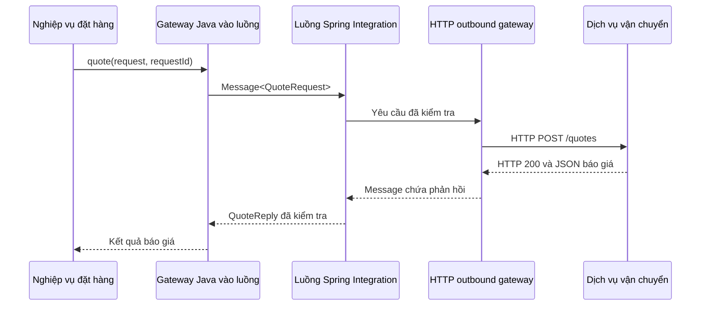

# Outbound gateway

## 1. Mục tiêu và phạm vi

Trong chương **Messaging gateway** của module **SPRING_INTEGRATION_CORE**, bài này giải thích cách một luồng thông điệp chủ động gọi hệ thống ngoài và đưa kết quả trở lại luồng. Đây là bước nối kiến thức về `Message`, `MessageChannel`, endpoint và Java DSL với một tình huống tích hợp thực tế: hỏi dịch vụ vận chuyển để lấy báo giá trước khi tiếp tục xử lý đơn hàng.

Sau bài học, bạn có thể:

- Xác định outbound gateway từ hướng khởi tạo yêu cầu.
- Phân biệt outbound gateway, outbound channel adapter và gateway tạo bằng `@MessagingGateway`.
- Thiết kế hợp đồng request–reply, đường trả lời và các header cần thiết.
- Cấu hình HTTP outbound gateway bằng Java DSL.
- Phân biệt timeout của channel, timeout mạng và thời gian chờ kết quả.
- Thiết kế xử lý lỗi, retry có giới hạn và kiểm thử tại ranh giới HTTP.

Ví dụ Java sử dụng **Java 17 trở lên, Spring Integration 6.5.x và Spring Framework 6.2.x**. Đây là mốc API cho các đoạn mã bên dưới; không phải yêu cầu nâng hoặc hạ phiên bản dự án. Với Spring Integration 7.1 trở lên, HTTP DSL có cấu hình dựa trên `RestClient` và cấu hình dựa trên `RestTemplate` được đánh dấu deprecated. Khi áp dụng bài học cho nhánh đó, cần chuyển phần HTTP client và công cụ kiểm thử tương ứng. [Cấu hình HTTP bằng Java](https://docs.spring.io/spring-integration/reference/http/java-config.html)

## 2. Outbound gateway là gì?

**Outbound gateway là endpoint nhận yêu cầu từ luồng messaging, thực hiện một thao tác với dịch vụ hoặc tài nguyên bên ngoài luồng, rồi tạo thông điệp phản hồi để luồng tiếp tục xử lý.**

Hướng “outbound” được xét tại ranh giới của ứng dụng messaging: ứng dụng này khởi tạo yêu cầu. Phản hồi đi vào ứng dụng không làm endpoint đổi thành inbound gateway. Đặc trưng quyết định là trao đổi hai chiều do phía luồng chủ động bắt đầu. Tài nguyên được gọi có thể là API HTTP, hệ thống JMS, máy chủ SFTP hoặc cơ sở dữ liệu; không nhất thiết là một microservice khác. [Phân loại integration endpoint](https://docs.spring.io/spring-integration/reference/6.5/endpoint-summary.html)

Ví dụ, khi khách hàng chọn địa chỉ nhận hàng:

1. Luồng nhận thông tin đơn hàng.
2. Outbound gateway gửi yêu cầu báo giá đến đối tác vận chuyển.
3. Đối tác trả về số tiền và đơn vị tiền tệ.
4. Luồng kiểm tra kết quả, sau đó trả báo giá cho nghiệp vụ đặt hàng.



Sơ đồ mô tả đường đi logic. Việc các bước chạy trên cùng thread hay trên nhiều thread là lựa chọn cấu hình riêng.

## 3. Phân biệt các thành phần có tên gần nhau

| Thành phần | Vai trò tại ranh giới messaging | Kết quả dành cho luồng |
|---|---|---|
| Inbound channel adapter | Đưa dữ liệu vào luồng theo một chiều | Không cung cấp chu kỳ phản hồi cho bên phát sinh dữ liệu |
| Outbound channel adapter | Gửi dữ liệu hoặc thực hiện tác vụ ra ngoài theo một chiều | Không phát kết quả nghiệp vụ thành reply để xử lý tiếp |
| Inbound gateway | Nhận yêu cầu do bên ngoài khởi tạo, đưa vào luồng và trả kết quả cho bên gọi | Yêu cầu đi vào, phản hồi đi ra |
| Outbound gateway | Nhận yêu cầu từ luồng, gọi tài nguyên ngoài và đưa kết quả về luồng | Yêu cầu đi ra, phản hồi quay lại |

Bảng này áp dụng cách phân loại endpoint của Spring Integration. Một outbound channel adapter HTTP vẫn phải làm việc với phản hồi ở mức giao thức; “một chiều” ở đây nói về hợp đồng của luồng, không có nghĩa HTTP không có response. [Endpoint quick reference](https://docs.spring.io/spring-integration/reference/6.5/endpoint-summary.html)

### 3.1. `@MessagingGateway` không tự tạo HTTP outbound gateway

Interface dưới đây tạo một lối vào kiểu Java cho hệ thống messaging:

```java
@MessagingGateway(defaultRequestChannel = "shipping.quote.requests")
public interface ShippingQuoteGateway {
    QuoteReply quote(QuoteRequest request);
}
```

Khi nghiệp vụ gọi `quote(...)`, proxy chuyển đối số thành thông điệp và gửi vào channel. Interface này chưa khai báo URL, HTTP method hay HTTP client; tự nó không thực hiện lời gọi HTTP.

Trong một thiết kế có cả interface gateway và HTTP outbound gateway, hai thành phần đứng ở hai vị trí khác nhau:

```text
Java caller
    -> @MessagingGateway
    -> request channel
    -> HTTP outbound gateway
    -> dịch vụ ngoài
    -> xử lý reply trong luồng
    -> Java caller
```

`@MessagingGateway` che giấu API messaging đối với bên gọi Java. Gateway tự quản lý đường phản hồi tạm thời cho lời gọi cần kết quả. [Messaging Gateways](https://docs.spring.io/spring-integration/reference/6.5/gateway.html)

### 3.2. `.gateway(...)` trong Java DSL có thể chỉ gọi một luồng nội bộ

Ví dụ:

```java
.gateway("address.validation.requests")
```

Toán tử này gửi yêu cầu tới đầu vào của một endpoint hoặc luồng khác rồi chờ reply. Nó không tự chọn HTTP, JMS hay giao thức ngoài nào. Muốn gọi HTTP, phải có endpoint HTTP trong nhánh được gọi hoặc sử dụng `.handle(Http.outboundGateway(...))` tại vị trí thích hợp. [Toán tử gateway trong Java DSL](https://docs.spring.io/spring-integration/docs/6.1.x/reference/html/dsl.html#java-dsl-gateway)

## 4. Hợp đồng request–reply và đường trả lời

Trước khi viết DSL, hãy mô tả hợp đồng bằng dữ liệu và kết quả mong đợi.

| Câu hỏi | Hợp đồng của ví dụ báo giá |
|---|---|
| Dữ liệu đầu vào là gì? | Mã đơn hàng, điểm đến, khối lượng |
| Thành công trả gì? | Mã đơn hàng, số tiền không âm, mã tiền tệ gồm ba chữ cái |
| Phản hồi HTTP không có body có hợp lệ không? | Không, vì nghiệp vụ cần một báo giá cụ thể |
| HTTP 4xx hoặc 5xx được biểu diễn thế nào? | Lỗi lời gọi; chưa chuyển thành kết quả báo giá thay thế |
| Có tự động gọi lại không? | Ví dụ cơ bản không retry |
| Dùng gì để truy vết? | `X-Request-Id` do bên gọi cung cấp |

### 4.1. Payload giao thức và payload nghiệp vụ

HTTP client có thể đọc JSON thành `QuoteReply`. Tuy nhiên, luồng vẫn cần kiểm tra ý nghĩa nghiệp vụ: body có tồn tại không, số tiền có hợp lệ không, tiền tệ có đúng dạng không.

`expectedResponseType(QuoteReply.class)` xác định kiểu cần giải mã từ HTTP response body; nó không thay thế các quy tắc nghiệp vụ.

Trong ví dụ, cấu hình `extractResponseBody(false)` giữ cả `ResponseEntity` làm payload của thông điệp phản hồi. Bước transformer sau đó kiểm tra status và body để trả một `QuoteReply` rõ ràng. Với HTTP response không có body, gateway có thể trả payload là `ResponseEntity` ngay cả khi đã đặt kiểu body mong đợi; vì vậy không được giả định mọi response đều là DTO. [HTTP outbound components](https://docs.spring.io/spring-integration/reference/6.5/http/outbound.html)

### 4.2. Reply đi đâu?

Đối với handler tạo reply, cấu hình output channel tường minh được dùng để phát kết quả. Nếu không cấu hình output channel, cơ chế trả lời có thể sử dụng header `replyChannel` của thông điệp yêu cầu.

Trong chuỗi DSL, bước tiếp theo chính là nơi nhận output của bước trước. Ở cuối luồng ví dụ, transformer tạo DTO và reply trở về kênh tạm thời mà gateway Java đã đưa vào thông điệp. Vì thế không cần tạo một `QueueChannel` phản hồi dùng chung chỉ để trả về interface gateway. [Đường phản hồi của gateway](https://docs.spring.io/spring-integration/reference/6.5/gateway.html#gateway-default-reply-channel)

Khi tự tạo lại thông điệp, cần giữ các header điều khiển có liên quan:

```java
Message<?> next = MessageBuilder.fromMessage(original)
        .setPayload(normalizedPayload)
        .build();
```

Đây là ví dụ nguyên tắc xây dựng message, với `original` và `normalizedPayload` do bước xử lý cung cấp. Nếu dùng `MessageBuilder.withPayload(...)` để tạo message mới mà bỏ toàn bộ header cũ, luồng có thể mất đường trả lời.

Không gửi đối tượng channel Java sang HTTP hoặc broker như dữ liệu nghiệp vụ. Đường reply bên trong JVM và định danh correlation của giao thức ngoài là hai cơ chế cần được cấu hình đúng ở từng ranh giới.

## 5. Ví dụ hoàn chỉnh: gọi dịch vụ báo giá bằng HTTP

### 5.1. Dependency và điều kiện chạy

Các đoạn mã dưới đây nằm trong cùng package `example.shipping`, mỗi public type trong một file Java tương ứng. Dự án cần BOM quản lý phiên bản phù hợp với mốc Spring Integration 6.5.x / Spring Framework 6.2.x nêu ở đầu bài.

Trong dự án Spring Boot đã có BOM phù hợp, các dependency liên quan là:

```xml
<dependencies>
    <dependency>
        <groupId>org.springframework.boot</groupId>
        <artifactId>spring-boot-starter-integration</artifactId>
    </dependency>
    <dependency>
        <groupId>org.springframework.integration</groupId>
        <artifactId>spring-integration-http</artifactId>
    </dependency>
    <dependency>
        <groupId>org.springframework.boot</groupId>
        <artifactId>spring-boot-starter-json</artifactId>
    </dependency>
    <dependency>
        <groupId>org.springframework.boot</groupId>
        <artifactId>spring-boot-starter-test</artifactId>
        <scope>test</scope>
    </dependency>
</dependencies>
```

Đây là phần dependency để ghép vào dự án, chưa phải một `pom.xml` độc lập. Jackson trên classpath cung cấp bộ chuyển đổi JSON cho `RestTemplate`.

Dịch vụ vận chuyển trong ví dụ có hợp đồng:

```http
POST /quotes
Content-Type: application/json
X-Request-Id: req-order-1001

{
  "orderId": "ORDER-1001",
  "destination": "700000",
  "weightKg": 1.5
}
```

Phản hồi thành công:

```http
HTTP/1.1 200 OK
Content-Type: application/json

{
  "orderId": "ORDER-1001",
  "amount": 35000,
  "currency": "VND"
}
```

URL mặc định trong cấu hình là `http://localhost:8091/quotes`, dành cho dịch vụ giả lập hoặc dịch vụ phát triển cục bộ. Khi gọi thật, truyền thuộc tính `shipping.quote.url` qua cấu hình môi trường của ứng dụng.

### 5.2. Dữ liệu nghiệp vụ

`QuoteRequest.java`:

```java
package example.shipping;

import java.math.BigDecimal;

public record QuoteRequest(
        String orderId,
        String destination,
        BigDecimal weightKg) {
}
```

`QuoteReply.java`:

```java
package example.shipping;

import java.math.BigDecimal;

public record QuoteReply(
        String orderId,
        BigDecimal amount,
        String currency) {
}
```

### 5.3. Interface cho bên gọi Java

`ShippingQuoteGateway.java`:

```java
package example.shipping;

import org.springframework.integration.annotation.MessagingGateway;
import org.springframework.messaging.handler.annotation.Header;

@MessagingGateway(
        name = "shippingQuoteGateway",
        defaultRequestChannel = "shipping.quote.requests",
        defaultRequestTimeout = "500",
        defaultReplyTimeout = "4000",
        errorOnTimeout = true)
public interface ShippingQuoteGateway {

    QuoteReply quote(
            QuoteRequest request,
            @Header("X-Request-Id") String requestId);
}
```

Đối số `request` trở thành payload; `requestId` được ánh xạ vào header. `errorOnTimeout = true` yêu cầu báo lỗi khi hết thời gian chờ reply thay vì trả `null`. Thuộc tính này có từ Spring Integration 6.2. Nó không biến `defaultReplyTimeout` thành giới hạn thời gian thực thi HTTP. [API MessagingGateway](https://docs.spring.io/spring-integration/docs/6.4.2/api/org/springframework/integration/annotation/MessagingGateway.html)

### 5.4. Cấu hình channel, HTTP client và IntegrationFlow

`ShippingIntegrationConfig.java`:

```java
package example.shipping;

import org.springframework.beans.factory.annotation.Qualifier;
import org.springframework.context.annotation.Bean;
import org.springframework.context.annotation.Configuration;
import org.springframework.core.env.Environment;
import org.springframework.http.HttpHeaders;
import org.springframework.http.HttpMethod;
import org.springframework.http.MediaType;
import org.springframework.http.ResponseEntity;
import org.springframework.http.client.SimpleClientHttpRequestFactory;
import org.springframework.integration.channel.DirectChannel;
import org.springframework.integration.config.EnableIntegration;
import org.springframework.integration.annotation.IntegrationComponentScan;
import org.springframework.integration.dsl.IntegrationFlow;
import org.springframework.integration.http.dsl.Http;
import org.springframework.web.client.RestTemplate;

@Configuration
@EnableIntegration
@IntegrationComponentScan(basePackageClasses = ShippingQuoteGateway.class)
public class ShippingIntegrationConfig {

    @Bean(name = "shipping.quote.requests")
    public DirectChannel shippingQuoteRequests() {
        return new DirectChannel();
    }

    @Bean
    public RestTemplate shippingRestTemplate() {
        SimpleClientHttpRequestFactory requestFactory =
                new SimpleClientHttpRequestFactory();

        requestFactory.setConnectTimeout(1000);
        requestFactory.setReadTimeout(2000);

        return new RestTemplate(requestFactory);
    }

    @Bean
    public IntegrationFlow shippingQuoteFlow(
            @Qualifier("shippingRestTemplate") RestTemplate restTemplate,
            Environment environment) {

        String url = environment.getProperty(
                "shipping.quote.url",
                "http://localhost:8091/quotes");

        return IntegrationFlow.from("shipping.quote.requests")
                .filter(
                        QuoteRequest.class,
                        ShippingIntegrationConfig::validRequest,
                        endpoint -> endpoint.throwExceptionOnRejection(true))
                .enrichHeaders(headers -> headers
                        .header(
                                HttpHeaders.CONTENT_TYPE,
                                MediaType.APPLICATION_JSON_VALUE)
                        .header(
                                HttpHeaders.ACCEPT,
                                MediaType.APPLICATION_JSON_VALUE))
                .handle(
                        Http.outboundGateway(url, restTemplate)
                                .httpMethod(HttpMethod.POST)
                                .expectedResponseType(QuoteReply.class)
                                .extractResponseBody(false)
                                .mappedRequestHeaders(
                                        "Content-Type",
                                        "Accept",
                                        "X-Request-Id"),
                        endpoint -> endpoint.id("shippingHttpEndpoint"))
                .<ResponseEntity<?>, QuoteReply>transform(
                        ShippingIntegrationConfig::requireQuote)
                .get();
    }

    private static boolean validRequest(QuoteRequest request) {
        return request.orderId() != null
                && !request.orderId().isBlank()
                && request.destination() != null
                && !request.destination().isBlank()
                && request.weightKg() != null
                && request.weightKg().signum() > 0;
    }

    private static QuoteReply requireQuote(ResponseEntity<?> response) {
        if (!response.getStatusCode().is2xxSuccessful()) {
            throw new IllegalStateException(
                    "Unexpected quote status: " + response.getStatusCode());
        }

        if (!(response.getBody() instanceof QuoteReply quote)) {
            throw new IllegalStateException(
                    "Quote response must contain a QuoteReply body");
        }

        if (quote.orderId() == null
                || quote.orderId().isBlank()
                || quote.amount() == null
                || quote.amount().signum() < 0
                || quote.currency() == null
                || !quote.currency().matches("[A-Z]{3}")) {
            throw new IllegalStateException("Invalid quote response");
        }

        return quote;
    }
}
```

HTTP outbound gateway được gắn vào luồng qua `.handle(Http.outboundGateway(...))`. Cách khai báo này nối endpoint HTTP với các bước messaging thông thường. [HTTP outbound gateway bằng Java DSL](https://docs.spring.io/spring-integration/reference/6.5/http/java-config.html)

Một số quyết định trong cấu hình có chủ đích:

- `IntegrationComponentScan` phát hiện interface `@MessagingGateway`; `EnableIntegration` bật hạ tầng Spring Integration.
- Filter từ chối input không hợp lệ bằng exception. Nếu chỉ loại bỏ request mà không tạo kết quả hoặc lỗi, bên gọi request–reply có thể phải chờ hết timeout.
- Header enricher đặt kiểu nội dung JSON và loại nội dung mong đợi.
- HTTP gateway giữ `ResponseEntity` để bước sau thống nhất kiểm tra response có body và response không có body.
- Transformer tạo DTO cuối cùng hoặc ném lỗi; nó không trả `null`.
- Ví dụ kiểm tra hình dạng response, nhưng chưa đối chiếu `orderId` trả về với `orderId` gốc. Nếu hợp đồng đối tác có nguy cơ trả nhầm đơn hàng, giữ mã đơn gốc trong một header nội bộ và thêm bước đối chiếu trước khi trả kết quả.

### 5.5. Gọi từ lớp nghiệp vụ

Đoạn sau chạy bên trong một bean đã được inject `ShippingQuoteGateway`:

```java
QuoteReply reply = shippingQuoteGateway.quote(
        new QuoteRequest(
                "ORDER-1001",
                "700000",
                new BigDecimal("1.5")),
        "req-order-1001");
```

Lớp nghiệp vụ nhận `QuoteReply` mà không cần gọi trực tiếp `MessageChannel` hoặc `RestTemplate`. Phần tích hợp chịu trách nhiệm chuyển đổi giao thức, kiểm tra phản hồi và quyết định cách biểu diễn lỗi.

## 6. Header mapping và correlation

Trong ví dụ có ba nhóm thông tin khác nhau:

| Nhóm | Ví dụ | Phạm vi |
|---|---|---|
| Dữ liệu nghiệp vụ | `orderId`, `weightKg`, `amount` | Body request và response |
| Header vận chuyển được chọn | `Content-Type`, `Accept`, `X-Request-Id` | HTTP |
| Header điều khiển nội bộ | `replyChannel`, `errorChannel` | Luồng messaging trong ứng dụng |

`mappedRequestHeaders(...)` đặt tập header được ánh xạ ra HTTP. Cấu hình tên cụ thể thay thế hành vi mapping mặc định, vì vậy cần liệt kê cả header chuẩn vẫn muốn gửi. Header tùy chỉnh như `X-Request-Id` cần được cấu hình phù hợp; không nên giả định mọi header nội bộ tự được đưa lên mạng. [HTTP header mappings](https://docs.spring.io/spring-integration/reference/6.5/http/header-mapping.html)

`X-Request-Id` trong bài phục vụ truy vết. Dịch vụ giả lập không cần echo header này để lời gọi HTTP trả đúng response: HTTP client vốn gắn response với request đang thực hiện.

Với giao thức trao đổi qua broker, correlation có thể là một phần thiết yếu để chọn đúng phản hồi. JMS outbound gateway gửi message đến request destination và nhận reply từ reply destination được cấu hình hoặc một destination tạm. Tùy chiến lược, cần thống nhất `JMSReplyTo`, `JMSCorrelationID` hoặc correlation key giữa hai phía. Đừng lấy cấu hình HTTP áp nguyên sang JMS. [JMS request–reply](https://docs.spring.io/spring-integration/reference/6.5/jms.html)

Nếu hệ thống gọi nhiều đối tác, nên thống nhất định danh nghiệp vụ và định danh truy vết ngay từ đầu luồng. Chỉ đưa ra ngoài những thông tin mà hợp đồng với đối tác cần sử dụng.

## 7. Timeout: phải xác định đúng nơi đang chờ

Một thao tác outbound thường có nhiều điểm chờ độc lập. Tên thuộc tính tương tự nhau không có nghĩa chúng giới hạn cùng một khoảng thời gian.

| Điểm chờ | Cấu hình liên quan | Ý nghĩa |
|---|---|---|
| Đưa request vào channel | `defaultRequestTimeout` của gateway Java | Thời gian chờ gửi khi channel có khả năng chặn |
| Thiết lập kết nối HTTP | Connect timeout trên HTTP request factory | Giới hạn giai đoạn kết nối theo khả năng của client |
| Đọc phản hồi HTTP | Read timeout trên HTTP request factory | Giới hạn thao tác đọc/chờ dữ liệu theo client |
| Lấy kết nối từ pool | Cấu hình của HTTP client có pooling | Chờ tài nguyên kết nối trước khi gửi request |
| Phát reply vào output channel | `sendTimeout` trên handler; XML HTTP dùng tên `reply-timeout` | Chờ gửi reply nếu output channel có thể bị chặn |
| Đợi reply tại gateway Java | `defaultReplyTimeout` | Chờ kết quả trên đường nhận reply sau khi gửi request |

Riêng `reply-timeout` của **HTTP outbound gateway trong XML** ánh xạ tới thời gian gửi message vào channel, không phải thời gian đợi remote HTTP server trả lời. Timeout mạng phải cấu hình ở HTTP client hoặc request factory. [HTTP timeout handling](https://docs.spring.io/spring-integration/reference/6.5/http/timeout.html)

### 7.1. Vì sao `defaultReplyTimeout = "4000"` không đảm bảo lời gọi kết thúc sau 4 giây?

Trong ví dụ, `DirectChannel` gọi handler trên thread của bên gửi. Thread đó có thể đang thực hiện HTTP trước khi gateway Java quay về bước chờ reply. Nếu HTTP client bị treo, thời gian chờ reply tại gateway không tự ngắt đoạn mã HTTP đang chạy.

Vì vậy, ví dụ đặt rõ connect timeout 1.000 ms và read timeout 2.000 ms. Các giá trị này cũng không tự tạo thành một deadline tuyệt đối cho toàn bộ lời gọi: DNS, TLS, số lần đọc, cơ chế client và retry có thể ảnh hưởng tổng thời gian.

Nếu luồng chuyển công việc sang thread khác, gateway Java có thể hết thời gian chờ reply trong khi công việc nền vẫn tiếp tục. Timeout tại bên gọi không đồng nghĩa hủy thành công thao tác bên ngoài. [Hành vi timeout của gateway](https://docs.spring.io/spring-integration/reference/6.5/gateway.html#gateway-no-response)

### 7.2. Thiết kế ngân sách thời gian

Một cách lập kế hoạch là ước lượng:

```text
Thời gian toàn hành trình
    ≈ thời gian chờ hàng đợi
      + tổng thời gian các lần gọi
      + tổng thời gian backoff
      + thời gian xử lý nội bộ
```

Đây là công thức lập ngân sách, không phải cam kết thực thi của framework.

Ví dụ nghiệp vụ chỉ chờ khoảng 5 giây thì ba lần gọi, mỗi lần có thể mất vài giây, đã không phù hợp trước khi tính backoff. Cần chọn timeout mạng, số lần retry và thời gian chờ reply theo cùng một ngân sách.

Với deadline nghiêm ngặt, cần thiết kế thêm cách truyền deadline, giới hạn thời gian trên client phù hợp và chính sách cho tác vụ còn chạy sau timeout. Tăng `defaultReplyTimeout` đơn thuần chỉ làm bên gọi đợi lâu hơn.

## 8. Xử lý lỗi phải giữ được hợp đồng trả lời

### 8.1. Phân loại lỗi theo nơi phát sinh

| Nhóm lỗi | Ví dụ | Cách nhìn từ hợp đồng báo giá |
|---|---|---|
| Input | Khối lượng bằng 0, thiếu địa chỉ | Từ chối trước khi gọi đối tác |
| Kết nối hoặc truyền dữ liệu | Không kết nối được, lỗi đọc | Chưa có báo giá đáng tin cậy |
| HTTP status | `400`, `429`, `503` | Phân loại theo hợp đồng và chính sách đối tác |
| Giải mã | JSON sai cấu trúc, sai kiểu | Vi phạm hợp đồng dữ liệu |
| Nội dung nghiệp vụ | Số tiền âm, thiếu tiền tệ | Không trả dữ liệu đó như một báo giá hợp lệ |
| Đường messaging | Không có consumer, không tìm thấy reply channel | Lỗi topology hoặc cấu hình luồng |

Với `RestTemplate` và error handler mặc định, HTTP status thuộc nhóm 4xx và 5xx được xử lý thành exception. Do đó, không nên mong router phía sau gateway nhận mọi status như một response bình thường. Muốn một số status đi tiếp như dữ liệu, cần chủ động thay đổi error handler và định nghĩa lại bước chuẩn hóa kết quả. [DefaultResponseErrorHandler](https://docs.spring.io/spring-framework/docs/6.2.x/javadoc-api/org/springframework/web/client/DefaultResponseErrorHandler.html)

Trong ví dụ, `503` phát sinh lỗi tại HTTP gateway. Còn `204` là status thành công ở mức HTTP nhưng không có báo giá; transformer `requireQuote(...)` từ chối kết quả đó theo hợp đồng nghiệp vụ.

### 8.2. Lỗi đồng bộ và lỗi qua channel

Khi xử lý trên cùng thread, exception có thể truyền theo call stack về bên gọi. Với `QueueChannel` hoặc `ExecutorChannel`, bên gửi ban đầu và bên thực thi có thể khác thread; cơ chế của thành phần bất đồng bộ có thể đóng gói lỗi thành `ErrorMessage`.

Khi framework xuất bản lỗi theo cơ chế đó, header `errorChannel` của message được ưu tiên, rồi mới đến bean `errorChannel` chung. Việc chỉ thêm header này không làm mọi lần `send(...)` đồng bộ tự chuyển exception thành message lỗi. [Error Handling](https://docs.spring.io/spring-integration/reference/6.5/error-handling.html)

Trong luồng request–reply, có hai chiến lược phổ biến:

1. **Trả lỗi cho caller:** giữ lỗi như một kết quả thất bại của thao tác để tầng nghiệp vụ quyết định.
2. **Chuyển lỗi thành kết quả có kiểu:** trả một kiểu dữ liệu biểu diễn được cả thành công và thất bại, chẳng hạn `QuoteOutcome`.

Nếu chọn chiến lược thứ hai, cần đổi chữ ký gateway tương ứng. Không trả một chuỗi mô tả lỗi vào phương thức đang khai báo `QuoteReply`.

Một error flow chỉ ghi log rồi kết thúc có thể làm mất kết quả mà bên gọi đang đợi. Khi muốn cung cấp fallback, error flow phải tạo reply tương thích và giữ được đường trả lời. Đồng thời, phải phân biệt báo giá thật với dữ liệu dự phòng trong hợp đồng nghiệp vụ.

### 8.3. Không có reply và reply không có body là hai tình huống khác nhau

- **Không có reply:** một thành phần không tạo message đầu ra hoặc reply chưa đến trước timeout.
- **HTTP reply không có body:** đã có phản hồi giao thức, chẳng hạn `204`; HTTP gateway có thể biểu diễn nó bằng `ResponseEntity`.

`requiresReply` kiểm soát trường hợp handler không tạo được kết quả; nó không xác nhận một DTO có đủ trường hoặc số tiền hợp lệ. Tương tự, `errorOnTimeout` của gateway Java chỉ xử lý việc hết thời gian đợi reply, không thay thế bước kiểm tra body.

Với endpoint hoặc service activator có thể trả `null`, xem xét cấu hình `requiresReply` phù hợp để biến việc thiếu kết quả thành lỗi rõ ràng. Kiểm tra hành vi mặc định trên đúng loại endpoint và phiên bản đang dùng thay vì suy ra từ tên “gateway”.

## 9. Retry và tính lặp an toàn

Retry hợp lý khi lỗi tạm thời có khả năng hết và thao tác có thể thực hiện lại mà không tạo hậu quả sai. Ví dụ báo giá cơ bản chưa cài retry để hành vi mỗi lời gọi rõ ràng.

Spring Integration cung cấp `RequestHandlerRetryAdvice` dựa trên Spring Retry; có thể gắn advice vào endpoint gọi ngoài bằng cấu hình `endpoint.advice(...)`. Nên giới hạn phạm vi retry vào thao tác cần gọi lại, thay vì vô tình chạy lại cả một đoạn luồng có nhiều tác dụng phụ. [Retry advice](https://docs.spring.io/spring-integration/reference/6.5/handler-advice/classes.html#retry-advice)

Trước khi thêm retry, cần quyết định:

| Quyết định | Ví dụ áp dụng cho báo giá |
|---|---|
| Lỗi nào được retry? | Một số lỗi kết nối hoặc `503` theo hợp đồng đối tác |
| Lỗi nào dừng ngay? | Input sai, xác thực thất bại, response vi phạm schema |
| Thử bao nhiêu lần? | Một giới hạn nhỏ phù hợp ngân sách thời gian |
| Nghỉ bao lâu? | Backoff có giới hạn; tránh nhiều caller cùng dồn lại một thời điểm |
| Hết lượt xử lý ra sao? | Propagate lỗi hoặc tạo kết quả thất bại có kiểu |
| Có lặp an toàn không? | Xác nhận API báo giá không tạo giao dịch tính phí ngoài dự kiến |

Không suy ra một request `POST` có thể retry chỉ từ tên nghiệp vụ “báo giá”. Có đối tác ghi nhận giao dịch hoặc tính phí mỗi lần gọi.

Tình huống cần đặc biệt lưu ý: server đã xử lý thành công nhưng response bị mất. Client nhìn thấy timeout và không biết kết quả cuối cùng. Với thanh toán hoặc tạo đơn vận chuyển, thường cần idempotency key được phía nhận hỗ trợ, lưu trạng thái hoặc tra cứu lại kết quả.

**Request ID để truy vết không tự tạo tính idempotent.** Hai phía phải thống nhất ý nghĩa của idempotency key và cách xử lý khi cùng key được gửi lại.

Circuit breaker, giới hạn đồng thời và retry giải quyết những vấn đề khác nhau. Khi đối tác đang lỗi kéo dài, tăng số lần retry có thể làm hàng đợi và số thread chờ tăng thêm.

## 10. Thread, poller và khả năng chịu tải

Outbound gateway không mặc định đồng nghĩa với một tác vụ bất đồng bộ. Cách endpoint nhận message và cách client giao thức thực hiện I/O quyết định thread nào phải chờ.

| Channel trước endpoint | Cách endpoint được kích hoạt | Hệ quả cần xem xét |
|---|---|---|
| `DirectChannel` | Consumer được gọi trực tiếp | Caller có thể chờ cả HTTP và các bước sau |
| `ExecutorChannel` | Công việc được giao cho executor | Worker thực hiện I/O chặn; cần giới hạn executor |
| `QueueChannel` | Consumer lấy message bằng poller | Có thời gian chờ hàng đợi và cần cấu hình poller |

Endpoint tiêu thụ message từ `QueueChannel` cần cơ chế polling. Nếu thay channel đầu vào của ví dụ bằng queue, endpoint đầu tiên lấy từ queue là **filter**, nên poller phải đặt tại endpoint tiêu thụ đó hoặc có default poller phù hợp. Đặt poller ở HTTP handler phía sau filter không giải quyết việc queue đầu vào chưa có consumer polling. [Cấu hình message channel](https://docs.spring.io/spring-integration/reference/6.5/channel/configuration.html)

Đưa HTTP client đồng bộ sang `ExecutorChannel` giúp tách thread caller khỏi worker thực hiện lời gọi; worker vẫn chờ I/O. Cần thiết kế dung lượng queue, số worker và giới hạn kết nối theo năng lực của đối tác.

Một ước lượng phục vụ lập kế hoạch là:

```text
Số tác vụ đang xử lý trung bình
    ≈ số request mỗi giây × thời gian xử lý trung bình tính bằng giây
```

Ví dụ 80 request/giây với thời gian gọi trung bình 0,5 giây tương ứng khoảng 40 thao tác đang xử lý, chưa tính biến động và retry. Đây là ước lượng tải, cần xác nhận bằng đo đạc; nó không xác định trực tiếp kích thước pool tối ưu.

## 11. Cùng một mẫu, khác nhau theo giao thức

| Loại outbound gateway | Yêu cầu từ luồng | Kết quả đi tiếp | Điều cần thiết kế riêng |
|---|---|---|---|
| HTTP | HTTP request | Body hoặc `ResponseEntity` theo cấu hình | Converter, status, timeout mạng, header mapping |
| JMS | Message đến request destination | Message reply được ghép với request | Reply destination, correlation, thời gian chờ |
| TCP | Dữ liệu gửi trên kết nối | Dữ liệu phản hồi | Framing, correlation và sử dụng kết nối |
| SFTP | Lệnh như `ls` hoặc `get` | Danh sách tệp, tệp hoặc stream theo lệnh | Quyền truy cập, đường dẫn, vòng đời session/stream |

Với TCP gateway, không nên giả định có thể ghép vô hạn request đồng thời trên cùng một kết nối như HTTP. Khả năng xử lý đồng thời và ghép request–reply phụ thuộc cấu hình gateway và connection factory. [TCP Gateways](https://docs.spring.io/spring-integration/reference/6.5/ip/tcp-gateways.html)

Với SFTP gateway, “reply” có thể là danh sách thông tin tệp hoặc đối tượng `File` được tải về; không cần một ứng dụng trên máy chủ tự tạo DTO trả lời. Nếu chọn tải dạng stream, phải quản lý việc đóng stream và session theo hướng dẫn của endpoint. [SFTP Outbound Gateway](https://docs.spring.io/spring-integration/reference/6.5/sftp/outbound-gateway.html)

Điểm dùng chung là luồng phát một yêu cầu và nhận kết quả để tiếp tục. Cơ chế truyền tải, correlation, lỗi và tài nguyên cần được học theo từng module giao thức.

## 12. Kiểm thử luồng ở ranh giới HTTP

Có hai ranh giới kiểm thử cần phân biệt:

- Thay HTTP handler bằng mock để kiểm tra riêng logic luồng.
- Giữ HTTP gateway, converter và transformer thật, chỉ giả lập phía HTTP để kiểm tra hợp đồng request–response.

Spring Integration có các công cụ mock endpoint và cấu hình test context. Với ví dụ HTTP này, `MockRestServiceServer` đủ để kiểm tra dữ liệu gửi đi và cách luồng xử lý response mà không cần một server bên ngoài. [Testing support](https://docs.spring.io/spring-integration/reference/6.5/testing.html)

### 12.1. Ví dụ JUnit cho các lớp ở mục 5

Đặt test trong cùng package `example.shipping`. Các dependency test đã nêu trong mục 5.1.

```java
package example.shipping;

import java.math.BigDecimal;

import org.junit.jupiter.api.AfterEach;
import org.junit.jupiter.api.BeforeEach;
import org.junit.jupiter.api.Test;
import org.springframework.beans.factory.annotation.Autowired;
import org.springframework.beans.factory.annotation.Qualifier;
import org.springframework.http.HttpMethod;
import org.springframework.http.HttpStatus;
import org.springframework.http.MediaType;
import org.springframework.test.context.TestPropertySource;
import org.springframework.test.context.junit.jupiter.SpringJUnitConfig;
import org.springframework.test.web.client.MockRestServiceServer;
import org.springframework.web.client.HttpServerErrorException;
import org.springframework.web.client.RestTemplate;

import static org.junit.jupiter.api.Assertions.assertEquals;
import static org.junit.jupiter.api.Assertions.assertThrows;
import static org.junit.jupiter.api.Assertions.assertTrue;
import static org.springframework.test.web.client.match.MockRestRequestMatchers.content;
import static org.springframework.test.web.client.match.MockRestRequestMatchers.header;
import static org.springframework.test.web.client.match.MockRestRequestMatchers.method;
import static org.springframework.test.web.client.match.MockRestRequestMatchers.requestTo;
import static org.springframework.test.web.client.response.MockRestResponseCreators.withNoContent;
import static org.springframework.test.web.client.response.MockRestResponseCreators.withStatus;
import static org.springframework.test.web.client.response.MockRestResponseCreators.withSuccess;

@SpringJUnitConfig(ShippingIntegrationConfig.class)
@TestPropertySource(properties =
        "shipping.quote.url=http://shipping.test/quotes")
class ShippingQuoteFlowTest {

    @Autowired
    private ShippingQuoteGateway gateway;

    @Autowired
    @Qualifier("shippingRestTemplate")
    private RestTemplate restTemplate;

    private MockRestServiceServer server;

    @BeforeEach
    void setUp() {
        server = MockRestServiceServer.bindTo(restTemplate).build();
    }

    @AfterEach
    void verifyRequests() {
        server.verify();
    }

    @Test
    void returnsQuoteAndSendsExpectedRequest() {
        server.expect(requestTo("http://shipping.test/quotes"))
                .andExpect(method(HttpMethod.POST))
                .andExpect(header("X-Request-Id", "req-order-1001"))
                .andExpect(content().json("""
                        {
                          "orderId": "ORDER-1001",
                          "destination": "700000",
                          "weightKg": 1.5
                        }
                        """))
                .andRespond(withSuccess("""
                        {
                          "orderId": "ORDER-1001",
                          "amount": 35000,
                          "currency": "VND"
                        }
                        """, MediaType.APPLICATION_JSON));

        QuoteReply reply = gateway.quote(
                request(), "req-order-1001");

        assertEquals("ORDER-1001", reply.orderId());
        assertEquals(
                0,
                new BigDecimal("35000").compareTo(reply.amount()));
        assertEquals("VND", reply.currency());
    }

    @Test
    void rejectsSuccessfulHttpResponseWithoutQuoteBody() {
        server.expect(requestTo("http://shipping.test/quotes"))
                .andRespond(withNoContent());

        RuntimeException error = assertThrows(
                RuntimeException.class,
                () -> gateway.quote(request(), "req-empty"));

        assertTrue(hasCause(error, IllegalStateException.class));
    }

    @Test
    void propagatesRemoteServiceFailure() {
        server.expect(requestTo("http://shipping.test/quotes"))
                .andRespond(withStatus(HttpStatus.SERVICE_UNAVAILABLE)
                        .contentType(MediaType.APPLICATION_JSON)
                        .body("""
                                {"code": "TEMPORARILY_UNAVAILABLE"}
                                """));

        RuntimeException error = assertThrows(
                RuntimeException.class,
                () -> gateway.quote(request(), "req-unavailable"));

        assertTrue(hasCause(error, HttpServerErrorException.class));
    }

    private static QuoteRequest request() {
        return new QuoteRequest(
                "ORDER-1001",
                "700000",
                new BigDecimal("1.5"));
    }

    private static boolean hasCause(
            Throwable error,
            Class<? extends Throwable> expectedType) {

        for (Throwable current = error;
                current != null;
                current = current.getCause()) {
            if (expectedType.isInstance(current)) {
                return true;
            }
        }

        return false;
    }
}
```

`MockRestServiceServer` phải bind vào đúng `RestTemplate` được HTTP gateway sử dụng. Tạo một `RestTemplate` khác trong test sẽ không giả lập lời gọi của gateway thật.

Ba test tập trung vào ba hành vi:

1. Request có đúng method, URL, header và body; response được giải mã thành DTO.
2. `204` không bị hiểu thành một báo giá hợp lệ.
3. `503` được chuyển thành lỗi; test tìm loại nguyên nhân trong chuỗi exception để không phụ thuộc việc gateway bọc hoặc tháo exception.

### 12.2. Giới hạn của mock và các kịch bản mở rộng

`MockRestServiceServer` dùng request factory giả lập; nó không thực hiện kết nối mạng thật. Vì vậy các test trên không chứng minh connect timeout 1 giây hay read timeout 2 giây hoạt động với client thật.

Để kiểm tra timeout và hành vi transport, dùng mock web server mở cổng cục bộ, cấu hình trì hoãn response và giữ nguyên HTTP client cần kiểm chứng. Đây là ranh giới kiểm thử khác với việc mock request factory. [Testing Client Applications](https://docs.spring.io/spring-framework/reference/6.2/testing/spring-mvc-test-client.html)

Các kịch bản nên bổ sung khi mở rộng ví dụ:

| Kịch bản | Điều cần xác nhận |
|---|---|
| Input không hợp lệ | Không có request nào gửi tới đối tác |
| JSON sai kiểu | Không trả DTO có vẻ thành công |
| Số tiền âm hoặc thiếu tiền tệ | Lỗi hợp đồng dữ liệu được phát hiện |
| Có retry | Đếm đúng số lần gọi và tuân thủ ngân sách thời gian |
| Caller hết thời gian chờ | Có chính sách cho reply đến muộn và công việc còn chạy |
| Có xử lý bất đồng bộ | Lỗi quay về đúng cơ chế, executor và queue có giới hạn |
| Có idempotency key | Các lần thử lại giữ nguyên key theo hợp đồng phía nhận |

Các đoạn test trong bài là mẫu để đưa vào dự án học tập; việc có mã kiểm thử trong tài liệu không có nghĩa các test đã được thực thi trên môi trường của người đọc.

## 13. Nhận diện lỗi thiết kế qua triệu chứng

| Triệu chứng | Điểm nên kiểm tra |
|---|---|
| Caller đợi rồi timeout dù HTTP đã trả thành công | Reply channel có bị mất; một bước sau có làm rơi message hay không |
| Đặt `defaultReplyTimeout` nhỏ nhưng lời gọi vẫn rất lâu | HTTP có đang chạy cùng thread; timeout client đã đặt đúng chưa |
| Chuyển input sang `QueueChannel` rồi luồng không chạy | Endpoint đầu tiên tiêu thụ queue đã có poller chưa |
| Không thấy `X-Request-Id` ở đối tác | Header có tồn tại trước HTTP gateway và có trong mapping không |
| Lỗi chuyển kiểu khi nhận `204` | Có giả định payload luôn là DTO thay vì `ResponseEntity` không |
| Caller không thấy lỗi nhưng hệ thống chỉ ghi log | Error flow có tạo reply hoặc truyền lỗi lại theo hợp đồng không |
| Số lượng giao dịch phía đối tác tăng sau timeout | Retry có tạo thao tác lặp; idempotency đã được hỗ trợ thật chưa |
| Nhiều thread chờ và queue tăng | Độ trễ đối tác, số kết nối, mức đồng thời và retry có vượt khả năng phục vụ không |

Trong vận hành, nên theo dõi số lần gọi, độ trễ, nhóm HTTP status, lỗi giải mã, timeout, số lần retry và độ sâu hàng đợi khi có queue. Ghi request ID và mã nghiệp vụ cần thiết để nối các chặng xử lý; tránh ghi toàn bộ body hoặc header nhạy cảm chỉ để truy vết.

## 14. Áp dụng vào một luồng tích hợp lớn hơn

Khi đã hiểu một outbound gateway độc lập, có thể ghép nó với các thành phần cốt lõi khác:

- **Transformer:** chuyển mô hình nội bộ sang hợp đồng đối tác, rồi chuẩn hóa response về mô hình nội bộ.
- **Filter:** chặn request không hợp lệ, đồng thời bảo đảm bên gọi nhận lỗi hoặc kết quả từ chối rõ ràng.
- **Router:** chọn đối tác theo vùng giao hàng hoặc loại đơn; mọi nhánh cần tuân thủ hợp đồng trả lời chung.
- **Aggregator:** kết hợp báo giá của nhiều đối tác sau khi tách yêu cầu; xác định correlation, điều kiện đủ kết quả và cách xử lý nhánh timeout.
- **Error flow:** phân loại lỗi đối tác và lỗi dữ liệu để quyết định propagate, fallback hoặc chuyển sang xử lý khác.

Ví dụ mở rộng hợp lý là gọi hai nhà vận chuyển rồi chọn báo giá phù hợp. Trước khi thêm splitter và aggregator, cần quyết định khi một đối tác không trả lời thì hệ thống trả báo giá còn lại, trả lỗi hay trả trạng thái chưa đầy đủ. Quy tắc đó thuộc hợp đồng nghiệp vụ; outbound gateway chỉ cung cấp cơ chế lấy kết quả ở từng ranh giới.

Một cấu hình outbound gateway sử dụng được cần thể hiện rõ dữ liệu gửi đi, kết quả mong đợi, đường trả lời, giới hạn chờ và cách báo lỗi. Các quyết định này giúp luồng tiếp tục có chủ đích khi hệ thống ngoài trả thành công, trả thiếu dữ liệu hoặc không hoàn thành đúng hạn.
