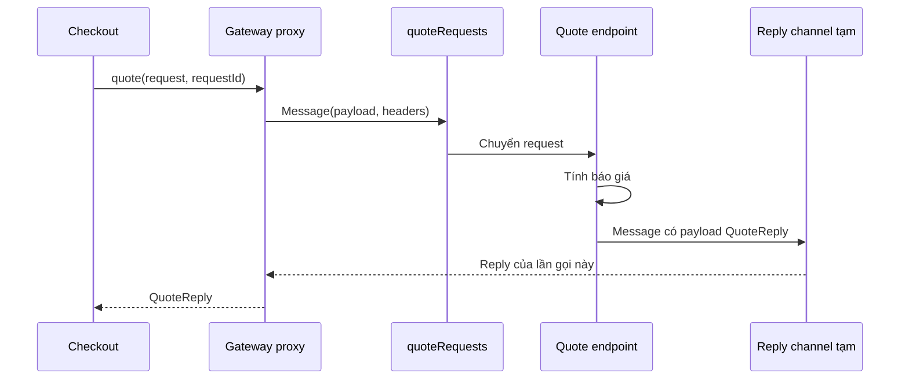
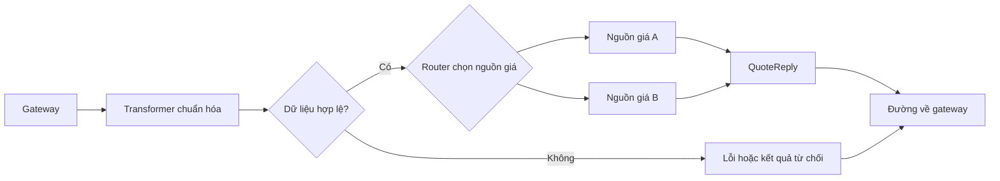

# Gateway request-reply

## Mục tiêu và phạm vi

Trong chương **Messaging gateway** của module **SPRING_INTEGRATION_CORE**, bài này giải thích cách biến một lời gọi Java có giá trị trả về thành một cuộc trao đổi thông điệp request-reply. Bạn sẽ kết nối `Message`, `MessageChannel`, endpoint và gateway bằng Java DSL, rồi xem điều gì xảy ra khi luồng trả kết quả, phát sinh lỗi hoặc không tạo phản hồi.

Sau bài học, bạn có thể:

- Thiết kế interface gateway có hợp đồng đầu vào, đầu ra và thời gian chờ rõ ràng.
- Theo dấu request từ tham số phương thức đến payload/header, rồi theo dấu reply trở về caller.
- Giải thích vai trò của `replyChannel` và sự khác biệt giữa xử lý cùng luồng với xử lý qua executor hoặc hàng đợi.
- Thiết kế đường kết thúc cho transformer, router, filter và aggregator trong một luồng cần phản hồi.
- Viết kiểm thử cho kết quả thành công, lỗi nghiệp vụ và tình huống không có reply.

Các ví dụ dùng `record` của Java 17 trở lên và API Spring Integration 6.2 trở lên; riêng thuộc tính `@MessagingGateway(errorOnTimeout = true)` có từ phiên bản 6.2. Hãy dùng bộ phiên bản tương thích do nền tảng của ứng dụng quản lý. [Javadoc `MessagingGateway`](https://docs.spring.io/spring-integration/api/org/springframework/integration/annotation/MessagingGateway.html#errorOnTimeout()).

## 1. Request-reply là hợp đồng gì?

Giả sử checkout cần tính báo giá trước khi cho khách xác nhận đơn:

```java
QuoteReply reply = quoteGateway.quote(request, "req-1001");
```

Đối với checkout, đây là một phương thức nhận `QuoteRequest` và trả `QuoteReply`. Bên trong gateway, lời gọi được ánh xạ thành message gửi vào luồng tích hợp; kết quả của luồng được ánh xạ ngược thành giá trị trả về. Gateway proxy là ranh giới giữa cách lập trình bằng phương thức Java và cách phối hợp các endpoint bằng thông điệp. [Javadoc `GatewayProxyFactoryBean`](https://docs.spring.io/spring-integration/api/org/springframework/integration/gateway/GatewayProxyFactoryBean.html).

Một hợp đồng request-reply nên trả lời được bốn câu hỏi:

| Câu hỏi | Quyết định trong ví dụ báo giá |
| --- | --- |
| Gửi dữ liệu gì? | Mã sản phẩm và số lượng trong `QuoteRequest` |
| Kết quả có nghĩa gì? | Báo giá đã tính xong, biểu diễn bằng `QuoteReply` |
| Chờ đến khi nào? | Cấu hình thời gian gửi và thời gian chờ reply |
| Khi không thể có kết quả? | Ném lỗi hoặc trả một kết quả nghiệp vụ mô tả thất bại theo hợp đồng đã chọn |

Việc gửi message thành công chỉ cho biết thao tác gửi đã được channel chấp nhận theo cơ chế của channel đó. Ví dụ, hàng đợi đã nhận request chưa có nghĩa dịch vụ báo giá đã xử lý xong. Checkout chỉ có thể sử dụng giá tiền khi nhận được reply hợp lệ.

## 2. Đường đi của một lời gọi



Trong cấu hình thông thường, gateway tạo một reply channel tạm, ẩn danh cho cuộc trao đổi và đặt địa chỉ trả lời trong header `replyChannel`. Vì vậy, bạn không cần tự tạo một bean reply channel chỉ để nhận kết quả. Nếu khai báo reply channel có tên, framework tạo bridge để đưa phản hồi về kênh tạm của lời gọi. [Messaging Gateways — Setting the Default Reply Channel](https://docs.spring.io/spring-integration/reference/gateway.html#gateway-default-reply-channel).

Đừng nhầm ba thông tin sau:

| Thông tin | Mục đích |
| --- | --- |
| `replyChannel` | Địa chỉ để gửi phản hồi về cuộc trao đổi đang chờ |
| `requestId` do ứng dụng đặt | Theo dõi một yêu cầu nghiệp vụ qua log hoặc các lần thử lại |
| `correlationId` dùng trong luồng | Gom các message có liên quan, chẳng hạn các phần cần tổng hợp |

Một header `requestId` không tự biến thành địa chỉ trả lời. Tương tự, tự đặt `correlationId` không thay thế việc giữ đúng đường về gateway.

Với service activator, nếu có output channel thì kết quả được gửi tiếp vào output channel; nếu không có, endpoint có thể dùng `replyChannel` trong request. Bởi vậy, endpoint tính toán được một giá trị chưa đủ: giá trị đó còn phải đi tới đúng đích. [Service Activator](https://docs.spring.io/spring-integration/reference/service-activator.html).

## 3. Ví dụ hoàn chỉnh: tính báo giá bằng annotation và Java DSL

Ví dụ sau là một ứng dụng Spring thuần trong package `example.gateway`. Mỗi kiểu `public` đặt trong tệp Java mang tên tương ứng. Cần các thư viện `spring-integration-core` và Spring Context; kiểm thử ở phần sau dùng thêm Spring Test và JUnit Jupiter. Với Spring Boot, có thể dùng starter integration và starter test theo dependency management của ứng dụng.

### 3.1. Kiểu dữ liệu nghiệp vụ

```java
package example.gateway;

public record QuoteRequest(String sku, int quantity) {
}
```

```java
package example.gateway;

import java.math.BigDecimal;

public record QuoteReply(String sku, BigDecimal total, String currency) {
}
```

Dùng kiểu đầu ra riêng giúp hợp đồng dễ đọc hơn `Object` hoặc một chuỗi JSON chưa có cấu trúc. Ví dụ này chỉ tính giá, chưa tạo đơn hay trừ tồn kho.

### 3.2. Interface gateway

```java
package example.gateway;

import org.springframework.integration.annotation.MessagingGateway;
import org.springframework.messaging.handler.annotation.Header;

@MessagingGateway(
        defaultRequestChannel = "quoteRequests",
        defaultRequestTimeout = "300",
        defaultReplyTimeout = "1500",
        errorOnTimeout = true)
public interface QuoteGateway {

    QuoteReply quote(
            QuoteRequest request,
            @Header("requestId") String requestId);
}
```

`request` trở thành payload, còn tham số đánh dấu `@Header` trở thành header. Khi kiểu trả về là `QuoteReply`, gateway lấy payload của reply để trả về; nếu cần cả header, có thể khai báo kiểu trả về là `Message<QuoteReply>`. [Javadoc `Gateway`](https://docs.spring.io/spring-integration/api/org/springframework/integration/annotation/Gateway.html).

Hai giá trị timeout ở annotation cấp interface là chuỗi và có đơn vị mili giây. `errorOnTimeout = true` chọn cách báo lỗi khi hết thời gian chờ reply, thay cho kết quả `null`; ví dụ chưa khai báo error channel riêng nên lỗi được đưa về caller. [Javadoc `MessagingGateway`](https://docs.spring.io/spring-integration/api/org/springframework/integration/annotation/MessagingGateway.html).

### 3.3. Dịch vụ tính giá

```java
package example.gateway;

import java.math.BigDecimal;

public class QuoteService {

    public QuoteReply calculate(QuoteRequest request) {
        if (request.quantity() <= 0) {
            throw new IllegalArgumentException("quantity phải lớn hơn 0");
        }

        if (!"BOOK-01".equals(request.sku())) {
            throw new IllegalArgumentException("Không có giá cho SKU này");
        }

        BigDecimal unitPrice = new BigDecimal("39.90");
        BigDecimal total = unitPrice.multiply(
                BigDecimal.valueOf(request.quantity()));

        return new QuoteReply(request.sku(), total, "USD");
    }
}
```

Dịch vụ chỉ nhận và trả dữ liệu nghiệp vụ. Nó không phải biết tên channel hay cách caller đang chờ kết quả.

### 3.4. Cấu hình luồng

```java
package example.gateway;

import org.springframework.context.annotation.Bean;
import org.springframework.context.annotation.Configuration;
import org.springframework.integration.channel.DirectChannel;
import org.springframework.integration.config.EnableIntegration;
import org.springframework.integration.config.IntegrationComponentScan;
import org.springframework.integration.dsl.IntegrationFlow;

@Configuration
@EnableIntegration
@IntegrationComponentScan(basePackageClasses = QuoteGateway.class)
public class QuoteIntegrationConfig {

    @Bean
    public DirectChannel quoteRequests() {
        return new DirectChannel();
    }

    @Bean
    public QuoteService quoteService() {
        return new QuoteService();
    }

    @Bean
    public IntegrationFlow quoteFlow(QuoteService quoteService) {
        return IntegrationFlow.from("quoteRequests")
                .handle(quoteService, "calculate",
                        endpoint -> endpoint.requiresReply(true))
                .get();
    }
}
```

`@IntegrationComponentScan` quét interface mang `@MessagingGateway` để đăng ký proxy; component scan thông thường không tự xử lý loại interface này. `@EnableIntegration` bật hạ tầng cần thiết cho cấu hình Spring thuần của ví dụ. [Javadoc `MessagingGateway`](https://docs.spring.io/spring-integration/api/org/springframework/integration/annotation/MessagingGateway.html), [Messaging Gateways — annotation](https://docs.spring.io/spring-integration/reference/gateway.html).

Ở cuối flow không có output channel. Kết quả từ `calculate` được đưa về địa chỉ trả lời của request. `requiresReply(true)` khiến endpoint báo lỗi nếu phương thức trả `null`, giúp phát hiện vi phạm hợp đồng gần nơi phát sinh. Nó không buộc một phương thức đang treo phải kết thúc. [Service Activator](https://docs.spring.io/spring-integration/reference/service-activator.html), [Javadoc `GenericEndpointSpec`](https://docs.spring.io/spring-integration/docs/current/api/org/springframework/integration/dsl/GenericEndpointSpec.html).

### 3.5. Gọi thử

```java
package example.gateway;

import org.springframework.context.annotation.AnnotationConfigApplicationContext;

public class QuoteDemo {

    public static void main(String[] args) {
        try (var context = new AnnotationConfigApplicationContext(
                QuoteIntegrationConfig.class)) {

            QuoteGateway gateway = context.getBean(QuoteGateway.class);
            QuoteReply reply = gateway.quote(
                    new QuoteRequest("BOOK-01", 2), "req-1001");

            System.out.println(reply.total());     // 79.80
            System.out.println(reply.currency());  // USD
        }
    }
}
```

Trong ứng dụng thực tế, inject `QuoteGateway` qua constructor vào checkout. Caller dùng bean proxy do Spring quản lý; chỉ tự khai báo một interface trong mã nguồn chưa tạo ra đường vào flow.

## 4. Ánh xạ phương thức và ghi đè theo từng lời gọi

Khi có nhiều tham số nghiệp vụ, hãy chỉ rõ payload/header để tránh mơ hồ. Ví dụ hợp đồng khác:

```java
QuoteReply quote(
        @org.springframework.messaging.handler.annotation.Payload
        QuoteRequest request,
        @org.springframework.messaging.handler.annotation.Header("tenantId")
        String tenantId,
        @org.springframework.messaging.handler.annotation.Header("requestId")
        String requestId);
```

Tham số kiểu `Map` không nên được hiểu bằng suy đoán khi cả payload và header đều có thể là map. Dùng `@Payload`, `@Header` hoặc `@Headers` để thể hiện chủ ý. [Javadoc `Gateway`](https://docs.spring.io/spring-integration/api/org/springframework/integration/annotation/Gateway.html).

Một phương thức có thể đặt timeout riêng bằng `@Gateway`. Đoạn sau minh họa cách thay khai báo phương thức trong interface đã có:

```java
@org.springframework.integration.annotation.Gateway(
        requestTimeout = 200,
        replyTimeout = 800)
QuoteReply quote(
        QuoteRequest request,
        @org.springframework.messaging.handler.annotation.Header("requestId")
        String requestId);
```

Ở cấp phương thức, `requestTimeout` và `replyTimeout` nhận `long`, khác với các thuộc tính mặc định dạng chuỗi của `@MessagingGateway`. Các giá trị ở phương thức ghi đè mặc định tương ứng của interface. [Javadoc `Gateway`](https://docs.spring.io/spring-integration/api/org/springframework/integration/annotation/Gateway.html#replyTimeout()).

Giữ kiểu trả về nhất quán với mọi nhánh kết thúc. Nếu gateway trả `QuoteReply`, một nhánh trả chuỗi `"OUT_OF_STOCK"` sẽ tạo ra hợp đồng khó dùng và có thể gây lỗi chuyển kiểu. Muốn biểu diễn kết quả không có hàng như dữ liệu bình thường, nên thiết kế một kiểu kết quả có trạng thái rõ ràng ngay từ đầu.

## 5. Hai timeout bảo vệ hai giai đoạn khác nhau

| Cấu hình | Giai đoạn được giới hạn | Ví dụ |
| --- | --- | --- |
| `requestTimeout` | Chờ gửi message khi thao tác gửi có thể bị chặn | `QueueChannel` hữu hạn đang đầy |
| `replyTimeout` | Chờ phản hồi sau khi thao tác gửi trả quyền điều khiển về gateway | Request đã giao cho worker, caller chờ kết quả |
| Timeout của HTTP client/JDBC client | Thao tác I/O do endpoint thực hiện | Đọc phản hồi từ dịch vụ giá bên ngoài |

`requestTimeout` không phải ngân sách xử lý toàn bộ request. Đặc biệt, nó không đặt giới hạn thực thi cho một service được gọi qua `DirectChannel`. Thời gian chờ gửi vào channel có thể chặn được mô tả ở [Javadoc `Gateway`](https://docs.spring.io/spring-integration/api/org/springframework/integration/annotation/Gateway.html#requestTimeout()) và [QueueChannel](https://docs.spring.io/spring-integration/reference/channel/implementations.html#channel-implementations-queuechannel).

### 5.1. Toàn bộ flow chạy cùng luồng

`DirectChannel` chuyển xử lý đến subscriber trong luồng gửi. Nếu `calculate` mất 8 giây, caller vẫn đang thực thi bên trong thao tác gửi của chính nó. Cấu hình `replyTimeout = 1500` không ngắt phương thức đó sau 1,5 giây. [Message Channel Implementations](https://docs.spring.io/spring-integration/reference/channel/implementations.html), [Gateway Behavior When No response Arrives](https://docs.spring.io/spring-integration/reference/gateway.html#gateway-no-response).

```text
caller: vào gateway -> gửi -> calculate chạy 8 giây -> có reply -> trả kết quả
```

Đây là lý do cần timeout ở HTTP/JDBC client nếu service thực hiện I/O. Một timeout ở gateway không thay thế cơ chế giới hạn thời gian của thao tác đang chạy.

### 5.2. Flow chuyển xử lý sang worker

Khi có ranh giới executor hoặc hàng đợi, caller có thể quay về gateway để chờ trong khi worker tiếp tục xử lý. Lúc đó `replyTimeout` giới hạn bước chờ phản hồi. [Gateway Behavior When No response Arrives](https://docs.spring.io/spring-integration/reference/gateway.html#gateway-no-response).

Để thử biến thể này, **thay** bean `quoteRequests()` trong cấu hình bằng hai bean sau và giữ nguyên `quoteFlow`:

```java
@Bean
public org.springframework.scheduling.concurrent.ThreadPoolTaskExecutor
quoteExecutor() {
    var executor = new org.springframework.scheduling.concurrent
            .ThreadPoolTaskExecutor();
    executor.setCorePoolSize(4);
    executor.setMaxPoolSize(4);
    executor.setQueueCapacity(32);
    executor.setThreadNamePrefix("quote-");
    return executor;
}

@Bean
public org.springframework.integration.channel.ExecutorChannel quoteRequests(
        org.springframework.scheduling.concurrent.ThreadPoolTaskExecutor
                quoteExecutor) {
    return new org.springframework.integration.channel.ExecutorChannel(
            quoteExecutor);
}
```

Spring quản lý khởi tạo và vòng đời của executor bean. Khi executor nhận được việc, caller thường chuyển sang chờ reply, còn worker thực thi service. Cần giữ dung lượng executor hữu hạn và có chính sách xử lý từ chối phù hợp; nếu cấu hình chính sách chạy việc ngay trên luồng caller khi quá tải, giả định về ranh giới luồng sẽ thay đổi. [ExecutorChannel](https://docs.spring.io/spring-integration/reference/channel/implementations.html#channel-implementations-executorchannel).

```text
caller: gửi cho worker -> chờ reply -> hết hạn -> nhận lỗi timeout
worker:                  tiếp tục calculate -> có thể hoàn thành muộn
```

Với `QueueChannel`, việc thêm hàng đợi còn yêu cầu consumer dùng poller; chỉ tạo queue và gửi request vào đó không tự tạo worker lấy message ra. Thời gian nằm trong queue cũng tiêu tốn thời gian caller đang chờ. [Message Channel Implementations](https://docs.spring.io/spring-integration/reference/channel/implementations.html).

### 5.3. Hết thời gian chờ không đồng nghĩa hủy công việc

Giả sử worker tạo một báo giá lưu trong cơ sở dữ liệu nhưng reply đến sau khi checkout hết hạn. Checkout chưa nhận được kết quả, còn báo giá có thể đã tồn tại. Từ đó cần thiết kế:

- Mã yêu cầu ổn định khi retry để có thể nhận diện cùng một thao tác nghiệp vụ.
- Cách truy vấn kết quả đã tạo nếu hợp đồng cho phép hoàn thành muộn.
- Log thời gian chờ, thời gian xử lý và request ID để đối chiếu.
- Cơ chế idempotency nếu thao tác có tác dụng phụ và caller có thể thử lại.

Đây là hệ quả thiết kế của việc caller và worker kết thúc ở các thời điểm khác nhau. Gateway không tự cấp bảo đảm xử lý đúng một lần, không tự rollback thao tác bên ngoài, cũng không tự hủy worker chỉ vì caller đã hết thời gian chờ.

## 6. Khi nào gateway nhận `null`, khi nào nhận exception?

Trong bài này, `errorOnTimeout = true` và không có error channel riêng, nên hết hạn chờ reply được báo bằng `MessageTimeoutException`. Nếu giữ `errorOnTimeout = false`, timeout chờ reply có thể trả `null`. [Javadoc `MessagingGateway`](https://docs.spring.io/spring-integration/api/org/springframework/integration/annotation/MessagingGateway.html#errorOnTimeout()).

Phân biệt **service trả `null`** với **gateway trả `null`**. Service trả `null` thường có nghĩa endpoint không sinh reply message; gateway chỉ biết rằng nó chưa nhận được phản hồi, rồi xử lý theo thời gian chờ đã cấu hình. `requiresReply(true)` biến việc service trả `null` thành lỗi tại endpoint. [Service Activator](https://docs.spring.io/spring-integration/reference/service-activator.html).

| Tình huống | Hệ quả cần dự kiến |
| --- | --- |
| Service trả `QuoteReply` và đường về còn nguyên | Caller nhận kết quả |
| Service ném lỗi trong ví dụ chạy đồng bộ | Caller nhận exception theo cơ chế gateway |
| Service trả `null`, không yêu cầu reply tại endpoint | Không sinh phản hồi; caller có thể chờ đến hạn |
| Service trả `null`, bật `requiresReply(true)` | Endpoint ném `ReplyRequiredException` |
| Filter loại request và không có nhánh phản hồi | Gateway vẫn chờ dù request đã bị loại |
| Reply bị đưa vào một output channel không có đường về | Kết quả không đến cuộc gọi đang chờ |
| Chờ vô hạn trong một nhánh không sinh reply | Có thể giữ caller vô hạn |

Tránh kiểu trả về primitive nếu hợp đồng vẫn cho phép `null` khi timeout, vì primitive không biểu diễn được kết quả đó. Tốt hơn là quyết định rõ giữa “kết quả có thể vắng mặt” và “thiếu phản hồi là lỗi”, rồi thể hiện nhất quán trong interface và caller.

## 7. Mỗi nhánh của flow cần một đường kết thúc

Một flow tính báo giá có thể cần chuẩn hóa dữ liệu, chọn dịch vụ giá và tổng hợp nhiều thành phần:



Sơ đồ này minh họa router chọn **một** nguồn giá. Nếu yêu cầu lấy nhiều nguồn rồi so sánh, cần thiết kế việc phân nhánh và tổng hợp riêng.

| Thành phần | Câu hỏi khi đặt trong request-reply |
| --- | --- |
| Transformer | Kết quả có đúng kiểu mà endpoint tiếp theo cần? Header phục vụ định tuyến có được giữ? |
| Filter | Message bị loại sẽ tạo lỗi ngay hay đi tới một nhánh trả kết quả từ chối? |
| Router | Giá trị không khớp nhánh nào sẽ được xử lý ra sao? |
| Aggregator | Khi nào nhóm được phát hành? Thiếu một phần thì hết hạn theo chính sách nào? |
| Endpoint cuối | Có tạo kết quả và gửi về đúng địa chỉ trả lời không? |

Filter mặc định có thể loại message mà không tạo phản hồi. Khi hợp đồng xem đầu vào bị loại là lỗi, có thể dùng `throwExceptionOnRejection(true)`; nếu đó là tình huống nghiệp vụ bình thường, thiết kế discard flow trả một kết quả phù hợp. [Filter](https://docs.spring.io/spring-integration/reference/filter.html).

Ví dụ chèn filter vào flow trước service:

```java
return IntegrationFlow.from("quoteRequests")
        .<QuoteRequest>filter(
                request -> request.quantity() > 0,
                filter -> filter.throwExceptionOnRejection(true))
        .handle(quoteService, "calculate",
                endpoint -> endpoint.requiresReply(true))
        .get();
```

`requiresReply` chỉ kiểm tra endpoint được cấu hình. Nó không thể phát hiện request bị một filter trước đó loại bỏ, cũng không tự hoàn tất một nhóm aggregator đang thiếu message. Vì vậy, hãy duyệt từng nhánh từ đầu vào đến điểm kết thúc, thay vì chỉ kiểm tra phương thức cuối cùng.

Đối với aggregator, nên quyết định ngân sách chờ nhóm trước khi chọn thời gian chờ của gateway. Ví dụ, nếu nghiệp vụ cho nhóm tối đa 900 ms để hoàn tất, còn gateway chỉ chờ 500 ms sau khi giao việc, caller có thể rời đi trước lúc nhóm được giải phóng. Phải tính thêm thời gian nằm hàng đợi, gọi dịch vụ và gửi kết quả khi đặt ngân sách cho toàn đường đi.

## 8. Giữ đường trả lời khi xử lý `Message`

Ưu tiên để các endpoint thông thường xử lý payload nếu không cần thao tác message. Khi cần tự dựng một message mới trong custom handler, hãy chú ý header mà luồng phía sau còn sử dụng.

Ví dụ dưới đây minh họa dựng message dẫn xuất từ request:

```java
import org.springframework.messaging.Message;
import org.springframework.messaging.support.MessageBuilder;

public Message<QuoteReply> calculateMessage(Message<QuoteRequest> request) {
    QuoteReply reply = calculate(request.getPayload());

    return MessageBuilder.withPayload(reply)
            .copyHeaders(request.getHeaders())
            .setHeader("quoteSource", "local-catalog")
            .build();
}
```

Đoạn này là phương án thay cho xử lý payload trong một custom message handler, không phải phương thức cần thêm vào `QuoteService` của ví dụ chính. Việc sao chép header cần có chủ ý; khi đi ra hệ thống khác, chỉ truyền các header được giao thức cho phép.

Đối tượng reply channel tạm trong bộ nhớ không phải địa chỉ có thể tuần tự hóa và mang sang một tiến trình khác một cách trực tiếp. Khi đi qua HTTP, JMS hoặc AMQP, gateway/adapter của giao thức phải ánh xạ cơ chế reply/correlation phù hợp. Một header `replyChannel` nội bộ không tự làm dịch vụ từ xa biết cách gọi ngược vào JVM.

Với nhiều lời gọi đồng thời, không đưa kết quả về một queue dùng chung rồi tự lấy “message tiếp theo” để trả cho caller. Thứ tự hoàn thành có thể khác thứ tự gửi. Hãy để cơ chế gateway và đường trả lời của từng cuộc trao đổi giữ việc ghép kết quả; request ID nghiệp vụ hỗ trợ quan sát và đối chiếu.

## 9. Xử lý lỗi trong request-reply

### 9.1. Giữ lỗi làm exception

Trong flow `DirectChannel` của ví dụ chính, exception từ `QuoteService` đi trở lại gateway. Gateway có quy tắc unwrap cause; loại exception caller nhận có liên quan đến chuỗi nguyên nhân và khai báo `throws` của interface. Với `IllegalArgumentException` trong ví dụ, caller có thể bắt lỗi nghiệp vụ này. [Messaging Gateways — Error Handling](https://docs.spring.io/spring-integration/reference/gateway.html#gateway-error-handling).

```java
try {
    QuoteReply reply = gateway.quote(
            new QuoteRequest("BOOK-01", 0), "req-invalid");
} catch (IllegalArgumentException ex) {
    // Đổi thành thông báo phù hợp tại biên giao diện của ứng dụng.
}
```

### 9.2. Chuyển lỗi thành kết quả có cấu trúc

Nếu nghiệp vụ muốn caller nhận dữ liệu mô tả thất bại, hãy thiết kế kiểu trả về bao quát cả hai trạng thái, chẳng hạn:

```java
public record QuoteOutcome(
        boolean successful,
        QuoteReply quote,
        String errorCode) {
}
```

Khi đổi gateway sang `QuoteOutcome`, cả luồng thành công và luồng lỗi đều phải trả kiểu này. Một error flow có thể ánh xạ exception thành `QuoteOutcome(false, null, "PRICE_UNAVAILABLE")`; không được chỉ thay kiểu trả về của interface trong khi nhánh thành công vẫn trả `QuoteReply`.

Gateway cho phép cấu hình `errorChannel` để chuyển lỗi sang một flow riêng và dùng kết quả từ flow đó làm phản hồi. Error flow chỉ ghi log, trả `void` hoặc tiêu thụ message mà không trả kết quả có thể khiến hợp đồng request-reply thiếu phản hồi. [Messaging Gateways — Error Handling](https://docs.spring.io/spring-integration/reference/gateway.html#gateway-error-handling).

Không dùng tổng tiền bằng 0 để giả lập việc tính giá thành công khi dịch vụ giá lỗi. Với checkout, “giá bằng 0” và “chưa xác định được giá” là hai kết quả nghiệp vụ khác nhau.

### 9.3. Khi có ranh giới luồng

Lỗi trên worker không thể tự nhảy qua Java call stack sang caller. Hạ tầng bất đồng bộ dùng `ErrorMessage` và định tuyến lỗi theo error channel; header `errorChannel` của message được ưu tiên trước global error channel. Với request-reply, cần giữ đường phản hồi lỗi về cuộc trao đổi đang chờ. [Error Handling](https://docs.spring.io/spring-integration/reference/error-handling.html).

Nếu tự tạo thread bằng `new Thread(...)` hoặc gửi công việc sang executor riêng ngoài cơ chế endpoint, bạn phải tự xử lý việc chuyển kết quả/lỗi về flow. Việc lỗi xuất hiện trong log worker không đồng nghĩa gateway đã nhận được thông báo kết thúc.

## 10. Gateway đồng bộ không quyết định toàn bộ mô hình thực thi

```java
QuoteReply quote(QuoteRequest request);
```

Hợp đồng này khiến caller chờ một kết quả trực tiếp. Bên trong vẫn có thể dùng `ExecutorChannel`, queue và nhiều worker. Ngược lại, `DirectChannel` giữ công việc trên luồng caller trong ví dụ chính. Cần xem channel và endpoint thực tế khi phân tích khả năng chặn, tải đồng thời và vị trí phát sinh lỗi.

Nếu caller không thể giữ một luồng trong lúc chờ, có thể thiết kế gateway trả `CompletableFuture<QuoteReply>` hoặc kiểu bất đồng bộ được hỗ trợ. Tuy nhiên, đó là thay đổi hợp đồng với caller; chỉ đổi channel sang executor không làm phương thức trả `QuoteReply` trở thành một API không chặn. [Messaging Gateways — Asynchronous Gateway](https://docs.spring.io/spring-integration/reference/gateway.html).

Tương tự, request-reply không tự mở một giao dịch bao trùm cả hệ thống. Khi luồng chuyển sang worker, đừng giả định transaction gắn với luồng caller sẽ tự đi theo; cần đặt ranh giới transaction ở nơi thực hiện công việc và xem xét cơ chế phối hợp với tài nguyên bên ngoài.

## 11. Hai cách dùng gateway trong Java DSL

### 11.1. Tạo gateway từ interface ngay tại đầu flow

Thay vì quét interface mang annotation, có thể khai báo một interface thuần rồi để DSL tạo proxy:

```java
package example.gateway;

public interface PlainQuoteGateway {
    QuoteReply quote(QuoteRequest request);
}
```

```java
@Bean
public IntegrationFlow plainQuoteFlow(QuoteService quoteService) {
    return IntegrationFlow.from(PlainQuoteGateway.class, gateway -> gateway
                    .beanName("plainQuoteGateway")
                    .replyTimeout(1500))
            .handle(quoteService, "calculate",
                    endpoint -> endpoint.requiresReply(true))
            .get();
}
```

DSL cung cấp input channel nội bộ cho các phương thức của interface. Vì thế, `requestChannel` trên annotation không dùng để chọn một flow khác trong cách khai báo này. Hãy chọn một cách đăng ký cho mỗi gateway để tránh tạo nhiều proxy ngoài chủ ý. [IntegrationFlow as a Gateway](https://docs.spring.io/spring-integration/reference/dsl/integration-flow-as-gateway.html).

Đoạn DSL này chỉ minh họa cách khởi tạo proxy, chưa chọn lại đầy đủ chính sách lỗi timeout của ví dụ annotation. Khi đổi cấu hình thực tế, hãy giữ hợp đồng timeout/lỗi mà caller đang dựa vào.

### 11.2. Gọi một flow con bằng `.gateway(...)`

Trong một flow đang xử lý message, toán tử `.gateway(...)` có thể gọi một flow khác qua input channel và chờ reply rồi tiếp tục pipeline. Đây là điểm gọi nằm trong flow, khác vị trí với interface `QuoteGateway` mà checkout gọi. [Operator gateway()](https://docs.spring.io/spring-integration/reference/dsl/java-gateway.html).

```java
@Bean
public IntegrationFlow quoteSubflow(QuoteService quoteService) {
    return IntegrationFlow.from("quoteSubflow.input")
            .handle(quoteService, "calculate",
                    endpoint -> endpoint.requiresReply(true))
            .get();
}

@Bean
public IntegrationFlow checkoutQuoteFlow() {
    return IntegrationFlow.from("checkoutQuote.input")
            .gateway("quoteSubflow.input")
            .<QuoteReply, String>transform(
                    reply -> reply.total() + " " + reply.currency())
            .get();
}
```

Đây là biến thể độc lập: đầu vào `checkoutQuote.input` nhận `QuoteRequest`, còn kết quả cuối là `String`. Nếu mở interface gateway vào flow này, kiểu trả về của interface phải phù hợp với chuỗi cuối cùng. Hợp đồng của gateway ngoài không nhất thiết giống kiểu reply của gateway gọi flow con.

## 12. Kiểm thử hợp đồng request-reply

Đoạn kiểm thử sau dành cho cấu hình đồng bộ ở phần 3, trước các biến thể thay channel hoặc thêm filter. Nó kiểm tra proxy thật và flow thật trong Spring context, thay vì mock gateway rồi chỉ xác nhận mock trả giá trị đã cài.

```java
package example.gateway;

import java.math.BigDecimal;

import org.junit.jupiter.api.Test;
import org.springframework.beans.factory.annotation.Autowired;
import org.springframework.test.context.junit.jupiter.SpringJUnitConfig;

import static org.junit.jupiter.api.Assertions.assertEquals;
import static org.junit.jupiter.api.Assertions.assertThrows;

@SpringJUnitConfig(QuoteIntegrationConfig.class)
class QuoteGatewayTest {

    @Autowired
    private QuoteGateway gateway;

    @Test
    void returnsCalculatedQuote() {
        QuoteReply reply = gateway.quote(
                new QuoteRequest("BOOK-01", 2), "req-test-1");

        assertEquals("BOOK-01", reply.sku());
        assertEquals(new BigDecimal("79.80"), reply.total());
        assertEquals("USD", reply.currency());
    }

    @Test
    void propagatesInvalidQuantity() {
        assertThrows(IllegalArgumentException.class, () -> gateway.quote(
                new QuoteRequest("BOOK-01", 0), "req-test-2"));
    }
}
```

Với các tình huống không có reply, tạo context kiểm thử riêng để không làm thay đổi ví dụ chính:

| Tình huống kiểm thử | Cách tạo có kiểm soát | Điều cần xác nhận |
| --- | --- | --- |
| Endpoint vi phạm hợp đồng | Service giả trả `null`, bật `requiresReply(true)` | Có lỗi thiếu reply tại endpoint |
| Request không tạo reply | Flow cuối dùng handler trả `void`, timeout ngắn và hữu hạn | Nhận `null` hoặc lỗi timeout đúng cấu hình |
| Worker hoàn thành muộn | Worker đợi `CountDownLatch`; caller có thời gian chờ hữu hạn | Caller hết hạn trước khi thả latch; luôn thả latch khi dọn dẹp |
| Queue đầy | Queue dung lượng 1 đã có message, chưa có consumer | Lần gửi tiếp bị giới hạn theo request timeout |
| Nhiều request đồng thời | Dữ liệu đầu vào khác nhau và hoàn thành đảo thứ tự | Mỗi caller nhận kết quả đúng yêu cầu của mình |

Không kiểm tra rằng timeout xảy ra chính xác ở một mili giây cụ thể. Lập lịch thread và tải máy có thể làm số đo dao động. Hãy kiểm tra loại kết quả/lỗi, thứ tự sự kiện và một giới hạn thời gian đủ rộng để phát hiện treo; dùng latch để kiểm soát worker thay vì phụ thuộc vào chuỗi `sleep` dễ dao động.

## 13. Chẩn đoán khi caller không nhận được phản hồi

| Triệu chứng | Kiểm tra đầu tiên |
| --- | --- |
| Không inject được gateway | Interface đã được quét hoặc tạo proxy qua DSL chưa? |
| Lỗi gửi ngay khi gọi | Input channel có subscriber? Tên channel có khớp? Executor có từ chối công việc? |
| Nhận `null` sau một khoảng chờ | Hợp đồng có cho phép timeout trả `null`? Nhánh nào đã không tạo reply? |
| Có log đã tính giá nhưng caller vẫn chờ | Output channel cuối và header trả lời còn đúng không? |
| Reply timeout ngắn mà caller vẫn bị giữ lâu | Có endpoint chậm đang chạy cùng luồng qua `DirectChannel` không? |
| Chỉ lỗi khi có nhiều request đồng thời | Có custom code lấy reply từ queue chung hoặc ghi đè header định tuyến không? |
| Chỉ có log lỗi từ worker | Error flow có đưa lỗi về cuộc trao đổi đang chờ không? |
| Có nhiều reply cho một request | Nhánh publish-subscribe/fan-out có đang tạo nhiều kết quả cuối ngoài hợp đồng không? |

Để đọc log có ích, ghi request ID, tên endpoint, thread thực thi và thời điểm bắt đầu/kết thúc ở các biên quan trọng. Với timeout, phân biệt thời gian chờ gửi, thời gian nằm queue, thời gian tính toán và thời gian chờ reply; một con số tổng duy nhất thường không cho biết nghẽn ở đâu.

## 14. Tự thực hành

1. Chạy ví dụ đồng bộ với `BOOK-01`, số lượng 2; dự đoán payload request, header `requestId` và kết quả trước khi đọc output.
2. Cho `QuoteService` trả `null` trong một nhánh và so sánh hành vi khi bật/tắt `requiresReply`, luôn giữ timeout hữu hạn.
3. Thay input channel bằng `ExecutorChannel`. Dùng một cổng chờ có kiểm soát trong service để quan sát caller hết hạn trong khi worker chưa hoàn tất.
4. Thêm filter loại số lượng không hợp lệ. Thiết kế kết thúc bằng exception hoặc một kiểu kết quả từ chối, rồi xác nhận caller không chờ một reply vốn không thể có.
5. Mở rộng bài toán thành lấy hai thành phần giá cần tổng hợp. Xác định chính sách thiếu một thành phần trước khi chọn thời gian chờ của gateway.

Điểm cần giải thích được sau thực hành: caller chờ một kết quả có ý nghĩa nghiệp vụ; channel quyết định việc chuyển giao và mô hình luồng; endpoint quyết định tạo kết quả; đường trả lời đưa kết quả về đúng lời gọi. Thiết kế request-reply hoàn chỉnh phải có cách kết thúc rõ ràng cho cả thành công, lỗi và thiếu phản hồi.
