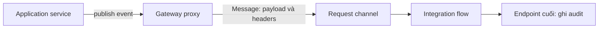
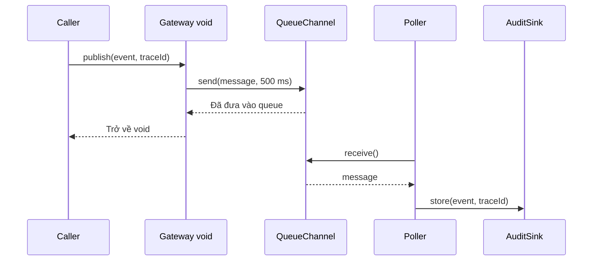

# Gateway one-way

Bài học thuộc chương **Messaging gateway** của module **SPRING_INTEGRATION_CORE**. Nội dung tập trung vào cách đưa lời gọi Java vào một luồng thông điệp bằng gateway một chiều, sử dụng `Message`, `MessageChannel`, endpoint và Java DSL; đồng thời làm rõ cách xử lý lỗi và kiểm thử tại ranh giới đó.

## 1. Mục tiêu và tình huống sử dụng

Sau bài học, bạn có thể:

- Khai báo một gateway có phương thức trả về `void` và ánh xạ đối số thành payload, header.
- Giải thích thời điểm phương thức trở về khi sử dụng `DirectChannel`, `QueueChannel` hoặc `ExecutorChannel`.
- Chọn timeout phù hợp cho thao tác gửi, thiết kế đường xử lý lỗi và kiểm thử hành vi một chiều.
- Phân biệt việc tiếp nhận thông điệp với việc hoàn tất tác vụ nghiệp vụ.

Giả sử ứng dụng cần ghi lại sự kiện người dùng tải báo cáo. Phần nghiệp vụ muốn gọi một interface như `auditGateway.publish(event, traceId)` mà không phải tự tạo `Message` hoặc tìm channel. Kết quả ghi audit không cần trở thành giá trị trả về của lời gọi này. Đây là một tình huống phù hợp để bắt đầu với gateway one-way.

Tuy nhiên, yêu cầu “không cần kết quả trả về” vẫn cần đi cùng một hợp đồng rõ ràng: audit có bắt buộc thành công trước khi tiếp tục hay có thể xử lý sau; khi hệ thống quá tải thì từ chối hay chờ; nếu ghi thất bại thì ai chịu trách nhiệm xử lý.

## 2. Hợp đồng one-way được thể hiện như thế nào?

Một phương thức gateway trả về `void` biểu diễn việc gửi thông điệp mà không đợi reply để chuyển thành kết quả Java. Spring tạo proxy cho interface; caller nhận proxy qua dependency injection. [Tham khảo Messaging Gateways](https://docs.spring.io/spring-integration/reference/gateway.html).

```java
public interface AuditGateway {
    void publish(AuditEvent event, String traceId);
}
```

Đây mới là hình dạng của hợp đồng. Phần cấu hình đầy đủ ở mục 4 sẽ chỉ ra channel đích và cách ánh xạ `traceId`.



Trong ví dụ này, bên gọi giao một sự kiện cho hệ thống tích hợp. Bạn có thể bổ sung transformer để chuẩn hóa nội dung, router để chọn đích hoặc filter để áp dụng chính sách trước khi ghi audit. Các bước ấy thuộc luồng thông điệp; interface phía caller vẫn có thể giữ nguyên.

### 2.1. Phân biệt ba khái niệm thường bị gộp chung

| Khái niệm | Câu hỏi nó trả lời | Ví dụ trong bài |
| --- | --- | --- |
| One-way | Caller có nhận một reply qua giá trị trả về không? | `void publish(...)` |
| Bất đồng bộ | Công việc có được bàn giao sang thread hoặc giai đoạn xử lý khác không? | Gateway gửi vào queue, poller xử lý sau |
| Bền vững | Thông điệp đã tiếp nhận có được giữ qua sự cố tiến trình không? | Phải có cơ chế lưu trữ hoặc hạ tầng phù hợp |

Với yêu cầu ghi audit, hãy xác định riêng từng câu hỏi. Một thiết kế có thể là one-way nhưng chạy đồng bộ và chỉ lưu dữ liệu trong bộ nhớ. Một thiết kế khác có thể nhận thông điệp rồi xử lý sau trên hạ tầng có lưu trữ. Chữ ký `void` không đủ để lựa chọn giữa hai thiết kế đó.

### 2.2. One-way khác request-reply tại hợp đồng

```java
// Hợp đồng một chiều: không nhận kết quả nghiệp vụ qua return value.
void submitAudit(AuditEvent event);

// Hợp đồng request-reply: yêu cầu có kết quả để trả về.
AuditReceipt submitAuditAndGetReceipt(AuditEvent event);
```

Ở dòng thứ hai, `AuditReceipt` cần mang ý nghĩa cụ thể. Biên nhận tiếp nhận, kết quả lưu dữ liệu và kết quả hoàn tất toàn bộ nghiệp vụ là những mốc khác nhau. Nếu bên gọi cần một mốc nào đó để quyết định bước tiếp theo, hãy mô hình hóa mốc ấy trong hợp đồng thay vì suy luận từ việc một phương thức `void` đã trở về.

Ví dụ: chức năng tải báo cáo có thể cho phép ghi thống kê sau. Chức năng xác nhận đã thu tiền thường cần bằng chứng về kết quả xử lý. Cả hai đều có thể phát thông điệp, nhưng yêu cầu trả kết quả cho caller khác nhau.

## 3. Channel quyết định ranh giới thực thi

| Channel tại điểm bàn giao | Đường thực thi thông thường | Khi lời gọi gửi trở về bình thường |
| --- | --- | --- |
| `DirectChannel` | Subscriber được gọi trên thread gửi | Đoạn xử lý đồng bộ mà thread này đi qua đã kết thúc |
| `QueueChannel` | Lưu vào queue; consumer nhận riêng | Message đã được đưa vào queue |
| `ExecutorChannel` | Giao tác vụ cho executor | Tác vụ gửi đã được executor chấp nhận theo cấu hình |

`QueueChannel` mặc định lưu trong bộ nhớ và có thể chặn người gửi khi queue có giới hạn đã đầy. `ExecutorChannel` còn phụ thuộc executor và chính sách khi quá tải; chính sách kiểu caller-runs có thể khiến tác vụ chạy ngay trên thread gửi. [Tham khảo Message Channel Implementations](https://docs.spring.io/spring-integration/reference/channel/implementations.html).

Khi phân tích một flow, hãy lần theo toàn bộ đường đi. Nếu request channel là `DirectChannel` nhưng phía sau có queue, thời điểm caller trở về chỉ phản ánh đoạn đồng bộ đến điểm bàn giao đó. Nó không phản ánh những bước được consumer của queue thực hiện về sau.

### 3.1. Timeout gửi và timeout chờ reply

`requestTimeout` của `@Gateway` giới hạn thời gian chờ gửi nếu channel hỗ trợ thao tác gửi có thể bị chặn, chẳng hạn queue đầy. `replyTimeout` áp dụng cho việc chờ phản hồi. Giá trị timeout của annotation được tính bằng mili giây. [API @Gateway](https://docs.spring.io/spring-integration/docs/6.5.0/api/org/springframework/integration/annotation/Gateway.html).

| Cấu hình hoặc giới hạn | Mục đích trong ví dụ audit |
| --- | --- |
| `@Gateway(requestTimeout = 500)` | Chờ tối đa 500 ms để đưa message vào queue đang đầy |
| `replyTimeout` | Không tạo thêm bước chờ phản hồi nghiệp vụ cho phương thức `void` |
| Timeout của client gọi cơ sở dữ liệu hoặc dịch vụ ngoài | Giới hạn thao tác I/O mà handler thực hiện |

Nếu handler đồng bộ đang gọi một hệ thống ngoài bị treo, đặt `requestTimeout` trên gateway không tạo một cơ chế ngắt handler sau 500 ms. Hãy cấu hình giới hạn tại client và thành phần thực hiện công việc. Đây là hai vị trí kiểm soát khác nhau trong thiết kế.

Cũng không nên biến một phương thức request-reply thành one-way bằng cách đặt `replyTimeout = 0`. Nếu caller không cần reply, hãy khai báo hợp đồng `void` ngay từ đầu.

## 4. Ví dụ đầy đủ: gateway một chiều chạy đồng bộ

Ví dụ dùng Java 17 trở lên và các API của Spring Integration 6.5. Cần dependency `org.springframework.integration:spring-integration-core`; phần kiểm thử dùng JUnit Jupiter. Dùng phiên bản do BOM của dự án quản lý. Không cần broker hoặc cơ sở dữ liệu để thực hành ví dụ này.

Các lớp dưới đây nằm trong package `example.gateway`. Mỗi kiểu `public` được đặt trong tệp Java cùng tên. `AuditSink` là nơi ghi thử trong bộ nhớ; hành động `FAIL_STORE` chỉ là điểm giả lập lỗi phục vụ bài học.

### 4.1. Payload nghiệp vụ

```java
package example.gateway;

import java.time.Instant;
import java.util.Objects;

public record AuditEvent(
        String eventId,
        String actor,
        String action,
        Instant occurredAt) {

    public AuditEvent {
        Objects.requireNonNull(eventId, "eventId");
        Objects.requireNonNull(actor, "actor");
        Objects.requireNonNull(action, "action");
        Objects.requireNonNull(occurredAt, "occurredAt");
    }
}
```

`eventId` là định danh do ứng dụng cấp cho sự kiện. Khi thiết kế cơ chế gửi lại, có thể dùng định danh này để nhận biết cùng một sự kiện. Việc có trường định danh chưa tự tạo ra cơ chế chống xử lý trùng; nơi lưu dữ liệu phải áp dụng quy tắc tương ứng.

### 4.2. Interface gateway và header

```java
package example.gateway;

import org.springframework.integration.annotation.Gateway;
import org.springframework.integration.annotation.MessagingGateway;
import org.springframework.messaging.handler.annotation.Header;
import org.springframework.messaging.handler.annotation.Payload;

@MessagingGateway(defaultRequestChannel = "auditInput")
public interface AuditGateway {

    @Gateway(requestTimeout = 500)
    void publish(
            @Payload AuditEvent event,
            @Header("auditTraceId") String traceId);
}
```

`@Payload` chỉ định đối số làm nội dung message; `@Header` đưa đối số còn lại vào header có tên `auditTraceId`. Đây là header tùy chỉnh để lần theo sự kiện trong ví dụ, chưa phải cấu hình distributed tracing. [API ánh xạ tham số của @Gateway](https://docs.spring.io/spring-integration/docs/6.5.0/api/org/springframework/integration/annotation/Gateway.html).

Caller chỉ phụ thuộc vào interface `AuditGateway` và đối tượng `AuditEvent`. Caller không phải tự giữ tham chiếu đến `MessageChannel` hoặc tự lắp ghép message.

### 4.3. Nơi nhận dữ liệu để quan sát

```java
package example.gateway;

import java.util.List;
import java.util.Objects;
import java.util.concurrent.CopyOnWriteArrayList;

public final class AuditSink {

    private final List<StoredAudit> stored = new CopyOnWriteArrayList<>();

    public void store(AuditEvent event, String traceId) {
        Objects.requireNonNull(traceId, "traceId");
        if ("FAIL_STORE".equals(event.action())) {
            throw new IllegalStateException("Audit store unavailable");
        }
        stored.add(new StoredAudit(
                event,
                traceId,
                Thread.currentThread().getName()));
    }

    public List<StoredAudit> snapshot() {
        return List.copyOf(stored);
    }

    public record StoredAudit(
            AuditEvent event,
            String traceId,
            String threadName) {
    }
}
```

Danh sách này chỉ giúp bài thực hành kiểm tra payload, header và thread thực thi. Nó không đại diện cho một kho audit bền vững. `CopyOnWriteArrayList` được chọn để ví dụ đọc kết quả an toàn khi chuyển sang poller ở mục sau, với số lượng sự kiện thử nhỏ.

### 4.4. Cấu hình channel và endpoint bằng Java DSL

```java
package example.gateway;

import org.springframework.context.annotation.Bean;
import org.springframework.context.annotation.Configuration;
import org.springframework.integration.annotation.IntegrationComponentScan;
import org.springframework.integration.channel.DirectChannel;
import org.springframework.integration.config.EnableIntegration;
import org.springframework.integration.dsl.IntegrationFlow;
import org.springframework.messaging.MessageChannel;

@Configuration
@EnableIntegration
@IntegrationComponentScan(basePackageClasses = AuditGateway.class)
public class AuditFlowConfig {

    @Bean
    public MessageChannel auditInput() {
        return new DirectChannel();
    }

    @Bean
    public AuditSink auditSink() {
        return new AuditSink();
    }

    @Bean
    public IntegrationFlow auditFlow(AuditSink sink) {
        return IntegrationFlow.from("auditInput")
                .handle(AuditEvent.class, (event, headers) -> {
                    sink.store(event, (String) headers.get("auditTraceId"));
                    return null;
                })
                .get();
    }
}
```

`@IntegrationComponentScan` tìm interface có `@MessagingGateway` để đăng ký proxy. Component scan thông thường không làm việc này với interface. [Tham khảo Annotation Support](https://docs.spring.io/spring-integration/reference/6.5/configuration/annotations.html).

Handler cuối hoàn tất tác dụng phụ rồi trả `null`, nên không phát message kết quả. Không cấu hình `requiresReply(true)` ở endpoint này. Một service activator có thể kết thúc bằng `void` hoặc `null`; bật yêu cầu reply rồi trả `null` sẽ gây `ReplyRequiredException`. [Tham khảo hành vi service activator](https://docs.spring.io/spring-integration/docs/6.0.3/reference/html/messaging-endpoints.html).

### 4.5. Gọi qua Spring context

```java
package example.gateway;

import java.time.Instant;
import org.springframework.context.annotation.AnnotationConfigApplicationContext;

public final class AuditGatewayDemo {

    public static void main(String[] args) {
        try (var context =
                new AnnotationConfigApplicationContext(AuditFlowConfig.class)) {
            AuditGateway gateway = context.getBean(AuditGateway.class);
            AuditSink sink = context.getBean(AuditSink.class);

            gateway.publish(
                    new AuditEvent(
                            "audit-001",
                            "user-42",
                            "REPORT_DOWNLOADED",
                            Instant.now()),
                    "trace-001");

            System.out.println(sink.snapshot());
        }
    }
}
```

Với cấu hình `DirectChannel` và handler trên, kết quả đã có trong `AuditSink` khi `publish` trở về. Trường `threadName` cho thấy handler chạy trên thread gọi `main`. Không có kết quả Java trả về từ gateway, nhưng lời gọi vẫn phải đi qua thao tác `store` trước khi tiếp tục.

Khi áp dụng vào ứng dụng thực tế, inject gateway vào application service. Không tự tạo một implementation bằng `new` rồi mong Spring tự chuyển lời gọi của đối tượng đó thành message.

## 5. Chuyển sang queue: cùng hợp đồng, khác thời điểm hoàn tất

Giả sử chức năng tải báo cáo được phép tiếp tục ngay sau khi audit được tiếp nhận vào bộ đệm. Trong `AuditFlowConfig`, thay hai phương thức `auditInput` và `auditFlow` bằng phần dưới; giữ bean `auditSink` cùng các annotation cấu hình. Đây là phương án thay thế, không đăng ký song song hai bean cùng tên.

Thêm hai import:

```java
import java.time.Duration;
import org.springframework.integration.channel.QueueChannel;
import org.springframework.integration.dsl.Pollers;
```

```java
@Bean
public QueueChannel auditInput() {
    return new QueueChannel(100);
}

@Bean
public IntegrationFlow auditFlow(AuditSink sink) {
    return IntegrationFlow.from("auditInput")
            .handle(AuditEvent.class, (event, headers) -> {
                sink.store(event, (String) headers.get("auditTraceId"));
                return null;
            }, endpoint -> endpoint.poller(
                    Pollers.fixedDelay(Duration.ofMillis(100))
                            .maxMessagesPerPoll(20)))
            .get();
}
```

Endpoint nhận từ queue cần được polling. Cấu hình trên chọn một poller có chu kỳ fixed delay 100 ms và giới hạn 20 message trong một lượt poll. [API Pollers](https://docs.spring.io/spring-integration/docs/6.5.0/api/org/springframework/integration/dsl/Pollers.html).



Sơ đồ minh họa trường hợp consumer chạy sau khi caller đã trở về. Trong thực tế, poller có thể nhận message rất nhanh và xử lý trước khi caller kịp tiếp tục. Không nên viết logic hoặc test dựa trên giả định rằng tác vụ chắc chắn chưa bắt đầu khi `publish` trở về.

Với biến thể này:

- `publish` thành công cho biết message đã vào queue, chưa xác nhận đã có bản ghi audit.
- Nếu queue 100 phần tử đang đầy, lời gọi có thể phải chờ gửi trong giới hạn đã cấu hình.
- Nếu thiếu consumer, message có thể chỉ nằm chờ; chữ ký `void` không phát hiện thay bạn lỗi thiết kế đó.
- Không dùng đoạn `main` ngắn ở mục trước để kết luận công việc nền đã hoàn tất: đọc snapshot ngay có thể thấy danh sách rỗng, và đóng context ngay sau đó làm kết quả thử phụ thuộc thời điểm.

Trong một dịch vụ chạy lâu dài, cần quản lý vòng đời consumer và việc dừng ứng dụng. Trong kiểm thử, hãy chờ một tín hiệu hoàn tất cụ thể hoặc nhận message tại một channel quan sát, với thời hạn hữu hạn.

## 6. Xử lý lỗi: caller và error flow có trách nhiệm gì?

### 6.1. Lỗi trên đường đồng bộ

Khi chưa cấu hình `errorChannel`, lỗi xảy ra trên thread gọi có thể truyền về caller. Với gateway không khai báo `throws`, framework có thể bóc lớp `MessagingException` để ném runtime exception nghiệp vụ bên trong. [Tham khảo Error Handling của gateway](https://docs.spring.io/spring-integration/reference/gateway.html#error-handling).

Trong cấu hình đồng bộ ở mục 4, caller có thể quan sát lỗi giả lập như sau:

```java
try {
    gateway.publish(
            new AuditEvent(
                    "audit-fail",
                    "user-42",
                    "FAIL_STORE",
                    Instant.now()),
            "trace-fail");
} catch (IllegalStateException failure) {
    // Chọn phản ứng nghiệp vụ phù hợp khi audit chưa được ghi.
    System.err.println(failure.getMessage());
}
```

Đây là exception của lời gọi, không phải một reply nghiệp vụ. Do đó, `void` vẫn cho phép báo thất bại theo cơ chế exception của Java.

### 6.2. Lỗi sau điểm bàn giao sang poller

Một exception xảy ra trên thread xử lý nền không thể quay lại call stack đã kết thúc của caller. Cơ chế xử lý lỗi chuẩn của Spring Integration tạo `ErrorMessage`; ưu tiên đích trong header `errorChannel`, rồi mới dùng channel lỗi toàn cục. [Tham khảo Error Handling](https://docs.spring.io/spring-integration/reference/error-handling.html).

Với phương thức `void`, cấu hình `errorChannel` tại gateway còn được đưa vào header của message để luồng bất đồng bộ sử dụng. [Tham khảo cấu hình lỗi cho one-way gateway](https://docs.spring.io/spring-integration/reference/gateway.html#error-handling).

Để quan sát lỗi của biến thể queue, sửa annotation của `AuditGateway`:

```java
@MessagingGateway(
        defaultRequestChannel = "auditInput",
        errorChannel = "auditErrors")
public interface AuditGateway {

    @Gateway(requestTimeout = 500)
    void publish(
            @Payload AuditEvent event,
            @Header("auditTraceId") String traceId);
}
```

Thêm bean sau vào cấu hình queue:

```java
@Bean
public QueueChannel auditErrors() {
    return new QueueChannel();
}
```

Ở đây, `auditErrors` là điểm quan sát phục vụ bài thực hành: test sẽ chủ động gọi `receive(timeout)` để lấy lỗi. Nếu triển khai ứng dụng chạy thật, cần consumer cho đường lỗi và chính sách xử lý rõ ràng; để lỗi tích tụ trong queue không phải là một cơ chế khôi phục.

Có thể quan sát một lần lỗi bằng đoạn mã dưới, trong một context đang chạy cấu hình queue và gateway đã có `errorChannel`:

```java
import org.springframework.messaging.Message;
import org.springframework.messaging.MessagingException;
import org.springframework.messaging.support.ErrorMessage;

QueueChannel errors = context.getBean("auditErrors", QueueChannel.class);

// Với queue trống và không có lỗi gửi, publish hoàn tất việc tiếp nhận.
gateway.publish(
        new AuditEvent(
                "audit-fail-async",
                "user-42",
                "FAIL_STORE",
                Instant.now()),
        "trace-fail-async");

Message<?> observed = errors.receive(2_000);
if (!(observed instanceof ErrorMessage errorMessage)) {
    throw new AssertionError("Không nhận được ErrorMessage trong thời hạn");
}

Throwable failure = errorMessage.getPayload();
if (failure instanceof MessagingException messagingFailure) {
    Message<?> failed = messagingFailure.getFailedMessage();
    if (failed != null) {
        System.out.println(failed.getHeaders().get("auditTraceId"));
    }
}
```

Trong tình huống này, hãy theo dõi message gây lỗi thông qua `failedMessage` khi exception có thông tin đó. Không giả định mọi `Throwable` đều có message nguồn hoặc header của `ErrorMessage` luôn giống header của request.

### 6.3. Cấu hình error channel có thể đổi cách caller nhìn thấy lỗi

Khi gateway được cấu hình đưa lỗi vào error channel, một error flow xử lý thành công có thể khiến lời gọi trở về bình thường dù nghiệp vụ đích đã thất bại. Đây là sự thay đổi hợp đồng lỗi cần được quyết định có chủ ý. [API @MessagingGateway.errorChannel](https://docs.spring.io/spring-integration/docs/6.5.0/api/org/springframework/integration/annotation/MessagingGateway.html#errorChannel()).

Với ví dụ audit, có thể chọn lưu sự kiện lỗi để vận hành xử lý sau. Nếu một chức năng bắt buộc audit thành công mới được tiếp tục, hãy kiểm tra lại xem việc chuyển lỗi sang đường riêng có còn thỏa yêu cầu hay không.

Lỗi khi gửi request, như queue đầy hoặc executor từ chối tiếp nhận, vẫn cần một chính sách riêng. Chúng xảy ra tại điểm bàn giao; đừng gộp chúng với lỗi `store` xuất hiện sau đó. Consumer cũng cần bảo vệ đường lỗi: nếu nơi ghi nhận lỗi thất bại, phải có cách quan sát thất bại thứ hai ấy.

## 7. Reply ngoài ý muốn và endpoint kết thúc

Kể từ Spring Integration 5.4, phương thức gateway `void` được gắn `replyChannel` trỏ tới `nullChannel` nếu header này chưa được chỉ định, để bỏ reply ngoài ý muốn. [Tham khảo hành vi replyChannel của one-way gateway](https://docs.spring.io/spring-integration/reference/gateway.html#setting-the-default-reply-channel).

Điều này hữu ích khi một bước downstream có thể trả kết quả nhưng caller đã chọn hợp đồng không nhận kết quả. Tuy nhiên, thiết kế vẫn nên chỉ rõ endpoint nào thực hiện tác dụng phụ cuối cùng và tại đâu kết quả không còn cần được sử dụng.

Một flow một chiều vẫn có thể biến đổi dữ liệu qua nhiều bước. Ví dụ, transformer chuẩn hóa tên hành động, router chọn kho lưu, rồi service activator thực hiện ghi dữ liệu. “Một chiều” mô tả ranh giới gateway; nó không cấm các bước bên trong trả message cho bước kế tiếp.

Cần phân biệt hai cấu hình:

| Cấu hình | Thông tin bị loại bỏ |
| --- | --- |
| Reply của gateway `void` được đưa vào `nullChannel` theo cơ chế mặc định | Kết quả downstream mà hợp đồng không cần nhận |
| Chủ động đặt `errorChannel = "nullChannel"` | Lỗi được chuyển tới đích loại bỏ |

Cấu hình thứ hai có thể khiến vận hành mất thông tin thất bại. Nếu audit cần được theo dõi, nên có error flow ghi nhận đủ định danh và nguyên nhân thay vì bỏ lỗi. [API cấu hình errorChannel](https://docs.spring.io/spring-integration/docs/6.5.0/api/org/springframework/integration/annotation/MessagingGateway.html#errorChannel()).

## 8. Kiểm thử hợp đồng thay vì đoán thời gian

Các đoạn test dưới đây là mã thực hành để chạy trong dự án có JUnit Jupiter. Hai cấu hình thử có mục đích khác nhau: cấu hình đồng bộ ở mục 4 kiểm tra kết quả ngay tại thời điểm gọi; cấu hình queue độc lập ở mục 8.2 kiểm tra việc bàn giao và timeout mà không cần poller chạy đua với test.

### 8.1. Kiểm tra payload, header, thread và lỗi đồng bộ

Dùng nguyên trạng gateway ở mục 4, chưa thêm `errorChannel`, và cấu hình `DirectChannel` ban đầu:

```java
package example.gateway;

import java.time.Instant;
import org.junit.jupiter.api.Test;
import org.springframework.context.annotation.AnnotationConfigApplicationContext;

import static org.junit.jupiter.api.Assertions.assertEquals;
import static org.junit.jupiter.api.Assertions.assertThrows;

class AuditGatewaySyncTest {

    @Test
    void storesPayloadAndHeaderBeforeReturning() {
        try (var context =
                new AnnotationConfigApplicationContext(AuditFlowConfig.class)) {
            AuditGateway gateway = context.getBean(AuditGateway.class);
            AuditSink sink = context.getBean(AuditSink.class);
            AuditEvent event = new AuditEvent(
                    "audit-test-1",
                    "user-42",
                    "REPORT_DOWNLOADED",
                    Instant.parse("2026-01-01T00:00:00Z"));
            String callerThread = Thread.currentThread().getName();

            gateway.publish(event, "trace-test-1");

            assertEquals(1, sink.snapshot().size());
            AuditSink.StoredAudit stored = sink.snapshot().get(0);
            assertEquals(event, stored.event());
            assertEquals("trace-test-1", stored.traceId());
            assertEquals(callerThread, stored.threadName());
        }
    }

    @Test
    void propagatesFailureOnTheCallerThread() {
        try (var context =
                new AnnotationConfigApplicationContext(AuditFlowConfig.class)) {
            AuditGateway gateway = context.getBean(AuditGateway.class);
            AuditEvent event = new AuditEvent(
                    "audit-test-fail",
                    "user-42",
                    "FAIL_STORE",
                    Instant.parse("2026-01-01T00:00:00Z"));

            IllegalStateException failure = assertThrows(
                    IllegalStateException.class,
                    () -> gateway.publish(event, "trace-test-fail"));

            assertEquals("Audit store unavailable", failure.getMessage());
            assertEquals(0, context.getBean(AuditSink.class).snapshot().size());
        }
    }
}
```

Test thứ nhất kiểm tra một lời hứa quan sát được: dữ liệu đã được ghi khi gateway đồng bộ trở về. Test thứ hai kiểm tra phản ứng của caller với lỗi giả lập. Nếu đổi channel hoặc thêm error flow, phải đánh giá lại những lời hứa ấy trước khi sửa assertion.

### 8.2. Kiểm tra one-way trên queue và trường hợp đầy queue

Test này dùng interface và cấu hình nằm ngay trong lớp test; không bật `@IntegrationComponentScan` và không nạp `AuditFlowConfig`. Nhờ vậy nó không vô tình kéo theo consumer của ví dụ khác.

```java
package example.gateway;

import java.time.Instant;
import org.junit.jupiter.api.Test;
import org.springframework.context.annotation.Bean;
import org.springframework.context.annotation.Configuration;
import org.springframework.context.annotation.AnnotationConfigApplicationContext;
import org.springframework.integration.channel.QueueChannel;
import org.springframework.integration.config.EnableIntegration;
import org.springframework.integration.gateway.GatewayProxyFactoryBean;
import org.springframework.messaging.Message;
import org.springframework.messaging.MessageDeliveryException;
import org.springframework.messaging.handler.annotation.Header;
import org.springframework.messaging.handler.annotation.Payload;

import static org.junit.jupiter.api.Assertions.assertEquals;
import static org.junit.jupiter.api.Assertions.assertNotNull;
import static org.junit.jupiter.api.Assertions.assertThrows;

class AuditGatewayQueueTest {

    interface QueueOnlyGateway {
        void publish(
                @Payload AuditEvent event,
                @Header("auditTraceId") String traceId);
    }

    @Configuration
    @EnableIntegration
    static class QueueOnlyConfig {

        @Bean
        QueueChannel auditInput() {
            return new QueueChannel(1);
        }

        @Bean
        GatewayProxyFactoryBean<QueueOnlyGateway> queueOnlyGateway() {
            var factory = new GatewayProxyFactoryBean<>(QueueOnlyGateway.class);
            factory.setDefaultRequestChannelName("auditInput");
            factory.setDefaultRequestTimeout(0L);
            return factory;
        }
    }

    @Test
    void returnsWithoutAConsumerAndPreservesMessageData() {
        try (var context =
                new AnnotationConfigApplicationContext(QueueOnlyConfig.class)) {
            QueueOnlyGateway gateway = context.getBean(QueueOnlyGateway.class);
            QueueChannel input = context.getBean("auditInput", QueueChannel.class);
            AuditEvent event = event("audit-queue-1");

            gateway.publish(event, "trace-queue-1");

            assertEquals(1, input.getQueueSize());
            Message<?> message = input.receive(0);
            assertNotNull(message);
            assertEquals(event, message.getPayload());
            assertEquals("trace-queue-1",
                    message.getHeaders().get("auditTraceId"));
        }
    }

    @Test
    void failsToSendWhenQueueHasNoCapacity() {
        try (var context =
                new AnnotationConfigApplicationContext(QueueOnlyConfig.class)) {
            QueueOnlyGateway gateway = context.getBean(QueueOnlyGateway.class);
            QueueChannel input = context.getBean("auditInput", QueueChannel.class);

            gateway.publish(event("audit-queue-1"), "trace-queue-1");

            assertThrows(MessageDeliveryException.class,
                    () -> gateway.publish(
                            event("audit-queue-2"), "trace-queue-2"));
            assertEquals(1, input.getQueueSize());
        }
    }

    private static AuditEvent event(String id) {
        return new AuditEvent(
                id,
                "user-42",
                "REPORT_DOWNLOADED",
                Instant.parse("2026-01-01T00:00:00Z"));
    }
}
```

`GatewayProxyFactoryBean` là cách đăng ký proxy bằng Java thay cho cơ chế quét annotation; bean trả về là factory, còn `getBean(QueueOnlyGateway.class)` lấy proxy mà factory tạo ra. [API GatewayProxyFactoryBean](https://docs.spring.io/spring-integration/docs/6.5.0/api/org/springframework/integration/gateway/GatewayProxyFactoryBean.html).

Không có consumer trong test là chủ ý: message đầu tiên chiếm đúng một chỗ, nên message thứ hai không thể vào queue. Timeout gửi bằng `0` làm kiểm thử từ chối ngay mà không phải đo ước lượng số mili giây. Test đầu cũng cho thấy gateway `void` không đòi consumer tạo reply mới cho caller tiếp tục.

### 8.3. Kiểm tra đường lỗi của biến thể queue có poller

Với cấu hình mục 5 và `auditErrors` ở mục 6, một kiểm thử tích hợp cần chứng minh đủ các điểm sau:

1. Publish một sự kiện `FAIL_STORE` với `eventId` và `auditTraceId` riêng.
2. Nhận từ `auditErrors` trong thời hạn hữu hạn, chẳng hạn 2 giây.
3. Xác nhận nhận được `ErrorMessage` và nguyên nhân gốc là lỗi giả lập của sink.
4. Khi payload là `MessagingException`, lấy `failedMessage` và đối chiếu payload cùng header định danh.
5. Xác nhận sink không có bản ghi thành công cho sự kiện lỗi.

Không chỉ viết assertion “gateway không ném exception”: điều đó chưa chứng minh consumer đã chạy hoặc đường lỗi đã hoạt động. Tương tự, `Thread.sleep(100)` rồi đọc snapshot làm test phụ thuộc tốc độ máy. Hãy chờ tại điểm quan sát phản ánh đúng điều kiện cần chứng minh.

## 9. Độ tin cậy, giao dịch và khả năng quan sát

Đối với bài toán audit, một hợp đồng vận hành rõ ràng có thể ghi như sau: “Chấp nhận sự kiện vào bộ đệm trong tối đa 500 ms; xử lý ghi riêng; sự kiện thất bại được lưu vào đường lỗi và có người hoặc tiến trình xử lý tiếp”. Mỗi vế cần có thành phần thực hiện và cách đo tương ứng.

| Mối quan tâm | Quyết định thiết kế cần có |
| --- | --- |
| Tiếp nhận | Channel nào tiếp nhận, dung lượng bao nhiêu, khi đầy thì làm gì |
| Hoàn tất | Điểm nào xác nhận đã ghi audit; caller có cần biết điểm này không |
| Thất bại | Đích lưu lỗi, định danh sự kiện, nguyên nhân và cách xử lý tiếp |
| Gửi lại | Khi nào gửi lại, giới hạn ra sao, có chống ghi trùng hay không |
| Khởi động và dừng | Message đang chờ sẽ được giữ, xử lý tiếp hoặc từ chối như thế nào |
| Quan sát | Số sự kiện tiếp nhận, ghi thành công, thất bại và thời gian chờ |

Không thể suy ra “đã ghi đúng một lần” từ việc `publish` trở về. Ví dụ, nếu tiến trình bị dừng sau khi queue nhận message nhưng trước khi sink ghi dữ liệu, ứng dụng cần cơ chế giữ và tiếp tục công việc. Nếu caller gửi lại sau một lỗi chưa rõ kết quả, sink cần xử lý khả năng nhận cùng `eventId` nhiều lần.

Tương tự, không suy ra một giao dịch nguyên tử giữa cập nhật nghiệp vụ và ghi audit chỉ từ việc hai thao tác cùng xuất hiện trong một phương thức Java. Nếu cần bảo đảm chúng đi cùng nhau, phải xác định tài nguyên, transaction manager và ranh giới commit. Khi yêu cầu cần lưu thay đổi nghiệp vụ cùng sự kiện phát đi, có thể khảo sát mẫu transactional outbox như một thiết kế riêng.

Riêng với việc chuyển qua queue hoặc executor, hãy đánh giá lại transaction context, security context và thông tin truy vết tại điểm chuyển thread. Đừng dựa vào thread-local của caller để cung cấp dữ liệu bắt buộc cho consumer. Trong ví dụ này, `auditTraceId` được đưa tường minh vào message để consumer có thể đọc được.

## 10. Những lỗi thiết kế dễ gặp

| Biểu hiện | Giả định gây lỗi | Cách điều chỉnh |
| --- | --- | --- |
| Caller bị giữ lâu dù gateway là `void` | One-way luôn chạy nền | Lần theo channel và các bước đồng bộ; đặt timeout tại thao tác I/O |
| Caller tiếp tục nhưng audit chưa xuất hiện | Trở về đồng nghĩa hoàn tất ghi | Xác định mốc tiếp nhận và mốc hoàn tất; quan sát consumer |
| Thông điệp vào queue nhưng không được xử lý | Queue tự gọi handler | Cấu hình consumer và poller, kiểm tra lifecycle |
| `try/catch` quanh gateway không thấy lỗi sink chạy nền | Exception nền quay về caller cũ | Thiết kế error flow và kiểm thử tại error channel |
| Không có bean gateway để inject | Scan thông thường sẽ tạo implementation cho interface | Bật `@IntegrationComponentScan` hoặc đăng ký factory tường minh |
| Endpoint cuối báo thiếu reply | Bật `requiresReply` cho tác vụ chỉ có tác dụng phụ | Kết thúc đúng hợp đồng bằng handler `void` hoặc `null` |
| Mất dấu sự kiện lỗi | Cho rằng lỗi luôn giữ nguyên mọi header ở message ngoài cùng | Kiểm tra `failedMessage` và ghi lại định danh có sẵn |
| Ghi trùng khi gửi lại | Gateway tự cung cấp chống trùng | Thiết kế idempotency tại điểm lưu hoặc xử lý nghiệp vụ |

## 11. Bài thực hành củng cố

Thực hiện lần lượt trên một dự án thử nghiệm:

1. Chạy ví dụ `DirectChannel`, xác nhận snapshot có đúng một sự kiện và thread ghi trùng với thread gọi.
2. Gửi hành động `FAIL_STORE`, kiểm tra caller nhận lỗi theo hợp đồng đồng bộ ban đầu.
3. Chuyển sang queue, giữ chữ ký `void`, bổ sung đường lỗi và xác nhận `ErrorMessage` có liên hệ với đúng sự kiện.
4. Dùng cấu hình queue không có consumer trong test để tái hiện trường hợp đầy queue một cách xác định.
5. Bổ sung bước chuẩn hóa `action` trước sink; xác định bước nào còn tạo message tiếp theo và bước nào kết thúc luồng.
6. Viết mô tả hợp đồng cho một ứng dụng thực: caller biết gì sau `publish`, lỗi được đưa về đâu và ai chịu trách nhiệm hoàn tất tác vụ.

Khi giải thích thiết kế, hãy dùng ba thông tin cụ thể: **phương thức gateway trả về kiểu gì**, **điểm nào bàn giao việc xử lý**, và **thất bại được quan sát ở đâu**. Với ba thông tin này, bạn có thể đánh giá một flow one-way mà không phải suy đoán từ tên phương thức hoặc từ khóa “fire-and-forget”.
