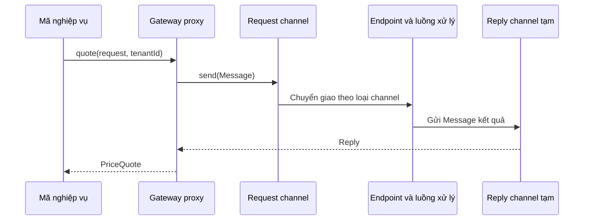

# Request channel

## Mục tiêu và phạm vi

Trong chương **Messaging gateway** của module **SPRING_INTEGRATION_CORE**, request channel là kênh mà gateway gửi thông điệp yêu cầu vào khi mã nghiệp vụ gọi một phương thức Java. Chọn kênh này cũng là chọn điểm bắt đầu của một luồng tích hợp.

Bài học nối hợp đồng gateway với các thành phần cốt lõi của Spring Integration: `Message`, `MessageChannel`, endpoint và Java DSL. Ví dụ xuyên suốt là dịch vụ báo giá có hai luồng: báo giá thông thường và báo giá bán sỉ. Từ ví dụ này, người học có thể:

- Cấu hình request channel mặc định và ghi đè cho từng phương thức.
- Phân biệt việc gửi request thành công với việc nghiệp vụ hoàn thành.
- Chọn `DirectChannel`, `QueueChannel` hoặc `ExecutorChannel` theo cách thực thi mong muốn.
- Giải thích đúng `requestTimeout`, `replyTimeout` và đường trả kết quả.
- Nhận diện lỗi đấu nối, thiếu consumer và luồng không sinh reply.
- Viết kiểm thử xác nhận gateway đưa request vào đúng kênh.

## 1. Request channel nằm ở đâu trong luồng?

Một lời gọi như `pricingGateway.quote(request, tenantId)` được gateway chuyển thành thông điệp. Gateway gửi thông điệp đó vào request channel đã cấu hình; endpoint nhận thông điệp từ kênh rồi thực hiện công việc.

`MessageChannel` cung cấp thao tác `send(...)`. Endpoint mới là thành phần thực thi transformer, router hoặc lời gọi dịch vụ. Không nên xem bản thân channel là một phương thức nghiệp vụ. Hai nhóm giao diện quan trọng là `SubscribableChannel`, phân phối cho handler đã đăng ký, và `PollableChannel`, cho phép consumer gọi `receive(...)`. Xem [MessageChannel và các giao diện con](https://docs.spring.io/spring-integration/reference/channel/interfaces.html).



Sơ đồ mô tả đường đi logic. Thời điểm từng bước chạy và thread thực thi phụ thuộc loại channel.

Ba thành phần sau giữ những vai trò khác nhau:

| Thành phần | Câu hỏi nó trả lời | Ví dụ |
|---|---|---|
| Request channel | Request đi vào luồng nào? | `priceRequests` |
| Endpoint đầu tiên | Ai nhận và xử lý request? | Transformer chuẩn hóa mã hàng |
| Reply channel | Kết quả quay lại đâu? | Kênh tạm do gateway quản lý |

Với gateway request–reply thông thường, không cần tự tạo một reply channel có tên. Gateway quản lý địa chỉ nhận reply cho lời gọi; luồng cần bảo toàn đường trả kết quả đó. Tài liệu [Messaging Gateways](https://docs.spring.io/spring-integration/reference/gateway.html) mô tả cơ chế reply channel tạm và vai trò của header `replyChannel`.

## 2. Cấu hình request channel ở hai cấp

### 2.1. Mặc định trên interface

```java
@MessagingGateway(
        defaultRequestChannel = "priceRequests",
        defaultRequestTimeout = "500",
        defaultReplyTimeout = "3000")
public interface PricingGateway {

    PriceQuote quote(PriceRequest request,
                     @Header("tenantId") String tenantId);
}
```

Mọi phương thức messaging không khai báo request channel riêng sử dụng `priceRequests`. Các timeout trong ví dụ là giá trị chủ động chọn cho bài học, đơn vị mili giây.

### 2.2. Ghi đè trên phương thức

```java
@Gateway(requestChannel = "wholesalePriceRequests")
PriceQuote quoteWholesale(PriceRequest request,
                          @Header("tenantId") String tenantId);
```

Phương thức `quoteWholesale(...)` gửi vào `wholesalePriceRequests`. Phương thức `quote(...)` vẫn dùng mặc định của interface.

Quy tắc cần nhớ:

1. Có `@Gateway(requestChannel = "...")` trên phương thức thì dùng cấu hình đó.
2. Nếu không có giá trị riêng, dùng `@MessagingGateway(defaultRequestChannel = "...")`.
3. Nếu không có cấu hình request channel hữu hiệu từ cơ chế đăng ký gateway, phải bổ sung cấu hình; không suy tên đích từ tên phương thức.

Tên trong annotation được phân giải thành channel trong Spring context. Đây không mặc nhiên là URL, tên topic Kafka hay tên bean `IntegrationFlow`. Đọc [Javadoc của MessagingGateway](https://docs.spring.io/spring-integration/api/org/springframework/integration/annotation/MessagingGateway.html) và [Javadoc của Gateway](https://docs.spring.io/spring-integration/api/org/springframework/integration/annotation/Gateway.html) để đối chiếu hai cấp cấu hình.

Ví dụ, `standardPricingFlow` có thể là tên bean mô tả toàn bộ luồng, còn `priceRequests` là channel đầu vào. Ghi `defaultRequestChannel = "standardPricingFlow"` sẽ không tự biến flow bean thành channel.

Trong XML, phần cấu hình tương ứng có thể viết như sau; đây chỉ là đoạn khai báo gateway trong một cấu hình đã có namespace Spring Integration:

```xml
<int:gateway id="pricingGateway"
             service-interface="example.gateway.PricingGateway"
             default-request-channel="priceRequests"
             default-request-timeout="500"
             default-reply-timeout="3000">
    <int:method name="quoteWholesale"
                request-channel="wholesalePriceRequests"/>
</int:gateway>
```

Chọn một cách đăng ký cho cùng gateway trong ứng dụng. Ví dụ hoàn chỉnh bên dưới sử dụng annotation.

## 3. Ví dụ hoàn chỉnh: hai request channel cho dịch vụ báo giá

### 3.1. Điều kiện sử dụng

Ví dụ dùng Java 17 trở lên, `spring-integration-core` cùng các dependency Spring tương thích do BOM của dự án quản lý. Phần kiểm thử dùng JUnit Jupiter. Trong dự án Spring Boot, có thể dùng starter Integration và starter Test do Boot quản lý phiên bản.

Đặt các kiểu bên dưới trong package `example.gateway`, mỗi kiểu `public` ở một file Java cùng tên. Đây là cấu hình Spring Java độc lập, không yêu cầu HTTP server hay message broker.

### 3.2. Hợp đồng dữ liệu

`PriceRequest.java`:

```java
package example.gateway;

public record PriceRequest(String sku, int quantity) {

    public PriceRequest {
        if (sku == null || sku.isBlank()) {
            throw new IllegalArgumentException("sku must not be blank");
        }
        if (quantity <= 0) {
            throw new IllegalArgumentException("quantity must be positive");
        }
    }
}
```

`PriceQuote.java`:

```java
package example.gateway;

import java.math.BigDecimal;

public record PriceQuote(
        String sku,
        BigDecimal total,
        String tenantId,
        String pricingMode) {
}
```

Record đầu vào kiểm tra dữ liệu cơ bản trước khi gateway được gọi. Giá tiền dùng `BigDecimal`. Đơn giá cố định chỉ phục vụ minh họa luồng; ứng dụng thực tế có thể đọc bảng giá từ dịch vụ riêng.

### 3.3. Gateway

`PricingGateway.java`:

```java
package example.gateway;

import org.springframework.integration.annotation.Gateway;
import org.springframework.integration.annotation.MessagingGateway;
import org.springframework.messaging.handler.annotation.Header;

@MessagingGateway(
        defaultRequestChannel = "priceRequests",
        defaultRequestTimeout = "500",
        defaultReplyTimeout = "3000")
public interface PricingGateway {

    PriceQuote quote(
            PriceRequest request,
            @Header("tenantId") String tenantId);

    @Gateway(requestChannel = "wholesalePriceRequests")
    PriceQuote quoteWholesale(
            PriceRequest request,
            @Header("tenantId") String tenantId);
}
```

Trong cả hai phương thức:

- `request` là payload.
- `tenantId` trở thành header nhờ `@Header`.
- Giá trị trả về là payload của thông điệp kết quả, được gateway đưa về kiểu `PriceQuote`.

Hợp đồng nghiệp vụ không cần nhận `MessageChannel` làm tham số. Hai phương thức chọn hai điểm vào rõ ràng; caller không cần biết endpoint nào xử lý phía sau.

### 3.4. Channel và Java DSL

`PricingIntegrationConfig.java`:

```java
package example.gateway;

import java.math.BigDecimal;
import java.util.Locale;

import org.springframework.context.annotation.Bean;
import org.springframework.context.annotation.Configuration;
import org.springframework.integration.annotation.IntegrationComponentScan;
import org.springframework.integration.channel.DirectChannel;
import org.springframework.integration.config.EnableIntegration;
import org.springframework.integration.dsl.IntegrationFlow;

@Configuration
@EnableIntegration
@IntegrationComponentScan(basePackageClasses = PricingGateway.class)
public class PricingIntegrationConfig {

    @Bean
    public DirectChannel priceRequests() {
        return new DirectChannel();
    }

    @Bean
    public DirectChannel wholesalePriceRequests() {
        return new DirectChannel();
    }

    @Bean
    public IntegrationFlow standardPricingFlow() {
        return IntegrationFlow.from(priceRequests())
                .<PriceRequest, PriceRequest>transform(this::normalize)
                .<PriceRequest>handle(
                        (request, headers) -> calculate(
                                request,
                                (String) headers.get("tenantId"),
                                new BigDecimal("100000"),
                                "STANDARD"),
                        endpoint -> endpoint.requiresReply(true))
                .get();
    }

    @Bean
    public IntegrationFlow wholesalePricingFlow() {
        return IntegrationFlow.from(wholesalePriceRequests())
                .<PriceRequest, PriceRequest>transform(this::normalize)
                .<PriceRequest>handle(
                        (request, headers) -> calculate(
                                request,
                                (String) headers.get("tenantId"),
                                new BigDecimal("90000"),
                                "WHOLESALE"),
                        endpoint -> endpoint.requiresReply(true))
                .get();
    }

    private PriceRequest normalize(PriceRequest request) {
        return new PriceRequest(
                request.sku().trim().toUpperCase(Locale.ROOT),
                request.quantity());
    }

    private PriceQuote calculate(
            PriceRequest request,
            String tenantId,
            BigDecimal unitPrice,
            String mode) {

        return new PriceQuote(
                request.sku(),
                unitPrice.multiply(
                        BigDecimal.valueOf(request.quantity())),
                tenantId,
                mode);
    }
}
```

`@EnableIntegration` bật hạ tầng Integration cho cấu hình Spring này. `@IntegrationComponentScan` tìm interface gateway và đăng ký proxy. Chỉ có component scan thông thường chưa đủ để phát hiện interface `@MessagingGateway`; xem [yêu cầu đăng ký MessagingGateway](https://docs.spring.io/spring-integration/api/org/springframework/integration/annotation/MessagingGateway.html).

Các phương thức `@Bean` đang nằm trong `@Configuration` với cơ chế proxy mặc định, nên lời gọi `priceRequests()` trong flow tham chiếu bean channel được Spring quản lý.

Đường đi của báo giá thường là:

```text
PricingGateway.quote(...)
    -> priceRequests
    -> transformer chuẩn hóa sku
    -> service activator tính giá STANDARD
    -> replyChannel của lời gọi
    -> PriceQuote
```

`.handle(...)` biểu diễn service activator. Endpoint cuối trả về một đối tượng và không có output channel cố định, nên có thể dùng địa chỉ reply trong thông điệp. `requiresReply(true)` giúp phát hiện trường hợp handler này trả `null` ngoài ý muốn. Xem [Service Activator: output channel, replyChannel và requiresReply](https://docs.spring.io/spring-integration/reference/service-activator.html).

Hai flow trong ví dụ có tên bean và channel khác nhau để người học quan sát được việc lựa chọn đích. Trong hệ thống lớn, có thể tách phần tính giá dùng chung thành một service.

### 3.5. Gọi gateway

`PricingDemo.java`:

```java
package example.gateway;

import org.springframework.context.annotation.AnnotationConfigApplicationContext;

public class PricingDemo {

    public static void main(String[] args) {
        try (var context = new AnnotationConfigApplicationContext(
                PricingIntegrationConfig.class)) {

            PricingGateway gateway =
                    context.getBean(PricingGateway.class);

            PriceRequest request = new PriceRequest(" book-01 ", 2);

            System.out.println(gateway.quote(request, "tenant-a"));
            System.out.println(gateway.quoteWholesale(request, "tenant-a"));
        }
    }
}
```

Kết quả mong đợi về mặt dữ liệu:

| Lời gọi | SKU sau xử lý | Tổng tiền | Chế độ |
|---|---|---:|---|
| `quote(...)` | `BOOK-01` | `200000` | `STANDARD` |
| `quoteWholesale(...)` | `BOOK-01` | `180000` | `WHOLESALE` |

Cả hai kết quả giữ `tenantId = tenant-a`. Nếu hai phương thức đều trả về `STANDARD`, cần kiểm tra cấu hình ghi đè request channel trước khi kiểm tra công thức tính tiền.

## 4. Loại request channel quyết định cách chuyển giao

Cùng một tên `priceRequests` có thể trỏ đến các cách triển khai `MessageChannel` khác nhau. Việc thay loại bean có thể làm thay đổi thời gian chờ và đường truyền lỗi dù interface gateway giữ nguyên.

| Loại channel | Cách chuyển giao | Việc cần quyết định khi làm điểm vào |
|---|---|---|
| `DirectChannel` | Gọi handler trong thread gửi | Phù hợp luồng ngắn; thời gian handler ảnh hưởng trực tiếp caller |
| `QueueChannel` | Lưu request để consumer lấy ra | Cần consumer/poller, dung lượng và chính sách khi đầy |
| `ExecutorChannel` | Giao việc qua executor | Cần quản lý pool, hàng đợi executor và rejection policy |
| `PublishSubscribeChannel` | Phát tới nhiều subscriber | Cần thiết kế rõ bên nào tạo kết quả trả về |

`DirectChannel` là điểm bắt đầu dễ quan sát cho request–reply. Nó có ngữ nghĩa point-to-point; đăng ký thêm một consumer vào cùng kênh có thể tạo cạnh tranh nhận request. Muốn ghi audit, hãy thiết kế nhánh quan sát phù hợp thay vì mặc định thêm một consumer nghiệp vụ vào kênh này. Đặc tính thực thi cùng thread được nêu trong [Javadoc DirectChannel](https://docs.spring.io/spring-integration/api/org/springframework/integration/channel/DirectChannel.html).

`PublishSubscribeChannel` hữu ích cho sự kiện nhưng cần thận trọng với một lời gọi Java chỉ mong đợi một kết quả. Nếu nhiều nhánh tạo reply, phải có quy tắc tổng hợp hoặc lựa chọn kết quả rõ ràng.

`ExecutorChannel` thường tách thread xử lý khỏi thread gọi. Tuy nhiên, executor dùng `CallerRunsPolicy` có thể chạy tác vụ ngay trên thread gửi khi quá tải. Không xem việc dùng executor là bảo đảm tuyệt đối rằng caller luôn thoát khỏi công việc downstream. Đối chiếu [các cách triển khai channel](https://docs.spring.io/spring-integration/reference/channel/implementations.html).

## 5. Đổi điểm vào sang QueueChannel

Giả sử dịch vụ muốn tiếp nhận một lượng request hữu hạn rồi xử lý bằng poller. Thay **bean `priceRequests` và flow `standardPricingFlow`** trong cấu hình ở phần 3 bằng hai khai báo sau; giữ các thành phần còn lại.

Bổ sung import:

```java
import org.springframework.integration.channel.QueueChannel;
import org.springframework.integration.dsl.Pollers;
```

Cấu hình thay thế:

```java
@Bean
public QueueChannel priceRequests() {
    return new QueueChannel(20);
}

@Bean
public IntegrationFlow standardPricingFlow() {
    return IntegrationFlow.from(priceRequests())
            .<PriceRequest>handle(
                    (request, headers) -> calculate(
                            normalize(request),
                            (String) headers.get("tenantId"),
                            new BigDecimal("100000"),
                            "STANDARD"),
                    endpoint -> endpoint
                            .poller(Pollers.fixedDelay(100)
                                    .maxMessagesPerPoll(10))
                            .requiresReply(true))
            .get();
}
```

Ở đây handler đầu tiên trực tiếp nhận từ queue nên poller được đặt trên endpoint đó. Không giữ thêm phiên bản cũ của hai bean cùng tên.

Diễn biến của một lời gọi:

1. Gateway thử đưa request vào queue dung lượng 20.
2. Nếu còn chỗ, request được lưu và thao tác gửi kết thúc.
3. Poller lấy request ra, chuẩn hóa SKU rồi tính giá.
4. Gateway nhận reply hoặc kết thúc chờ theo reply timeout.

`fixedDelay(100)` đặt khoảng trễ giữa các lượt poll; nó không cam kết mỗi request hoàn thành trong 100 ms. `maxMessagesPerPoll(10)` giới hạn số message lấy trong một lượt poll, không tạo ra 10 worker song song.

Khi queue đầy, thao tác gửi có thể chờ một chỗ trống. Constructor có dung lượng giúp thể hiện giới hạn tiếp nhận; xem [Javadoc QueueChannel](https://docs.spring.io/spring-integration/api/org/springframework/integration/channel/QueueChannel.html).

Gateway trong ví dụ vẫn trả `PriceQuote` đồng bộ cho caller. Xử lý bằng thread poller không tự biến phương thức Java đó thành lời gọi trả về ngay.

Queue cũng không tự cung cấp độ bền dữ liệu. Với `new QueueChannel(20)` thông thường, request đang đợi nằm trong bộ nhớ. Nếu yêu cầu nghiệp vụ là chấp nhận công việc bền vững rồi trả mã theo dõi, cần thiết kế lưu trữ, trạng thái và hợp đồng tiếp nhận tương ứng.

## 6. Hiểu đúng requestTimeout và replyTimeout

### 6.1. Hai timeout áp dụng ở hai công đoạn

| Thuộc tính | Phạm vi | Ví dụ trong bài |
|---|---|---|
| `requestTimeout` / `defaultRequestTimeout` | Thời gian chờ gửi request khi channel có cơ chế gửi có thể chặn | Queue đầy, chờ tối đa 500 ms để có chỗ |
| `replyTimeout` / `defaultReplyTimeout` | Thời gian gateway chờ reply sau khi lấy lại quyền điều khiển từ việc gửi | Request đã vào queue, chờ kết quả tối đa 3000 ms |

`requestTimeout` không phải thời hạn tối đa của toàn bộ nghiệp vụ. `replyTimeout` cũng không cưỡng chế ngắt một handler đang chạy cùng thread. Javadoc mô tả rõ phạm vi gửi và thời điểm bắt đầu chờ reply; xem [Gateway: requestTimeout và replyTimeout](https://docs.spring.io/spring-integration/api/org/springframework/integration/annotation/Gateway.html).

### 6.2. Trường hợp DirectChannel

Giả sử đổi cấu hình thành:

```java
@Gateway(
        requestChannel = "priceRequests",
        requestTimeout = 100,
        replyTimeout = 200)
PriceQuote quoteFast(
        PriceRequest request,
        @Header("tenantId") String tenantId);
```

Nếu toàn bộ luồng chạy cùng thread qua `DirectChannel` và handler mất 2 giây, hai timeout này không khiến handler dừng ở mốc 100 ms hoặc 200 ms. Thread gọi vẫn đang thực hiện công việc downstream.

Đối với việc gọi HTTP, cơ sở dữ liệu hoặc thư viện bên ngoài, cần cấu hình timeout của thao tác tương ứng. Gateway không thay thế các giới hạn đó.

### 6.3. Trường hợp QueueChannel

Với request timeout 500 ms và reply timeout 3000 ms, có thể gặp:

- Queue còn chỗ, handler trả kết quả sau khoảng 200 ms: caller nhận báo giá.
- Queue luôn đầy suốt khoảng chờ gửi: lỗi xảy ra ở công đoạn chuyển giao request.
- Request đã được đưa vào queue nhưng chưa được lấy ra trước khi hết thời gian chờ reply: caller không nhận được báo giá trong hạn.
- Request đã được lấy ra nhưng handler xử lý quá lâu: caller có thể hết thời gian chờ trong khi handler tiếp tục chạy.

Thời gian chờ trong queue **sau khi gửi thành công** nằm trong thời gian gateway đợi kết quả. Nó không còn là thời gian chờ một chỗ trống để gửi.

Với cấu hình mặc định về chính sách hết hạn của gateway trong ví dụ, hết thời gian đợi reply có thể trả `null`. Cần quy định cách caller xử lý kết quả thiếu; không xem `null` là giá bằng 0. Các phiên bản có thuộc tính `errorOnTimeout` cho phép chọn chính sách ném lỗi; kiểm tra API của phiên bản dự án trước khi sử dụng.

Một timeout ở caller không hủy message đã được chấp nhận. Với thao tác ghi như tạo đơn hàng, tránh retry mù quáng: cần mã yêu cầu ổn định và cơ chế chống xử lý lặp. Đây là hệ quả thiết kế của tình huống “caller hết chờ nhưng công việc vẫn chạy”.

## 7. Payload, header và request channel không thay thế nhau

Trong ví dụ:

```java
PriceQuote quote(
        PriceRequest request,
        @Header("tenantId") String tenantId);
```

Payload mô tả công việc cần làm; header `tenantId` mang ngữ cảnh; request channel xác định điểm vào.

Đổi `tenantId` không tự đổi request channel. Tương tự, một header tự đặt tên `requestChannel` không tự ghi đè đích đã cấu hình trên gateway.

Khi cần chọn luồng theo nội dung, có hai lựa chọn thiết kế dễ theo dõi:

- Nếu đó là hai năng lực nghiệp vụ khác nhau, dùng hai phương thức với request channel riêng, như `quote` và `quoteWholesale`.
- Nếu đó là một năng lực có quy tắc phân tuyến nội bộ, gửi vào một kênh chung rồi đặt router trong luồng.

Ví dụ, gateway có thể chỉ cung cấp `quote(...)`, còn router đọc hạng khách hàng để chọn bảng giá. Khi đó caller không phải quyết định tên channel hoặc chế độ giá.

Đừng đưa nhiều tham số không được ánh xạ rõ vào gateway rồi trông chờ framework tự đoán payload. Với hợp đồng phức tạp, gom dữ liệu nghiệp vụ vào một request object; dùng header cho metadata cần đi cùng thông điệp.

## 8. Kết nối với transformer, router, filter và aggregator

Request channel chỉ xác định nơi vào. Các mẫu tích hợp phía sau phải cùng đáp ứng hợp đồng trả kết quả của gateway.

| Thành phần downstream | Ví dụ trong dịch vụ báo giá | Điều phải làm rõ với request–reply |
|---|---|---|
| Transformer | Chuẩn hóa SKU | Bảo toàn ngữ cảnh cần cho các bước tiếp theo |
| Router | Chọn bảng giá theo nhóm khách | Mọi nhánh hợp lệ cần có đường kết thúc phù hợp |
| Filter | Từ chối mặt hàng không được báo giá | Chọn lỗi hoặc kết quả từ chối; tránh loại bỏ im lặng rồi để caller chờ |
| Aggregator | Gom báo giá từ nhiều nhà cung cấp | Quy định điều kiện hoàn tất và cách xử lý nhóm không đủ kết quả |
| Service activator | Tính tổng tiền | Trả đúng kiểu dữ liệu theo hợp đồng gateway |

Chẳng hạn, request đã qua `priceRequests` nhưng bị filter loại bỏ thì việc “gửi thành công” không tạo ra `PriceQuote`. Tương tự, aggregator đợi đủ ba nhà cung cấp trong khi chỉ hai nhánh trả lời có thể làm gateway hết thời gian chờ.

Cần thiết kế thời hạn nghiệp vụ cho các nhánh và bước tổng hợp phù hợp thời gian caller sẵn sàng đợi. Không chỉ tăng reply timeout khi nguyên nhân là một nhánh không bao giờ trả kết quả.

Nếu tái sử dụng các flow nhỏ, channel đầu vào có thể đóng vai trò điểm kết nối giữa chúng. Tài liệu [Integration Flows Composition](https://docs.spring.io/spring-integration/reference/dsl/integration-flows-composition.html) giải thích việc ghép các luồng thông qua channel và các toán tử DSL.

## 9. Lỗi thường gặp và cách khoanh vùng

### 9.1. Nhầm tên channel

```java
@MessagingGateway(defaultRequestChannel = "priceRequest")
// Bean trong cấu hình lại tên là priceRequests.
```

Cấu hình đích không khớp bean. Cần kiểm tra tên channel, kiểu bean và context đăng ký nó. Tùy cách khởi tạo và phân giải gateway, lỗi có thể lộ khi tạo context hoặc khi gọi phương thức; không chỉ dựa vào việc ứng dụng đã khởi động để kết luận đích hợp lệ.

### 9.2. Có channel nhưng không có endpoint nhận

Với `DirectChannel`, cần có handler đăng ký. Khi lỗi báo không có subscriber, kiểm tra flow đã được đăng ký, endpoint đã hoạt động và tên đầu vào có đúng không.

Với `QueueChannel`, message có thể được lưu dù chưa có consumer. Khi ấy caller thường biểu hiện chờ reply, còn queue tăng dần. Kiểm tra poller và endpoint đang lấy message ra.

### 9.3. Có endpoint nhưng không có reply

Nguyên nhân có thể là handler trả `null`, một nhánh kết thúc ở sink, filter loại bỏ message hoặc kết quả bị gửi tới một output channel không quay lại gateway.

`requiresReply(true)` ở handler tính giá chỉ kiểm soát yêu cầu trả kết quả của handler đó. Nó không tự sửa mọi nhánh mất reply trong toàn bộ flow.

### 9.4. Thay channel làm thay đổi đường truyền lỗi

Với luồng cùng thread, lỗi downstream có thể truyền về caller theo call stack. Khi xử lý qua executor hoặc poller, không thể chỉ dựa vào việc ném exception từ worker để lỗi tự xuất hiện trên stack của caller; cần cơ chế thông điệp lỗi của Spring Integration.

Gateway và hạ tầng xử lý lỗi phối hợp với `errorChannel`, header của message và đường trả lời. Nếu cấu hình error flow riêng, hãy quyết định nó tạo kết quả fallback, truyền lỗi về người gọi hay chỉ ghi nhận lỗi. Một nhánh chỉ ghi log không mặc nhiên tạo ra báo giá trả về. Xem [Error Handling](https://docs.spring.io/spring-integration/reference/error-handling.html).

Bảng khoanh vùng nhanh:

| Hiện tượng | Kiểm tra trước |
|---|---|
| Không inject được gateway | Package scan và đăng ký gateway proxy |
| Không phân giải được đích | Tên request channel và kiểu bean |
| Direct channel báo thiếu subscriber | Flow/endpoint đầu vào |
| Queue tăng, caller chờ | Consumer, poller và tốc độ xử lý |
| Handler đã chạy nhưng caller không có kết quả | Kiểu reply, output channel, header trả lời |
| Đổi tenant nhưng vẫn vào cùng flow | Đó là cấu hình hợp lệ nếu chưa có router đọc tenant |

## 10. Kiểm thử việc chọn request channel

Các kiểm thử mẫu bên dưới dùng cấu hình `DirectChannel` ở phần 3. Chúng minh họa cách kiểm chứng hợp đồng; không dùng đồng thời với biến thể queue khi chưa điều chỉnh kiểu bean trong test.

`PricingGatewayTest.java`:

```java
package example.gateway;

import java.math.BigDecimal;
import java.util.concurrent.atomic.AtomicReference;

import org.junit.jupiter.api.Test;
import org.springframework.context.annotation.AnnotationConfigApplicationContext;
import org.springframework.integration.channel.DirectChannel;
import org.springframework.messaging.Message;
import org.springframework.messaging.MessageChannel;
import org.springframework.messaging.support.ChannelInterceptor;

import static org.junit.jupiter.api.Assertions.assertEquals;
import static org.junit.jupiter.api.Assertions.assertNotNull;

class PricingGatewayTest {

    @Test
    void usesDefaultRequestChannel() {
        try (var context = new AnnotationConfigApplicationContext(
                PricingIntegrationConfig.class)) {

            PricingGateway gateway =
                    context.getBean(PricingGateway.class);

            PriceQuote quote = gateway.quote(
                    new PriceRequest(" book-01 ", 2),
                    "tenant-a");

            assertNotNull(quote);
            assertEquals("BOOK-01", quote.sku());
            assertEquals("STANDARD", quote.pricingMode());
            assertEquals("tenant-a", quote.tenantId());
            assertEquals(0,
                    new BigDecimal("200000").compareTo(quote.total()));
        }
    }

    @Test
    void methodOverrideSendsToWholesaleChannel() {
        try (var context = new AnnotationConfigApplicationContext(
                PricingIntegrationConfig.class)) {

            AtomicReference<Message<?>> captured =
                    new AtomicReference<>();

            DirectChannel channel = context.getBean(
                    "wholesalePriceRequests", DirectChannel.class);

            channel.addInterceptor(new ChannelInterceptor() {
                @Override
                public Message<?> preSend(
                        Message<?> message,
                        MessageChannel messageChannel) {

                    captured.set(message);
                    return message;
                }
            });

            PriceRequest request = new PriceRequest(" book-01 ", 2);

            PriceQuote quote = context.getBean(PricingGateway.class)
                    .quoteWholesale(request, "tenant-a");

            Message<?> sent = captured.get();

            assertNotNull(sent);
            assertEquals(request, sent.getPayload());
            assertEquals("tenant-a",
                    sent.getHeaders().get("tenantId"));

            assertNotNull(quote);
            assertEquals("WHOLESALE", quote.pricingMode());
            assertEquals(0,
                    new BigDecimal("180000").compareTo(quote.total()));
        }
    }
}
```

Kiểm thử thứ nhất xác nhận phương thức không ghi đè sử dụng luồng mặc định. Kiểm thử thứ hai quan sát chính channel đích, kiểm tra payload/header ở điểm vào và đối chiếu kết quả bán sỉ. Payload tại `preSend` còn giữ SKU gốc vì transformer chưa chạy.

Khi thực hành biến thể queue, nên bổ sung các kịch bản sau trong context riêng:

| Kịch bản | Chuẩn bị | Kết quả cần quan sát |
|---|---|---|
| Queue còn chỗ, có poller | Consumer trả kết quả bình thường | Có `PriceQuote` |
| Queue đầy | Nạp đủ dung lượng, không cho consumer lấy ra | Gửi request thất bại sau thời gian chờ |
| Đã nhận nhưng thiếu reply | Cho nhận message rồi kết thúc không trả kết quả | Caller xử lý trường hợp hết hạn |
| Worker trả lời muộn | Điều khiển worker bằng latch | Caller hết chờ không đồng nghĩa công việc đã hủy |

Các test timeout nên dùng dung sai và đồng bộ bằng latch để điều khiển thứ tự. Tránh khẳng định “đúng 500 ms”, vì scheduler và môi trường chạy có thể làm thời gian đo lệch.

## 11. Quy trình thiết kế request channel

Khi thêm một gateway cho nghiệp vụ mới, có thể làm theo trình tự:

1. **Xác định hợp đồng gọi:** caller cần kết quả ngay, hay chỉ cần xác nhận tiếp nhận?
2. **Đặt tên điểm vào:** dùng tên phản ánh nhóm request, chẳng hạn `priceRequests` hoặc `invoiceCommands`.
3. **Chọn loại channel:** cân nhắc việc chạy cùng thread, tách worker hay cần đệm hữu hạn.
4. **Đấu endpoint nhận:** channel có tồn tại chưa đủ; phải có thành phần tiếp nhận thích hợp.
5. **Thiết kế đường kết thúc:** kết quả thành công, từ chối nghiệp vụ và lỗi đều phải có hành vi rõ.
6. **Đặt giới hạn thời gian:** phân biệt chờ gửi, chờ reply và timeout của tài nguyên downstream.
7. **Kiểm chứng điểm vào:** gọi phương thức mặc định và phương thức ghi đè, quan sát channel thực tế.

Ví dụ, một màn hình cần báo giá ngay có thể bắt đầu với `DirectChannel` và thao tác đọc có timeout rõ. Một quy trình nhập hàng loạt có thể cần queue hữu hạn, chính sách tiếp nhận và mã theo dõi công việc. Hai trường hợp này khác nhau ở hợp đồng người gọi cần, không chỉ ở tốc độ xử lý.

## 12. Những điểm cần ghi nhớ

Request channel nối một phương thức gateway với điểm vào của luồng thông điệp. `defaultRequestChannel` đặt mặc định cho interface; `@Gateway(requestChannel = "...")` chọn đích riêng cho phương thức.

Loại channel quyết định cách chuyển giao request. Muốn hiểu thời gian chờ và lỗi, cần xét cả loại channel, endpoint nhận và các bước downstream.

Một cấu hình request–reply hoàn chỉnh phải làm được ba việc: nhận request đúng nơi, xử lý theo hợp đồng và đưa kết quả hoặc lỗi về cho caller với hành vi đã xác định.
