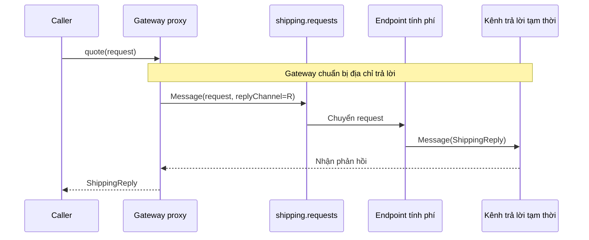
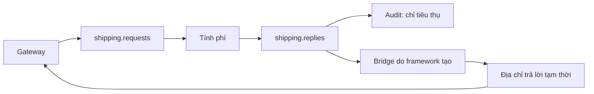

# Reply channel

## 1. Vấn đề cần giải quyết

Một ứng dụng bán hàng gọi phương thức tính phí vận chuyển:

```java
ShippingReply reply = shippingGateway.quote(
        new ShippingRequest("ORDER-101", 3));
```

Sau lời gọi này, request có thể đi qua transformer chuẩn hóa dữ liệu, router chọn hãng vận chuyển và endpoint tính phí. Kết quả phải quay về đúng lời gọi `quote()` đang chờ, kể cả khi nhiều đơn hàng được xử lý đồng thời. Đường đi tới endpoint tính phí chưa đủ để xác định đường về.

Trong chương **Messaging gateway** của module **SPRING_INTEGRATION_CORE**, reply channel là mắt xích nối `Message`, `MessageChannel`, endpoint và giá trị trả về của gateway. Hiểu mắt xích này giúp thiết kế luồng Java DSL có phản hồi rõ ràng, phát hiện nhánh làm mất phản hồi và kiểm thử được hợp đồng request–reply.

Sau bài học, bạn cần giải thích được ba câu hỏi: ai cung cấp địa chỉ trả lời, endpoint chọn địa chỉ nào, và điều gì xảy ra khi câu trả lời không đến.

## 2. Reply channel là vai trò của một kênh

**Reply channel** là kênh nhận thông điệp phản hồi trong một trao đổi request–reply. Đây là vai trò trong luồng xử lý; Spring Integration không bắt buộc mọi reply channel phải có cùng một lớp triển khai hoặc cùng một tên bean.

Ví dụ, request được gửi tới `shipping.requests`. Endpoint cuối tạo `ShippingReply`; gateway lấy payload của thông điệp phản hồi và hoàn tất lời gọi `quote()`.

| Thành phần | Vai trò trong ví dụ |
| --- | --- |
| Gateway interface | Cung cấp phương thức `quote()` cho mã nghiệp vụ |
| Request channel | Đưa request vào luồng tính phí |
| Reply-producing endpoint | Tạo kết quả tính phí và gửi phản hồi |
| Reply channel | Nhận phản hồi để hoàn tất trao đổi |
| Caller | Nhận `ShippingReply`, hoặc xử lý lỗi/không có phản hồi theo hợp đồng |

Đừng dựa vào tên channel để suy ra chức năng. Một bean tên `shipping.replies` chỉ tham gia đường trả lời khi cấu hình endpoint và gateway thực sự nối tới nó.

## 3. Phân biệt header và cấu hình gateway

Các vị trí thường có chữ “reply channel” nhưng nằm ở những tầng khác nhau:

| Vị trí | Ví dụ | Ý nghĩa |
| --- | --- | --- |
| Header của request | `MessageHeaders.REPLY_CHANNEL`, có tên thực tế `replyChannel` | Địa chỉ trả lời gắn với thông điệp |
| Cấu hình gateway | `@MessagingGateway(defaultReplyChannel = "shipping.replies")` | Kênh trả lời đặt tên dùng mặc định cho các phương thức |
| Cấu hình từng phương thức | `@Gateway(replyChannel = "priority.replies")` | Ghi đè kênh trả lời mặc định cho phương thức đó |
| Đầu ra endpoint | `outputChannel` hoặc `.channel("shipping.replies")` | Chuyển kết quả của endpoint sang một kênh được cấu hình rõ ràng |

`defaultReplyChannel` và `replyChannel` trong annotation là **tên kênh cấu hình**. Header `replyChannel` có thể giữ một đối tượng `MessageChannel` hoặc một chuỗi cần được phân giải. Một chuỗi tùy ý chỉ có ích khi hạ tầng phân giải tìm được kênh tương ứng.

Các thuộc tính cấp phương thức được mô tả tại [Javadoc của `@Gateway`](https://docs.spring.io/spring-integration/docs/6.2.6/api/org/springframework/integration/annotation/Gateway.html). Khóa header chuẩn được khai báo tại [Javadoc của `MessageHeaders`](https://docs.spring.io/spring-framework/docs/current/javadoc-api/org/springframework/messaging/MessageHeaders.html).

## 4. Đường trả lời tạm thời do gateway tạo

Với gateway trả về một giá trị, thường không cần khai báo reply channel. Gateway tạo kênh trả lời tạm thời, ẩn danh, theo ngữ nghĩa point-to-point và đưa địa chỉ đó vào header `replyChannel`. Nếu cấu hình kênh trả lời đặt tên, framework nối kênh đó tới đường trả lời tạm thời bằng bridge. Cơ chế này được trình bày trong [Setting the Default Reply Channel](https://docs.spring.io/spring-integration/reference/6.5/gateway.html#gateway-default-reply-channel).



Sơ đồ mô tả quan hệ gửi và nhận. Nó không khẳng định mỗi mũi tên chạy trên một thread riêng. Với `DirectChannel`, phần tính phí có thể chạy ngay trên thread gọi gateway.

Hãy hình dung hai request A và B mang hai địa chỉ trả lời RA và RB. Endpoint hoàn tất B trước vẫn có thể gửi B về RB, rồi gửi A về RA. Không nên thay toàn bộ địa chỉ này bằng một queue chung rồi tự cho rằng thứ tự nhận sẽ luôn khớp thứ tự gọi.

Reply channel thực hiện vai trò **Return Address**. Một `orderId` trong payload giúp nhận diện đơn hàng; một `correlationId` có thể phục vụ ghép nhóm; cả hai không tự trở thành địa chỉ gửi phản hồi.

## 5. Endpoint quyết định gửi kết quả đi đâu?

Với service activator tạo kết quả khác `null`, thứ tự tìm đầu ra là:

1. Kênh đầu ra được cấu hình trên endpoint.
2. Header `replyChannel` của request nếu không có đầu ra cấu hình.
3. Header `replyChannel` trên kết quả nếu kết quả là `Message` và request không có header này.

Địa chỉ dạng chuỗi phải phân giải được thành channel. Nếu không có đầu ra hợp lệ, việc tạo payload kết quả không đủ để hoàn tất trao đổi. Quy tắc cụ thể được mô tả trong [Service Activator](https://docs.spring.io/spring-integration/reference/6.5/service-activator.html).

Ví dụ, luồng sau vẫn còn bước lưu trữ sau khi tính phí:

```java
IntegrationFlow.from("shipping.requests")
        .handle(shippingService, "quote")
        .channel("shipping.persist")
        .handle(shippingStore, "saveAndReturn")
        .get();
```

`shippingService` và `shippingStore` ở đây là các bean minh họa. `quote()` tạo kết quả trung gian; đầu ra cấu hình đưa kết quả tới `shipping.persist`. Chỉ khi `saveAndReturn()` trả kết quả và endpoint cuối sử dụng được địa chỉ trả lời thì caller mới nhận phản hồi.

Nếu đổi `saveAndReturn()` thành phương thức `void`, luồng kết thúc ở thao tác lưu. Việc `quote()` từng trả về một đối tượng ở giữa luồng không bảo đảm gateway nhận được đối tượng đó.

## 6. Ví dụ Java DSL: tính phí và trả về qua header

Ví dụ dùng Java 17 trở lên và API Spring Integration 6.5. Dự án cần `spring-integration-core`; khi dùng Spring Boot, có thể khai báo starter `spring-boot-starter-integration` và để cơ chế quản lý dependency của dự án chọn phiên bản tương thích.

Các đoạn dưới là các tệp Java minh họa trong package `example.reply`. Mức phí chỉ phục vụ thực hành cơ chế trả lời.

### 6.1. Kiểu dữ liệu nghiệp vụ

```java
package example.reply;

public record ShippingRequest(String orderId, int weightKg) {
}
```

```java
package example.reply;

public record ShippingReply(String orderId, int feeVnd) {
}
```

Giữ `orderId` trong phản hồi giúp caller và bài kiểm thử xác nhận kết quả thuộc đơn hàng nào. Nó bổ sung khả năng kiểm tra nghiệp vụ cho cơ chế trả lời của framework.

### 6.2. Gateway interface

```java
package example.reply;

import org.springframework.integration.annotation.MessagingGateway;

@MessagingGateway(
        defaultRequestChannel = "shipping.requests",
        defaultReplyTimeout = "2000")
public interface ShippingGateway {

    ShippingReply quote(ShippingRequest request);
}
```

Interface không khai báo `defaultReplyChannel`. Đường trả lời tạm thời đáp ứng nhu cầu một kết quả cho một lời gọi. Timeout được đặt rõ ràng để ví dụ không phụ thuộc giá trị mặc định của từng phiên bản.

### 6.3. Khai báo kênh và luồng xử lý

```java
package example.reply;

import org.springframework.context.annotation.Bean;
import org.springframework.context.annotation.Configuration;
import org.springframework.integration.annotation.IntegrationComponentScan;
import org.springframework.integration.channel.DirectChannel;
import org.springframework.integration.config.EnableIntegration;
import org.springframework.integration.dsl.IntegrationFlow;
import org.springframework.messaging.MessageChannel;

@Configuration
@EnableIntegration
@IntegrationComponentScan(basePackageClasses = ShippingGateway.class)
public class ShippingConfiguration {

    @Bean(name = "shipping.requests")
    public MessageChannel shippingRequests() {
        return new DirectChannel();
    }

    @Bean
    public IntegrationFlow shippingFlow() {
        return IntegrationFlow.from("shipping.requests")
                .handle(ShippingRequest.class, (request, headers) -> {
                    if (request.weightKg() <= 0) {
                        throw new IllegalArgumentException(
                                "weightKg must be positive");
                    }
                    int fee = 20_000 + request.weightKg() * 5_000;
                    return new ShippingReply(request.orderId(), fee);
                })
                .get();
    }
}
```

`@IntegrationComponentScan` đăng ký gateway interface thành proxy. Handler cuối trả `ShippingReply`, không có kênh đầu ra cấu hình, nên đường trả lời được lấy từ request. Caller nhận payload `ShippingReply`, thay vì phải tự nhận một `Message` từ channel.

### 6.4. Gọi gateway

```java
package example.reply;

import org.springframework.context.annotation.AnnotationConfigApplicationContext;

public class ShippingDemo {

    public static void main(String[] args) {
        try (var context = new AnnotationConfigApplicationContext(
                ShippingConfiguration.class)) {
            ShippingGateway gateway = context.getBean(ShippingGateway.class);
            ShippingReply reply = gateway.quote(
                    new ShippingRequest("ORDER-101", 3));
            System.out.println(reply);
        }
    }
}
```

Kết quả dự kiến:

```text
ShippingReply[orderId=ORDER-101, feeVnd=35000]
```

Hãy theo dõi toàn bộ hợp đồng: gateway gửi `ShippingRequest`, handler tạo đúng kiểu phản hồi, header cung cấp đường về, và proxy hoàn tất phương thức Java.

## 7. Khi cần một reply channel đặt tên

Giả sử bộ phận vận hành muốn quan sát mọi báo giá đã hoàn tất. Có thể cho phản hồi đi qua một channel đặt tên, đồng thời giữ đường trả lời về gateway.

Đây là **biến thể thay thế** cho cấu hình ở phần 6. Các đoạn dưới không được đăng ký thêm một gateway thứ hai trùng interface hoặc một `shippingFlow` thứ hai cùng nhận request.

Trước hết, sửa annotation trên `ShippingGateway`:

```java
@MessagingGateway(
        defaultRequestChannel = "shipping.requests",
        defaultReplyChannel = "shipping.replies",
        defaultReplyTimeout = "2000")
public interface ShippingGateway {
    ShippingReply quote(ShippingRequest request);
}
```

Thêm bean sau vào `ShippingConfiguration`, với import `org.springframework.integration.channel.PublishSubscribeChannel`:

```java
@Bean(name = "shipping.replies")
public PublishSubscribeChannel shippingReplies() {
    return new PublishSubscribeChannel();
}
```

Trong `shippingFlow()`, thêm `.channel("shipping.replies")` ngay sau `.handle(...)` và trước `.get()`. Đồng thời thêm luồng quan sát:

```java
@Bean
public IntegrationFlow shippingReplyAuditFlow() {
    return IntegrationFlow.from("shipping.replies")
            .handle(message -> {
                ShippingReply reply = (ShippingReply) message.getPayload();
                System.out.printf("Quoted %s: %d VND%n",
                        reply.orderId(), reply.feeVnd());
            })
            .get();
}
```

Quan hệ giữa các thành phần:



Khai báo `defaultReplyChannel` trên gateway không tự chuyển mọi đầu ra của endpoint sang kênh này. Trong ví dụ, chính `.channel("shipping.replies")` đưa kết quả tính phí tới điểm phát tán. Header chứa địa chỉ trả lời vẫn phải còn để bridge đưa phản hồi về đúng lời gọi.

`PublishSubscribeChannel` phát thông điệp cho các subscriber; `DirectChannel` và `QueueChannel` có ngữ nghĩa point-to-point. Do đó, thêm audit làm một consumer trên kênh point-to-point có thể khiến audit nhận phần việc mà bạn dự kiến dành cho đường trả lời. Chi tiết các kiểu kênh được mô tả tại [Message Channel Implementations](https://docs.spring.io/spring-integration/reference/6.5/channel/implementations.html).

Nhánh audit trong ví dụ chỉ tiêu thụ. Nếu nhánh này lại tạo phản hồi về cùng địa chỉ tạm thời, một request có thể sinh nhiều câu trả lời cạnh tranh. Với audit tốn thời gian, hãy thiết kế cách chuyển việc sang nhánh riêng, kèm chính sách lỗi và quá tải; channel đặt tên không tự tạo sự độc lập về thread.

## 8. Giữ địa chỉ trả lời khi biến đổi thông điệp

Trong luồng nhiều bước, payload có thể đổi từ request sang dữ liệu chuẩn hóa rồi thành kết quả cuối. Địa chỉ trả lời vẫn cần tồn tại qua các đoạn đường đó.

Rủi ro dễ thấy nằm ở mã tùy biến tự dựng và tự gửi thông điệp, chẳng hạn một `MessageHandler`:

```java
// request là Message<?> nhận được; nextChannel là MessageChannel đầu ra.
ShippingRequest input = (ShippingRequest) request.getPayload();
ShippingReply result = new ShippingReply(input.orderId(), 35_000);

// Mất các header của request tại thao tác tự gửi này.
nextChannel.send(MessageBuilder.withPayload(result).build());
```

Nếu đoạn sau trông chờ header `replyChannel`, nó không còn biết đường trả lời. Với bridge tùy biến cần tiếp tục cùng trao đổi, có thể sao chép header bằng `org.springframework.messaging.support.MessageBuilder`:

```java
Message<ShippingReply> outgoing = MessageBuilder.withPayload(result)
        .copyHeaders(request.getHeaders())
        .build();

if (!nextChannel.send(outgoing)) {
    throw new IllegalStateException("Cannot forward shipping reply");
}
```

Đoạn này cần import `org.springframework.messaging.Message`. Header được sao chép theo quy tắc của builder; không coi thao tác này là yêu cầu giữ nguyên định danh và thời điểm tạo của mọi message. Bản đồ header chuẩn là bất biến, nên không sửa trực tiếp bằng `request.getHeaders().put(...)`. Xem [MessageHeaders](https://docs.spring.io/spring-framework/docs/current/javadoc-api/org/springframework/messaging/MessageHeaders.html).

Phân biệt thao tác **tự gửi** ở trên với việc trả payload hoặc trả `Message` từ endpoint có cơ chế truyền header của framework. Không thể kết luận mọi `Message` mới trả về từ transformer đều làm mất `replyChannel`; cần xem endpoint bao quanh xử lý header thế nào.

Ở ranh giới JMS, lưu trữ message hoặc tuần tự hóa, đối tượng channel trong JVM không phải một địa chỉ có thể gửi nguyên trạng tới mọi tiến trình. Spring Integration có `HeaderChannelRegistry` để ánh xạ channel sang chuỗi và phân giải lại trong ngữ cảnh registry, theo [Header Channel Registry](https://docs.spring.io/spring-integration/reference/6.5/content-enrichment.html#header-channel-registry).

Registry có vòng đời và thời hạn lưu ánh xạ. Với phản hồi từ dịch vụ bên ngoài, hãy xác định rõ transport reply destination, correlation và nơi chuyển phản hồi trở lại gateway. Việc đổi một tham chiếu channel thành chuỗi không tự tạo một giao thức trả lời xuyên tiến trình.

## 9. Timeout và trường hợp không có phản hồi

Reply channel cung cấp đường về; nó không buộc mọi nhánh xử lý phải tạo câu trả lời.

| Tình huống trong luồng tính phí | Tác động cần xem xét |
| --- | --- |
| Handler trả kết quả khác `null` và đường về hợp lệ | Gateway có thể hoàn tất bằng kết quả |
| Handler trả `null` hoặc `void` | Không tạo reply tại bước đó |
| Filter loại request và không báo lỗi | Nhánh xử lý có thể dừng trước bước tạo reply |
| Router không đưa request tới nhánh có kết quả | Caller có thể chờ mà không có phản hồi |
| Aggregator chưa đủ điều kiện release | Phản hồi tổng hợp chưa được tạo |
| Kết quả được gửi vào `nullChannel` | Kết quả bị tiêu thụ, không tới caller qua đường đó |
| Phản hồi tới sau khi caller hết thời gian chờ | Không được giả định caller sẽ nhận lại kết quả muộn |

Trong gateway đồng bộ thông thường, hết thời gian chờ nhận có thể trả `null`. Spring Integration 6.2 trở lên cung cấp tùy chọn `errorOnTimeout` để dùng lỗi `MessageTimeoutException`. Timeout không hủy công việc downstream; với `DirectChannel`, handler còn đang chạy trên thread caller thì `replyTimeout` không ngắt được handler. Phạm vi timeout và hành vi này được giải thích tại [Gateway Behavior When No response Arrives](https://docs.spring.io/spring-integration/reference/6.5/gateway.html#gateway-no-response).

Ví dụ về luồng toàn bộ đồng bộ:

```text
t = 0 ms       Caller vào gateway, handler bắt đầu chạy
t = 2000 ms    Handler vẫn chạy trên chính thread caller
t = 5000 ms    Handler mới hoàn tất và gửi phản hồi
```

Đặt `defaultReplyTimeout = "2000"` không biến lời gọi này thành deadline hai giây. Để kiểm soát thao tác gọi HTTP hoặc cơ sở dữ liệu trong handler, phải cấu hình timeout phù hợp cho chính thao tác đó.

Nếu có điểm bàn giao sang thread khác, chẳng hạn `ExecutorChannel`, caller có cơ hội trở lại gateway để chờ phản hồi trong thời gian đã cấu hình. Khi hết thời gian chờ, xử lý phía sau vẫn có thể tiếp tục tạo tác dụng phụ. Vì vậy, nếu caller gửi lại yêu cầu tính phí hoặc tạo vận đơn, hãy xác định khóa nghiệp vụ dùng để nhận diện lần thực hiện trùng.

`requestTimeout` liên quan việc gửi vào kênh request có khả năng chặn, ví dụ queue đầy. `replyTimeout` liên quan chờ phản hồi. Không dùng một trong hai giá trị này như bằng chứng rằng tổng thời gian toàn bộ lời gọi đã được giới hạn.

## 10. Reply channel, error channel và gateway một chiều

Reply channel phục vụ kết quả trả lời; error channel phục vụ thông điệp lỗi. Một error flow muốn trả kết quả thay thế phải tạo được phản hồi phù hợp với kiểu trả về của gateway và giữ đường về của trao đổi.

Giả sử `ShippingReply` chỉ có `orderId` và `feeVnd`. Đổi một lỗi thành chuỗi `"TIMEOUT"` rồi trả cho `ShippingGateway.quote()` tạo hợp đồng kiểu dữ liệu không nhất quán. Nếu cần trả trạng thái thất bại như dữ liệu nghiệp vụ, nên thiết kế kiểu kết quả có trường trạng thái rõ ràng hoặc chọn hợp đồng ném lỗi.

Một nhánh chỉ ghi log rồi kết thúc không tạo ra `ShippingReply`. Hãy quyết định rõ caller sẽ nhận lỗi, nhận kết quả thay thế, hay chờ tới timeout; không coi thao tác ghi log là phản hồi.

Với phương thức gateway trả `void`, caller không chờ kết quả nghiệp vụ. Ở Spring Integration 6.5, nếu không cung cấp header trả lời rõ ràng, framework sử dụng `nullChannel` cho phản hồi phát sinh từ loại phương thức này. Đây là hành vi được ghi trong [tài liệu Messaging Gateways](https://docs.spring.io/spring-integration/reference/6.5/gateway.html). Tuy vậy, chữ ký `void` không tự khiến handler chạy trên thread khác.

## 11. Gọi một luồng con bằng Java DSL

Ngoài gateway interface dành cho caller, Java DSL có toán tử `.gateway(...)` để một luồng gọi luồng khác và nhận kết quả trước khi tiếp tục. Đây là vai trò được mô tả trong [Operator gateway()](https://docs.spring.io/spring-integration/reference/6.5/dsl/java-gateway.html).

Ví dụ cấu trúc:

```java
IntegrationFlow.from("checkout.requests")
        .gateway("shipping.requests")
        .handle(checkoutService, "attachShippingQuote")
        .get();
```

`checkoutService` là bean minh họa. Trong thiết kế này, `attachShippingQuote()` phải chấp nhận kết quả mà luồng tính phí trả về. Nếu cần cả dữ liệu checkout ban đầu, phải giữ dữ liệu đó trong payload bao ngoài, header phù hợp hoặc dùng mẫu enrich; `.gateway()` không tự ghép mọi payload đầu vào với payload phản hồi.

Có hai phạm vi trao đổi: checkout chờ phần tính phí, rồi toàn bộ checkout mới trả kết quả cho caller bên ngoài. Không nên thay các địa chỉ trả lời lồng nhau bằng một channel dùng chung chỉ vì mọi phản hồi đều có cùng kiểu Java.

## 12. Kiểm thử đường trả lời

Kiểm thử nên bắt đầu từ hợp đồng caller nhận được gì. Sau đó mới kiểm tra header và đường đi khi cần chẩn đoán cấu hình.

Với cấu hình cơ bản ở phần 6, ví dụ JUnit Jupiter sau kiểm tra cả gateway và endpoint. Dự án cần dependency kiểm thử JUnit Jupiter tương ứng.

```java
package example.reply;

import org.junit.jupiter.api.Test;
import org.springframework.context.annotation.AnnotationConfigApplicationContext;
import org.springframework.integration.channel.QueueChannel;
import org.springframework.messaging.Message;
import org.springframework.messaging.MessageChannel;
import org.springframework.messaging.support.MessageBuilder;

import static org.junit.jupiter.api.Assertions.assertEquals;
import static org.junit.jupiter.api.Assertions.assertNotNull;

class ShippingReplyChannelTest {

    @Test
    void returnsQuoteToGatewayCaller() {
        try (var context = new AnnotationConfigApplicationContext(
                ShippingConfiguration.class)) {
            ShippingGateway gateway = context.getBean(ShippingGateway.class);

            ShippingReply reply = gateway.quote(
                    new ShippingRequest("ORDER-101", 3));

            assertEquals(new ShippingReply("ORDER-101", 35_000), reply);
        }
    }

    @Test
    void endpointUsesReplyAddressFromRequest() {
        try (var context = new AnnotationConfigApplicationContext(
                ShippingConfiguration.class)) {
            MessageChannel requests = context.getBean(
                    "shipping.requests", MessageChannel.class);
            QueueChannel replies = new QueueChannel(1);

            requests.send(MessageBuilder
                    .withPayload(new ShippingRequest("ORDER-202", 2))
                    .setReplyChannel(replies)
                    .build());

            Message<?> response = replies.receive(0);
            assertNotNull(response);
            assertEquals(new ShippingReply("ORDER-202", 30_000),
                    response.getPayload());
        }
    }
}
```

Ở bài kiểm thử thứ hai, `replies` là địa chỉ trả lời do bài kiểm thử cấp, không phải kênh tạm thời nội bộ của gateway. Vì cấu hình phần 6 dùng `DirectChannel`, handler đã hoàn tất khi `requests.send(...)` trả về; `receive(0)` kiểm tra kết quả ngay mà không cần `sleep`.

Khi chuyển sang biến thể có đầu ra cố định `shipping.replies`, bài kiểm thử cấp địa chỉ trực tiếp cần được điều chỉnh theo topology đó. Không xem bài kiểm thử của cấu hình cơ bản là phép kiểm tra mọi biến thể.

Các tình huống bổ sung đáng kiểm tra khi triển khai thực tế:

| Tình huống | Điều cần chứng minh |
| --- | --- |
| Hai request có `orderId` và trọng lượng khác nhau chạy đồng thời | Mỗi caller nhận đúng đơn hàng và mức phí |
| Filter từ chối một request | Caller nhận hành vi từ chối đã chọn, thay vì chờ không rõ nguyên nhân |
| Handler bắt buộc trả lời nhưng trả `null` | `requiresReply` trên endpoint phát hiện vi phạm hợp đồng |
| Nhánh audit được thêm vào | Caller vẫn nhận đúng một kết quả nghiệp vụ |
| Downstream bất đồng bộ phản hồi muộn | Timeout xảy ra theo cấu hình và kết quả muộn có cách xử lý rõ ràng |
| Mã tùy biến dựng rồi tự gửi message | Địa chỉ trả lời cần thiết được bảo toàn |

Để kiểm tra timeout của luồng bất đồng bộ, nên điều phối worker bằng latch hoặc barrier và thời gian chờ có giới hạn. Tránh chỉ thêm `Thread.sleep()` rồi suy ra đường trả lời đã đúng.

## 13. Chẩn đoán trường hợp caller không nhận kết quả

Giả sử log cho thấy đã tính được phí nhưng `quote()` không trả về đúng kết quả. Lần theo đường trả lời theo thứ tự:

1. Xác nhận gateway thực sự yêu cầu kết quả và endpoint cuối tạo đúng kiểu payload.
2. Quan sát header `replyChannel` trên request tại đầu luồng và trước bước gửi kết quả.
3. Kiểm tra kênh đầu ra cố định có chuyển kết quả sang nhánh khác trước khi về gateway không.
4. Với kênh đặt tên, xác nhận bean tồn tại, có consumer phù hợp và phản hồi thực sự được gửi vào đó.
5. Kiểm tra filter, router, aggregator và các sink `void` có làm dừng nhánh tạo phản hồi không.
6. Xác định có điểm đổi thread hay không để diễn giải timeout đúng.
7. Đối chiếu `orderId`, thời điểm hoàn tất và thời điểm caller ngừng chờ để phân biệt mất đường về với phản hồi đến muộn.

Nếu yêu cầu là “tạo vận đơn trong vài phút rồi thông báo sau”, hãy cân nhắc trả mã tác vụ và phát sự kiện hoàn tất. Một địa chỉ trả lời tạm thời gắn với lời gọi hiện tại không thay thế thiết kế vòng đời cho công việc kéo dài.

## 14. Điểm cần ghi nhớ

- `replyChannel` là địa chỉ trả lời trong message; channel trả lời đặt tên là một cấu hình ở tầng gateway hoặc luồng.
- Với trao đổi một phản hồi cho một lời gọi, bắt đầu bằng cơ chế tạm thời do gateway quản lý.
- Khi cần quan sát phản hồi qua kênh đặt tên, nối đầu ra tới kênh đó và chọn ngữ nghĩa phân phối phù hợp.
- Payload kết quả chỉ tới được caller khi đường trả lời còn hợp lệ và nhánh xử lý thực sự gửi phản hồi.
- Timeout, lỗi và nhánh không tạo kết quả đều là phần của hợp đồng request–reply cần được thiết kế và kiểm thử.
