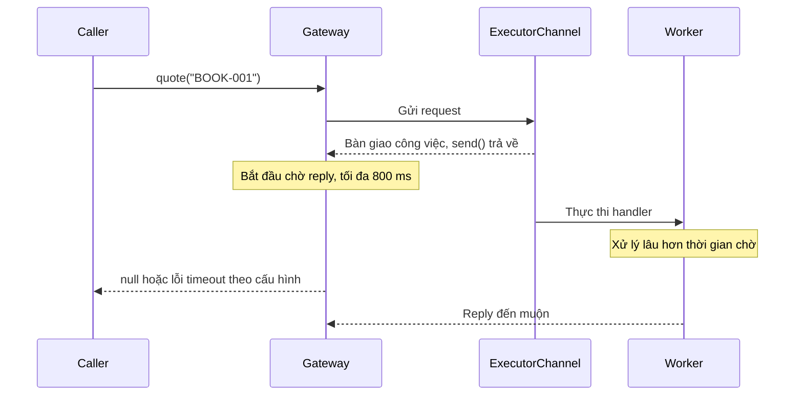

# Reply timeout trong Messaging Gateway

> Trong chương Messaging gateway của SPRING_INTEGRATION_CORE, `replyTimeout` giúp xác định caller sẽ chờ phản hồi bao lâu ở giai đoạn nhận reply. Muốn thiết kế đúng, cần nhìn cả `Message`, `MessageChannel`, endpoint và ranh giới luồng thực thi.

## 1. Vấn đề: gọi phương thức Java nhưng phản hồi đi qua messaging

Giả sử ứng dụng tra cứu giá qua một gateway:

```java
String price = priceGateway.quote("BOOK-001");
```

Nhìn từ caller, đây là lời gọi phương thức cần một `String`. Bên trong, gateway chuyển tham số thành message, gửi vào request channel và chờ một reply để tạo giá trị trả về.

Trong luồng tích hợp, không phải request nào cũng sinh reply: filter có thể loại message; handler có thể trả `null`; router có thể dẫn đến nhánh chỉ ghi log; aggregator có thể chưa đủ phần tử để release. Một dịch vụ cũng có thể vẫn đang xử lý khi caller đã chờ quá lâu.

Bài học hướng tới ba việc: cấu hình thời gian chờ rõ ràng, giải thích đúng hành vi khi đổi loại channel và thiết kế hợp đồng trả kết quả hoặc báo lỗi phù hợp cho caller.

Các ví dụ dùng Java 17+, Spring Integration 6.5.x và Java DSL với `IntegrationFlow.from(...)`. Giá trị timeout được cấu hình tường minh để người học không phải dựa vào mặc định của một phiên bản khác.

## 2. Reply timeout kiểm soát giai đoạn nào?

### 2.1. Hai giai đoạn cần phân biệt

| Thuộc tính | Giai đoạn được tác động | Tình huống điển hình | Không bảo đảm điều gì? |
| --- | --- | --- | --- |
| `requestTimeout` | Gửi request vào request channel, nếu thao tác gửi hỗ trợ chờ có giới hạn | `QueueChannel` có dung lượng giới hạn đang đầy | Không đặt giới hạn thực thi cho handler chạy ngay trong `send()` |
| `replyTimeout` | Chờ nhận reply sau khi thao tác gửi trả quyền điều khiển về gateway | Request được bàn giao sang executor hoặc hàng đợi | Không tự hủy công việc downstream, rollback hay dừng I/O |

Đơn vị của các giá trị timeout là **millisecond**: `800` nghĩa là 0,8 giây. `requestTimeout` có ý nghĩa với thao tác gửi có thể block; không nên diễn giải nó thành thời hạn chạy toàn bộ phương thức gateway. Xem [JavaDoc `Gateway.requestTimeout()`](https://docs.spring.io/spring-integration/docs/6.5.0/api/org/springframework/integration/annotation/Gateway.html#requestTimeout()).

### 2.2. Mốc bắt đầu bộ đếm

Điểm quyết định là: bộ đếm chờ reply bắt đầu **khi thread gửi request quay về gateway**, sau khi `send()` trả quyền điều khiển. Bộ đếm không mặc nhiên bắt đầu ngay lúc ứng dụng gọi phương thức. Quy tắc này được nêu trực tiếp trong [JavaDoc `Gateway.replyTimeout()`](https://docs.spring.io/spring-integration/docs/6.5.0/api/org/springframework/integration/annotation/Gateway.html#replyTimeout()).

Để phân tích một lời gọi, có thể dùng mô hình gần đúng sau:

```text
Thời gian caller quan sát
  ≈ thời gian tạo request
  + thời gian send() chưa trả về
  + thời gian chờ reply
  + thời gian chuyển đổi kết quả / xử lý lỗi
```

Đây là mô hình phân tích, không phải công thức bảo đảm thời gian thực. `replyTimeout` chỉ giới hạn phần chờ reply; các phần còn lại vẫn có thể kéo dài. Nếu error flow chạy thêm công việc đồng bộ, caller cũng phải chờ công việc đó.

### 2.3. Giá trị dương, bằng không và âm

| Giá trị | Cách hiểu ở giai đoạn nhận reply | Hệ quả thiết kế |
| --- | --- | --- |
| `> 0` | Chờ tối đa số millisecond đã cấu hình | Dùng khi caller cần giới hạn chờ hữu hạn |
| `0` | Không chờ thêm nếu chưa có reply tại thời điểm nhận | Reply đã sẵn sàng vẫn có thể được lấy; không biến gateway thành cơ chế gửi một chiều |
| `< 0` | Chờ không giới hạn | Có thể giữ caller mãi nếu flow không sinh reply |

Với annotation `@MessagingGateway` và `@Gateway` trong Spring Integration 6.5.0, mặc định được JavaDoc công bố là `30000` ms. Dù vậy, hãy đặt giá trị phù hợp với hợp đồng của ứng dụng. Xem [mặc định của `@MessagingGateway`](https://docs.spring.io/spring-integration/docs/6.5.0/api/org/springframework/integration/annotation/MessagingGateway.html#defaultReplyTimeout()) và [quy ước receive timeout của channel](https://docs.spring.io/spring-integration/reference/6.5/channel/implementations.html#channel-implementations-queuechannel).

Không áp dụng máy móc mặc định này cho mọi HTTP/TCP/JMS gateway hoặc mọi bản Spring Integration. Bài này tập trung vào gateway proxy gọi từ phương thức Java.

## 3. Ranh giới thread quyết định hiệu lực thực tế

### 3.1. Luồng chỉ có DirectChannel

Giả sử cả flow xử lý trên thread của caller:

```text
caller → gateway → DirectChannel → handler → reply
                   cùng thread thực thi
```

Đặt `replyTimeout = 200` ms và giả sử handler mất khoảng 1.200 ms để trả kết quả. Khi handler chưa kết thúc, `send()` vẫn chưa quay về gateway. Caller có thể nhận kết quả sau hơn 1.200 ms, dù cấu hình chỉ ghi 200 ms. Khi gateway đến giai đoạn nhận, reply của handler đã sẵn sàng.

Nếu handler bị kẹt vô hạn trong đường đi đồng bộ này, giảm `replyTimeout` xuống 1 ms cũng không giải phóng caller. Hành vi đối với flow đồng bộ và flow có bàn giao sang thread khác được trình bày tại [Messaging Gateways — Gateway Behavior When No Response Arrives](https://docs.spring.io/spring-integration/reference/6.5/gateway.html#gateway-no-response).

### 3.2. Luồng có ExecutorChannel

Với executor thực sự chạy công việc trên thread khác, thao tác gửi có thể quay về gateway sau khi công việc được nhận vào executor. Caller bắt đầu chờ reply trong khi worker xử lý:



Sơ đồ minh họa một lịch thực thi có thể xảy ra; worker cũng có thể bắt đầu trước khi `send()` trả về. Mốc quan trọng vẫn là lúc gateway bước vào nhận reply.

`ExecutorChannel` giao việc cho `Executor`; chính executor quyết định cách thực thi. `SyncTaskExecutor` hoặc chính sách quá tải chạy tác vụ trên thread caller có thể làm mất ranh giới bất đồng bộ mong đợi. Ngoài ra, transaction gắn với thread caller không tự đi theo worker. Xem [JavaDoc `ExecutorChannel`](https://docs.spring.io/spring-integration/docs/6.5.0/api/org/springframework/integration/channel/ExecutorChannel.html).

### 3.3. QueueChannel cũng cần consumer

Với `QueueChannel`, gửi thành công nghĩa là request đã được đặt vào hàng đợi. Để có reply, cần consumer, thường là polling endpoint. Nếu không có consumer, caller vẫn có thể timeout dù thao tác gửi đã thành công.

Trong ví dụ thiết kế có hàng đợi, thời gian đợi consumer lấy message, đợi tài nguyên và thực thi handler đều có thể tiêu tốn ngân sách chờ reply. Hàng đợi đầy trước lúc gửi thành công lại liên quan đến `requestTimeout`. Cơ chế send/receive này được mô tả tại [QueueChannel](https://docs.spring.io/spring-integration/reference/6.5/channel/implementations.html).

## 4. Cấu hình bằng annotation

### 4.1. Mặc định cho gateway và ghi đè từng phương thức

```java
package demo.integration.timeout;

import org.springframework.integration.annotation.Gateway;
import org.springframework.integration.annotation.MessagingGateway;

@MessagingGateway(
        defaultRequestChannel = "priceRequests",
        defaultRequestTimeout = "100",
        defaultReplyTimeout = "800")
public interface PriceGateway {

    String quote(String sku);

    @Gateway(replyTimeout = 200)
    String quickQuote(String sku);
}
```

`quote()` dùng thời gian chờ reply 800 ms; `quickQuote()` ghi đè thành 200 ms. Cả hai cùng gửi vào `priceRequests`. Chuỗi ở `defaultReplyTimeout` và số nguyên ở `replyTimeout` là đúng kiểu thuộc tính của hai annotation.

Trong ngữ cảnh Spring thông thường, interface cần được đăng ký thành gateway proxy, chẳng hạn bằng `@IntegrationComponentScan`. Khởi tạo một implementation thủ công sẽ không tự tạo hành vi messaging. Tham khảo [JavaDoc `@MessagingGateway`](https://docs.spring.io/spring-integration/docs/6.5.0/api/org/springframework/integration/annotation/MessagingGateway.html).

### 4.2. Tính timeout theo lời gọi

Đoạn sau là một biến thể phương thức để bổ sung vào gateway khi nghiệp vụ cần ngân sách chờ riêng:

```java
@Gateway(
        payloadExpression = "args[0]",
        replyTimeoutExpression = "args[1]")
String quoteWithin(String sku, long replyWaitMillis);
```

`payloadExpression` chọn SKU làm payload; đối số thứ hai dùng để tính timeout. Tầng gọi nên kiểm tra `replyWaitMillis` trong khoảng cho phép, ví dụ 50–2.000 ms. Nếu cho đầu vào tùy ý đi thẳng vào cấu hình, giá trị âm có thể dẫn đến chờ không giới hạn.

Biểu thức trả về **thời lượng chờ tại gateway**. Nó không tự biến thành deadline chung cho HTTP client, database hay endpoint phía sau. Cơ chế biểu thức được mô tả tại [JavaDoc `Gateway.replyTimeoutExpression()`](https://docs.spring.io/spring-integration/docs/6.5.0/api/org/springframework/integration/annotation/Gateway.html#replyTimeoutExpression()).

## 5. Ví dụ Java DSL: flow tra cứu giá có worker riêng

Ví dụ gồm ba file Java cùng package `demo.integration.timeout`: `PriceGateway` ở trên, `PriceService` và `PriceFlowConfiguration` dưới đây. Các đoạn cấu hình biến thể ở phần sau được học riêng, không cần thêm đồng thời vào ví dụ chính.

Ví dụ cần `spring-integration-core` cùng các thư viện Spring tương thích do dependency management của dự án cung cấp; không cần broker hoặc máy chủ bên ngoài.

### 5.1. Hợp đồng dịch vụ

```java
package demo.integration.timeout;

public interface PriceService {
    String lookup(String sku);
}
```

### 5.2. Channel, executor và endpoint

```java
package demo.integration.timeout;

import org.springframework.beans.factory.annotation.Qualifier;
import org.springframework.context.annotation.Bean;
import org.springframework.context.annotation.Configuration;
import org.springframework.integration.channel.ExecutorChannel;
import org.springframework.integration.config.EnableIntegration;
import org.springframework.integration.config.IntegrationComponentScan;
import org.springframework.integration.dsl.IntegrationFlow;
import org.springframework.messaging.MessageChannel;
import org.springframework.scheduling.concurrent.ThreadPoolTaskExecutor;

@Configuration(proxyBeanMethods = false)
@EnableIntegration
@IntegrationComponentScan(basePackageClasses = PriceGateway.class)
public class PriceFlowConfiguration {

    @Bean
    public ThreadPoolTaskExecutor priceExecutor() {
        ThreadPoolTaskExecutor executor = new ThreadPoolTaskExecutor();
        executor.setCorePoolSize(2);
        executor.setMaxPoolSize(2);
        executor.setQueueCapacity(10);
        executor.setThreadNamePrefix("price-worker-");
        return executor;
    }

    @Bean
    public MessageChannel priceRequests(
            @Qualifier("priceExecutor") ThreadPoolTaskExecutor executor) {
        return new ExecutorChannel(executor);
    }

    @Bean
    public PriceService priceService() {
        return sku -> "sku=" + sku + ";priceVnd=250000";
    }

    @Bean
    public IntegrationFlow priceFlow(PriceService service) {
        return IntegrationFlow.from("priceRequests")
                .handle(String.class,
                        (sku, headers) -> service.lookup(sku),
                        endpoint -> endpoint.requiresReply(true))
                .get();
    }
}
```

Spring quản lý vòng đời `ThreadPoolTaskExecutor` do nó là bean, bao gồm khởi tạo và hủy tài nguyên. Ví dụ không dùng `CallerRunsPolicy`; cần đánh giá chính sách từ chối khi executor đầy trước khi áp dụng vào tải thực tế.

Đường đi của một request:

1. Gateway tạo message có payload là SKU.
2. `priceRequests` giao công việc cho executor.
3. Endpoint `.handle(...)` gọi `PriceService.lookup()` trên worker.
4. Giá trị trả về khác `null` trở thành reply.
5. Gateway chuyển payload reply thành `String` cho caller nếu vẫn đang chờ.

Flow không chỉ định output channel cho endpoint cuối, nên framework dùng thông tin `replyChannel` trong request. Khi không cấu hình reply channel riêng cho gateway, gateway có thể dùng channel phản hồi tạm thời. Xem [Service Activator — lựa chọn reply channel](https://docs.spring.io/spring-integration/reference/6.5/service-activator.html) và [JavaDoc `GatewayProxyFactoryBean.setDefaultReplyChannel()`](https://docs.spring.io/spring-integration/docs/6.5.0/api/org/springframework/integration/gateway/GatewayProxyFactoryBean.html#setDefaultReplyChannel(org.springframework.messaging.MessageChannel)).

Ví dụ trả giá ngay để làm rõ cấu trúc flow. Phần kiểm thử sẽ thay dịch vụ này bằng dịch vụ bị chặn có kiểm soát, qua đó tạo timeout mà không dựa vào một khoảng `Thread.sleep()` tùy ý.

### 5.3. Vì sao đặt requiresReply(true)?

Nếu `lookup()` trả `null`, endpoint phải báo lỗi hợp đồng thay vì kết thúc mà không sinh reply. `requiresReply(true)` phục vụ trường hợp này; nó không kiểm tra handler đã chạy bao lâu.

Một handler bị kẹt trong I/O vẫn có thể không bao giờ chạm đến bước kiểm tra kết quả. Vì vậy, cần cấu hình timeout I/O tại client gọi hệ thống bên ngoài. Xem [Service Activator — kết quả null và requires-reply](https://docs.spring.io/spring-integration/reference/6.5/service-activator.html).

## 6. Hợp đồng khi hết thời gian chờ

### 6.1. Mặc định: caller có thể nhận null

Với gateway chính trong ví dụ, khi hết thời gian chờ mà chưa có reply, `errorOnTimeout` đang ở mặc định `false`. Caller cần xử lý trường hợp không có kết quả:

```java
String quote = priceGateway.quote("BOOK-001");
if (quote == null) {
    // Không nhận được phản hồi trong thời gian chờ của lời gọi này.
    // Tầng ứng dụng quyết định trả trạng thái phù hợp cho người dùng.
    return;
}
System.out.println(quote);
```

Nhánh này chỉ kết luận rằng caller chưa nhận reply đúng thời gian chờ. Nó không đủ để kết luận SKU không tồn tại, worker đã dừng hoặc hệ thống phía sau chưa cập nhật dữ liệu.

Nên dùng kiểu tham chiếu khi cần biểu diễn kết quả vắng mặt; một phương thức trả kiểu nguyên thủy như `int` không có giá trị `null` hợp lệ để trả về. Tốt hơn là thiết kế rõ gateway sẽ trả kết quả tùy chọn, trả một DTO trạng thái hay ném lỗi.

### 6.2. Từ Spring Integration 6.2: errorOnTimeout

Trong một biến thể yêu cầu caller bắt lỗi timeout rõ ràng:

```java
package demo.integration.timeout;

import org.springframework.integration.annotation.MessagingGateway;

@MessagingGateway(
        defaultRequestChannel = "priceRequests",
        defaultReplyTimeout = "800",
        errorOnTimeout = true)
public interface StrictPriceGateway {
    String quote(String sku);
}
```

Không cấu hình error channel riêng, caller có thể bắt:

```java
import org.springframework.integration.MessageTimeoutException;

try {
    String quote = strictPriceGateway.quote("BOOK-001");
    System.out.println(quote);
}
catch (MessageTimeoutException ex) {
    // Ghi nhận việc chờ reply đã hết hạn và ánh xạ sang lỗi ứng dụng.
}
```

`errorOnTimeout` có từ 6.2. Khi bật, gateway tạo lỗi timeout thay cho kết quả `null` thông thường; nếu có error channel, lỗi có thể được đưa vào error flow. Xem [JavaDoc `MessagingGatewaySupport.setErrorOnTimeout()`](https://docs.spring.io/spring-integration/docs/6.5.0/api/org/springframework/integration/gateway/MessagingGatewaySupport.html#setErrorOnTimeout(boolean)).

Error flow có thể chuyển lỗi thành một reply thay thế, hoặc làm lỗi tiếp tục được truyền ra caller. Vì vậy cần kiểm tra cả cấu hình gateway và hợp đồng error flow; không suy ra chỉ từ một cờ rằng caller luôn nhận cùng một loại kết quả.

### 6.3. Không nhầm ba loại tình huống

| Tình huống | Điều đã biết | Hướng xử lý |
| --- | --- | --- |
| Không gửi được vào request channel | Bước gửi thất bại theo cơ chế channel và cấu hình tương ứng | Kiểm tra capacity, consumer, rejection và lỗi gửi |
| Gửi thành công nhưng chưa nhận reply đúng hạn | Kết quả của request có thể vẫn đang được tạo | Trả trạng thái timeout; đối soát trước khi retry thao tác có tác dụng phụ |
| Endpoint phát hiện dữ liệu không hợp lệ hoặc ném lỗi | Có lỗi cụ thể trong xử lý | Giữ nguyên ý nghĩa lỗi nghiệp vụ/kỹ thuật khi ánh xạ về caller |

Đừng bắt mọi `MessagingException` rồi biến thành “hết thời gian”: thao tác đó sẽ che cả lỗi cấu hình channel, lỗi chuyển kiểu và lỗi handler.

## 7. Reply đến muộn và tác dụng phụ

Giả sử một flow đặt hàng có lịch thực thi sau. Đây là tình huống phân tích để thiết kế ứng dụng:

```text
t =    0 ms: caller gửi yêu cầu tạo đơn với operationId = O-123
t ≈  800 ms: caller hết thời gian chờ reply
t ≈ 1100 ms: worker ghi đơn thành công
t ≈ 1200 ms: worker tạo reply, nhưng lời gọi cũ đã kết thúc
```

Giảm timeout không hủy message đang nằm trong hàng đợi và không tự interrupt worker. Timeout cũng không tự rollback transaction đang chạy riêng ở worker.

Với channel phản hồi tạm thời, reply muộn không làm lời gọi đã kết thúc “trả kết quả lần nữa”. Hạ tầng messaging có cơ chế phát hiện phản hồi sau khi bên nhận hết chờ; việc phát sinh cảnh báo hay exception phụ thuộc cơ chế và cấu hình cụ thể. Không nên coi việc ghi log phản hồi muộn là kho lưu kết quả nghiệp vụ. Xem [JavaDoc `GenericMessagingTemplate.setThrowExceptionOnLateReply()`](https://docs.spring.io/spring-framework/docs/6.2.7/javadoc-api/org/springframework/messaging/core/GenericMessagingTemplate.html#setThrowExceptionOnLateReply(boolean)).

Đối với thao tác ghi dữ liệu, một thiết kế ứng dụng có thể gồm:

- **Operation ID ổn định:** caller dùng cùng mã khi thử lại cùng thao tác.
- **Idempotency:** hệ thống kiểm tra mã trước khi tạo tác dụng phụ, có ràng buộc lưu trữ phù hợp để xử lý cả request đồng thời.
- **Tra cứu trạng thái:** caller có cách hỏi kết quả của operation sau khi hết thời gian chờ.
- **Deadline nghiệp vụ:** nếu công việc hết giá trị sau một thời điểm, truyền thời điểm đó bằng header do ứng dụng quy ước và kiểm tra trước bước tốn tài nguyên hoặc gây tác dụng phụ.

Header deadline là phần thiết kế thêm của ứng dụng; `replyTimeout` không tự truyền một deadline chung xuyên suốt flow. Nếu deadline đi qua nhiều máy, cần tính đến đồng bộ đồng hồ và cách diễn giải thời điểm.

## 8. Các endpoint có thể khiến gateway chờ hết hạn

| Thành phần | Vì sao chưa có reply? | Điều chỉnh hợp đồng flow |
| --- | --- | --- |
| Service activator | Trả `null`, hoặc phương thức chỉ thực hiện công việc rồi trả `void` | Nếu bắt buộc có kết quả, bật `requiresReply(true)` hoặc sửa kiểu kết quả |
| Filter | Message bị loại và nhánh loại không tạo reply | Cân nhắc `throwExceptionOnRejection(true)` hoặc nhánh từ chối trả kết quả rõ ràng |
| Router | Nhánh được chọn không kết thúc ở endpoint trả reply | Kiểm tra tất cả nhánh nghiệp vụ, kể cả nhánh mặc định |
| Aggregator | Chưa đủ điều kiện release group | Thiết kế release, thời hạn group và kết quả thiếu dữ liệu phù hợp với caller |
| Đoạn tùy biến tạo Message mới | Mất header phục vụ phản hồi | Giữ các header cần thiết hoặc cấu hình đường phản hồi tường minh |
| Error flow | Chỉ ghi log rồi kết thúc | Quyết định rõ caller cần lỗi, kết quả thay thế hay hợp đồng một chiều |

Ví dụ nếu SKU rỗng phải bị từ chối ngay, có thể đặt filter trước handler trong flow chính:

```java
return IntegrationFlow.from("priceRequests")
        .<String>filter(sku -> !sku.isBlank(),
                endpoint -> endpoint.throwExceptionOnRejection(true))
        .handle(String.class,
                (sku, headers) -> service.lookup(sku),
                endpoint -> endpoint.requiresReply(true))
        .get();
```

Cấu hình này giúp phân biệt dữ liệu bị từ chối với việc chờ reply quá lâu. Nếu dùng discard channel, bản thân việc chuyển message sang nhánh discard không bảo đảm gateway sẽ nhận một reply. Xem [Filter — xử lý message bị loại](https://docs.spring.io/spring-integration/reference/6.5/filter.html).

Thời hạn của aggregator là chính sách quản lý group, còn thời gian chờ gateway là chính sách của caller. Ví dụ, nếu caller chờ 800 ms nhưng group chỉ được xem xét hết hạn sau 5 giây, cần chấp nhận caller kết thúc trước hoặc điều chỉnh thiết kế. Không mặc định cho rằng hai loại timeout tự đồng bộ.

Khi biến đổi message bằng code tùy biến, một cách giữ header là tạo message với payload mới rồi sao chép header, chẳng hạn `MessageBuilder.withPayload(newPayload).copyHeaders(request.getHeaders()).build()`. Không chuyển trực tiếp đối tượng channel trong header qua ranh giới lưu trữ hoặc mạng mà chưa có cơ chế ánh xạ phù hợp.

## 9. Chọn ngân sách thời gian và quan sát tải

Giả sử tầng HTTP của một ứng dụng có ngân sách đáp ứng 2 giây. Một phương án thiết kế ban đầu có thể là:

| Phần công việc | Ngân sách minh họa |
| --- | --- |
| Kiểm tra đầu vào, tạo request, bàn giao | 100 ms |
| Chờ reply tại gateway | 1.200 ms |
| Ánh xạ kết quả, tạo response và phần dự phòng | 700 ms |

Các con số này là giả định để phân tích, không phải khuyến nghị mặc định cho mọi hệ thống. Cần đo thời gian thực tế, lưu lượng và mức độ quá tải để điều chỉnh. Với đoạn xử lý đồng bộ trước khi handoff, phải đưa thời gian đó vào ngân sách riêng.

Nếu sau gateway có gọi dịch vụ ngoài, cần đặt timeout kết nối, timeout đọc/phản hồi và giới hạn số lần retry tại client tương ứng. Ví dụ hai lần thử, mỗi lần có thể mất 700 ms cộng thêm backoff, dễ vượt ngân sách chờ 1.200 ms.

Khi tải tăng, caller timeout sớm hơn không đồng nghĩa hệ thống đã giảm công việc. Các request cũ có thể vẫn chiếm worker, trong khi retry tạo thêm request mới. Vì vậy cần theo dõi đồng thời thời gian chờ và lượng công việc còn tồn.

Thông tin quan sát hữu ích gồm số lần gateway timeout, thời gian đợi executor/queue, số worker đang bận, số message bị loại, thời gian handler và số operation vẫn hoàn tất sau khi caller ngừng chờ. Gắn operation ID vào log hoặc trace để đối chiếu một request; tránh dùng mã request riêng lẻ làm nhãn metric gây số lượng chuỗi thời gian quá lớn.

## 10. Kiểm thử: caller timeout nhưng worker chưa dừng

Một kiểm thử tốt cần kiểm soát thứ tự sự kiện, thay vì chỉ ngủ 1 giây rồi hy vọng scheduler tạo đúng tình huống. Ví dụ dưới dùng JUnit Jupiter và `spring-test`, cùng ba file Java của ví dụ chính.

Đặt test cùng package để `@IntegrationComponentScan` tìm đúng `PriceGateway`. `@Primary` chọn dịch vụ kiểm thử thay cho dịch vụ trả giá ngay. Test không yêu cầu Spring Boot.

```java
package demo.integration.timeout;

import java.util.concurrent.CountDownLatch;
import java.util.concurrent.ExecutorService;
import java.util.concurrent.Executors;
import java.util.concurrent.Future;
import java.util.concurrent.TimeUnit;

import org.junit.jupiter.api.Test;
import org.springframework.beans.factory.annotation.Autowired;
import org.springframework.context.annotation.Bean;
import org.springframework.context.annotation.Configuration;
import org.springframework.context.annotation.Primary;
import org.springframework.test.annotation.DirtiesContext;
import org.springframework.test.context.junit.jupiter.SpringJUnitConfig;

import static org.junit.jupiter.api.Assertions.assertEquals;
import static org.junit.jupiter.api.Assertions.assertNull;
import static org.junit.jupiter.api.Assertions.assertTrue;

@SpringJUnitConfig({
        PriceFlowConfiguration.class,
        ReplyTimeoutTest.ControlledConfiguration.class
})
@DirtiesContext(classMode = DirtiesContext.ClassMode.AFTER_CLASS)
class ReplyTimeoutTest {

    @Autowired
    PriceGateway gateway;

    @Autowired
    ControlledPriceService service;

    @Test
    void callerTimesOutWhileWorkerRemainsBlocked() throws Exception {
        ExecutorService caller = Executors.newSingleThreadExecutor();
        try {
            Future<String> result = caller.submit(
                    () -> gateway.quote("BOOK-001"));

            assertTrue(service.entered.await(5, TimeUnit.SECONDS));

            // Gateway chờ reply 800 ms; chừa khoảng rộng cho môi trường test.
            assertNull(result.get(5, TimeUnit.SECONDS));

            // Lời gọi đã kết thúc nhưng handler vẫn bị chặn.
            assertEquals(1L, service.completed.getCount());

            service.release.countDown();
            assertTrue(service.completed.await(5, TimeUnit.SECONDS));
        }
        finally {
            service.release.countDown();
            caller.shutdownNow();
        }
    }

    @Configuration(proxyBeanMethods = false)
    static class ControlledConfiguration {

        @Bean
        @Primary
        ControlledPriceService controlledPriceService() {
            return new ControlledPriceService();
        }
    }

    static class ControlledPriceService implements PriceService {

        final CountDownLatch entered = new CountDownLatch(1);
        final CountDownLatch release = new CountDownLatch(1);
        final CountDownLatch completed = new CountDownLatch(1);

        @Override
        public String lookup(String sku) {
            entered.countDown();
            try {
                if (!release.await(10, TimeUnit.SECONDS)) {
                    throw new IllegalStateException("Test did not release worker");
                }
                return "sku=" + sku + ";priceVnd=250000";
            }
            catch (InterruptedException ex) {
                Thread.currentThread().interrupt();
                throw new IllegalStateException("Worker interrupted", ex);
            }
            finally {
                completed.countDown();
            }
        }
    }
}
```

Test chứng minh hai sự kiện: caller nhận `null` khi không có reply trong thời gian chờ, và handler chưa kết thúc khi caller đã quay về. Latch `completed` chỉ đánh dấu `lookup()` đã rời khỏi phương thức; nó không chứng minh reply muộn đã được gateway tiêu thụ.

`Future.get(5, ...)` ở đây là giới hạn chờ của test để phát hiện treo. Nó khác với `defaultReplyTimeout = "800"` của gateway. Test cũng không khẳng định thời gian phải đúng chính xác 800 ms; thời gian thực tế phụ thuộc scheduler và tải máy.

Các tình huống nên kiểm tra thêm trong bài thực hành:

| Tình huống | Cách tạo | Kết quả cần quan sát |
| --- | --- | --- |
| Reply bình thường | Dịch vụ trả giá ngay | Caller nhận đúng chuỗi giá |
| Timeout thành exception | Bật `errorOnTimeout = true`, giữ worker bị chặn | Caller nhận `MessageTimeoutException` khi không có error flow đổi kết quả |
| DirectChannel chạy lâu | Đổi bean `priceRequests` sang `DirectChannel`, gọi qua thread test rồi chủ động release handler | Caller vẫn chờ handler; `replyTimeout` không ngắt bước gửi |
| Handler trả null | Dịch vụ trả `null`, giữ `requiresReply(true)` | Nhận lỗi vi phạm yêu cầu reply thay vì chỉ chờ hết hạn |
| Filter từ chối | Thêm filter và gửi SKU rỗng | Nhận lỗi từ chối rõ ràng theo cấu hình |
| Queue không có consumer | Tạo biến thể độc lập dùng `QueueChannel` không có polling endpoint | Gửi được vào queue nhưng caller không nhận reply đúng hạn |

Với kiểm thử DirectChannel, luôn release latch trong `finally` và chờ tác vụ kết thúc để tránh giữ thread sau test. Các latch trong ví dụ dùng một lần; mỗi kịch bản cần fixture mới hoặc context mới.

## 11. Tự kiểm tra hiểu biết

**Đặt `replyTimeout = 100` ms thì phương thức luôn quay về trong 100 ms?** Không. Handler có thể đang chạy đồng bộ trong `send()`, trước khi gateway bắt đầu chờ reply.

**Gateway trả `null` có chứng minh handler trả `null` không?** Không. Handler có thể chưa hoàn tất, message có thể bị loại hoặc đường phản hồi không còn hoạt động đúng.

**Đổi sang ExecutorChannel có tự giải quyết toàn bộ timeout không?** Cần executor thực sự bàn giao sang thread khác, consumer hoạt động, đường reply đúng và giới hạn tài nguyên phù hợp. Các client I/O vẫn cần timeout riêng.

**`requiresReply(true)` có dừng một HTTP request đang treo không?** Không. Nó kiểm tra việc endpoint có tạo reply sau xử lý; timeout của HTTP client giải quyết giai đoạn I/O.

**Có nên retry ngay một lệnh tạo đơn sau timeout không?** Cần xác định trạng thái của operation và bảo đảm idempotency, vì request trước có thể vẫn hoàn tất.

**Tại sao `replyTimeout = 0` vẫn có thể nhận kết quả?** Vì khi gateway đến bước nhận, reply có thể đã sẵn sàng, đặc biệt trong flow đồng bộ.

## 12. Những điểm cần nhớ khi áp dụng

`replyTimeout` là chính sách chờ phản hồi của gateway. Muốn hiểu tác động của nó, hãy xác định đoạn nào chạy trên thread caller, đoạn nào được bàn giao sang worker, và mỗi nhánh kết thúc bằng reply, lỗi hay việc loại message.

Với flow request–reply, cấu hình một thời gian chờ hữu hạn, chọn rõ hợp đồng `null` hoặc lỗi timeout, kiểm tra các nhánh không sinh reply và thiết kế cách xử lý công việc còn chạy sau timeout. Khi cần giới hạn thời gian từ đầu đến cuối, phối hợp ngân sách của caller, queue, endpoint, retry và client gọi hệ thống ngoài.

