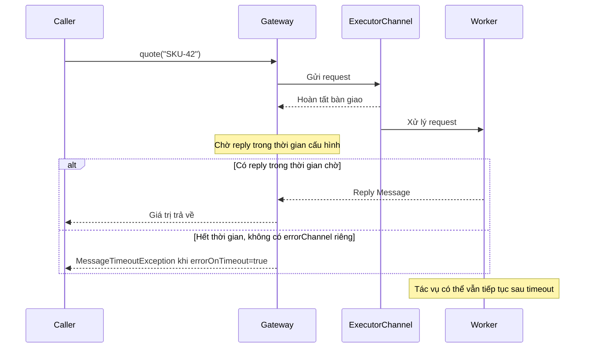

# errorOnTimeout trong Messaging Gateway

## 1. Mục tiêu và phạm vi

Trong module **SPRING_INTEGRATION_CORE**, messaging gateway là điểm nối giữa lời gọi phương thức Java và luồng xử lý thông điệp. Tham số được đưa vào `Message`, request đi qua `MessageChannel` và các endpoint, còn reply được chuyển thành giá trị trả về. Bài này thuộc chương **Messaging gateway**, tập trung vào một lựa chọn của hợp đồng request–reply: caller nhận gì khi hết thời gian chờ mà chưa có phản hồi?

Sau bài học, bạn có thể:

- Chọn giữa kết quả `null`, ngoại lệ timeout và phản hồi dự phòng.
- Cấu hình `errorOnTimeout` bằng annotation, factory bean và Java DSL.
- Nhận biết ảnh hưởng của `DirectChannel`, `ExecutorChannel` và `QueueChannel` đến thời điểm chờ reply.
- Thiết kế luồng lỗi, kiểm thử việc thiếu reply và xử lý kết quả đến muộn.

Các ví dụ dùng **Java 17 trở lên và Spring Integration 6.2 trở lên**; mốc API được đối chiếu với nhánh 6.3. Không cần một giao thức mạng cụ thể để học tính năng này. `errorOnTimeout` có trên `@MessagingGateway`, `GatewayProxyFactoryBean` và `GatewayEndpointSpec` từ **6.2**; khả năng tương tự ở lớp nền `MessagingGatewaySupport` đã có trước đó. [Nguồn: Messaging Gateways](https://docs.spring.io/spring-integration/reference/6.3/gateway.html#gateway-no-response).

## 2. Vấn đề: thiếu reply có ý nghĩa gì?

Giả sử ứng dụng gọi dịch vụ báo giá:

```java
String quote = quoteGateway.quote("SKU-42");
```

Caller cần phân biệt hai kết quả:

1. Dịch vụ đã trả lời rằng không có giá cho sản phẩm.
2. Gateway chưa nhận được câu trả lời trong thời gian cho phép.

Hai tình huống dẫn đến các quyết định khác nhau: trường hợp đầu có thể hiển thị “chưa có giá”; trường hợp sau có thể đề nghị thử lại hoặc tra cứu trạng thái yêu cầu. Nếu cùng biểu diễn bằng `null`, mã nghiệp vụ dễ đánh đồng dữ liệu không tồn tại với một lần trao đổi thông điệp chưa hoàn tất.

Với gateway request–reply, `errorOnTimeout` quyết định cách biểu diễn tình huống thứ hai:

| Thiết lập | Khi hết thời gian chờ reply |
| --- | --- |
| `errorOnTimeout = false` | Có thể trả `null` với chữ ký trả về kiểu tham chiếu như `String`. |
| `errorOnTimeout = true`, không cấu hình error channel riêng | Phát sinh `org.springframework.integration.MessageTimeoutException`. |
| `errorOnTimeout = true`, có error channel riêng | Lỗi timeout được đưa vào luồng lỗi; kết quả caller nhận phụ thuộc cách luồng lỗi xử lý và trả lời. |

Giá trị mặc định của thuộc tính trên `@MessagingGateway` là **`false`**. Đây là cờ boolean, nên viết `errorOnTimeout = true`, không viết `errorOnTimeout = "true"`. [Nguồn: API MessagingGateway](https://docs.spring.io/spring-integration/docs/6.4.2/api/org/springframework/integration/annotation/MessagingGateway.html#errorOnTimeout()).

Không dùng kiểu nguyên thủy như `int` để ngầm giả định rằng timeout sẽ thành `0`: kiểu nguyên thủy không thể nhận `null`. Hãy chọn một hợp đồng rõ ràng, chẳng hạn một DTO kết quả hoặc một ngoại lệ có thể xử lý.

## 3. Phân biệt ba cấu hình liên quan

| Cấu hình | Câu hỏi nó trả lời | Phạm vi |
| --- | --- | --- |
| `requestTimeout` / `defaultRequestTimeout` | Chờ gửi request vào kênh được bao lâu? | Có ý nghĩa khi thao tác gửi có thể chặn, chẳng hạn queue hữu hạn đang đầy. |
| `replyTimeout` / `defaultReplyTimeout` | Chờ nhận reply được bao lâu? | Giai đoạn đợi phản hồi sau thao tác gửi. |
| `errorOnTimeout` | Thiếu reply sau thời gian chờ được biểu diễn thế nào? | Chính sách kết quả khi không nhận được reply. |

Các giá trị timeout ở đây tính bằng **mili giây**. Annotation `@Gateway` cho phép ghi đè timeout theo phương thức; `errorOnTimeout` trong các API được dùng ở bài này là thiết lập trên gateway, không phải một thuộc tính của `@Gateway`. [Nguồn: API Gateway](https://docs.spring.io/spring-integration/docs/6.4.2/api/org/springframework/integration/annotation/Gateway.html).

Ví dụ, `requestTimeout = 100` không giới hạn handler xuống còn 100 ms; nó chỉ có thể giới hạn việc chờ gửi vào một kênh có khả năng chặn. Cũng không nên coi `replyTimeout = 300` là cam kết toàn bộ phương thức Java luôn kết thúc sau 300 ms.

Khi thiết kế ví dụ hoặc dịch vụ, hãy đặt timeout hữu hạn một cách tường minh. Việc bật `errorOnTimeout` tự nó không tạo một thời hạn hữu hạn cho một cấu hình đang chờ vô hạn.

## 4. Vì sao ranh giới luồng quyết định hiệu lực của timeout?

### 4.1. Toàn bộ flow chạy trên luồng caller

```text
caller -> gateway -> DirectChannel -> handler chạy 2 giây -> reply
         cùng một luồng thực thi xuyên suốt
```

Nếu handler giữ luồng trong hai giây, caller vẫn mắc trong thao tác gửi. Gateway chưa giành lại quyền điều khiển để chờ reply theo cơ chế thông thường. Do đó, một `replyTimeout` ngắn không ngắt handler ở giữa; bật `errorOnTimeout` cũng không thay đổi điều đó.

Khi handler kết thúc và reply đã có sẵn, gateway có thể nhận ngay kết quả, dù tổng thời gian lời gọi đã vượt giá trị `replyTimeout`. Tài liệu mô tả đồng hồ chờ reply bắt đầu sau khi quyền điều khiển trở lại gateway. [Nguồn: Gateway Behavior When No response Arrives](https://docs.spring.io/spring-integration/reference/gateway.html#gateway-no-response).

### 4.2. Flow chuyển việc sang luồng khác



`ExecutorChannel` thường bàn giao handler cho executor; `QueueChannel` lưu message để consumer lấy sau. Đây là các cách tạo ranh giới bất đồng bộ giữa gửi request và xử lý nghiệp vụ. Với queue còn chỗ hoặc executor nhận việc nhanh, gateway có thể bắt đầu chờ reply trong khi xử lý downstream tiếp tục. Riêng executor dùng `CallerRunsPolicy` có thể đưa tác vụ về chạy trên luồng gửi khi quá tải. [Nguồn: Message Channel Implementations](https://docs.spring.io/spring-integration/reference/channel/implementations.html).

Hệ quả thiết kế: phải xem cả loại channel, executor và chính sách quá tải. Chỉ nhìn tên thuộc tính timeout là chưa đủ để đánh giá thời gian caller có thể bị giữ.

## 5. Ví dụ annotation và flow báo giá

### 5.1. Khai báo gateway

Các lớp ở phần này đặt trong cùng package `example.gateway`, mỗi lớp public trong một file Java tương ứng. Project cần `spring-integration-core` cùng các dependency Spring tương thích; nên dùng BOM hoặc cơ chế quản lý dependency của ứng dụng.

```java
package example.gateway;

import org.springframework.integration.annotation.MessagingGateway;

@MessagingGateway(
        defaultRequestChannel = "quoteRequests",
        defaultRequestTimeout = "100",
        defaultReplyTimeout = "300",
        errorOnTimeout = true)
public interface QuoteGateway {
    String quote(String sku);
}
```

Các giá trị timeout ở `@MessagingGateway` là chuỗi; cờ `errorOnTimeout` là boolean. Để Spring tạo proxy cho interface trong ví dụ cấu hình Java thuần, dùng `@IntegrationComponentScan` như bên dưới. [Nguồn: khai báo MessagingGateway](https://github.com/spring-projects/spring-integration/blob/v6.3.0/spring-integration-core/src/main/java/org/springframework/integration/annotation/MessagingGateway.java).

### 5.2. Tạo kênh bất đồng bộ và các endpoint

```java
package example.gateway;

import org.springframework.context.annotation.Bean;
import org.springframework.context.annotation.Configuration;
import org.springframework.integration.annotation.IntegrationComponentScan;
import org.springframework.integration.channel.ExecutorChannel;
import org.springframework.integration.config.EnableIntegration;
import org.springframework.integration.dsl.IntegrationFlow;
import org.springframework.messaging.MessageChannel;
import org.springframework.scheduling.concurrent.ThreadPoolTaskExecutor;

@Configuration
@EnableIntegration
@IntegrationComponentScan(basePackageClasses = QuoteGateway.class)
public class QuoteConfiguration {

    @Bean
    public ThreadPoolTaskExecutor quoteExecutor() {
        ThreadPoolTaskExecutor executor = new ThreadPoolTaskExecutor();
        executor.setCorePoolSize(2);
        executor.setMaxPoolSize(2);
        executor.setQueueCapacity(100);
        executor.setThreadNamePrefix("quote-");
        return executor;
    }

    @Bean
    public MessageChannel quoteRequests(ThreadPoolTaskExecutor quoteExecutor) {
        return new ExecutorChannel(quoteExecutor);
    }

    @Bean
    public IntegrationFlow quoteFlow() {
        return IntegrationFlow.from("quoteRequests")
                .<String>filter(sku -> !"MISSING".equals(sku))
                .<String, String>transform(sku -> "PRICE:" + sku)
                .get();
    }
}
```

Đây là flow minh họa cơ chế, không phải thuật toán tính giá. Hai đường đi có thể quan sát:

| Đầu vào | Diễn biến | Kết quả mong đợi |
| --- | --- | --- |
| `SKU-42` | Filter cho qua; transformer tạo reply. | `PRICE:SKU-42` nếu reply đến trong thời gian chờ. |
| `MISSING` | Filter loại message; không có reply. | `MessageTimeoutException` khi hết thời gian chờ. |

Việc filter loại message là cách tạo tình huống thiếu reply mà không cần gọi dịch vụ mạng chậm hay chèn `Thread.sleep`. Trong ứng dụng báo giá thực tế, “không có giá” thường nên là một kết quả nghiệp vụ tường minh, thay vì cố ý bỏ reply.

### 5.3. Xử lý tại caller

```java
import org.springframework.integration.MessageTimeoutException;

try {
    String result = quoteGateway.quote("MISSING");
    // Xử lý kết quả nghiệp vụ khi có reply.
}
catch (MessageTimeoutException timeout) {
    // Ghi nhận rằng lần trao đổi chưa có reply đúng thời hạn.
    // Chính sách thử lại hoặc trả kết quả dự phòng do ứng dụng quyết định.
}
```

Ở đây `quoteGateway` là bean `QuoteGateway` được inject vào caller. Exception đúng là **`org.springframework.integration.MessageTimeoutException`**; không nhầm với `java.util.concurrent.TimeoutException`. Nó thuộc nhánh `MessagingException` và là unchecked exception. [Nguồn: API MessageTimeoutException](https://docs.spring.io/spring-integration/docs/6.4.2/api/org/springframework/integration/MessageTimeoutException.html).

## 6. Thêm errorChannel để trả phản hồi dự phòng

Có những nghiệp vụ cho phép caller nhận một kết quả “tạm thời không khả dụng” thay cho ngoại lệ. Khi đó có thể sửa annotation của `QuoteGateway`:

```java
@MessagingGateway(
        defaultRequestChannel = "quoteRequests",
        defaultRequestTimeout = "100",
        defaultReplyTimeout = "300",
        errorChannel = "quoteErrors",
        errorOnTimeout = true)
public interface QuoteGateway {
    String quote(String sku);
}
```

Sau đó bổ sung hai bean sau vào `QuoteConfiguration`:

```java
@Bean
public MessageChannel quoteErrors() {
    return new org.springframework.integration.channel.DirectChannel();
}

@Bean
public IntegrationFlow quoteErrorFlow() {
    return IntegrationFlow.from("quoteErrors")
            .<Throwable, String>transform(error -> {
                if (error instanceof
                        org.springframework.integration.MessageTimeoutException) {
                    return "QUOTE_TEMPORARILY_UNAVAILABLE";
                }
                if (error instanceof RuntimeException runtime) {
                    throw runtime;
                }
                throw new IllegalStateException("Quote processing failed", error);
            })
            .get();
}
```

Đây là **biến thể thay thế** cho gateway ở phần 5, không đăng ký thêm một proxy trùng tên. Error flow nhận `ErrorMessage`; transformer ở ví dụ dùng payload `Throwable` để quyết định phản hồi. `String` được trả về phù hợp với chữ ký `quote`, nên caller có thể nhận `QUOTE_TEMPORARILY_UNAVAILABLE` sau timeout.

Cần đọc `errorOnTimeout = true` là “tạo lỗi khi thiếu reply”, không phải “caller luôn nhận ngoại lệ”. Một error flow có thể chuyển lỗi thành kết quả dự phòng. Cơ chế của `GatewayProxyFactoryBean` cho phép phát lỗi ra error channel thay cho ném thẳng về caller. [Nguồn: setErrorOnTimeout](https://docs.spring.io/spring-integration/docs/6.4.2/api/org/springframework/integration/gateway/GatewayProxyFactoryBean.html#setErrorOnTimeout(boolean)).

### 6.1. Error flow phải có hợp đồng trả lời

Nếu error flow chỉ ghi log rồi kết thúc mà không trả reply, gateway vẫn thiếu kết quả. Ở triển khai nhánh 6.3, khi `errorOnTimeout` bật, thiếu reply từ error channel có thể tiếp tục gây `MessageTimeoutException`; thông điệp lỗi phân biệt tình huống không nhận reply từ error channel. Trả về message có payload `Throwable` cũng mang nghĩa phát lại lỗi, không phải một phản hồi nghiệp vụ bình thường. [Nguồn: xử lý lỗi trong MessagingGatewaySupport](https://github.com/spring-projects/spring-integration/blob/v6.3.0/spring-integration-core/src/main/java/org/springframework/integration/gateway/MessagingGatewaySupport.java).

Do đó, hãy thiết kế error flow theo một trong hai hướng rõ ràng:

- Tạo reply dự phòng đúng kiểu và trả về qua đường reply của request lỗi.
- Cho lỗi tiếp tục lan tới caller nếu nghiệp vụ không cho phép phản hồi dự phòng.

Tránh để việc “đã ghi log” bị hiểu thành “đã trả lời caller”. Việc tiếp tục xử lý ở error flow cũng làm tăng tổng độ trễ; không mặc định tổng thời gian lời gọi bằng đúng một lần `replyTimeout`.

Trong sản phẩm thực, nên dùng DTO chứa trạng thái như `AVAILABLE`, `NOT_FOUND`, `TEMPORARILY_UNAVAILABLE` thay cho chuỗi đặc biệt. Khi đó, dữ liệu thành công và phản hồi dự phòng vẫn thuộc cùng một hợp đồng kiểu.

## 7. Cấu hình bằng Java DSL và factory bean

### 7.1. Gateway ở giữa một flow

Toán tử `.gateway(...)` gọi một flow khác theo mô hình request–reply, sau đó đưa kết quả về flow đang chạy:

```java
@Bean
public IntegrationFlow orderPricingFlow() {
    return IntegrationFlow.from("pricingCommands")
            .gateway("quoteRequests", gateway -> gateway
                    .requestTimeout(100L)
                    .replyTimeout(300L)
                    .errorOnTimeout(true))
            .channel("pricedOrders")
            .get();
}
```

Đoạn này là cấu hình minh họa để ghép vào ứng dụng có sẵn các kênh `pricingCommands`, `quoteRequests`, `pricedOrders`. Payload đầu vào phải phù hợp với flow báo giá. `GatewayEndpointSpec.errorOnTimeout(boolean)` có từ 6.2; tham số `replyTimeout` ở DSL này là `Long`, nên ví dụ dùng `300L`. [Nguồn: GatewayEndpointSpec](https://github.com/spring-projects/spring-integration/blob/v6.3.0/spring-integration-core/src/main/java/org/springframework/integration/dsl/GatewayEndpointSpec.java).

Nếu gateway giữa flow hết thời gian, phần phía sau như gửi vào `pricedOrders` không tự nhận được một kết quả báo giá thành công. Lỗi tiếp tục đi theo cơ chế xử lý lỗi của flow bao ngoài; tùy ranh giới thực thi, nó có thể được ném trên luồng gửi hoặc chuyển thành error message ở phía bất đồng bộ.

Phân biệt hai API cùng dùng tên gateway:

| Cách dùng | Vai trò |
| --- | --- |
| `@MessagingGateway` hoặc `GatewayProxyFactoryBean` | Tạo proxy interface cho mã Java gọi vào messaging. |
| `.gateway("someChannel", spec -> ...)` | Tạo endpoint request–reply ở giữa flow. |
| `IntegrationFlow.from(SomeInterface.class)` | Tạo flow bắt đầu từ proxy của một interface. |

`IntegrationFlow.from(SomeInterface.class)` hỗ trợ dùng interface làm đầu vào và áp dụng các thuộc tính annotation của gateway. Đây không phải cùng vị trí cấu hình với `GatewayEndpointSpec` của toán tử `.gateway(...)`. [Nguồn: IntegrationFlow as a Gateway](https://docs.spring.io/spring-integration/reference/dsl/integration-flow-as-gateway.html).

### 7.2. Khai báo factory bean trực tiếp

Nếu không dùng quét annotation, một cấu hình thay thế là:

```java
@Bean
public org.springframework.integration.gateway.GatewayProxyFactoryBean<QuoteGateway>
        quoteGateway() {
    var factory = new org.springframework.integration.gateway.GatewayProxyFactoryBean<>(
            QuoteGateway.class);
    factory.setDefaultRequestChannelName("quoteRequests");
    factory.setDefaultRequestTimeout(100L);
    factory.setDefaultReplyTimeout(300L);
    factory.setErrorOnTimeout(true);
    return factory;
}
```

Ở biến thể này dùng interface `QuoteGateway` không có `@MessagingGateway` và không quét lại nó thành proxy khác. Spring quản lý vòng đời factory bean và expose proxy cho caller. Cách khai báo này cũng hữu ích trong kiểm thử, vì các lựa chọn timeout nằm ngay trong cấu hình test. [Nguồn: GatewayProxyFactoryBean](https://github.com/spring-projects/spring-integration/blob/v6.3.0/spring-integration-core/src/main/java/org/springframework/integration/gateway/GatewayProxyFactoryBean.java).

## 8. Kiểm thử hành vi thiếu reply

Một bài test timeout ổn định nên kiểm tra **kết quả quan sát được**: trả `null`, ném exception hay trả fallback. Không cần khẳng định lời gọi phải kết thúc chính xác tại một số mili giây cụ thể.

Ví dụ độc lập dưới đây dùng JUnit Jupiter và Spring context thuần. `QueueChannel` có sức chứa nhưng không có consumer mô phỏng việc request đã được nhận vào kênh và không có reply; test không chạy tác vụ ngủ. Dependency cần có là `spring-integration-core` và `junit-jupiter`, cùng các dependency chuyển tiếp tương thích.

```java
package example.gateway;

import org.junit.jupiter.api.Test;
import org.springframework.context.annotation.AnnotationConfigApplicationContext;
import org.springframework.context.annotation.Bean;
import org.springframework.context.annotation.Configuration;
import org.springframework.integration.MessageTimeoutException;
import org.springframework.integration.channel.DirectChannel;
import org.springframework.integration.channel.QueueChannel;
import org.springframework.integration.config.EnableIntegration;
import org.springframework.integration.dsl.IntegrationFlow;
import org.springframework.integration.gateway.GatewayProxyFactoryBean;
import org.springframework.messaging.MessageChannel;

import static org.junit.jupiter.api.Assertions.assertEquals;
import static org.junit.jupiter.api.Assertions.assertNull;
import static org.junit.jupiter.api.Assertions.assertThrows;

public class GatewayTimeoutTest {

    public interface Exchange {
        String exchange(String request);
    }

    @Configuration
    @EnableIntegration
    public static class TestConfiguration {

        @Bean
        public QueueChannel noReplyRequests() {
            return new QueueChannel(10);
        }

        @Bean
        public MessageChannel healthyRequests() {
            return new DirectChannel();
        }

        @Bean
        public MessageChannel recoveryErrors() {
            return new DirectChannel();
        }

        @Bean
        public GatewayProxyFactoryBean<Exchange> relaxedGateway() {
            return factory("noReplyRequests", false);
        }

        @Bean
        public GatewayProxyFactoryBean<Exchange> strictGateway() {
            return factory("noReplyRequests", true);
        }

        @Bean
        public GatewayProxyFactoryBean<Exchange> healthyGateway() {
            return factory("healthyRequests", true);
        }

        @Bean
        public GatewayProxyFactoryBean<Exchange> recoveredGateway() {
            GatewayProxyFactoryBean<Exchange> factory =
                    factory("noReplyRequests", true);
            factory.setErrorChannelName("recoveryErrors");
            return factory;
        }

        @Bean
        public IntegrationFlow healthyFlow() {
            return IntegrationFlow.from("healthyRequests")
                    .<String, String>transform(value -> "OK:" + value)
                    .get();
        }

        @Bean
        public IntegrationFlow recoveryFlow() {
            return IntegrationFlow.from("recoveryErrors")
                    .<Throwable, String>transform(error -> {
                        if (error instanceof MessageTimeoutException) {
                            return "FALLBACK";
                        }
                        throw new IllegalStateException("Unexpected error", error);
                    })
                    .get();
        }

        private GatewayProxyFactoryBean<Exchange> factory(
                String requestChannel, boolean errorOnTimeout) {
            GatewayProxyFactoryBean<Exchange> factory =
                    new GatewayProxyFactoryBean<>(Exchange.class);
            factory.setDefaultRequestChannelName(requestChannel);
            factory.setDefaultRequestTimeout(100L);
            factory.setDefaultReplyTimeout(100L);
            factory.setErrorOnTimeout(errorOnTimeout);
            return factory;
        }
    }

    @Test
    void returnsNullWhenTimeoutIsAllowed() {
        try (var context = new AnnotationConfigApplicationContext(
                TestConfiguration.class)) {
            Exchange gateway = context.getBean("relaxedGateway", Exchange.class);
            assertNull(gateway.exchange("A"));
        }
    }

    @Test
    void throwsWhenReplyDoesNotArrive() {
        try (var context = new AnnotationConfigApplicationContext(
                TestConfiguration.class)) {
            Exchange gateway = context.getBean("strictGateway", Exchange.class);
            assertThrows(MessageTimeoutException.class,
                    () -> gateway.exchange("A"));
        }
    }

    @Test
    void keepsSuccessfulReplies() {
        try (var context = new AnnotationConfigApplicationContext(
                TestConfiguration.class)) {
            Exchange gateway = context.getBean("healthyGateway", Exchange.class);
            assertEquals("OK:A", gateway.exchange("A"));
        }
    }

    @Test
    void convertsTimeoutToFallbackThroughErrorFlow() {
        try (var context = new AnnotationConfigApplicationContext(
                TestConfiguration.class)) {
            Exchange gateway = context.getBean("recoveredGateway", Exchange.class);
            assertEquals("FALLBACK", gateway.exchange("A"));
        }
    }
}
```

Mỗi test mở context riêng và đóng sau khi dùng; queue của test trước không ảnh hưởng test sau. Bốn test minh họa bốn nhánh hợp đồng, trong đó test thành công xác nhận rằng bật cờ không làm thay đổi reply bình thường.

Khi kiểm thử flow sản xuất có tác vụ đến muộn, có thể dùng latch để giữ worker, đợi gateway kết thúc vì timeout, rồi giải phóng worker trong `finally`. Cách đó cho phép quan sát riêng hai sự kiện “caller hết chờ” và “worker hoàn tất”. Đây là thiết kế kiểm thử bổ sung, không được suy ra từ việc chỉ kiểm tra một exception.

## 9. Timeout không thay thế hợp đồng của từng endpoint

Một request không có reply có thể xuất phát từ sai thiết kế flow, không chỉ từ hệ thống chạy chậm. Hãy sửa nguyên nhân tại vị trí có đủ ngữ cảnh:

| Nguyên nhân | Cách thiết kế phù hợp |
| --- | --- |
| Handler đáng lẽ phải trả dữ liệu nhưng trả `null` | Bật `requiresReply(true)` ở endpoint đó nếu việc thiếu kết quả là lỗi. |
| Filter loại request mà caller vẫn cần kết quả | Trả kết quả từ chối qua một nhánh phù hợp, hoặc chủ động phát lỗi khi bị loại. |
| Nhánh router đi tới endpoint một chiều | Bổ sung phản hồi nghiệp vụ cho nhánh đó hoặc thay hợp đồng của gateway. |
| Aggregator chưa đủ điều kiện release | Xem lại correlation, release strategy và chính sách cho nhóm thiếu phần tử. |
| Header đường reply bị mất khi dựng message mới | Bảo toàn đường reply cần thiết khi biến đổi hoặc xây lại message. |

Ví dụ buộc service activator phát lỗi khi trả `null`:

```java
.handle(orderService, "lookup", endpoint -> endpoint.requiresReply(true))
```

`orderService` ở đây là service của ứng dụng được inject vào cấu hình. `requiresReply` áp dụng tại endpoint, khác với việc gateway đợi tới timeout mới phát hiện không có kết quả. Khi endpoint yêu cầu reply mà handler trả `null`, lỗi tương ứng là `ReplyRequiredException`. [Nguồn: Service Activator](https://docs.spring.io/spring-integration/reference/service-activator.html).

Ví dụ filter chủ động phát lỗi khi từ chối:

```java
.<String>filter(value -> !value.isBlank(),
        filter -> filter.throwExceptionOnRejection(true))
```

Lựa chọn này thích hợp khi đầu vào bị loại là lỗi cần báo ngay. Filter cũng hỗ trợ discard channel; nếu thiết kế một nhánh xử lý request bị loại, phải quyết định nhánh đó có trả reply cho gateway hay không. [Nguồn: Filter](https://docs.spring.io/spring-integration/reference/filter.html).

Như vậy, `errorOnTimeout` là chính sách ở biên gateway; từng endpoint vẫn cần một hợp đồng xử lý thông điệp nhất quán.

## 10. Kết quả đến muộn và chính sách thử lại

Hãy xét một yêu cầu ghi đơn hàng có mã nghiệp vụ `ORDER-42`. Gateway hết thời gian chờ, nhưng worker sau đó vẫn có thể ghi thành công. Đối với caller, trạng thái lúc này là “chưa biết kết quả”, không tự động là “ghi thất bại”.

Một thiết kế cho tình huống này nên trả lời được:

- Nếu caller gửi lại `ORDER-42`, hệ thống có nhận ra đây là cùng một thao tác không?
- Có nơi tra cứu trạng thái cuối cùng của đơn hàng không?
- Khi worker tạo reply sau khi caller đã ngừng chờ, hệ thống quan sát và xử lý nó bằng cách nào?

Với thao tác có side effect, dùng định danh nghiệp vụ ổn định và cơ chế chống xử lý trùng tại nơi thực hiện thao tác. Retry phải dựa vào tính chất nghiệp vụ và trạng thái có thể tra cứu, thay vì chỉ dựa vào tên exception.

Đồng thời, timeout của client HTTP, JDBC hoặc giao thức downstream phải được cấu hình tại chính client đó. Gateway timeout không tự gửi tín hiệu hủy hay tự hoàn tác thay đổi đã thực hiện. Nếu có transaction, việc rollback còn phụ thuộc ranh giới transaction, luồng thực thi và cách exception được xử lý.

Về vận hành, nên ghi nhận số lần thiếu reply, số lần dùng fallback, mức sử dụng executor và độ dài hàng đợi. Dùng correlation ID hoặc request ID để nối dấu vết caller với xử lý downstream; không biến mọi timeout thành một thông báo thành công khó phân biệt.

## 11. Những điểm cần ghi nhớ khi áp dụng

- Bật `errorOnTimeout` khi hợp đồng coi thiếu reply là một sự kiện lỗi cần xử lý rõ ràng.
- Đặt `replyTimeout` hữu hạn và xem ranh giới thực thi trước khi đánh giá độ trễ caller.
- Dùng error flow trả fallback khi nghiệp vụ cho phép, với kiểu dữ liệu tương thích chữ ký gateway.
- Đảm bảo các nhánh transformer, router, filter và aggregator kết thúc theo một hợp đồng có chủ đích.
- Kiểm thử cả reply thành công, thiếu reply và phản hồi dự phòng; đánh giá riêng trường hợp worker hoàn tất muộn.

Từ lời gọi Java qua message, channel và endpoint, `errorOnTimeout` giúp đưa việc thiếu phản hồi vào hợp đồng của gateway. Giá trị thực tế của cấu hình nằm ở cách caller và toàn bộ flow cùng hiểu, quan sát và xử lý tình huống đó.