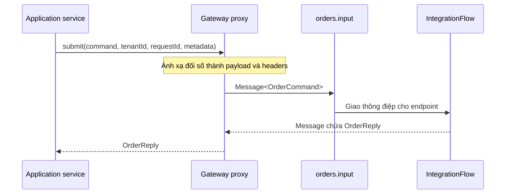

# Gateway method argument mapping

## 1. Từ lời gọi Java đến hợp đồng thông điệp

Trong chương **Messaging gateway** của module **SPRING_INTEGRATION_CORE**, argument mapping là bước chuyển các đối số của phương thức Java thành payload và headers của thông điệp. Đây là nơi ứng dụng xác định dữ liệu nào cần được xử lý, dữ liệu nào giúp định tuyến hoặc theo dõi luồng.

Bài học tập trung vào việc thiết kế hợp đồng này bằng `Message`, `MessageChannel`, gateway và Java DSL. Những thành phần phía sau như transformer, router, filter, aggregator và endpoint xử lý nghiệp vụ đều phụ thuộc vào thông điệp mà gateway tạo ra. Nếu mapping sai từ đầu, router có thể đọc thiếu header hoặc transformer có thể nhận nhầm kiểu payload dù cấu hình riêng của chúng đúng.

Sau bài học, bạn có thể:

- Chọn đúng payload khi phương thức có nhiều đối số.
- Dùng `@Payload`, `@Header` và `@Headers` để mô tả vai trò từng đối số.
- Nhận diện các trường hợp `Map` dễ gây nhập nhằng.
- Tạo payload hoặc header bằng SpEL trong đúng ngữ cảnh.
- Kiểm thử thông điệp thực sự đi vào channel.

Ví dụ xuyên suốt là ứng dụng tiếp nhận đơn hàng theo tenant:

```java
OrderReply reply = orderGateway.submit(
        new OrderCommand("ORD-2401", 3),
        "tenant-hcm",
        "req-701",
        Map.of("clientVersion", "web-3"));
```

Hợp đồng thông điệp mong muốn:

```text
payload:
  OrderCommand(orderId="ORD-2401", quantity=3)

headers nghiệp vụ:
  tenantId      = "tenant-hcm"
  requestId     = "req-701"
  clientVersion = "web-3"
```

Các header do hạ tầng tạo, chẳng hạn `id` hoặc `replyChannel`, không được liệt kê hết ở đây.



Gateway giúp caller làm việc qua interface Java; việc tạo proxy và tương tác messaging được Spring Integration thực hiện. Xem [tổng quan Messaging Gateways](https://docs.spring.io/spring-integration/reference/gateway.html).

## 2. Payload, header và đối số là ba khái niệm khác nhau

**Đối số** là giá trị truyền vào khi gọi phương thức. **Payload** là nội dung chính của message. **Header** là một mục metadata đi cùng message.

Một lời gọi có bốn đối số không đồng nghĩa message có bốn payload. Bạn phải xác định một payload cuối cùng; các giá trị khác có thể trở thành headers hoặc được dùng để xây dựng payload bằng biểu thức.

| Giá trị đầu vào | Vai trò được chọn | Lý do thiết kế |
|---|---|---|
| `OrderCommand` | Payload | Endpoint cần dữ liệu này để xử lý đơn |
| `tenantId` | Header | Router có thể chọn luồng theo tenant |
| `requestId` | Header | Theo dõi yêu cầu qua các endpoint |
| `clientVersion` | Header | Bổ sung ngữ cảnh quan sát hoặc tương thích |

Đặt một giá trị vào header là quyết định về hợp đồng, không phải phép biến đổi bảo mật. Một `tenantId` do caller truyền vào vẫn cần được đối chiếu với tenant được phép truy cập. Gateway không tự xác thực giá trị đó.

Nếu tenant là thuộc tính bắt buộc của tài liệu nghiệp vụ cần lưu trữ và phát lại độc lập, đặt tenant trong DTO có thể phù hợp hơn. Hãy quyết định theo nhu cầu hệ thống và giữ một nguồn dữ liệu có thẩm quyền khi thông tin xuất hiện ở nhiều vị trí.

## 3. Quy ước mapping khi chưa dùng annotation

Các quy ước mặc định giúp interface ngắn gọn trong trường hợp đơn giản. Bảng sau giả định các giá trị payload khác `null` và không có payload expression hay custom mapper:

| Chữ ký phương thức | Payload theo quy ước | Headers từ đối số | Nhận xét |
|---|---|---|---|
| `void send(String body)` | `body` | Không có header nghiệp vụ bổ sung | Một đối số |
| `void send(OrderCommand command)` | `command` | Không có header nghiệp vụ bổ sung | Một DTO rõ nghĩa |
| `void send(Map<String, Object> document)` | Toàn bộ `document` | Không tự bung map thành headers | Một map duy nhất vẫn là payload |
| `void send(String body, Map<String, Object> metadata)` | `body` | Các entry trong `metadata` | Payload không phải map |
| `void send(Map<String, Object> first, Map<String, Object> second)` | Không xác định rõ | Không có hợp đồng hợp lệ | Cần chỉ định vai trò |
| `void send(String body, String tenant)` | Không xác định được một payload duy nhất | `tenant` không tự thành header | Cần annotation hoặc expression |

Tên biến `metadata`, `headers` hoặc `tenant` không tự quyết định vai trò đối số. Cũng không nên suy ra quy tắc tổng quát rằng “tham số đầu tiên luôn là payload”.

Quy ước với `Object` có thể trở nên khó đọc khi giá trị thực tế là `Map`. Với interface dùng ở nhiều nơi, nên khai báo kiểu cụ thể và annotation rõ ràng. Các trường hợp map và nhiều ứng viên payload được mô tả tại [Mapping Method Arguments to a Message](https://docs.spring.io/spring-integration/reference/gateway.html#mapping-method-arguments).

## 4. Chỉ định vai trò bằng annotation

Các annotation liên quan đến phần của message thuộc Spring Messaging:

```java
import org.springframework.messaging.handler.annotation.Header;
import org.springframework.messaging.handler.annotation.Headers;
import org.springframework.messaging.handler.annotation.Payload;
```

Annotation cấu hình gateway thuộc Spring Integration:

```java
import org.springframework.integration.annotation.Gateway;
import org.springframework.integration.annotation.GatewayHeader;
import org.springframework.integration.annotation.MessagingGateway;
```

`@Header` trong bài này không phải annotation lấy HTTP header của một controller.

### 4.1. `@Payload`: chọn nội dung chính

```java
void enqueue(@Payload OrderCommand command);
```

Annotation cho biết đối số `command` cung cấp payload. Hợp đồng dễ nhận ra ngay cả khi phương thức được bổ sung thêm tham số.

Khi dữ liệu nghiệp vụ có nhiều phần, gói chúng vào DTO:

```java
public record OrderCommand(String orderId, int quantity) {
}
```

Không khai báo hai tham số cùng mang `@Payload` để biểu diễn hai phần của đơn hàng. Nếu cần ghép dữ liệu từ nhiều đối số, hãy tạo DTO trước khi gọi gateway hoặc sử dụng payload expression ở cấp phương thức.

`@Payload` còn hỗ trợ biểu thức; ý nghĩa biểu thức phụ thuộc vị trí annotation. Phần SpEL bên dưới tách rõ hai trường hợp này. Xem [API của Payload](https://docs.spring.io/spring-framework/docs/current/javadoc-api/org/springframework/messaging/handler/annotation/Payload.html).

### 4.2. `@Header`: một đối số thành một header

```java
void enqueue(
        @Payload OrderCommand command,
        @Header("tenantId") String tenantId,
        @Header("requestId") String requestId);
```

Lời gọi `gateway.enqueue(command, "tenant-hcm", "req-701")` đặt tenant và request vào các header được chỉ tên. Đổi tên biến Java từ `tenantId` thành `tenant` không đổi tên header đã khai báo bằng chuỗi `"tenantId"`.

Nên ghi rõ tên trong `@Header("...")` để hợp đồng không phụ thuộc việc compiler giữ tên tham số. Header tùy chọn có thể khai báo như sau:

```java
void enqueue(
        @Payload OrderCommand command,
        @Header("tenantId") String tenantId,
        @Header(name = "locale", required = false) String locale);
```

Nếu `locale` là `null`, consumer cần xử lý được việc thiếu header này. Đối với header bắt buộc, kiểm tra sớm trước lời gọi giúp trả lỗi nghiệp vụ dễ hiểu hơn.

Không suy rộng mọi hành vi annotation ở endpoint nhận message sang gateway gửi message. Khi cần locale mặc định, có thể chuẩn hóa rõ ràng tại application service:

```java
String effectiveLocale = locale == null ? "vi-VN" : locale;
gateway.enqueue(command, tenantId, effectiveLocale);
```

Tên và thuộc tính annotation được mô tả trong [API của Header](https://docs.spring.io/spring-framework/docs/current/javadoc-api/org/springframework/messaging/handler/annotation/Header.html).

### 4.3. `@Headers`: một map thành nhiều header

```java
void enqueue(
        @Payload OrderCommand command,
        @Headers Map<String, Object> metadata);
```

Ví dụ:

```java
gateway.enqueue(
        command,
        Map.of("clientVersion", "web-3", "sourceSystem", "checkout"));
```

Hai entry của map trở thành hai header riêng. Map không được đặt vào một header có tên `metadata`, cũng không được gắn thêm vào DTO payload.

Khi muốn toàn bộ map là **giá trị của một header**, dùng `@Header` số ít:

```java
void enqueue(
        @Payload OrderCommand command,
        @Header("clientMetadata") Map<String, Object> metadata);
```

Hai cách khai báo phục vụ hai hợp đồng khác nhau:

```text
@Headers map:
  headers["clientVersion"] = "web-3"

@Header("clientMetadata") map:
  headers["clientMetadata"] = {"clientVersion": "web-3"}
```

`@Headers` yêu cầu kiểu map phù hợp với tên header là `String` và giá trị là `Object`. Xem [API của Headers](https://docs.spring.io/spring-framework/docs/current/javadoc-api/org/springframework/messaging/handler/annotation/Headers.html).

## 5. Trường hợp đặc biệt: `Map` là dữ liệu nghiệp vụ

Giả sử hệ thống tiếp nhận tài liệu đơn hàng linh hoạt:

```java
Map<String, Object> document = Map.of(
        "orderId", "ORD-2401",
        "quantity", 3);
```

Nếu đây là đối số duy nhất, map có thể làm payload theo quy ước. Khi có cả map dữ liệu và map metadata, nên ghi đủ vai trò:

```java
void acceptDocument(
        @Payload Map<String, Object> document,
        @Headers Map<String, Object> metadata);
```

Lời gọi:

```java
gateway.acceptDocument(
        Map.of("orderId", "ORD-2401", "quantity", 3),
        Map.of("tenantId", "tenant-hcm"));
```

Thông điệp cần có:

```text
payload["orderId"]  = "ORD-2401"
payload["quantity"] = 3
headers["tenantId"] = "tenant-hcm"
```

Một lỗi thiết kế thường gặp là thêm `@Headers` vào map dữ liệu vì thấy map chứa nhiều cặp khóa và giá trị. Khi đó, `orderId` và `quantity` có thể bị diễn giải thành metadata thay vì nội dung nghiệp vụ, còn phương thức không có nguồn payload hợp lệ.

Khi cấu trúc tài liệu ổn định, DTO thường giúp IDE và compiler phát hiện lỗi sớm hơn map. Map phù hợp hơn ở ranh giới dữ liệu động, nhưng cần kiểm tra schema và kiểu giá trị trước khi endpoint sử dụng.

## 6. Payload expression và ngữ cảnh SpEL

Không phải biểu thức nào trong Spring Integration cũng được đánh giá trên cùng một đối tượng. Đối chiếu ngữ cảnh trước khi viết expression:

| Nơi khai báo | Đối tượng gốc được dùng | Ví dụ truy cập |
|---|---|---|
| `@Payload("...")` trên tham số | Giá trị của chính đối số đó | `trim()`, `#this` |
| `@Payload("...")` trên phương thức | Ngữ cảnh lời gọi chứa method và args | `args[0]`, `args[1]` |
| `@Gateway(payloadExpression = "...")` | Ngữ cảnh lời gọi chứa method và args | `args[0]` |
| `@GatewayHeader(expression = "...")` | Ngữ cảnh lời gọi chứa method và args | `args[1]`, `method.name` |
| Expression xử lý message ở downstream | Thường là message đầu vào của endpoint | `payload`, `headers['tenantId']` |

Dòng cuối chỉ áp dụng cho endpoint sử dụng message làm root; cần xem hợp đồng expression của component đang cấu hình.

### 6.1. Biểu thức trên tham số

```java
void sendCode(@Payload("trim()") String rawCode);
```

Với `rawCode = "  ORD-2401  "`, payload là chuỗi đã bỏ khoảng trắng đầu và cuối. `trim()` được gọi trên đối số chuỗi.

Không viết `args[0]` ở vị trí này với suy nghĩ root luôn là toàn bộ lời gọi. Ngược lại, `#this` tại đây có thể dùng để biểu diễn chính đối số.

Hãy giữ biểu thức ngắn. Nếu chuẩn hóa cần nhiều điều kiện, gọi bean chuyên trách hoặc đưa bước chuẩn hóa vào transformer để code có tên, dễ kiểm thử và dễ quan sát.

### 6.2. Biểu thức trên phương thức

```java
@Payload("args[0] + ':' + args[1]")
void sendReference(String region, String orderId);
```

Với `region = "VN"` và `orderId = "ORD-2401"`, payload là `"VN:ORD-2401"`. Hai đối số được dùng để tính một payload, thay vì tự động trở thành hai phần payload riêng.

Cách cấu hình tương ứng bằng annotation gateway:

```java
@Gateway(payloadExpression = "args[0] + ':' + args[1]")
void sendReference(String region, String orderId);
```

Đây là hai lựa chọn thay thế. Trong cùng phương thức, nên chọn một nơi quy định payload để người đọc không phải suy luận về nhiều nguồn cấu hình. Cũng tránh kết hợp payload expression ở cấp phương thức với một tham số `@Payload` riêng.

Vị trí trong `args` bắt đầu từ `0`. Đổi thứ tự tham số là thay đổi hợp đồng biểu thức, ngay cả khi các tham số có cùng kiểu và Java vẫn biên dịch.

### 6.3. Sinh header từ đối số

```java
@Gateway(
        payloadExpression = "args[0]",
        headers = {
                @GatewayHeader(name = "tenantId", expression = "args[1]"),
                @GatewayHeader(name = "operation", value = "CREATE_ORDER")
        })
OrderReply submitWithExpressions(OrderCommand command, String tenantId);
```

Phương thức chọn đối số thứ nhất làm payload, lấy tenant từ đối số thứ hai và thêm header hằng. Không thêm `@Payload` vào `command` trong ví dụ này vì payload đã được chọn ở cấp phương thức.

`value = "CREATE_ORDER"` là giá trị chuỗi. `expression = "args[1]"` là biểu thức cần được đánh giá. Nếu dùng hằng chuỗi bên trong expression, phải theo cú pháp literal của SpEL, chẳng hạn `expression = "'CREATE_ORDER'"`.

Các tùy chọn này được mô tả trong [API của Gateway](https://docs.spring.io/spring-integration/api/org/springframework/integration/annotation/Gateway.html) và [API của GatewayHeader](https://docs.spring.io/spring-integration/api/org/springframework/integration/annotation/GatewayHeader.html).

Dữ liệu người dùng nên là đối số của lời gọi; biểu thức là cấu hình do ứng dụng kiểm soát. Không đưa chuỗi biểu thức do người dùng nhập trực tiếp vào cấu hình.

## 7. Nhiều nguồn header và nguy cơ ghi đè

Gateway có thể nhận header từ đối số, cấu hình mặc định hoặc cấu hình riêng cho phương thức. Khi cùng tên, giá trị cuối cùng là phần hợp đồng phải kiểm thử.

Ví dụ default header nhận diện nguồn:

```java
@MessagingGateway(
        defaultRequestChannel = "orders.input",
        defaultHeaders = @GatewayHeader(name = "sourceSystem", value = "checkout"))
public interface TaggedOrderGateway {

    OrderReply submit(
            @Payload OrderCommand command,
            @Header("tenantId") String tenantId);
}
```

Nên phân chia quyền sở hữu tên header:

- Cấu hình chung sở hữu `sourceSystem`.
- Tham số có tên sở hữu `tenantId` và `requestId`.
- Map metadata chỉ cung cấp khóa mở rộng đã thống nhất, như `clientVersion`.

Với mapper mặc định, header cấu hình riêng cho method có thể ghi đè header từ tham số, còn default header được thêm khi chưa có giá trị cùng tên. Không dựa vào default header để khóa một giá trị không được phép thay đổi. Nếu `@Header` và `@Headers` cùng cung cấp một khóa, nên loại bỏ xung đột khỏi hợp đồng. Logic ghép nguồn được thể hiện trong [mã nguồn GatewayMethodInboundMessageMapper](https://github.com/spring-projects/spring-integration/blob/main/spring-integration-core/src/main/java/org/springframework/integration/gateway/GatewayMethodInboundMessageMapper.java).

Khi nhận map tùy ý từ tầng bên ngoài, lọc khóa tại ranh giới ứng dụng trước khi gọi gateway. Tránh để dữ liệu tùy ý điều khiển header hạ tầng như `replyChannel`, `errorChannel` hoặc ghi đè tenant đã xác thực.

## 8. Ví dụ hoàn chỉnh: gateway và Java DSL

Các đoạn mã dưới đây tạo thành ví dụ độc lập dùng Java 17 trở lên, `spring-integration-core`, Spring Context và API Java DSL có trong Spring Integration 6.x. Dùng bộ phiên bản được BOM của dự án quản lý; bài học không yêu cầu chọn một phiên bản mới nhất.

Mỗi kiểu public đặt trong tệp Java riêng, cùng package `example.gatewaymapping`. Những đoạn ngắn ở phần trước là lựa chọn hợp đồng khác, không cần ghép tất cả vào interface này.

### 8.1. Kiểu dữ liệu

`OrderCommand.java`:

```java
package example.gatewaymapping;

public record OrderCommand(String orderId, int quantity) {
}
```

`OrderReply.java`:

```java
package example.gatewaymapping;

public record OrderReply(
        String orderId,
        String tenantId,
        String requestId,
        int acceptedQuantity) {
}
```

### 8.2. Interface gateway

`OrderGateway.java`:

```java
package example.gatewaymapping;

import java.util.Map;

import org.springframework.integration.annotation.MessagingGateway;
import org.springframework.messaging.handler.annotation.Header;
import org.springframework.messaging.handler.annotation.Headers;
import org.springframework.messaging.handler.annotation.Payload;

@MessagingGateway(defaultRequestChannel = "orders.input")
public interface OrderGateway {

    OrderReply submit(
            @Payload OrderCommand command,
            @Header("tenantId") String tenantId,
            @Header("requestId") String requestId,
            @Headers Map<String, Object> metadata);
}
```

Quy ước của ví dụ: `metadata` chỉ chứa khóa mở rộng, không chứa `tenantId` hoặc `requestId`. Caller chịu trách nhiệm thực hiện quy ước này; chữ ký Java không tự cưỡng chế danh sách khóa.

### 8.3. Channel và endpoint xử lý

`OrderFlowConfiguration.java`:

```java
package example.gatewaymapping;

import org.springframework.context.annotation.Bean;
import org.springframework.context.annotation.Configuration;
import org.springframework.integration.channel.DirectChannel;
import org.springframework.integration.config.EnableIntegration;
import org.springframework.integration.config.IntegrationComponentScan;
import org.springframework.integration.dsl.IntegrationFlow;

@Configuration
@EnableIntegration
@IntegrationComponentScan(basePackageClasses = OrderGateway.class)
public class OrderFlowConfiguration {

    @Bean(name = "orders.input")
    public DirectChannel ordersInput() {
        return new DirectChannel();
    }

    @Bean
    public IntegrationFlow orderFlow() {
        return IntegrationFlow.from("orders.input")
                .handle(OrderCommand.class, (command, headers) -> {
                    if (command.quantity() <= 0) {
                        throw new IllegalArgumentException(
                                "quantity must be greater than zero");
                    }
                    return new OrderReply(
                            command.orderId(),
                            (String) headers.get("tenantId"),
                            (String) headers.get("requestId"),
                            command.quantity());
                })
                .get();
    }
}
```

`@IntegrationComponentScan` đăng ký gateway interface; `@EnableIntegration` bật hạ tầng tích hợp trong cấu hình Java độc lập. Không tự viết lớp triển khai `OrderGateway` chỉ để tạo message.

Endpoint trả `OrderReply`, giúp lời gọi có kết quả phản hồi. Một consumer chỉ ghi log và trả `null` không đáp ứng hợp đồng trả kết quả này.

`DirectChannel` giúp ví dụ dễ theo dõi vì endpoint được gọi đồng bộ trong luồng gửi. Đổi sang channel có hàng đợi hoặc executor là quyết định riêng về thực thi; annotation mapping không tự làm lời gọi trở thành bất đồng bộ.

### 8.4. Caller sử dụng hợp đồng

```java
try (var context = new org.springframework.context.annotation
        .AnnotationConfigApplicationContext(OrderFlowConfiguration.class)) {
    OrderGateway gateway = context.getBean(OrderGateway.class);

    OrderReply reply = gateway.submit(
            new OrderCommand("ORD-2401", 3),
            "tenant-hcm",
            "req-701",
            Map.of("clientVersion", "web-3"));

    System.out.println(reply);
}
```

Kết quả nghiệp vụ mong đợi:

```text
OrderReply[orderId=ORD-2401, tenantId=tenant-hcm, requestId=req-701, acceptedQuantity=3]
```

Gateway tạo đầu vào theo hợp đồng. Điều kiện `quantity > 0` thuộc endpoint xử lý, nên tách biệt với lỗi không xác định được payload hoặc thiếu đối số header bắt buộc.

## 9. Kiểm thử thông điệp tại ranh giới gateway

Test chỉ kiểm tra `reply.orderId()` chưa chứng minh `tenantId` hoặc `clientVersion` đã vào đúng header. Endpoint có thể vô tình suy ra chúng từ nơi khác. Test dưới đây chặn message ở channel đầu vào và kiểm tra trực tiếp mapping.

Cần JUnit Jupiter trong test dependencies. `GatewayArgumentMappingTest.java` đặt cùng package với ví dụ:

```java
package example.gatewaymapping;

import java.util.Map;
import java.util.concurrent.atomic.AtomicReference;

import org.junit.jupiter.api.Test;
import org.springframework.context.annotation.AnnotationConfigApplicationContext;
import org.springframework.integration.channel.DirectChannel;
import org.springframework.messaging.Message;
import org.springframework.messaging.MessageChannel;
import org.springframework.messaging.support.ChannelInterceptor;

import static org.junit.jupiter.api.Assertions.assertEquals;
import static org.junit.jupiter.api.Assertions.assertNotNull;
import static org.junit.jupiter.api.Assertions.assertSame;

class GatewayArgumentMappingTest {

    @Test
    void mapsBusinessArgumentsToPayloadAndHeaders() {
        try (var context = new AnnotationConfigApplicationContext(
                OrderFlowConfiguration.class)) {
            var captured = new AtomicReference<Message<?>>();
            DirectChannel input = context.getBean(
                    "orders.input", DirectChannel.class);

            input.addInterceptor(new ChannelInterceptor() {
                @Override
                public Message<?> preSend(
                        Message<?> message, MessageChannel channel) {
                    captured.set(message);
                    return message;
                }
            });

            OrderCommand command = new OrderCommand("ORD-2401", 3);
            OrderGateway gateway = context.getBean(OrderGateway.class);

            OrderReply reply = gateway.submit(
                    command,
                    "tenant-hcm",
                    "req-701",
                    Map.of("clientVersion", "web-3"));

            Message<?> sent = captured.get();
            assertNotNull(sent);
            assertSame(command, sent.getPayload());
            assertEquals("tenant-hcm", sent.getHeaders().get("tenantId"));
            assertEquals("req-701", sent.getHeaders().get("requestId"));
            assertEquals("web-3", sent.getHeaders().get("clientVersion"));
            assertEquals(
                    new OrderReply("ORD-2401", "tenant-hcm", "req-701", 3),
                    reply);
        }
    }
}
```

`assertSame` phù hợp với ví dụ chọn trực tiếp DTO làm payload, không có payload expression tạo đối tượng mới. Khi thêm bước tạo payload mới tại gateway, kiểm tra kiểu và nội dung thay cho yêu cầu cùng tham chiếu.

Không so sánh toàn bộ headers map với map tự tạo trong test: framework có thể bổ sung header hạ tầng. Chỉ kiểm tra các khóa thuộc hợp đồng cần bảo đảm.

Có thể mở rộng kiểm thử:

| Tình huống | Điều cần kiểm chứng |
|---|---|
| Một map nghiệp vụ và một map metadata | Map nghiệp vụ còn nguyên trong payload; metadata ở headers |
| Header tùy chọn nhận `null` | Downstream xử lý được việc thiếu header |
| Thiếu header bắt buộc | Lời gọi thất bại trước khi nghiệp vụ xử lý yêu cầu |
| Hai tham số có cùng vai trò payload | Hợp đồng bị từ chối, không âm thầm chọn một đối số |
| Payload expression dùng hai đối số | Payload cuối cùng đúng sau khi ghép hoặc chuyển đổi |
| Header cấu hình trùng tên header tham số | Giá trị cuối cùng đúng với hợp đồng đã chọn |
| Số lượng đơn hàng không hợp lệ | Phân biệt lỗi endpoint với lỗi mapping đầu vào |

Các đoạn test là tài liệu thực hành. Khi đưa vào dự án, chạy chúng bằng công cụ build và bộ phiên bản của chính dự án.

## 10. Những cấu hình sai cần nhận ra

### 10.1. Hai nguồn payload độc lập

```java
// Hợp đồng sai: hai tham số đều được đánh dấu là payload.
void broken(@Payload String orderId, @Payload Integer quantity);
```

Sửa bằng DTO:

```java
void corrected(@Payload OrderCommand command);
```

Nếu caller có hai giá trị rời, caller tạo `new OrderCommand(orderId, quantity)` trước khi gọi gateway.

### 10.2. Một tham số mang hai vai trò message

```java
// Hợp đồng sai: cùng một đối số vừa là payload vừa là header.
void broken(@Payload @Header("orderId") String value);
```

Nếu order ID cần xuất hiện ở cả payload và header, hãy thiết kế rõ việc nhân bản dữ liệu: payload là `OrderCommand`, còn header được sinh từ `args[0].orderId()` bằng cấu hình method. Khi đó cần quy định thành phần sở hữu giá trị gốc.

### 10.3. `@Headers` đặt trên kiểu không phải map

```java
// Hợp đồng sai: metadata không phải Map.
void broken(@Payload OrderCommand command, @Headers String metadata);
```

Nếu chuỗi là một giá trị header riêng, dùng `@Header("metadata")`. Nếu muốn nhiều header, chuyển thành map phù hợp tại ranh giới ứng dụng.

### 10.4. Nhầm ngữ cảnh expression

```java
// Không phù hợp: @Payload trên tham số String không có root là Message.
void broken(@Payload("payload.orderId") String rawCode);
```

Root ở đây là chuỗi `rawCode`. Để lấy thuộc tính DTO từ toàn bộ lời gọi, dùng biểu thức ở cấp phương thức như `args[0].orderId()`; để thao tác trên đối số chuỗi, dùng expression phù hợp với chuỗi.

### 10.5. Payload hoặc kết quả expression là `null`

Thông điệp cần payload khác `null`. Đừng dùng `@Payload(required = false)` như cách tạo request với payload rỗng trong gateway. Nếu “không có dữ liệu” là một lệnh có ý nghĩa, biểu diễn bằng giá trị rõ ràng như DTO lệnh hoặc literal.

Với phương thức không đối số nhưng cần chủ động gửi lệnh, có thể cung cấp payload expression:

```java
@Gateway(payloadExpression = "'REFRESH_CATALOG'")
void refreshCatalog();
```

Không suy luận rằng mọi phương thức không đối số tự tạo request rỗng. Gateway còn có hành vi nhận message cho phương thức không đối số khi không cấu hình payload; đó là hợp đồng khác.

## 11. Khi caller truyền sẵn `Message<?>`

Interface sát hạ tầng có thể nhận message đã xây dựng:

```java
void forward(org.springframework.messaging.Message<OrderCommand> request);
```

Caller đã quyết định payload và một phần headers. Gateway không có nhiệm vụ tự biến `Message<OrderCommand>` thành một trường nghiệp vụ bên trong `OrderCommand`; đây là đường vào bằng message có sẵn.

Cách này hữu ích cho thành phần hạ tầng, bridge hoặc test cần điều khiển message. Đổi lại, caller phải biết Spring Messaging và dễ truyền thêm header ngoài hợp đồng. Với application service thông thường, interface nhận DTO và header có tên thường dễ duy trì hơn.

Phía trả về cũng cần phân biệt:

```java
OrderReply submit(OrderCommand command);

org.springframework.messaging.Message<OrderReply> submitMessage(
        OrderCommand command);
```

Kiểu thứ nhất phục vụ caller chỉ cần kết quả nghiệp vụ; kiểu thứ hai phù hợp khi caller cần cả headers của reply. Chọn kiểu trả về không tự sửa request bị mapping sai.

## 12. Khi nào cần custom `MethodArgsMessageMapper`?

Nếu giao diện cũ có cấu trúc đặc biệt mà annotation hoặc expression ngắn không thể biểu đạt rõ ràng, có thể cung cấp `MethodArgsMessageMapper`. Mapper nhận thông tin phương thức và các đối số qua `MethodArgsHolder`, rồi tạo message theo hợp đồng ứng dụng kiểm soát. Đây là điểm mở rộng cho toàn bộ quá trình ánh xạ, theo [API của MethodArgsMessageMapper](https://docs.spring.io/spring-integration/api/org/springframework/integration/gateway/MethodArgsMessageMapper.html).

Nhu cầu hợp lý có thể là nhiều gateway method cũ cần chuyển thành một envelope thống nhất, hoặc cần quy tắc whitelist header dùng chung mà không thể thay đổi các interface.

Custom mapper phải chịu trách nhiệm rõ ràng với:

- Kiểu và số đối số được chấp nhận.
- Cách tạo payload khác `null`.
- Tên header, quy tắc trùng khóa và dữ liệu được phép đưa vào headers.
- Thông báo lỗi khi gặp hợp đồng không được hỗ trợ.

`@MessagingGateway(mapper = "...")` trỏ đến bean mapper. Khi dùng mapper riêng, không cấu hình song song payload expressions và gateway headers để chia đôi quyền quyết định message. Hạn chế này được ghi trong [API của MessagingGateway](https://docs.spring.io/spring-integration/api/org/springframework/integration/annotation/MessagingGateway.html).

Trước khi chọn custom mapper, thử đơn giản hóa interface thành DTO và một vài header có tên. Mapper riêng cho chữ ký vốn mô tả được bằng ba annotation thường tăng chi phí bảo trì.

## 13. Chẩn đoán lỗi tại đúng ranh giới

Khi lời gọi gateway không tạo kết quả mong đợi, lần theo các câu hỏi kỹ thuật:

1. **Gateway bean đã được đăng ký chưa?** Nếu không inject được interface, kiểm tra cấu hình đăng ký gateway trước khi phân tích argument mapping.
2. **Có một nguồn payload rõ ràng không?** Kiểm tra nhiều đối số chưa có annotation, hai map, expression trả `null` hoặc nhiều `@Payload`.
3. **Tên và kiểu header có đúng không?** Đối chiếu chính xác `tenantId`, kiểu giá trị và quy ước khóa metadata.
4. **Message đã đến request channel chưa?** Dùng interceptor tại đầu vào như ví dụ test. Lỗi mapping trước khi gửi có thể khiến interceptor không nhận message.
5. **Endpoint có xử lý đúng payload không?** Nếu đã nhận `OrderCommand` nhưng lỗi quantity, đó là vấn đề xử lý nghiệp vụ.
6. **Flow có trả reply cho phương thức yêu cầu kết quả không?** Phân tích đường phản hồi sau khi xác nhận hợp đồng request.

Không coi mọi lỗi mapping là sự kiện chắc chắn xuất hiện trên `errorChannel` của endpoint downstream. Nếu thông điệp chưa được tạo hoặc chưa được gửi, endpoint đó chưa có đầu vào để xử lý. Test lỗi nên xác nhận cả ngoại lệ tại lời gọi và việc downstream có được thực thi hay không.

Log tại ranh giới nên ghi tên operation, request ID và kiểu payload cần chẩn đoán. Hạn chế dump toàn bộ args hoặc headers khi có dữ liệu cá nhân, thông tin xác thực hoặc nội dung đơn hàng nhạy cảm.

## 14. Liên hệ với các thành phần của luồng

Giữ gateway mapping gọn giúp các thành phần cốt lõi phía sau có hợp đồng ổn định:

| Thành phần | Thông tin thường sử dụng | Hệ quả nếu mapping sai |
|---|---|---|
| Transformer | Kiểu và cấu trúc payload | Không đọc được dữ liệu mong đợi |
| Router | Thuộc tính payload hoặc header đã thống nhất | Đi vào nhánh mặc định hoặc sai nhánh |
| Filter | Điều kiện nghiệp vụ hoặc metadata | Loại nhầm thông điệp |
| Aggregator | Khóa tương quan và quy tắc gom nhóm | Thông điệp không được nhóm theo ý định |
| Endpoint xử lý lỗi | Lỗi và thông điệp liên quan nếu có | Thiếu ngữ cảnh chẩn đoán |

`requestId` trong ví dụ phục vụ theo dõi yêu cầu; nó không tự trở thành correlation strategy của aggregator. Nếu flow gom nhóm theo request, phải cấu hình strategy tương ứng và xác định quy tắc hoàn thành nhóm.

Không đặt toàn bộ chuyển đổi nghiệp vụ vào SpEL của gateway chỉ vì expression truy cập được mọi đối số. Gateway nên thể hiện ranh giới lời gọi; phép biến đổi cần tái sử dụng hoặc quan sát riêng nên có transformer hoặc bean xử lý rõ ràng.

## 15. Bài thực hành

Dùng ví dụ đơn hàng làm nền:

1. Thêm `@Header(name = "locale", required = false)` vào gateway. Cập nhật test cho locale có giá trị và `null`.
2. Tạo gateway method nhận `@Payload Map<String, Object>` và `@Headers Map<String, Object>`. Kiểm tra `orderId` ở payload, còn `tenantId` ở headers.
3. Tạo method dùng `@Gateway(payloadExpression = "args[0] + ':' + args[1]")`. Kiểm tra payload sau khi ghép hai chuỗi.
4. Thêm default header `sourceSystem`, rồi cấu hình riêng cho một method với cùng tên. Quan sát giá trị message bằng interceptor.
5. Đưa metadata có khóa trùng `tenantId` vào test riêng. Bổ sung kiểm tra danh sách khóa tại caller và xác nhận trường hợp trùng bị chặn trước khi gửi.

Tiêu chí hoàn thành là giải thích được từng đối số đi đâu, chứng minh payload và các header bằng test tại channel, đồng thời phân biệt lỗi mapping với lỗi endpoint xử lý đơn hàng.
