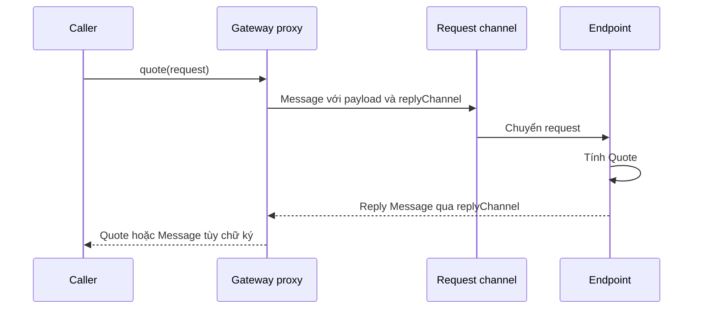

# Gateway return value: thiết kế giá trị trả về của Messaging Gateway

Trong chương **Messaging gateway** của module `SPRING_INTEGRATION_CORE`, kiểu trả về của một phương thức gateway là hợp đồng giữa mã nghiệp vụ và luồng thông điệp. Hợp đồng này quyết định caller nhận dữ liệu gì, có cần headers hay không, có chờ phản hồi hay không và quan sát lỗi bằng cách nào.

Bài học tập trung vào gateway dựa trên interface Java. Các ví dụ kết nối `Message`, `MessageChannel`, endpoint và Java DSL để tạo đường đi từ lời gọi phương thức tới reply. Transformer, router, filter và aggregator được xét ở những điểm chúng ảnh hưởng đến kết quả mà caller nhận được.

Sau bài học, bạn có thể:

- Chọn giữa DTO, `Message<T>`, `void` và kiểu trả về bất đồng bộ.
- Giải thích sự khác nhau giữa không có reply, một kết quả nghiệp vụ rỗng và lỗi xử lý.
- Thiết kế đường phản hồi, timeout và error flow phù hợp với chữ ký gateway.
- Viết kiểm thử quan sát giá trị, headers và trường hợp không nhận được phản hồi.

Các ví dụ chính dùng Java 17 và API Spring Integration 6.2 trở lên. Dependency cần có là `spring-integration-core`; ví dụ kiểm thử dùng JUnit Jupiter. Hãy dùng bộ phiên bản do dự án quản lý. Phần `Mono` cần Project Reactor. Thuộc tính `@MessagingGateway(errorOnTimeout = true)` có từ Spring Integration 6.2, theo [Javadoc của MessagingGateway](https://docs.spring.io/spring-integration/api/org/springframework/integration/annotation/MessagingGateway.html#errorOnTimeout()).

## 1. Reply message và return value là hai lớp khác nhau

Một endpoint thường tạo ra **reply message** trong luồng. Gateway chuyển reply đó thành **giá trị trả về của phương thức Java**.

Ví dụ, endpoint tạo message có payload `Quote` và header `quoteSource`. Phương thức khai báo `Quote quote(...)` lấy payload; phương thức khai báo `Message<Quote> quoteMessage(...)` cho caller truy cập cả payload lẫn headers. Đây là quy tắc ánh xạ của [annotation Gateway](https://docs.spring.io/spring-integration/api/org/springframework/integration/annotation/Gateway.html).

| Chữ ký phương thức | Hợp đồng nhìn từ caller | Khi nên dùng |
| --- | --- | --- |
| `Quote quote(QuoteRequest request)` | Kết quả nghiệp vụ của một yêu cầu | Service cần giá bán để tiếp tục tính toán |
| `Message<Quote> quoteMessage(QuoteRequest request)` | Kết quả cùng metadata của reply | Cần biết nguồn báo giá hoặc mã đối soát |
| `void audit(QuoteRequest request)` | Không yêu cầu giá trị phản hồi | Gửi thông tin phục vụ ghi nhận |
| `CompletableFuture<Quote> quoteAsync(QuoteRequest request)` | Nhận một đối tượng đại diện kết quả sẽ có sau | Caller cần ghép các tác vụ bất đồng bộ |
| `Mono<Quote> quoteReactive(QuoteRequest request)` | Nhận một publisher cho tối đa một kết quả | Caller đang xây dựng pipeline Reactor |

Bảng trên là cách chọn hợp đồng cho ví dụ của bài. Không nên đổi mọi phương thức thành `Object` chỉ để tránh quyết định kiểu dữ liệu: điều đó đẩy việc kiểm tra kết quả sang từng caller.

Một phân biệt quan trọng trong thiết kế: giá trị `boolean` của `MessageChannel.send(...)` phản ánh thao tác gửi. Nếu gateway khai báo `boolean approve(...)`, giá trị đó phải đến từ payload phản hồi có thể ánh xạ sang `boolean`; nó không tự động trở thành biên nhận gửi thành công.

## 2. Giá trị đi ngược về gateway bằng đường nào?



Khi không cấu hình reply channel riêng, gateway dùng một channel tạm cho phản hồi. Header `replyChannel` giữ đường trở về này. Cơ chế channel tạm được mô tả trong [MessagingGatewaySupport](https://docs.spring.io/spring-integration/api/org/springframework/integration/gateway/MessagingGatewaySupport.html#setReplyChannel(org.springframework.messaging.MessageChannel)).

Ở service activator, output channel được cấu hình tường minh sẽ được ưu tiên. Nếu không có output channel, endpoint có thể dùng `replyChannel` của request để gửi kết quả. Vì vậy, một flow kết thúc ở handler tạo kết quả vẫn có thể trả về gateway dù không khai báo một bean có tên `replyChannel`. Xem [Service Activator](https://docs.spring.io/spring-integration/reference/service-activator.html).

Khi thiết kế flow báo giá, hãy kiểm tra ba điều:

1. Nhánh xử lý tạo ra kết quả phù hợp với kiểu mà gateway hứa trả về.
2. Những bước xây dựng lại message không làm mất đường phản hồi cần thiết.
3. Không có output channel cuối cùng đưa reply sang một consumer khác rồi kết thúc mà không quay về gateway.

Nếu cần caller biết dữ liệu tới từ hệ thống nào, hãy đưa thông tin đó vào header của reply hoặc DTO theo hợp đồng đã chọn. Không nên bắt caller suy luận nguồn xử lý từ tên channel nội bộ.

## 3. Ví dụ đầy đủ: trả payload, trả Message và quan sát không có reply

Ví dụ sau là một tệp Java độc lập mang tên `GatewayReturnDemo.java`, đặt trong package `example.gatewayreturns`. Nó tạo ba flow nghiệp vụ và một queue không có consumer để thực hành timeout.

```java
package example.gatewayreturns;

import java.math.BigDecimal;

import org.springframework.context.annotation.AnnotationConfigApplicationContext;
import org.springframework.context.annotation.Bean;
import org.springframework.context.annotation.Configuration;
import org.springframework.integration.annotation.Gateway;
import org.springframework.integration.annotation.IntegrationComponentScan;
import org.springframework.integration.annotation.MessagingGateway;
import org.springframework.integration.channel.DirectChannel;
import org.springframework.integration.channel.QueueChannel;
import org.springframework.integration.config.EnableIntegration;
import org.springframework.integration.dsl.IntegrationFlow;
import org.springframework.messaging.Message;
import org.springframework.messaging.MessageChannel;

@Configuration(proxyBeanMethods = false)
@EnableIntegration
@IntegrationComponentScan(basePackageClasses = GatewayReturnDemo.class)
public class GatewayReturnDemo {

    public record QuoteRequest(String sku, int quantity) {
    }

    public record Quote(String sku, BigDecimal total) {
    }

    @MessagingGateway(
        defaultRequestChannel = "quotes.requests",
        defaultReplyTimeout = "500"
    )
    public interface QuoteGateway {

        Quote quote(QuoteRequest request);

        Message<Quote> quoteMessage(QuoteRequest request);

        @Gateway(requestChannel = "counts.requests")
        Integer count(String request);

        @Gateway(requestChannel = "audit.requests")
        void audit(QuoteRequest request);

        // Chỉ dùng cho thí nghiệm: queue này không có consumer.
        @Gateway(requestChannel = "quotes.unconsumed", replyTimeout = 30)
        Quote noReply(QuoteRequest request);
    }

    @Bean("quotes.requests")
    MessageChannel quoteRequests() {
        return new DirectChannel();
    }

    @Bean("quotes.unconsumed")
    QueueChannel unconsumedRequests() {
        return new QueueChannel(10);
    }

    @Bean
    IntegrationFlow quoteFlow() {
        return IntegrationFlow.from("quotes.requests")
            .handle(QuoteRequest.class, (request, headers) -> {
                if (request.quantity() <= 0) {
                    throw new IllegalArgumentException("quantity must be positive");
                }
                BigDecimal unitPrice = new BigDecimal("120000");
                BigDecimal total = unitPrice.multiply(
                    BigDecimal.valueOf(request.quantity()));
                return new Quote(request.sku(), total);
            }, endpoint -> endpoint.requiresReply(true))
            .enrichHeaders(headers -> headers.header("quoteSource", "catalog"))
            .get();
    }

    @Bean
    IntegrationFlow countFlow() {
        return IntegrationFlow.from("counts.requests")
            .handle(String.class, (request, headers) -> "7",
                endpoint -> endpoint.requiresReply(true))
            .get();
    }

    @Bean
    IntegrationFlow auditFlow() {
        return IntegrationFlow.from("audit.requests")
            .handle(QuoteRequest.class, (request, headers) -> {
                System.out.println("AUDIT " + request.sku());
                return null;
            })
            .get();
    }

    public static void main(String[] args) {
        try (var context = new AnnotationConfigApplicationContext(
                GatewayReturnDemo.class)) {
            QuoteGateway gateway = context.getBean(QuoteGateway.class);
            QuoteRequest request = new QuoteRequest("BOOK-01", 2);

            Quote quote = gateway.quote(request);
            System.out.println(quote.total());

            Message<Quote> reply = gateway.quoteMessage(request);
            System.out.println(reply.getPayload().total());
            System.out.println(reply.getHeaders().get("quoteSource"));

            System.out.println(gateway.count("count active offers"));
            gateway.audit(request);
        }
    }
}
```

Kết quả nghiệp vụ dự kiến của `main`:

```text
240000
240000
catalog
7
AUDIT BOOK-01
```

Framework có thể ghi thêm log khởi động và dừng context. Hai lời gọi `quote` và `quoteMessage` là hai request riêng biệt; ví dụ chỉ cho thấy cùng một flow có thể phục vụ hai hợp đồng nhận kết quả.

`@EnableIntegration` bật hạ tầng Spring Integration trong context Java thuần. `@IntegrationComponentScan` giúp phát hiện interface gateway; component scan thông thường không thay thế việc scan interface này, như [Javadoc MessagingGateway](https://docs.spring.io/spring-integration/api/org/springframework/integration/annotation/MessagingGateway.html) giải thích. Các flow dùng `IntegrationFlow.from(...).handle(...).get()` theo cơ chế đăng ký component của [Java DSL IntegrationFlow](https://docs.spring.io/spring-integration/api/org/springframework/integration/dsl/IntegrationFlow.html).

Phương thức `noReply` không được gọi trong `main`. Nó dành cho kiểm thử bên dưới. Queue có dung lượng 10 để thí nghiệm không tạo nơi lưu trữ vô hạn; các message không được xử lý sẽ nằm trong queue cho tới khi được lấy ra hoặc context kết thúc.

## 4. Trả payload hay trả toàn bộ Message?

### 4.1. Trả DTO để caller làm việc với nghiệp vụ

Với `Quote quote(...)`, service có thể tiếp tục xử lý bằng dữ liệu miền:

```java
Quote quote = gateway.quote(new QuoteRequest("BOOK-01", 2));
BigDecimal payable = quote.total().add(new BigDecimal("30000"));
```

Trong thiết kế này, caller chỉ cần biết giá và cách tính khoản thanh toán. Kiểu `Quote` giúp hợp đồng rõ hơn `Map<String, Object>` hoặc `Object`.

### 4.2. Trả Message khi metadata là một phần của nhu cầu caller

Với `Message<Quote> quoteMessage(...)`, caller truy cập được cả hai phần:

```java
Message<Quote> reply = gateway.quoteMessage(
    new QuoteRequest("BOOK-01", 2));

Quote quote = reply.getPayload();
String source = reply.getHeaders().get("quoteSource", String.class);
```

`Message<T>` cung cấp `getPayload()` và `getHeaders()`, theo [API Message](https://docs.spring.io/spring-framework/docs/current/javadoc-api/org/springframework/messaging/Message.html). Trong ví dụ, `quoteSource` phục vụ giải thích nguồn báo giá. Nếu chỉ cần một nguồn cố định không có ý nghĩa nghiệp vụ cho caller, có thể giữ metadata này ở lớp tích hợp.

Việc trả `Message<Quote>` cũng đưa API messaging vào phía gọi. Khi muốn giữ service chỉ phụ thuộc kiểu miền, có thể mở rộng DTO thành `QuoteResult(Quote quote, String source)` và dùng transformer tạo DTO đó trước lúc trả về.

Không sửa trực tiếp map headers nhận được. Nếu một bước trong flow cần thay đổi metadata, hãy tạo message mới bằng `MessageBuilder` hoặc dùng header enricher. Cấu trúc headers của message được thiết kế chỉ đọc, theo phần [Message Headers](https://docs.spring.io/spring-integration/reference/message.html#message-headers).

### 4.3. Khai báo generic không thay thế bước chuyển đổi dữ liệu

Nếu reply chứa một chuỗi JSON, khai báo `Message<Quote>` không phải là lệnh deserialize JSON thành `Quote`. Hãy đặt bước chuyển đổi rõ ràng trong flow và kiểm thử payload thực tế.

Tương tự, nếu một service trả `Map`, việc đổi chữ ký gateway thành `Quote` chưa đủ để xác định cách đọc từng field, xử lý thiếu dữ liệu và kiểm tra giá trị. Transformer là nơi phù hợp để diễn đạt quy tắc ánh xạ này.

## 5. Chuyển đổi kiểu trả về có giới hạn

Trong ví dụ, endpoint của `countFlow` trả chuỗi `"7"`, còn gateway khai báo `Integer`. Gateway có thể thực hiện chuyển đổi kiểu được Spring hỗ trợ. Cơ chế chuyển đổi và việc sử dụng integration `ConversionService` được mô tả ở [GatewayProxyFactoryBean](https://docs.spring.io/spring-integration/api/org/springframework/integration/gateway/GatewayProxyFactoryBean.html).

Hãy phân biệt chuyển đổi kỹ thuật đơn giản với ánh xạ nghiệp vụ:

| Reply payload | Kiểu caller mong đợi | Cách thiết kế trong bài |
| --- | --- | --- |
| `Quote` | `Quote` | Trả trực tiếp |
| Chuỗi số hợp lệ như `"7"` | `Integer` | Có thể dùng chuyển đổi chuẩn và kiểm thử |
| Chuỗi `"seven"` | `Integer` | Xem là dữ liệu sai, không mong có chuyển đổi tự động |
| JSON chứa mã hàng và giá | `Quote` | Dùng bước deserialize và validate rõ ràng |
| Danh sách bản ghi bên ngoài | `List<Quote>` | Ánh xạ từng phần tử trước khi trả về |

Một converter tùy biến có thể phù hợp với kiểu dùng chung toàn ứng dụng. Nếu quy tắc chỉ có ý nghĩa trong một flow, transformer thường giúp người đọc nhìn thấy phép biến đổi ngay tại chỗ sử dụng.

Tránh dùng primitive như `int` khi hợp đồng còn cho phép không có phản hồi. `null` không biểu diễn được bằng primitive; hãy chọn wrapper, DTO kết quả hoặc chính sách ném lỗi rõ ràng. Đây là quyết định thiết kế API, không phải cách khắc phục việc thiếu đường reply.

## 6. void: không yêu cầu reply, không đồng nghĩa tự động chạy nền

Trong `audit(...)`, caller không yêu cầu kết quả nghiệp vụ. Flow có thể ghi log, ghi sự kiện hoặc gửi thông báo mà không trả một DTO cho lời gọi đó.

Cách chạy vẫn phụ thuộc channel. `DirectChannel` thực thi xử lý trên luồng gửi; `QueueChannel` lưu message để consumer nhận sau. Đặc điểm queue và ranh giới xử lý được mô tả trong [Message Channel Implementations](https://docs.spring.io/spring-integration/reference/channel/implementations.html).

Vì ví dụ dùng flow trực tiếp, handler của `audit` chạy trước khi lời gọi kết thúc. Nếu handler ghi log mất nhiều thời gian, caller cũng chịu thời gian đó. Nếu đổi sang queue, việc phương thức đã kết thúc chỉ cho biết nó đã đi qua phần gửi tương ứng; trong thiết kế nghiệp vụ, đừng suy ra rằng mọi side effect về sau đã hoàn tất.

Với gateway `void`, Spring Integration từ 5.4 dùng `nullChannel` làm `replyChannel` nếu request chưa chỉ định header này, để bỏ reply phát sinh ngoài hợp đồng một chiều. Xem [Messaging Gateways — Setting the Default Reply Channel](https://docs.spring.io/spring-integration/reference/gateway.html#gateway-default-reply-channel).

Nếu yêu cầu là “caller phải biết kho đã trừ hàng”, hãy thiết kế kết quả như `ReservationResult` hoặc một hợp đồng bất đồng bộ có thể theo dõi hoàn tất. Một phương thức `void reserve(...)` không diễn đạt được mã đặt chỗ hay lý do từ chối.

## 7. Không có reply khác với kết quả nghiệp vụ rỗng

Một message phải có payload hợp lệ. Khi handler trả `null`, thông thường không có reply message được tạo; đoạn flow đó kết thúc. Nếu cấu hình `requiresReply(true)`, handler bắt buộc tạo reply, nếu không sẽ phát sinh lỗi. Quy tắc này thuộc [AbstractReplyProducingMessageHandler](https://docs.spring.io/spring-integration/api/org/springframework/integration/handler/AbstractReplyProducingMessageHandler.html).

Hãy xét ba kết quả khác nhau của bài toán báo giá:

| Tình huống | Ý nghĩa nghiệp vụ | Cách biểu diễn đề xuất |
| --- | --- | --- |
| Đã có giá cho sản phẩm | Xử lý thành công | `Quote` hoặc DTO trạng thái `AVAILABLE` |
| Sản phẩm hợp lệ nhưng chưa có giá | Kết quả nghiệp vụ xác định | DTO trạng thái `NOT_AVAILABLE` |
| Caller không nhận reply trong thời hạn | Chưa biết kết quả xử lý | Timeout theo chính sách của gateway |

Ví dụ một hợp đồng kết quả chủ động:

```java
public record QuoteOutcome(String status, Quote quote) {
}

// Chưa có giá là một kết quả có chủ đích.
QuoteOutcome unavailable = new QuoteOutcome("NOT_AVAILABLE", null);
```

Đối tượng `QuoteOutcome` vẫn khác `null`, nên có thể làm payload dù field `quote` bên trong rỗng. Khi đưa vào dự án thực, có thể dùng enum cho `status` và constructor kiểm tra tổ hợp field hợp lệ.

Những điểm trong flow cần kiểm tra khi gateway không nhận kết quả:

- Filter có nhánh từ chối chỉ bỏ message mà không tạo kết quả cho caller.
- Router có một đường đi kết thúc ở bước gửi một chiều.
- Handler trả `null` hoặc được khai báo `void` trong flow mà gateway lại chờ DTO.
- Aggregator chưa đạt điều kiện release nên chưa tạo message kết quả.
- Bước tự tạo message mới không giữ các headers cần cho đường trở về.

Đây là danh sách truy vết đường reply, không phải bằng chứng rằng tất cả trường hợp đều là lỗi. Với `void audit(...)`, không tạo reply là hợp đồng mong muốn. Với `Quote quote(...)`, mỗi nhánh phải có chính sách rõ: trả kết quả, báo lỗi hoặc để timeout thể hiện trạng thái chưa nhận được phản hồi.

Trong `quoteFlow`, `requiresReply(true)` đặt ngay ở handler tính giá nhằm phát hiện việc handler vô tình trả `null`. Nó không bảo đảm một bước phía sau luôn gửi reply về đúng nơi và cũng không thay thế timeout của toàn đường phản hồi.

## 8. Timeout và giá trị trả về

### 8.1. Tách thời gian gửi với thời gian chờ phản hồi

`requestTimeout` giới hạn phần gửi khi thao tác gửi có thể bị chặn, chẳng hạn queue có dung lượng hữu hạn đang đầy. `replyTimeout` giới hạn thời gian chờ reply. Các thuộc tính cấp phương thức dùng mili giây và ghi đè cấu hình mặc định tương ứng của gateway. Xem [Gateway — requestTimeout và replyTimeout](https://docs.spring.io/spring-integration/api/org/springframework/integration/annotation/Gateway.html).

Với `noReply(...)` trong ví dụ:

1. Request được đưa vào `quotes.unconsumed` nếu queue còn chỗ.
2. Không có consumer lấy request để tạo kết quả.
3. Sau khoảng chờ reply đã cấu hình, caller nhận `null` theo chính sách mặc định của ví dụ.

`null` ở đây không có nghĩa “không có giá”. Request thậm chí chưa được xử lý. Nếu queue đầy, tình huống chuyển sang vấn đề gửi request và phải được phân tích riêng.

### 8.2. replyTimeout không phải đồng hồ ngắt mọi đoạn code

Với đường xử lý hoàn toàn đồng bộ, thời gian chờ reply bắt đầu khi luồng quay lại gateway. Một handler chậm trên cùng luồng không bị dừng bởi `replyTimeout`. Sau ranh giới bất đồng bộ, caller có thể chờ reply trong thời hạn cấu hình. Chi tiết nằm ở [Gateway Behavior When No response Arrives](https://docs.spring.io/spring-integration/reference/gateway.html#gateway-behavior-no-response).

Ví dụ về hệ quả thiết kế:

```text
Gateway -> DirectChannel -> HTTP client chậm -> reply
```

Muốn kiểm soát thời gian gọi hệ thống ngoài trong đường trên, hãy cấu hình timeout của HTTP client. Chỉ đặt `replyTimeout` của gateway không tạo cơ chế ngắt HTTP call.

```text
Gateway -> QueueChannel -> consumer trên luồng khác -> reply
```

Ở đường thứ hai, caller có thể hết thời gian chờ trong khi consumer vẫn đang làm việc. Việc caller timeout không tự chứng minh consumer đã dừng hay giao dịch đã rollback. Khi cân nhắc retry, cần có mã yêu cầu và chính sách chống xử lý lặp phù hợp với nghiệp vụ.

### 8.3. Chọn trả null hay báo lỗi timeout

Từ Spring Integration 6.2, có thể yêu cầu gateway báo lỗi khi không nhận được reply trong thời hạn:

```java
@MessagingGateway(
    defaultRequestChannel = "strictQuotes.requests",
    defaultReplyTimeout = "200",
    errorOnTimeout = true
)
public interface StrictQuoteGateway {
    Quote quote(QuoteRequest request);
}
```

Đây là cấu hình riêng để minh họa chính sách, không cần thêm vào `GatewayReturnDemo`. Channel `strictQuotes.requests` và consumer phải được cấu hình trong ứng dụng dùng interface này.

Khi không có error channel tùy biến, gateway ném `MessageTimeoutException` thay cho kết quả `null`. Nếu có error channel, lỗi timeout có thể đi qua error flow. Cơ chế đó được mô tả trong [MessagingGatewaySupport — setErrorOnTimeout](https://docs.spring.io/spring-integration/api/org/springframework/integration/gateway/MessagingGatewaySupport.html#setErrorOnTimeout(boolean)).

Đối với API bắt buộc có kết quả, báo lỗi timeout thường giúp caller phân biệt sự cố chờ phản hồi với trạng thái `NOT_AVAILABLE`. Hãy khai báo thời hạn chủ động theo yêu cầu sử dụng, tránh dựa vào giả định về giá trị mặc định ở các phiên bản khác nhau.

## 9. Lỗi có thể trở thành giá trị trả về nếu hợp đồng cho phép

Với flow đồng bộ và không có error channel tùy biến, lỗi có thể truyền về caller. Với xử lý trên luồng khác, error message và error channel tham gia chuyển lỗi; không thể dựa vào Java call stack ban đầu để bắt mọi lỗi phía sau ranh giới bất đồng bộ. Xem [Error Handling](https://docs.spring.io/spring-integration/reference/error-handling.html).

Một error flow có thể ánh xạ lỗi thành DTO kết quả. Ví dụ dưới đây là một cấu hình minh họa độc lập, dùng các kiểu `QuoteRequest`, `Quote` và `QuoteOutcome` đã giới thiệu:

```java
@MessagingGateway(
    defaultRequestChannel = "outcome.requests",
    errorChannel = "outcome.errors",
    defaultReplyTimeout = "500"
)
public interface OutcomeGateway {
    QuoteOutcome quote(QuoteRequest request);
}

@Bean
IntegrationFlow outcomeErrorFlow() {
    return IntegrationFlow.from("outcome.errors")
        .handle(Throwable.class, (failure, headers) ->
            new QuoteOutcome("UNAVAILABLE", null))
        .get();
}
```

Flow chính trên `outcome.requests` cũng phải trả `QuoteOutcome` khi thành công. Ví dụ chỉ minh họa đường lỗi; ứng dụng cần bổ sung flow chính trước khi sử dụng interface này.

Việc error flow tạo một reply thích hợp cho gateway được mô tả trong [Messaging Gateways — Error Handling](https://docs.spring.io/spring-integration/reference/gateway.html#gateway-error-handling). Trong thiết kế ví dụ, caller đọc `status` để quyết định có hiển thị lựa chọn thay thế hay không.

Một số quy tắc nên áp dụng khi mở rộng ví dụ:

- Chỉ chuyển những lỗi mà API đã định nghĩa thành kết quả nghiệp vụ hoặc trạng thái suy giảm dịch vụ.
- Giữ lại mã đối soát và thông tin chẩn đoán trong quan sát vận hành, không đưa nguyên stack trace vào DTO công khai.
- Trả cùng một kiểu kết quả ở đường thành công và đường fallback.
- Nếu error flow chỉ ghi log rồi kết thúc, phải xác định caller sẽ quan sát việc thiếu reply như thế nào.

Không nên chuyển mọi lỗi lập trình thành “không có giá”: điều đó làm một lỗi cần sửa trở nên khó phân biệt với trạng thái nghiệp vụ bình thường.

## 10. Kiểu trả về bất đồng bộ: đối tượng nhận ngay và kết quả nhận sau

### 10.1. CompletableFuture

Có thể khai báo gateway tạo `CompletableFuture<Quote>` bằng một executor được chỉ định:

```java
@MessagingGateway(
    defaultRequestChannel = "quotes.requests",
    defaultReplyTimeout = "500",
    asyncExecutor = "quoteExecutor"
)
public interface AsyncQuoteGateway {
    java.util.concurrent.CompletableFuture<Quote> quoteAsync(
        QuoteRequest request);
}

@Bean
org.springframework.scheduling.concurrent.ThreadPoolTaskExecutor quoteExecutor() {
    var executor = new org.springframework.scheduling.concurrent.ThreadPoolTaskExecutor();
    executor.setCorePoolSize(2);
    executor.setMaxPoolSize(4);
    executor.setQueueCapacity(20);
    executor.setThreadNamePrefix("quote-gateway-");
    return executor;
}
```

Đây là phần mở rộng tùy chọn cho ví dụ tính giá; interface phải được scan và bean executor phải nằm trong context. Flow `quotes.requests` vẫn trả `Quote` như trước.

Với executor đang bật, gateway thực thi tác vụ để hoàn thành future. Nếu chủ động tắt executor bằng `AnnotationConstants.NULL`, downstream phải cung cấp kiểu `Future` tương ứng. Hai chế độ này được mô tả trong [GatewayProxyFactoryBean — setAsyncExecutor](https://docs.spring.io/spring-integration/api/org/springframework/integration/gateway/GatewayProxyFactoryBean.html#setAsyncExecutor(java.util.concurrent.Executor)).

Caller có thể nối bước xử lý sau:

```java
asyncGateway.quoteAsync(new QuoteRequest("BOOK-01", 2))
    .thenApply(Quote::total)
    .thenAccept(total -> System.out.println("Total: " + total))
    .exceptionally(failure -> {
        System.err.println("Quote failed: " + failure.getMessage());
        return null;
    });
```

Trong chế độ có executor của ví dụ, có hai lớp kết quả: đối tượng future và giá trị `Quote` khi future hoàn tất. Khi kiểm thử hoặc chờ future, hãy dùng giới hạn chờ thích hợp; đừng để một phép `get()` không giới hạn che mất flow đang thiếu reply.

### 10.2. Mono

Một phương thức gateway có thể khai báo `Mono<Quote>`. Flow được kích hoạt khi có subscription; khai báo `Mono` không tự bảo đảm mọi bước downstream trở thành nonblocking. Cơ chế lazy này được mô tả ở [Messaging Gateways — Reactor Mono](https://docs.spring.io/spring-integration/reference/gateway.html#gateway-reactor-mono).

Khi dùng kiểu này, hãy đặt việc subscribe hoặc ghép publisher vào pipeline ở một ranh giới rõ ràng. Nếu không có subscription, người đọc có thể nhầm việc “đã gọi phương thức” với việc request đã bắt đầu được xử lý.

Bài học này dùng `Mono` để phân biệt hợp đồng trả về; thiết kế pipeline reactive đầy đủ còn cần xét channel, scheduler và các thư viện I/O mà flow sử dụng.

## 11. Trả List không có nghĩa gateway tự thu thập nhiều reply

Giả sử nghiệp vụ đổi thành báo giá cả giỏ hàng:

```java
List<Quote> quoteAll(List<QuoteRequest> requests);
```

Hợp đồng nên tạo **một reply có payload là danh sách**. Một hướng thiết kế là:

```text
Gateway
  -> Splitter tách từng sản phẩm
  -> Handler tính giá mỗi sản phẩm
  -> Aggregator tạo kết quả cả nhóm
  -> Transformer chuẩn hóa List<Quote>
  -> Một reply về gateway
```

Java DSL cho phép kết hợp `split()`, các nhánh xử lý và `aggregate()` trong cùng flow, như ví dụ của [IntegrationFlow](https://docs.spring.io/spring-integration/api/org/springframework/integration/dsl/IntegrationFlow.html). Trong bài toán này, aggregator là nơi quyết định lúc nào đủ dữ liệu để tạo kết quả; chữ ký `List<Quote>` của gateway không thay phần việc đó.

Trước khi triển khai, cần quyết định liệu một sản phẩm không có giá làm cả giỏ thất bại hay tạo kết quả từng dòng. Đồng thời phải giữ dữ liệu gom nhóm, xác định điều kiện release và thống nhất thời hạn của nhóm với thời gian caller chờ.

## 12. Kiểm thử hợp đồng trả về

Các kiểm thử dưới đây dùng nguyên cấu hình `GatewayReturnDemo` ở phần 3. Đặt test trong cùng package; ngoài dependency chính, cần JUnit Jupiter và cấu hình chạy test tương ứng của dự án.

```java
package example.gatewayreturns;

import java.math.BigDecimal;

import org.junit.jupiter.api.AfterAll;
import org.junit.jupiter.api.BeforeAll;
import org.junit.jupiter.api.Test;
import org.springframework.context.annotation.AnnotationConfigApplicationContext;
import org.springframework.integration.channel.QueueChannel;
import org.springframework.messaging.Message;

import example.gatewayreturns.GatewayReturnDemo.Quote;
import example.gatewayreturns.GatewayReturnDemo.QuoteGateway;
import example.gatewayreturns.GatewayReturnDemo.QuoteRequest;

import static org.junit.jupiter.api.Assertions.assertEquals;
import static org.junit.jupiter.api.Assertions.assertNotNull;
import static org.junit.jupiter.api.Assertions.assertNull;
import static org.junit.jupiter.api.Assertions.assertThrows;

class GatewayReturnDemoTest {

    private static AnnotationConfigApplicationContext context;
    private static QuoteGateway gateway;

    @BeforeAll
    static void startContext() {
        context = new AnnotationConfigApplicationContext(GatewayReturnDemo.class);
        gateway = context.getBean(QuoteGateway.class);
    }

    @AfterAll
    static void stopContext() {
        if (context != null) {
            context.close();
        }
    }

    @Test
    void returnsBusinessPayload() {
        Quote result = gateway.quote(new QuoteRequest("BOOK-01", 2));

        assertNotNull(result);
        assertEquals("BOOK-01", result.sku());
        assertEquals(new BigDecimal("240000"), result.total());
    }

    @Test
    void returnsPayloadAndReplyHeaders() {
        Message<Quote> result = gateway.quoteMessage(
            new QuoteRequest("BOOK-01", 2));

        assertNotNull(result);
        assertEquals(new BigDecimal("240000"), result.getPayload().total());
        assertEquals("catalog", result.getHeaders().get("quoteSource"));
    }

    @Test
    void convertsNumericStringToInteger() {
        assertEquals(Integer.valueOf(7), gateway.count("active offers"));
    }

    @Test
    void propagatesInvalidQuantityFromSynchronousFlow() {
        assertThrows(IllegalArgumentException.class,
            () -> gateway.quote(new QuoteRequest("BOOK-01", 0)));
    }

    @Test
    void returnsNullWhenNoReplyArrives() {
        Quote result = gateway.noReply(new QuoteRequest("BOOK-01", 2));

        assertNull(result);
        QueueChannel requests = context.getBean(
            "quotes.unconsumed", QueueChannel.class);
        assertNotNull(requests.receive(0));
    }
}
```

Đây là mã kiểm thử để người học thực hành trong dự án Java đã có dependency; nội dung bài không giả định các test đã được chạy tại thời điểm tạo tài liệu.

Test cuối dùng queue không có consumer để tạo điều kiện không có reply một cách rõ ràng. Nó còn xác minh request đã được gửi vào queue, nhờ đó phân biệt với lỗi gửi. Không cần `Thread.sleep` và không nên khẳng định thời gian chạy đúng tuyệt đối 30 mili giây vì scheduler và môi trường test có thể làm thời gian thực tế dài hơn.

Với biến thể `errorOnTimeout = true`, hãy bổ sung test riêng mong đợi `MessageTimeoutException`, giữ điều kiện không có consumer tương tự. Với fallback, kiểm thử rằng đường lỗi trả đúng DTO và đúng trạng thái đã công bố. Với future, kiểm thử cả dữ liệu khi hoàn tất bình thường lẫn nhánh hoàn tất có lỗi.

## 13. Thực hành thay đổi hợp đồng

1. **Thêm trạng thái không có giá:** đổi cả gateway và flow sang `QuoteOutcome`; sản phẩm `UNKNOWN` phải trả `NOT_AVAILABLE` bằng một reply thực sự. Kiểm thử để phân biệt với queue không có consumer.
2. **Cần metadata nhưng giữ service dùng kiểu miền:** tạo DTO kết quả chứa `Quote` và nguồn báo giá; dùng transformer ở cuối flow để ánh xạ dữ liệu.
3. **Bắt buộc có phản hồi:** dùng chính sách báo lỗi timeout và tạo test cho trường hợp request đã được gửi nhưng chưa có reply.
4. **Báo giá giỏ hàng:** xác định chính sách sản phẩm thiếu giá, gom kết quả bằng aggregator và trả một danh sách trong một reply.

Khi hoàn thành, hãy đọc lại từng chữ ký gateway và mô tả được bốn yếu tố: kết quả nghiệp vụ, dữ liệu metadata cần giữ, chính sách khi chưa có reply và cách caller quan sát lỗi. Những yếu tố này phải nhất quán với mọi nhánh mà request có thể đi qua.
