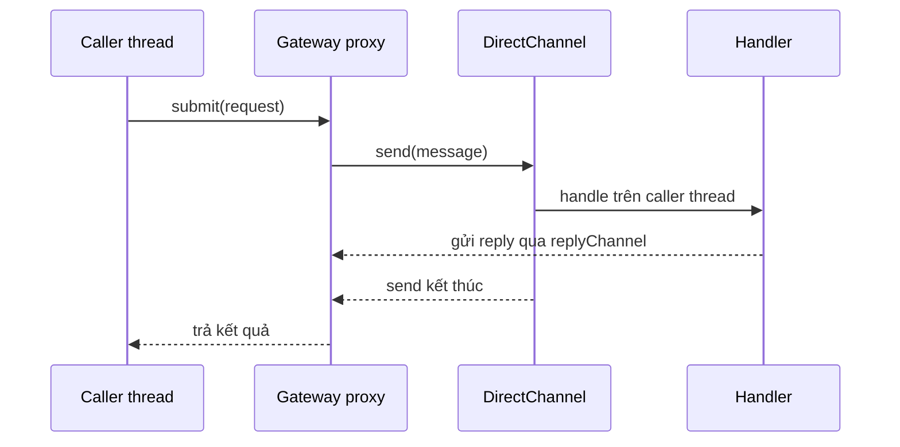
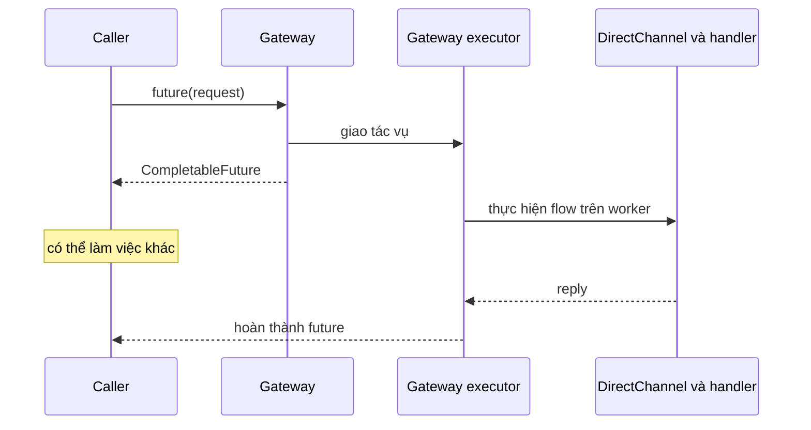

# Gateway và caller thread

## 1. Mục tiêu và phạm vi

Trong chương **Messaging gateway** của module **SPRING_INTEGRATION_CORE**, bài này giải thích thread nào thực hiện từng đoạn của integration flow và khi nào thread gọi gateway được tiếp tục. Đây là kiến thức cần có để thiết kế luồng thông điệp bằng Message, MessageChannel, endpoint và Java DSL, đồng thời xử lý lỗi và kiểm thử đúng hành vi thực thi.

Sau bài học, bạn có thể:

- Phân biệt caller đang thực hiện nghiệp vụ với caller đang chờ reply.
- Giải thích vì sao có worker không đồng nghĩa caller được giải phóng.
- Chọn hợp đồng đồng bộ, one-way hoặc future theo yêu cầu nhận kết quả.
- Đặt timeout đúng giai đoạn và nhận diện công việc còn chạy sau timeout.
- Kiểm tra ảnh hưởng của việc đổi thread lên transaction, ngữ cảnh và lỗi.

Các ví dụ dùng Java 17 và Spring Integration 6.5.x. Dependency cần đồng bộ theo dự án, chẳng hạn qua BOM của Spring Boot. Bài cấu hình tường minh timeout và executor để không phụ thuộc vào giá trị mặc định của từng phiên bản.

## 2. Hai câu hỏi phải tách riêng

**Caller thread** là thread đang gọi phương thức trên gateway proxy. Nó có thể là thread HTTP, scheduler, worker của một executor khác hoặc thread `main`.

```java
String reply = orderGateway.submit("ORDER-42");
```

Tại thời điểm thực hiện câu lệnh này, thread hiện tại là caller của gateway. Cần trả lời riêng hai câu hỏi:

| Câu hỏi | Yếu tố quyết định |
|---|---|
| Ai thực hiện handler tiếp theo? | Channel, executor, poller và các ranh giới thực thi |
| Caller được tiếp tục khi nào? | Kiểu trả về, cấu hình gateway và cách sử dụng kết quả |

Một handler có thể chạy trên worker trong khi phương thức `String submit(...)` vẫn chặn caller đợi reply. Phương thức trả `CompletableFuture<String>` với executor phù hợp có thể trao future cho caller trước khi nghiệp vụ hoàn tất.

Có Message hoặc nhiều endpoint không có nghĩa có thread mới. Hãy tìm cơ chế thật sự bàn giao việc thực thi.

### 2.1. Gateway chuyển lời gọi thành message

Xét gateway:

```java
@MessagingGateway(defaultRequestChannel = "orders")
public interface OrderGateway {
    String submit(String orderId);
}
```

Lời gọi được xử lý theo các bước khái niệm:

1. Ánh xạ đối số thành payload và header của request.
2. Chuẩn bị đường nhận reply.
3. Gửi request vào `orders`.
4. Thực hiện flow theo cấu hình từng channel và endpoint.
5. Nhận reply, chuyển payload thành giá trị trả về.

Phương thức gateway có thể nhận payload hoặc `Message<?>`; tham số dùng `@Header` được ánh xạ thành header. Caller dùng kiểu trả về payload không cần thao tác trực tiếp với message. Xem [Javadoc @Gateway 6.5.0](https://docs.spring.io/spring-integration/docs/6.5.0/api/org/springframework/integration/annotation/Gateway.html).

Trong request–reply thông thường, gateway tạo reply channel tạm và đưa vào header `replyChannel`. Không cần khai báo reply channel có tên chỉ để chuyển việc sang worker. Nếu tự tạo message mới và đánh mất thông tin định tuyến reply, caller có thể không nhận được kết quả. Xem phần Setting the Default Reply Channel trong [Messaging Gateways 6.5](https://docs.spring.io/spring-integration/reference/6.5/gateway.html).

**Reply channel xác định kết quả quay về đâu; channel thực thi và executor xác định ai chạy nghiệp vụ.**

## 3. DirectChannel: caller tự đi qua flow

`DirectChannel` gọi handler đã đăng ký ngay trên thread gửi message. Nếu gateway đồng bộ đi vào chuỗi endpoint đồng bộ, caller tự chạy qua chuỗi đó. Xem đặc tính DirectChannel trong [Message Channel Implementations](https://docs.spring.io/spring-integration/reference/channel/implementations.html).



Các cột là thành phần logic; toàn bộ tương tác trên có thể dùng **một thread**.

```text
caller → gateway → DirectChannel → transformer → router
                                                ↓
                                         service activator
                                                ↓
                                              reply
```

Transformer và router không tự tạo worker. Nếu nhánh được chọn vẫn đồng bộ, handler cuối cùng vẫn dùng caller.

Hệ quả:

- I/O chậm trong handler giữ caller ngay trong call stack xử lý.
- Handler không kết thúc thì caller chưa quay về gateway.
- Số lượng endpoint không quyết định số lượng thread.
- Thread dump của caller có thể cho thấy đường gọi qua các endpoint đồng bộ.

Với ứng dụng servlet thông thường, caller có thể là request thread. Handler giữ thread này trong lúc gọi dịch vụ ngoài, nên phải tính cả tài nguyên phía tiếp nhận request khi chọn mức đồng thời.

## 4. Đặt ranh giới bàn giao

### 4.1. ExecutorChannel

```text
caller → gateway → ExecutorChannel → worker → handler → reply
            └──────── đợi reply nếu phương thức trả String ───┘
```

`ExecutorChannel` ủy quyền dispatch cho executor. Khi executor thực thi bất đồng bộ, worker xử lý nghiệp vụ nhưng caller của gateway trả `String` vẫn chờ reply.

Không thể suy luận “luôn đổi thread” chỉ từ tên channel: executor đồng bộ hoặc chính sách `CallerRunsPolicy` khi pool bão hòa có thể chạy công việc trên thread gửi. Phải xét cấu hình executor thực tế. Xem [Javadoc ExecutorChannel 6.5.0](https://docs.spring.io/spring-integration/docs/6.5.0/api/org/springframework/integration/channel/ExecutorChannel.html).

### 4.2. QueueChannel

Queue giữ message để consumer lấy ra sau. Endpoint phía sau pollable channel trong integration flow thông thường cần poller:

```java
@Bean
QueueChannel queuedRequests() {
    return new QueueChannel(100);
}

@Bean
IntegrationFlow queuedFlow() {
    return IntegrationFlow.from("queuedRequests")
            .handle(String.class,
                    (payload, headers) -> "ACK:" + payload,
                    endpoint -> endpoint.poller(
                            Pollers.fixedDelay(50)
                                    .maxMessagesPerPoll(10)))
            .get();
}
```

Mảnh cấu hình trên cần thêm import:

```java
import org.springframework.integration.channel.QueueChannel;
import org.springframework.integration.dsl.Pollers;
```

Gateway trỏ đến `queuedRequests` có thể gửi vào queue rồi đợi reply. Queue đầy còn có thể làm giai đoạn gửi phải chờ chỗ trống. Queue là nơi đệm; consumer và poller mới thực hiện xử lý. Queue trong bộ nhớ không tự bảo đảm giữ công việc khi tiến trình dừng.

### 4.3. Điểm đổi thread có thể nằm giữa flow

```text
T0: gateway → DirectChannel → transformer → router
                                             ↓
                                   ExecutorChannel
                                             ↓
T1:                            service activator → reply
```

Phần trước ExecutorChannel vẫn chạy trên `T0`. Khi đánh giá độ trễ của caller, cần tính cả transformer, router và I/O nằm trước điểm bàn giao.

Filter loại message mà không tạo lỗi hoặc reply thay thế có thể làm gateway đợi đến timeout. Aggregator cũng chỉ phát kết quả khi điều kiện release được thỏa mãn. Có worker không bảo đảm mỗi request chắc chắn có reply.

## 5. Ví dụ Java DSL hoàn chỉnh

Ví dụ dùng Spring thuần với `spring-integration-core` và các dependency Spring tương thích. Dự án Spring Boot có thể dùng `spring-boot-starter-integration` theo BOM đang dùng.

Khi thực hành, đặt ba kiểu public dưới đây trong ba tệp Java riêng, cùng package `demo.gateway`. Tên tệp chỉ mô tả mã ví dụ.

### 5.1. ThreadGateway.java

```java
package demo.gateway;

import java.util.concurrent.CompletableFuture;

import org.springframework.integration.annotation.Gateway;
import org.springframework.integration.annotation.MessagingGateway;

@MessagingGateway(
        defaultRequestTimeout = "500",
        defaultReplyTimeout = "3000",
        asyncExecutor = "gatewayExecutor")
public interface ThreadGateway {

    @Gateway(requestChannel = "directRequests")
    String direct(String value);

    @Gateway(requestChannel = "workerRequests")
    String viaWorker(String value);

    @Gateway(requestChannel = "directRequests")
    CompletableFuture<String> future(String value);

    @Gateway(requestChannel = "directRequests")
    void oneWay(String value);
}
```

`asyncExecutor` chỉ áp dụng cho phương thức bất đồng bộ có kiểu trả về được hỗ trợ, không chuyển các phương thức trả `String` sang hợp đồng future. `@IntegrationComponentScan` dùng để đăng ký gateway interface; component scan thông thường không đăng ký interface này. Xem [Javadoc @MessagingGateway 6.5.0](https://docs.spring.io/spring-integration/docs/6.5.0/api/org/springframework/integration/annotation/MessagingGateway.html).

### 5.2. ThreadFlowConfig.java

```java
package demo.gateway;

import java.util.concurrent.ThreadPoolExecutor;

import org.springframework.beans.factory.annotation.Qualifier;
import org.springframework.context.annotation.Bean;
import org.springframework.context.annotation.Configuration;
import org.springframework.integration.annotation.IntegrationComponentScan;
import org.springframework.integration.channel.DirectChannel;
import org.springframework.integration.channel.ExecutorChannel;
import org.springframework.integration.config.EnableIntegration;
import org.springframework.integration.dsl.IntegrationFlow;
import org.springframework.scheduling.concurrent.ThreadPoolTaskExecutor;

@Configuration
@EnableIntegration
@IntegrationComponentScan(basePackageClasses = ThreadGateway.class)
public class ThreadFlowConfig {

    @Bean
    DirectChannel directRequests() {
        return new DirectChannel();
    }

    @Bean
    ThreadPoolTaskExecutor gatewayExecutor() {
        return pool("gateway-", 2, 20);
    }

    @Bean
    ThreadPoolTaskExecutor processingExecutor() {
        return pool("processing-", 2, 20);
    }

    @Bean
    ExecutorChannel workerRequests(
            @Qualifier("processingExecutor")
            ThreadPoolTaskExecutor executor) {
        return new ExecutorChannel(executor);
    }

    @Bean
    IntegrationFlow directFlow() {
        return IntegrationFlow.from("directRequests")
                .<String, String>transform(String::trim)
                .handle(String.class,
                        (payload, headers) -> process(payload))
                .get();
    }

    @Bean
    IntegrationFlow workerFlow() {
        return IntegrationFlow.from("workerRequests")
                .<String, String>transform(String::trim)
                .handle(String.class,
                        (payload, headers) -> process(payload))
                .get();
    }

    private static ThreadPoolTaskExecutor pool(
            String prefix, int size, int capacity) {
        ThreadPoolTaskExecutor executor =
                new ThreadPoolTaskExecutor();
        executor.setCorePoolSize(size);
        executor.setMaxPoolSize(size);
        executor.setQueueCapacity(capacity);
        executor.setThreadNamePrefix(prefix);
        executor.setRejectedExecutionHandler(
                new ThreadPoolExecutor.AbortPolicy());
        return executor;
    }

    private static String process(String value) {
        String thread = Thread.currentThread().getName();
        System.out.printf("handler value=%s thread=%s%n",
                value, thread);
        try {
            // Chỉ để quan sát hành vi chờ trong demo.
            Thread.sleep(600);
        }
        catch (InterruptedException ex) {
            Thread.currentThread().interrupt();
            throw new IllegalStateException(
                    "Bị ngắt khi mô phỏng xử lý", ex);
        }
        return "ACK:" + value + "@" + thread;
    }
}
```

Hai executor được tách để quan sát vai trò và tránh vô tình để worker chờ công việc trong chính pool của nó. Với bean do Spring quản lý, không cần tự gọi `initialize()` trong phương thức tạo `ThreadPoolTaskExecutor`.

`AbortPolicy` làm rõ trường hợp pool và queue đầy bằng việc từ chối công việc, không âm thầm chạy handler trên caller. Chọn kích thước pool và queue theo tải thực tế. Xem [Spring Framework — Task Execution and Scheduling](https://docs.spring.io/spring-framework/reference/integration/scheduling.html).

### 5.3. GatewayThreadDemo.java

```java
package demo.gateway;

import java.util.concurrent.CompletableFuture;
import java.util.concurrent.TimeUnit;

import org.springframework.context.annotation.AnnotationConfigApplicationContext;

public class GatewayThreadDemo {

    public static void main(String[] args) throws Exception {
        try (var context = new AnnotationConfigApplicationContext(
                ThreadFlowConfig.class)) {
            ThreadGateway gateway =
                    context.getBean(ThreadGateway.class);

            System.out.println("caller="
                    + Thread.currentThread().getName());

            System.out.println("before direct");
            System.out.println(gateway.direct(" A "));
            System.out.println("after direct");

            System.out.println("before viaWorker");
            System.out.println(gateway.viaWorker(" B "));
            System.out.println("after viaWorker");

            CompletableFuture<String> result =
                    gateway.future(" C ");
            System.out.println("future received; caller tiếp tục");
            System.out.println(result.get(5, TimeUnit.SECONDS));

            System.out.println("before oneWay");
            gateway.oneWay(" D ");
            System.out.println("after oneWay");
        }
    }
}
```

Khi executor không bão hòa, kỳ vọng:

| Lời gọi | Thread chạy handler | Khi nào câu lệnh sau lời gọi gateway chạy? |
|---|---|---|
| `direct` | `main` | Sau khi handler xong và có reply |
| `viaWorker` | Tiền tố `processing-` | Sau khi caller đợi được reply |
| `future` | Tiền tố `gateway-` | Khi proxy trao future, có thể trước khi handler xong |
| `oneWay` | `main` | Sau khi gửi đồng bộ đi hết handler, không đợi reply riêng |

Số thứ tự worker có thể thay đổi. Trong trường hợp future, dòng log handler và dòng “future received” có thể đổi thứ tự tùy lịch chạy; không dùng thứ tự log làm bằng chứng duy nhất.

Demo chủ động gọi `get(...)` để in kết quả trước khi đóng context. Đặt `get()` ngay sau lời gọi future trong request handler sẽ khiến request thread đó lại phải chờ.

## 6. Future và void: đọc đúng hợp đồng

### 6.1. Future chuyển phần thực thi sang đâu?

Với phương thức `future` ở mục 5, gateway giao công việc cho `gatewayExecutor`. Worker gửi vào DirectChannel và thực hiện flow. Caller ban đầu nhận future.



DirectChannel dùng thread gửi vào nó **tại thời điểm thực thi**. Trong `direct`, đó là caller ban đầu; trong `future`, đó là worker của gateway executor.

Có chế độ khác: `asyncExecutor = AnnotationConstants.NULL` cho phép flow tự trả future làm payload. Khi ấy phần gọi flow để lấy future có thể chạy trên caller. Chỉ nhìn kiểu `CompletableFuture` chưa đủ để khẳng định toàn bộ lời gọi đã được đưa sang worker. Xem phần CompletableFuture trong [Messaging Gateways](https://docs.spring.io/spring-integration/reference/gateway.html).

Sử dụng kết quả sau:

```java
CompletableFuture<String> result = gateway.future("ORDER-42");

result.thenAccept(value ->
        System.out.println("Kết quả: " + value));
```

Callback không có hậu tố Async có thể chạy trên thread hoàn thành future; khi future đã hoàn thành, callback có thể được thực hiện ngay khi đăng ký. Muốn chỉ định executor cho phần xử lý tiếp:

```java
result.thenApplyAsync(
        value -> value.toUpperCase(java.util.Locale.ROOT),
        continuationExecutor);
```

`continuationExecutor` là executor do ứng dụng cung cấp. `get(timeout, unit)` giới hạn việc đợi của caller, không tự hủy I/O phía sau. Các quy tắc completion và callback được mô tả trong [Javadoc CompletableFuture của Java 17](https://docs.oracle.com/en/java/javase/17/docs/api/java.base/java/util/concurrent/CompletableFuture.html).

### 6.2. Void không bảo đảm trả về sớm

```java
@Gateway(requestChannel = "notifications")
void notify(String value);
```

`void` thể hiện rằng caller không nhận giá trị reply. Nếu request channel là DirectChannel, caller vẫn thực hiện handler trong lúc gửi message.

Cần tách:

- **Không đợi reply:** không có bước lấy kết quả theo hợp đồng request–reply.
- **Không đợi nghiệp vụ hoàn tất:** cần cơ chế bàn giao thực thi để công việc tiếp tục sau thao tác gửi.

Với one-way cần trở về sớm, có thể dùng ExecutorChannel hoặc queue có consumer. Lỗi sau khi lời gọi đã trả về cần được quan sát qua error flow. Trong Spring Integration 6.5, gateway void thông thường dùng `nullChannel` cho reply nếu không chỉ định đường reply khác, nên reply tình cờ từ handler không biến hợp đồng thành request–reply. Xem [Messaging Gateways 6.5](https://docs.spring.io/spring-integration/reference/6.5/gateway.html).

## 7. Timeout không phải cơ chế cưỡng bức dừng handler

### 7.1. Phân biệt các giai đoạn

| Cấu hình/thao tác | Giới hạn | Không bảo đảm |
|---|---|---|
| `requestTimeout` | Chờ gửi khi channel hỗ trợ gửi có timeout và có thể bị chặn | Thời gian chạy handler |
| `replyTimeout` | Chờ reply sau khi bước gửi trả điều khiển về gateway | Tổng thời gian toàn bộ lời gọi |
| `future.get(2, SECONDS)` | Caller đợi future tối đa hai giây | Công việc thực thi tự dừng |

QueueChannel có giới hạn đang đầy là ví dụ điển hình cho request timeout. Executor đầy có thể từ chối theo rejection policy; không coi request timeout là thời gian chờ nhận việc chung cho mọi executor. Xem [Javadoc @MessagingGateway — timeout](https://docs.spring.io/spring-integration/docs/current/api/org/springframework/integration/annotation/MessagingGateway.html).

### 7.2. Flow hoàn toàn đồng bộ

Giả sử `replyTimeout = 100` ms, handler mất 600 ms rồi trả kết quả:

```text
t=0 ms      caller vào gateway rồi vào handler
t=100 ms    caller vẫn chạy trong handler
t≈600 ms    handler gửi reply, send() kết thúc
            gateway nhận reply đã có và trả kết quả
```

Reply timeout không ngắt handler. Lời gọi có thể kéo dài khoảng 600 ms rồi vẫn trả thành công. Giới hạn này được phân tích trong phần Gateway Behavior When No Response Arrives của [Messaging Gateways 7.0](https://docs.spring.io/spring-integration/reference/7.0/gateway.html).

### 7.3. Flow bàn giao sang worker

Nếu executor nhận việc nhanh:

```text
t≈0 ms      request được giao cho executor, send() trả về
t≈0 ms      caller bắt đầu chờ reply
t≈100 ms    hết thời gian chờ, worker chưa có kết quả
t≈600 ms    worker có thể vẫn hoàn tất nghiệp vụ
```

Các mốc chỉ minh họa cơ chế, không cam kết độ chính xác của scheduler. Xử lý đồng bộ trước điểm bàn giao vẫn thuộc tổng thời gian lời gọi.

Khi không bật báo lỗi timeout, gateway có thể trả `null` lúc hết thời gian nhận reply. Từ Spring Integration 6.2, có thể dùng:

```java
@MessagingGateway(
        defaultRequestChannel = "workerRequests",
        defaultReplyTimeout = "100",
        errorOnTimeout = true)
public interface StrictGateway {
    String submit(String value);
}
```

`errorOnTimeout = true` yêu cầu phát sinh `MessageTimeoutException` thay vì trả null khi hết thời gian nhận reply. Error channel riêng của gateway còn có thể tham gia xử lý lỗi đó. Xem [Javadoc @MessagingGateway — errorOnTimeout](https://docs.spring.io/spring-integration/docs/6.5.0/api/org/springframework/integration/annotation/MessagingGateway.html#errorOnTimeout()).

### 7.4. Timeout và tác dụng phụ

Nếu worker đã gửi lệnh trừ tiền nhưng caller timeout trước khi nhận reply, chưa thể kết luận lệnh trừ tiền thất bại.

Thiết kế cần có mã yêu cầu để tra cứu, cơ chế chống xử lý lặp khi gửi lại, timeout ở HTTP/JDBC thực sự và chính sách cho reply muộn. Muốn hủy tác vụ phải có hỗ trợ từ bên thực thi; timeout cục bộ không thay thế giao thức hủy.

Đây là hệ quả thiết kế từ việc caller và worker có vòng đời khác nhau, không phải cam kết rằng mọi tác vụ sẽ tiếp tục hoặc có thể hủy theo cùng một cách.

## 8. Lỗi, transaction và ngữ cảnh

### 8.1. Lỗi không tự nhảy giữa các call stack

Với flow đồng bộ, lỗi trong handler có thể đi ngược call stack về gateway rồi về caller. Framework có thể bọc exception, nên không giả định mọi lỗi giữ nguyên kiểu ban đầu.

Với worker, exception không tự nhảy sang stack của caller đang đợi. Spring Integration dùng ErrorMessage và định tuyến lỗi; header `errorChannel` được ưu tiên, nếu không có thì cơ chế xử lý lỗi bất đồng bộ có thể dùng global errorChannel.

Gateway request–reply với đường lỗi phù hợp có thể đưa lỗi về caller. Future có thể hoàn thành thất bại; one-way đã trả về cần quan sát error flow. Xem [Spring Integration — Error Handling](https://docs.spring.io/spring-integration/reference/error-handling.html).

Nếu error flow chỉ log rồi kết thúc mà không tạo reply hoặc lỗi phù hợp với hợp đồng, caller có thể chờ tới timeout. Hãy quyết định rõ biên gateway kết thúc bằng exception, reply thay thế hay một thời gian chờ có giới hạn.

Filter loại message, router không chọn được nhánh, handler không trả kết quả và aggregator chưa release đều cần trả lời cùng câu hỏi: **lần gọi kết thúc theo đường nào?**

### 8.2. Caller chờ không làm transaction truyền sang worker

```text
T0: transaction → gateway → DirectChannel → cập nhật DB
```

Khi cùng thread, endpoint có thể tham gia transaction hiện tại theo transaction manager và propagation. Gateway và channel tự nó không tạo transaction.

```text
T0: transaction → gateway → giao việc → chờ reply
T1:                              cập nhật DB
```

Transaction cục bộ gắn với `T0` không tự truyền sang `T1`. Caller vẫn chờ không làm hai thread chia sẻ transaction. Nếu worker mở transaction riêng, commit của nó không tự bị hoàn tác bởi rollback phía caller. Xem [Spring Integration — Transaction Support](https://docs.spring.io/spring-integration/reference/6.5/transactions.html).

Cần kiểm tra worker đọc dữ liệu caller chưa commit ra sao, có phải đợi khóa caller đang giữ không, và bù trừ thế nào nếu một bước trên worker đã commit.

Tác vụ phải chạy sau commit hoặc cần giao việc bền vững có thể cần cơ chế sau commit, outbox hoặc broker phù hợp với yêu cầu nghiệp vụ.

### 8.3. Header khác với ThreadLocal

MDC, security context hoặc ThreadLocal tự viết không mặc nhiên chuyển sang worker. Dữ liệu như orderId, tenantId và correlationId trong header vẫn đi theo message nếu các endpoint giữ chúng.

Spring có TaskDecorator; `ContextPropagatingTaskDecorator` hỗ trợ khôi phục logging/observation context khi có dependency và accessor phù hợp. Nó không sao chép mọi ThreadLocal và không truyền transaction JDBC giữa các thread. Xem [Javadoc ContextPropagatingTaskDecorator](https://docs.spring.io/spring-framework/docs/current/javadoc-api/org/springframework/core/task/support/ContextPropagatingTaskDecorator.html).

Đồng thời, tránh sửa payload mutable sau khi bàn giao. Các thread vẫn có thể tham chiếu cùng đối tượng Java; message không làm toàn bộ đồ thị payload tự trở thành immutable.

## 9. Pool, tải và chờ lẫn nhau

### 9.1. Worker không làm caller biến mất

Nếu 80 lời gọi đồng bộ vào pool 8 worker, có thể chỉ 8 handler đang chạy, còn nhiều caller vẫn giữ tài nguyên để đợi reply. Cần quan sát đồng thời:

| Chỉ số | Ý nghĩa |
|---|---|
| Caller đang chờ | Tài nguyên bị giữ phía gọi |
| Worker đang chạy | Mức đồng thời xử lý |
| Độ dài queue | Việc đã nhận nhưng chưa chạy |
| Thời gian đợi reply | Độ trễ caller quan sát |
| Thời gian handler | Chi phí riêng của nghiệp vụ |
| Số timeout/từ chối | Dấu hiệu quá tải hoặc thiếu reply |

Ví dụ ước lượng: đầu vào ổn định 40 request/giây, thời gian một lời gọi 0,5 giây thì trung bình khoảng `40 × 0,5 = 20` lời gọi đang ở trong hệ thống. Ước lượng này cần điều kiện ổn định và không thay thế đo đạc tải thực tế.

### 9.2. Đợi chính pool đang chạy mình

```text
sharedExecutor có 1 worker

gateway trả Future
  → tác vụ G chạy trên sharedExecutor
  → gửi qua ExecutorChannel cũng dùng sharedExecutor
  → tác vụ H nằm trong queue
  → G đợi reply từ H
  → H không có worker rảnh để chạy
```

Với thời gian chờ hữu hạn, G có thể timeout rồi worker mới rảnh; chờ vô hạn có thể làm hệ thống mắc kẹt. Đây là phân tích từ quan hệ chờ của cấu hình trên. Pool lớn hơn cũng có thể gặp vấn đề khi mọi worker đều bị tác vụ chờ chiếm hết.

Có thể tách pool, bỏ ranh giới executor thừa hoặc đổi hợp đồng để không giữ worker chờ công việc trong cùng pool. Tăng timeout không tạo thêm worker.

### 9.3. Chọn theo nhu cầu

| Nhu cầu | Thiết kế cân nhắc |
|---|---|
| Xử lý ngắn, lấy kết quả ngay | Gateway đồng bộ, flow đồng bộ |
| Cô lập tài nguyên xử lý, vẫn cần kết quả ngay | Gateway đồng bộ vào worker, tính cả caller đang chờ |
| Caller tiếp tục rồi nhận kết quả sau | Future có executor và phần tiếp tục xử lý phù hợp |
| Không cần kết quả tức thời | One-way, ranh giới thực thi và đường lỗi rõ ràng |
| Giữ công việc qua lần khởi động lại | Channel/broker hoặc message store có lưu bền |

Tách thread là quyết định về thực thi. Hợp đồng nhận kết quả và bảo đảm lưu trữ cần được thiết kế cùng nó.

## 10. Kiểm chứng bằng thí nghiệm

### 10.1. Kiểm thử thread của ví dụ

Handler trả tên thread chỉ để thực hành; sản phẩm nên dùng telemetry thay vì đưa chi tiết này vào payload nghiệp vụ. Ví dụ JUnit 5:

```java
package demo.gateway;

import java.util.concurrent.TimeUnit;

import org.junit.jupiter.api.Test;
import org.springframework.context.annotation.AnnotationConfigApplicationContext;

import static org.junit.jupiter.api.Assertions.assertEquals;
import static org.junit.jupiter.api.Assertions.assertTrue;

class GatewayThreadTest {

    @Test
    void observesThreadsForEachContract() throws Exception {
        try (var context = new AnnotationConfigApplicationContext(
                ThreadFlowConfig.class)) {
            ThreadGateway gateway =
                    context.getBean(ThreadGateway.class);
            String caller = Thread.currentThread().getName();

            assertEquals("ACK:A@" + caller,
                    gateway.direct(" A "));

            assertTrue(gateway.viaWorker(" B ")
                    .startsWith("ACK:B@processing-"));

            assertTrue(gateway.future(" C ")
                    .get(5, TimeUnit.SECONDS)
                    .startsWith("ACK:C@gateway-"));
        }
    }
}
```

Test này kiểm tra thread trong cấu hình cụ thể. Nó chưa chứng minh caller nhận future trước lúc handler hoàn tất.

### 10.2. Dùng latch kiểm tra quan hệ chờ

Để kiểm tra đáng tin cậy, thay sleep bằng handler thí nghiệm có:

- `entered`: latch báo handler đã bắt đầu.
- `release`: latch giữ handler tới khi test cho phép trả kết quả.
- `handlerThread`: nơi ghi nhận thread thực thi.

Thực hiện:

1. Gọi gateway từ executor riêng dành cho caller thử nghiệm.
2. Đợi entered với timeout hữu hạn để biết handler đã tới điểm giữ.
3. Với `String viaWorker(...)`, kiểm tra tác vụ gọi gateway chưa hoàn thành.
4. Với `CompletableFuture<String> future(...)`, kiểm tra tác vụ **lấy future từ gateway** đã hoàn thành nhưng future kết quả chưa hoàn thành.
5. Mở release rồi kiểm tra kết quả.
6. Luôn mở latch trong finally và đóng executor/context.

Timeout của fixture cần lớn hơn khoảng đợi quan sát. Phép thử kiểm tra quan hệ “đã vào handler nhưng chưa được phép trả”, không phụ thuộc vào yêu cầu lời gọi phải nhanh hơn vài millisecond trên mọi máy.

### 10.3. Ma trận thực hành

| Thay đổi | Điều cần quan sát |
|---|---|
| DirectChannel xuyên suốt | Handler và caller cùng thread |
| Request channel là ExecutorChannel | Handler đổi thread; gateway trả String vẫn đợi |
| Phương thức future có executor | Caller lấy future trước khi handler được release |
| Void với DirectChannel | Caller vẫn đi hết xử lý đồng bộ |
| Reply timeout 100 ms, handler đồng bộ 600 ms | Lời gọi có thể trả thành công sau khoảng 600 ms |
| Reply timeout 100 ms, handler trên worker 600 ms | Caller có thể timeout khi worker vẫn chạy |
| Filter loại request không tạo lỗi | Kiểm tra đường kết thúc và thời gian đợi reply |
| Pool chung một worker ở hai tầng chờ | Nhận diện thiếu worker, timeout hoặc mắc kẹt |

Các đoạn test là tài liệu thực hành, chưa phải kết quả chạy kiểm thử của môi trường đang đọc bài.

## 11. Checklist đọc một cấu hình gateway

1. **Caller đến từ đâu?** HTTP, scheduler hay executor.
2. **Phương thức trả gì?** Payload đồng bộ, void hay future.
3. **Executor nào được dùng?** Kiểu trả về có thực sự dùng executor của gateway không.
4. **Ranh giới thread đầu tiên ở đâu?** Lần qua channel và các nhánh router.
5. **Trước ranh giới có việc gì?** Tính cả transformer, filter và I/O.
6. **Caller đang chạy hay đang đợi?** Có worker chưa chứng minh caller được giải phóng.
7. **Lần gọi kết thúc bằng gì?** Reply, exception, timeout hay one-way.
8. **Sau timeout còn gì chạy?** Tác dụng phụ, reply muộn và nguy cơ gửi lại.
9. **Transaction/context ở thread nào?** Dữ liệu chưa commit, khóa và tracing.
10. **Ai đợi ai trong pool?** Vẽ quan hệ chờ để nhận diện cạn worker.

Nhìn được đường thực thi của từng thread và đường quay về của reply/error giúp bạn thiết kế gateway phù hợp với ngân sách thời gian và khả năng phục vụ của hệ thống.
