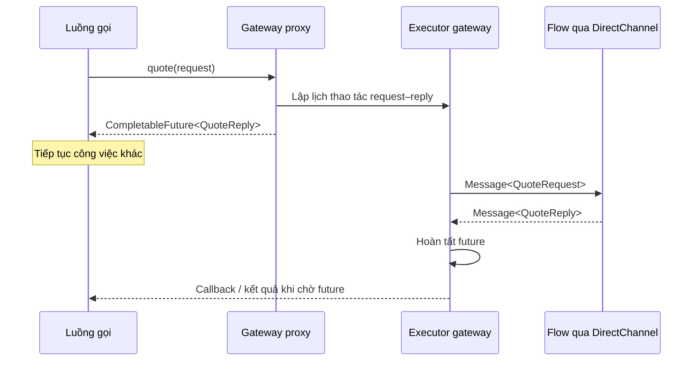

# Gateway với asynchronous flow

## 1. Mục tiêu và phạm vi

Trong module `SPRING_INTEGRATION_CORE`, messaging gateway là điểm vào để mã nghiệp vụ gọi một interface Java, còn Spring Integration chuyển lời gọi thành trao đổi `Message` qua `MessageChannel` và các endpoint. Khi xử lý mất thời gian, thiết kế gateway cần trả lời hai câu hỏi: **luồng nào thực hiện công việc** và **bên gọi nhận kết quả bằng cách nào**.

Bài này dùng tình huống lập báo giá để thực hành gateway bất đồng bộ, Java DSL, đường đi của phản hồi, timeout, lỗi và kiểm thử. Sau khi học, bạn có thể:

- Phân biệt gateway có hợp đồng bất đồng bộ với flow có điểm chuyển luồng.
- Cấu hình `CompletableFuture<T>` cùng executor có giới hạn.
- Giữ được đường phản hồi và đường lỗi khi thêm transformer, filter, router hoặc aggregator.
- Chọn cách xử lý khi không có phản hồi, quá tải hoặc bên gọi ngừng chờ.
- Chứng minh hành vi bất đồng bộ bằng kiểm thử có phối hợp giữa các luồng.

Ví dụ chính dùng Java 17+, Spring Integration 6.5.x và cấu hình Java thuần. Thuộc tính `errorOnTimeout` trên `@MessagingGateway` có từ Spring Integration 6.2. Chọn phiên bản thư viện bằng BOM phù hợp của ứng dụng; các con số pool và timeout trong bài chỉ là cấu hình minh họa. Xem ý nghĩa thuộc tính trong [API của `@MessagingGateway`](https://docs.spring.io/spring-integration/api/org/springframework/integration/annotation/MessagingGateway.html).

## 2. Hai ý nghĩa khác nhau của “bất đồng bộ”

### 2.1. Bất đồng bộ ở hợp đồng gateway

```java
public interface QuoteGateway {
    CompletableFuture<QuoteReply> quote(QuoteRequest request);
}
```

Với executor của gateway được bật, Spring Integration thực hiện lời gọi flow trong executor và trả future để bên gọi theo dõi kết quả. Handler phía sau có thể trả một `QuoteReply` thông thường. Cơ chế này được mô tả tại [Messaging Gateways — CompletableFuture](https://docs.spring.io/spring-integration/reference/6.5/gateway.html#_completablefuture).

### 2.2. Bất đồng bộ ở việc chuyển thông điệp

Flow có thể chuyển công việc sang executor thông qua `ExecutorChannel`, hoặc đưa thông điệp vào `QueueChannel` để consumer nhận sau. Tuy nhiên, nếu gateway khai báo kiểu trả về `QuoteReply`, bên gọi vẫn chờ kết quả của thao tác request–reply. `DirectChannel` thực hiện handler trên luồng gửi; `ExecutorChannel` giao việc cho executor. Với `CallerRunsPolicy`, lúc quá tải handler có thể chạy ngay trên luồng gửi. Xem [các triển khai MessageChannel](https://docs.spring.io/spring-integration/reference/channel/implementations.html).

| Hợp đồng gateway | Điểm vào flow | Bên gọi có chờ kết quả nghiệp vụ? | Nơi thực hiện handler |
| --- | --- | --- | --- |
| `QuoteReply` | `DirectChannel` | Có | Luồng gọi gateway |
| `QuoteReply` | `ExecutorChannel` | Có, dù việc xử lý được chuyển luồng | Executor của channel, tùy chính sách từ chối |
| `CompletableFuture<QuoteReply>` với executor gateway | `DirectChannel` | Nhận future rồi có thể tiếp tục | Executor của gateway |
| `CompletableFuture<QuoteReply>` với executor gateway | `ExecutorChannel` | Nhận future rồi có thể tiếp tục | Executor gateway giao tiếp với executor channel |

Trong bài, “trả future sớm” nghĩa là không đợi kết quả nghiệp vụ. Thao tác tạo request, lập lịch và kiểm tra cấu hình vẫn có chi phí, và việc nhận task vẫn có thể thất bại.

## 3. Vòng đời một lời gọi bất đồng bộ



Sơ đồ thể hiện quan hệ giữa các bước; một handler rất nhanh có thể hoàn tất trước khi bên gọi kịp sử dụng future.

Gateway thực hiện ánh xạ giữa lời gọi Java và message. Kết quả nghiệp vụ là payload của reply; future là đối tượng phía bên gọi dùng để quan sát việc hoàn tất. Không cần biến payload của request thành future.

Để nhận phản hồi, gateway có thể sử dụng một reply channel tạm thời được đặt trong header `replyChannel`. Khi không cấu hình output channel riêng, endpoint tạo phản hồi có thể dựa vào header này để gửi kết quả về. Xem [API `MessagingGatewaySupport`](https://docs.spring.io/spring-integration/api/org/springframework/integration/gateway/MessagingGatewaySupport.html) và [Service Activator](https://docs.spring.io/spring-integration/reference/service-activator.html).

Từ cơ chế đó, khi mở rộng flow cần giữ những điều kiện sau:

- Transformer trả `Message<?>` mới phải bảo toàn các header hạ tầng cần thiết, đặc biệt `replyChannel` và `errorChannel`.
- Mỗi nhánh router phục vụ request–reply cần có kết quả hoặc lỗi có ý nghĩa.
- Filter loại bỏ request phải có chủ đích: trả lời từ chối ở nhánh phù hợp, hoặc báo lỗi; việc im lặng loại bỏ khiến bên gọi chỉ còn quan sát được timeout.
- Aggregator cần có điều kiện giải phóng nhóm và chính sách cho nhóm thiếu thông điệp để request không bị bỏ chờ vô hạn.

Các điều kiện này là những quyết định thiết kế cho hợp đồng báo giá. Việc chuyển sang executor không tự bổ sung phản hồi cho một nhánh vốn không tạo phản hồi.

## 4. Ví dụ chính: CompletableFuture và một executor tại gateway

### 4.1. Chuẩn bị

Ứng dụng cần `spring-integration-core`. Đoạn dependency sau giả định phiên bản đã được quản lý bằng BOM; nếu chưa có dependency management, phải khai báo phiên bản tương thích trước khi dùng.

```xml
<dependency>
    <groupId>org.springframework.integration</groupId>
    <artifactId>spring-integration-core</artifactId>
</dependency>
```

Các kiểu Java trong ví dụ chính nằm trong package `vn.example.gateway`, mỗi kiểu `public` nằm trong một tệp riêng. Các biến thể ở phần sau được trình bày để thay thế hoặc mở rộng có chủ đích, không phải để chép tất cả vào cùng cấu hình.

### 4.2. Request và reply

```java
package vn.example.gateway;

public record QuoteRequest(String productCode, int quantity) {
}
```

```java
package vn.example.gateway;

import java.math.BigDecimal;

public record QuoteReply(
        String productCode,
        BigDecimal total,
        String workerThread) {
}
```

`workerThread` chỉ hỗ trợ quan sát trong ví dụ. Hợp đồng nghiệp vụ thực tế thường không cần công bố tên luồng.

### 4.3. Interface gateway

```java
package vn.example.gateway;

import java.util.concurrent.CompletableFuture;
import org.springframework.integration.annotation.MessagingGateway;

@MessagingGateway(
        name = "quoteGateway",
        defaultRequestChannel = "quote.requests",
        asyncExecutor = "quoteGatewayExecutor",
        defaultRequestTimeout = "100",
        defaultReplyTimeout = "1500",
        errorOnTimeout = true)
public interface QuoteGateway {

    CompletableFuture<QuoteReply> quote(QuoteRequest request);
}
```

`asyncExecutor` là tên bean executor, còn hai timeout tính bằng mili giây. `errorOnTimeout = true` yêu cầu báo lỗi thay cho kết quả `null` khi hết thời gian nhận phản hồi; nếu có error flow thì lỗi có thể được xử lý tại đó. Xem [hợp đồng annotation](https://docs.spring.io/spring-integration/api/org/springframework/integration/annotation/MessagingGateway.html).

### 4.4. Nghiệp vụ đồng bộ bên trong

```java
package vn.example.gateway;

import java.math.BigDecimal;

public class QuoteService {

    public QuoteReply calculate(QuoteRequest request) {
        if (request.productCode() == null
                || request.productCode().isBlank()) {
            throw new IllegalArgumentException("Thiếu mã sản phẩm");
        }
        if (request.quantity() <= 0) {
            throw new IllegalArgumentException("Số lượng phải lớn hơn 0");
        }

        BigDecimal unitPrice = new BigDecimal("125000");
        BigDecimal total = unitPrice.multiply(
                BigDecimal.valueOf(request.quantity()));

        return new QuoteReply(
                request.productCode(),
                total,
                Thread.currentThread().getName());
    }
}
```

Service vẫn là một đối tượng nghiệp vụ bình thường. Để quan sát xử lý chậm trong thực hành, có thể thay phần tính toán bằng client gọi hệ thống định giá; client đó cần timeout riêng cho việc kết nối và đọc dữ liệu.

### 4.5. Cấu hình executor, channel và Java DSL

```java
package vn.example.gateway;

import java.util.concurrent.ThreadPoolExecutor;
import org.springframework.context.annotation.Bean;
import org.springframework.context.annotation.Configuration;
import org.springframework.integration.channel.DirectChannel;
import org.springframework.integration.config.EnableIntegration;
import org.springframework.integration.config.IntegrationComponentScan;
import org.springframework.integration.dsl.IntegrationFlow;
import org.springframework.scheduling.concurrent.ThreadPoolTaskExecutor;

@Configuration
@EnableIntegration
@IntegrationComponentScan(basePackageClasses = QuoteGateway.class)
public class QuoteIntegrationConfig {

    @Bean
    public ThreadPoolTaskExecutor quoteGatewayExecutor() {
        ThreadPoolTaskExecutor executor = new ThreadPoolTaskExecutor();
        executor.setCorePoolSize(4);
        executor.setMaxPoolSize(8);
        executor.setQueueCapacity(32);
        executor.setThreadNamePrefix("quote-gateway-");
        executor.setRejectedExecutionHandler(
                new ThreadPoolExecutor.AbortPolicy());
        return executor;
    }

    @Bean(name = "quote.requests")
    public DirectChannel quoteRequests() {
        return new DirectChannel();
    }

    @Bean
    public QuoteService quoteService() {
        return new QuoteService();
    }

    @Bean
    public IntegrationFlow quoteFlow(QuoteService quoteService) {
        return IntegrationFlow.from("quote.requests")
                .handle(quoteService, "calculate",
                        endpoint -> endpoint.requiresReply(true))
                .get();
    }
}
```

Spring quản lý khởi tạo và vòng đời của `ThreadPoolTaskExecutor` khi nó là bean. Cấu hình pool, queue và tên luồng được mô tả trong [API `ThreadPoolTaskExecutor`](https://docs.spring.io/spring-framework/docs/6.2.x/javadoc-api/org/springframework/scheduling/concurrent/ThreadPoolTaskExecutor.html). Interface `@MessagingGateway` cần cơ chế đăng ký gateway, ở đây là `@IntegrationComponentScan`; component scan thông thường không đủ để tìm interface này. Xem [Annotation Support](https://docs.spring.io/spring-integration/reference/configuration/annotations.html).

Ở cấu hình trên, executor gateway tạo ranh giới luồng duy nhất. Handler chạy trên luồng `quote-gateway-*`, dù channel của flow là `DirectChannel`. `requiresReply(true)` thể hiện hợp đồng endpoint phải tạo phản hồi: nếu service trả `null`, endpoint báo lỗi thay vì im lặng kết thúc. Đây là thuộc tính của [Service Activator](https://docs.spring.io/spring-integration/reference/service-activator.html).

### 4.6. Gọi ví dụ bằng Spring context thuần

```java
package vn.example.gateway;

import java.util.concurrent.CompletableFuture;
import java.util.concurrent.TimeUnit;
import org.springframework.context.annotation.AnnotationConfigApplicationContext;

public class QuoteDemo {

    public static void main(String[] args) throws Exception {
        try (var context = new AnnotationConfigApplicationContext(
                QuoteIntegrationConfig.class)) {
            QuoteGateway gateway = context.getBean(QuoteGateway.class);

            CompletableFuture<QuoteReply> future = gateway.quote(
                    new QuoteRequest("BOOK-01", 2));

            System.out.println("Đã nhận future trên "
                    + Thread.currentThread().getName());

            QuoteReply reply = future.get(3, TimeUnit.SECONDS);
            System.out.println(reply.total());
            System.out.println(reply.workerThread());
        }
    }
}
```

Kết quả nghiệp vụ dự kiến là tổng tiền `250000`, và tên luồng xử lý bắt đầu bằng `quote-gateway-`. Thứ tự các dòng log giữa nhiều luồng không phải bằng chứng đủ mạnh cho tính bất đồng bộ; phần kiểm thử sẽ kiểm soát rõ thời điểm handler được phép hoàn tất.

Trong chương trình dòng lệnh, `get` giữ context mở để chờ ví dụ kết thúc. Trong đường xử lý cần trả quyền điều khiển sớm, hãy tiếp tục chuỗi future thay vì chờ ngay tại đây.

## 5. Sử dụng future ở phía gọi

### 5.1. Ghép các bước tính toán

Ví dụ sau dùng `gateway` đã được inject hoặc lấy từ context:

```java
CompletableFuture<BigDecimal> totalFuture = gateway
        .quote(new QuoteRequest("BOOK-01", 2))
        .thenApply(QuoteReply::total);

CompletableFuture<BigDecimal> observed = totalFuture.whenComplete(
        (total, failure) -> {
            if (failure != null) {
                System.err.println("Lập báo giá thất bại: " + failure);
            } else {
                System.out.println("Tổng tiền: " + total);
            }
        });
```

Giữ hoặc trả `observed` cho tầng phía trên nếu tầng đó cần biết toàn bộ chuỗi đã kết thúc. Callback nên làm công việc ngắn và có cách quan sát lỗi của chính nó.

`thenApply` không bảo đảm tạo luồng mới; callback có thể chạy trên luồng hoàn tất future hoặc luồng tham gia xử lý completion. Khi cần chọn executor cho bước sau, dùng dạng `thenApplyAsync(function, executor)`. Dạng `Async` không truyền executor thường dùng common pool của JDK. Xem [quy tắc thực thi của `CompletableFuture`](https://docs.oracle.com/en/java/javase/21/docs/api/java.base/java/util/concurrent/CompletableFuture.html).

Hai lời gọi độc lập có thể được kết hợp:

```java
CompletableFuture<QuoteReply> first = gateway.quote(
        new QuoteRequest("BOOK-01", 2));
CompletableFuture<QuoteReply> second = gateway.quote(
        new QuoteRequest("PEN-02", 3));

CompletableFuture<BigDecimal> combined = first.thenCombine(
        second,
        (left, right) -> left.total().add(right.total()));
```

Trong nghiệp vụ báo giá theo gói, `combined` thể hiện yêu cầu có cả hai kết quả. Nếu bước tiếp theo cũng trả một future, dùng `thenCompose` để nối bước đó thay vì tạo `CompletableFuture<CompletableFuture<T>>`. Các phép kết hợp này thuộc [hợp đồng `CompletionStage`](https://docs.oracle.com/en/java/javase/17/docs/api/java.base/java/util/concurrent/CompletionStage.html).

### 5.2. Chờ kết quả là quyết định của bên gọi

`get()` và `join()` có thể giữ luồng gọi cho đến khi có kết quả. `get(timeout, unit)` giới hạn thời gian chờ của lần gọi đó. Vì vậy, đoạn `gateway.quote(request).join()` vẫn có thể phù hợp tại một ranh giới xử lý đồng bộ, nhưng không giúp ranh giới đó trả quyền điều khiển sớm. Xem [API `Future`](https://docs.oracle.com/en/java/javase/17/docs/api/java.base/java/util/concurrent/Future.html).

## 6. Các biến thể với Java DSL và ExecutorChannel

### 6.1. Đăng ký gateway trực tiếp từ IntegrationFlow

Có thể dùng một interface thuần, không gắn `@MessagingGateway`:

```java
public interface DslQuoteGateway {
    CompletableFuture<QuoteReply> quote(QuoteRequest request);
}
```

Bean sau là một phương án thay cho cặp interface annotation và `quoteFlow` ở ví dụ chính. Các import dùng cùng nhóm thư viện như phần 4, bổ sung `Qualifier` và `Executor`:

```java
@Bean
public IntegrationFlow dslQuoteFlow(
        QuoteService quoteService,
        @Qualifier("quoteGatewayExecutor") Executor gatewayExecutor) {
    return IntegrationFlow.from(DslQuoteGateway.class,
                    gateway -> gateway
                            .beanName("dslQuoteGateway")
                            .asyncExecutor(gatewayExecutor)
                            .replyTimeout(1500L))
            .handle(quoteService, "calculate",
                    endpoint -> endpoint.requiresReply(true))
            .get();
}
```

DSL tạo proxy và channel đầu vào cho flow. Không đăng ký thêm một proxy khác cho cùng interface bằng scanner. Khi dùng `IntegrationFlow.from(Interface.class)`, DSL quản lý request channel nối với endpoint kế tiếp; request channel khai báo trên annotation, nếu có, không được dùng để thay đường nối này. Xem [IntegrationFlow as a Gateway](https://docs.spring.io/spring-integration/reference/dsl/integration-flow-as-gateway.html).

Ví dụ DSL này chỉ đặt `replyTimeout`, không cấu hình chính sách báo lỗi khi timeout như annotation ở ví dụ chính. Khi hết hạn nhận reply, cần tính đến kết quả `null`. `GatewayProxySpec` có các phương thức như `asyncExecutor`, `replyTimeout`, `requestTimeout` và `beanName`; không suy ra tên phương thức DSL chỉ từ tên thuộc tính annotation. Xem [API `GatewayProxySpec`](https://docs.spring.io/spring-integration/api/org/springframework/integration/dsl/GatewayProxySpec.html).

### 6.2. Flow chuyển luồng nhưng gateway vẫn đồng bộ

Để quan sát trường hợp này riêng biệt, dùng interface thuần khác:

```java
public interface SyncQuoteGateway {
    QuoteReply quote(QuoteRequest request);
}
```

```java
@Bean
public IntegrationFlow syncGatewayWithAsyncFlow(
        QuoteService quoteService,
        @Qualifier("quoteWorkerExecutor") Executor workerExecutor) {
    return IntegrationFlow.from(SyncQuoteGateway.class,
                    gateway -> gateway
                            .beanName("syncQuoteGateway")
                            .replyTimeout(1500L))
            .channel(new ExecutorChannel(workerExecutor))
            .handle(quoteService, "calculate",
                    endpoint -> endpoint.requiresReply(true))
            .get();
}
```

Biến thể này cần thêm import `org.springframework.integration.channel.ExecutorChannel` và một bean `quoteWorkerExecutor`, có thể cấu hình cùng cách với executor ở phần 4 nhưng dùng tên luồng `quote-worker-`.

Luồng gọi gateway gửi message vào flow rồi chờ reply. Worker thực hiện service; kết quả quay lại đánh thức luồng đang chờ. Khi worker xử lý lâu hơn thời gian nhận reply, gateway có thể trả `null` ở cấu hình này. Từ đó có thể kiểm tra bằng tên luồng và thời điểm method trả về: handler chuyển luồng không đồng nghĩa method gateway đã có hợp đồng trả future.

### 6.3. Khi kết hợp cả hai executor

Một gateway trả future vẫn có thể gọi flow chứa `ExecutorChannel`. Khi đó, một task của executor gateway có thể phải chờ task trên executor channel trả lời. Chỉ thêm ranh giới thứ hai khi có mục đích như tách tài nguyên cho công việc chậm hoặc giới hạn tải ở một công đoạn.

Một lỗi thiết kế cụ thể là dùng cùng pool cố định hai luồng: hai task gateway chiếm cả hai luồng rồi chờ; hai task handler cần thiết để tạo reply lại nằm trong queue của chính pool ấy. Flow không tiến triển cho đến khi việc chờ kết thúc. Cách xử lý là loại bỏ điểm chuyển luồng dư thừa, tách pool phù hợp hoặc đổi cách phối hợp để task không chiếm worker chỉ để chờ công việc cùng pool.

## 7. Timeout: xác định đúng thứ đang được giới hạn

| Giới hạn | Đối tượng chịu tác động | Ví dụ | Điều không được bảo đảm |
| --- | --- | --- | --- |
| Request timeout | Thao tác gửi vào channel có thể chặn | Gửi vào `QueueChannel` hữu hạn đang đầy | Không giới hạn toàn bộ thời gian service chạy |
| Reply timeout | Thời gian nhận reply sau bước gửi | Chờ worker của `ExecutorChannel` phản hồi | Không tự ngắt handler hoặc thao tác I/O |
| Thời gian chờ future | Luồng đang gọi `get` | `future.get(1, SECONDS)` | Không tự hủy công việc phía sau |
| Deadline quan sát future | Trạng thái hoàn tất của future | `future.orTimeout(2, SECONDS)` | Không tự dừng lời gọi hệ thống ngoài |
| Timeout của client | Thao tác tài nguyên cụ thể | Timeout kết nối/đọc của HTTP client | Không tự bao phủ thời gian xếp hàng ở gateway |

Request timeout chỉ hữu ích khi thao tác gửi có khả năng chặn; không xem nó là thời gian tối đa chạy một handler. Reply timeout là giới hạn nhận phản hồi. Xem [các tùy chọn timeout của gateway trong Java DSL](https://docs.spring.io/spring-integration/api/org/springframework/integration/dsl/GatewayProxySpec.html).

### 7.1. Vì sao handler chạy 5 giây vẫn vượt replyTimeout 1,5 giây?

Trong ví dụ chính, task của executor gateway gọi handler qua `DirectChannel`. Nếu handler mất 5 giây, thao tác gửi vẫn chưa trả quyền điều khiển về gateway để bước chờ nhận reply áp dụng timeout. Khi handler trả lời, reply có thể đã sẵn sàng ngay.

Nếu flow chuyển sang `ExecutorChannel`, bước gửi có thể kết thúc trước khi worker tạo reply; task gateway lúc đó có thể thực sự chờ và hết reply timeout. Đây là giới hạn theo cấu trúc flow, được giải thích trong [Gateway Behavior When No Response Arrives](https://docs.spring.io/spring-integration/reference/6.5/gateway.html#_gateway_behavior_when_no_response_arrives).

Từ tình huống đó, ngân sách thời gian nghiệp vụ cần xét cả:

```text
Thời gian quan sát từ bên gọi
  = thời gian chờ được lập lịch
  + thời gian gửi / xếp hàng trong flow
  + thời gian xử lý và I/O
  + thời gian truyền kết quả và callback liên quan
```

Đây là cách phân tích các thành phần độ trễ, không phải công thức để cộng mọi timeout cấu hình: một số giai đoạn có thể chồng nhau hoặc được giới hạn bởi deadline chung.

### 7.2. Phân biệt get có timeout và orTimeout

```java
CompletableFuture<QuoteReply> future = gateway.quote(
        new QuoteRequest("BOOK-01", 2));

// Chỉ lần chờ này có giới hạn một giây.
QuoteReply reply = future.get(1, TimeUnit.SECONDS);
```

Nếu lần chờ hết hạn, `get` ném `TimeoutException`; future có thể vẫn hoàn tất sau đó. Cách xử lý nên trả lỗi thời gian chờ cho tầng gọi, đồng thời giữ khả năng quan sát công việc còn chạy. Xem [Future.get với timeout](https://docs.oracle.com/en/java/javase/17/docs/api/java.base/java/util/concurrent/Future.html#get(long,java.util.concurrent.TimeUnit)).

```java
CompletableFuture<QuoteReply> deadlineView = gateway
        .quote(new QuoteRequest("BOOK-01", 2))
        .orTimeout(2, TimeUnit.SECONDS);
```

`orTimeout` làm chính future đó hoàn tất ngoại lệ nếu hết hạn trước khi có kết quả. Nó không trả một lớp bọc độc lập. Việc hủy `CompletableFuture`, kể cả `cancel(true)`, cũng không bảo đảm ngắt computation đang thực hiện. Xem [API `CompletableFuture`](https://docs.oracle.com/en/java/javase/21/docs/api/java.base/java/util/concurrent/CompletableFuture.html).

Với thao tác có ghi dữ liệu, bên gọi hết thời gian chờ không đủ để kết luận thao tác thất bại. Ví dụ, nếu quy trình đặt chỗ tồn kho đã ghi thành công nhưng reply đến muộn, retry thiếu khóa idempotency có thể tạo tác dụng phụ lặp lại. Hợp đồng cần quy định cách tra cứu kết quả và cách nhận diện một yêu cầu đã thực hiện.

## 8. Xử lý lỗi trong hợp đồng bất đồng bộ

### 8.1. Quan sát lỗi từ future

Khi handler của ví dụ chính ném lỗi, task gateway có thể hoàn tất future bằng ngoại lệ. Lệnh gọi tạo future có thể đã kết thúc, nên `try/catch` chỉ bao quanh `gateway.quote(...)` không đủ để quan sát lỗi xuất hiện sau đó.

Với `get`, lỗi tính toán được chuyển thành `ExecutionException`; với `join`, thường là `CompletionException`. Khi chẩn đoán, xem chuỗi nguyên nhân thay vì giả định lớp ngoài cùng luôn là ngoại lệ nghiệp vụ. Quy tắc wrapper thuộc [API `CompletableFuture`](https://docs.oracle.com/en/java/javase/21/docs/api/java.base/java/util/concurrent/CompletableFuture.html).

Ở phía ứng dụng, có thể chọn một chính sách rõ ràng cho từng nhóm lỗi:

| Nhóm lỗi | Ví dụ báo giá | Cách xử lý gợi ý cho tình huống này |
| --- | --- | --- |
| Đầu vào không hợp lệ | Số lượng bằng 0 | Báo lỗi kiểm tra dữ liệu, yêu cầu sửa đầu vào |
| Hạ tầng quá tải | Executor từ chối task | Báo bận hoặc áp dụng cơ chế điều tiết tải |
| Hệ thống phụ thuộc không phản hồi | Dịch vụ giá hết timeout | Trả lỗi có thể tra cứu/retry theo hợp đồng |
| Lỗi cấu hình | Không có consumer cho channel | Sửa cấu hình và phát hiện sớm bằng kiểm thử |

Không biến mọi lỗi thành báo giá `0`: trong ví dụ bán hàng, số tiền đó có thể bị hiểu nhầm là báo giá hợp lệ. Nếu nghiệp vụ cho phép dùng giá lưu trước, cần biểu diễn nguồn giá, trạng thái dự phòng và độ mới của dữ liệu trong kiểu kết quả phù hợp.

### 8.2. Đường lỗi sau khi chuyển luồng

Ở ranh giới executor hoặc poller, ngoại lệ không thể chỉ quay ngược stack của luồng gửi. Spring Integration dùng `ErrorMessage`; cơ chế xử lý lỗi ưu tiên header `errorChannel`, rồi mới tới channel lỗi toàn cục khi phù hợp. Xem [Error Handling](https://docs.spring.io/spring-integration/reference/error-handling.html).

Vì vậy, khi thêm endpoint tùy chỉnh, đừng loại bỏ header lỗi hoặc bắt rồi bỏ qua ngoại lệ mà không có quyết định cho request đang chờ. Một dòng log trong một consumer độc lập không tự hoàn tất future của gateway.

Nếu cấu hình `errorChannel` riêng trên gateway, error flow có thể chuyển lỗi thành một reply tương thích với hợp đồng hoặc tiếp tục báo lỗi. Một flow chỉ ghi log rồi kết thúc không tạo ra phản hồi nghiệp vụ; request có thể tiếp tục chờ đến timeout. Ý nghĩa định tuyến lỗi được mô tả trong [API `MessagingGatewaySupport`](https://docs.spring.io/spring-integration/api/org/springframework/integration/gateway/MessagingGatewaySupport.html).

### 8.3. Lỗi khi nhận task cũng cần được tính đến

Task có thể bị từ chối ngay lúc gửi vào executor, trước khi bên gọi nhận future. Nếu tầng ứng dụng muốn biểu diễn riêng lỗi từ chối bằng future thất bại, có thể chuẩn hóa tại ranh giới gọi:

```java
public static CompletableFuture<QuoteReply> submitQuote(
        QuoteGateway gateway, QuoteRequest request) {
    try {
        return gateway.quote(request);
    } catch (RejectedExecutionException rejected) {
        return CompletableFuture.failedFuture(rejected);
    }
}
```

Đoạn này cần import `RejectedExecutionException`. Nó chuẩn hóa lỗi từ chối đồng bộ; lỗi xảy ra sau khi nhận task vẫn được quan sát trên future trả về. `ThreadPoolTaskExecutor` sử dụng hợp đồng lỗi của Spring `TaskExecutor`, bao gồm `TaskRejectedException`. Xem [API executor của Spring](https://docs.spring.io/spring-framework/docs/6.2.x/javadoc-api/org/springframework/scheduling/concurrent/ThreadPoolTaskExecutor.html).

## 9. Khi chính downstream trả CompletableFuture

Có hai nơi có thể sở hữu future:

| Chế độ | Kết quả endpoint trả về | Thành phần sở hữu việc hoàn tất future |
| --- | --- | --- |
| Gateway dùng executor như ví dụ chính | `QuoteReply` | Gateway bao thao tác request–reply |
| Gateway tắt executor, downstream trả async payload | `CompletableFuture<QuoteReply>` trong payload của reply | Client/service phía downstream |

Với chế độ thứ hai, annotation có thể khai báo:

```java
import org.springframework.integration.annotation.AnnotationConstants;
import org.springframework.integration.annotation.MessagingGateway;

@MessagingGateway(
        defaultRequestChannel = "native.quote.requests",
        asyncExecutor = AnnotationConstants.NULL)
public interface NativeQuoteGateway {
    CompletableFuture<QuoteReply> quote(QuoteRequest request);
}
```

Khi tắt executor, phần gọi flow đến lúc nhận được async payload diễn ra trên luồng gọi. Downstream phải trả đúng future theo hợp đồng; nếu downstream làm công việc chặn trước khi tạo future, method gateway vẫn có thể trả chậm. Xem [GatewayProxyFactoryBean.setAsyncExecutor](https://docs.spring.io/spring-integration/api/org/springframework/integration/gateway/GatewayProxyFactoryBean.html#setAsyncExecutor(java.util.concurrent.Executor)). `AnnotationConstants.NULL` là hằng đại diện cho giá trị `null` trong annotation, theo [API `AnnotationConstants`](https://docs.spring.io/spring-integration/api/org/springframework/integration/annotation/AnnotationConstants.html).

Cần quyết định thêm ở endpoint: với service activator thông thường và channel imperative, future có thể được giữ làm payload; bật `async` sẽ khiến endpoint đợi completion theo cơ chế callback rồi gửi giá trị hoàn tất làm reply. Khi đó downstream đang trả **giá trị sau khi future hoàn tất**, thay vì chuyển nguyên future qua gateway. Không trộn hai chế độ khi chưa xác định rõ kiểu reply. Xem [Asynchronous Service Activator](https://docs.spring.io/spring-integration/reference/service-activator.html#_asynchronous_service_activator).

## 10. Gateway trả Reactor Mono

Nếu tầng gọi sử dụng Reactor, một biến thể có thể khai báo:

```java
import org.springframework.integration.annotation.MessagingGateway;
import reactor.core.publisher.Mono;

@MessagingGateway(
        defaultRequestChannel = "quote.requests",
        defaultReplyTimeout = "1500",
        errorOnTimeout = true)
public interface ReactiveQuoteGateway {
    Mono<QuoteReply> quote(QuoteRequest request);
}
```

Trong chế độ gateway tạo `Mono` cho thao tác trao đổi message, flow bắt đầu khi có subscription. Chỉ gọi method rồi bỏ `Mono` không khởi động flow này. Đây là hành vi được mô tả trong [Reactive Streams Support — Messaging Gateway](https://docs.spring.io/spring-integration/reference/6.5/reactive-streams.html#_messaging_gateway).

Nếu phía sau là flow imperative có thao tác chặn, có thể chọn scheduler thích hợp tại ranh giới gọi:

```java
Mono<QuoteReply> result = reactiveGateway
        .quote(new QuoteRequest("BOOK-01", 2))
        .subscribeOn(Schedulers.boundedElastic())
        .timeout(Duration.ofSeconds(2));
```

Đoạn trên cần `reactor.core.scheduler.Schedulers` và `java.time.Duration`. `boundedElastic` là lựa chọn Reactor hướng dẫn cho nguồn đồng bộ có thao tác chặn; nó chuyển chỗ thực thi để việc chờ tài nguyên không chiếm luồng xử lý non-blocking. Xem [Reactor — wrapping a blocking call](https://projectreactor.io/docs/core/release/reference/faq.html#faq.wrap-blocking).

Tầng ứng dụng cần trả `result` cho thành phần quản lý subscription, hoặc subscribe tại một ranh giới có quản lý vòng đời và lỗi. Không thêm `subscribe()` ở mọi tầng dịch vụ chỉ để làm flow chạy.

Một `Mono` có thể hoàn tất không có giá trị hoặc phát lỗi; gọi `block()` lại giữ luồng đang chờ. Với nguồn cold chưa được chia sẻ, subscription lặp có thể thực hiện lại công việc. Khi request có tác dụng phụ, cần tính đến việc một kết quả được nhiều bên subscribe. Xem [API `Mono`](https://projectreactor.io/docs/core/release/api/reactor/core/publisher/Mono.html).

Trả `Mono` không tự biến một HTTP client đồng bộ thành client non-blocking. Để thiết kế phản ứng xuyên suốt, phải xét các endpoint, channel, adapter và hệ thống phụ thuộc thực tế; [Reactive Streams Support](https://docs.spring.io/spring-integration/reference/6.5/reactive-streams.html) trình bày các điểm tích hợp đó.

## 11. void và tín hiệu hoàn tất

Một method `void send(...)` thể hiện hợp đồng không nhận reply nghiệp vụ. Kiểu `void` không tự tạo điểm chuyển luồng: với đường `DirectChannel`, công việc vẫn có thể chạy ngay trên luồng gọi. Nếu có điểm giao việc cho worker, việc method trả về chỉ cho biết phần giao việc đã kết thúc theo cấu trúc flow.

Từ Spring Integration 6.0, có thể dùng `Future<Void>` hoặc `Mono<Void>` để quan sát việc hoàn tất hoặc lỗi của thao tác gửi mà không cần giá trị trả về. Cần phân biệt tín hiệu đó với kết quả xử lý nghiệp vụ sau một điểm handoff. Xem [Asynchronous void Return Type](https://docs.spring.io/spring-integration/reference/gateway.html#_asynchronous_void_return_type).

Ví dụ, gửi một yêu cầu vào `QueueChannel` thành công không chứng minh consumer đã ghi dữ liệu vào cơ sở dữ liệu. Nếu ứng dụng cần xác nhận “đã ghi báo giá”, hãy thiết kế reply tương ứng với mốc đó, thay vì suy ra từ việc gửi thành công.

## 12. Quản lý executor và trạng thái ứng dụng

### 12.1. Giới hạn tài nguyên theo tải thực tế

Với pool `core = 4`, `max = 8`, queue `32` ở ví dụ chính, khi đạt số worker lõi, task tiếp theo thường được xếp hàng; pool tăng vượt core khi queue đầy và chưa đạt max. Khi cả pool và queue không nhận thêm được, `AbortPolicy` từ chối task. Các quy tắc này thuộc [ThreadPoolExecutor](https://docs.oracle.com/en/java/javase/17/docs/api/java.base/java/util/concurrent/ThreadPoolExecutor.html).

Từ đó, không suy ra “max bằng 8 thì luôn có 8 request chạy đồng thời”. Khi đo ứng dụng báo giá, nên theo dõi số task đang chạy, độ dài queue, thời gian đợi trước khi xử lý, thời gian xử lý, số lần từ chối và số lần hết thời gian chờ.

Giả sử một worker mất trung bình khoảng 0,2 giây cho một request và tải đến đều 20 request/giây, lượng công việc đang xử lý trung bình xấp xỉ 4 request. Đây chỉ là ước lượng ban đầu cho tình huống đó; độ trễ đuôi, giới hạn connection pool, CPU và tải đột biến vẫn quyết định cấu hình phù hợp. Tăng queue có thể giữ được nhiều task hơn nhưng cũng kéo dài thời gian request chờ đến lượt.

Đối với endpoint báo giá, một chính sách đầy đủ có thể quy định: khi quá tải thì trả lỗi bận, client retry có backoff và giới hạn; khi hết deadline thì vẫn ghi nhận kết quả đến muộn để điều tra hoặc tra cứu. Không dùng chính sách bỏ task im lặng cho request mà bên gọi đang chờ reply.

### 12.2. Đổi luồng làm thay đổi những giả định nào?

Với ví dụ báo giá, hãy kiểm tra cụ thể:

- **Dữ liệu dùng chung:** `QuoteService` không giữ tổng tiền trong field có thể bị các request sửa đồng thời. Request và reply dùng record để hạn chế thay đổi cấu trúc dữ liệu trong quá trình truyền.
- **Transaction:** đừng giả định transaction gắn với luồng gọi tự đi qua ranh giới executor. Đặt giao dịch ở công đoạn thật sự cần thao tác dữ liệu và định nghĩa rõ thời điểm reply xác nhận hoàn tất.
- **Thông tin theo luồng:** request ID, thông tin bảo mật hoặc dữ liệu log cần cơ chế truyền phù hợp. Có thể đưa dữ liệu nghiệp vụ cần thiết vào message header và kiểm soát việc khôi phục context ở worker.
- **Thứ tự:** hai request độc lập có thể hoàn tất đảo thứ tự. Nếu cập nhật cùng một thực thể, cần quy tắc sắp thứ tự hoặc kiểm soát phiên bản tại nghiệp vụ.
- **Vòng đời:** khi ứng dụng dừng, phải có chính sách cho task đang chờ và task đang chạy; không đóng context trong khi vẫn kỳ vọng future tiếp tục hoàn tất bình thường.

Đây là các quyết định cho thiết kế ứng dụng, không phải các bảo đảm bổ sung do kiểu trả về `CompletableFuture` cung cấp.

## 13. Kiểm thử hành vi bất đồng bộ bằng CountDownLatch

### 13.1. Điều cần chứng minh

Một kiểm thử hữu ích cho hợp đồng này cần chứng minh ba mốc:

1. Handler đã bắt đầu và đang bị giữ tại một điểm có kiểm soát.
2. Method gateway đã trả future trong khi handler chưa được phép hoàn tất.
3. Khi giải phóng handler, future hoàn tất với đúng kết quả; đường lỗi cũng quan sát được qua future.

Không chỉ đo “method trả dưới 50 ms”, vì máy chạy kiểm thử có thể bận. Ví dụ dưới dùng latch để phối hợp, cùng timeout để giới hạn việc chờ. Nó là fixture độc lập để kiểm tra cơ chế gateway; không thay thế các kiểm thử tích hợp cho từng nhánh nghiệp vụ của ứng dụng.

Test cần JUnit Jupiter, `spring-test` và `spring-integration-core` với phiên bản tương thích. Có thể dùng dependency test đã được quản lý bằng BOM:

```xml
<dependency>
    <groupId>org.springframework</groupId>
    <artifactId>spring-test</artifactId>
    <scope>test</scope>
</dependency>
<dependency>
    <groupId>org.junit.jupiter</groupId>
    <artifactId>junit-jupiter</artifactId>
    <scope>test</scope>
</dependency>
```

### 13.2. Fixture và hai tình huống kiểm thử

```java
package vn.example.gateway;

import java.util.concurrent.CompletableFuture;
import java.util.concurrent.CountDownLatch;
import java.util.concurrent.ExecutionException;
import java.util.concurrent.Executor;
import java.util.concurrent.ExecutorService;
import java.util.concurrent.Executors;
import java.util.concurrent.Future;
import org.junit.jupiter.api.Test;
import org.springframework.beans.factory.annotation.Autowired;
import org.springframework.beans.factory.annotation.Qualifier;
import org.springframework.context.annotation.Bean;
import org.springframework.context.annotation.Configuration;
import org.springframework.integration.config.EnableIntegration;
import org.springframework.integration.dsl.IntegrationFlow;
import org.springframework.scheduling.concurrent.ThreadPoolTaskExecutor;
import org.springframework.test.context.junit.jupiter.SpringJUnitConfig;

import static java.util.concurrent.TimeUnit.SECONDS;
import static org.junit.jupiter.api.Assertions.*;

@SpringJUnitConfig(AsyncGatewayTest.Config.class)
public class AsyncGatewayTest {

    public interface TestGateway {
        CompletableFuture<String> uppercase(String value);
    }

    @Autowired
    TestGateway gateway;

    @Autowired
    Gate gate;

    @Test
    void returnsFutureBeforeHandlerFinishes() throws Exception {
        ExecutorService caller = Executors.newSingleThreadExecutor();
        try {
            Future<CompletableFuture<String>> invocation = caller.submit(
                    () -> gateway.uppercase("hello"));

            CompletableFuture<String> result = invocation.get(2, SECONDS);
            assertTrue(gate.entered.await(2, SECONDS));
            assertFalse(result.isDone());

            gate.release.countDown();

            assertEquals("HELLO", result.get(2, SECONDS));
            assertTrue(gate.workerThread.startsWith("test-gateway-"));
        } finally {
            gate.release.countDown();
            caller.shutdownNow();
        }
    }

    @Test
    void exposesHandlerFailureThroughFuture() {
        CompletableFuture<String> result = gateway.uppercase("FAIL");

        ExecutionException failure = assertThrows(
                ExecutionException.class,
                () -> result.get(2, SECONDS));

        assertInstanceOf(IllegalArgumentException.class, rootCause(failure));
    }

    private static Throwable rootCause(Throwable failure) {
        Throwable current = failure;
        while (current.getCause() != null) {
            current = current.getCause();
        }
        return current;
    }

    public static class Gate {
        final CountDownLatch entered = new CountDownLatch(1);
        final CountDownLatch release = new CountDownLatch(1);
        volatile String workerThread;

        public String process(String value) {
            if ("FAIL".equals(value)) {
                throw new IllegalArgumentException("Giá trị không hợp lệ");
            }

            workerThread = Thread.currentThread().getName();
            entered.countDown();
            try {
                if (!release.await(10, SECONDS)) {
                    throw new IllegalStateException("Test chưa mở latch");
                }
            } catch (InterruptedException interrupted) {
                Thread.currentThread().interrupt();
                throw new IllegalStateException(interrupted);
            }
            return value.toUpperCase(java.util.Locale.ROOT);
        }
    }

    @Configuration
    @EnableIntegration
    public static class Config {

        @Bean
        public Gate gate() {
            return new Gate();
        }

        @Bean
        public ThreadPoolTaskExecutor testGatewayExecutor() {
            ThreadPoolTaskExecutor executor = new ThreadPoolTaskExecutor();
            executor.setCorePoolSize(1);
            executor.setMaxPoolSize(1);
            executor.setQueueCapacity(4);
            executor.setThreadNamePrefix("test-gateway-");
            return executor;
        }

        @Bean
        public IntegrationFlow testFlow(
                Gate gate,
                @Qualifier("testGatewayExecutor") Executor executor) {
            return IntegrationFlow.from(TestGateway.class,
                            gateway -> gateway
                                    .beanName("testGateway")
                                    .asyncExecutor(executor)
                                    .replyTimeout(1000L))
                    .handle(gate, "process",
                            endpoint -> endpoint.requiresReply(true))
                    .get();
        }
    }
}
```

Future ngoài cùng trong test đầu chỉ phục vụ quan sát việc **method gateway đã trả về**; future bên trong là kết quả gateway thật sự trả. Nếu gateway giữ luồng gọi cho đến khi handler hoàn tất, bước `invocation.get(...)` sẽ thất bại trước khi test mở latch. `finally` giải phóng handler để tài nguyên được thu hồi cả khi assertion thất bại.

Hai test có thể chạy độc lập theo thứ tự bất kỳ: nhánh `FAIL` báo lỗi trước khi đụng tới latch, còn nhánh thành công sử dụng latch một lần. Fixture dùng cơ chế gateway từ Java DSL; ví dụ nghiệp vụ ở phần 4 cần thêm kiểm thử riêng nếu muốn xác nhận scanner, tên channel và cấu hình annotation của chính ứng dụng.

### 13.3. Các tình huống nên bổ sung trong ứng dụng

| Tình huống | Cách tạo điều kiện | Điều cần quan sát |
| --- | --- | --- |
| Không có reply | Filter chủ động dừng request ở một fixture riêng | Gateway hết reply timeout theo chính sách đã cấu hình |
| Bên gọi ngừng chờ trước | Giữ handler bằng latch, gọi `get` với timeout ngắn | Lần chờ lỗi nhưng công việc vẫn có thể hoàn tất sau |
| Executor quá tải | Giữ toàn bộ worker và lấp queue bằng task có kiểm soát | Nhận lỗi từ chối, không để request biến mất im lặng |
| Lỗi sau điểm chuyển luồng | Thêm `ExecutorChannel`, cho handler ném lỗi | Lỗi quay về đúng lời gọi qua đường lỗi dự kiến |
| Reply đến sau timeout | Giữ worker quá hạn nhận reply rồi mới giải phóng | Có chính sách quan sát reply muộn và tác dụng phụ |
| Nhánh aggregator thiếu dữ liệu | Chỉ gửi một phần nhóm trong fixture | Có quyết định timeout nhóm, phản hồi thiếu hoặc báo lỗi |
| Subscription của Mono | Tạo Mono, kiểm tra chưa xử lý, rồi mới subscribe | Thời điểm bắt đầu flow khớp hợp đồng Reactor |

Với kiểm thử timeout, chọn khoảng chờ phù hợp với môi trường CI và phối hợp trạng thái bằng latch hoặc công cụ tương đương; tránh lấy một khoảng `sleep` cố định làm bằng chứng duy nhất cho thứ tự sự kiện.

## 14. Thực hành thiết kế một luồng báo giá

Áp dụng nội dung bài vào flow gồm: chuẩn hóa mã sản phẩm bằng transformer, kiểm tra dữ liệu bằng filter, định tuyến theo nhóm hàng bằng router và tạo báo giá tại service activator. Nếu báo giá cần nhiều nguồn giá, bổ sung aggregator với chính sách nhóm được xác định rõ.

Thực hiện theo trình tự:

1. Bắt đầu bằng ví dụ một executor tại gateway. Xác nhận kiểu trả về là `CompletableFuture<QuoteReply>` và service trả `QuoteReply`.
2. Thêm transformer rồi xác nhận reply vẫn quay về đúng request khi có nhiều lời gọi đồng thời.
3. Với dữ liệu bị từ chối, chọn phản hồi nghiệp vụ riêng hoặc ngoại lệ; ghi lại kết quả bên gọi phải nhận thay vì để request bị loại bỏ không có chủ đích.
4. Thêm router và kiểm tra mọi nhánh hợp lệ đều đi đến nơi tạo reply; request không chọn được nhánh phải có cách kết thúc rõ ràng.
5. Nếu thêm aggregator, định nghĩa số phần cần nhận, khóa tương quan, thời gian giữ nhóm và cách báo trường hợp thiếu phần.
6. Tạo một request chậm, thử cả thời gian chờ future lẫn reply timeout, rồi kiểm tra tác vụ có còn chạy sau khi bên gọi hết hạn hay không.
7. Chỉ thêm executor thứ hai khi đã xác định công đoạn cần cô lập tài nguyên; kiểm tra lại trường hợp pool đầy và trường hợp hai executor chờ lẫn nhau.

Sản phẩm thực hành nên ghi rõ hợp đồng hoàn tất của lời gọi: reply xác nhận đã tính được giá, đã lưu báo giá hay mới nhận việc. Từ mốc đó mới chọn kiểu trả về, đường lỗi và chính sách timeout phù hợp.
