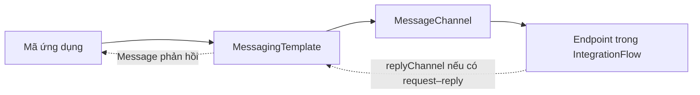
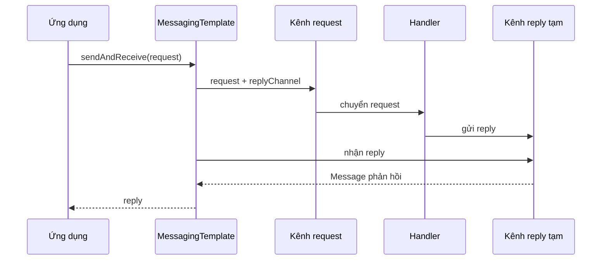

# MessagingTemplate

## 1. Mục tiêu và vị trí trong Spring Integration Core

Trong module `SPRING_INTEGRATION_CORE`, `MessagingTemplate` là công cụ để mã Java chủ động tương tác với luồng thông điệp: gửi một `Message`, lấy thông điệp từ hàng đợi hoặc gửi yêu cầu rồi đợi phản hồi. Đây là điểm nối giữa lời gọi trong ứng dụng và mô hình gồm `Message`, `MessageChannel`, endpoint và Java DSL.

Ví dụ, dịch vụ đặt hàng cần hỏi luồng báo giá để tính tổng tiền. Dịch vụ tạo thông điệp chứa mã sản phẩm, số lượng và mã yêu cầu; template gửi vào kênh đầu vào; endpoint tính giá; kết quả quay về bên gọi. Transformer, router, filter hoặc aggregator có thể xuất hiện ở giữa mà bên gọi vẫn tương tác qua kênh đã thống nhất.

Sau bài này, người học có thể:

- Chọn thao tác gửi, nhận hoặc request–reply theo hợp đồng giao tiếp.
- Cấu hình kênh mặc định, timeout và sử dụng tên bean khi cần.
- Giải thích vai trò của `replyChannel` và sự khác nhau giữa xử lý đồng bộ, bất đồng bộ.
- Phân biệt không có phản hồi, lỗi gửi, lỗi xử lý và phản hồi lỗi dưới dạng thông điệp.
- Kết nối template với Java DSL, thực hành kiểm thử và quyết định khi nào dùng messaging gateway.

Các ví dụ dùng Java 17 và API thuộc dòng Spring Integration 6.x, với `IntegrationFlow.from(...)`. Đây là mốc API minh họa, không phải khẳng định về phiên bản hiện có của dự án. Với Spring Boot, lấy bộ phiên bản Spring tương thích từ dependency management của Boot. Bài không yêu cầu giao thức bên ngoài hoặc message broker.

## 2. Bản chất của MessagingTemplate

Lớp được sử dụng trong bài là:

```java
import org.springframework.integration.core.MessagingTemplate;
```

`MessagingTemplate` kế thừa `GenericMessagingTemplate` của Spring Messaging và bổ sung khả năng tích hợp với hạ tầng Spring Integration. Nó cung cấp API thao tác với kênh; các endpoint thực hiện chuyển đổi, định tuyến hay gọi nghiệp vụ. Xem [API MessagingTemplate](https://docs.spring.io/spring-integration/docs/current/api/org/springframework/integration/core/MessagingTemplate.html).



Template không tự tạo consumer cho kênh đầu vào. Nếu gửi vào `DirectChannel` chưa có subscriber, việc gửi có thể thất bại ngay. Nếu gửi vào `QueueChannel` chưa có consumer, thông điệp có thể được lưu nhưng chưa được xử lý. Cấu hình template vì vậy phải đi cùng thiết kế luồng và vòng đời endpoint.

Cần phân biệt ba lớp có tên gần nhau:

| Lớp | Phạm vi thường gặp |
| --- | --- |
| `org.springframework.integration.core.MessagingTemplate` | Tương tác với các kênh và luồng Spring Integration |
| `org.springframework.messaging.core.GenericMessagingTemplate` | Template tổng quát thao tác với `MessageChannel` trong Spring Messaging |
| `org.springframework.messaging.simp.SimpMessagingTemplate` | Hạ tầng SIMP, thường gặp ở WebSocket/STOMP |

Các ví dụ trong bài chỉ dùng lớp ở hàng đầu tiên.

## 3. Ba kiểu trao đổi cần phân biệt

### 3.1. Gửi một chiều

```java
Message<String> command = MessageBuilder
        .withPayload("rebuild-product-index")
        .setHeader("requestId", "REQ-101")
        .build();

template.send(commandChannel, command);
```

Trong đó, `template` là `MessagingTemplate`, `commandChannel` là `MessageChannel`; các import cho message gồm:

```java
import org.springframework.messaging.Message;
import org.springframework.messaging.support.MessageBuilder;
```

`send(...)` của template trả về `void`. Không viết `boolean sent = template.send(...)`. API trực tiếp `MessageChannel.send(...)` trả về `boolean`, nhưng template chuyển trường hợp kênh trả về `false` thành `MessageDeliveryException`. Cơ chế này có trong [mã nguồn GenericMessagingTemplate](https://raw.githubusercontent.com/spring-projects/spring-framework/v6.2.12/spring-messaging/src/main/java/org/springframework/messaging/core/GenericMessagingTemplate.java).

Gửi thành công phải được diễn giải theo loại kênh. Với hàng đợi, nó thường chỉ chứng minh thông điệp đã vào hàng đợi. Ứng dụng cần phản hồi nghiệp vụ riêng nếu muốn xác nhận đơn hàng đã được duyệt, dữ liệu đã được cập nhật hoặc công việc đã hoàn tất.

Luồng một chiều nên kết thúc tại endpoint tiêu thụ thông điệp mà không phát sinh kết quả cần trả về, hoặc có kênh đầu ra rõ ràng. Nếu handler trả dữ liệu nhưng không có `outputChannel` hay `replyChannel`, luồng có thể lỗi vì không xác định được nơi gửi kết quả.

### 3.2. Nhận từ kênh có thể polling

```java
Message<?> next = template.receive(workQueue, 0);
if (next != null) {
    System.out.println(next.getPayload());
}
```

`workQueue` cần là kênh thực thi `PollableChannel`, chẳng hạn `QueueChannel`. `receive(..., 0)` kiểm tra ngay và trả về `null` nếu chưa có thông điệp. `DirectChannel` chuyển thông điệp tới subscriber, không có bộ đệm để lấy ra bằng `receive()`.

Một lời gọi `receive()` thường lấy một thông điệp. Nó không đăng ký consumer chạy liên tục. Nếu cần endpoint tự lấy dữ liệu định kỳ, cấu hình polling endpoint; nếu đã có poller đọc cùng hàng đợi, lời gọi nhận thủ công có thể trở thành consumer cạnh tranh.

### 3.3. Gửi yêu cầu rồi đợi phản hồi

```java
Message<?> reply = template.sendAndReceive(requestChannel, request);
if (reply == null) {
    throw new IllegalStateException("Không nhận được phản hồi trong thời gian chờ");
}
```

`sendAndReceive()` tạo điểm nhận phản hồi tạm cho lần gọi. Caller không cần tự tạo hàng đợi phản hồi cho trường hợp thông thường. Luồng cần đưa kết quả về địa chỉ phản hồi mà template gắn vào thông điệp. Tài liệu [MessagingTemplate](https://docs.spring.io/spring-integration/reference/7.0/channel/template.html) giới thiệu cách sử dụng này.

| Nhu cầu | Thao tác | Kết quả cần xử lý |
| --- | --- | --- |
| Gửi lệnh hoặc sự kiện | `send(channel, message)` | Không có giá trị trả về; lỗi được biểu diễn bằng exception |
| Gửi payload qua converter | `convertAndSend(channel, payload)` | Không chờ phản hồi nghiệp vụ |
| Lấy message từ hàng đợi | `receive(channel)` | `Message<?>` hoặc `null` |
| Nhận với timeout riêng | `receive(channel, timeout)` | `Message<?>` hoặc `null` |
| Lấy payload theo kiểu yêu cầu | `receiveAndConvert(channel, Target.class)` | Payload qua converter hoặc `null` khi không có message |
| Trao đổi cả payload và header | `sendAndReceive(channel, message)` | `Message<?>` phản hồi hoặc `null` |
| Gửi payload và nhận đối tượng | `convertSendAndReceive(channel, payload, Target.class)` | Đối tượng kết quả hoặc `null` khi không có reply |

Overload nhận `MessageChannel` phù hợp khi kênh đã được inject. Overload nhận `String` hữu ích khi cần resolve tên kênh; phần 5 trình bày điều kiện sử dụng.

## 4. Ví dụ đầy đủ: gọi luồng báo giá qua Java DSL

### 4.1. Kịch bản và điều kiện

Ứng dụng gửi yêu cầu mua hai sản phẩm `BOOK`. Đơn giá minh họa là `120000`, nên phản hồi dự kiến có tổng tiền `240000`. Header `requestId` giúp đối chiếu lời gọi với kết quả.

Classpath cần có `spring-integration-core` cùng các dependency Spring tương thích. Trong ứng dụng Boot đã có dependency management, thêm starter sau vào phần dependencies của build hiện hữu:

```xml
<dependency>
    <groupId>org.springframework.boot</groupId>
    <artifactId>spring-boot-starter-integration</artifactId>
</dependency>
```

Đoạn XML không phải toàn bộ `pom.xml`. Chương trình dưới đây tạo context trực tiếp để thấy rõ kênh, template và flow; nó không cần khởi động web server.

### 4.2. Chương trình minh họa

Nếu tách ví dụ ra để chạy, lưu lớp trong file `MessagingTemplateDemo.java`:

```java
import java.math.BigDecimal;

import org.springframework.beans.factory.annotation.Qualifier;
import org.springframework.context.annotation.Bean;
import org.springframework.context.annotation.Configuration;
import org.springframework.context.annotation.AnnotationConfigApplicationContext;
import org.springframework.integration.annotation.EnableIntegration;
import org.springframework.integration.channel.DirectChannel;
import org.springframework.integration.core.MessagingTemplate;
import org.springframework.integration.dsl.IntegrationFlow;
import org.springframework.messaging.Message;
import org.springframework.messaging.MessageChannel;
import org.springframework.messaging.support.MessageBuilder;

public class MessagingTemplateDemo {

    public record PriceRequest(String productCode, int quantity) {
    }

    public record PriceReply(String requestId, BigDecimal total) {
    }

    @Configuration
    @EnableIntegration
    public static class PricingConfiguration {

        @Bean
        public DirectChannel priceRequests() {
            return new DirectChannel();
        }

        @Bean
        public IntegrationFlow priceFlow(
                @Qualifier("priceRequests") DirectChannel input) {

            return IntegrationFlow.from(input)
                    .handle(PriceRequest.class, (request, headers) -> {
                        if (request.quantity() <= 0) {
                            throw new IllegalArgumentException(
                                    "Số lượng phải lớn hơn 0");
                        }

                        BigDecimal unitPrice = switch (request.productCode()) {
                            case "BOOK" -> new BigDecimal("120000");
                            case "PEN" -> new BigDecimal("10000");
                            default -> throw new IllegalArgumentException(
                                    "Mã sản phẩm không tồn tại");
                        };

                        BigDecimal total = unitPrice.multiply(
                                BigDecimal.valueOf(request.quantity()));

                        return new PriceReply(
                                (String) headers.get("requestId"), total);
                    })
                    .get();
        }

        @Bean
        public MessagingTemplate messagingTemplate(
                @Qualifier("priceRequests") MessageChannel input) {

            MessagingTemplate template = new MessagingTemplate(input);
            template.setSendTimeout(500);
            template.setReceiveTimeout(2000);
            template.setThrowExceptionOnLateReply(true);
            return template;
        }
    }

    public static void main(String[] args) {
        try (AnnotationConfigApplicationContext context =
                     new AnnotationConfigApplicationContext(
                             PricingConfiguration.class)) {

            MessagingTemplate template = context.getBean(MessagingTemplate.class);

            Message<PriceRequest> request = MessageBuilder
                    .withPayload(new PriceRequest("BOOK", 2))
                    .setHeader("requestId", "REQ-001")
                    .build();

            Message<?> reply = template.sendAndReceive(request);
            if (reply == null) {
                throw new IllegalStateException("Hết thời gian chờ báo giá");
            }
            if (!(reply.getPayload() instanceof PriceReply price)) {
                throw new IllegalStateException(
                        "Payload phản hồi không đúng hợp đồng báo giá");
            }

            System.out.println(price.requestId());
            System.out.println(price.total().toPlainString());
        }
    }
}
```

Kết quả nghiệp vụ dự kiến, ngoài các dòng log của framework:

```text
REQ-001
240000
```

### 4.3. Đọc cấu hình theo trách nhiệm

`priceRequests` xác định điểm nhận yêu cầu. `priceFlow` tạo endpoint đọc `PriceRequest` và trả `PriceReply`. `messagingTemplate` là API để caller đi vào luồng. Constructor nhận kênh khiến `template.sendAndReceive(request)` sử dụng kênh mặc định.

Endpoint cuối trả về một đối tượng, không khai báo kênh đầu ra cố định. Trong luồng này, kết quả được đưa về `replyChannel` của request. Vì dùng `DirectChannel`, phép tính diễn ra trên thread gọi; phần 7 giải thích vì sao timeout không biến đoạn tính giá thành tác vụ có deadline.

`@EnableIntegration` kích hoạt hạ tầng cần thiết khi dùng Spring thuần. Java DSL vẫn tạo các channel và endpoint Spring Integration thực; `IntegrationFlow` phải được đăng ký làm bean để hạ tầng xử lý nó. Xem [Java DSL](https://docs.spring.io/spring-integration/reference/6.5/dsl.html).

## 5. Kênh mặc định và resolve theo tên

Có thể cấu hình một đích mặc định:

```java
MessagingTemplate template = new MessagingTemplate(priceRequests);
// Cách tương đương: template.setDefaultChannel(priceRequests);

template.sendAndReceive(request);
```

Hoặc truyền kênh rõ ràng trong từng lời gọi:

```java
template.sendAndReceive(priceRequests, request);
```

Đích truyền ở lời gọi được dùng cho lời gọi đó. Nếu không truyền đích và không có kênh mặc định, template không có đủ thông tin để thực hiện thao tác.

Một template được khai báo là Spring bean còn có thể dùng tên kênh:

```java
Message<?> reply = template.sendAndReceive("priceRequests", request);
```

Tên trên là tên bean channel trong context. Đây không phải tên queue của RabbitMQ, topic Kafka hay địa chỉ HTTP. Khi giao tiếp với hệ thống bên ngoài, endpoint hoặc adapter phía sau kênh thực hiện công việc đó.

Khi Spring quản lý bean template, callback `BeanFactoryAware` cho phép nó dùng channel resolver của Spring Integration. Nếu chỉ tạo bằng `new MessagingTemplate()` ngoài context, đừng giả định tên kênh tự được resolve. Truyền đối tượng channel trực tiếp hoặc cấu hình resolver phù hợp. Xem [mã nguồn MessagingTemplate 6.5.3](https://raw.githubusercontent.com/spring-projects/spring-integration/v6.5.3/spring-integration-core/src/main/java/org/springframework/integration/core/MessagingTemplate.java).

Khi có nhiều `MessageChannel`, dùng `@Qualifier` để làm rõ kênh được inject. Chọn kênh bằng tên động khi đó là yêu cầu của thiết kế; API nghiệp vụ cố định thường dễ theo dõi hơn nếu phụ thuộc vào kênh cố định.

## 6. Request–reply hoạt động như thế nào?

### 6.1. Vai trò của replyChannel

Ở mức khái niệm, một lần `sendAndReceive()` gồm các bước:

1. Template chuẩn bị một kênh phản hồi tạm riêng cho lần gọi.
2. Template đặt địa chỉ đó vào header `replyChannel` của request được gửi.
3. Request đi vào channel và qua các endpoint.
4. Endpoint trả kết quả về địa chỉ phản hồi.
5. Template nhận kết quả và trả `Message<?>` cho caller, hoặc trả `null` khi hết thời gian nhận mà chưa có reply.



Với flow đồng bộ, handler có thể gửi reply trước khi template đi tới bước nhận; kênh tạm giữ được phản hồi đó. Sơ đồ không có nghĩa các bước luôn chạy trên những thread khác nhau.

Trong triển khai đang xét, template còn đặt `errorChannel` về kênh tạm khi gửi request. Do đó, tự gắn `errorChannel` trước `sendAndReceive()` không đảm bảo lỗi bất đồng bộ đi tới kênh đã gắn. Xem [doSendAndReceive của GenericMessagingTemplate](https://raw.githubusercontent.com/spring-projects/spring-framework/v6.2.12/spring-messaging/src/main/java/org/springframework/messaging/core/GenericMessagingTemplate.java).

### 6.2. Luồng phải duy trì đường phản hồi

Nếu handler chỉ trả payload, endpoint trả lời của framework có thể tạo reply message và giữ các header cần thiết. Khi tự tạo `Message` hoàn toàn mới trong custom handler, phải quyết định rõ cách bảo toàn header điều khiển và header nghiệp vụ.

Ví dụ, khi tự chuyển payload sang văn bản:

```java
Message<String> output = MessageBuilder
        .withPayload(resultText)
        .copyHeaders(input.getHeaders())
        .build();
```

Đoạn này giả định `input` là message đầu vào và `resultText` là kết quả đã tính. Nó minh họa việc giữ header, không yêu cầu sao chép mọi header qua mọi ranh giới hệ thống. `copyHeaders()` không ghi đè `id` và `timestamp`; xem [MessageBuilder](https://docs.spring.io/spring-framework/docs/6.2.12/javadoc-api/org/springframework/messaging/support/MessageBuilder.html).

`outputChannel` được cấu hình trực tiếp trên endpoint có thể dẫn kết quả đi theo đường khác thay vì về caller. Nếu flow kết thúc ở queue đầu ra cố định, cần thiết kế đưa kết quả từ đó về đúng request; `sendAndReceive()` không tự thêm bridge vào mọi kênh đầu ra.

Kênh reply tạm là đối tượng cục bộ trong tiến trình Java. Không gửi nguyên tham chiếu đó qua broker hay mạng rồi kỳ vọng tiến trình khác sử dụng được. Request–reply qua ranh giới tiến trình cần adapter/gateway, correlation và cơ chế phản hồi tương ứng.

### 6.3. Một lời gọi chờ một reply

Không nên fan-out request tới nhiều nhánh rồi để mọi nhánh cùng trả vào kênh tạm với kỳ vọng nhận một danh sách kết quả. Một lần gọi template chỉ lấy một phản hồi. Nếu cần báo giá từ nhiều nhà cung cấp, tập hợp chúng bằng aggregator hoặc mẫu scatter–gather, sau đó trả một kết quả tổng hợp.

`requestId` trong ví dụ là mã nghiệp vụ để đối chiếu. Nó không tự trở thành khóa gom nhóm của aggregator. Khi thêm aggregator, cấu hình correlation và điều kiện release phù hợp; nếu nhóm không được release, caller có thể hết thời gian chờ dù từng nhánh đã xử lý xong.

## 7. Timeout: giới hạn đúng giai đoạn

### 7.1. Send timeout và receive timeout

```java
template.setSendTimeout(500);
template.setReceiveTimeout(2000);
```

Đơn vị là mili giây. `sendTimeout` dùng cho thao tác gửi vào channel; `receiveTimeout` dùng khi nhận hoặc đợi reply trong request–reply. API cho phép ghi đè timeout theo request. Xem [GenericMessagingTemplate](https://docs.spring.io/spring-framework/docs/6.2.12/javadoc-api/org/springframework/messaging/core/GenericMessagingTemplate.html).

| Giá trị | Ý nghĩa với các thao tác chờ tương ứng |
| --- | --- |
| `0` | Không chờ; thử ngay |
| Dương | Chờ tối đa số mili giây đã cấu hình cho giai đoạn đó |
| Âm, thường là `-1` | Dùng biến thể không có timeout; có thể chờ vô hạn |

Trong mã nguồn Framework được tham chiếu, hai timeout mặc định là `-1`. Các ví dụ luôn đặt giá trị hữu hạn để hành vi chờ rõ ràng. Điều đó vẫn không tạo deadline toàn bộ flow.

Với `QueueChannel` có dung lượng giới hạn, send timeout hữu ích khi hàng đợi đầy. Với queue rỗng, receive timeout quyết định khoảng chờ dữ liệu. `receiveTimeout = 0` trong flow bất đồng bộ dễ khiến caller trả `null` trước khi worker kịp tạo phản hồi.

### 7.2. DirectChannel không bị ngắt bởi receiveTimeout

Giả sử handler đồng bộ mất năm giây, còn template có `receiveTimeout = 100`. Khi gửi qua `DirectChannel`, thread caller thực thi handler trong lời gọi gửi. Chỉ sau khi handler trả về, template mới tiếp tục phần nhận reply.

Lời gọi vì thế vẫn có thể kéo dài khoảng năm giây và nhận kết quả. `receiveTimeout` không ngắt handler sau 100 ms. `sendTimeout` cũng không phải bộ đếm cưỡng chế thời gian thực thi phương thức nghiệp vụ trên `DirectChannel`.

Muốn giới hạn lời gọi tới dịch vụ HTTP hoặc cơ sở dữ liệu, cấu hình timeout tại client hoặc thao tác I/O đó. Nếu đổi sang bất đồng bộ để caller có thể ngừng đợi, vẫn cần thiết kế riêng việc hủy tác vụ và giải quyết kết quả đến muộn.

Sự khác nhau giữa thực thi trên thread caller của `DirectChannel` và chuyển việc cho executor của `ExecutorChannel` được mô tả trong [các triển khai MessageChannel](https://docs.spring.io/spring-integration/reference/6.5/channel/implementations.html).

### 7.3. QueueChannel và ExecutorChannel

Khi flow có hàng đợi hoặc executor thực sự tách thread, caller có thể đi tới bước chờ reply trong lúc worker còn xử lý. Hết `receiveTimeout`, template trả `null` nếu chưa có phản hồi. Worker vẫn có thể tiếp tục chạy.

Queue đầu vào phải có consumer. Ví dụ sau là một **flow thay thế độc lập**, không ghép thêm vào flow báo giá ở phần 4:

```java
@Bean
public QueueChannel queuedPriceRequests() {
    return new QueueChannel(100);
}

@Bean
public IntegrationFlow queuedPriceFlow(
        @Qualifier("queuedPriceRequests") QueueChannel input) {

    return IntegrationFlow.from(input)
            .handle(MessagingTemplateDemo.PriceRequest.class,
                    (request, headers) -> {
                        if (request.quantity() <= 0) {
                            throw new IllegalArgumentException(
                                    "Số lượng phải lớn hơn 0");
                        }
                        if (!"BOOK".equals(request.productCode())) {
                            throw new IllegalArgumentException(
                                    "Flow minh họa chỉ hỗ trợ BOOK");
                        }
                        return new MessagingTemplateDemo.PriceReply(
                                (String) headers.get("requestId"),
                                new BigDecimal("120000").multiply(
                                        BigDecimal.valueOf(request.quantity())));
                    }, endpoint -> endpoint.poller(Pollers.fixedDelay(100)))
            .get();
}
```

Ngoài các import ở ví dụ chính, cấu hình cần:

```java
import org.springframework.integration.channel.QueueChannel;
import org.springframework.integration.dsl.Pollers;
```

Đặt hai bean trong lớp `@Configuration` có `@EnableIntegration`. Template gọi biến thể này bằng `sendAndReceive(queuedPriceRequests, request)` với bean channel đã inject. Khoảng polling 100 ms là nhịp lấy dữ liệu, không phải deadline xử lý request. Queue giới hạn ở 100 message để thấy rõ khả năng chờ gửi khi đầy.

Với `ExecutorChannel`, thời điểm trả về và hành vi khi bão hòa còn phụ thuộc executor cùng rejection policy. Cần xem cấu hình executor; không suy ra mọi lần gọi đều tách thread chỉ từ tên channel.

### 7.4. Timeout riêng cho từng request

Không thay `receiveTimeout` của singleton template trước mỗi lời gọi: các request song song có thể làm cấu hình của nhau thay đổi. Có thể dùng header dành cho timeout:

```java
import org.springframework.messaging.core.GenericMessagingTemplate;

Message<?> requestWithTimeout = MessageBuilder
        .fromMessage(request)
        .setHeader(GenericMessagingTemplate.DEFAULT_SEND_TIMEOUT_HEADER, 100L)
        .setHeader(GenericMessagingTemplate.DEFAULT_RECEIVE_TIMEOUT_HEADER, 800L)
        .build();

Message<?> reply = template.sendAndReceive(priceRequests, requestWithTimeout);
```

Tên mặc định là `sendTimeout` và `receiveTimeout`; template loại các header này trước khi gửi message vào luồng. Ghi đè receive timeout bằng header áp dụng cho `sendAndReceive()`, vì có request để mang header. Với `receive()` thuần túy, dùng overload nhận timeout. Xem [API timeout header](https://docs.spring.io/spring-framework/docs/6.2.12/javadoc-api/org/springframework/messaging/core/GenericMessagingTemplate.html).

Các con số trên là cấu hình minh họa. Khi vận hành, chọn khoảng chờ dựa trên yêu cầu nghiệp vụ, độ trễ đo được, thời gian đợi trong queue và timeout của các lời gọi bên dưới.

## 8. Phản hồi đến muộn và ý nghĩa nghiệp vụ của timeout

Khi caller đã hết thời gian nhận, worker bất đồng bộ vẫn có thể cập nhật dữ liệu rồi gửi reply. Caller ngừng đợi không chứng minh worker thất bại và cũng không tự rollback giao dịch của worker.

Có thể cấu hình:

```java
template.setThrowExceptionOnLateReply(true);
```

Tùy chọn này khiến phía gửi reply gặp `MessageDeliveryException` khi không còn người nhận hợp lệ, chẳng hạn caller đã timeout hoặc đã nhận một reply. Nó không tạo exception cho caller đã trả về. Xem [setThrowExceptionOnLateReply](https://docs.spring.io/spring-framework/docs/6.2.12/javadoc-api/org/springframework/messaging/core/GenericMessagingTemplate.html).

Ví dụ đặt tùy chọn tường minh: lớp Spring Integration có thể lấy chính sách từ integration properties khi chưa được đặt trực tiếp. Xem [MessagingTemplate 6.5.3](https://raw.githubusercontent.com/spring-projects/spring-integration/v6.5.3/spring-integration-core/src/main/java/org/springframework/integration/core/MessagingTemplate.java).

Với yêu cầu có side effect, chẳng hạn trừ tồn kho, cần coi timeout là trạng thái chưa biết kết quả. Một thiết kế thực tế có thể:

- Gán khóa idempotency cho thao tác nghiệp vụ và giữ nguyên khóa khi gửi lại cùng yêu cầu.
- Lưu kết quả theo mã yêu cầu để caller tra cứu sau timeout.
- Phân biệt thời hạn còn được phép bắt đầu công việc với thời gian caller chờ kết quả.
- Theo dõi late reply và độ dài queue để phát hiện nghẽn.

`requestId` chỉ là dữ liệu nhận dạng nếu chưa có cơ chế lưu và kiểm tra trùng. Thêm header không tự làm luồng trở nên idempotent.

## 9. Payload conversion và bảo toàn header

### 9.1. Làm việc trực tiếp với đối tượng

Nếu chỉ cần payload, có thể gọi luồng ở phần 4 như sau:

```java
MessagingTemplateDemo.PriceReply price = template.convertSendAndReceive(
        priceRequests,
        new MessagingTemplateDemo.PriceRequest("BOOK", 2),
        MessagingTemplateDemo.PriceReply.class);

if (price == null) {
    throw new IllegalStateException("Không nhận được báo giá");
}
```

Lời gọi không tự thêm `requestId`, nên trường đó trong reply của ví dụ sẽ là `null`. Có thể dùng overload hỗ trợ header hoặc `MessagePostProcessor` khi cần, hoặc dùng `MessageBuilder` với `sendAndReceive()` để hợp đồng header hiện rõ.

Tên `convert...` không có nghĩa template tự biết mọi định dạng dữ liệu. `SimpleMessageConverter` chủ yếu bọc payload thành message và lấy payload ra khi kiểu đích tương thích; nó không tự phân tích JSON thành DTO. Nếu request là chuỗi JSON nhưng handler nhận `PriceRequest`, cần converter hoặc transformer được cấu hình tương ứng. Xem [SimpleMessageConverter](https://docs.spring.io/spring-framework/docs/6.2.12/javadoc-api/org/springframework/messaging/converter/SimpleMessageConverter.html).

### 9.2. Chọn API theo hợp đồng dữ liệu

Dùng `sendAndReceive()` khi cần đọc cả payload lẫn header phản hồi, hoặc cần phân biệt kiểu message như `ErrorMessage`. Dùng `convertSendAndReceive()` khi hợp đồng payload đã rõ và việc chuyển đổi được cấu hình đúng.

Lỗi conversion khác với hết thời gian chờ: message đã có nhưng không chuyển được sang kiểu đích có thể dẫn tới `MessageConversionException`. Không gom cả hai thành kết luận “không có dữ liệu”.

Header nghiệp vụ nên có ý nghĩa rõ ràng, chẳng hạn `requestId`, `tenantId` hoặc `sourceSystem`. Không dùng tên header điều khiển như `replyChannel`, `errorChannel`, `sendTimeout` hay `receiveTimeout` để chứa dữ liệu nghiệp vụ.

## 10. Xử lý lỗi: exception và ErrorMessage

### 10.1. Lỗi trên cùng thread

Trong flow dùng `DirectChannel` ở phần 4, số lượng âm khiến handler ném exception. Lỗi đi ngược qua lời gọi Java tới caller; exception của framework thường chứa nguyên nhân nghiệp vụ bên trong.

```java
import org.springframework.messaging.MessagingException;

try {
    Message<?> reply = template.sendAndReceive(priceRequests, request);
    // Kiểm tra null và payload theo hợp đồng trước khi sử dụng.
} catch (MessagingException ex) {
    Throwable cause = ex.getCause();
    System.err.println(cause != null ? cause.getMessage() : ex.getMessage());
}
```

Tạo bean `errorChannel` toàn cục không tự chuyển mọi lỗi đồng bộ của template thành thông điệp. Khi caller và handler trên cùng thread, exception propagation vẫn là đường xử lý cần xét. Xem [Error Handling](https://docs.spring.io/spring-integration/reference/error-handling.html).

Ví dụ chỉ minh họa nơi bắt lỗi. Trong ứng dụng thật, tầng biên cần chuyển lỗi thành kết quả có nghĩa đối với HTTP API, tác vụ nền hoặc giao diện người dùng, đồng thời giữ nguyên nhân để quan sát.

### 10.2. Lỗi sau ranh giới bất đồng bộ

Khi handler chạy trong task của Spring Integration, chẳng hạn poller hoặc executor, hạ tầng có thể đóng gói lỗi thành `ErrorMessage` rồi gửi tới `errorChannel` của request hoặc kênh lỗi toàn cục. Xem [cơ chế lỗi bất đồng bộ](https://docs.spring.io/spring-integration/reference/error-handling.html).

Đối với request–reply của template, kênh lỗi tạm ở phần 6 có nghĩa lỗi được công bố có thể xuất hiện như reply. Khi cần phân biệt kiểu phản hồi này, dùng API trả về `Message<?>`:

```java
import org.springframework.messaging.support.ErrorMessage;

Message<?> reply = template.sendAndReceive(queuedPriceRequests, request);
if (reply == null) {
    throw new IllegalStateException("Chưa nhận được kết quả báo giá");
}
if (reply instanceof ErrorMessage error) {
    throw new IllegalStateException("Luồng báo giá xử lý thất bại",
            error.getPayload());
}
if (!(reply.getPayload() instanceof MessagingTemplateDemo.PriceReply price)) {
    throw new IllegalStateException("Kiểu kết quả báo giá không hợp lệ");
}

System.out.println(price.total());
```

Không mặc định template biến mọi payload `Throwable` thành exception nghiệp vụ giống mọi kiểu gateway. Hành vi cần được hiểu theo flow và API đang dùng. Nếu tác vụ tự tạo ngoài hạ tầng Spring Integration không công bố lỗi về đường phản hồi, caller có thể chỉ thấy timeout.

### 10.3. Phân loại kết quả tại caller

| Hiện tượng | Ý nghĩa cần kiểm tra | Cách xử lý tại biên |
| --- | --- | --- |
| `send()` ném `MessageDeliveryException` | Kênh không chấp nhận việc gửi theo điều kiện hiện tại | Kiểm tra capacity, timeout và consumer; chỉ retry khi ngữ nghĩa cho phép |
| Lỗi dispatch trên `DirectChannel` | Không có subscriber hoặc không dispatch được | Kiểm tra cấu hình và vòng đời endpoint |
| `sendAndReceive()` trả `null` | Chưa có reply khi kết thúc thời gian nhận | Trả trạng thái phù hợp; cân nhắc tra cứu theo mã yêu cầu |
| Ném `MessageHandlingException` hoặc exception xử lý tương ứng | Lỗi trong đường gọi đồng bộ | Đọc nguyên nhân và ánh xạ lỗi nghiệp vụ |
| Reply là `ErrorMessage` | Lỗi được đưa về bằng messaging | Xử lý payload lỗi trước khi đọc DTO kết quả |
| `MessageConversionException` | Không chuyển được dữ liệu sang kiểu yêu cầu | Sửa hợp đồng hoặc converter |
| Worker gặp late reply | Caller không còn nhận được phản hồi đó | Theo dõi kết quả nghiệp vụ và chính sách idempotency |

Retry là quyết định về nghiệp vụ và bảo đảm giao nhận. Chỉ dựa vào việc caller không nhận được reply là chưa đủ để kết luận có thể gửi lại lệnh có side effect một cách an toàn.

## 11. Khi đưa transformer, filter, router và aggregator vào flow

Template vẫn là phía gọi; tính đúng của request–reply còn phụ thuộc từng endpoint:

| Endpoint hoặc cấu trúc | Điều cần giữ trong hợp đồng với caller |
| --- | --- |
| Transformer | Payload sau biến đổi đúng kiểu; đường phản hồi được bảo toàn |
| Filter | Nếu loại bỏ request mà không tạo reply hay lỗi, caller có thể chờ tới timeout |
| Router | Mỗi nhánh được chọn có đường kết thúc rõ ràng; nhánh không có reply được thiết kế có chủ đích |
| Aggregator | Có khóa gom nhóm và điều kiện release; output tổng hợp về đúng caller |
| Fan-out nhiều nhánh | Gom nhiều kết quả trước khi trả một reply nếu caller cần kết quả tổng hợp |
| Endpoint chỉ tạo side effect | Không dùng hợp đồng chờ DTO nếu endpoint không tạo phản hồi |

Với luồng báo giá, thay vì im lặng bỏ yêu cầu số lượng âm bằng filter, có thể thiết kế kết quả từ chối rõ ràng hoặc ném lỗi validation trên đường đồng bộ. Cách chọn phải thống nhất với caller; không để caller tự đoán liệu `null` là bị từ chối, chưa xử lý hay thiếu cấu hình.

Nếu router đưa một số request vào nhánh xử lý dài, có thể cần tách API “tiếp nhận công việc” khỏi API “tra cứu kết quả”. Reply ban đầu có thể là mã tác vụ; caller dùng mã để theo dõi trạng thái thay vì giữ một thread chờ toàn bộ thời gian xử lý.

## 12. MessagingTemplate hay messaging gateway?

Cả hai đều đưa lời gọi từ mã ứng dụng vào messaging, nhưng đặt API ở tầng biên theo cách khác nhau. Gateway có thể che `Message` và `MessageChannel` sau interface nghiệp vụ. Xem [Messaging Gateways](https://docs.spring.io/spring-integration/reference/6.5/gateway.html).

| Tình huống | Lựa chọn phù hợp |
| --- | --- |
| Test cần gửi message và kiểm tra header | `MessagingTemplate` |
| Thành phần hạ tầng cần chọn channel hoặc thao tác send/receive trực tiếp | `MessagingTemplate` |
| Dịch vụ nghiệp vụ chỉ cần gọi `quote(request)` và nhận `PriceReply` | Messaging gateway |
| Nhiều nơi gọi cùng hợp đồng nghiệp vụ | Interface gateway giúp gom cấu hình |
| Luồng hướng sự kiện, caller không cần đợi kết quả | Gửi một chiều hoặc gateway có hợp đồng một chiều |

Interface minh họa, **không tự đăng ký thêm vào chương trình ở phần 4**:

```java
import org.springframework.integration.annotation.MessagingGateway;

@MessagingGateway(
        defaultRequestChannel = "priceRequests",
        defaultRequestTimeout = "500",
        defaultReplyTimeout = "2000")
public interface PricingGateway {
    MessagingTemplateDemo.PriceReply quote(
            MessagingTemplateDemo.PriceRequest request);
}
```

Muốn dùng interface, phải để infrastructure gateway phát hiện và đăng ký, chẳng hạn qua `@IntegrationComponentScan` trong cấu hình thích hợp. Caller sau đó inject `PricingGateway`. Interface minh họa chưa truyền `requestId`; có thể bổ sung mapping header khi hợp đồng cần mã yêu cầu.

Gateway không tự làm flow đồng bộ trở thành bất đồng bộ và không tự tạo deadline cho handler. Template hay gateway là lựa chọn bề mặt API cùng chính sách giao tiếp; loại channel và endpoint vẫn quyết định cách thực thi.

## 13. Mã kiểm thử để thực hành

Các đoạn sau là ví dụ JUnit 5 cho người học, chưa được thực thi trong phạm vi soạn bài. Chúng tập trung vào hợp đồng message và hành vi channel, không cần broker ngoài. Nếu đưa vào dự án, cần dependency JUnit Jupiter; với Boot có thể dùng starter test tương thích.

### 13.1. Luồng báo giá trả đúng payload và header

Đặt test cùng package với `MessagingTemplateDemo` nếu đã thêm package cho ví dụ:

```java
import java.math.BigDecimal;

import org.junit.jupiter.api.Test;
import org.springframework.context.annotation.AnnotationConfigApplicationContext;
import org.springframework.integration.core.MessagingTemplate;
import org.springframework.messaging.Message;
import org.springframework.messaging.support.MessageBuilder;

import static org.junit.jupiter.api.Assertions.*;

class PricingTemplateTest {

    @Test
    void returnsQuoteForTheGivenRequest() {
        try (AnnotationConfigApplicationContext context =
                     new AnnotationConfigApplicationContext(
                             MessagingTemplateDemo.PricingConfiguration.class)) {

            MessagingTemplate template = context.getBean(MessagingTemplate.class);
            Message<?> request = MessageBuilder
                    .withPayload(new MessagingTemplateDemo.PriceRequest("BOOK", 2))
                    .setHeader("requestId", "REQ-TEST-01")
                    .build();

            Message<?> reply = template.sendAndReceive(request);

            assertNotNull(reply);
            var result = assertInstanceOf(
                    MessagingTemplateDemo.PriceReply.class, reply.getPayload());
            assertEquals("REQ-TEST-01", result.requestId());
            assertEquals(0, new BigDecimal("240000").compareTo(result.total()));
            assertEquals("REQ-TEST-01", reply.getHeaders().get("requestId"));
        }
    }
}
```

So sánh `BigDecimal` bằng `compareTo` vì bài toán kiểm tra giá trị tiền, không kiểm tra scale. Test kiểm tra cả payload nghiệp vụ lẫn header đã thỏa thuận với caller.

### 13.2. Queue rỗng, queue đầy và request không có consumer

```java
import org.junit.jupiter.api.Test;
import org.springframework.integration.channel.QueueChannel;
import org.springframework.integration.core.MessagingTemplate;
import org.springframework.messaging.MessageDeliveryException;
import org.springframework.messaging.support.GenericMessage;

import static org.junit.jupiter.api.Assertions.*;

class TemplateChannelBehaviorTest {

    @Test
    void returnsNullWhenPollingAnEmptyQueueWithoutWaiting() {
        MessagingTemplate template = new MessagingTemplate();
        QueueChannel queue = new QueueChannel(1);

        assertNull(template.receive(queue, 0));
    }

    @Test
    void rejectsSendWhenBoundedQueueIsFullAndWaitingIsDisabled() {
        MessagingTemplate template = new MessagingTemplate();
        template.setSendTimeout(0);
        QueueChannel queue = new QueueChannel(1);

        template.send(queue, new GenericMessage<>("first"));

        assertThrows(MessageDeliveryException.class,
                () -> template.send(queue, new GenericMessage<>("second")));
    }

    @Test
    void waitingForReplyDoesNotCreateAQueueConsumer() {
        MessagingTemplate template = new MessagingTemplate();
        template.setSendTimeout(0);
        template.setReceiveTimeout(0);
        template.setThrowExceptionOnLateReply(true);
        QueueChannel requests = new QueueChannel(1);

        assertNull(template.sendAndReceive(
                requests, new GenericMessage<>("no-consumer")));

        assertEquals(1, requests.getQueueSize());
    }
}
```

Test cuối cố ý không có consumer: request vẫn nằm trong queue dù caller đã nhận `null`. Đây là bằng chứng dễ quan sát cho việc “không có reply” khác với “request chưa được gửi”. Các test không đo chính xác số mili giây và không dùng `Thread.sleep()` để quyết định đúng sai.

Khi bổ sung kiểm thử bất đồng bộ, dùng latch, barrier hoặc công cụ chờ có giới hạn để điều khiển thời điểm worker chạy. Cần kiểm tra worker có thể hoàn thành sau khi caller timeout, cùng đường xử lý late reply của hệ thống.

## 14. Chẩn đoán nhanh và lưu ý vận hành

| Triệu chứng | Điểm cần kiểm tra trước |
| --- | --- |
| Nhận lỗi yêu cầu `PollableChannel` | Có đang gọi `receive()` trên `DirectChannel` không? |
| `sendAndReceive()` thường xuyên trả `null` | Endpoint đã khởi động chưa; queue có consumer không; nhánh nào không trả reply? |
| Chờ lâu dù `receiveTimeout` nhỏ | Có handler chạy đồng bộ trong pha gửi qua `DirectChannel` không? |
| Queue tăng liên tục | Tốc độ consumer, thời gian I/O, capacity và chiến lược tiếp nhận công việc |
| Không resolve được tên kênh | Đúng tên bean chưa; template có context hoặc resolver phù hợp chưa? |
| Không parse được payload thành DTO | Converter/transformer có khớp định dạng thực tế không? |
| Đã tạo `errorChannel` nhưng caller vẫn nhận exception | Đường lỗi có nằm trên cùng thread gọi không? |
| Worker hoàn thành nhưng caller báo timeout | Độ trễ queue, nhịp poller, thời gian xử lý và chính sách late reply |

Những điểm nên đưa vào thiết kế vận hành:

- Cấu hình template một lần rồi tái sử dụng qua dependency injection. Khi dùng đồng thời, converter và thành phần tùy biến kèm theo cũng phải hỗ trợ cách dùng đó.
- Dùng timeout hữu hạn tại biên phù hợp và tại các lời gọi I/O; theo dõi riêng thời gian gửi, đợi queue và thực thi nếu có thể.
- Dùng queue có capacity phù hợp khả năng tiêu thụ. Timeout chỉ làm caller ngừng chờ, không tự dọn backlog.
- Giữ mã đối chiếu trong log và metric; tránh ghi toàn bộ payload khi có dữ liệu nhạy cảm.
- Không gọi template đang chờ/blocking trực tiếp trên event-loop của ứng dụng reactive; thiết kế đường tích hợp phù hợp mô hình thực thi.
- Với công việc dài hoặc side effect quan trọng, cung cấp trạng thái nghiệp vụ có thể tra cứu thay vì suy diễn từ timeout.

## 15. Những điểm cần ghi nhớ

`MessagingTemplate` phù hợp khi một thành phần chủ động gửi hoặc nhận qua Spring Integration channel. Chọn thao tác theo hợp đồng: một chiều, polling hay request–reply; chọn channel theo cách thực thi và nhu cầu đệm dữ liệu; bảo toàn đường phản hồi khi request đi qua các endpoint.

`sendAndReceive()` cần flow có khả năng tạo một reply phù hợp. `null` biểu thị chưa nhận được phản hồi trong giai đoạn chờ, không xác nhận công việc đã bị hủy. `sendTimeout` và `receiveTimeout` giới hạn thao tác chờ tương ứng, còn thời gian xử lý và kết quả nghiệp vụ cần được kiểm soát tại các thành phần thực hiện công việc.

Khi API ứng dụng thể hiện một thao tác nghiệp vụ ổn định, messaging gateway giúp caller làm việc qua interface. Khi cần thao tác trực tiếp với message, header hoặc nhiều kiểu trao đổi, template cho mức điều khiển rõ ràng hơn.
