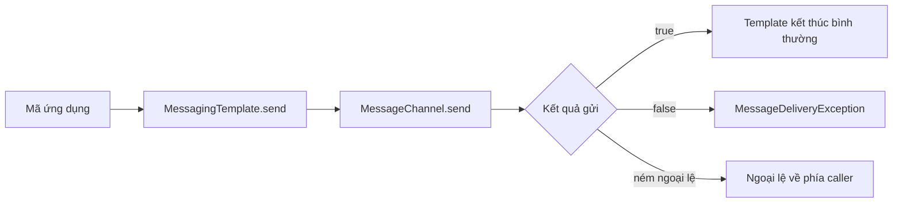
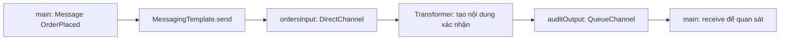

# Gửi thông điệp bằng MessagingTemplate.send

Trong module **SPRING_INTEGRATION_CORE**, `MessagingTemplate` là điểm kết nối khi mã ứng dụng cần chủ động đưa một `Message` vào luồng Spring Integration. Bài thuộc chương **MessagingTemplate**, tập trung vào thao tác **send**: chọn channel đích, tạo thông điệp, cấu hình thời gian chờ và hiểu điều gì xảy ra khi gửi thành công hoặc thất bại.

Tình huống xuyên suốt là tiếp nhận một đơn hàng rồi đưa vào luồng xử lý. Sau bài học, bạn cần phân biệt được ba sự kiện: lời gọi gửi đã kết thúc, channel đã tiếp nhận thông điệp và nghiệp vụ đã hoàn tất. Đây là những mốc có thể trùng nhau trong ví dụ đơn giản nhưng thường tách rời khi luồng có hàng đợi hoặc executor.

## 1. Vai trò và hợp đồng của send

`MessagingTemplate` có tên đầy đủ:

```java
import org.springframework.integration.core.MessagingTemplate;
```

Lớp này kế thừa hạ tầng messaging của Spring Framework. Các dạng gọi chính cho bài học là:

```java
void send(Message<?> message);
void send(MessageChannel destination, Message<?> message);
void send(String destinationName, Message<?> message);
```

| Dạng gọi | Cách xác định đích | Điều kiện sử dụng |
| --- | --- | --- |
| `template.send(message)` | Channel mặc định của template | Đã cấu hình default destination |
| `template.send(channel, message)` | Đối tượng `MessageChannel` truyền trực tiếp | Có tham chiếu channel hợp lệ |
| `template.send("ordersInput", message)` | Phân giải tên thành channel | Template có destination resolver phù hợp |

Hai phương thức đầu được kế thừa từ `AbstractMessageSendingTemplate`; dạng theo tên đến từ `AbstractDestinationResolvingMessagingTemplate`. Tất cả đều trả về `void`. Việc gán `boolean sent = template.send(...)` sẽ không biên dịch. Xem [Javadoc phương thức gửi](https://docs.spring.io/spring-framework/docs/6.2.15/javadoc-api/org/springframework/messaging/core/AbstractMessageSendingTemplate.html) và [API phân giải destination](https://docs.spring.io/spring-framework/docs/current/javadoc-api/org/springframework/messaging/core/AbstractDestinationResolvingMessagingTemplate.html).

`send` nhận một thông điệp đã được tạo. Nó không tự chờ một phản hồi nghiệp vụ. Nếu cần dùng kết quả để quyết định bước xử lý ngay sau đó, hãy xem xét `sendAndReceive` hoặc một messaging gateway có kiểu trả về phù hợp.

### 1.1. Phân biệt với MessageChannel.send

`MessageChannel` cung cấp hợp đồng thấp hơn:

```java
boolean send(Message<?> message);
boolean send(Message<?> message, long timeout);
```

Khi gọi trực tiếp channel, mã ứng dụng có thể nhận `false` khi không gửi được vì một nguyên nhân mà channel biểu diễn bằng giá trị trả về. Channel cũng có thể ném ngoại lệ. `MessagingTemplate` chuyển kết quả `false` từ channel thành `MessageDeliveryException`, vì vậy người gọi template xử lý lỗi bằng ngoại lệ thay vì kiểm tra boolean. Xem [hợp đồng MessageChannel](https://docs.spring.io/spring-framework/docs/current/javadoc-api/org/springframework/messaging/MessageChannel.html) và [cài đặt GenericMessagingTemplate](https://raw.githubusercontent.com/spring-projects/spring-framework/v6.2.15/spring-messaging/src/main/java/org/springframework/messaging/core/GenericMessagingTemplate.java).



Trong sơ đồ, “kết thúc bình thường” chỉ nói về lời gọi gửi theo hành vi của channel và luồng hiện tại. Ví dụ, việc thông điệp đã nằm trong hàng đợi chưa chứng minh rằng một hóa đơn đã được tạo.

## 2. Ví dụ tối thiểu: gửi vào QueueChannel

Ví dụ sau dùng `spring-integration-core` cùng các phụ thuộc Spring tương thích. Không cần khởi động Spring ApplicationContext vì channel được truyền trực tiếp và chưa có endpoint do container quản lý.

```java
import org.springframework.integration.channel.QueueChannel;
import org.springframework.integration.core.MessagingTemplate;
import org.springframework.messaging.Message;
import org.springframework.messaging.support.MessageBuilder;

public class SendToQueueDemo {

    public static void main(String[] args) {
        QueueChannel ordersInput = new QueueChannel(10);

        MessagingTemplate template = new MessagingTemplate();
        template.setSendTimeout(200L);

        Message<String> order = MessageBuilder
                .withPayload("ORDER-1001")
                .setHeader("eventType", "OrderPlaced")
                .setHeader("orderId", "ORDER-1001")
                .build();

        template.send(ordersInput, order);

        Message<?> accepted = ordersInput.receive(0);
        if (accepted == null) {
            throw new IllegalStateException("Không tìm thấy đơn hàng trong queue");
        }

        System.out.println(accepted.getPayload());
        System.out.println(accepted.getHeaders().get("eventType"));
    }
}
```

Kết quả dự kiến:

```text
ORDER-1001
OrderPlaced
```

Diễn biến của ví dụ:

1. `MessageBuilder` tạo một `Message<String>` với payload và các header do ứng dụng đặt.
2. Template gửi thông điệp vào queue còn chỗ trống.
3. Lời gọi `send` kết thúc sau khi queue tiếp nhận.
4. `receive(0)` lấy thông điệp ra ngay nếu có, không chờ thêm.

`QueueChannel(10)` giới hạn số thông điệp có thể nằm trong hàng đợi tại một thời điểm. Channel này không tự tạo consumer. Trong ứng dụng thực tế, cần có mã nhận hoặc endpoint có poller để lấy thông điệp ra xử lý. Việc chưa có consumer không khiến lần gửi đầu tiên thất bại nếu queue vẫn còn chỗ. Xem [QueueChannel](https://docs.spring.io/spring-integration/api/org/springframework/integration/channel/QueueChannel.html).

Phương thức `MessageBuilder.withPayload` và `setHeader` giúp biểu diễn dữ liệu đầu vào rõ ràng. Với payload là một đối tượng nghiệp vụ, nên dùng dữ liệu bất biến hoặc quản lý quyền sửa chặt chẽ, nhất là khi xử lý khác thread. Việc gửi message không tự tạo bản sao sâu của đối tượng payload. Xem [MessageBuilder](https://docs.spring.io/spring-framework/docs/current/javadoc-api/org/springframework/messaging/support/MessageBuilder.html).

## 3. Chọn channel đích

### 3.1. Truyền channel trực tiếp

```java
QueueChannel input = new QueueChannel(20);
MessagingTemplate template = new MessagingTemplate();
template.setSendTimeout(100L);

Message<String> message = MessageBuilder
        .withPayload("ORDER-1002")
        .build();

template.send(input, message);
```

Đây là cách thuận tiện khi thử nghiệm hoặc khi lớp producer được inject một channel cụ thể. Mã không cần phân giải tên, nhưng vẫn phụ thuộc vào abstraction `MessageChannel` của Spring.

### 3.2. Dùng channel mặc định

```java
QueueChannel input = new QueueChannel(20);
MessagingTemplate template = new MessagingTemplate(input);
template.setSendTimeout(100L);

template.send(MessageBuilder.withPayload("ORDER-1003").build());
```

Cũng có thể cấu hình bằng `setDefaultDestination(input)`. `setDefaultChannel(input)` là tên tương thích mà `MessagingTemplate` cung cấp. Channel mặc định chỉ được dùng cho dạng gọi không truyền destination; lời gọi có channel tường minh sử dụng đích được truyền vào. Không cấu hình mặc định rồi gọi `send(message)` sẽ gây lỗi cấu hình. Xem [MessagingTemplate API](https://docs.spring.io/spring-integration/api/org/springframework/integration/core/MessagingTemplate.html).

### 3.3. Dùng tên bean

Template được Spring quản lý sẽ nhận `BeanFactory` qua lifecycle callback. `MessagingTemplate` sử dụng cơ chế phân giải channel của Spring Integration để hỗ trợ các thao tác theo tên.

```java
import org.springframework.context.annotation.Bean;
import org.springframework.context.annotation.Configuration;
import org.springframework.integration.channel.QueueChannel;
import org.springframework.integration.config.EnableIntegration;
import org.springframework.integration.core.MessagingTemplate;

@Configuration
@EnableIntegration
public class NamedChannelConfiguration {

    @Bean
    public QueueChannel ordersInput() {
        return new QueueChannel(100);
    }

    @Bean
    public MessagingTemplate messagingTemplate() {
        MessagingTemplate template = new MessagingTemplate();
        template.setSendTimeout(200L);
        return template;
    }
}
```

Sau khi lấy template từ context:

```java
template.send(
        "ordersInput",
        MessageBuilder.withPayload("ORDER-1004").build());
```

Ở đây `"ordersInput"` là tên bean channel trong context, không phải tên một queue RabbitMQ hoặc Kafka topic. Việc kết nối broker là trách nhiệm của adapter hoặc cấu hình channel tương ứng.

Nếu tự tạo template bằng `new` ngoài container và muốn gửi theo tên, phải cung cấp resolver. Ví dụ với `context` là một ApplicationContext đã được khởi tạo:

```java
import org.springframework.messaging.core.BeanFactoryMessageChannelDestinationResolver;

MessagingTemplate template = new MessagingTemplate();
template.setDestinationResolver(
        new BeanFactoryMessageChannelDestinationResolver(context));
template.setSendTimeout(200L);

template.send(
        "ordersInput",
        MessageBuilder.withPayload("ORDER-1005").build());
```

`BeanFactoryMessageChannelDestinationResolver` tìm bean `MessageChannel` theo tên trong BeanFactory được cung cấp. Sai tên hoặc bean không đúng kiểu là lỗi phân giải đích; tăng timeout không giải quyết được trường hợp đó. Xem [Javadoc resolver](https://docs.spring.io/spring-framework/docs/current/javadoc-api/org/springframework/messaging/core/BeanFactoryMessageChannelDestinationResolver.html).

## 4. Timeout của send thực sự giới hạn điều gì?

### 4.1. Cấu hình trên template

```java
template.setSendTimeout(250L);
```

Đơn vị là mili giây. Khi channel có cơ chế chờ tiếp nhận, có thể hiểu cấu hình như sau:

| Giá trị | Hành vi mong đợi với QueueChannel |
| --- | --- |
| Nhỏ hơn `0` | Không đặt giới hạn chờ; queue đầy có thể làm sender đợi vô hạn |
| Bằng `0` | Thử đưa vào ngay; queue đầy thì không chờ chỗ trống |
| Lớn hơn `0` | Chờ tối đa khoảng thời gian này để có chỗ trong queue |

Trong cài đặt `GenericMessagingTemplate` được tham chiếu, timeout mặc định là `-1`. Nên cấu hình rõ thời gian chờ theo yêu cầu của điểm tiếp nhận. Khi channel trả `false` do hết thời gian chờ, template ném ngoại lệ. Đây là timeout của việc giao cho channel, không phải deadline cho toàn bộ quy trình nghiệp vụ. Xem [mã nguồn xử lý timeout](https://raw.githubusercontent.com/spring-projects/spring-framework/v6.2.15/spring-messaging/src/main/java/org/springframework/messaging/core/GenericMessagingTemplate.java).

### 4.2. Ghi đè theo từng thông điệp

`GenericMessagingTemplate` hỗ trợ header timeout cho từng lần gửi. Tên mặc định của header gửi là `sendTimeout`; có thể dùng hằng số để tránh viết sai:

```java
import org.springframework.messaging.core.GenericMessagingTemplate;

Message<String> urgentOrder = MessageBuilder
        .withPayload("ORDER-URGENT")
        .setHeader(
                GenericMessagingTemplate.DEFAULT_SEND_TIMEOUT_HEADER,
                0L)
        .build();

template.send(ordersInput, urgentOrder);
```

Thông điệp này chọn cách thử gửi ngay, ghi đè cấu hình mặc định của template cho lần gọi đó. Header timeout điều khiển template được loại khỏi thông điệp trước khi chuyển tiếp vào channel; không dùng nó như một header nghiệp vụ cần đi xuyên suốt hệ thống. Xem [GenericMessagingTemplate API](https://docs.spring.io/spring-framework/docs/6.2.15/javadoc-api/org/springframework/messaging/core/GenericMessagingTemplate.html).

Với template dùng chung, nên cấu hình các thuộc tính khi khởi tạo rồi giữ ổn định. Nếu mỗi request có yêu cầu timeout riêng, header giúp thể hiện yêu cầu trên từng message, tránh đổi cấu hình chung ngay trước một lần gửi.

### 4.3. Timeout không ngắt handler đồng bộ

`DirectChannel` gọi handler trên thread của sender. Giả sử handler thực hiện một lời gọi HTTP mất ba giây; `template.setSendTimeout(50L)` không tạo một bộ hẹn giờ để ngắt handler sau 50 mili giây. Thread vẫn có thể bị giữ cho đến khi handler hoàn tất hoặc ném lỗi.

```mermaid
sequenceDiagram
    participant A as Thread ứng dụng
    participant T as MessagingTemplate
    participant C as DirectChannel
    participant H as Handler
    A->>T: send(message)
    T->>C: send(message, timeout)
    C->>H: handleMessage(message)
    Note over A,H: Cùng thread; thời gian handler vẫn nằm trong lời gọi
    H-->>C: kết thúc
    C-->>T: true
    T-->>A: trả về void
```

Vì vậy, thời gian chờ HTTP, JDBC hoặc thao tác I/O cần được cấu hình tại thành phần thực hiện I/O. Deadline nghiệp vụ cũng cần được thiết kế riêng nếu có yêu cầu. Cơ chế cùng thread của `DirectChannel` được mô tả trong [Javadoc DirectChannel](https://docs.spring.io/spring-integration/api/org/springframework/integration/channel/DirectChannel.html).

Một luồng nhiều endpoint cũng có nhiều lần gửi nội bộ. Timeout của template ở đầu luồng không tự áp dụng thành một ngân sách chung cho các lần gửi phía sau.

## 5. Kiểu channel quyết định ý nghĩa của việc gửi thành công

| Channel | Khi gửi được tiếp nhận | Điều caller cần hiểu |
| --- | --- | --- |
| `DirectChannel` | Dispatch đến handler đồng bộ và lời gọi xử lý trả về bình thường | Caller chờ phần xử lý trên cùng thread; luồng vẫn có thể chuyển sang bất đồng bộ ở bước sau |
| `QueueChannel` | Thông điệp được đưa vào queue | Consumer có thể chưa nhận, chưa xử lý hoặc đang dừng |
| `ExecutorChannel` | Dispatch được bàn giao cho executor theo cấu hình | Handler thường chạy ở thread khác; lỗi xử lý sau đó không quay về lời gọi đã kết thúc |
| `PublishSubscribeChannel` | Thỏa điều kiện dispatch và subscriber của cấu hình channel | Không được mặc định suy ra mọi tác dụng phụ đều đã hoàn tất |

`QueueChannel` mặc định lưu trong bộ nhớ. Khi cần dữ liệu sống qua việc khởi động lại tiến trình, phải thiết kế cơ chế lưu bền hoặc sử dụng hạ tầng broker phù hợp. Khả năng đệm thông điệp, điểm chuyển thread và độ bền là những lựa chọn kiến trúc riêng. Xem [các cài đặt MessageChannel](https://docs.spring.io/spring-integration/reference/channel/implementations.html).

`ExecutorChannel` thường tạo ranh giới thread nên transaction gắn với thread của sender không tự trải sang handler. Executor cụ thể và chính sách từ chối tác vụ có thể làm thay đổi cách dispatch; cần xem cấu hình thực tế trước khi kết luận hành vi. Xem [ExecutorChannel](https://docs.spring.io/spring-integration/api/org/springframework/integration/channel/ExecutorChannel.html).

Với đơn hàng, các mốc nên có tên rõ ràng:

- **Đã tiếp nhận:** hệ thống đã nhận lệnh hoặc event ở ranh giới đã định.
- **Đã xử lý:** consumer hoàn thành quy tắc nghiệp vụ.
- **Đã ghi nhận bền vững:** dữ liệu hoặc sự kiện đã được commit vào nơi lưu trữ có bảo đảm phù hợp.

Khi thiết kế API tiếp nhận, chỉ trả trạng thái “đơn hàng đã hoàn tất” nếu thực sự có bằng chứng cho mốc đó. Một lần `send` vào queue chỉ cung cấp bằng chứng về bước tiếp nhận tại queue.

## 6. Gửi vào luồng Java DSL

Ví dụ này ghép producer, message, channel và endpoint transformer trong một chương trình. Dùng Java 17 trở lên với phiên bản Spring Integration tương thích; các dependency Spring nên được quản lý đồng bộ bằng BOM của dự án.



```java
import org.springframework.beans.factory.annotation.Qualifier;
import org.springframework.context.annotation.AnnotationConfigApplicationContext;
import org.springframework.context.annotation.Bean;
import org.springframework.context.annotation.Configuration;
import org.springframework.integration.channel.DirectChannel;
import org.springframework.integration.channel.QueueChannel;
import org.springframework.integration.config.EnableIntegration;
import org.springframework.integration.core.MessagingTemplate;
import org.springframework.integration.dsl.IntegrationFlow;
import org.springframework.messaging.Message;
import org.springframework.messaging.MessageChannel;
import org.springframework.messaging.support.MessageBuilder;

@Configuration
@EnableIntegration
public class SendFlowDemo {

    public record OrderPlaced(String orderId, int quantity) {
    }

    @Bean
    public DirectChannel ordersInput() {
        return new DirectChannel();
    }

    @Bean
    public QueueChannel auditOutput() {
        // Queue để quan sát kết quả trong ví dụ nhỏ.
        return new QueueChannel();
    }

    @Bean
    public MessagingTemplate ordersTemplate(
            @Qualifier("ordersInput") MessageChannel input) {
        MessagingTemplate template = new MessagingTemplate(input);
        template.setSendTimeout(200L);
        return template;
    }

    @Bean
    public IntegrationFlow ordersFlow(
            @Qualifier("ordersInput") MessageChannel input,
            @Qualifier("auditOutput") MessageChannel output) {
        return IntegrationFlow.from(input)
                .transform(
                        OrderPlaced.class,
                        order -> "ACCEPTED:" + order.orderId()
                                + ":quantity=" + order.quantity())
                .channel(output)
                .get();
    }

    public static void main(String[] args) {
        try (var context =
                     new AnnotationConfigApplicationContext(SendFlowDemo.class)) {
            MessagingTemplate template = context.getBean(
                    "ordersTemplate", MessagingTemplate.class);

            Message<OrderPlaced> message = MessageBuilder
                    .withPayload(new OrderPlaced("ORDER-2001", 3))
                    .setHeader("source", "checkout")
                    .build();

            template.send(message);

            QueueChannel output = context.getBean(
                    "auditOutput", QueueChannel.class);
            Message<?> result = output.receive(0);
            if (result == null) {
                throw new IllegalStateException("Luồng chưa tạo kết quả");
            }

            System.out.println(result.getPayload());
        }
    }
}
```

Kết quả dự kiến:

```text
ACCEPTED:ORDER-2001:quantity=3
```

`IntegrationFlow` được đăng ký như bean; container tạo và quản lý các endpoint của luồng. Producer chỉ cần biết channel đầu vào. Transformer chuyển payload `OrderPlaced` thành chuỗi rồi gửi tới channel đầu ra. Xem [Java DSL](https://docs.spring.io/spring-integration/reference/dsl.html).

Trong ví dụ, transformer chạy đồng bộ qua `DirectChannel`. `receive(0)` dùng để quan sát output đã được tạo; đó là một thao tác riêng, không phải giá trị trả về từ `send`. Nếu đổi đầu vào thành `QueueChannel`, cần thêm poller cho endpoint và thay đổi cách chờ kết quả quan sát.

`auditOutput` dùng queue không giới hạn thực tế cho ví dụ nhỏ. Khi đưa mô hình vào ứng dụng lâu dài, cần chọn capacity, consumer và chính sách chờ phù hợp. Nếu output có giới hạn và bị đầy, việc gửi từ endpoint tới output có cấu hình timeout riêng; `200L` ở producer không tự trở thành timeout của endpoint đó.

## 7. Xử lý lỗi tại đúng ranh giới

### 7.1. Lỗi khi giao thông điệp

Ví dụ queue chỉ chứa một phần tử và lần gửi tiếp theo không chờ:

```java
import org.springframework.messaging.MessageDeliveryException;

QueueChannel input = new QueueChannel(1);
MessagingTemplate template = new MessagingTemplate(input);
template.setSendTimeout(0L);

template.send(MessageBuilder.withPayload("ORDER-A").build());

try {
    template.send(MessageBuilder.withPayload("ORDER-B").build());
} catch (MessageDeliveryException ex) {
    System.out.println("Chưa giao được ORDER-B vào queue");
    // Chọn phản hồi quá tải, lưu lại lệnh, hoặc retry có giới hạn.
}
```

`ORDER-A` vẫn ở trong queue; `ORDER-B` chưa được đưa vào queue này. Với tình huống queue đầy đơn giản, caller có thể xử lý quá tải ngay tại biên tiếp nhận.

Không nên diễn giải mọi `MessageDeliveryException` là “không có gì xảy ra”. Với một luồng đồng bộ phức tạp, lỗi có thể phát sinh sau một số tác dụng phụ ở downstream. Khi quyết định retry, cần biết điểm lỗi và khả năng lặp an toàn của nghiệp vụ.

### 7.2. Lỗi từ handler đồng bộ

```java
import org.springframework.integration.channel.DirectChannel;
import org.springframework.messaging.MessagingException;

DirectChannel input = new DirectChannel();
input.subscribe(message -> {
    throw new IllegalArgumentException("Đơn hàng không hợp lệ");
});

MessagingTemplate template = new MessagingTemplate(input);

try {
    template.send(MessageBuilder.withPayload("INVALID-ORDER").build());
} catch (MessagingException ex) {
    System.out.println("Lỗi trong luồng đồng bộ: " + ex.getMessage());
}
```

Với channel và handler đồng bộ, lỗi truyền theo call stack về caller; Spring có thể bọc lỗi nghiệp vụ trong một `MessagingException`. Khi chẩn đoán, cần xem cả cause thay vì chỉ đọc lớp ngoại lệ ngoài cùng.

### 7.3. Lỗi sau khi đã chuyển thread

Nếu sender đã gửi vào queue và trả về, lỗi xảy ra khi consumer xử lý sau đó không thể quay ngược vào khối `try/catch` đã kết thúc. Với các tác vụ bất đồng bộ do Spring Integration quản lý, cơ chế error handling có thể xuất bản `ErrorMessage` tới channel được chỉ định bằng header `errorChannel` hoặc channel lỗi chung. Xem [Error Handling](https://docs.spring.io/spring-integration/reference/error-handling.html).

Chỉ thêm header `errorChannel` không tự biến `MessagingTemplate.send` trên một luồng đồng bộ thành thao tác nuốt lỗi. Cũng không nên kỳ vọng một vòng lặp consumer tự viết ngoài hạ tầng Spring Integration sẽ tự có đầy đủ cơ chế xuất bản lỗi của framework.

Thiết kế xử lý đơn hàng nên tách hai trách nhiệm: phản hồi lỗi tiếp nhận ngay tại caller và theo dõi lỗi xử lý tại consumer. Một event thất bại có thể mang `orderId`, loại lỗi và thông tin truy vết để phục vụ đối soát.

## 8. Kiểm thử hành vi gửi

Các kiểm thử sau dùng JUnit Jupiter. Chúng kiểm tra điều quan sát được tại channel và ranh giới lỗi, không chỉ xác nhận rằng mã đã gọi một mock.

```java
import org.junit.jupiter.api.Test;
import org.springframework.integration.channel.DirectChannel;
import org.springframework.integration.channel.QueueChannel;
import org.springframework.integration.core.MessagingTemplate;
import org.springframework.messaging.Message;
import org.springframework.messaging.MessageDeliveryException;
import org.springframework.messaging.MessagingException;
import org.springframework.messaging.core.GenericMessagingTemplate;
import org.springframework.messaging.support.MessageBuilder;

import static org.junit.jupiter.api.Assertions.assertEquals;
import static org.junit.jupiter.api.Assertions.assertFalse;
import static org.junit.jupiter.api.Assertions.assertNotNull;
import static org.junit.jupiter.api.Assertions.assertNull;
import static org.junit.jupiter.api.Assertions.assertThrows;

class MessagingTemplateSendTest {

    @Test
    void sendsPayloadAndBusinessHeaderToDefaultChannel() {
        QueueChannel input = new QueueChannel(1);
        MessagingTemplate template = new MessagingTemplate(input);
        template.setSendTimeout(0L);

        Message<String> request = MessageBuilder
                .withPayload("ORDER-3001")
                .setHeader("orderId", "ORDER-3001")
                .build();

        template.send(request);

        Message<?> actual = input.receive(0);
        assertNotNull(actual);
        assertEquals("ORDER-3001", actual.getPayload());
        assertEquals("ORDER-3001", actual.getHeaders().get("orderId"));
        assertNull(input.receive(0));
    }

    @Test
    void reportsFailureWithoutReplacingTheQueuedMessage() {
        QueueChannel input = new QueueChannel(1);
        MessagingTemplate template = new MessagingTemplate(input);
        template.setSendTimeout(0L);

        template.send(MessageBuilder.withPayload("FIRST").build());

        assertThrows(
                MessageDeliveryException.class,
                () -> template.send(
                        MessageBuilder.withPayload("SECOND").build()));

        Message<?> remaining = input.receive(0);
        assertNotNull(remaining);
        assertEquals("FIRST", remaining.getPayload());
        assertNull(input.receive(0));
    }

    @Test
    void consumesThePerMessageSendTimeoutHeader() {
        QueueChannel input = new QueueChannel(1);
        MessagingTemplate template = new MessagingTemplate(input);
        template.setSendTimeout(100L);

        Message<String> request = MessageBuilder
                .withPayload("ORDER-3002")
                .setHeader(
                        GenericMessagingTemplate.DEFAULT_SEND_TIMEOUT_HEADER,
                        0L)
                .setHeader("source", "checkout")
                .build();

        template.send(request);

        Message<?> actual = input.receive(0);
        assertNotNull(actual);
        assertFalse(actual.getHeaders().containsKey(
                GenericMessagingTemplate.DEFAULT_SEND_TIMEOUT_HEADER));
        assertEquals("checkout", actual.getHeaders().get("source"));
    }

    @Test
    void propagatesFailureFromASynchronousHandler() {
        DirectChannel input = new DirectChannel();
        input.subscribe(message -> {
            throw new IllegalArgumentException("Sai dữ liệu đơn hàng");
        });
        MessagingTemplate template = new MessagingTemplate(input);

        assertThrows(
                MessagingException.class,
                () -> template.send(
                        MessageBuilder.withPayload("INVALID").build()));
    }
}
```

Các lần nhận dùng `receive(0)` và tình huống quá tải dùng timeout bằng `0` để kiểm thử không phụ thuộc vào `Thread.sleep`. Với luồng bất đồng bộ thực sự, cần chờ kết quả bằng cơ chế có giới hạn và kiểm tra lỗi ở channel tương ứng.

Nếu cần chứng minh header ghi đè timeout, có thể bổ sung một channel kiểm thử ghi nhận tham số timeout được truyền vào. Không nên chứng minh bằng cách đo một khoảng chờ vài mili giây trên máy CI, vì lịch thực thi thread có thể làm kiểm thử thiếu ổn định.

## 9. Các lỗi hiểu sai thường gặp

| Hiểu sai hoặc triệu chứng | Cách giải thích và xử lý |
| --- | --- |
| Gán kết quả `template.send` vào boolean | Template trả `void`; xử lý ngoại lệ khi thất bại |
| Gọi `send(message)` mà chưa có default destination | Cấu hình default channel hoặc truyền đích tường minh |
| Tự `new` template rồi gửi theo tên không được | Cung cấp resolver hoặc dùng bean template do Spring quản lý |
| Queue đã nhận nhưng không thấy nghiệp vụ chạy | Kiểm tra consumer, poller và lifecycle của endpoint |
| Đặt send timeout nhỏ nhưng handler vẫn chạy lâu | Timeout tiếp nhận không ngắt xử lý đồng bộ; kiểm tra timeout I/O |
| Thêm `errorChannel` nhưng caller vẫn nhận lỗi | Xác định ranh giới đồng bộ và nơi framework thực hiện error handling |
| Tăng số subscriber trên `DirectChannel` để broadcast | DirectChannel có ngữ nghĩa point-to-point; cần chọn channel đúng mục đích |
| Gửi xong rồi tiến trình dừng làm mất dữ liệu chờ xử lý | Queue trong bộ nhớ không cung cấp độ bền qua lần khởi động lại |
| Retry làm phát sinh tác dụng phụ nhiều lần | Cần khóa nghiệp vụ hoặc cơ chế idempotency tại điểm thực thi |

Một trường hợp cần chú ý khi chẩn đoán là channel interceptor. `preSend` có thể thay đổi message hoặc ngăn việc gửi bằng cách trả `null`. Vì vậy, khi thông điệp không đến đích, cần kiểm tra cả interceptor và các quy tắc filter thay vì chỉ nhìn trạng thái queue. Xem [Channel Interceptors](https://docs.spring.io/spring-integration/reference/channel/interceptors.html).

## 10. Thiết kế điểm gửi trong ứng dụng

Đối với một producer tiếp nhận đơn hàng, có thể dùng trình tự thiết kế sau:

1. Xác định ý nghĩa nghiệp vụ của message: lệnh yêu cầu xử lý hay sự kiện đã xảy ra.
2. Chọn channel theo nhu cầu cùng thread, đệm, chuyển thread hoặc phát tới nhiều nơi.
3. Tạo payload và header có ý nghĩa, chẳng hạn `orderId`, `eventType` và mã truy vết.
4. Cấu hình timeout tiếp nhận và hành vi khi quá tải.
5. Xác định ai xử lý lỗi tiếp nhận, ai xử lý lỗi consumer và ai đối soát kết quả.
6. Kiểm thử cả nhánh được tiếp nhận và nhánh không được tiếp nhận.

`MessagingTemplate` phù hợp khi lớp producer cần chủ động thao tác với `Message` và `MessageChannel`. Nếu muốn lớp nghiệp vụ gọi một interface như `placeOrder(OrderPlaced order)` mà không trực tiếp tạo message, messaging gateway có thể là ranh giới phù hợp hơn. Việc chọn gateway vẫn không tự thay đổi độ bền hoặc ranh giới thread của các channel phía sau.

Với các luồng có transformer, router, filter hoặc aggregator, lời gọi `send` vẫn là một điểm đưa message vào hệ thống. Điều kiện định tuyến, loại bỏ hoặc gom nhóm thuộc về endpoint tương ứng; producer cần thống nhất hợp đồng đầu vào với luồng đó. Chẳng hạn, một thông điệp đã được tiếp nhận có thể bị filter loại hoặc được aggregator giữ lại để chờ đủ nhóm.

Không suy ra “xử lý đúng một lần” chỉ từ một lần `send` không ném lỗi. Với đơn hàng có thao tác thanh toán hoặc phát hành hóa đơn, hãy thiết kế khóa nghiệp vụ ổn định và cách xử lý lặp phù hợp với nơi thực hiện tác dụng phụ.

## 11. Bài tập thực hành

1. Tạo `QueueChannel(2)`, dùng template có timeout `0` và gửi ba đơn hàng liên tiếp khi chưa có consumer. Ghi nhận hai message đang chờ và ngoại lệ ở lần gửi thứ ba.
2. Nhận một message ra, sau đó gửi lại đơn hàng thứ ba. Giải thích vì sao lần gửi này có thể thành công.
3. Thay cách gửi tường minh bằng default channel, rồi bằng tên bean trong ApplicationContext. Giữ nguyên payload để tập trung quan sát cách xác định destination.
4. Dùng ví dụ Java DSL để tạo chuỗi xác nhận. Xác định endpoint nào tạo kết quả và thao tác nào lấy kết quả ra.
5. Cho handler của `DirectChannel` ném lỗi. Sau đó thiết kế biến thể dùng queue và consumer do Spring Integration quản lý; xác định lỗi xuất hiện ở caller hay ở error channel.

Kết quả cần giải thích được bằng hợp đồng: **`send` đưa một message tới channel theo cách channel đó hoạt động; sự hoàn tất nghiệp vụ cần được xác nhận tại ranh giới phù hợp của luồng.**
