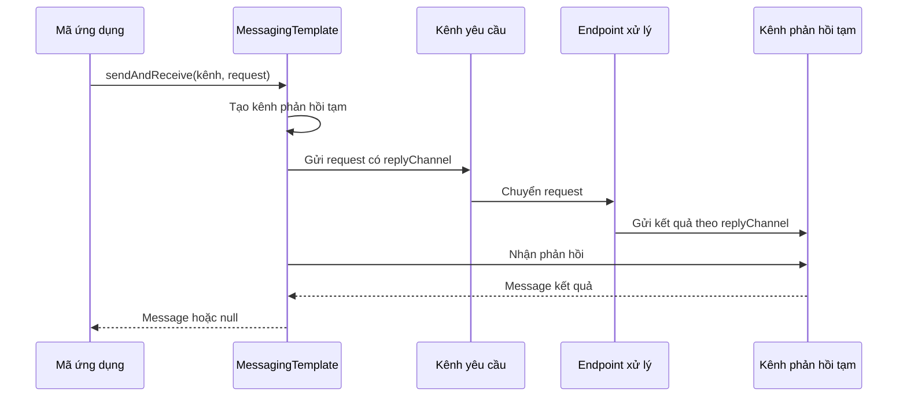

# sendAndReceive với MessagingTemplate

## 1. Mục tiêu và bài toán

Trong Spring Integration, ứng dụng có thể đưa một `Message` vào luồng xử lý rồi chờ kết quả của chính lần gọi đó. `MessagingTemplate.sendAndReceive` cung cấp điểm vào theo mô hình request–reply: gửi yêu cầu tới một `MessageChannel`, đợi phản hồi và trả về một `Message<?>` hoặc `null`.

Ví dụ, màn hình bán hàng cần tính báo giá trước khi xác nhận đơn. Luồng có thể kiểm tra dữ liệu, chuẩn hóa mã sản phẩm, gọi dịch vụ tính giá rồi trả báo giá. Bên gọi chỉ cần biết hợp đồng yêu cầu, hợp đồng phản hồi và kênh đầu vào. Template phù hợp khi mã ứng dụng cần làm việc trực tiếp với message và header. Đây là cách sử dụng được mô tả trong [tài liệu MessagingTemplate](https://docs.spring.io/spring-integration/reference/channel/template.html).

Sau bài này, bạn có thể:

- Tạo request, gọi `sendAndReceive` và xử lý đủ các kết quả.
- Giải thích vai trò của `replyChannel` tạm và cách endpoint trả lời.
- Phân biệt thời gian gửi, thời gian chờ phản hồi và thời gian chạy nghiệp vụ.
- Thiết kế luồng Java DSL có phản hồi rõ ràng, kể cả khi đầu vào bị từ chối.
- Nhận diện khác biệt giữa exception đồng bộ và error message bất đồng bộ.
- Viết kiểm thử cho hợp đồng request–reply.

Bài thuộc phạm vi **Spring Integration Core**. Các ví dụ dùng API Java DSL với `IntegrationFlow.from(...)`, cú pháp Java 17 như `record` và pattern matching cho `instanceof`. Chọn JDK phù hợp với phiên bản Spring của dự án; Java 17 là mức cú pháp của ví dụ, không phải cam kết về JDK tối thiểu của mọi phiên bản Spring Integration.

## 2. Hợp đồng của lời gọi

### 2.1. API cơ bản

Import đúng template của Spring Integration:

```java
import org.springframework.integration.core.MessagingTemplate;
import org.springframework.messaging.Message;
import org.springframework.messaging.MessageChannel;
import org.springframework.messaging.support.MessageBuilder;
```

Một cách gọi điển hình:

```java
MessagingTemplate template = new MessagingTemplate();
template.setSendTimeout(200);
template.setReceiveTimeout(1_500);

Message<String> request = MessageBuilder.withPayload("SKU-101")
        .setHeader("requestId", "quote-2026-001")
        .build();

Message<?> reply = template.sendAndReceive(requestChannel, request);
```

Ở đây, `requestChannel` là một `MessageChannel` đã được cấu hình và có consumer phù hợp. Các giá trị timeout tính bằng mili giây.

Chữ ký quan trọng:

```java
Message<?> sendAndReceive(
        MessageChannel destination,
        Message<?> requestMessage);
```

Kết quả có thể là `null`; hết thời gian chờ là trường hợp phổ biến, nhưng thao tác chờ bị interrupt cũng có thể kết thúc mà không có reply. Không được gọi ngay `getPayload()` mà chưa kiểm tra. Kiểu trả về cũng không đảm bảo payload thuộc lớp nghiệp vụ bạn mong đợi. Thông tin về chữ ký và quan hệ kế thừa nằm trong [Javadoc MessagingTemplate](https://docs.spring.io/spring-integration/docs/current/api/org/springframework/integration/core/MessagingTemplate.html).

### 2.2. Bốn kết quả cần phân biệt

| Kết quả quan sát được | Ý nghĩa ở phía gọi | Cách xử lý trong ví dụ báo giá |
| --- | --- | --- |
| Message chứa `QuoteReply` hợp lệ | Đã nhận được kết quả theo hợp đồng | Hiển thị báo giá hoặc lý do từ chối |
| `null` | Không nhận được phản hồi trong lần chờ này | Báo chưa có kết quả, ghi nhận request để điều tra |
| Exception được ném trong lời gọi | Gửi thất bại hoặc lỗi trên đường xử lý đồng bộ | Phân loại lỗi và chuyển thành lỗi ứng dụng |
| Message chứa thông tin lỗi | Một đường xử lý đã gửi lỗi về như dữ liệu message | Kiểm tra lỗi trước khi ép kiểu payload nghiệp vụ |

Bảng này là hợp đồng ứng dụng nên thiết kế. `null` không chứng minh yêu cầu chưa được xử lý, và một message bất kỳ cũng không chứng minh nghiệp vụ thành công.

### 2.3. Cấu hình destination

Có thể truyền kênh trực tiếp trong từng lần gọi, hoặc thiết lập kênh mặc định:

```java
template.setDefaultChannel(requestChannel);
Message<?> reply = template.sendAndReceive(request);
```

Trong ứng dụng Spring, template được quản lý dưới dạng bean còn có thể phân giải tên kênh:

```java
Message<?> reply = template.sendAndReceive("quoteRequests", request);
```

Dạng tên kênh cần destination resolver được thiết lập đúng. Khởi tạo `new MessagingTemplate()` bên ngoài Spring rồi truyền một tên bean chưa đủ để template tự tìm thấy application context. Dùng đối tượng kênh trực tiếp giúp ví dụ độc lập với cơ chế phân giải tên.

## 3. Request được nối với reply như thế nào?

### 3.1. Kênh phản hồi tạm cho từng lần gọi

Khi thực hiện request–reply, template tạo kênh tạm nội bộ và đưa nó vào header `replyChannel` của message gửi xuống luồng.



Thứ tự trên minh họa trường hợp xử lý đồng bộ: endpoint có thể gửi reply trước khi template bắt đầu thao tác nhận. Khi có executor hoặc queue, template thường bắt đầu chờ trong khi worker đang xử lý.

Kênh yêu cầu có thể là `DirectChannel`; không cần là `PollableChannel`. Chính kênh tạm nội bộ mới là nơi template nhận reply. Việc tách này giải thích vì sao `sendAndReceive(directChannel, request)` hợp lệ, dù gọi `receive(directChannel)` không hợp lệ. Cơ chế tạo kênh tạm được giới thiệu trong [tài liệu MessagingTemplate](https://docs.spring.io/spring-integration/reference/channel/template.html).

### 3.2. Endpoint phải tạo đầu ra

Một service activator cuối luồng có thể trả về payload. Nếu không có output channel được chỉ định, endpoint dùng `replyChannel` trong message đầu vào để gửi kết quả. Xem [quy tắc trả kết quả của service activator](https://docs.spring.io/spring-integration/reference/service-activator.html).

```java
return IntegrationFlow.from(quoteRequests)
        .<String, String>transform(String::trim)
        .handle(String.class, (sku, headers) -> "QUOTE:" + sku)
        .get();
```

Trong đoạn này, giá trị trả về của `handle` là dữ liệu trả lời. Nếu thay handler bằng một consumer chỉ ghi log và không sinh đầu ra, caller sẽ không nhận được báo giá.

Tương tự, nếu thêm `.channel("auditOnly")` ở cuối, kết quả được gửi tới kênh đó. Cần có consumer tiếp tục trả kết quả về đúng tuyến reply; một queue chỉ lưu message không tự chuyển nó vào kênh tạm.

### 3.3. Header định tuyến và header nghiệp vụ

| Header | Vai trò |
| --- | --- |
| `MessageHeaders.REPLY_CHANNEL` | Địa chỉ để thành phần trả lời gửi kết quả |
| `MessageHeaders.ERROR_CHANNEL` | Địa chỉ được cơ chế xử lý lỗi dùng khi phát error message |
| `requestId` trong bài | Mã theo dõi do ứng dụng tự định nghĩa |
| `IntegrationMessageHeaderAccessor.CORRELATION_ID` | Header chuẩn thường dùng để gom nhóm ở aggregator |

Không cần tự đặt `correlationId` chỉ để một lần `sendAndReceive` thông thường trả đúng caller. Kênh tạm riêng của lần gọi đã cung cấp tuyến trả lời. Tuy nhiên, request ID nghiệp vụ vẫn hữu ích để tra cứu log, chống xử lý lặp và đối chiếu kết quả.

Trong triển khai của `GenericMessagingTemplate`, request được gửi đi với cả `replyChannel` và `errorChannel` trỏ tới kênh tạm. Khi có reply, template khôi phục hai header này theo giá trị trước khi gọi. Vì vậy, không nên giả định `errorChannel` tự gắn vào request luôn được giữ nguyên bên trong cuộc trao đổi. Chi tiết này có thể xem tại [mã nguồn GenericMessagingTemplate](https://github.com/spring-projects/spring-framework/blob/main/spring-messaging/src/main/java/org/springframework/messaging/core/GenericMessagingTemplate.java).

Khi viết endpoint tùy chỉnh, tránh tạo message hoàn toàn mới rồi bỏ mất các header cần để trả lời. Các endpoint chuẩn thường hỗ trợ truyền header; mã tự xây message hoặc đi qua bộ chuyển đổi vẫn cần được kiểm tra theo hợp đồng cụ thể.

## 4. Timeout và ranh giới thực thi

### 4.1. Hai timeout có hai phạm vi

| Thuộc tính | Điều khiển | Không đảm bảo |
| --- | --- | --- |
| `sendTimeout` | Thời gian chờ thao tác gửi khi kênh hỗ trợ chờ, chẳng hạn queue có giới hạn đang đầy | Cắt ngang handler đang chạy trên caller thread |
| `receiveTimeout` | Thời gian chờ nhận trên kênh phản hồi tạm sau khi thao tác gửi kết thúc | Giới hạn tổng thời gian nghiệp vụ hoặc tự hủy xử lý |

API kênh phân biệt việc gửi và nhận; xem [MessageChannel](https://docs.spring.io/spring-framework/docs/current/javadoc-api/org/springframework/messaging/MessageChannel.html) và [PollableChannel](https://docs.spring.io/spring-framework/docs/current/javadoc-api/org/springframework/messaging/PollableChannel.html).

Trong các thao tác này, giá trị âm biểu thị chờ không giới hạn, `0` biểu thị không chờ, giá trị dương là giới hạn chờ. Ví dụ luôn đặt timeout hữu hạn để tránh giữ caller vô thời hạn. Với `receiveTimeout = 0`, reply đồng bộ đã được tạo trong bước gửi vẫn có thể được lấy ngay.

### 4.2. DirectChannel không biến timeout thành deadline

Giả sử endpoint gọi dịch vụ tính giá mất ba giây:

```text
caller thread:
  gửi vào DirectChannel
    -> handler chạy ba giây
    -> handler trả reply
  thao tác gửi kết thúc
  template nhận reply đã có sẵn
```

Đặt `receiveTimeout = 100` không buộc lời gọi kết thúc sau 100 ms. Caller đang trực tiếp chạy handler và chỉ chuyển sang chờ reply sau khi việc gửi trả về. Đặt `sendTimeout = 100` cũng không cung cấp cơ chế ngắt phương thức Java đó.

Đây là ranh giới cần hiểu khi áp dụng timeout: nó phụ thuộc vị trí chuyển thread. [Tài liệu gateway về timeout](https://docs.spring.io/spring-integration/reference/gateway.html#gateway-timeouts) cũng giải thích việc đồng hồ chờ phản hồi bắt đầu khi thread quay lại điểm gọi.

### 4.3. QueueChannel và ExecutorChannel

- Với `QueueChannel`, gửi thành công thường chỉ có nghĩa message đã vào queue. Phải có consumer, thường là endpoint có poller, để lấy request ra.
- Với `ExecutorChannel`, executor có thể chạy handler trên worker thread. Caller có thể chờ reply đồng thời với công việc đó.
- Cần xét chính sách executor: executor chạy trực tiếp hoặc rejection policy thực thi trên caller có thể làm thay đổi ranh giới thread.

Các đặc tính gửi, nhận và chuyển thread nằm trong [tài liệu triển khai message channel](https://docs.spring.io/spring-integration/reference/channel/implementations.html).

Với xử lý thực sự bất đồng bộ, mô hình thời gian gần đúng là:

```text
Tổng thời gian phía gọi
  ≈ thời gian thực hiện gửi
    + thời gian chờ nhận phản hồi
    + chi phí điều phối
```

Đây không phải SLA cứng: hệ điều hành, executor, thao tác gửi và công việc đồng bộ trong luồng đều ảnh hưởng thời gian quan sát được.

### 4.4. Ghi đè timeout cho một request

Không đổi cấu hình bean dùng chung chỉ để phục vụ một lần gọi. Dùng header timeout được template hỗ trợ:

```java
Message<String> urgentRequest = MessageBuilder.withPayload("SKU-101")
        .setHeader(MessagingTemplate.DEFAULT_SEND_TIMEOUT_HEADER, 50L)
        .setHeader(MessagingTemplate.DEFAULT_RECEIVE_TIMEOUT_HEADER, 300L)
        .setHeader("requestId", "quote-urgent-001")
        .build();

Message<?> reply = template.sendAndReceive(requestChannel, urgentRequest);
```

Theo mặc định, hai tên header tương ứng là `sendTimeout` và `receiveTimeout`. Template lấy giá trị cho cuộc trao đổi rồi loại chúng khỏi message gửi xuống; chúng không phải deadline tự động truyền qua tất cả các bước. Tên header cũng có thể được cấu hình lại trên template. Xem [Javadoc các timeout header](https://docs.spring.io/spring-framework/docs/current/javadoc-api/org/springframework/messaging/core/GenericMessagingTemplate.html).

### 4.5. Timeout không hủy công việc

Nếu caller hết thời gian chờ trong khi worker đang gọi hệ thống khác, worker vẫn có thể tiếp tục và tạo tác dụng phụ. Với nghiệp vụ trừ tồn kho hay thanh toán, nên có khóa idempotency, trạng thái xử lý tra cứu được và timeout riêng ở HTTP client hoặc JDBC khi phù hợp.

Không tự retry một yêu cầu có tác dụng phụ chỉ vì nhận `null`. Trước hết phải biết lần trước chưa chạy, đã chạy, hay đang chạy. Đối với bài báo giá chỉ đọc, retry dễ quản lý hơn, nhưng vẫn cần tính tới tải phát sinh.

## 5. Ví dụ đầy đủ: tính báo giá bằng Java DSL

### 5.1. Phụ thuộc và cách tổ chức

Ví dụ cần `org.springframework.integration:spring-integration-core`. Nếu dự án đã dùng Spring Boot với dependency management tương ứng, có thể khai báo:

```xml
<dependency>
    <groupId>org.springframework.integration</groupId>
    <artifactId>spring-integration-core</artifactId>
</dependency>
```

Nếu không có BOM hoặc parent quản lý version, phải chỉ định phiên bản tương thích với Spring Framework của dự án. Đoạn dependency trên không phải một file Maven hoàn chỉnh.

Lưu mã sau vào `QuoteRequestReplyDemo.java` trong dự án học tập. Ví dụ dùng application context độc lập, không cần web server hoặc message broker.

### 5.2. Cấu hình luồng và gọi từ ứng dụng

```java
import java.math.BigDecimal;
import java.util.Locale;

import org.springframework.context.annotation.AnnotationConfigApplicationContext;
import org.springframework.context.annotation.Bean;
import org.springframework.context.annotation.Configuration;
import org.springframework.integration.channel.DirectChannel;
import org.springframework.integration.config.EnableIntegration;
import org.springframework.integration.core.MessagingTemplate;
import org.springframework.integration.dsl.IntegrationFlow;
import org.springframework.messaging.Message;
import org.springframework.messaging.MessageChannel;
import org.springframework.messaging.MessagingException;
import org.springframework.messaging.support.ErrorMessage;
import org.springframework.messaging.support.MessageBuilder;

public class QuoteRequestReplyDemo {

    public record QuoteRequest(String sku, int quantity) {
    }

    public record QuoteReply(
            String requestId,
            String sku,
            int quantity,
            boolean accepted,
            BigDecimal total,
            String reason) {
    }

    @Configuration
    @EnableIntegration
    public static class QuoteConfiguration {

        @Bean
        public DirectChannel quoteRequests() {
            return new DirectChannel();
        }

        @Bean
        public MessagingTemplate quoteTemplate() {
            MessagingTemplate template = new MessagingTemplate();
            template.setSendTimeout(200);
            template.setReceiveTimeout(1_000);
            template.setThrowExceptionOnLateReply(true);
            return template;
        }

        @Bean
        public IntegrationFlow quoteFlow(DirectChannel quoteRequests) {
            return IntegrationFlow.from(quoteRequests)
                    .<QuoteRequest, QuoteRequest>transform(request ->
                            new QuoteRequest(
                                    request.sku().trim()
                                            .toUpperCase(Locale.ROOT),
                                    request.quantity()))
                    .handle(
                            QuoteRequest.class,
                            (request, headers) -> createQuote(
                                    request,
                                    (String) headers.get("requestId")),
                            endpoint -> endpoint.requiresReply(true))
                    .get();
        }

        private QuoteReply createQuote(
                QuoteRequest request, String requestId) {

            if (request.quantity() <= 0) {
                return new QuoteReply(
                        requestId, request.sku(), request.quantity(),
                        false, BigDecimal.ZERO,
                        "QUANTITY_MUST_BE_POSITIVE");
            }

            if (!"SKU-101".equals(request.sku())) {
                return new QuoteReply(
                        requestId, request.sku(), request.quantity(),
                        false, BigDecimal.ZERO,
                        "UNKNOWN_SKU");
            }

            BigDecimal total = new BigDecimal("125000")
                    .multiply(BigDecimal.valueOf(request.quantity()));

            return new QuoteReply(
                    requestId, request.sku(), request.quantity(),
                    true, total, "OK");
        }
    }

    public static QuoteReply askForQuote(
            MessagingTemplate template,
            MessageChannel channel,
            QuoteRequest payload,
            String requestId) {

        if (payload == null
                || payload.sku() == null
                || payload.sku().isBlank()) {
            throw new IllegalArgumentException("Phải có mã sản phẩm");
        }
        if (requestId == null || requestId.isBlank()) {
            throw new IllegalArgumentException("Phải có requestId");
        }

        Message<QuoteRequest> request = MessageBuilder
                .withPayload(payload)
                .setHeader("requestId", requestId)
                .build();

        Message<?> reply;
        try {
            reply = template.sendAndReceive(channel, request);
        }
        catch (MessagingException ex) {
            throw new IllegalStateException(
                    "Không thực hiện được yêu cầu " + requestId, ex);
        }

        if (reply == null) {
            throw new IllegalStateException(
                    "Chưa nhận được báo giá cho " + requestId);
        }

        if (reply instanceof ErrorMessage error) {
            throw new IllegalStateException(
                    "Luồng xử lý báo lỗi cho " + requestId,
                    error.getPayload());
        }

        if (!(reply.getPayload() instanceof QuoteReply result)) {
            throw new IllegalStateException(
                    "Sai kiểu phản hồi cho " + requestId + ": "
                            + reply.getPayload().getClass().getName());
        }

        if (!requestId.equals(result.requestId())) {
            throw new IllegalStateException(
                    "Phản hồi không khớp yêu cầu " + requestId);
        }

        return result;
    }

    public static void main(String[] args) {
        try (var context = new AnnotationConfigApplicationContext(
                QuoteConfiguration.class)) {

            MessagingTemplate template = context.getBean(
                    "quoteTemplate", MessagingTemplate.class);
            MessageChannel channel = context.getBean(
                    "quoteRequests", MessageChannel.class);

            QuoteReply quote = askForQuote(
                    template, channel,
                    new QuoteRequest(" sku-101 ", 2),
                    "quote-001");

            System.out.println(quote.requestId()); // quote-001
            System.out.println(quote.sku());       // SKU-101
            System.out.println(quote.accepted());  // true
            System.out.println(quote.total());     // 250000

            QuoteReply rejected = askForQuote(
                    template, channel,
                    new QuoteRequest("SKU-101", 0),
                    "quote-002");

            System.out.println(rejected.accepted()); // false
            System.out.println(rejected.reason());
            // QUANTITY_MUST_BE_POSITIVE
        }
    }
}
```

### 5.3. Vì sao luồng này trả lời được?

`@EnableIntegration` bật hạ tầng Spring Integration. Bean `IntegrationFlow` mô tả các endpoint và kết nối giữa chúng; luồng cần được đăng ký trong context, không chỉ được tạo thành một đối tượng Java rồi bỏ đó. Vai trò cấu hình của DSL được trình bày trong [tài liệu Java DSL](https://docs.spring.io/spring-integration/reference/dsl.html).

Trong ví dụ:

1. Caller xây `Message<QuoteRequest>` và thêm `requestId`.
2. Template gắn tuyến trả lời rồi gửi vào `quoteRequests`.
3. Transformer chuẩn hóa SKU, vẫn để các endpoint chuẩn quản lý việc truyền header.
4. Service activator tính giá và luôn trả `QuoteReply`.
5. Endpoint cuối không chỉ định output channel nên gửi kết quả theo tuyến reply.
6. Caller kiểm tra phản hồi rồi trả kết quả nghiệp vụ.

`requiresReply(true)` giúp phát hiện trường hợp handler đó trả `null` ngoài dự kiến. Nó không buộc mọi router, filter hay endpoint khác trong toàn bộ luồng phải có reply.

Từ chối nghiệp vụ như số lượng không hợp lệ được biểu diễn bằng `QuoteReply.accepted = false`. Nhờ vậy, giao diện phân biệt được “không bán sản phẩm này” với “chưa nhận được phản hồi”. `BigDecimal.ZERO` là quy ước của ví dụ khi không có báo giá; hợp đồng thực tế có thể chọn một kiểu kết quả tách biệt.

`requestId` được đưa cả vào payload trả lời để minh họa kiểm tra hợp đồng. Có thể dùng header để theo dõi ở tầng hạ tầng, nhưng không nên biến địa chỉ kênh phản hồi thành mã định danh nghiệp vụ.

## 6. Giữ hợp đồng request–reply qua các mẫu EIP

Một luồng dài vẫn cần trả về một kết quả cuối cho từng yêu cầu. Sự hiện diện của template không tự làm mọi nhánh trở thành request–reply.

### 6.1. Transformer

Transformer phù hợp cho bước chuẩn hóa, chuyển đổi dữ liệu hoặc định dạng kết quả. Khi dùng lambda trên payload, hãy khai báo rõ kiểu vào và ra nếu cần:

```java
.<QuoteRequest, QuoteRequest>transform(request ->
        new QuoteRequest(
                request.sku().trim().toUpperCase(Locale.ROOT),
                request.quantity()))
```

Nếu muốn đọc toàn bộ message, dùng overload hỗ trợ kiểu `Message.class`; không mặc định coi tham số của lambda chuyển đổi payload là một message. [DSL Basics](https://docs.spring.io/spring-integration/reference/dsl/java-basics.html) giải thích khác biệt này.

### 6.2. Filter

Filter từ chối request có thể kết thúc nhánh mà không tạo phản hồi. Hai cách thiết kế thường gặp:

- Coi đầu vào không hợp lệ là lỗi và bật `throwExceptionOnRejection(true)`.
- Gửi request bị từ chối tới discard flow, nơi tạo phản hồi từ chối nghiệp vụ.

Ví dụ cấu hình minh họa, thay cho bước kiểm tra số lượng trong handler:

```java
return IntegrationFlow.from(quoteRequests)
        .filter(
                QuoteRequest.class,
                request -> request.quantity() > 0,
                endpoint -> endpoint.throwExceptionOnRejection(true))
        .handle(
                QuoteRequest.class,
                (request, headers) -> createQuote(
                        request, (String) headers.get("requestId")))
        .get();
```

Đoạn này đặt trong lớp cấu hình có sẵn `createQuote`. Nhánh từ chối bây giờ phát lỗi thay vì trả `QuoteReply.accepted = false`. Cần chọn một hợp đồng nhất quán. Nếu dùng discard flow chỉ để ghi log, caller vẫn thiếu phản hồi. Các tùy chọn từ chối được mô tả trong [tài liệu Filter](https://docs.spring.io/spring-integration/reference/filter.html).

### 6.3. Router

Với router, vẽ rõ các nhánh: hàng trong nước, hàng nhập khẩu, không hỗ trợ. Mỗi nhánh phải trả kết quả cuối, chuyển tới một nhánh phản hồi chung hoặc phát lỗi có chủ đích.

Đừng gửi nhánh “không hỗ trợ” vào `nullChannel` rồi kỳ vọng caller nhận được thông báo từ chối. Việc bỏ message và việc tạo một phản hồi từ chối là hai hành động khác nhau.

### 6.4. Splitter và aggregator

Nếu cần hỏi ba nhà cung cấp để trả một báo giá tổng hợp, cấu trúc có thể là:

```text
request báo giá
  -> tách thành các yêu cầu nhà cung cấp
  -> gọi từng nhà cung cấp
  -> gom kết quả cùng nhóm
  -> chọn hoặc tổng hợp báo giá
  -> một reply cuối
```

Aggregator giữ trạng thái nhóm, dùng correlation để gom message và release strategy để quyết định khi nào sinh đầu ra. Mặc định liên quan tới `correlationId` và thông tin sequence; xem [tài liệu Aggregator](https://docs.spring.io/spring-integration/reference/aggregator.html).

Khi đưa aggregator vào request–reply, cần thiết kế thêm:

- Timeout nhóm và chính sách khi thiếu một nhà cung cấp.
- Cách giữ tuyến reply nhất quán cho nhóm.
- Sự tương quan giữa thời gian hoàn tất nhóm và thời gian caller chờ.
- Cách xử lý kết quả đến sau khi caller đã rời đi.

Không dùng kênh tạm của template làm nơi gom nhiều reply. Hợp đồng của lần gọi là một phản hồi cuối; việc tổng hợp thuộc trách nhiệm của luồng.

## 7. Lỗi đồng bộ và lỗi bất đồng bộ

### 7.1. Exception trên caller thread

Với chuỗi xử lý chạy qua `DirectChannel`, lỗi từ endpoint thường đi ngược call stack về `sendAndReceive`. Lỗi nghiệp vụ có thể được Spring bọc trong `MessagingException`, chẳng hạn `MessageHandlingException`.

Vì vậy, kiểm tra kiểu lỗi và nguyên nhân thay vì chỉ dựa vào một exception con cố định:

```java
try {
    Message<?> reply = template.sendAndReceive(channel, request);
    // Kiểm tra null, error message và kiểu payload tại đây.
}
catch (MessagingException ex) {
    Throwable cause = ex.getCause();
    // Ghi requestId, loại lỗi và nguyên nhân phù hợp.
    throw new IllegalStateException("Luồng tích hợp thất bại", ex);
}
```

Nếu kênh từ chối gửi, template có thể ném `MessageDeliveryException`. Đây khác với việc gửi thành công nhưng không có reply.

### 7.2. Lỗi trên worker thread

Sau khi chuyển thread, một exception không thể tự đi ngược call stack vốn thuộc thread khác. Các thành phần bất đồng bộ của Spring Integration có thể công bố lỗi thành `ErrorMessage`, với `Throwable` làm payload. Nơi nhận được xác định qua `errorChannel` và cấu hình xử lý lỗi. Xem [tài liệu Error Handling](https://docs.spring.io/spring-integration/reference/error-handling.html).

Trong cuộc trao đổi của template, tuyến lỗi tạm có thể đưa `ErrorMessage` về cùng điểm nhận reply. Bản thân `MessagingTemplate.sendAndReceive` không áp dụng mọi quy tắc chuyển lỗi của messaging gateway để tự ném lại payload lỗi. Caller cần kiểm tra:

```java
if (reply instanceof ErrorMessage error) {
    throw new IllegalStateException(
            "Xử lý bất đồng bộ thất bại",
            error.getPayload());
}
```

Cách kiểm tra này cũng xuất hiện trong ví dụ đầy đủ. Với hợp đồng tùy chỉnh cho phép message mang `Throwable` nhưng không dùng `ErrorMessage`, cần xử lý thêm trường hợp đó.

Không phải bất kỳ tác vụ Java tự tạo nào cũng được Spring tự chuyển exception thành message. Nếu tự gọi `executor.submit(...)` ngoài endpoint của framework, phải tự nối kết quả và lỗi về luồng phù hợp.

### 7.3. Tránh hiểu sai errorChannel

Chỉ gắn một `errorChannel` vào request không bảo đảm mọi lỗi sẽ đi tới kênh giám sát đó:

- Lỗi trên caller thread vẫn có thể được ném trực tiếp.
- Template có tuyến lỗi tạm cho cuộc trao đổi hiện tại.
- Error handler hoặc advice tùy chỉnh có thể đổi đường đi hay biến lỗi thành kết quả.
- Nếu luồng lỗi chỉ ghi log và kết thúc, caller có thể chờ đến timeout.

Nếu cần vừa giám sát vừa phản hồi, hãy thiết kế đường lỗi thực hiện cả hai nhiệm vụ. Thông báo lỗi nghiệp vụ nên là dữ liệu có cấu trúc; exception hạ tầng cần giữ nguyên nguyên nhân để chẩn đoán.

## 8. Reply đến muộn và phản hồi nhiều lần

Giả sử caller chờ 300 ms, còn worker mất 800 ms. Khi worker gửi reply, caller có thể đã trả về `null`. Reply đến muộn không làm lời gọi cũ sống lại.

Có thể đặt chính sách rõ ràng:

```java
template.setThrowExceptionOnLateReply(true);
```

Khi bật, việc gửi vào kênh tạm đã không còn được chờ có thể phát `MessageDeliveryException` tại **thread gửi reply**. Caller đã kết thúc không nhận exception đó theo cách hồi tố. Khi tắt, cơ chế này ghi cảnh báo thay vì ném thêm lỗi. Các trường hợp nhận reply muộn được minh họa trong [kiểm thử GenericMessagingTemplate của Spring Framework](https://github.com/spring-projects/spring-framework/blob/main/spring-messaging/src/test/java/org/springframework/messaging/core/GenericMessagingTemplateTests.java).

Cấu hình toàn cục của Spring Integration cũng có thuộc tính `spring.integration.messagingTemplate.throwExceptionOnLateReply`; [tài liệu Global Properties](https://docs.spring.io/spring-integration/reference/configuration/global-properties.html) liệt kê mặc định là `false`. Ví dụ chủ động gọi setter để người học không phải dựa vào cấu hình bên ngoài.

Kênh tạm phục vụ một reply cho một lần gọi, không phải một stream. Việc nhiều nhánh cùng gửi reply không có hợp đồng chọn kết quả hay thứ tự đáng tin cậy; nếu cần nhiều kết quả, hãy gom thành một payload hoặc chọn API streaming phù hợp.

Với tác vụ dài cần nhận kết quả sau khi caller rời đi, nên thiết kế request ID, lưu trạng thái và một kênh kết quả độc lập. Kênh tạm nội bộ không phải hộp thư bền vững.

## 9. Kiểm thử hợp đồng request–reply

Các kiểm thử sau dùng JUnit Jupiter và đặt cùng package với `QuoteRequestReplyDemo`. Cần dependency `org.junit.jupiter:junit-jupiter` ở test scope và cấu hình chạy JUnit 5 của dự án.

Nên kiểm tra kết quả quan sát được thay vì khẳng định lời gọi luôn mất chính xác một số mili giây. Các trường hợp không có consumer bên dưới dùng timeout bằng `0` để không phụ thuộc lịch chạy của hệ điều hành.

```java
import java.math.BigDecimal;

import org.junit.jupiter.api.Test;
import org.springframework.context.annotation.AnnotationConfigApplicationContext;
import org.springframework.integration.channel.DirectChannel;
import org.springframework.integration.channel.QueueChannel;
import org.springframework.integration.core.MessagingTemplate;
import org.springframework.messaging.Message;
import org.springframework.messaging.MessageChannel;
import org.springframework.messaging.MessageDeliveryException;
import org.springframework.messaging.MessageHandlingException;
import org.springframework.messaging.support.ErrorMessage;
import org.springframework.messaging.support.GenericMessage;

import static org.junit.jupiter.api.Assertions.*;

class MessagingTemplateRequestReplyTest {

    @Test
    void returnsQuoteAndBusinessRejection() {
        try (var context = new AnnotationConfigApplicationContext(
                QuoteRequestReplyDemo.QuoteConfiguration.class)) {

            MessagingTemplate template = context.getBean(
                    "quoteTemplate", MessagingTemplate.class);
            MessageChannel channel = context.getBean(
                    "quoteRequests", MessageChannel.class);

            var accepted = QuoteRequestReplyDemo.askForQuote(
                    template, channel,
                    new QuoteRequestReplyDemo.QuoteRequest(
                            " sku-101 ", 2),
                    "test-001");

            assertEquals("test-001", accepted.requestId());
            assertEquals("SKU-101", accepted.sku());
            assertTrue(accepted.accepted());
            assertEquals(
                    0,
                    new BigDecimal("250000")
                            .compareTo(accepted.total()));

            var rejected = QuoteRequestReplyDemo.askForQuote(
                    template, channel,
                    new QuoteRequestReplyDemo.QuoteRequest(
                            "SKU-101", 0),
                    "test-002");

            assertFalse(rejected.accepted());
            assertEquals(
                    "QUANTITY_MUST_BE_POSITIVE",
                    rejected.reason());
        }
    }

    @Test
    void returnsNullWhenRequestIsQueuedButNoReplyExists() {
        QueueChannel requests = new QueueChannel(1);
        MessagingTemplate template = new MessagingTemplate();
        template.setSendTimeout(0);
        template.setReceiveTimeout(0);

        Message<?> reply = template.sendAndReceive(
                requests, new GenericMessage<>("request"));

        assertNull(reply);
        assertNotNull(requests.receive(0));
    }

    @Test
    void throwsWhenBoundedQueueCannotAcceptRequest() {
        QueueChannel requests = new QueueChannel(1);
        assertTrue(requests.send(
                new GenericMessage<>("already-full"), 0));

        MessagingTemplate template = new MessagingTemplate();
        template.setSendTimeout(0);
        template.setReceiveTimeout(0);

        assertThrows(
                MessageDeliveryException.class,
                () -> template.sendAndReceive(
                        requests, new GenericMessage<>("request")));
    }

    @Test
    void propagatesSynchronousEndpointFailure() {
        DirectChannel requests = new DirectChannel();
        requests.subscribe(message -> {
            throw new MessageHandlingException(
                    message,
                    new IllegalStateException("PRICE_SERVICE_FAILED"));
        });

        MessagingTemplate template = new MessagingTemplate();
        template.setReceiveTimeout(100);

        MessageHandlingException error = assertThrows(
                MessageHandlingException.class,
                () -> template.sendAndReceive(
                        requests, new GenericMessage<>("request")));

        assertEquals(
                "PRICE_SERVICE_FAILED",
                error.getCause().getMessage());
    }

    @Test
    void exposesErrorMessageSentToTemporaryErrorChannel() {
        DirectChannel requests = new DirectChannel();
        requests.subscribe(message -> {
            MessageChannel errorChannel = (MessageChannel)
                    message.getHeaders().getErrorChannel();

            errorChannel.send(new ErrorMessage(
                    new IllegalStateException("WORKER_FAILURE")));
        });

        MessagingTemplate template = new MessagingTemplate();
        template.setReceiveTimeout(100);

        Message<?> reply = template.sendAndReceive(
                requests, new GenericMessage<>("request"));

        ErrorMessage error = assertInstanceOf(
                ErrorMessage.class, reply);
        assertEquals(
                "WORKER_FAILURE",
                error.getPayload().getMessage());
    }
}
```

Kiểm thử cuối chủ động gửi error message vào tuyến lỗi tạm để xác minh giá trị mà caller nhận. Nó không kiểm thử cách một executor hay poller thật công bố lỗi.

Kiểm thử queue không có consumer cho thấy một điểm quan trọng: caller không nhận reply nhưng request vẫn có trong queue. Không thể suy từ `null` ra kết luận “message chưa được gửi”.

Khi kiểm thử biến thể bất đồng bộ trong ứng dụng thật, dùng latch hoặc một cơ chế phối hợp có giới hạn chờ để kiểm soát thời điểm worker xử lý. Đóng executor sau test. Có thể bổ sung kiểm tra caller nhận phản hồi đúng request ID khi nhiều request chạy đồng thời, và kiểm tra chính sách late reply tại thread gửi phản hồi.

## 10. Chọn sendAndReceive, gateway hay thao tác khác

| Nhu cầu | Công cụ phù hợp | Điều cần xác định |
| --- | --- | --- |
| Gửi message, không lấy kết quả trong lần gọi | `send` hoặc `convertAndSend` | Thành công của thao tác gửi khác hoàn tất nghiệp vụ |
| Chủ động lấy message từ kênh có khả năng polling | `receive` hoặc `receiveAndConvert` | Kênh nhận phải hỗ trợ polling |
| Gửi một message và nhận message phản hồi | `sendAndReceive` | Null, lỗi và kiểu payload trả về |
| Gửi payload và nhận payload qua converter | `convertSendAndReceive` | Converter và kiểu kết quả mong đợi |
| Đưa một interface nghiệp vụ trước luồng tích hợp | Messaging gateway | Ánh xạ phương thức, header, timeout và lỗi |
| Tác vụ dài có kết quả trả sau | Luồng bất đồng bộ cùng cơ chế theo dõi trạng thái | Địa chỉ kết quả, lưu trữ và vòng đời request |

Ví dụ chuyển đổi payload:

```java
String result = template.convertSendAndReceive(
        textRequests, "  hello  ", String.class);
```

`textRequests` cần trỏ tới một luồng thực sự trả về dữ liệu tương thích với `String`. Converter không tự tạo endpoint xử lý, và việc chuyển payload không loại bỏ nhu cầu định nghĩa hợp đồng lỗi.

Nếu phần lớn mã nghiệp vụ chỉ cần phương thức như `QuoteReply quote(QuoteRequest request)`, gateway có thể giúp giấu chi tiết message khỏi caller. Template hữu ích khi caller cần điều khiển trực tiếp message, header hoặc kênh. Có thể xem cách gateway ánh xạ interface tại [tài liệu Messaging Gateways](https://docs.spring.io/spring-integration/reference/gateway.html).

Không dùng `send` rồi `receive` trên một queue phản hồi dùng chung như phép thay thế tùy ý cho `sendAndReceive`. Nếu có nhiều caller, phải tự thiết kế correlation và điều phối để caller không lấy nhầm kết quả.

## 11. Chẩn đoán khi không nhận được phản hồi

| Hiện tượng | Giả thuyết cần kiểm tra | Hành động cụ thể |
| --- | --- | --- |
| `MessageDeliveryException` lúc gửi | Queue đầy hoặc kênh không phân phối được | Kiểm tra consumer, dung lượng queue và nguyên nhân exception |
| Request nằm trong queue nhưng caller nhận `null` | Không có poller hoặc consumer chưa chạy | Xác minh endpoint và vòng đời của nó |
| Chỉ đầu vào không hợp lệ bị hết thời gian chờ | Filter hoặc nhánh từ chối không tạo reply | Tạo phản hồi từ chối hoặc cấu hình phát lỗi |
| Message cuối nằm ở một output queue | Đầu ra bị định tuyến ra khỏi tuyến reply | Kiểm tra consumer tiếp theo và output channel cuối |
| Gặp lỗi định tuyến phản hồi | Header cần thiết bị mất hoặc không phân giải được | So sánh header ở trước và sau endpoint tùy chỉnh |
| Đặt receive timeout thấp mà gọi vẫn lâu | Nghiệp vụ đang chạy trên caller thread | Xác định ranh giới thread và timeout của tác vụ I/O |
| Caller ép kiểu bị lỗi | Nhận error message hoặc payload ngoài hợp đồng | Kiểm tra loại message và payload trước khi cast |
| Có cảnh báo reply đến muộn | Worker hoàn tất sau lúc caller rời đi | Đối chiếu request ID, tải hệ thống và thời gian từng bước |
| Chỉ lỗi khi gọi lồng nhau | Một bước đã ghi đè hoặc làm mất tuyến reply | Kiểm tra các header trước và sau cuộc gọi lồng |

Khi quan sát, nên ghi request ID, tên luồng hoặc endpoint, thời gian nhận request, thời gian hoàn tất và loại kết quả. Không dùng giá trị `replyChannel.toString()` làm khóa nghiệp vụ bền vững.

Với nhiều request đồng thời, giữ cấu hình template ổn định sau khi khởi tạo và đặt timeout riêng trên message khi cần. Việc có kênh tạm riêng cho từng lần gọi không làm cho service, bộ nhớ đệm hoặc tài nguyên dùng chung ở downstream tự an toàn khi truy cập đồng thời.

Nếu đổi từ `DirectChannel` sang `ExecutorChannel`, cần xem lại giao dịch. Transaction gắn với caller thread không tự trở thành transaction chung với handler chạy trên thread khác. [Javadoc ExecutorChannel](https://docs.spring.io/spring-integration/docs/current/api/org/springframework/integration/channel/ExecutorChannel.html) nêu rõ ranh giới này.

## 12. Những điều cần giữ khi thiết kế

- Mỗi request phải có đường đi tới một phản hồi cuối hoặc một kết quả lỗi đã định nghĩa.
- Kiểm tra riêng `null`, error message và kiểu payload nghiệp vụ.
- Đặt timeout hữu hạn, hiểu nó áp dụng ở bước gửi hay bước nhận.
- Xử lý reply đến muộn ở phía worker và không coi timeout là lệnh hủy.
- Giữ header định tuyến qua các endpoint tùy chỉnh; dùng request ID cho theo dõi nghiệp vụ.
- Khi thêm filter, router hoặc aggregator, xem lại tất cả nhánh có thể không trả lời.
- Với tác vụ có tác dụng phụ, quyết định retry dựa trên trạng thái và idempotency.
- Dùng gateway khi interface nghiệp vụ giúp caller đơn giản hơn; dùng template khi cần thao tác trực tiếp với message.

Bài học cốt lõi là thiết kế một cuộc trao đổi có hợp đồng rõ ràng: template đảm nhiệm việc gửi và chờ, còn luồng phải bảo đảm cách sinh kết quả, giữ tuyến trả lời và xử lý mọi trường hợp kết thúc.
