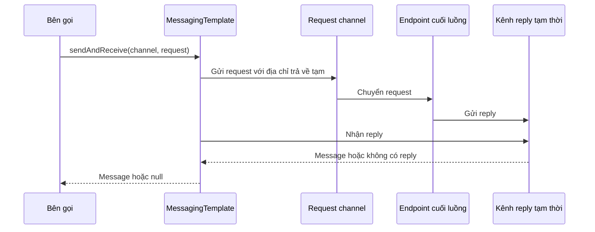

# sendAndReceiveMessage

## 1. Mục tiêu và tên API cần dùng

Trong ứng dụng xử lý đơn hàng, một thành phần có thể cần gửi yêu cầu tra cứu giá vào luồng Spring Integration và nhận lại kết quả để tiếp tục tính tiền. Yêu cầu này phù hợp với mẫu **request–reply**: bên gọi gửi một thông điệp, sau đó chờ thông điệp phản hồi của lần gọi đó.

Bài học thuộc chương **MessagingTemplate** của **SPRING_INTEGRATION_CORE**. Trọng tâm là cách ứng dụng chủ động đi vào luồng tích hợp, phối hợp `Message`, `MessageChannel`, endpoint và Java DSL, rồi xử lý kết quả hoặc lỗi tại ranh giới gọi.

**Lưu ý về tên bài:** `sendAndReceiveMessage` mô tả thao tác gửi và nhận thông điệp. Với lớp `org.springframework.integration.core.MessagingTemplate` trong Spring Integration 6.x, API public dùng trong bài là **`sendAndReceive(...)`**, trả về `Message<?>`. Không có lời gọi public `template.sendAndReceiveMessage(...)` trên lớp này. [Javadoc MessagingTemplate 6.5.0](https://docs.spring.io/spring-integration/docs/6.5.0/api/org/springframework/integration/core/MessagingTemplate.html).

Sau bài này, người học cần có thể:

- Gửi một request có payload và header, nhận lại toàn bộ reply.
- Giải thích vai trò của kênh phản hồi tạm thời.
- Cấu hình thời gian chờ mà không hiểu nhầm đó là thời hạn hủy xử lý.
- Phân biệt không nhận được reply, lỗi gửi và lỗi xử lý.
- Thiết kế đường phản hồi xuyên qua các endpoint và viết kiểm thử cho hợp đồng đó.

Các ví dụ dùng Java 17 và API Spring Integration 6.x, đối chiếu với nhánh tài liệu 6.5. Phiên bản dependency cần đi theo bộ phiên bản mà dự án quản lý.

## 2. Hợp đồng gửi request và nhận Message

Hai dạng gọi thường dùng:

```java
Message<?> reply = template.sendAndReceive(requestChannel, request);
Message<?> replyFromDefault = template.sendAndReceive(request);
```

Dạng thứ hai cần cấu hình destination mặc định, chẳng hạn bằng constructor `new MessagingTemplate(requestChannel)`. Khi truyền một đối tượng `MessageChannel`, bên gọi không cần phân giải tên bean để tìm destination.

Kết quả có thể là một `Message<?>` hoặc `null` khi không nhận được phản hồi, ví dụ do hết thời gian chờ. Lời gọi cũng có thể ném exception. Vì vậy, không thể coi việc phương thức kết thúc là bằng chứng nghiệp vụ thành công. [Hợp đồng MessageRequestReplyOperations](https://docs.spring.io/spring-framework/docs/6.2.0/javadoc-api/org/springframework/messaging/core/MessageRequestReplyOperations.html).

Ví dụ tối thiểu tại một điểm gọi đã có sẵn channel và template:

```java
Message<QuoteRequest> request = MessageBuilder
        .withPayload(new QuoteRequest("SKU-01", 2))
        .setHeader("requestId", "quote-2026-001")
        .build();

Message<?> reply = template.sendAndReceive(requestChannel, request);

if (reply == null) {
    throw new IllegalStateException("Không nhận được phản hồi báo giá");
}
```

Đoạn này chưa giả định kiểu payload của reply. Việc kiểm tra kiểu và xử lý thông điệp lỗi sẽ được bổ sung ở ví dụ đầy đủ.

### Chọn mức trừu tượng phù hợp

| Cách gọi | Dữ liệu ở ranh giới gọi | Tình huống phù hợp |
| --- | --- | --- |
| `sendAndReceive(channel, message)` | Request và reply đều là `Message` | Cần đọc header, kiểm tra kiểu thông điệp hoặc giữ hợp đồng messaging rõ ràng |
| `convertSendAndReceive(channel, payload, Target.class)` | Payload đầu vào và đối tượng kết quả | Muốn dùng cơ chế chuyển đổi của template, chủ yếu quan tâm dữ liệu |
| Interface dùng `@MessagingGateway` | Chữ ký phương thức nghiệp vụ | Muốn service gọi qua interface và giảm phụ thuộc trực tiếp vào messaging API |

`convertSendAndReceive` dựa trên `MessageConverter` đã cấu hình; việc truyền `Target.class` không tự tạo ra khả năng chuyển mọi chuỗi JSON thành mọi DTO. [API chuyển đổi request–reply](https://docs.spring.io/spring-framework/docs/6.2.0/javadoc-api/org/springframework/messaging/core/MessageRequestReplyOperations.html).

Gateway thích hợp khi nhiều nơi cần cùng một API nghiệp vụ, chẳng hạn `QuoteReply quote(QuoteRequest request)`. Template thích hợp cho lớp adapter cần tự điều khiển `Message` và header. [Messaging Gateways](https://docs.spring.io/spring-integration/reference/6.5/gateway.html).

## 3. Reply trở về bên gọi như thế nào?

Template tạo một kênh phản hồi tạm thời cho lần trao đổi và gắn nó vào request gửi đi. Endpoint ở cuối luồng có thể dùng địa chỉ trả về này để gửi kết quả. Bên gọi không phải tự tạo một hàng đợi dùng chung rồi lấy reply từ đó. [MessagingTemplate trong Reference Guide](https://docs.spring.io/spring-integration/reference/6.5/channel/template.html).



Với luồng đồng bộ, endpoint có thể gửi reply trước khi template bắt đầu bước nhận. Sơ đồ thể hiện quan hệ trao đổi, không bắt buộc mỗi mũi tên chạy ở một thread riêng.

Trong triển khai của `GenericMessagingTemplate` mà `MessagingTemplate` kế thừa, request được gửi đi có cả `replyChannel` và `errorChannel` trỏ vào kênh tạm. Khi trả reply cho bên gọi, template khôi phục hai header này theo request ban đầu. Đây là chi tiết cần biết khi quan sát header trong các luồng lồng nhau. [Mã nguồn GenericMessagingTemplate, phần doSendAndReceive](https://raw.githubusercontent.com/spring-projects/spring-framework/v6.2.0/spring-messaging/src/main/java/org/springframework/messaging/core/GenericMessagingTemplate.java).

### Quy tắc thiết kế đường về

Mỗi request của ví dụ cần dẫn tới một kết quả báo giá hoặc một thất bại mà bên gọi nhận diện được. Khi thiết kế flow, hãy xác định điểm cuối nào chịu trách nhiệm đáp ứng hợp đồng này.

Ví dụ, nếu một nhánh xử lý đơn hàng hợp lệ còn nhánh khác chỉ ghi log, các request đi vào nhánh ghi log sẽ không có kết quả báo giá. Việc có log chứng minh request đã đi qua một thành phần; nó chưa chứng minh đường phản hồi đã hoàn tất.

Không dùng `MessageHeaders.ID` như mã yêu cầu nghiệp vụ bất biến. Hãy đặt header riêng như `requestId` để đối chiếu log và kết quả, hoặc dùng `correlationId` khi thiết kế nhóm thông điệp. Trong mô hình này, đường về của một lần gọi do kênh tạm đảm nhiệm; một header correlation tùy ý không tự biến thành cơ chế ghép reply.

## 4. Ví dụ đầy đủ: luồng tra cứu báo giá

Ví dụ gồm hai lớp Java trong package `example.integration`:

- `QuoteConfig`: khai báo channel, template và flow.
- `QuoteApplication`: tạo context, gửi request và kiểm tra reply.

Dự án cần dependency `org.springframework.integration:spring-integration-core`, với phiên bản được quản lý đồng bộ cùng các thư viện Spring. Java DSL nằm trong module core; không cần thêm dependency DSL riêng.

Luồng được xây dựng:

```text
QuoteRequest
    → DirectChannel quoteRequests
    → transformer chuẩn hóa SKU
    → thêm header quoteSource
    → service activator tính giá
    → kênh reply tạm thời
    → Message<QuoteReply> tại bên gọi
```

### 4.1. Cấu hình channel, endpoint và template

Nội dung lớp `QuoteConfig`:

```java
package example.integration;

import java.math.BigDecimal;
import java.util.Locale;

import org.springframework.context.annotation.Bean;
import org.springframework.context.annotation.Configuration;
import org.springframework.integration.channel.DirectChannel;
import org.springframework.integration.config.EnableIntegration;
import org.springframework.integration.core.MessagingTemplate;
import org.springframework.integration.dsl.IntegrationFlow;

@Configuration
@EnableIntegration
public class QuoteConfig {

    public record QuoteRequest(String sku, int quantity) {
        public QuoteRequest {
            if (sku == null || sku.isBlank()) {
                throw new IllegalArgumentException("SKU không được để trống");
            }
            if (quantity <= 0) {
                throw new IllegalArgumentException("Số lượng phải lớn hơn 0");
            }
        }
    }

    public record QuoteReply(
            String sku,
            int quantity,
            BigDecimal total,
            String currency) {
    }

    @Bean
    public DirectChannel quoteRequests() {
        return new DirectChannel();
    }

    @Bean
    public MessagingTemplate quoteTemplate(DirectChannel quoteRequests) {
        MessagingTemplate template = new MessagingTemplate(quoteRequests);
        template.setSendTimeout(200);
        template.setReceiveTimeout(1_500);
        template.setThrowExceptionOnLateReply(true);
        return template;
    }

    @Bean
    public IntegrationFlow quoteFlow(DirectChannel quoteRequests) {
        return IntegrationFlow.from(quoteRequests)
                .transform(QuoteRequest.class, request ->
                        new QuoteRequest(
                                request.sku().strip().toUpperCase(Locale.ROOT),
                                request.quantity()))
                .enrichHeaders(headers ->
                        headers.header("quoteSource", "demo-catalog"))
                .handle(QuoteRequest.class, (request, headers) -> {
                    if (!"SKU-01".equals(request.sku())) {
                        throw new IllegalArgumentException(
                                "Không có giá cho SKU: " + request.sku());
                    }

                    BigDecimal unitPrice = new BigDecimal("125000.00");
                    BigDecimal total = unitPrice.multiply(
                            BigDecimal.valueOf(request.quantity()));

                    return new QuoteReply(
                            request.sku(),
                            request.quantity(),
                            total,
                            "VND");
                }, endpoint -> endpoint.requiresReply(true))
                .get();
    }
}
```

`@EnableIntegration` bật hạ tầng Integration trong context Java thuần. Flow là một Spring bean để framework đăng ký channel và endpoint được DSL mô tả. Chỉ tạo một đối tượng `IntegrationFlow` bên ngoài context sẽ chưa tạo thành ứng dụng tích hợp đã vận hành. [Java DSL](https://docs.spring.io/spring-integration/reference/6.5/dsl.html).

Trong ví dụ, transformer chuẩn hóa `" sku-01 "` thành `"SKU-01"`. Service activator trả payload `QuoteReply`; endpoint chịu trách nhiệm tạo thông điệp kết quả. Không cấu hình output channel cuối nên endpoint có thể dùng header `replyChannel` của request. `requiresReply(true)` yêu cầu handler tạo kết quả khác `null`. [Service Activator](https://docs.spring.io/spring-integration/reference/6.5/service-activator.html).

### 4.2. Gửi request và đọc cả payload lẫn header

Nội dung lớp `QuoteApplication`:

```java
package example.integration;

import java.util.UUID;

import org.springframework.context.annotation.AnnotationConfigApplicationContext;
import org.springframework.integration.core.MessagingTemplate;
import org.springframework.messaging.Message;
import org.springframework.messaging.support.ErrorMessage;
import org.springframework.messaging.support.MessageBuilder;

import example.integration.QuoteConfig.QuoteReply;
import example.integration.QuoteConfig.QuoteRequest;

public class QuoteApplication {

    public static void main(String[] args) {
        try (var context =
                     new AnnotationConfigApplicationContext(QuoteConfig.class)) {

            MessagingTemplate template =
                    context.getBean("quoteTemplate", MessagingTemplate.class);

            String requestId = UUID.randomUUID().toString();

            Message<QuoteRequest> request = MessageBuilder
                    .withPayload(new QuoteRequest(" sku-01 ", 2))
                    .setHeader("requestId", requestId)
                    .build();

            Message<?> reply = template.sendAndReceive(request);

            if (reply == null) {
                throw new IllegalStateException(
                        "Không nhận được báo giá, requestId=" + requestId);
            }

            if (reply instanceof ErrorMessage error) {
                throw new IllegalStateException(
                        "Luồng báo giá thất bại, requestId=" + requestId,
                        error.getPayload());
            }

            if (!(reply.getPayload() instanceof QuoteReply quote)) {
                throw new IllegalStateException(
                        "Sai kiểu phản hồi: "
                                + reply.getPayload().getClass().getName());
            }

            System.out.println(quote);
            System.out.println("requestId="
                    + reply.getHeaders().get("requestId"));
            System.out.println("quoteSource="
                    + reply.getHeaders().get("quoteSource"));
        }
    }
}
```

Với dữ liệu hợp lệ, payload mong đợi:

```text
QuoteReply[sku=SKU-01, quantity=2, total=250000.00, currency=VND]
```

Header `quoteSource` có giá trị `demo-catalog`; header `requestId` giúp đối chiếu với request. Mã không ép kiểu trực tiếp sang `Message<QuoteReply>`, vì kết quả public của template là `Message<?>`.

Nhánh `ErrorMessage` chuẩn bị cho biến thể có xử lý bất đồng bộ. Với `DirectChannel` trong cấu hình hiện tại, exception do handler ném thường truyền ngược ngay trong lời gọi; nó có thể xuất hiện trước khi biến `reply` được gán.

## 5. Timeout: đang chờ ở bước nào?

Hai timeout trên template đo hai pha khác nhau, đơn vị là mili giây:

| Cấu hình | Pha áp dụng | Ví dụ |
| --- | --- | --- |
| `sendTimeout` | Gửi request vào channel, tùy khả năng chờ của channel | Chờ chỗ trống trong một `QueueChannel` có giới hạn |
| `receiveTimeout` | Chờ kết quả tại kênh reply tạm sau bước gửi | Chờ worker xử lý xong và gửi reply |

Một giá trị âm biểu thị chờ không giới hạn ở thao tác tương ứng; `0` biểu thị không chờ. Trong triển khai template được đối chiếu, hai giá trị ban đầu là `-1`. Các ví dụ chủ động cấu hình thời gian hữu hạn. [GenericMessagingTemplate API](https://docs.spring.io/spring-framework/docs/6.2.0/javadoc-api/org/springframework/messaging/core/GenericMessagingTemplate.html), [khởi tạo và sử dụng timeout trong mã nguồn](https://raw.githubusercontent.com/spring-projects/spring-framework/v6.2.0/spring-messaging/src/main/java/org/springframework/messaging/core/GenericMessagingTemplate.java).

### 5.1. DirectChannel không tạo thời hạn ngắt handler

`DirectChannel` gọi handler trên thread gửi. Với một handler mất năm giây, lệnh `sendAndReceive` có thể mất ít nhất khoảng năm giây dù `receiveTimeout` được đặt là 100 ms. Phần xử lý đó diễn ra trong pha gửi; khi pha nhận bắt đầu, reply thậm chí đã có sẵn. [DirectChannel và các channel khác](https://docs.spring.io/spring-integration/reference/6.5/channel/implementations.html).

Do đó, đoạn cấu hình sau không thể được dùng như bộ hủy mọi xử lý sau 100 ms:

```java
template.setReceiveTimeout(100);
```

Nếu endpoint gọi HTTP, truy vấn cơ sở dữ liệu hoặc chờ khóa, cần cấu hình giới hạn tại chính tài nguyên đó. Khi lập ngân sách thời gian cho một yêu cầu báo giá, hãy tính cả chờ kết nối, thao tác I/O, retry và thời gian trả kết quả.

### 5.2. Có ranh giới bất đồng bộ vẫn phải xem tổng thời gian

Với `ExecutorChannel`, công việc có thể được giao sang thread khác. Với `QueueChannel`, cần consumer hoặc polling endpoint để lấy request và xử lý. Một queue tự nó chỉ giữ thông điệp.

Thời gian quan sát tại bên gọi có thể gồm thời gian gửi, thời gian chờ reply và chi phí phụ. Không suy ra rằng tổng thời gian luôn bị chặn ở đúng `receiveTimeout`, cũng không coi mọi channel đều thực thi `sendTimeout` như nhau.

Đừng nhầm giá trị mặc định của template với `spring.integration.endpoints.defaultTimeout`. Đây là cấu hình cho endpoint và không phải cách thiết lập trực tiếp hai thuộc tính timeout trên template ở trên. [Global Properties](https://docs.spring.io/spring-integration/reference/6.5/configuration/global-properties.html).

### 5.3. Timeout theo từng request

Khi dùng chung một template, có thể đặt timeout trên request thay vì thay đổi cấu hình bean cho mỗi lần gọi:

```java
Message<QuoteRequest> request = MessageBuilder
        .withPayload(new QuoteRequest("SKU-01", 2))
        .setHeader("requestId", "quote-short-budget")
        .setHeader(
                org.springframework.messaging.core.GenericMessagingTemplate
                        .DEFAULT_SEND_TIMEOUT_HEADER,
                100L)
        .setHeader(
                org.springframework.messaging.core.GenericMessagingTemplate
                        .DEFAULT_RECEIVE_TIMEOUT_HEADER,
                500L)
        .build();

Message<?> reply = template.sendAndReceive(requestChannel, request);
```

Tên header mặc định là `sendTimeout` và `receiveTimeout`. Template dùng giá trị đó cho lần trao đổi rồi loại các header điều khiển timeout khỏi request gửi xuống flow. Không đặt quy ước nghiệp vụ trùng tên hai header này. [GenericMessagingTemplate API](https://docs.spring.io/spring-framework/docs/6.2.0/javadoc-api/org/springframework/messaging/core/GenericMessagingTemplate.html).

Giả sử hai request dùng chung template, request A có ngân sách 500 ms còn request B có ngân sách 2.000 ms. Nếu cả hai thay đổi `template.setReceiveTimeout(...)` ngay trước khi gọi, cấu hình dùng chung có thể bị request khác thay đổi xen giữa. Đặt header trên từng request tránh sự phụ thuộc đó.

## 6. Phân biệt không có reply và lỗi

Một adapter gọi luồng báo giá nên quy định riêng cách xử lý các kết cục sau:

| Kết cục | Ý nghĩa cần xem xét | Hành động tại ranh giới ứng dụng |
| --- | --- | --- |
| Nhận `Message` với `QuoteReply` hợp lệ | Có kết quả theo hợp đồng | Kiểm tra kết quả và tiếp tục nghiệp vụ |
| Nhận `null` | Không lấy được reply trong lần nhận | Báo không nhận được kết quả; tra cứu trạng thái khi cần |
| Lỗi gửi request | Request không được chấp nhận hoặc gửi không hoàn tất | Ghi nhận lỗi gửi, xem xét retry có kiểm soát |
| Exception từ flow đồng bộ | Thành phần xử lý thất bại trên đường gọi | Ánh xạ lỗi kỹ thuật hoặc lỗi nghiệp vụ |
| Nhận `ErrorMessage` | Một cơ chế xử lý lỗi đã chuyển lỗi thành thông điệp trả về | Đọc payload lỗi và ánh xạ theo hợp đồng |
| Nhận kiểu payload ngoài dự kiến | Hợp đồng giữa caller và flow bị lệch | Báo lỗi hợp đồng, lưu thông tin truy vết |

`null` không chứng minh request chưa được xử lý. Ví dụ, một worker có thể đã cập nhật dữ liệu nhưng chưa gửi được kết quả trước lúc caller ngừng chờ. Với báo giá chỉ đọc, có thể cân nhắc gọi lại; với tạo đơn hàng hoặc trừ tiền, cần mã thao tác và cơ chế chống xử lý trùng.

### Lỗi đồng bộ

Với `DirectChannel`, lỗi có thể truyền theo call stack về sender. Có thể bắt `MessagingException` ở ranh giới ứng dụng và dùng cause để xác định nguyên nhân.

Đặt header `errorChannel` không tự chuyển mọi lỗi đồng bộ thành thông điệp trên kênh đó. Luồng hiện tại vẫn có thể ném exception trực tiếp. [Error Handling](https://docs.spring.io/spring-integration/reference/6.5/error-handling.html).

### Lỗi bất đồng bộ

Một lỗi trên worker không thể tự ném ngược qua call stack của thread caller. Cần cơ chế công bố lỗi, chẳng hạn error handler của executor channel hoặc poller.

Khi cơ chế này dùng `errorChannel` của request mà template đã trỏ vào kênh tạm, lỗi có thể quay về dưới dạng `ErrorMessage`. API `sendAndReceive` nhận thông điệp; không áp dụng giả định rằng nó tự chuyển mọi payload lỗi thành exception nghiệp vụ. Nếu lỗi chỉ được ghi log ở một nhánh khác, caller có thể chỉ thấy không có reply. [Error Handling](https://docs.spring.io/spring-integration/reference/6.5/error-handling.html).

Vì vậy, hợp đồng phải xác định cách biểu diễn thất bại. Chẳng hạn, “không có giá cho SKU” có thể được thiết kế thành một kết quả nghiệp vụ rõ ràng thay cho exception. Lựa chọn đó cần nhất quán ở caller, flow và kiểm thử.

## 7. Endpoint nào thực sự gửi phản hồi?

Một handler trả về dữ liệu chưa đủ để bảo đảm dữ liệu tới caller. Đường output của endpoint cũng phải đúng.

Với service activator tạo reply, output channel cấu hình tường minh được xét trước địa chỉ trả về trong header. Nếu output cuối là một queue dành cho báo cáo mà không có đường chuyển tiếp, kết quả có thể nằm trong queue đó trong khi template vẫn chờ kênh tạm. [Quy tắc chọn reply destination](https://docs.spring.io/spring-integration/reference/6.5/service-activator.html).

Các tình huống cần kiểm tra khi thiết kế flow:

| Thành phần hoặc nhánh | Câu hỏi về hợp đồng request–reply |
| --- | --- |
| Transformer | Dữ liệu sau biến đổi có còn đáp ứng kiểu mà endpoint tiếp theo cần không? |
| Filter | Request bị loại sẽ nhận kết quả từ chối hay im lặng kết thúc? |
| Router | Mỗi nhánh mà request có thể đi vào có tạo kết quả cuối không? |
| Aggregator | Nhóm có đủ điều kiện release và trả một kết quả tổng hợp đúng hạn không? |
| Handler trả `void` hoặc `null` | Việc không tạo reply có đúng hợp đồng không? |
| Output sang kênh lưu trữ hoặc `nullChannel` | Caller còn đường nhận kết quả không? |

`requiresReply(true)` chỉ ràng buộc kết quả của handler được cấu hình. Nó không kiểm tra hộ toàn bộ router, không buộc aggregator giải phóng nhóm và không khôi phục request đã bị filter loại.

Khi tự tạo hoặc chuyển tiếp thông điệp bằng code ở ngoài các endpoint chuẩn, cần bảo toàn các header phục vụ đường về. Đừng giả định một header `requestId` có thể thay thế cho `replyChannel`. Nếu đi qua broker hoặc ranh giới tiến trình, dùng gateway/adapter và chiến lược correlation phù hợp; đối tượng channel tạm trong bộ nhớ không tự trở thành địa chỉ trả lời của hệ thống từ xa.

## 8. Reply đến muộn và nhiều kết quả

Một lần gọi template có hợp đồng nhận một kết quả logic. Nếu cần thu kết quả từ nhiều nhánh, hãy thiết kế bước tổng hợp, chẳng hạn aggregator, rồi trả một reply chứa tập kết quả.

`setThrowExceptionOnLateReply(true)` yêu cầu báo lỗi ở phía gửi reply khi bên nhận đã hết hạn chờ hoặc không còn nhận reply theo trạng thái trao đổi. Exception này có thể xảy ra trên thread worker, sau khi caller đã kết thúc. [GenericMessagingTemplate API](https://docs.spring.io/spring-framework/docs/6.2.0/javadoc-api/org/springframework/messaging/core/GenericMessagingTemplate.html).

Trong ví dụ, giá trị này được đặt tường minh để phản hồi bất thường dễ được nhận diện khi thay đổi flow. Spring Integration cũng có thuộc tính toàn cục `spring.integration.messagingTemplate.throwExceptionOnLateReply`, mặc định `false` trong cấu hình được tham chiếu. [Global Properties](https://docs.spring.io/spring-integration/reference/6.5/configuration/global-properties.html).

Cấu hình trên không hủy worker, không hoàn tác tác động nghiệp vụ và không gửi ngược một exception mới cho caller đã rời khỏi lời gọi.

Để điều tra phản hồi muộn của một yêu cầu tạo đơn, nên đối chiếu cùng một mã thao tác ở các thời điểm nhận request, bắt đầu xử lý, hoàn tất cập nhật và gửi kết quả. Khi đó mới phân biệt được thao tác chậm với phản hồi bị thất lạc hoặc retry tạo tác động trùng.

## 9. Ví dụ kiểm thử hợp đồng

Các đoạn dưới là mã kiểm thử minh họa để đưa vào dự án học tập. Chúng không dùng `Thread.sleep`; hai tình huống queue dùng timeout bằng `0` để tạo trạng thái xác định.

Dự án kiểm thử cần JUnit Jupiter. Lớp dùng lại `QuoteConfig` của phần 4:

```java
package example.integration;

import static org.junit.jupiter.api.Assertions.assertEquals;
import static org.junit.jupiter.api.Assertions.assertInstanceOf;
import static org.junit.jupiter.api.Assertions.assertNotNull;
import static org.junit.jupiter.api.Assertions.assertNull;
import static org.junit.jupiter.api.Assertions.assertThrows;

import java.math.BigDecimal;

import org.junit.jupiter.api.Test;
import org.springframework.context.annotation.AnnotationConfigApplicationContext;
import org.springframework.integration.channel.QueueChannel;
import org.springframework.integration.core.MessagingTemplate;
import org.springframework.messaging.Message;
import org.springframework.messaging.MessageDeliveryException;
import org.springframework.messaging.MessageHandlingException;
import org.springframework.messaging.support.GenericMessage;
import org.springframework.messaging.support.MessageBuilder;

import example.integration.QuoteConfig.QuoteReply;
import example.integration.QuoteConfig.QuoteRequest;

class QuoteRequestReplyTest {

    @Test
    void returnsQuoteAndBusinessHeaders() {
        try (var context =
                     new AnnotationConfigApplicationContext(QuoteConfig.class)) {

            MessagingTemplate template =
                    context.getBean("quoteTemplate", MessagingTemplate.class);

            Message<?> request = MessageBuilder
                    .withPayload(new QuoteRequest(" sku-01 ", 2))
                    .setHeader("requestId", "req-001")
                    .build();

            Message<?> reply = template.sendAndReceive(request);

            assertNotNull(reply);
            QuoteReply quote =
                    assertInstanceOf(QuoteReply.class, reply.getPayload());

            assertEquals("SKU-01", quote.sku());
            assertEquals(2, quote.quantity());
            assertEquals(new BigDecimal("250000.00"), quote.total());
            assertEquals("VND", quote.currency());
            assertEquals("req-001", reply.getHeaders().get("requestId"));
            assertEquals("demo-catalog",
                    reply.getHeaders().get("quoteSource"));
        }
    }

    @Test
    void propagatesFailureFromSynchronousHandler() {
        try (var context =
                     new AnnotationConfigApplicationContext(QuoteConfig.class)) {

            MessagingTemplate template =
                    context.getBean("quoteTemplate", MessagingTemplate.class);

            Message<?> request = new GenericMessage<>(
                    new QuoteRequest("UNKNOWN", 1));

            MessageHandlingException failure = assertThrows(
                    MessageHandlingException.class,
                    () -> template.sendAndReceive(request));

            assertInstanceOf(IllegalArgumentException.class, failure.getCause());
        }
    }

    @Test
    void noReplyDoesNotRemoveTheAcceptedRequest() {
        QueueChannel requests = new QueueChannel(1);
        MessagingTemplate template = immediateTemplate(requests);

        Message<?> reply = template.sendAndReceive(
                new GenericMessage<>("lookup-price"));

        assertNull(reply);

        Message<?> acceptedRequest = requests.receive(0);
        assertNotNull(acceptedRequest);
        assertEquals("lookup-price", acceptedRequest.getPayload());
    }

    @Test
    void rejectsSendWhenRequestQueueIsFull() {
        QueueChannel requests = new QueueChannel(1);
        requests.send(new GenericMessage<>("occupy-slot"), 0);

        MessagingTemplate template = immediateTemplate(requests);

        assertThrows(
                MessageDeliveryException.class,
                () -> template.sendAndReceive(
                        new GenericMessage<>("lookup-price")));
    }

    private MessagingTemplate immediateTemplate(QueueChannel requests) {
        MessagingTemplate template = new MessagingTemplate(requests);
        template.setSendTimeout(0);
        template.setReceiveTimeout(0);
        template.setThrowExceptionOnLateReply(true);
        return template;
    }
}
```

Bốn ca kiểm thử kiểm tra những điều khác nhau:

1. Flow biến đổi request và trả đúng payload cùng header nghiệp vụ.
2. Lỗi handler trong flow đồng bộ tới được caller.
3. Không nhận được reply không đồng nghĩa request đã biến mất khỏi queue.
4. Queue đầy tạo lỗi gửi, khác với việc gửi thành công rồi không có kết quả.

Ca thứ ba không có worker. Nó kiểm tra trường hợp không chờ reply và request vẫn còn trong queue; nó chưa chứng minh cách một worker thực tế phản ứng khi reply đến muộn.

Nếu ứng dụng dùng executor hoặc poller, cần thêm kiểm thử cho cơ chế công bố lỗi và phản hồi muộn của cấu hình đó. Có thể dùng `CountDownLatch` hoặc hàng đợi phối hợp để điều khiển thứ tự xử lý, kèm giới hạn chờ và dọn executor sau kiểm thử.

## 10. Chẩn đoán khi caller không nhận kết quả

Bắt đầu bằng việc xác định lời gọi đang ở pha gửi hay pha nhận. Một handler đồng bộ chưa kết thúc và một request đã vào queue nhưng không có consumer là hai vấn đề khác nhau, dù người dùng đều thấy màn hình chờ.

| Biểu hiện | Điểm cần kiểm tra trước |
| --- | --- |
| Lỗi ngay khi gửi vào `DirectChannel` | Endpoint đã được đăng ký, khởi động và subscribe chưa? |
| Gửi vào queue được nhưng không có reply | Có consumer/poller đang hoạt động không? |
| Handler chạy và trả dữ liệu nhưng caller vẫn chờ | Output cuối đi đâu, còn đường về kênh tạm không? |
| Một số request có reply, một số không | Nhánh filter/router hoặc điều kiện release của aggregator |
| Caller đã hết chờ nhưng dữ liệu vẫn đổi | Công việc tiếp tục sau khi thời gian nhận kết quả hết hạn |
| Có reply nhưng ép kiểu thất bại | Có `ErrorMessage`, kiểu kết quả khác hoặc hợp đồng bị thay đổi không? |

Trong ví dụ báo giá, log theo `requestId` tại đầu vào và đầu ra giúp xác định SKU đã được chuẩn hóa chưa, handler có tạo `QuoteReply` không và kết quả có quay lại caller không. Tránh ghi toàn bộ payload nếu dữ liệu thực tế có thông tin nhạy cảm.

Không retry tự động chỉ vì `reply == null`. Hãy đặt quyết định retry sau khi đã xác định tính chất thao tác: đọc giá có thể khác hoàn toàn ghi nhận thanh toán. Đối với thao tác có tác động, cùng một mã yêu cầu cần có cách tra cứu hoặc chống thực thi trùng.

## 11. Vận dụng vào thiết kế luồng

Khi dùng `sendAndReceive` để nối service với flow, hãy mô tả hợp đồng bằng một câu cụ thể, ví dụ: “Mỗi yêu cầu báo giá hợp lệ trả về một `QuoteReply`; không có SKU được báo thành thất bại có thể nhận diện; bên gọi có thời gian chờ hữu hạn.”

Từ hợp đồng đó, chọn nơi biến đổi dữ liệu, nơi định tuyến và nơi tạo kết quả cuối. Với nhiều bước xử lý, cần giữ đường phản hồi xuyên suốt; với nhiều nhánh kết quả, cần xác định cách tổng hợp trước khi trở về caller.

Ở ranh giới gọi, ba việc cần hiện diện trong code là kiểm tra không nhận được reply, kiểm tra lỗi và xác nhận kiểu payload. Ở ranh giới tài nguyên, cần giới hạn thời gian thực hiện thao tác. Ở nghiệp vụ có tác động, cần quyết định rõ cách xử lý khi kết quả chưa rõ nhưng request có thể đã được thực thi.

## 12. Tài liệu tham chiếu

- [MessagingTemplate 6.5.0 — API và các phương thức kế thừa](https://docs.spring.io/spring-integration/docs/6.5.0/api/org/springframework/integration/core/MessagingTemplate.html).
- [MessageRequestReplyOperations — hợp đồng sendAndReceive và convertSendAndReceive](https://docs.spring.io/spring-framework/docs/6.2.0/javadoc-api/org/springframework/messaging/core/MessageRequestReplyOperations.html).
- [GenericMessagingTemplate — timeout và phản hồi muộn](https://docs.spring.io/spring-framework/docs/6.2.0/javadoc-api/org/springframework/messaging/core/GenericMessagingTemplate.html).
- [Mã nguồn GenericMessagingTemplate 6.2.0 — kênh tạm và các pha gửi/nhận](https://raw.githubusercontent.com/spring-projects/spring-framework/v6.2.0/spring-messaging/src/main/java/org/springframework/messaging/core/GenericMessagingTemplate.java).
- [Java DSL — đăng ký flow qua cấu hình Java](https://docs.spring.io/spring-integration/reference/6.5/dsl.html).
- [Message Channel Implementations — DirectChannel, QueueChannel và ExecutorChannel](https://docs.spring.io/spring-integration/reference/6.5/channel/implementations.html).
- [Service Activator — reply destination và requiresReply](https://docs.spring.io/spring-integration/reference/6.5/service-activator.html).
- [Error Handling — khác biệt giữa lỗi đồng bộ và bất đồng bộ](https://docs.spring.io/spring-integration/reference/6.5/error-handling.html).
- [Global Properties — cấu hình toàn cục liên quan](https://docs.spring.io/spring-integration/reference/6.5/configuration/global-properties.html).
