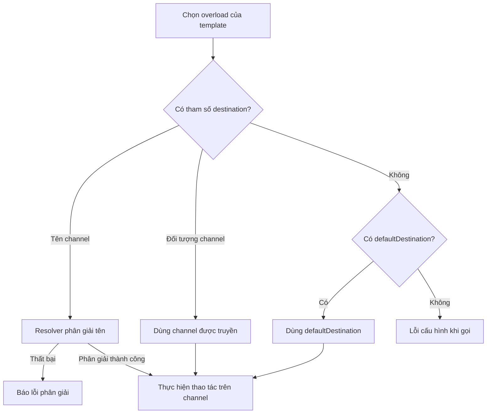
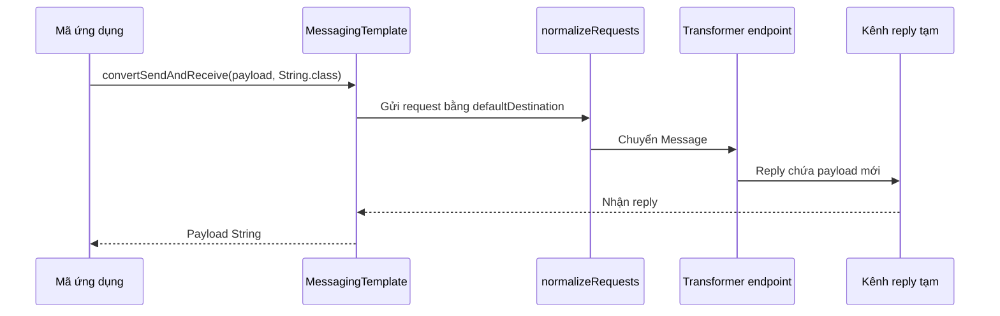

# DefaultDestination

Trong chương **MessagingTemplate** của module **SPRING_INTEGRATION_CORE**, `defaultDestination` là kênh được template sử dụng khi lời gọi không truyền đích. Cấu hình này giúp mã gọi tập trung vào thông điệp cần trao đổi, trong khi Spring quản lý kênh đi vào luồng tích hợp.

Bài học đặt `defaultDestination` trong quan hệ với `Message`, `MessageChannel`, endpoint, gateway và Java DSL. Mục tiêu là biết đặt đúng điểm vào của luồng, phân biệt kênh request với đường trả lời, và kiểm tra được hành vi khi có hoặc không có đích mặc định.

## 1. Bài toán: một điểm vào được gọi nhiều lần

Giả sử ứng dụng có luồng chuẩn hóa mã sản phẩm:

```text
Mã sản phẩm → kênh normalizeRequests → transformer → kết quả chuẩn hóa
```

Nếu mỗi nơi gọi đều viết `template.sendAndReceive(normalizeRequests, request)`, mã ứng dụng phải giữ cả template lẫn tham chiếu đến kênh. Khi template chỉ phục vụ luồng chuẩn hóa này, có thể cấu hình điểm vào một lần rồi dùng `template.sendAndReceive(request)`.

Một cách hiểu thực dụng là: **template có một địa chỉ dùng sẵn cho những lời gọi lược bỏ địa chỉ**. Thuộc tính này thuộc từng instance template; nó không thiết lập một kênh mặc định chung cho toàn bộ ứng dụng.

Theo [API AbstractMessageSendingTemplate](https://docs.spring.io/spring-framework/docs/current/javadoc-api/org/springframework/messaging/core/AbstractMessageSendingTemplate.html), các phương thức gửi không nhận destination sử dụng đích đã cấu hình bằng `setDefaultDestination(...)`.

## 2. DefaultDestination có kiểu gì?

Với lớp đang học:

```java
import org.springframework.integration.core.MessagingTemplate;
```

đích là một đối tượng `org.springframework.messaging.MessageChannel`. `MessagingTemplate` kế thừa cơ chế gửi, nhận và request–reply từ các lớp template của Spring Messaging. Tên chương dùng chữ hoa `DefaultDestination`; tên thuộc tính Java là `defaultDestination`.

Ba cách sau cấu hình cùng một thuộc tính:

| Cách cấu hình | Ví dụ | Cách đọc |
| --- | --- | --- |
| Constructor | `new MessagingTemplate(channel)` | Khởi tạo template cùng kênh mặc định |
| Setter kế thừa | `template.setDefaultDestination(channel)` | Gán đích mặc định bằng API chung |
| Setter tương thích | `template.setDefaultChannel(channel)` | Gán cùng thuộc tính qua tên API của Spring Integration |

`setDefaultChannel(...)` chuyển tiếp đến `setDefaultDestination(...)`; không có hai đích mặc định độc lập. Constructor không tham số tạo template chưa có kênh mặc định. Xem [MessagingTemplate API](https://docs.spring.io/spring-integration/docs/current/api/org/springframework/integration/core/MessagingTemplate.html).

Ví dụ ngắn, không cần Spring ApplicationContext:

```java
import org.springframework.integration.channel.QueueChannel;
import org.springframework.integration.core.MessagingTemplate;
import org.springframework.messaging.Message;
import org.springframework.messaging.support.MessageBuilder;

QueueChannel pendingOrders = new QueueChannel(20);
MessagingTemplate orderTemplate = new MessagingTemplate();
orderTemplate.setDefaultDestination(pendingOrders);
orderTemplate.setSendTimeout(500);

Message<String> order = MessageBuilder.withPayload("ORDER-101")
        .setHeader("source", "checkout")
        .build();

orderTemplate.send(order);
Message<?> queued = pendingOrders.receive(0);

if (queued == null) {
    throw new IllegalStateException("Không tìm thấy đơn vừa gửi");
}
System.out.println(queued.getPayload()); // ORDER-101
```

Đoạn mã là phần thân phương thức. Queue có sức chứa rõ ràng; `receive(0)` lấy thông điệp đang có và trả về ngay. Tham chiếu `pendingOrders` được đặt làm mặc định, nên bước gửi không cần tìm bean theo tên.

## 3. Quy tắc chọn đích của từng lời gọi

Hãy xác định overload được gọi trước khi phân tích luồng:

| Lời gọi | Đích dùng cho thao tác |
| --- | --- |
| `send(message)` | `defaultDestination` |
| `convertAndSend(payload)` | `defaultDestination` |
| `sendAndReceive(request)` | Gửi request đến `defaultDestination` |
| `convertSendAndReceive(payload, String.class)` | Gửi request đến `defaultDestination`, chuyển payload reply sang kiểu yêu cầu |
| `receive()` | Nhận từ `defaultDestination`, yêu cầu kênh có khả năng polling |
| `receiveAndConvert(String.class)` | Nhận từ mặc định rồi chuyển payload |
| `send(otherChannel, message)` | Chính đối tượng `otherChannel` |
| `send("otherChannel", message)` | Kênh được resolver phân giải từ tên `otherChannel` |

Những API nhận và request–reply này được mô tả lần lượt trong [AbstractMessageReceivingTemplate](https://docs.spring.io/spring-framework/docs/current/javadoc-api/org/springframework/messaging/core/AbstractMessageReceivingTemplate.html) và [AbstractMessagingTemplate](https://docs.spring.io/spring-framework/docs/6.2.0/javadoc-api/org/springframework/messaging/core/AbstractMessagingTemplate.html).



Đích truyền trực tiếp chỉ chi phối lần gọi hiện tại. Nếu kênh đó từ chối thông điệp hoặc tên kênh không phân giải được, template báo lỗi tương ứng. Nó không tự chuyển lần gửi ấy sang kênh mặc định.

Ví dụ minh họa hai luồng đơn hàng:

```java
QueueChannel regularOrders = new QueueChannel(10);
QueueChannel priorityOrders = new QueueChannel(10);
MessagingTemplate template = new MessagingTemplate(regularOrders);
template.setSendTimeout(500);

template.convertAndSend("ORDER-201");
template.convertAndSend(priorityOrders, "ORDER-202");
template.convertAndSend("ORDER-203");
```

Sau ba lời gọi, `regularOrders` chứa `ORDER-201`, `ORDER-203`; `priorityOrders` chứa `ORDER-202`. `template.getDefaultDestination()` vẫn trả về `regularOrders`.

Đây là hệ quả có thể kiểm chứng bằng API công khai: các lời gọi chỉ định đích không cần thay đổi cấu hình của template. Nó cho phép một ngoại lệ có chủ đích mà không làm thay đổi các lần gọi tiếp theo.

## 4. Phân biệt đối tượng kênh, tên kênh và payload chuỗi

Các lệnh sau khác nhau về ý nghĩa:

```java
template.setDefaultDestination(regularOrders); // Tham chiếu MessageChannel.
template.convertAndSend("ORDER-301");          // Một payload String, dùng mặc định.
template.convertAndSend("priorityOrders", "ORDER-302"); // Tên đích + payload.
```

`convertAndSend("priorityOrders")` chỉ có một đối số: chuỗi ấy là payload. Nó không đặt mặc định và cũng không yêu cầu gửi đến bean tên `priorityOrders`.

Với API của `org.springframework.integration.core.MessagingTemplate`, không viết:

```java
// Sai kiểu đối số: setter cần MessageChannel, không nhận String.
// template.setDefaultDestination("regularOrders");
```

Cũng không suy ra một setter `setDefaultDestinationName(...)` từ API của các template khác như JMS. Mỗi loại template có hợp đồng destination riêng.

Các overload nhận tên do `AbstractDestinationResolvingMessagingTemplate` cung cấp. Khi là bean do Spring quản lý, Spring Integration `MessagingTemplate` nhận BeanFactory và thiết lập cơ chế phân giải kênh. Nếu tự `new` bên ngoài container, hãy truyền đối tượng kênh hoặc cấu hình resolver phù hợp; chỉ đặt default destination không làm template biết cách tra mọi tên bean. Xem [API phân giải destination](https://docs.spring.io/spring-framework/docs/current/javadoc-api/org/springframework/messaging/core/AbstractDestinationResolvingMessagingTemplate.html).

Ví dụ tùy chọn, nếu thực sự cần dùng tên khi không có container:

```java
MessagingTemplate localTemplate = new MessagingTemplate(regularOrders);
localTemplate.setDestinationResolver(name -> {
    if ("priorityOrders".equals(name)) {
        return priorityOrders;
    }
    throw new IllegalArgumentException("Không hỗ trợ kênh: " + name);
});
localTemplate.convertAndSend("priorityOrders", "ORDER-303");
```

Đây là resolver tối giản do ứng dụng tự định nghĩa, với tập tên được hỗ trợ rõ ràng. Trong cấu hình Spring thông thường, nên dùng cơ chế resolver của container thay vì tạo thêm bảng ánh xạ thủ công.

## 5. Kênh mặc định và khả năng nhận thông điệp

Một `defaultDestination` phục vụ các lời gọi không truyền đích, nhưng mỗi thao tác vẫn có yêu cầu riêng đối với loại kênh:

| Kênh | Gửi thông điệp | Gọi `template.receive()` khi kênh là mặc định |
| --- | --- | --- |
| `DirectChannel` | Phân phối đến handler đã đăng ký | Không hỗ trợ polling |
| `QueueChannel` | Đưa thông điệp vào queue | Có thể nhận từ queue |

`DirectChannel` thực thi handler trong thread gửi khi không có thành phần bất đồng bộ khác xen vào. `QueueChannel` giữ thông điệp cho consumer lấy ra sau. Việc chọn kênh quyết định mô hình thực thi; thuộc tính mặc định chỉ quyết định địa chỉ. Xem [Message Channel Implementations](https://docs.spring.io/spring-integration/reference/7.0/channel/implementations.html).

Với queue, có thể dùng cùng template cho thao tác gửi và nhận:

```java
QueueChannel inbox = new QueueChannel(10);
MessagingTemplate inboxTemplate = new MessagingTemplate(inbox);
inboxTemplate.setSendTimeout(500);
inboxTemplate.setReceiveTimeout(0);

inboxTemplate.convertAndSend("EVENT-401");
String event = inboxTemplate.receiveAndConvert(String.class);
String absent = inboxTemplate.receiveAndConvert(String.class);

System.out.println(event);  // EVENT-401
System.out.println(absent); // null
```

Lần nhận thứ hai không thấy thông điệp và trả về ngay do timeout bằng `0`. Đừng đặt một `DirectChannel` làm mặc định rồi gọi `receive()` để chờ phản hồi. Request–reply có thao tác riêng và có thể dùng `DirectChannel` làm kênh request.

Một queue được chọn làm mặc định cũng không tự xuất hiện consumer. Khi đầu vào endpoint là `QueueChannel`, cần cấu hình poller phù hợp hoặc một consumer chủ động gọi nhận. Queue mặc định lưu trong bộ nhớ; nhu cầu lưu bền cần cấu hình message store hoặc cơ chế vận chuyển phù hợp. Xem [Configuring Message Channels](https://docs.spring.io/spring-integration/reference/channel/configuration.html).

## 6. DefaultDestination trong request–reply

Ở thao tác `sendAndReceive(request)`, mặc định xác định **kênh gửi request**. Template tạo kênh trả lời tạm thời cho lần trao đổi; endpoint tạo reply sẽ gửi về đường trả lời đó. Mô hình được mô tả trong [MessagingTemplate reference](https://docs.spring.io/spring-integration/reference/channel/template.html).



Ba địa chỉ cần phân biệt khi đọc cấu hình:

| Thành phần | Vai trò |
| --- | --- |
| `template.defaultDestination` | Điểm vào được dùng khi lời gọi bỏ qua destination |
| Header `replyChannel` của request | Đường trả lời cho một trao đổi thông điệp |
| Output channel của endpoint | Đích đầu ra được endpoint cấu hình để tiếp tục luồng |

Trong ví dụ tiếp theo, transformer cuối luồng không có output channel cố định nên có thể trả kết quả qua `replyChannel`. Nếu nối kết quả vào một queue khác mà không có đường chuyển tiếp về reply channel, bên gọi không tự nhận được reply từ queue ấy.

`convertSendAndReceive(...)` dùng converter của template để tạo request và lấy payload reply. Converter mặc định `SimpleMessageConverter` chủ yếu đóng gói hoặc lấy payload có kiểu tương thích; đừng giả định nó tự giải mã JSON thành DTO. Khi cần chuyển đổi dữ liệu thực sự, cấu hình converter hoặc endpoint chuyển đổi thích hợp. Xem [SimpleMessageConverter API](https://docs.spring.io/spring-framework/docs/current/javadoc-api/org/springframework/messaging/converter/SimpleMessageConverter.html).

## 7. Ví dụ đầy đủ: cấu hình Spring và Java DSL

Ví dụ sử dụng Java 17+, API Spring Integration 6.4 và JUnit Jupiter ở phần kiểm thử. Project cần có `org.springframework.integration:spring-integration-core` cùng các phụ thuộc Spring tương thích; phần test cần JUnit Jupiter. Nếu project dùng Spring Boot, dùng dependency management của project để giữ các phiên bản đồng bộ.

Lớp minh họa có thể đặt trong `DefaultDestinationFlowDemo.java` của project thực hành:

```java
import java.util.Locale;

import org.springframework.beans.factory.annotation.Qualifier;
import org.springframework.context.annotation.Bean;
import org.springframework.context.annotation.Configuration;
import org.springframework.context.annotation.AnnotationConfigApplicationContext;
import org.springframework.integration.annotation.IntegrationComponentScan;
import org.springframework.integration.channel.DirectChannel;
import org.springframework.integration.config.EnableIntegration;
import org.springframework.integration.core.MessagingTemplate;
import org.springframework.integration.dsl.IntegrationFlow;
import org.springframework.messaging.MessageChannel;

public class DefaultDestinationFlowDemo {

    @Configuration
    @EnableIntegration
    public static class FlowConfig {

        @Bean
        public MessageChannel normalizeRequests() {
            return new DirectChannel();
        }

        @Bean
        public MessagingTemplate normalizationTemplate(
                @Qualifier("normalizeRequests") MessageChannel requests) {
            MessagingTemplate template = new MessagingTemplate(requests);
            template.setSendTimeout(500);
            template.setReceiveTimeout(1000);
            return template;
        }

        @Bean
        public IntegrationFlow normalizationFlow(
                @Qualifier("normalizeRequests") MessageChannel requests) {
            return IntegrationFlow.from(requests)
                    .<String, String>transform(
                            value -> value.trim().toUpperCase(Locale.ROOT))
                    .get();
        }
    }

    public static void main(String[] args) {
        try (AnnotationConfigApplicationContext context =
                new AnnotationConfigApplicationContext(FlowConfig.class)) {
            MessagingTemplate template = context.getBean(
                    "normalizationTemplate", MessagingTemplate.class);

            String result = template.convertSendAndReceive(
                    "  sku-501  ", String.class);
            if (result == null) {
                throw new IllegalStateException("Chưa nhận được kết quả chuẩn hóa");
            }
            System.out.println(result); // SKU-501
        }
    }
}
```

Import `IntegrationComponentScan` chỉ cần nếu mở rộng sang gateway được quét ở mục sau; cấu hình hiện tại không yêu cầu annotation đó.

Các thành phần được nối với nhau như sau:

1. Bean `normalizeRequests` là điểm vào duy nhất của luồng minh họa.
2. Bean `normalizationTemplate` giữ tham chiếu đến kênh đó làm mặc định.
3. `IntegrationFlow` đăng ký transformer endpoint nhận payload chuỗi.
4. `convertSendAndReceive(...)` gửi request và chờ reply của transformer.
5. Transformer chuẩn hóa khoảng trắng, chữ hoa rồi trả payload kết quả.

`@EnableIntegration` kích hoạt hạ tầng Spring Integration trong ApplicationContext thuần Spring của ví dụ. Java DSL mô tả và đăng ký các thành phần luồng; nó không tự đặt mặc định cho mọi template đang có. Xem [Java DSL reference](https://docs.spring.io/spring-integration/reference/6.4/dsl.html).

`@Qualifier` chỉ rõ bean kênh cần inject. Khi ứng dụng có nhiều kênh hoặc nhiều template, nên đặt tên bean theo nhiệm vụ và dùng qualifier ở điểm inject để giữ quan hệ cấu hình rõ ràng.

## 8. Khi nào dùng gateway thay cho template?

Trong lớp xử lý nghiệp vụ, một hợp đồng như `String normalize(String value)` có thể dễ dùng hơn việc gọi API messaging trực tiếp. Spring Integration gateway tạo proxy cho interface và nối lời gọi vào kênh đã khai báo. Xem [Messaging Gateways](https://docs.spring.io/spring-integration/reference/6.4/gateway.html).

Ví dụ mở rộng trên cùng kênh của mục 7:

```java
import org.springframework.integration.annotation.MessagingGateway;

@MessagingGateway(
        defaultRequestChannel = "normalizeRequests",
        defaultReplyTimeout = "1000")
public interface NormalizationGateway {
    String normalize(String value);
}
```

Đặt interface trong package được quét, sau đó thêm `@IntegrationComponentScan(basePackageClasses = NormalizationGateway.class)` vào `FlowConfig`. Khi ấy có thể inject `NormalizationGateway` và gọi `gateway.normalize("  sku-502  ")`.

`defaultRequestChannel` là cấu hình của gateway; nó không sửa `defaultDestination` trên bean template đã tạo. Có thể chọn template cho mã tích hợp cần thao tác trực tiếp với `Message` và channel, hoặc gateway cho điểm gọi cần hợp đồng phương thức Java rõ kiểu. Đây là lựa chọn thiết kế theo mức độ phụ thuộc mong muốn của lớp gọi.

## 9. Timeout, lỗi và giới hạn của cấu hình mặc định

Cần xử lý riêng ba giai đoạn: chọn đích, gửi request và nhận reply.

| Hiện tượng | Cách hiểu | Việc cần kiểm tra |
| --- | --- | --- |
| Gọi `send(message)` khi chưa đặt mặc định | Thiếu cấu hình cho overload đang dùng | Constructor, setter hoặc truyền destination trực tiếp |
| Gửi theo tên nhưng không tìm được kênh | Phân giải destination thất bại | Tên bean, resolver và container quản lý template |
| `receive()` trên `DirectChannel` | Kênh không hỗ trợ nhận bằng polling | Dùng `QueueChannel` hoặc thao tác request–reply phù hợp |
| Gửi vào queue đầy quá thời gian chờ | Không đưa được thông điệp vào kênh | Capacity, tốc độ consumer và send timeout |
| `sendAndReceive(...)` trả `null` | Chưa nhận được reply trong thời gian chờ | Consumer, nhánh filter/router, đường reply |
| Reply tồn tại nhưng không chuyển được kiểu | Vấn đề converter hoặc kiểu payload | Kiểu reply và converter đang cấu hình |

Trong Spring Framework 6.2, thiếu mặc định làm `getRequiredDefaultDestination()` ném `IllegalStateException`; đó là lỗi cấu hình, không phải kết quả timeout. Tham khảo [mã nguồn AbstractMessageSendingTemplate 6.2.0](https://github.com/spring-projects/spring-framework/blob/v6.2.0/spring-messaging/src/main/java/org/springframework/messaging/core/AbstractMessageSendingTemplate.java).

`sendTimeout` và `receiveTimeout` có đơn vị mili giây. Với kênh hỗ trợ chờ, `0` yêu cầu trả về ngay, còn giá trị âm biểu thị chờ không giới hạn. Khi kênh trả `false` do không gửi được, template ném `MessageDeliveryException`; khi chờ nhận hết thời gian mà không có thông điệp, kết quả có thể là `null`.

Đặc biệt, `sendTimeout` không ngắt một handler chạy lâu trên `DirectChannel`. `receiveTimeout` cũng không biến toàn bộ lời gọi đồng bộ thành deadline: handler có thể chiếm thời gian ngay trong bước gửi trước khi template bắt đầu chờ reply. Hành vi này thể hiện trong [GenericMessagingTemplate API](https://docs.spring.io/spring-framework/docs/current/javadoc-api/org/springframework/messaging/core/GenericMessagingTemplate.html) và [mã nguồn thực thi 6.2.0](https://github.com/spring-projects/spring-framework/blob/v6.2.0/spring-messaging/src/main/java/org/springframework/messaging/core/GenericMessagingTemplate.java).

Kênh mặc định không cấu hình retry hay error flow. Với luồng đồng bộ, lỗi xử lý có thể truyền về bên gọi; với luồng bất đồng bộ, cần thiết kế đường báo lỗi theo endpoint và hạ tầng thực thi. Hãy quyết định rõ hợp đồng trả lời của luồng, ví dụ một filter loại request sẽ trả kết quả từ chối, gửi sang nhánh khác, hay để bên gọi nhận timeout. Việc đặt default destination không giải quyết quyết định nghiệp vụ đó.

## 10. Kiểm thử hành vi chọn đích

Các kiểm thử sau là mã thực hành JUnit Jupiter. Chúng không cần Spring context vì mục tiêu là xác minh quan hệ giữa template và các queue trong bộ nhớ.

```java
import org.junit.jupiter.api.Test;
import org.springframework.integration.channel.DirectChannel;
import org.springframework.integration.channel.QueueChannel;
import org.springframework.integration.core.MessagingTemplate;
import org.springframework.messaging.Message;
import org.springframework.messaging.MessageDeliveryException;
import org.springframework.messaging.support.MessageBuilder;

import static org.junit.jupiter.api.Assertions.*;

class DefaultDestinationTest {

    @Test
    void sendsToDefaultAndReceivesFromDefault() {
        QueueChannel inbox = new QueueChannel(2);
        MessagingTemplate template = new MessagingTemplate(inbox);
        template.setSendTimeout(0);
        template.setReceiveTimeout(0);

        template.convertAndSend("ORDER-601");

        assertEquals("ORDER-601", template.receiveAndConvert(String.class));
        assertNull(template.receive());
    }

    @Test
    void explicitDestinationDoesNotChangeDefault() {
        QueueChannel regular = new QueueChannel(2);
        QueueChannel priority = new QueueChannel(2);
        MessagingTemplate template = new MessagingTemplate(regular);
        template.setSendTimeout(0);

        template.convertAndSend(priority, "ORDER-602");
        template.convertAndSend("ORDER-603");

        Message<?> priorityMessage = priority.receive(0);
        Message<?> regularMessage = regular.receive(0);
        assertNotNull(priorityMessage);
        assertNotNull(regularMessage);
        assertEquals("ORDER-602", priorityMessage.getPayload());
        assertEquals("ORDER-603", regularMessage.getPayload());
        assertSame(regular, template.getDefaultDestination());
        assertNull(priority.receive(0));
        assertNull(regular.receive(0));
    }

    @Test
    void missingDefaultFailsWhenDefaultOperationIsUsed() {
        MessagingTemplate template = new MessagingTemplate();
        Message<String> request = MessageBuilder.withPayload("ORDER-604").build();

        assertThrows(IllegalStateException.class, () -> template.send(request));
    }

    @Test
    void explicitDestinationWorksWithoutDefault() {
        MessagingTemplate template = new MessagingTemplate();
        template.setSendTimeout(0);
        QueueChannel target = new QueueChannel(1);

        template.convertAndSend(target, "ORDER-605");

        Message<?> actual = target.receive(0);
        assertNotNull(actual);
        assertEquals("ORDER-605", actual.getPayload());
        assertNull(template.getDefaultDestination());
    }

    @Test
    void cannotPollADirectChannel() {
        MessagingTemplate template = new MessagingTemplate(new DirectChannel());
        template.setReceiveTimeout(0);

        assertThrows(IllegalStateException.class, () -> template.receive());
    }

    @Test
    void failedExplicitSendDoesNotFallBackToDefault() {
        QueueChannel regular = new QueueChannel(1);
        QueueChannel fullPriority = new QueueChannel(1);
        assertTrue(fullPriority.send(
                MessageBuilder.withPayload("ALREADY-QUEUED").build(), 0));
        MessagingTemplate template = new MessagingTemplate(regular);
        template.setSendTimeout(0);

        assertThrows(MessageDeliveryException.class,
                () -> template.convertAndSend(fullPriority, "ORDER-606"));

        assertNull(regular.receive(0));
        assertSame(regular, template.getDefaultDestination());
    }
}
```

Các lần nhận dùng timeout `0`, giúp kết quả âm tính trả về ngay. Kiểm thử cuối xác minh một điều dễ bỏ sót khi thiết kế vận hành: gửi thất bại ở đích chỉ định không làm thông điệp xuất hiện trong queue mặc định.

Để kiểm tra cả việc đăng ký endpoint Java DSL, bổ sung một test dùng cấu hình hoàn chỉnh ở mục 7:

```java
import org.junit.jupiter.api.Test;
import org.springframework.context.annotation.AnnotationConfigApplicationContext;
import org.springframework.integration.core.MessagingTemplate;

import static org.junit.jupiter.api.Assertions.assertEquals;

class DefaultDestinationFlowTest {

    @Test
    void requestReplyUsesConfiguredFlowEntry() {
        try (AnnotationConfigApplicationContext context =
                new AnnotationConfigApplicationContext(
                        DefaultDestinationFlowDemo.FlowConfig.class)) {
            MessagingTemplate template = context.getBean(
                    "normalizationTemplate", MessagingTemplate.class);

            String result = template.convertSendAndReceive(
                    "  sku-607  ", String.class);

            assertEquals("SKU-607", result);
        }
    }
}
```

Đặt lớp demo và lớp kiểm thử trong cùng package thực hành, hoặc thêm import tương ứng. Các đoạn test được cung cấp để người học chạy trong project có dependency phù hợp; bài viết không khẳng định đã chạy chúng trong workspace hiện tại.

## 11. Chọn mặc định ổn định cho ứng dụng nhiều luồng

Có thể tạo hai bean, chẳng hạn `orderTemplate` trỏ vào luồng đơn hàng và `notificationTemplate` trỏ vào luồng thông báo. Tên bean nói rõ mục đích; mỗi lớp gọi chỉ nhận template cần dùng. Nhờ đó, thay đổi kênh đầu vào có thể tập trung ở cấu hình thay vì rải trong nhiều nơi gọi.

Không nên đổi mặc định của một singleton template cho từng request:

```java
// Tránh dùng cấu hình chung làm trạng thái định tuyến của từng request.
// sharedTemplate.setDefaultDestination(channelForCurrentRequest);
// sharedTemplate.send(message);
```

Hai thread có thể xen kẽ bước gán và gửi, khiến lời gọi đọc cấu hình do thread khác vừa thay đổi. Với đích động, truyền channel trực tiếp trong lời gọi; với quy tắc phân nhánh thuộc luồng tích hợp, đặt router sau một kênh vào ổn định. Đây là khuyến nghị thiết kế dựa trên việc setter thay đổi trạng thái của instance dùng chung.

`defaultDestination` cũng không thay thế default output channel của router. Một thuộc tính chọn điểm vào từ phía mã gọi, thuộc tính còn lại giải quyết đầu ra của endpoint định tuyến. Hãy xác định rõ component sở hữu cấu hình trước khi dùng từ “mặc định”.

Trong các luồng có filter, router hay aggregator, điểm vào có thể vẫn giữ nguyên. Điều cần thiết kế thêm là mỗi nhánh có trả lời hay không và khi nào kết quả đủ để gửi reply. Ví dụ aggregator chờ đủ nhóm sẽ ảnh hưởng đến thời gian chờ của bên gọi; đổi kênh mặc định không làm nhóm thông điệp hoàn tất sớm hơn.

## 12. Thực hành củng cố

Mở rộng ví dụ mà vẫn giữ một điểm vào rõ ràng:

1. Tạo `QueueChannel regularOrders` và `QueueChannel priorityOrders`, đặt `regularOrders` làm mặc định; gửi xen kẽ bằng hai overload và kiểm tra từng queue.
2. Dùng resolver tối giản ở mục 4 để gửi theo tên; thử một tên không được hỗ trợ và quan sát lỗi thay vì mong chờ fallback.
3. Chạy luồng chuẩn hóa Java DSL; kiểm tra payload đầu vào có khoảng trắng và kết quả chữ hoa.
4. Thêm filter loại chuỗi rỗng sau bước chuẩn hóa; xác định hợp đồng từ chối trước khi chọn cách xử lý reply và timeout.

Kết quả cần giải thích được là **thông điệp đi vào đâu, thành phần nào xử lý và đường nào đưa phản hồi về bên gọi**. Khi ba điểm này rõ ràng, `defaultDestination` trở thành một cấu hình đơn giản và có thể kiểm chứng trong toàn bộ luồng tích hợp.
