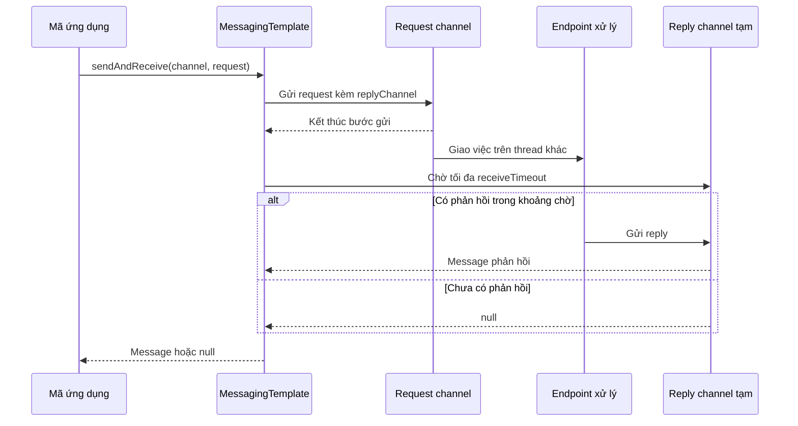

# Receive timeout trong MessagingTemplate

Trong module **SPRING_INTEGRATION_CORE**, `MessagingTemplate` là một cách để mã ứng dụng tương tác trực tiếp với luồng thông điệp. Sau khi gửi yêu cầu hoặc khi chủ động lấy thông điệp từ channel, ứng dụng cần quyết định sẽ chờ trong bao lâu. Cấu hình `receiveTimeout` thể hiện quyết định đó.

Ví dụ, một API kiểm tra tồn kho có thể chấp nhận chờ phản hồi trong 750 ms. Khi hết khoảng chờ mà chưa có phản hồi, tầng gọi phải có cách xử lý rõ ràng: trả kết quả chưa xác định, truy vấn trạng thái sau hoặc áp dụng phương án dự phòng phù hợp nghiệp vụ.

Bài học tập trung vào thời gian chờ nhận của `org.springframework.integration.core.MessagingTemplate`, kết nối khái niệm này với `Message`, `MessageChannel`, endpoint, gateway và Java DSL. Ví dụ dùng API thuộc dòng Spring Integration 6.5 và Spring Framework 6.2, với Java 17 trở lên. Dependency Spring cần được quản lý nhất quán bằng BOM hoặc cơ chế quản lý dependency của dự án.

## 1. Mục tiêu và kiến thức nền

Sau bài này, bạn có thể:

- Phân biệt chờ lấy thông điệp từ channel với chờ phản hồi của một request.
- Giải thích các giá trị âm, bằng không và dương của receive timeout.
- Cấu hình mặc định và thay đổi timeout cho một lần tương tác.
- Xác định vì sao timeout không giới hạn thời gian thực thi của một handler đồng bộ.
- Xử lý `null`, phản hồi đến muộn và kiểm thử những tình huống này.

Bạn cần biết `Message<T>` gồm payload và headers; `MessageChannel` dùng để gửi thông điệp; `PollableChannel` bổ sung thao tác nhận chủ động. Các ví dụ kiểm thử ở cuối dùng JUnit Jupiter.

## 2. Receive timeout áp dụng ở đâu?

Có hai tình huống chính:

| Thao tác | Channel được chờ nhận | Ý nghĩa |
| --- | --- | --- |
| `template.receive(channel)` | Channel do ứng dụng truyền vào | Chờ một thông điệp để lấy khỏi channel |
| `template.sendAndReceive(channel, request)` | Reply channel tạm do template tạo | Gửi request, sau đó chờ phản hồi cho lần gọi đó |
| `template.receiveAndConvert(...)` | Channel nhận tương ứng | Chờ nhận rồi chuyển đổi payload nếu có thông điệp |
| `template.send(...)` | Không có bước nhận | Receive timeout không tạo thêm thao tác chờ reply |

Với thao tác nhận trực tiếp, channel phải triển khai `PollableChannel`, chẳng hạn `QueueChannel`. `DirectChannel` là channel có cơ chế đăng ký subscriber, không hỗ trợ `receive()`. Truyền một `DirectChannel` vào `template.receive(...)` sẽ gây `IllegalStateException`. API của `MessagingTemplate` vẫn có thể nhận tham số kiểu `MessageChannel`; điều kiện này được kiểm tra khi chạy. [API MessagingTemplate](https://docs.spring.io/spring-integration/docs/6.5.0/api/org/springframework/integration/core/MessagingTemplate.html), [API PollableChannel](https://docs.spring.io/spring-framework/docs/6.2.15/javadoc-api/org/springframework/messaging/PollableChannel.html).

Ngược lại, request channel trong `sendAndReceive(...)` có thể là `DirectChannel` hoặc `ExecutorChannel`. Template nhận từ reply channel tạm, không gọi `receive()` trên request channel.

### 2.1. Đơn vị và giá trị

Timeout được biểu diễn bằng `long`, đơn vị **mili giây**.

| Giá trị | Hành vi khi nhận từ QueueChannel tiêu chuẩn |
| --- | --- |
| `timeout > 0` | Chờ tối đa khoảng thời gian đã chỉ định nếu chưa có thông điệp |
| `timeout == 0` | Kiểm tra ngay, không chờ thông điệp xuất hiện trong tương lai |
| `timeout < 0` | Chờ không giới hạn nếu cần; thông thường dùng `-1L` |

Nếu đã có thông điệp, thao tác có thể trả về ngay cả khi timeout rất lớn. Vì vậy, `750L` không có nghĩa là bắt buộc ngủ 750 ms. Khi hết thời gian chờ mà chưa nhận được gì, kết quả thông thường là `null`. Thread bị interrupt cũng có thể khiến thao tác nhận trả về `null`. [Hành vi QueueChannel](https://docs.spring.io/spring-integration/reference/6.5/channel/implementations.html#queuechannel), [hợp đồng PollableChannel](https://docs.spring.io/spring-framework/docs/6.2.15/javadoc-api/org/springframework/messaging/PollableChannel.html).

Trong triển khai được đối chiếu ở bài này, `new MessagingTemplate()` kế thừa `receiveTimeout = -1` từ `GenericMessagingTemplate`. Hãy cấu hình tường minh khi ứng dụng cần thời gian chờ hữu hạn. Mặc định của một gateway hoặc endpoint bao ngoài có thể khác mặc định của template được khởi tạo trực tiếp. [Mã nguồn GenericMessagingTemplate 6.2.0](https://github.com/spring-projects/spring-framework/blob/v6.2.0/spring-messaging/src/main/java/org/springframework/messaging/core/GenericMessagingTemplate.java).

## 3. Nhận thông điệp từ QueueChannel

Ví dụ sau nhận một thông điệp có sẵn, rồi thử nhận lần nữa khi queue đã rỗng:

```java
import org.springframework.integration.channel.QueueChannel;
import org.springframework.integration.core.MessagingTemplate;
import org.springframework.messaging.Message;
import org.springframework.messaging.support.MessageBuilder;

public class ReceiveTimeoutDemo {

    public static void main(String[] args) {
        QueueChannel results = new QueueChannel(10);

        MessagingTemplate template = new MessagingTemplate();
        template.setReceiveTimeout(250L);

        results.send(
                MessageBuilder.withPayload("ORDER-42:READY").build(),
                0L
        );

        Message<?> first = template.receive(results);
        if (first != null) {
            System.out.println(first.getPayload());
        }

        Message<?> second = template.receive(results);
        if (second == null) {
            System.out.println("Chưa có kết quả trong khoảng chờ.");
        }
    }
}
```

Kết quả nghiệp vụ mong đợi:

```text
ORDER-42:READY
Chưa có kết quả trong khoảng chờ.
```

Lần nhận đầu thường trả về ngay vì queue có dữ liệu. Lần nhận thứ hai chờ khoảng 250 ms rồi trả về `null` nếu không có producer bổ sung thông điệp. Lịch chạy thread có thể khiến thời gian đo được dài hơn cấu hình; đây không phải cam kết về thời gian thực cứng.

`receive()` lấy thông điệp ra khỏi queue. Nếu nhiều consumer cùng đọc một `QueueChannel`, mỗi thông điệp được giao cho một consumer; channel này không phát cùng một thông điệp cho tất cả consumer. Trong ứng dụng kiểm tra trạng thái đơn hàng, việc đọc một queue chung còn cần thiết kế phân phối hoặc correlation phù hợp, vì thông điệp tiếp theo có thể thuộc đơn hàng khác. [QueueChannel API](https://docs.spring.io/spring-integration/docs/6.5.0/api/org/springframework/integration/channel/QueueChannel.html), [triển khai QueueChannel](https://docs.spring.io/spring-integration/reference/6.5/channel/implementations.html#queuechannel).

### 3.1. Timeout riêng cho một lệnh nhận

`MessagingTemplate` cung cấp overload `receive(MessageChannel, long)`:

```java
MessagingTemplate template = new MessagingTemplate();
template.setReceiveTimeout(2_000L);

Message<?> immediate = template.receive(results, 0L);
Message<?> shortWait = template.receive(results, 100L);

// Vẫn dùng 2.000 ms, vì hai lệnh trên không sửa cấu hình mặc định.
Message<?> normalWait = template.receive(results);
```

Trong đoạn trên, `results` là `QueueChannel` đã có trong phạm vi gọi. Khi ứng dụng có nhiều thread cùng sử dụng template, cách truyền timeout theo từng lệnh giúp tránh việc đổi qua lại cấu hình của bean dùng chung. [Các overload của MessagingTemplate](https://docs.spring.io/spring-integration/docs/6.5.0/api/org/springframework/integration/core/MessagingTemplate.html).

Một vòng lặp liên tục gọi `receive(results, 0L)` có thể tiêu tốn CPU khi queue rỗng. Nếu ứng dụng cần consumer chạy thường xuyên, hãy cân nhắc endpoint có poller được quản lý hoặc một cơ chế chờ thích hợp.

## 4. Chờ phản hồi trong request–reply

Khi gọi `sendAndReceive(...)`, template thiết lập reply channel tạm trong header của request. Endpoint tạo phản hồi có thể sử dụng header này để trả kết quả về người gọi.



Sơ đồ biểu diễn trường hợp có ranh giới bất đồng bộ. Thời điểm worker bắt đầu chạy có thể trước hoặc sau lúc bước gửi hoàn tất.

Template dùng một reply channel tạm cho lần tương tác, ghi nó vào request và chờ nhận sau bước gửi. Đây là lý do request channel không bắt buộc phải poll được. [MessagingTemplate reference](https://docs.spring.io/spring-integration/reference/7.0/channel/template.html).

### 4.1. Cấu hình mặc định trên template

```java
MessagingTemplate template = new MessagingTemplate();
template.setSendTimeout(100L);
template.setReceiveTimeout(750L);

Message<?> reply = template.sendAndReceive(
        requestChannel,
        MessageBuilder.withPayload("ORDER-42").build()
);

if (reply == null) {
    // Chưa có phản hồi; tầng ứng dụng quyết định cách xử lý.
}
```

`requestChannel` là channel đầu vào đã được cấu hình cho luồng. Hai thuộc tính có mục đích khác nhau:

| Cấu hình | Bước được tác động | Ví dụ |
| --- | --- | --- |
| `sendTimeout` | Gửi request vào channel có hỗ trợ chờ khi gửi | Chờ chỗ trống trong một QueueChannel có giới hạn |
| `receiveTimeout` | Nhận reply sau khi bước gửi hoàn tất | Chờ kết quả của endpoint chạy trên thread khác |
| Timeout của HTTP client, JDBC hoặc dịch vụ ngoài | Thao tác I/O bên trong handler | Giới hạn thời gian kết nối hoặc đọc dữ liệu |

Khả năng thực thi send timeout phụ thuộc loại channel. Một giá trị timeout trên thao tác gửi không tự ngắt công việc nghiệp vụ đã được handler thực thi.

### 4.2. Ghi đè bằng header cho một request

Với `sendAndReceive(...)`, có thể đặt header mặc định tên `receiveTimeout` trên request:

```java
import org.springframework.messaging.core.GenericMessagingTemplate;
import org.springframework.messaging.support.MessageBuilder;

// template đã có receive timeout mặc định, ví dụ 750 ms.
Message<?> request = MessageBuilder.withPayload("ORDER-42")
        .setHeader(
                GenericMessagingTemplate.DEFAULT_RECEIVE_TIMEOUT_HEADER,
                300L
        )
        .build();

Message<?> reply = template.sendAndReceive(requestChannel, request);
```

Lần gọi này dùng 300 ms để chờ reply; mặc định của template vẫn giữ nguyên. Nên dùng giá trị `long` biểu diễn mili giây và hằng số header để giảm lỗi chính tả. Có thể đổi tên header qua `setReceiveTimeoutHeader(...)` khi cần một quy ước riêng. Header timeout được template tiêu thụ và loại khỏi request trước khi gửi tiếp, nên nó không phải TTL được tự động truyền xuyên suốt mọi endpoint. [Cấu hình header trên GenericMessagingTemplate](https://docs.spring.io/spring-framework/docs/6.2.15/javadoc-api/org/springframework/messaging/core/GenericMessagingTemplate.html).

Quy tắc lựa chọn cần nhớ:

| Cách gọi | Nguồn receive timeout |
| --- | --- |
| `receive(channel)` | Thuộc tính `receiveTimeout` trên template |
| `receive(channel, timeout)` | Đối số `timeout` của lần gọi |
| `sendAndReceive(channel, request)` có header timeout hợp lệ | Giá trị trong header request |
| `sendAndReceive(channel, request)` không có header timeout | Thuộc tính `receiveTimeout` trên template |

Một header đặt trong thông điệp đang nằm ở queue không điều khiển thời gian chờ của `receive(queue)`: template phải chờ nhận được thông điệp trước khi có thể đọc headers của nó.

Không nên thay đổi `setReceiveTimeout(...)` trước mỗi request trên một singleton rồi đặt lại sau. Hai thread có thể xen kẽ nhau và đọc giá trị dành cho request khác. Hãy cấu hình bean một lần, sau đó dùng cơ chế ghi đè theo từng thao tác.

## 5. Vì sao DirectChannel có thể làm lời gọi kéo dài hơn timeout?

Xét một chuỗi hoàn toàn đồng bộ:

```text
Caller thread
  -> template.sendAndReceive(...)
      -> DirectChannel.send(...)
          -> handler thực thi 2 giây
          -> handler gửi reply
      -> bước gửi kết thúc
      -> template nhận reply đã có
  -> trả kết quả
```

Nếu `receiveTimeout = 100` ms, lời gọi trên vẫn có thể mất khoảng 2 giây và trả về reply thành công. Handler chạy ngay trong lời gọi `send()`, trên cùng thread với caller. Bước nhận bắt đầu sau khi bước gửi kết thúc. [DirectChannel và ngữ cảnh thread](https://docs.spring.io/spring-integration/reference/6.5/channel/implementations.html#directchannel).

Hệ quả thiết kế: receive timeout giới hạn **khoảng chờ ở bước nhận**, không bảo đảm tổng thời gian `sendAndReceive(...)` nhỏ hơn cấu hình.

Có thể hình dung:

```text
Thời gian lời gọi ≈ thời gian bước gửi + thời gian bước nhận + chi phí phụ
```

Với một luồng đồng bộ, thời gian bước gửi bao gồm xử lý của các handler chạy nối tiếp trên caller thread. Với một luồng bất đồng bộ, xử lý có thể diễn ra song song với phần còn lại của bước gửi và khoảng chờ nhận.

Để caller có thể kết thúc chờ khi worker vẫn đang làm việc, cần một ranh giới thực thi trên thread khác, chẳng hạn `ExecutorChannel` dùng thread pool hoặc `QueueChannel` có consumer chạy độc lập. Đồng thời, vẫn phải cấu hình timeout I/O và chiến lược kiểm soát tải của worker.

`ExecutorChannel` ủy quyền cho `Executor`; hành vi thực tế còn phụ thuộc executor. Executor đồng bộ hoặc chính sách từ chối tác vụ kiểu caller-runs có thể đưa công việc trở lại caller thread. Không nên suy ra rằng mọi `ExecutorChannel` đều tạo ra ranh giới bất đồng bộ trong mọi điều kiện. [ExecutorChannel API](https://docs.spring.io/spring-integration/docs/6.5.0/api/org/springframework/integration/channel/ExecutorChannel.html).

## 6. Ví dụ đầy đủ với Java DSL

Ví dụ dưới đây mô phỏng luồng phê duyệt đơn hàng. `ExecutorChannel` chuyển xử lý sang thread pool; transformer tạo phản hồi và để Spring Integration trả về reply channel của request.

Project cần dependency `org.springframework.integration:spring-integration-core`. Ví dụ dùng các lớp của `spring-context` và `spring-messaging` trong hệ dependency Spring tương ứng, không cần HTTP server hoặc Spring Boot để khởi động chương trình này.

```java
import org.springframework.beans.factory.annotation.Qualifier;
import org.springframework.context.annotation.AnnotationConfigApplicationContext;
import org.springframework.context.annotation.Bean;
import org.springframework.context.annotation.Configuration;
import org.springframework.integration.channel.ExecutorChannel;
import org.springframework.integration.config.EnableIntegration;
import org.springframework.integration.core.MessagingTemplate;
import org.springframework.integration.dsl.IntegrationFlow;
import org.springframework.messaging.Message;
import org.springframework.messaging.MessageChannel;
import org.springframework.messaging.core.GenericMessagingTemplate;
import org.springframework.messaging.support.ErrorMessage;
import org.springframework.messaging.support.MessageBuilder;
import org.springframework.scheduling.concurrent.ThreadPoolTaskExecutor;

public class ReceiveTimeoutFlowDemo {

    @Configuration
    @EnableIntegration
    public static class FlowConfig {

        @Bean
        public ThreadPoolTaskExecutor orderExecutor() {
            ThreadPoolTaskExecutor executor = new ThreadPoolTaskExecutor();
            executor.setCorePoolSize(2);
            executor.setMaxPoolSize(2);
            executor.setQueueCapacity(20);
            executor.setThreadNamePrefix("order-worker-");
            return executor;
        }

        @Bean
        public MessageChannel orderRequests(
                @Qualifier("orderExecutor")
                ThreadPoolTaskExecutor executor) {

            return new ExecutorChannel(executor);
        }

        @Bean
        public IntegrationFlow orderFlow(
                @Qualifier("orderRequests")
                MessageChannel requests) {

            return IntegrationFlow.from(requests)
                    .<String, String>transform(
                            orderId -> "APPROVED:" + orderId)
                    .get();
        }

        @Bean
        public MessagingTemplate orderTemplate(
                @Qualifier("orderRequests")
                MessageChannel requests) {

            MessagingTemplate template = new MessagingTemplate(requests);
            template.setSendTimeout(100L);
            template.setReceiveTimeout(750L);
            template.setThrowExceptionOnLateReply(true);
            return template;
        }
    }

    public static void main(String[] args) {
        try (AnnotationConfigApplicationContext context =
                     new AnnotationConfigApplicationContext(FlowConfig.class)) {

            MessagingTemplate template =
                    context.getBean("orderTemplate", MessagingTemplate.class);

            Message<?> request = MessageBuilder.withPayload("ORDER-42")
                    .setHeader(
                            GenericMessagingTemplate.DEFAULT_RECEIVE_TIMEOUT_HEADER,
                            500L)
                    .build();

            Message<?> reply = template.sendAndReceive(request);

            if (reply == null) {
                System.out.println(
                        "Chưa nhận phản hồi; cần tra cứu trạng thái đơn hàng.");
                return;
            }

            if (reply instanceof ErrorMessage error) {
                throw new IllegalStateException(
                        "Luồng xử lý đơn hàng báo lỗi", error.getPayload());
            }

            System.out.println(reply.getPayload());
        }
    }
}
```

Khi xử lý hoàn tất trong khoảng chờ, chương trình in:

```text
APPROVED:ORDER-42
```

Các thành phần cùng tạo nên hành vi này:

- `@EnableIntegration` kích hoạt hạ tầng Spring Integration cho cấu hình Java.
- Bean `IntegrationFlow` đăng ký endpoint transformer trên channel đầu vào.
- Transformer trả về payload mới; không chỉ ghi log rồi kết thúc mà thiếu reply.
- `MessagingTemplate` có default channel, nên `sendAndReceive(request)` dùng `orderRequests`.
- Spring quản lý vòng đời executor; đóng application context cũng thực hiện việc giải phóng tài nguyên tương ứng.

Java DSL là cách khai báo các channel và endpoint của luồng, không thay đổi ý nghĩa receive timeout. [Java DSL reference](https://docs.spring.io/spring-integration/reference/6.5/dsl.html), [IntegrationFlow API](https://docs.spring.io/spring-integration/docs/6.5.0/api/org/springframework/integration/dsl/IntegrationFlow.html), [ThreadPoolTaskExecutor API](https://docs.spring.io/spring-framework/docs/6.2.15/javadoc-api/org/springframework/scheduling/concurrent/ThreadPoolTaskExecutor.html).

Trong ví dụ, 500 ms trên request ghi đè mặc định 750 ms. Giới hạn hàng đợi executor là 20 tác vụ. Nếu tài nguyên executor bị bão hòa và từ chối tác vụ, ứng dụng cần xử lý lỗi gửi; `sendTimeout = 100` không biến việc nộp tác vụ cho executor thành thao tác đợi chỗ trống 100 ms.

## 7. Hết thời gian chờ có nghĩa gì?

### 7.1. Null biểu thị chưa nhận được phản hồi

Với `MessagingTemplate.sendAndReceive(...)` thông thường, không nhận được reply trong khoảng chờ dẫn đến `null`. Ứng dụng cần quyết định ý nghĩa nghiệp vụ của trạng thái này.

Ví dụ:

```java
Message<?> reply = template.sendAndReceive(requestChannel, request);

if (reply == null) {
    if (Thread.currentThread().isInterrupted()) {
        throw new IllegalStateException("Tác vụ gọi đã bị gián đoạn");
    }

    throw new IllegalStateException(
            "Chưa nhận được phản hồi trong thời gian cho phép");
}
```

Đây là exception do ứng dụng chủ động tạo. Không nên mặc định cho rằng template luôn ném một exception chuyên biệt khi receive timeout hết hạn.

`null` cũng chưa đủ để kết luận worker bị treo. Một filter có thể loại bỏ request, router có thể đưa thông điệp sang nhánh không phản hồi, hoặc endpoint có thể không tạo output. Cần đối chiếu đường đi của thông điệp với hợp đồng request–reply.

### 7.2. Lỗi xử lý khác với không có phản hồi

| Tình huống | Điều cần kiểm tra |
| --- | --- |
| Hết khoảng chờ nhận | Kết quả có thể là `null` |
| Gửi vào channel thất bại | Có thể phát sinh `MessageDeliveryException` hoặc lỗi gửi tương ứng |
| Handler đồng bộ ném exception | Exception có thể lan về caller qua call stack |
| Handler bất đồng bộ thất bại | Cần kiểm tra cơ chế `ErrorMessage` và `errorChannel` |
| Có reply nhưng chuyển đổi payload thất bại | Đây là lỗi chuyển đổi, không phải thiếu reply |

Spring Integration định tuyến lỗi bất đồng bộ dựa vào `errorChannel` trong headers khi có, rồi mới dùng error channel toàn cục theo cơ chế xử lý lỗi tương ứng. Một template nhận `Message<?>` cũng có thể nhận một `ErrorMessage` làm kết quả của tương tác; đừng coi mọi thông điệp trả về đều là payload thành công. Receive timeout tự hết hạn không tự tạo một `ErrorMessage` trên error channel toàn cục. [Error Handling](https://docs.spring.io/spring-integration/reference/6.5/error-handling.html).

### 7.3. Worker có thể tiếp tục chạy

Giả sử caller chờ 500 ms, còn worker mất 2 giây để cập nhật hệ thống ngoài:

```text
t =    0 ms: gửi yêu cầu
t ≈  500 ms: caller nhận null, kết thúc chờ
t ≈ 2000 ms: worker hoàn tất và cố gửi phản hồi
```

Receive timeout không phải một lệnh hủy tác vụ. Nó không tự rút request khỏi queue, ngắt worker, thu hồi cập nhật đã thực hiện hoặc rollback transaction độc lập của worker.

Do đó, retry ngay sau timeout có thể thực hiện cùng nghiệp vụ hai lần. Với thanh toán, đặt hàng hoặc ghi dữ liệu quan trọng, hãy sử dụng mã nghiệp vụ để nhận diện yêu cầu lặp và thiết kế idempotency hoặc truy vấn trạng thái. Đây là quyết định của ứng dụng dựa trên hợp đồng xử lý, không phải tính năng tự có của receive timeout.

## 8. Phản hồi đến muộn

Phản hồi đến sau khi khoảng chờ đã kết thúc được gọi là late reply.

Với reply channel tạm, người gọi cũ đã thôi nhận. Template không tự giao phản hồi đó cho một lần `sendAndReceive(...)` mới. Một queue kết quả do ứng dụng tự quản lý là trường hợp khác: thông điệp đến sau có thể còn nằm trong queue để được nhận về sau, tùy cấu hình lưu trữ và consumer.

Có thể bật:

```java
template.setThrowExceptionOnLateReply(true);
```

Khi reply channel tạm đã ghi nhận timeout, việc gửi reply đến muộn có thể gây `MessageDeliveryException` trên **thread đang gửi reply**. Điều này không khiến caller đã nhận `null` trước đó bất ngờ nhận một exception khác. Thiết lập này cũng áp dụng cho những trường hợp reply không còn được mong đợi như đã nhận phản hồi hoặc bước gửi request trước đó thất bại. [GenericMessagingTemplate API](https://docs.spring.io/spring-framework/docs/6.2.15/javadoc-api/org/springframework/messaging/core/GenericMessagingTemplate.html#setThrowExceptionOnLateReply(boolean)).

Trong dòng Spring Integration được dùng ở bài này, thuộc tính toàn cục `spring.integration.messagingTemplate.throwExceptionOnLateReply` có mặc định `false`; template có thể lấy thiết lập toàn cục nếu chưa được cấu hình trực tiếp. Đặt giá trị rõ ràng trên template giúp thể hiện chủ đích của ví dụ. [Global Properties](https://docs.spring.io/spring-integration/reference/6.5/configuration/global-properties.html), [mã nguồn MessagingTemplate 6.5.0](https://github.com/spring-projects/spring-integration/blob/v6.5.0/spring-integration-core/src/main/java/org/springframework/integration/core/MessagingTemplate.java).

Khi bật exception cho late reply trong luồng bất đồng bộ, cần thiết kế cách quan sát hoặc xử lý lỗi trên worker. Tắt exception cũng không biến late reply thành phản hồi mà caller sẽ tiếp tục nhận.

## 9. Liên hệ với gateway, filter và aggregator

Receive timeout cần được đặt trong toàn bộ hợp đồng của luồng:

| Thành phần | Mối liên hệ với việc chờ phản hồi |
| --- | --- |
| Messaging gateway | Gateway có cấu hình request/reply timeout riêng cho lời gọi interface |
| Transformer | Trả về output để chuỗi có thể tiếp tục và tạo reply |
| Filter | Nếu loại request mà không có đường phản hồi phù hợp, caller có thể chờ đến timeout |
| Router | Mỗi nhánh cần có hành vi hoàn tất tương thích với yêu cầu của caller |
| Aggregator | Có thể chưa phát kết quả vì release condition chưa thỏa mãn |
| Error flow | Cần xác định lỗi được trả thành kết quả, ném exception hay chỉ được ghi nhận |

Timeout của caller và timeout của nhóm trong aggregator là hai đồng hồ khác nhau. Tăng receive timeout không làm một nhóm thiếu thông điệp tự hoàn thành. Nếu thiết kế yêu cầu tổng hợp nhiều phản hồi, cần thống nhất thời điểm caller ngừng chờ với thời điểm phát kết quả đầy đủ, kết quả một phần hoặc thông báo thất bại.

Với gateway, tên thuộc tính và mặc định thuộc về gateway hoặc endpoint tương ứng. Chẳng hạn, tài liệu dòng 6.5 mô tả mặc định chờ reply của messaging gateway là 30 giây, trong khi template khởi tạo trực tiếp ở bài này kế thừa receive timeout âm. Không sao chép mặc định giữa hai loại đối tượng. [Messaging Gateways](https://docs.spring.io/spring-integration/reference/6.5/gateway.html), [thuộc tính timeout của endpoint](https://docs.spring.io/spring-integration/reference/6.5/configuration/global-properties.html).

## 10. Mã kiểm thử các tình huống quan trọng

Các kiểm thử sau dùng `spring-integration-core` và JUnit Jupiter. Chúng chủ động điều khiển trạng thái channel, không dùng `Thread.sleep(...)` để phỏng đoán thứ tự giữa các thread.

```java
import org.junit.jupiter.api.Test;
import org.springframework.integration.channel.DirectChannel;
import org.springframework.integration.channel.QueueChannel;
import org.springframework.integration.core.MessagingTemplate;
import org.springframework.messaging.Message;
import org.springframework.messaging.MessageChannel;
import org.springframework.messaging.MessageDeliveryException;
import org.springframework.messaging.core.GenericMessagingTemplate;
import org.springframework.messaging.support.MessageBuilder;

import static org.junit.jupiter.api.Assertions.*;

class ReceiveTimeoutTest {

    @Test
    void zeroTimeoutReturnsNullWhenQueueIsEmpty() {
        MessagingTemplate template = new MessagingTemplate();
        template.setReceiveTimeout(0L);

        assertNull(template.receive(new QueueChannel()));
    }

    @Test
    void zeroTimeoutStillReceivesAvailableMessage() {
        QueueChannel channel = new QueueChannel();
        channel.send(MessageBuilder.withPayload("ready").build(), 0L);

        MessagingTemplate template = new MessagingTemplate();
        template.setReceiveTimeout(0L);

        Message<?> received = template.receive(channel);

        assertNotNull(received);
        assertEquals("ready", received.getPayload());
    }

    @Test
    void positiveTimeoutReturnsNullWhenNoMessageArrives() {
        MessagingTemplate template = new MessagingTemplate();
        template.setReceiveTimeout(40L);

        assertNull(template.receive(new QueueChannel()));
    }

    @Test
    void explicitReceiveTimeoutDoesNotChangeDefault() {
        MessagingTemplate template = new MessagingTemplate();
        template.setReceiveTimeout(5_000L);

        assertNull(template.receive(new QueueChannel(), 0L));
        assertEquals(5_000L, template.getReceiveTimeout());
    }

    @Test
    void requestHeaderOverridesReplyWaitWithoutChangingDefault() {
        QueueChannel requests = new QueueChannel();
        MessagingTemplate template = new MessagingTemplate();
        template.setReceiveTimeout(5_000L);

        Message<?> request = MessageBuilder.withPayload("ORDER-42")
                .setHeader(
                        GenericMessagingTemplate.DEFAULT_RECEIVE_TIMEOUT_HEADER,
                        0L)
                .build();

        // Không có worker: request được đưa vào queue nhưng chưa có reply.
        assertNull(template.sendAndReceive(requests, request));

        Message<?> queued = requests.receive(0L);
        assertNotNull(queued);
        assertNotNull(queued.getHeaders().getReplyChannel());
        assertFalse(queued.getHeaders().containsKey(
                GenericMessagingTemplate.DEFAULT_RECEIVE_TIMEOUT_HEADER));
        assertEquals(5_000L, template.getReceiveTimeout());
    }

    @Test
    void directChannelCanReplyBeforeReceiveStepBegins() {
        DirectChannel requests = new DirectChannel();
        Thread caller = Thread.currentThread();

        requests.subscribe(request -> {
            assertSame(caller, Thread.currentThread());

            MessageChannel replyChannel =
                    (MessageChannel) request.getHeaders().getReplyChannel();

            assertNotNull(replyChannel);
            replyChannel.send(
                    MessageBuilder.withPayload("APPROVED").build());
        });

        MessagingTemplate template = new MessagingTemplate();
        template.setReceiveTimeout(0L);

        Message<?> reply = template.sendAndReceive(
                requests,
                MessageBuilder.withPayload("ORDER-42").build());

        assertNotNull(reply);
        assertEquals("APPROVED", reply.getPayload());
    }

    @Test
    void lateReplyCanFailOnThreadSendingThatReply() {
        QueueChannel requests = new QueueChannel();
        MessagingTemplate template = new MessagingTemplate();
        template.setReceiveTimeout(0L);
        template.setThrowExceptionOnLateReply(true);

        assertNull(template.sendAndReceive(
                requests,
                MessageBuilder.withPayload("ORDER-42").build()));

        // Caller đã kết thúc chờ trước khi giả lập worker gửi reply.
        Message<?> queued = requests.receive(0L);
        assertNotNull(queued);

        MessageChannel replyChannel =
                (MessageChannel) queued.getHeaders().getReplyChannel();
        assertNotNull(replyChannel);

        assertThrows(MessageDeliveryException.class,
                () -> replyChannel.send(
                        MessageBuilder.withPayload("LATE").build()));
    }

    @Test
    void receivingFromDirectChannelIsInvalid() {
        MessagingTemplate template = new MessagingTemplate();
        template.setReceiveTimeout(0L);

        assertThrows(IllegalStateException.class,
                () -> template.receive(new DirectChannel()));
    }
}
```

Kiểm thử với timeout dương xác nhận kết quả khi không có producer. Nó không khẳng định thời gian thực thi phải bằng chính xác 40 ms. Kiểm thử `DirectChannel` chứng minh reply có thể xuất hiện trong bước gửi, trước cả bước nhận dù receive timeout bằng không.

Đối với kiểm thử có worker thật, nên dùng latch hoặc barrier để điều khiển thời điểm worker bắt đầu và gửi reply; đặt giới hạn thời gian cho việc đợi hoàn tất của chính bài test. Tránh để một trường hợp dùng timeout âm chặn vô hạn quá trình kiểm thử.

## 11. Chọn timeout và quan sát khi vận hành

Giá trị timeout nên xuất phát từ ngân sách thời gian mà người gọi chấp nhận và độ trễ thực tế của luồng.

Ví dụ một API có ngân sách 1 giây có thể dự kiến dành một phần cho xử lý đầu vào và trả response, một phần cho gửi request, phần còn lại cho chờ reply. Đây là bài toán phân bổ ngân sách, không phải bảo đảm rằng đặt send timeout cộng receive timeout bằng 1 giây sẽ giới hạn được toàn bộ lời gọi.

Những yếu tố cần tính đến gồm thời gian nằm trong queue, thời gian thực thi endpoint, I/O bên ngoài và biến động khi hệ thống quá tải. Cần thống nhất với cách xử lý kết quả đến sau khi caller đã ngừng chờ.

Nên quan sát tối thiểu:

| Dữ liệu | Mục đích |
| --- | --- |
| Độ trễ toàn bộ lời gọi và độ trễ handler | Phân biệt chờ xử lý với thời gian xử lý |
| Số lần không nhận được reply | Đánh giá mức độ vi phạm ngân sách chờ |
| Độ sâu queue và số worker đang hoạt động | Nhận diện tồn đọng hoặc thiếu tài nguyên |
| Số tác vụ bị từ chối | Phân biệt lỗi quá tải với hết thời gian chờ nhận |
| Số late reply và lỗi bất đồng bộ | Tìm công việc hoàn tất sau khi caller đã rời đi |

Thông tin log nên có mã nghiệp vụ hoặc correlation ID, tên luồng, timeout hiệu lực và kết quả tương tác. Khi tổng hợp metrics, tránh dùng mỗi mã đơn hàng làm một nhãn riêng vì số lượng giá trị có thể tăng rất lớn.

## 12. Những lỗi thường gặp

| Hiện tượng | Nguyên nhân cần xem xét | Hướng xử lý |
| --- | --- | --- |
| Lời gọi kéo dài nhiều giây dù receive timeout nhỏ | Handler chạy đồng bộ trong bước gửi | Kiểm tra ranh giới thread và timeout I/O |
| Nhận `null` ngay khi queue rỗng | Timeout bằng không hoặc bị override thành không | Kiểm tra thuộc tính và header request |
| Chờ mãi | Timeout âm và luồng không tạo reply | Dùng thời gian chờ hữu hạn, kiểm tra đường phản hồi |
| Không nhận được từ DirectChannel | Channel không triển khai PollableChannel | Đăng ký endpoint hoặc chọn channel có cơ chế nhận phù hợp |
| Lúc dùng timeout ngắn, lúc dùng timeout dài ngoài ý muốn | Nhiều thread thay đổi cấu hình template dùng chung | Cấu hình cố định và ghi đè theo từng thao tác |
| Có timeout rồi vẫn thấy dữ liệu được cập nhật | Worker tiếp tục chạy sau khi caller hết chờ | Thiết kế trạng thái nghiệp vụ và xử lý yêu cầu lặp |
| Worker báo lỗi khi gửi kết quả muộn | Reply channel tạm đã hết chờ và bật late-reply exception | Quan sát lỗi ở worker, xem lại ngân sách thời gian |
| Tăng timeout mà vẫn không có reply | Filter, router, aggregator hoặc endpoint không hoàn tất hợp đồng | Kiểm tra đường đi và điều kiện tạo kết quả |

Khi áp dụng vào một luồng thực tế, hãy xác định rõ ba thời điểm: request được chấp nhận, xử lý nghiệp vụ hoàn tất và caller nhận kết quả. Receive timeout kiểm soát khoảng chờ nhận; quan hệ giữa ba thời điểm còn phụ thuộc channel, endpoint và cách xử lý lỗi của ứng dụng.
