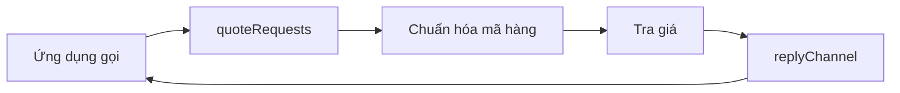

# Reply channel header

Trong chương **MessagingTemplate** của **SPRING_INTEGRATION_CORE**, `replyChannel` là địa chỉ để một endpoint gửi kết quả về bên yêu cầu. Hiểu header này giúp nối đúng đường về của thông điệp qua transformer, service activator, router và aggregator, đồng thời phân biệt việc gửi thành công với việc nhận được phản hồi.

Bài học tập trung vào request–reply trong Spring Integration Core: tạo `Message`, chọn `MessageChannel`, gọi `MessagingTemplate`, cấu hình endpoint bằng Java DSL và quan sát kết quả. Ví dụ nghiệp vụ xuyên suốt là tra giá theo mã hàng.

## 1. Mục tiêu học tập

Sau bài này, bạn có thể:

- Đọc và thiết lập `MessageHeaders.REPLY_CHANNEL` đúng kiểu.
- Giải thích cách `sendAndReceive()` sử dụng kênh tạm cho từng lần gọi.
- Phân biệt địa chỉ trả lời trên message với `outputChannel` của endpoint.
- Tự tổ chức gửi và nhận khi dùng một kênh phản hồi do ứng dụng quản lý.
- Nhận diện các nguyên nhân khiến caller chờ hết hạn dù nghiệp vụ đã chạy.
- Viết kiểm thử chứng minh phản hồi đi đúng nơi và header được bảo toàn.

Các ví dụ dùng `spring-integration-core`, Spring Context và Java DSL. Phần kiểm thử cần JUnit Jupiter. Hãy dùng bộ phiên bản phụ thuộc tương thích do BOM của dự án quản lý. Các cấu hình thay thế trong bài là những phương án riêng; không đăng ký đồng thời nhiều flow cùng xử lý `quoteRequests` để thử từng phương án.

## 2. Header này biểu diễn điều gì?

`replyChannel` có tên chuẩn là `MessageHeaders.REPLY_CHANNEL`. Nó chỉ nơi nhận kết quả; payload vẫn chứa dữ liệu nghiệp vụ.

Hai cách biểu diễn thường gặp:

| Giá trị | Ví dụ | Cách sử dụng |
| --- | --- | --- |
| Đối tượng `MessageChannel` | Một `QueueChannel` cụ thể | Endpoint gửi trực tiếp vào đối tượng đó |
| Chuỗi tên kênh | `"namedReplies"` | Resolver tìm kênh trong ngữ cảnh ứng dụng |

Với service activator thông thường, tên không phân giải được gây `DestinationResolutionException`. Header này thể hiện mẫu **Return Address**. [Tài liệu Service Activator](https://docs.spring.io/spring-integration/reference/service-activator.html)

Ví dụ một yêu cầu tra giá:

```text
payload: "sku-007"
headers:
  replyChannel: <kênh nhận kết quả tra giá>
  requestId: "quote-42"
```

`requestId` ở đây là header nghiệp vụ tự đặt để đối soát. Địa chỉ và mã nhận diện là hai thông tin khác nhau: biết gửi về đâu chưa đủ để ghép đúng các yêu cầu đồng thời cùng dùng một hàng đợi.

Dùng builder để tạo message:

```java
QueueChannel replies = new QueueChannel(1);

Message<String> request = MessageBuilder.withPayload("sku-007")
        .setReplyChannel(replies)
        .setHeader("requestId", "quote-42")
        .build();

Object returnAddress =
        request.getHeaders().get(MessageHeaders.REPLY_CHANNEL);
```

Các import tương ứng:

```java
import org.springframework.integration.channel.QueueChannel;
import org.springframework.messaging.Message;
import org.springframework.messaging.MessageHeaders;
import org.springframework.messaging.support.MessageBuilder;
```

`MessageHeaders` là bất biến ở API thông thường. Không gọi `request.getHeaders().put(...)`; hãy dựng message mới khi cần thay đổi header. [API MessageHeaders](https://docs.spring.io/spring-framework/docs/current/javadoc-api/org/springframework/messaging/MessageHeaders.html)

## 3. Endpoint chọn nơi gửi kết quả theo thứ tự nào?

Đối với service activator trả kết quả, không cấu hình routing slip hay chiến lược định tuyến đặc biệt, thứ tự là:

1. Dùng `outputChannel` của endpoint nếu có.
2. Nếu không, tìm `replyChannel` trên request.
3. Nếu request thiếu header này và kết quả là một `Message`, xét `replyChannel` trên kết quả.

Đặt header trên reply không thay thế được địa chỉ đã có trên request theo quy tắc trên. [Quy tắc trả lời của Service Activator](https://docs.spring.io/spring-integration/reference/service-activator.html)

| Tình huống của endpoint | Nơi đi tiếp |
| --- | --- |
| Có `outputChannel = nextStep` và request có `replyChannel = caller` | `nextStep` |
| Không có output, request có `replyChannel = caller` | `caller` |
| Request thiếu địa chỉ, reply là message có địa chỉ | Địa chỉ trên reply |
| Có kết quả nhưng không tìm được nơi gửi | Lỗi xác định đích |
| Handler không tạo kết quả | Không có reply để gửi |

Ở một pipeline tra giá, các endpoint giữa luồng cần gửi sang bước kế tiếp. Chỉ endpoint hoàn tất công việc mới gửi kết quả cuối về caller. Vì vậy header có thể đi qua nhiều bước mà chưa được dùng làm đích ngay.



Không suy diễn rằng mọi `MessageHandler` đều tự xử lý header này. Một handler do ứng dụng viết vẫn phải có logic gửi kết quả hoặc được bọc trong endpoint hỗ trợ sinh phản hồi.

## 4. MessagingTemplate.sendAndReceive() quản lý đường về

Ứng dụng thường gọi:

```java
Message<?> reply = template.sendAndReceive(
        requests,
        MessageBuilder.withPayload("sku-007").build());
```

Không cần đặt sẵn `replyChannel`: template tạo một kênh tạm cho lần trao đổi đó. [Giới thiệu MessagingTemplate](https://docs.spring.io/spring-integration/reference/7.0/channel/template.html)

Có thể hình dung kênh tạm như một ô nhận kết quả riêng của lần tra giá hiện tại. Lời gọi thứ hai có một ô riêng khác, nên hai caller không phải tranh nhau đọc một hàng đợi phản hồi chung.

Về triển khai, `GenericMessagingTemplate` lưu header reply/error ban đầu, đưa kênh tạm vào cả hai header của request gửi đi, rồi nhận kết quả từ kênh đó. Trên message trả về cho caller, các header được khôi phục về giá trị ban đầu; giá trị ban đầu không tồn tại thì header tương ứng được bỏ. [Mã nguồn GenericMessagingTemplate](https://github.com/spring-projects/spring-framework/blob/main/spring-messaging/src/main/java/org/springframework/messaging/core/GenericMessagingTemplate.java)

Điều này tạo ra hai tình huống dễ gây nhầm:

- Caller không đặt `replyChannel`, nhưng endpoint vẫn nhận được header do template bổ sung.
- Caller đọc reply và không thấy header kênh tạm, dù đường về đã hoạt động đúng.

### 4.1. Đặt QueueChannel trước khi gọi sendAndReceive() có tác dụng gì?

Giả sử bạn tạo request có `replyChannel = applicationReplies`, rồi gọi `sendAndReceive()`. Template vẫn dùng kênh tạm trong lần trao đổi này. Reply trả về có thể mang lại header `applicationReplies` đã khôi phục, nhưng điều đó không có nghĩa reply đã được gửi vào hàng đợi ấy.

Hãy phân biệt:

```text
Header trên message trả về:
    thông tin địa chỉ đã khôi phục

Message có mặt trong một QueueChannel:
    kết quả của một thao tác gửi vào hàng đợi đó
```

Nếu ứng dụng muốn tự đọc `applicationReplies`, hãy tổ chức `send()` và `receive()` riêng như phần 6.

## 5. Ví dụ hoàn chỉnh bằng Java DSL

Ví dụ dưới đây chuẩn hóa mã hàng, tạo một kết quả giá giả lập và trả về cho caller. Đây là lớp cấu hình độc lập; không cần broker hay cơ sở dữ liệu.

```java
import java.util.Locale;

import org.springframework.context.annotation.AnnotationConfigApplicationContext;
import org.springframework.context.annotation.Bean;
import org.springframework.context.annotation.Configuration;
import org.springframework.integration.channel.DirectChannel;
import org.springframework.integration.config.EnableIntegration;
import org.springframework.integration.core.MessagingTemplate;
import org.springframework.integration.dsl.IntegrationFlow;
import org.springframework.messaging.Message;
import org.springframework.messaging.support.MessageBuilder;

@Configuration
@EnableIntegration
public class ReplyChannelLab {

    @Bean
    public DirectChannel quoteRequests() {
        return new DirectChannel();
    }

    @Bean
    public IntegrationFlow quoteFlow(DirectChannel quoteRequests) {
        return IntegrationFlow.from(quoteRequests)
                .transform(String.class,
                        sku -> sku.trim().toUpperCase(Locale.ROOT))
                .handle(String.class,
                        (sku, headers) -> "PRICE[" + sku + "]=125000",
                        endpoint -> endpoint.requiresReply(true))
                .get();
    }

    @Bean
    public MessagingTemplate messagingTemplate() {
        MessagingTemplate template = new MessagingTemplate();
        template.setSendTimeout(1_000);
        template.setReceiveTimeout(1_000);
        template.setThrowExceptionOnLateReply(true);
        return template;
    }

    public static void main(String[] args) {
        try (var context =
                new AnnotationConfigApplicationContext(ReplyChannelLab.class)) {

            MessagingTemplate template =
                    context.getBean(MessagingTemplate.class);
            DirectChannel requests =
                    context.getBean("quoteRequests", DirectChannel.class);

            Message<?> reply = template.sendAndReceive(
                    requests,
                    MessageBuilder.withPayload(" sku-007 ").build());

            if (reply == null) {
                throw new IllegalStateException("Không nhận được kết quả tra giá");
            }

            System.out.println(reply.getPayload());
        }
    }
}
```

Kết quả mong đợi:

```text
PRICE[SKU-007]=125000
```

Theo dõi đúng ví dụ này:

1. Caller tạo yêu cầu có payload `" sku-007 "`.
2. Template cấp đường về tạm.
3. Transformer tạo mã `"SKU-007"`.
4. Service activator tạo chuỗi kết quả giá.
5. Endpoint cuối không khai báo output riêng nên trả về theo địa chỉ của request.
6. Caller nhận `Message<?>`, kiểm tra có kết quả rồi mới đọc payload.

Không cần thêm `.channel("replyChannel")` vào cuối flow. Chuỗi `"replyChannel"` trong lời gọi đó sẽ được hiểu là tên một kênh cụ thể trong cấu hình, trong khi header là thuộc tính của từng message.

## 6. Tự quản lý kênh phản hồi với send() và receive()

Khi muốn kiểm soát nơi lưu kết quả, ứng dụng có thể tạo một hàng đợi riêng và đặt nó làm địa chỉ trả lời. Với context ở phần 5 đã chạy:

```java
QueueChannel replies = new QueueChannel(1);

Message<String> request = MessageBuilder.withPayload(" sku-007 ")
        .setReplyChannel(replies)
        .setHeader("requestId", "quote-42")
        .build();

template.send(requests, request);

Message<?> reply = replies.receive(1_000);
if (reply == null) {
    throw new IllegalStateException("Hết thời gian chờ giá");
}

System.out.println(reply.getPayload());
```

Ở đây ứng dụng thực hiện hai thao tác tách biệt. `send()` không tự tạo cơ chế chờ trả lời như `sendAndReceive()`. Địa chỉ là đối tượng `replies` đã cấp cho request.

`QueueChannel(1)` chứa được một thông điệp, nên ví dụ vẫn hoạt động khi handler hoàn tất ngay trong lời gọi `send()`: kết quả nằm trong queue trước lúc caller bắt đầu nhận. `receive(1_000)` chờ tối đa 1.000 ms nếu queue đang rỗng. [QueueChannel và các kiểu kênh](https://docs.spring.io/spring-integration/reference/channel/implementations.html)

### 6.1. Dùng tên bean

Nếu ứng dụng đã đăng ký:

```java
@Bean
public QueueChannel namedReplies() {
    return new QueueChannel(10);
}
```

Thì request có thể dùng:

```java
Message<String> request = MessageBuilder.withPayload("sku-007")
        .setReplyChannelName("namedReplies")
        .build();
```

Endpoint phải chạy trong context có resolver phân giải được tên đó. Một chuỗi tên kênh không phải URL, tên topic Kafka hoặc tên hàng đợi JMS mặc định.

### 6.2. Cẩn thận với queue dùng chung

Một queue chung nhận các kết quả theo thứ tự chúng đến. Ví dụ A yêu cầu giá điện thoại, B yêu cầu giá bàn phím; nếu kết quả B đến trước, A có thể đọc nhầm nếu chỉ lấy phần tử đầu queue.

Để tự thiết kế mô hình này, cần một cơ chế ghép `requestId` với nơi nhận đang chờ, quản lý hết hạn và loại kết quả đến muộn. Thêm header correlation mà không có thành phần thực hiện ghép nối sẽ không giải quyết việc đọc nhầm. Với trao đổi đơn giản trong cùng ứng dụng, `sendAndReceive()` giảm đáng kể phần quản lý này.

## 7. outputChannel làm phản hồi đi sang nhánh khác

Xét một biến thể của flow tra giá:

```java
@Bean
public QueueChannel fixedReplies() {
    return new QueueChannel(10);
}

@Bean
public IntegrationFlow redirectedQuoteFlow(
        DirectChannel quoteRequests, QueueChannel fixedReplies) {

    return IntegrationFlow.from(quoteRequests)
            .handle(String.class,
                    (sku, headers) -> "PRICE[" + sku + "]=125000")
            .channel(fixedReplies)
            .get();
}
```

Dùng flow này **thay cho** `quoteFlow` ở phần 5. Handler gửi kết quả vào `fixedReplies`; caller gọi `sendAndReceive()` vẫn đợi ở đường về tạm của mình. Nếu không có bước chuyển tiếp, caller chờ hết hạn dù `fixedReplies` đã có kết quả.

Nếu queue đó chỉ là một bước trung gian có chủ đích, có thể bổ sung consumer nối tiếp:

```java
import org.springframework.integration.dsl.Pollers;

@Bean
public IntegrationFlow forwardFixedReplies(QueueChannel fixedReplies) {
    return IntegrationFlow
            .from(fixedReplies,
                    endpoint -> endpoint.poller(Pollers.fixedDelay(50)))
            .bridge()
            .get();
}
```

Bridge ở cuối gửi message tiếp theo địa chỉ trả lời còn trên nó. Queue đầu vào cần poller để có consumer lấy thông điệp ra.

Trong thiết kế tra giá đơn giản, không cần thêm queue trung gian này. Nó chỉ phù hợp khi bạn muốn có một điểm đệm và đã xác định rõ ai tiếp tục xử lý. Việc lưu kết quả trong queue chưa hoàn thành nghĩa vụ trả lời caller.

## 8. Giữ header khi biến đổi message

Với transformer chỉ trả payload, framework có thể tạo message kết quả từ dữ liệu mới cùng header của request. Khi transformer trả về một `Message` hoàn chỉnh, bạn phải chú ý chính các header trên message đó. [Transformer trong Spring Integration](https://docs.spring.io/spring-integration/reference/transformer.html)

Ví dụ phương thức tự tạo kết quả:

```java
public Message<String> normalize(Message<String> input) {
    return MessageBuilder
            .withPayload(input.getPayload().trim().toUpperCase(Locale.ROOT))
            .copyHeaders(input.getHeaders())
            .build();
}
```

Ngược lại, một message được tạo chỉ từ payload:

```java
public Message<String> normalizeWithoutHeaders(Message<String> input) {
    return new GenericMessage<>(
            input.getPayload().trim().toUpperCase(Locale.ROOT));
}
```

Không mang theo `replyChannel`, `errorChannel` hay `requestId` của input. Dùng phương thức này làm transformer giữa flow có thể khiến bước tra giá phía sau nhận dữ liệu hợp lệ nhưng thiếu đường về. Import của lớp trong ví dụ thứ hai là `org.springframework.messaging.support.GenericMessage`.

Cần xem cả vị trí endpoint: chính transformer vẫn có thể tìm địa chỉ trên request của nó khi gửi output, nhưng message đã tạo mới đi đến endpoint kế tiếp có thể thiếu header. Vì vậy quan sát payload đúng ở cuối pipeline chưa chứng minh đường trả lời còn nguyên.

Nếu chỉ sửa header mà giữ payload, dùng:

```java
Message<?> enriched = MessageBuilder.fromMessage(input)
        .setHeader("validated", true)
        .build();
```

### 8.1. Ghi đè địa chỉ trong flow

Java DSL cho phép:

```java
.enrichHeaders(headers -> headers.replyChannel("manualReplies", true))
```

Tham số `true` yêu cầu ghi đè giá trị có sẵn; overload không chỉ định overwrite thường giữ header đã tồn tại. [API HeaderEnricherSpec](https://docs.spring.io/spring-integration/docs/current/api/org/springframework/integration/dsl/HeaderEnricherSpec.html)

Nếu request đang thuộc một lời gọi `sendAndReceive()`, ghi đè như vậy có thể chuyển reply ra khỏi kênh mà caller đang đợi. Trong ví dụ tra giá, chỉ nên thay địa chỉ khi yêu cầu nghiệp vụ thực sự chuyển quyền nhận kết quả sang một thành phần khác và thiết kế đã có đường kết thúc cho caller ban đầu.

## 9. Kiểu channel, timeout và phản hồi đến muộn

### 9.1. Request channel và reply channel có vai trò khác nhau

`DirectChannel` dispatch tới handler ngay trên thread gửi; nó không phải `PollableChannel` để caller đọc bằng `receive()`. Một `QueueChannel` có thể được poll để nhận message. [API và cách thực thi của các channel](https://docs.spring.io/spring-integration/reference/channel/implementations.html)

Ví dụ phần 5 dùng:

| Vị trí | Lựa chọn | Lý do |
| --- | --- | --- |
| Request | `DirectChannel` | Chạy pipeline đơn giản trên thread caller |
| Đường về của template | Kênh tạm do template quản lý | Caller nhận kết quả của lần gọi hiện tại |
| Đường về tự quản lý | `QueueChannel(1)` riêng | Cho phép lưu một kết quả trước khi caller đọc |

Nếu đổi request sang `QueueChannel`, cần consumer và poller. Nếu đổi sang `ExecutorChannel`, cần executor phù hợp và cách xử lý lỗi khi chuyển thread. Thay kiểu kênh không tự tạo phần xử lý còn thiếu.

### 9.2. receiveTimeout không phải deadline của toàn bộ nghiệp vụ

Trong triển khai template, thao tác gửi request diễn ra trước thao tác nhận kết quả. Vì thế nếu flow chạy đồng bộ và handler tra giá bị chặn 5 giây, `receiveTimeout = 1.000 ms` không tự ngắt handler sau một giây. [Trình tự send/receive trong GenericMessagingTemplate](https://github.com/spring-projects/spring-framework/blob/main/spring-messaging/src/main/java/org/springframework/messaging/core/GenericMessagingTemplate.java)

Phân biệt ba giới hạn:

| Giới hạn | Điều cần kiểm soát |
| --- | --- |
| `sendTimeout` | Thao tác gửi khi loại channel hỗ trợ chờ |
| `receiveTimeout` | Chờ kết quả tại phía nhận của template |
| Timeout của HTTP/DB hoặc nghiệp vụ | Thời gian thao tác thực tế trong handler |

Ví dụ dịch vụ giá gọi HTTP phải có timeout HTTP riêng. Việc caller không tiếp tục chờ cũng không tự hủy một thay đổi dữ liệu đã chạy ở downstream.

### 9.3. Kết quả đến sau khi caller đã hết chờ

Template hỗ trợ `setThrowExceptionOnLateReply(true)` để báo lỗi khi gửi reply mà phía chờ không còn nhận được, chẳng hạn đã timeout hoặc đã nhận một kết quả. Ngoại lệ xuất hiện ở thread đang gửi reply; nó không làm caller đã kết thúc quay lại chờ. [API GenericMessagingTemplate](https://docs.spring.io/spring-framework/docs/current/javadoc-api/org/springframework/messaging/core/GenericMessagingTemplate.html)

Hợp đồng tra giá nên có một kết quả cuối cho mỗi yêu cầu. Nếu một request fan-out thành nhiều nhánh, cần tập hợp chúng trước đường trả lời, thay vì cho mọi nhánh cùng trả vào kênh tạm.

## 10. replyChannel và errorChannel

Hai header có mục đích khác nhau:

| Header | Ý nghĩa |
| --- | --- |
| `replyChannel` | Đích cho kết quả xử lý |
| `errorChannel` | Đích cho `ErrorMessage` khi cơ chế xử lý lỗi xuất bản lỗi thành thông điệp |

Trong flow đồng bộ trên thread caller, lỗi có thể được ném trực tiếp từ lời gọi template. Sau ranh giới bất đồng bộ, framework có thể biểu diễn lỗi thành `ErrorMessage`; việc tìm kênh lỗi ưu tiên header `errorChannel` của request, rồi tới kênh lỗi toàn cục nếu không có header. [Error Handling](https://docs.spring.io/spring-integration/reference/error-handling.html)

Với `sendAndReceive()`, cơ chế kênh tạm ở phần 4 còn áp dụng cho header lỗi. Vì vậy không giả định rằng mọi kết quả khác `null` đều là dữ liệu tra giá thành công. Nếu một thành phần bất đồng bộ đã đưa `ErrorMessage` về, ứng dụng phải nhận diện nó:

```java
import org.springframework.messaging.support.ErrorMessage;

Message<?> reply = template.sendAndReceive(requests, request);

if (reply == null) {
    throw new IllegalStateException("Không có kết quả trong thời gian chờ");
}
if (reply instanceof ErrorMessage error) {
    throw new IllegalStateException("Tra giá thất bại", error.getPayload());
}

Object quote = reply.getPayload();
```

Đây là kiểm tra kết quả nhận được, không thay thế việc bắt ngoại lệ từ lời gọi đồng bộ. Cũng không áp dụng suy luận tự động unwrap lỗi của một gateway cho mọi lời gọi `MessagingTemplate`: hai API có hợp đồng khác nhau.

## 11. Router, filter và aggregator có thể làm đứt đường về ở đâu?

Trong một hệ thống tra giá thực tế, header còn đúng chưa đủ bảo đảm có câu trả lời.

| Thành phần | Ví dụ nghiệp vụ | Câu hỏi cần giải quyết |
| --- | --- | --- |
| Router | Chọn bảng giá bán lẻ hoặc bán sỉ | Nhánh nào tạo kết quả cuối? |
| Filter | Loại mã hàng không hợp lệ | Caller sẽ nhận lỗi, kết quả từ chối hay chỉ timeout? |
| Aggregator | Gộp giá từ nhiều nhà cung cấp | Khi nào nhóm đủ điều kiện kết thúc? |

Một filter loại yêu cầu rồi chỉ ghi log có thể để caller tra giá chờ tới hạn. Thiết kế dễ hiểu hơn là nhánh từ chối tạo một kết quả nghiệp vụ, chẳng hạn `REJECTED`, hoặc phát sinh lỗi theo chính sách đã chọn.

Với aggregator, nhóm có thể chưa hoàn tất vì thiếu một nhà cung cấp. Cần xác định correlation, điều kiện release, xử lý nhóm quá hạn và header của message tổng hợp. Một `requestId` dành riêng cho lượt tra giá giúp tránh ghép kết quả của hai caller chỉ vì cùng hỏi một SKU.

Các tình huống này phải được kiểm thử theo đường đi thực tế. Không sửa timeout trước khi xác định liệu flow có tạo ra reply hay không.

Nếu service activator bắt buộc trả kết quả, `requiresReply(true)` giúp phát hiện trường hợp trả `null` bằng `ReplyRequiredException`. Nó không bổ sung kết quả cho một nhánh filter bị discard hoặc tự hoàn thành một nhóm aggregator đang chờ. [API ReplyRequiredException](https://docs.spring.io/spring-integration/docs/current/api/org/springframework/integration/handler/ReplyRequiredException.html)

## 12. Flow lồng nhau và ranh giới ngoài tiến trình

### 12.1. Dùng gateway khi flow cần gọi flow khác

Ví dụ flow bán hàng gọi một flow tra giá rồi tiếp tục tính tổng. Java DSL có `gateway()` để gửi vào input của flow khác, chờ reply và tiếp tục flow hiện tại. [Operator gateway()](https://docs.spring.io/spring-integration/reference/dsl/java-gateway.html)

Về mặt thiết kế, flow con chỉ cần trả kết quả cho bên gọi trực tiếp. Không nên tự giữ một tên kênh toàn cục rồi ép mọi flow con gửi vào đó; cách này làm việc tái sử dụng phụ thuộc vào nơi gọi.

Ở biên ứng dụng, messaging gateway còn có thể đưa ra interface nghiệp vụ, che API thông điệp với caller. Gateway có cấu hình reply riêng và bridge nội bộ khi dùng kênh trả lời được khai báo. Không coi cấu hình đó tương đương với việc đặt sẵn header cho một lần gọi `MessagingTemplate.sendAndReceive()`. [Messaging Gateways](https://docs.spring.io/spring-integration/reference/gateway.html)

### 12.2. Không mang tham chiếu kênh Java qua mạng

Một đối tượng kênh trong header thuộc runtime đang chạy. Ghi message xuống store hoặc chuyển qua transport cần quan tâm cách lưu và ánh xạ header.

Spring Integration hỗ trợ Header Channel Registry để chuyển tham chiếu reply/error channel thành chuỗi có thể phân giải lại. Mapping có thời hạn; cần thiết kế thời gian giữ phù hợp. [Header Channel Registry](https://docs.spring.io/spring-integration/reference/content-enrichment.html#header-channel-registry)

Đoạn DSL minh họa, đặt trước ranh giới cần lưu/chuyển message:

```java
.enrichHeaders(headers -> headers.headerChannelsToString())
```

Suy ra từ vai trò registry: một token chỉ hữu ích ở nơi có mapping tương ứng. Nó không tự tạo một địa chỉ trả lời dùng được trên mọi JVM. Với hệ thống qua broker, phải thiết kế reply destination và correlation của transport, rồi đưa phản hồi về đúng runtime đang chờ. [API chuyển header channel sang chuỗi](https://docs.spring.io/spring-integration/docs/current/api/org/springframework/integration/dsl/HeaderEnricherSpec.html)

## 13. Kiểm thử minh họa hợp đồng trả lời

Lớp dưới dùng cấu hình `ReplyChannelLab` ở phần 5. Mỗi test tạo context riêng để các message không ảnh hưởng lẫn nhau.

```java
import org.junit.jupiter.api.AfterEach;
import org.junit.jupiter.api.BeforeEach;
import org.junit.jupiter.api.Test;
import org.springframework.context.annotation.AnnotationConfigApplicationContext;
import org.springframework.integration.channel.DirectChannel;
import org.springframework.integration.channel.QueueChannel;
import org.springframework.integration.core.MessagingTemplate;
import org.springframework.messaging.Message;
import org.springframework.messaging.support.MessageBuilder;

import static org.junit.jupiter.api.Assertions.*;

class ReplyChannelLabTest {

    private AnnotationConfigApplicationContext context;
    private MessagingTemplate template;
    private DirectChannel requests;

    @BeforeEach
    void openContext() {
        context = new AnnotationConfigApplicationContext(ReplyChannelLab.class);
        template = context.getBean(MessagingTemplate.class);
        requests = context.getBean("quoteRequests", DirectChannel.class);
    }

    @AfterEach
    void closeContext() {
        context.close();
    }

    @Test
    void receivesReplyWithoutAnExplicitReturnAddress() {
        Message<?> reply = template.sendAndReceive(
                requests,
                MessageBuilder.withPayload(" sku-007 ").build());

        assertNotNull(reply);
        assertEquals("PRICE[SKU-007]=125000", reply.getPayload());
        assertNull(reply.getHeaders().getReplyChannel());
    }

    @Test
    void sendsReplyToTheApplicationQueueWhenUsingSend() {
        QueueChannel replies = new QueueChannel(1);
        Message<String> request = MessageBuilder.withPayload("sku-007")
                .setReplyChannel(replies)
                .setHeader("requestId", "quote-42")
                .build();

        template.send(requests, request);

        Message<?> reply = replies.receive(1_000);
        assertNotNull(reply);
        assertEquals("PRICE[SKU-007]=125000", reply.getPayload());
        assertEquals("quote-42", reply.getHeaders().get("requestId"));
        assertNull(replies.receive(0));
    }

    @Test
    void restoresTheOriginalHeaderWithoutEnqueuingTheReplyThere() {
        QueueChannel originalReplies = new QueueChannel(1);
        Message<String> request = MessageBuilder.withPayload("sku-007")
                .setReplyChannel(originalReplies)
                .build();

        Message<?> reply = template.sendAndReceive(requests, request);

        assertNotNull(reply);
        assertEquals("PRICE[SKU-007]=125000", reply.getPayload());
        assertSame(originalReplies, reply.getHeaders().getReplyChannel());
        assertSame(originalReplies, request.getHeaders().getReplyChannel());
        assertNull(originalReplies.receive(0));
    }
}
```

Ba test kiểm tra ba hành vi khác nhau:

- Request không đặt địa chỉ vẫn nhận được kết quả nhờ template.
- `send()` tôn trọng địa chỉ do ứng dụng cấp trong flow đang xét.
- Header được khôi phục trên reply không chứng minh queue ban đầu đã nhận message.

Khi mở rộng bài thực hành, thêm tình huống chuyển output sang queue riêng, làm mất header giữa hai endpoint, và xử lý yêu cầu bị từ chối. Với xử lý bất đồng bộ, nên phối hợp thread bằng latch hoặc công cụ chờ điều kiện; tránh dùng sleep cố định làm bằng chứng rằng một reply chắc chắn chưa đến.

Các đoạn test này là mã thực hành minh họa trong tài liệu; chúng cần được chạy trong dự án Java có các phụ thuộc nêu ở đầu bài.

## 14. Chẩn đoán khi caller không nhận được kết quả

Đi theo đường của một `requestId`, từ input tới điểm tạo kết quả và đích gửi cuối:

| Biểu hiện | Điều cần kiểm tra |
| --- | --- |
| Handler chạy xong, caller trả `null` | Output riêng hoặc header bị thay đổi có đưa reply ra ngoài đường chờ không? |
| Kết quả nằm trong queue riêng | Queue đó là đích cuối hay còn consumer chuyển tiếp? |
| Không có handler chạy | Channel có subscriber, poller hoặc executor phù hợp chưa? |
| Sau transformer mất `requestId` và địa chỉ | Có tự dựng message chỉ từ payload không? |
| Một số mã hàng luôn timeout | Nhánh router/filter có bỏ qua việc phản hồi không? |
| Kết quả trả về có payload ngoại lệ | Có nhận `ErrorMessage` từ ranh giới bất đồng bộ không? |
| Thời gian gọi dài hơn `receiveTimeout` | Handler đồng bộ có chặn ngay trong pha gửi không? |
| Có cảnh báo reply tới muộn | Caller đã timeout hoặc có nhiều reply cho một yêu cầu không? |

Khi quan sát header, ghi nhận nó là đối tượng channel hay chuỗi tên. Đừng chỉ tìm một bean có tên `replyChannel`: đường về có thể là kênh vô danh của template.

## 15. Những điểm cần ghi nhớ

- `replyChannel` gắn địa chỉ trả lời với từng message.
- Endpoint giữa pipeline thường đi tiếp bằng output; điểm cuối mới trả cho caller.
- `sendAndReceive()` quản lý kênh tạm và việc chờ kết quả của lần gọi.
- Muốn tự đọc một queue đã chọn thì tổ chức `send()` và `receive()` cùng cơ chế ghép yêu cầu khi cần.
- Giữ header qua các bước tạo message mới và xác định rõ đường trả lời của mọi nhánh nghiệp vụ.
- Phân biệt không có phản hồi, phản hồi lỗi và phản hồi thành công.