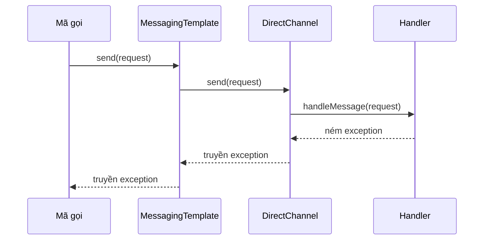
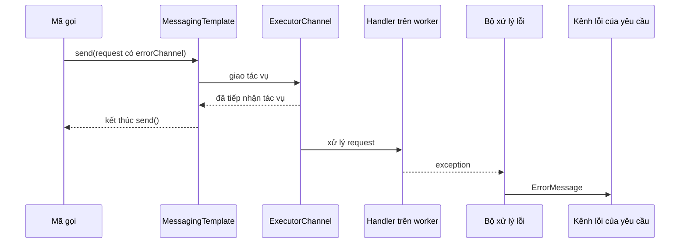

# Error channel trong template

Trong module `SPRING_INTEGRATION_CORE`, `MessagingTemplate` là cầu nối để mã Java chủ động gửi hoặc nhận `Message` qua `MessageChannel`. Khi thêm xử lý lỗi, cần xác định rõ lỗi xảy ra trên luồng thực thi nào và ứng dụng đang dùng `send()` hay `sendAndReceive()`. Hai lựa chọn này quyết định người gọi nhận exception, một `ErrorMessage`, hay không nhận được phản hồi.

Bài này tập trung vào hợp đồng lỗi tại ranh giới template, cách đặt header `errorChannel`, cách đọc thông điệp lỗi và cách kiểm thử hành vi. Các ví dụ dùng Java 17+, API Spring Integration 6.5 và Spring Framework 6.2; phiên bản phụ thuộc thực tế cần được quản lý nhất quán trong ứng dụng.

## 1. Kết quả cần đạt

Sau bài học, bạn có thể:

- Phân biệt exception đồng bộ với lỗi được phát thành thông điệp ở phía xử lý bất đồng bộ.
- Chọn error channel cho một yêu cầu gửi bằng `MessagingTemplate.send()`.
- Giải thích vì sao `sendAndReceive()` có thể không dùng error channel bạn đặt trên thông điệp đầu vào.
- Đọc `ErrorMessage`, thông điệp thất bại và nguyên nhân gốc mà không nhầm chúng với phản hồi thành công.
- Thiết kế đường xử lý lỗi có correlation, timeout và kiểm thử phù hợp.

Điều kiện nền tảng: biết payload/header của `Message`, sự khác nhau giữa `DirectChannel`, `ExecutorChannel`, `QueueChannel` và cách khai báo một `IntegrationFlow` bằng Java DSL.

## 2. Trước hết, xác định nơi exception xuất hiện

### 2.1. Luồng xử lý đồng bộ

Với `DirectChannel`, handler chạy trên thread của người gửi. Nếu handler ném exception, exception truyền ngược theo call stack đến lệnh gọi template. Chỉ đặt header `errorChannel` không tạo ra cơ chế tự bắt lỗi tại đây. Đây là hành vi mặc định khi chưa có advice hoặc thành phần khác chủ động chuyển lỗi thành thông điệp. [Tài liệu Error Handling](https://docs.spring.io/spring-integration/reference/6.5/error-handling.html).



Trong thiết kế này, `try/catch` quanh thao tác template có ý nghĩa: nó bao quanh cả việc gửi và thực thi handler đồng bộ.

### 2.2. Luồng xử lý bất đồng bộ

Với `ExecutorChannel` được quản lý bởi Spring và dùng thread pool, handler được thực thi qua executor. Kênh tích hợp cơ chế xử lý lỗi cho tác vụ; lỗi phát sinh trong handler có thể được chuyển thành `ErrorMessage`. `try/catch` quanh `send()` không bao quanh công việc chạy sau đó trên worker thread. [Mã nguồn ExecutorChannel](https://github.com/spring-projects/spring-integration/blob/v6.5.0/spring-integration-core/src/main/java/org/springframework/integration/channel/ExecutorChannel.java).



Sơ đồ minh họa một thứ tự có thể xảy ra. Worker có thể xử lý rất nhanh, kể cả trước khi `send()` trả về; điều quyết định vẫn là ranh giới thread, không phải thứ tự quan sát trên log.

### 2.3. Bảng lựa chọn tại ranh giới template

| Trường hợp mặc định | Người gọi quan sát gì? | Hướng thiết kế |
| --- | --- | --- |
| `send()` qua `DirectChannel`, handler lỗi | Exception từ lời gọi | Bắt lỗi ở caller hoặc bổ sung chính sách xử lý tại endpoint |
| `send()` qua `ExecutorChannel`, handler lỗi sau khi giao tác vụ | Lời gọi gửi có thể đã kết thúc; lỗi đi qua cơ chế xử lý tác vụ | Đặt error channel theo yêu cầu, bố trí consumer lỗi |
| `send()` vào `QueueChannel`, consumer dùng poller của Spring Integration | Đưa vào queue và xử lý nghiệp vụ là hai giai đoạn | Cấu hình poller và chính sách lỗi phù hợp |
| `sendAndReceive()` qua luồng bất đồng bộ | Caller chờ thông điệp kết quả, có thể là `ErrorMessage` | Phân loại kết quả trước khi đọc payload nghiệp vụ |

`QueueChannel` tự nó chỉ lưu thông điệp. Nếu bạn tự gọi `receive()` rồi tự gọi một dịch vụ, exception của dịch vụ vẫn thuộc mã do bạn điều khiển; queue không tự biến exception đó thành `ErrorMessage`. [Ngữ nghĩa QueueChannel](https://docs.spring.io/spring-integration/reference/6.5/channel/implementations.html).

## 3. Hiểu đúng header `errorChannel`

Ba khái niệm sau có cùng chữ “error channel” nhưng vai trò khác nhau:

| Khái niệm | Vị trí | Vai trò |
| --- | --- | --- |
| Header `errorChannel` | Trên thông điệp yêu cầu | Chỉ đích nhận lỗi cho yêu cầu đó khi thành phần xử lý lỗi tra cứu header |
| Bean tên `errorChannel` | Trong Spring application context | Kênh lỗi toàn cục dùng khi không có đích lỗi riêng theo cơ chế mặc định |
| `ErrorMessage` | Thông điệp được phát khi xử lý lỗi | Mang một `Throwable` làm payload |

Đối với `MessagePublishingErrorHandler` mặc định, header lỗi trên thông điệp thất bại được ưu tiên; nếu không có thì dùng kênh mặc định, thông thường là bean `errorChannel`. Giá trị header có thể là đối tượng `MessageChannel` hoặc tên kênh được resolver tra cứu. Đặt tên sai hoặc truyền kiểu không hợp lệ là lỗi cấu hình, không phải yêu cầu tự động chuyển sang kênh toàn cục. [Mã nguồn bộ xử lý lỗi](https://github.com/spring-projects/spring-integration/blob/v6.5.0/spring-integration-core/src/main/java/org/springframework/integration/channel/MessagePublishingErrorHandler.java).

```java
Message<String> request = MessageBuilder.withPayload("BAD-42")
        .setHeader("orderId", "BAD-42")
        .setErrorChannel(orderErrors)
        .setReplyChannelName("nullChannel")
        .build();

template.send(asyncInput, request);
```

Ở đây:

- `orderErrors` là một kênh riêng để quan sát lỗi của nhóm yêu cầu này.
- `orderId` là mã nghiệp vụ phục vụ đối chiếu; không phụ thuộc vào `id` của thông điệp.
- `replyChannel = nullChannel` thể hiện chủ ý bỏ phản hồi thông thường trong ví dụ gửi một chiều. Nó không có nghĩa là bỏ lỗi.

Đoạn mã dùng các biến sẽ được khai báo trong cấu hình ở phần tiếp theo.

## 4. Cấu hình Java DSL dùng chung cho thực hành

Tình huống: dịch vụ tiếp nhận mã đơn hàng. Mã bắt đầu bằng `BAD-` gây lỗi kiểm tra; các mã khác tạo phản hồi `ACCEPTED:<mã đơn>`.

Khai báo lớp sau trong `TemplateErrorConfig.java`. Ứng dụng cần `spring-integration-core`; phần kiểm thử phía dưới cần JUnit Jupiter. Nếu dùng Spring Boot, dùng cơ chế quản lý phụ thuộc của Boot để chọn bộ phiên bản tương thích.

```java
import org.springframework.context.annotation.Bean;
import org.springframework.context.annotation.Configuration;
import org.springframework.integration.channel.DirectChannel;
import org.springframework.integration.channel.ExecutorChannel;
import org.springframework.integration.channel.QueueChannel;
import org.springframework.integration.config.EnableIntegration;
import org.springframework.integration.core.MessagingTemplate;
import org.springframework.integration.dsl.IntegrationFlow;
import org.springframework.scheduling.concurrent.ThreadPoolTaskExecutor;

@Configuration
@EnableIntegration
public class TemplateErrorConfig {

    @Bean
    public MessagingTemplate messagingTemplate() {
        MessagingTemplate template = new MessagingTemplate();
        template.setSendTimeout(1_000);
        template.setReceiveTimeout(2_000);
        template.setThrowExceptionOnLateReply(true);
        return template;
    }

    @Bean
    public DirectChannel directInput() {
        return new DirectChannel();
    }

    @Bean
    public ThreadPoolTaskExecutor integrationExecutor() {
        ThreadPoolTaskExecutor executor = new ThreadPoolTaskExecutor();
        executor.setCorePoolSize(1);
        executor.setMaxPoolSize(1);
        executor.setQueueCapacity(10);
        executor.setThreadNamePrefix("orders-");
        return executor;
    }

    @Bean
    public ExecutorChannel asyncInput(
            ThreadPoolTaskExecutor integrationExecutor) {
        return new ExecutorChannel(integrationExecutor);
    }

    @Bean
    public QueueChannel orderErrors() {
        return new QueueChannel(10);
    }

    @Bean
    public IntegrationFlow directOrders(DirectChannel directInput) {
        return IntegrationFlow.from(directInput)
                .handle(String.class,
                        (orderId, headers) -> validateOrder(orderId))
                .get();
    }

    @Bean
    public IntegrationFlow asyncOrders(ExecutorChannel asyncInput) {
        return IntegrationFlow.from(asyncInput)
                .handle(String.class,
                        (orderId, headers) -> validateOrder(orderId))
                .get();
    }

    private static String validateOrder(String orderId) {
        if (orderId.startsWith("BAD-")) {
            throw new IllegalArgumentException(
                    "Mã đơn không hợp lệ: " + orderId);
        }
        return "ACCEPTED:" + orderId;
    }
}
```

`@EnableIntegration` thiết lập hạ tầng tích hợp. Để `ExecutorChannel` và executor làm bean cho phép Spring khởi tạo, quản lý vòng đời và gắn cơ chế xử lý lỗi của kênh. Không cần tự gọi `initialize()` trên executor trong phương thức `@Bean` của ví dụ này.

`orderErrors` dùng queue nhỏ để người học chủ động đọc thông điệp lỗi. Đây là chỗ quan sát cho bài thực hành; một ứng dụng vận hành liên tục cần consumer hoặc nơi lưu lỗi phù hợp.

## 5. `send()`: tách lỗi lúc gửi khỏi lỗi lúc xử lý

### 5.1. Lỗi đồng bộ vẫn đến caller

Đoạn sau giả sử đã lấy `template`, `directInput` và `orderErrors` từ application context:

```java
Message<String> request = MessageBuilder.withPayload("BAD-42")
        .setHeader("orderId", "BAD-42")
        .setErrorChannel(orderErrors)
        .setReplyChannelName("nullChannel")
        .build();

try {
    template.send(directInput, request);
} catch (MessagingException exception) {
    Message<?> failed = exception.getFailedMessage();
    // Ghi nhận mã đơn, nguyên nhân và quyết định xử lý ở caller.
}
```

Handler của ví dụ ném lỗi trong lúc `send()` đang chạy. Header `errorChannel` vẫn có thể tồn tại trên request, nhưng không có bước tự động gửi lỗi vào `orderErrors` ở ranh giới này. Exception do framework bọc thường giữ exception nghiệp vụ trong chuỗi cause.

### 5.2. Lỗi bất đồng bộ đến kênh riêng

```java
template.send(asyncInput, request);

Message<?> received = orderErrors.receive(2_000);
if (received == null) {
    throw new IllegalStateException("Chưa nhận được thông điệp lỗi");
}
if (!(received instanceof ErrorMessage error)) {
    throw new IllegalStateException("Kênh lỗi nhận sai loại thông điệp");
}

Throwable failure = error.getPayload();
```

Với `request` có payload `BAD-42`, kết quả mong đợi là một `ErrorMessage` ở queue. `receive(2_000)` chỉ đợi tối đa hai giây để lấy thông điệp lỗi; nó không tự tạo lỗi nghiệp vụ khi hết thời gian.

`MessagingTemplate.send(...)` trả về `void`. Nếu việc gửi thất bại vì channel trả `false`, template chuyển thất bại đó thành `MessageDeliveryException`; không viết `boolean sent = template.send(...)`. Khác biệt này thể hiện trong phần triển khai `doSend`. [Mã nguồn GenericMessagingTemplate](https://github.com/spring-projects/spring-framework/blob/v6.2.7/spring-messaging/src/main/java/org/springframework/messaging/core/GenericMessagingTemplate.java).

Cần giữ hai nhánh xử lý trong thiết kế:

- Lỗi trước hoặc trong lúc giao thông điệp: caller có thể phải xử lý ngay, chẳng hạn giao tác vụ bị từ chối.
- Lỗi nghiệp vụ trong worker sau khi giao tác vụ: consumer trên error channel chịu trách nhiệm.

Một lần `send()` kết thúc bình thường chỉ có ý nghĩa theo ngữ nghĩa của kênh và ranh giới đang dùng. Với luồng bất đồng bộ, điều đó chưa chứng minh đơn hàng đã xử lý thành công.

## 6. `sendAndReceive()`: kênh tạm ảnh hưởng cả phản hồi lẫn lỗi

### 6.1. Vì sao kênh lỗi riêng không nhận được thông điệp?

`MessagingTemplate` kế thừa cơ chế request–reply của `GenericMessagingTemplate`. Khi gửi request, cơ chế này thay cả `replyChannel` và `errorChannel` bằng cùng một kênh tạm. Trên reply trả về, nó khôi phục các giá trị header ban đầu. [Cơ chế request–reply trong GenericMessagingTemplate](https://github.com/spring-projects/spring-framework/blob/v6.2.7/spring-messaging/src/main/java/org/springframework/messaging/core/GenericMessagingTemplate.java).

Suy ra, với cấu hình mặc định của bài:

```text
request ban đầu:
  errorChannel = orderErrors

request thực sự gửi bởi sendAndReceive():
  replyChannel = kênh tạm
  errorChannel = kênh tạm

handler bất đồng bộ ném exception:
  ErrorMessage được chuyển về kênh tạm
  caller nhận thông điệp đó từ sendAndReceive()
```

Đây là lý do không thể lấy cách dùng `send()` rồi suy luận nguyên xi cho `sendAndReceive()`. Việc phát lỗi còn có thể thay đổi nếu thành phần ở giữa chủ động sửa header, có error handler riêng hoặc có advice phục hồi.

### 6.2. Phân loại kết quả trước khi dùng payload

Với Spring Integration `MessagingTemplate`, việc nhận `ErrorMessage` qua kênh tạm không tự chuyển payload lỗi thành exception ở caller. Phần override `sendAndReceive()` của template ủy quyền lại cho lớp cha, không có bước xử lý lỗi như messaging gateway. [Mã nguồn MessagingTemplate](https://github.com/spring-projects/spring-integration/blob/v6.5.0/spring-integration-core/src/main/java/org/springframework/integration/core/MessagingTemplate.java).

```java
Message<?> reply = template.sendAndReceive(asyncInput, request);

if (reply == null) {
    throw new IllegalStateException("Không có phản hồi trong thời gian chờ");
}
if (reply instanceof ErrorMessage error) {
    throw new IllegalStateException(
            "Luồng xử lý đơn hàng thất bại", error.getPayload());
}
if (!(reply.getPayload() instanceof String result)) {
    throw new IllegalStateException("Phản hồi không đúng hợp đồng");
}

// Chỉ dùng result sau khi đã phân loại timeout và ErrorMessage.
```

Hợp đồng phản hồi của ví dụ chỉ cho phép chuỗi kết quả hoặc `ErrorMessage`. Nếu ứng dụng quy định thông điệp thường cũng có thể mang payload `Throwable`, bổ sung nhánh xử lý theo hợp đồng đó. Tránh dùng API chuyển đổi payload ngay từ đầu nếu nó khiến lớp gọi mất khả năng nhận diện thông điệp lỗi.

Trường hợp dùng `DirectChannel` vẫn khác: exception đồng bộ có thể thoát khỏi `sendAndReceive()` ngay ở pha gửi, trước khi bước chờ reply diễn ra.

### 6.3. Timeout không phải chứng cứ rằng nghiệp vụ đã thất bại

`receiveTimeout` giới hạn thời gian chờ phản hồi; `sendTimeout` áp dụng cho thao tác gửi theo khả năng chờ của kênh. Chúng không tự hủy handler đang chạy. Đặc biệt, `sendTimeout` không cắt ngang một lời gọi handler đồng bộ chạy lâu qua `DirectChannel`. [API GenericMessagingTemplate](https://docs.spring.io/spring-framework/docs/6.2.7/javadoc-api/org/springframework/messaging/core/GenericMessagingTemplate.html).

Ví dụ, caller hết hạn chờ sau hai giây nhưng worker hoàn tất ghi đơn hàng ở giây thứ ba. Nếu caller tự gửi lại mà không có khóa idempotency, đơn hàng có thể bị thực hiện hai lần. Hợp đồng nghiệp vụ nên cho phép tra cứu trạng thái bằng `orderId` hoặc một mã yêu cầu ổn định.

Khi bật `setThrowExceptionOnLateReply(true)`, việc gửi reply muộn có thể gây exception ở bên gửi reply. Nó không làm thread caller đã hết hạn quay lại nhận kết quả. Cấu hình này giúp phát hiện vi phạm thời gian chờ; không thay thế cơ chế quản lý trạng thái công việc.

## 7. Đọc `ErrorMessage` mà không mất ngữ cảnh

`ErrorMessage` có payload kiểu `Throwable`, không phải đơn hàng gây lỗi. Thuộc tính `originalMessage` là tùy chọn; không giả định luôn có giá trị. [Kiểu ErrorMessage](https://github.com/spring-projects/spring-framework/blob/v6.2.7/spring-messaging/src/main/java/org/springframework/messaging/support/ErrorMessage.java).

Để lấy thông điệp ở điểm thất bại, kiểm tra payload có phải `MessagingException` hay không, sau đó dùng `getFailedMessage()`. Giá trị này cũng có thể là `null`. [Kiểu MessagingException](https://github.com/spring-projects/spring-framework/blob/v6.2.7/spring-messaging/src/main/java/org/springframework/messaging/MessagingException.java).

```java
Throwable failure = error.getPayload();
Message<?> failed = null;
if (failure instanceof MessagingException messagingException) {
    failed = messagingException.getFailedMessage();
}

Message<?> context = failed != null ? failed : error.getOriginalMessage();
Object orderId = context != null
        ? context.getHeaders().get("orderId")
        : null;

Throwable root = failure;
while (root.getCause() != null && root.getCause() != root) {
    root = root.getCause();
}
```

`failedMessage` có thể mang payload đã được transformer thay đổi. Vì vậy, cần chủ động giữ mã nghiệp vụ qua các bước biến đổi; không dựa vào việc payload lỗi luôn giống payload đầu vào.

Với một pipeline nhiều bước, bản ghi lỗi nên thể hiện các thông tin có ích cho quyết định xử lý:

| Thông tin | Ví dụ | Mục đích |
| --- | --- | --- |
| Mã nghiệp vụ | `orderId = BAD-42` | Đối chiếu yêu cầu và kết quả |
| Bước thất bại | `validateOrder` | Xác định nơi cần sửa hoặc gửi lại |
| Nhóm lỗi | `INVALID_ORDER` | Quyết định từ chối, sửa dữ liệu hoặc thử lại |
| Số lần xử lý | `attempt = 1` | Kiểm soát vòng lặp thử lại |
| Mã theo dõi | Giá trị theo hợp đồng ứng dụng | Liên kết log giữa các thành phần |

Nếu cần giữ thông điệp ban đầu riêng với thông điệp tại điểm lỗi, thiết kế `ErrorMessageStrategy` và ngữ cảnh tương ứng. `DefaultErrorMessageStrategy` chỉ gắn original message khi ngữ cảnh có thông điệp đầu vào; không phải mọi đường phát lỗi đều cung cấp ngữ cảnh đó. [DefaultErrorMessageStrategy](https://github.com/spring-projects/spring-integration/blob/v6.5.0/spring-integration-core/src/main/java/org/springframework/integration/support/DefaultErrorMessageStrategy.java).

## 8. Thiết kế đường xử lý lỗi cho ứng dụng

### 8.1. Chọn trách nhiệm cho kênh lỗi

Đối với hệ thống tiếp nhận đơn hàng, có thể chia trách nhiệm như sau:

| Nhóm lỗi | Hành động minh họa | Điều cần giữ trong hợp đồng |
| --- | --- | --- |
| Mã đơn không hợp lệ | Lưu kết quả từ chối, thông báo qua kênh nghiệp vụ đã định | Gắn với đúng `orderId` |
| Dịch vụ phụ thuộc tạm thời không sẵn sàng | Thử lại có giới hạn nếu thao tác cho phép | Giới hạn số lần, thời gian và tính idempotent |
| Lỗi xử lý chưa phân loại | Lưu để điều tra và xử lý thủ công | Giữ đủ ngữ cảnh tái hiện |
| Không chuyển được thông điệp lỗi | Phát hiện qua log/metric và cơ chế vận hành dự phòng | Không coi lỗi đã được ghi nhận thành công |

Đây là một thiết kế đề xuất cho tình huống đơn hàng, không phải bộ quy tắc được template tự thực hiện. Error channel là tuyến chuyển thông tin thất bại; retry, lưu bền vững và phục hồi cần cấu hình riêng. Spring Integration cung cấp `RequestHandlerRetryAdvice` và cơ chế recovery để xây dựng chính sách này. [Retry Advice](https://docs.spring.io/spring-integration/reference/6.5/handler-advice/classes.html#retry-advice).

### 8.2. Kênh riêng và kênh toàn cục

Kênh lỗi toàn cục mặc định là `PublishSubscribeChannel` có subscriber ghi log mức `ERROR`. Nó hữu ích cho quan sát chung, nhưng yêu cầu theo dõi trạng thái từng đơn hàng vẫn cần logic ứng dụng. [Kênh lỗi mặc định](https://docs.spring.io/spring-integration/reference/6.5/error-handling.html).

Trong bài thực hành, `orderErrors` là `QueueChannel`, nên phải có một bên gọi `receive()` hoặc một endpoint có poller để lấy lỗi ra. Nếu thêm consumer thật vào cùng queue khi chạy kiểm thử, consumer đó có thể lấy mất thông điệp mà test đang chờ. Mỗi thông điệp trên queue chỉ đến một consumer. [Ngữ nghĩa consumer của QueueChannel](https://docs.spring.io/spring-integration/reference/6.5/channel/implementations.html).

Khi chuyển ví dụ sang ứng dụng thực tế:

- Chọn nơi lưu lỗi theo yêu cầu khôi phục sau sự cố; queue trong bộ nhớ không đáp ứng yêu cầu lưu bền vững.
- Đặt giới hạn dung lượng và theo dõi lượng lỗi tồn đọng.
- Chỉ ghi các trường cần thiết; cân nhắc dữ liệu nhạy cảm có trong payload và header.
- Nếu đường xử lý lỗi cũng thất bại, cần đích quan sát độc lập để tránh vòng lặp tự gửi lỗi cho chính nó.

### 8.3. Khi nào cân nhắc messaging gateway?

Nếu muốn mã nghiệp vụ gọi một interface và có chính sách chuyển exception qua một error flow để tạo phản hồi, messaging gateway cung cấp cấu hình `errorChannel` cho nhu cầu đó. Gateway có cách diễn giải lỗi và `Throwable` trả về riêng; không áp dụng các quy tắc này nguyên xi cho `MessagingTemplate`. [Xử lý lỗi tại Messaging Gateway](https://docs.spring.io/spring-integration/reference/6.5/gateway.html#error-handling).

Chọn template khi lớp gọi cần chủ động thao tác với thông điệp, channel và kết quả trao đổi. Chọn gateway khi hợp đồng gọi nên được biểu diễn bằng phương thức Java và chính sách phản hồi được gom ở ranh giới đó.

## 9. Mã kiểm thử minh họa ba hợp đồng lỗi

Lớp kiểm thử sau dùng trực tiếp `AnnotationConfigApplicationContext`, cấu hình ở phần 4 và JUnit Jupiter. Mỗi test mở context riêng, nên queue và tác vụ không bị dùng chung giữa các test. Các đoạn này là mã thực hành để chạy trong dự án đã có bộ phụ thuộc tương thích.

```java
import org.junit.jupiter.api.Test;
import org.springframework.context.annotation.AnnotationConfigApplicationContext;
import org.springframework.integration.channel.DirectChannel;
import org.springframework.integration.channel.ExecutorChannel;
import org.springframework.integration.channel.QueueChannel;
import org.springframework.integration.core.MessagingTemplate;
import org.springframework.messaging.Message;
import org.springframework.messaging.MessagingException;
import org.springframework.messaging.support.ErrorMessage;
import org.springframework.messaging.support.MessageBuilder;

import static org.junit.jupiter.api.Assertions.*;

class TemplateErrorContractTest {

    @Test
    void directSendPropagatesExceptionToCaller() {
        try (var context = new AnnotationConfigApplicationContext(
                TemplateErrorConfig.class)) {
            var template = context.getBean(MessagingTemplate.class);
            var input = context.getBean("directInput", DirectChannel.class);
            var errors = context.getBean("orderErrors", QueueChannel.class);

            MessagingException exception = assertThrows(
                    MessagingException.class,
                    () -> template.send(input, badRequest(errors)));

            assertInstanceOf(IllegalArgumentException.class, root(exception));
            assertNotNull(exception.getFailedMessage());
            assertEquals("BAD-42",
                    exception.getFailedMessage().getPayload());
            assertNull(errors.receive(0));
        }
    }

    @Test
    void asyncSendPublishesErrorToRequestErrorChannel() {
        try (var context = new AnnotationConfigApplicationContext(
                TemplateErrorConfig.class)) {
            var template = context.getBean(MessagingTemplate.class);
            var input = context.getBean("asyncInput", ExecutorChannel.class);
            var errors = context.getBean("orderErrors", QueueChannel.class);

            assertDoesNotThrow(() -> template.send(input, badRequest(errors)));

            ErrorMessage error = assertInstanceOf(
                    ErrorMessage.class, errors.receive(2_000));
            MessagingException failure = assertInstanceOf(
                    MessagingException.class, error.getPayload());

            assertInstanceOf(IllegalArgumentException.class, root(failure));
            Message<?> failed = failure.getFailedMessage();
            assertNotNull(failed);
            assertEquals("BAD-42", failed.getHeaders().get("orderId"));
        }
    }

    @Test
    void asyncRequestReplyReceivesErrorOnTemporaryChannel() {
        try (var context = new AnnotationConfigApplicationContext(
                TemplateErrorConfig.class)) {
            var template = context.getBean(MessagingTemplate.class);
            var input = context.getBean("asyncInput", ExecutorChannel.class);
            var errors = context.getBean("orderErrors", QueueChannel.class);

            Message<?> reply = template.sendAndReceive(input, badRequest(errors));

            ErrorMessage error = assertInstanceOf(ErrorMessage.class, reply);
            assertInstanceOf(IllegalArgumentException.class,
                    root(error.getPayload()));
            assertNull(errors.receive(0));
        }
    }

    @Test
    void asyncRequestReplyReceivesBusinessResultOnSuccess() {
        try (var context = new AnnotationConfigApplicationContext(
                TemplateErrorConfig.class)) {
            var template = context.getBean(MessagingTemplate.class);
            var input = context.getBean("asyncInput", ExecutorChannel.class);
            Message<String> request = MessageBuilder.withPayload("OK-42")
                    .setHeader("orderId", "OK-42")
                    .build();

            Message<?> reply = template.sendAndReceive(input, request);

            assertNotNull(reply);
            assertFalse(reply instanceof ErrorMessage);
            assertEquals("ACCEPTED:OK-42", reply.getPayload());
        }
    }

    private static Message<String> badRequest(QueueChannel errors) {
        return MessageBuilder.withPayload("BAD-42")
                .setHeader("orderId", "BAD-42")
                .setErrorChannel(errors)
                .setReplyChannelName("nullChannel")
                .build();
    }

    private static Throwable root(Throwable throwable) {
        Throwable current = throwable;
        while (current.getCause() != null
                && current.getCause() != current) {
            current = current.getCause();
        }
        return current;
    }
}
```

Ý nghĩa của các assertion:

| Kiểm thử | Điều được xác nhận |
| --- | --- |
| `directSendPropagatesExceptionToCaller` | Header lỗi không tự chặn exception đồng bộ |
| `asyncSendPublishesErrorToRequestErrorChannel` | Luồng bất đồng bộ dùng kênh lỗi trên request và giữ mã đơn trong thông điệp thất bại |
| `asyncRequestReplyReceivesErrorOnTemporaryChannel` | Request–reply trả `ErrorMessage` qua kênh tạm, queue lỗi ban đầu không nhận nó |
| `asyncRequestReplyReceivesBusinessResultOnSuccess` | Cùng cấu hình vẫn trả được kết quả thành công |

Test bất đồng bộ chờ bằng `receive(timeout)` thay vì đoán thời điểm hoàn tất bằng `Thread.sleep()`. Hai giây là giới hạn cho ví dụ; môi trường chậm có thể cần giá trị khác. Khi luồng lớn hơn cần thay endpoint hoặc giả lập thành phần, có thể dùng các tiện ích của `spring-integration-test`. [Testing support](https://docs.spring.io/spring-integration/reference/6.5/testing.html).

## 10. Chẩn đoán các biểu hiện dễ gây nhầm

| Biểu hiện | Nguyên nhân cần kiểm tra | Hướng xử lý |
| --- | --- | --- |
| Có `errorChannel` nhưng caller vẫn nhận exception | Handler đang chạy đồng bộ qua `DirectChannel` | Xử lý exception tại caller hoặc thiết kế chính sách tại endpoint |
| `orderErrors` trống khi dùng `sendAndReceive()` | Template đã dùng kênh tạm cho lỗi | Kiểm tra đối tượng reply có phải `ErrorMessage` |
| `send()` kết thúc bình thường nhưng đơn hàng không thành công | Mới giao công việc cho thread khác | Theo dõi kết quả nghiệp vụ và đường lỗi theo `orderId` |
| Request–reply không có phản hồi | Handler chưa hoàn tất, không trả kết quả hoặc thông điệp bị loại khỏi luồng | Kiểm tra đường đi và hợp đồng timeout |
| Lỗi có payload là exception, không có mã đơn ngay trên header ngoài | Mã nghiệp vụ có thể nằm trong thông điệp thất bại | Kiểm tra `MessagingException.getFailedMessage()` |
| Test lúc nhận lỗi, lúc không | Consumer khác cùng đọc queue hoặc test không cô lập | Cô lập context và xác định rõ bên sở hữu thông điệp |
| Thông điệp lỗi tồn đọng tăng | Thiếu consumer hoặc tốc độ xử lý lỗi không đủ | Kiểm tra poller, năng lực xử lý và nơi lưu |

Với transformer, filter, router hay aggregator ở phía sau, hãy tiếp tục theo dấu thread, header điều khiển và hợp đồng phản hồi. Chẳng hạn, một filter loại thông điệp mà không ném lỗi có thể khiến caller hết thời gian chờ, dù không có exception nào để đưa vào error channel.

## 11. Bài tập thực hành

1. Chạy bốn test với bộ phụ thuộc tương thích, ghi lại thread của handler trong hai luồng.
2. Ở test `asyncSendPublishesErrorToRequestErrorChannel`, đổi header sang tên bean bằng `setErrorChannelName("orderErrors")` và quan sát kết quả.
3. Bỏ header lỗi khỏi request dùng với `send()`. Gắn consumer vào kênh lỗi toàn cục để xác nhận nơi nhận lỗi; tránh để consumer cạnh tranh đọc `orderErrors` với test.
4. Bổ sung một filter loại mã `SKIP-42` mà không ném exception. Dùng timeout hữu hạn để quan sát sự khác biệt giữa không có reply và có `ErrorMessage`.
5. Thiết kế một bản ghi lỗi có `orderId`, nhóm lỗi và số lần thử; mô tả cách ngăn xử lý trùng khi caller gửi lại sau timeout.

Khi hoàn thành, bạn cần giải thích được vì sao cùng một header `errorChannel` lại dẫn đến kết quả khác nhau giữa gửi đồng bộ, gửi bất đồng bộ và request–reply. Đó là cơ sở để nối template với các endpoint và mẫu tích hợp phức tạp hơn mà vẫn giữ được hợp đồng lỗi rõ ràng.
