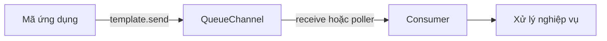
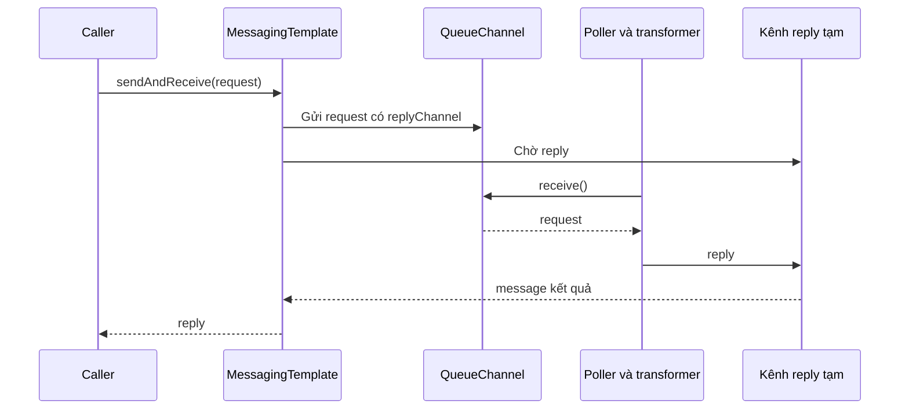

# MessagingTemplate với QueueChannel

Trong module `SPRING_INTEGRATION_CORE`, `MessagingTemplate` là cầu nối từ mã ứng dụng tới luồng thông điệp. Khi kết hợp với `QueueChannel`, ứng dụng có thể gửi một `Message` vào bộ đệm hoặc chủ động lấy message ra để xử lý. Bài học thuộc chương **MessagingTemplate**, tập trung vào ranh giới giữa thao tác gửi/nhận và việc thực thi endpoint.

Mục tiêu là đọc được một luồng có hàng đợi, chọn timeout phù hợp, cấu hình consumer bằng Java DSL và phân biệt lỗi giao message với lỗi nghiệp vụ.

## 1. Bối cảnh và điều kiện của ví dụ

Các ví dụ sử dụng Java 17 trở lên và API Spring Integration 6.5. Dự án thực hành cần `org.springframework.integration:spring-integration-core`; ví dụ cấu hình dùng thêm các lớp Spring Context, còn ví dụ kiểm thử dùng JUnit Jupiter. Quản lý phiên bản Spring bằng BOM hoặc cấu hình dependency đồng bộ của dự án, tránh trộn tùy ý các phiên bản Spring Framework và Spring Integration.

Các lớp Java có `main` bên dưới là những ví dụ độc lập; đặt mỗi lớp `public` trong tệp cùng tên khi thực hành. Những đoạn ngắn còn lại minh họa một thao tác riêng, không yêu cầu ghép tất cả vào cùng một ứng dụng.

| Thành phần | Vai trò trong bài |
| --- | --- |
| `Message<T>` | Mang payload và header như `jobId`, `replyChannel` |
| `QueueChannel` | Giữ message cho đến khi có consumer lấy ra |
| `MessagingTemplate` | Cung cấp API gửi, nhận và request–reply từ mã Java |
| Polling consumer | Lấy message khỏi channel rồi gọi handler hoặc transformer |
| `IntegrationFlow` | Mô tả cách các channel và endpoint nối với nhau |

`MessagingTemplate` được dùng ở đây là lớp `org.springframework.integration.core.MessagingTemplate`. Lớp này kế thừa `GenericMessagingTemplate` của Spring Messaging và hỗ trợ default channel. Xem [Javadoc MessagingTemplate 6.5.0](https://docs.spring.io/spring-integration/docs/6.5.0/api/org/springframework/integration/core/MessagingTemplate.html).

## 2. Mô hình hoạt động: hàng đợi tách thời điểm gửi và xử lý



Ví dụ một dịch vụ tiếp nhận yêu cầu xuất báo cáo. Thành công ở bước đưa yêu cầu vào hàng đợi cho biết yêu cầu đã được tiếp nhận tại channel; kết quả tạo báo cáo phải được quan sát ở một bước khác.

Với `QueueChannel` mặc định, message được lấy theo FIFO và mỗi message được trao cho một consumer. Khi nhiều consumer cùng đọc một channel, chúng cạnh tranh lấy việc, không cùng nhận bản sao của từng message. Channel không tự tạo worker thread; consumer hoặc poller quyết định nơi thực hiện xử lý. Xem [các triển khai MessageChannel](https://docs.spring.io/spring-integration/reference/6.5/channel/implementations.html).

Phân biệt ba mốc trong thiết kế:

1. **Đã xếp hàng:** thao tác gửi thành công.
2. **Đã lấy khỏi hàng đợi:** một consumer đã nhận message.
3. **Đã hoàn tất nghiệp vụ:** handler đã tạo kết quả mong muốn.

Không dùng mốc thứ nhất để khẳng định mốc thứ ba. Nếu API tiếp nhận cần trả trạng thái cho người dùng, có thể trả mã công việc rồi cung cấp cơ chế tra cứu kết quả.

## 3. Gửi và nhận message bằng template

### 3.1. Ví dụ độc lập, chưa cần Spring ApplicationContext

```java
import org.springframework.integration.channel.QueueChannel;
import org.springframework.integration.core.MessagingTemplate;
import org.springframework.messaging.Message;
import org.springframework.messaging.support.MessageBuilder;

public class QueueTemplateBasics {

    public static void main(String[] args) {
        QueueChannel jobs = new QueueChannel(10);

        MessagingTemplate template = new MessagingTemplate(jobs);
        template.setSendTimeout(200);
        template.setReceiveTimeout(500);

        Message<String> request = MessageBuilder
                .withPayload("export-report")
                .setHeader("jobId", "job-1001")
                .build();

        // Dùng default channel được truyền vào constructor.
        template.send(request);

        Message<?> received = template.receive();
        if (received == null) {
            throw new IllegalStateException("Không nhận được công việc");
        }

        System.out.println(received.getPayload());
        System.out.println(received.getHeaders().get("jobId"));

        // Queue đã rỗng; timeout 0 yêu cầu kiểm tra ngay.
        Message<?> next = template.receive(jobs, 0);
        System.out.println(next == null);
    }
}
```

Kết quả phần ứng dụng in ra:

```text
export-report
job-1001
true
```

Ví dụ cố ý gửi rồi nhận trên cùng thread để tách riêng việc học API. Chưa có bước tạo báo cáo và chưa có xử lý nền. Khi chuyển sang ứng dụng thực, cần giao phần nhận cho một consumer có vòng đời được quản lý.

### 3.2. Default channel và channel chỉ định

Có thể truyền channel cho từng thao tác:

```java
MessagingTemplate template = new MessagingTemplate();
template.setSendTimeout(100);
template.setReceiveTimeout(300);

template.send(jobs, request);
Message<?> received = template.receive(jobs);
```

Hai cách chọn destination khác nhau về cách gọi, không khác bản chất hàng đợi. Dùng default channel khi một template phục vụ một đích chính; truyền channel trực tiếp khi muốn thể hiện rõ đích tại vị trí gọi. Những overload không nhận destination cần có default destination đã cấu hình.

### 3.3. Không nhầm kiểu trả về của `send`

| Lời gọi | Kết quả bình thường |
| --- | --- |
| `jobs.send(message, timeout)` | `boolean` cho biết channel có chấp nhận message hay không |
| `template.send(jobs, message)` | `void`; không nhận được cờ thành công |
| `template.receive(jobs)` | `Message<?>`, hoặc `null` khi hết thời gian chờ mà không có message |
| `template.sendAndReceive(jobs, message)` | Một reply, hoặc `null` khi không nhận được reply trong thời gian chờ |

Không viết `boolean sent = template.send(jobs, message);`. Chữ ký `send` của API được dùng trong bài trả về `void`; xem [MessageSendingOperations](https://docs.spring.io/spring-framework/docs/6.2.7/javadoc-api/org/springframework/messaging/core/MessageSendingOperations.html).

`receive` cần một channel hỗ trợ nhận chủ động, tức `PollableChannel`. `QueueChannel` đáp ứng điều này. Dùng `receive` với `DirectChannel` là sai loại channel, không phải tình huống hàng đợi rỗng. Xem [GenericMessagingTemplate](https://docs.spring.io/spring-framework/docs/6.2.7/javadoc-api/org/springframework/messaging/core/GenericMessagingTemplate.html).

## 4. Timeout và sức chứa của QueueChannel

### 4.1. Timeout áp dụng ở đâu?

| Cấu hình | Điểm chờ trong ví dụ dùng QueueChannel |
| --- | --- |
| `setSendTimeout(200)` | Chờ tối đa 200 ms để có chỗ đưa message vào queue |
| `setReceiveTimeout(500)` | Chờ tối đa 500 ms để lấy message; trong request–reply là chờ reply |
| `receive(channel, 0)` | Thử nhận ngay, không đợi queue có thêm message |

Với QueueChannel: `0` là thử ngay, số dương là mili giây chờ, số âm là chờ không giới hạn. Template tham chiếu mặc định hai timeout là `-1`; nên cấu hình tường minh. Xem [mã nguồn GenericMessagingTemplate](https://raw.githubusercontent.com/spring-projects/spring-framework/v6.2.7/spring-messaging/src/main/java/org/springframework/messaging/core/GenericMessagingTemplate.java).

`sendTimeout` không phải thời hạn chạy handler. Một tác vụ xuất báo cáo mất 30 giây vẫn có thể được xếp hàng trong vài mili giây. Tương tự, timeout khi nhận kết quả không tự hủy tác vụ đang chạy.

### 4.2. Queue đầy và gửi thất bại

```java
import org.springframework.integration.channel.QueueChannel;
import org.springframework.integration.core.MessagingTemplate;
import org.springframework.messaging.MessageDeliveryException;
import org.springframework.messaging.support.GenericMessage;

public class FullQueueExample {

    public static void main(String[] args) {
        QueueChannel jobs = new QueueChannel(1);
        MessagingTemplate template = new MessagingTemplate(jobs);
        template.setSendTimeout(0);

        template.send(new GenericMessage<>("job-1"));

        try {
            template.send(new GenericMessage<>("job-2"));
            throw new IllegalStateException("Queue phải từ chối job-2");
        }
        catch (MessageDeliveryException ex) {
            System.out.println("Queue đầy, cần áp dụng chính sách quá tải");
        }

        System.out.println(template.receive(jobs, 0).getPayload());
    }
}
```

`job-1` vẫn còn trong queue. Template chuyển kết quả gửi `false` thành `MessageDeliveryException`, thay vì trả cờ `boolean`. Xem [doSend của GenericMessagingTemplate](https://raw.githubusercontent.com/spring-projects/spring-framework/v6.2.7/spring-messaging/src/main/java/org/springframework/messaging/core/GenericMessagingTemplate.java).

Trong ứng dụng, khối `catch` cần gắn với một quyết định cụ thể: từ chối yêu cầu mới, báo quá tải, hoặc chuyển việc sang một nơi lưu có bảo đảm phù hợp. Không mặc định retry vô hạn ngay trên thread nhận yêu cầu.

### 4.3. Chọn capacity bằng giả định tải

Ví dụ tự tính: producer tạo 120 yêu cầu/giây trong một đợt kéo dài 5 giây, consumer xử lý được 80 yêu cầu/giây. Phần tồn tăng thêm xấp xỉ:

```text
(120 - 80) × 5 = 200 message
```

Capacity 100 không hấp thụ hết đợt tăng tải này nếu không có cơ chế giảm tải khác. Capacity 250 có thêm khoảng đệm, nhưng còn phải tính lượng tồn ban đầu, kích thước payload và biến động thời gian xử lý. Đây là mô hình ước lượng cho tình huống đã nêu, không phải công thức bảo đảm mọi hệ thống.

Nếu tải duy trì ở 120 yêu cầu/giây mà năng lực xử lý vẫn là 80, tăng capacity chỉ kéo dài thời gian trước khi đầy. Cần thay đổi năng lực xử lý hoặc tốc độ tiếp nhận.

Constructor không đối số tạo queue có giới hạn rất lớn; chọn capacity hữu hạn giúp thể hiện rõ ngân sách bộ nhớ. `QueueChannel(int capacity)` yêu cầu số dương; trường hợp trao tay không có bộ đệm thuộc `RendezvousChannel`. Xem [Javadoc QueueChannel](https://docs.spring.io/spring-integration/docs/6.5.0/api/org/springframework/integration/channel/QueueChannel.html).

## 5. Consumer: chủ động nhận hay dùng poller

Có hai cách sử dụng cần phân biệt:

| Cách lấy message | Ai kích hoạt việc nhận? |
| --- | --- |
| Mã Java gọi `template.receive(queue)` | Chính mã ứng dụng |
| Endpoint đọc từ QueueChannel | Poller gắn với endpoint |

Với cách thứ nhất, không cần khai báo poller để một lần gọi `receive` hoạt động. Nếu tự tạo worker, ứng dụng phải quản lý khởi động, dừng, interrupt và xử lý lỗi của worker.

Với cách thứ hai, polling consumer nối channel với handler. Poller cần được cấu hình tại endpoint hoặc cung cấp qua default poller phù hợp. Đây là vai trò của endpoint, không phải tính năng tự chạy của queue. Xem [Message Endpoints](https://docs.spring.io/spring-integration/reference/6.5/endpoint.html).

Một lỗi thiết kế thường gặp là dùng cùng một thread để gọi `sendAndReceive`, rồi dự định lấy request xử lý ở câu lệnh tiếp theo. Thread đã chờ reply nên không thể chạy phần tạo reply. Phải có consumer độc lập đã sẵn sàng trước khi bắt đầu chờ.

## 6. Java DSL: QueueChannel → transformer → reply

Ví dụ dưới đây mô phỏng chuẩn hóa mã đơn hàng. Caller gửi chuỗi vào queue; poller lấy chuỗi, transformer chuẩn hóa và gửi kết quả về caller.

```java
import java.time.Duration;
import java.util.Locale;

import org.springframework.context.annotation.AnnotationConfigApplicationContext;
import org.springframework.context.annotation.Bean;
import org.springframework.context.annotation.Configuration;
import org.springframework.integration.channel.QueueChannel;
import org.springframework.integration.config.EnableIntegration;
import org.springframework.integration.core.MessagingTemplate;
import org.springframework.integration.dsl.IntegrationFlow;
import org.springframework.integration.dsl.Pollers;
import org.springframework.messaging.Message;
import org.springframework.messaging.support.ErrorMessage;
import org.springframework.messaging.support.GenericMessage;

public class QueueDslExample {

    @Configuration
    @EnableIntegration
    public static class FlowConfig {

        @Bean
        public QueueChannel workRequests() {
            return new QueueChannel(100);
        }

        @Bean
        public MessagingTemplate workTemplate(QueueChannel workRequests) {
            MessagingTemplate template = new MessagingTemplate(workRequests);
            template.setSendTimeout(200);
            template.setReceiveTimeout(2_000);
            template.setThrowExceptionOnLateReply(true);
            return template;
        }

        @Bean
        public IntegrationFlow normalizeFlow(QueueChannel workRequests) {
            return IntegrationFlow.from(workRequests)
                    .transform(
                            String.class,
                            text -> text.strip().toUpperCase(Locale.ROOT),
                            endpoint -> endpoint.poller(
                                    Pollers.fixedDelay(Duration.ofMillis(100))
                                            .receiveTimeout(0)
                                            .maxMessagesPerPoll(5)))
                    .get();
        }
    }

    public static void main(String[] args) {
        try (AnnotationConfigApplicationContext context =
                     new AnnotationConfigApplicationContext(FlowConfig.class)) {

            MessagingTemplate template =
                    context.getBean("workTemplate", MessagingTemplate.class);

            Message<?> reply = template.sendAndReceive(
                    new GenericMessage<>("  order-42  "));

            if (reply == null) {
                throw new IllegalStateException("Hết thời gian chờ chuẩn hóa");
            }
            if (reply instanceof ErrorMessage error) {
                throw new IllegalStateException("Luồng xử lý thất bại",
                        error.getPayload());
            }

            System.out.println(reply.getPayload());
        }
    }
}
```

Khi xử lý thành công, phần ứng dụng in `ORDER-42`. ApplicationContext quản lý các thành phần tích hợp và được đóng sau ví dụ.

Cấu hình `.transform(...)` tạo endpoint xử lý payload; tham số cuối cấu hình endpoint đọc queue. Tham khảo các overload trong [BaseIntegrationFlowDefinition](https://docs.spring.io/spring-integration/docs/6.5.0/api/org/springframework/integration/dsl/BaseIntegrationFlowDefinition.html).

Đọc phần poller theo ba ý:

- `fixedDelay(100 ms)` đặt khoảng nghỉ giữa các lần thực thi tác vụ polling theo cơ chế fixed delay.
- `receiveTimeout(0)` khiến lần lấy message của poller không chờ queue có thêm dữ liệu.
- `maxMessagesPerPoll(5)` giới hạn số message xử lý trong một lần thực thi polling; không tạo năm worker chạy song song.

API cấu hình được mô tả tại [Pollers](https://docs.spring.io/spring-integration/docs/6.5.0/api/org/springframework/integration/dsl/Pollers.html) và [PollerSpec](https://docs.spring.io/spring-integration/docs/6.5.0/api/org/springframework/integration/dsl/PollerSpec.html). Có thể định nghĩa một [default poller bằng DSL](https://docs.spring.io/spring-integration/reference/6.5/dsl/java-pollers.html), nhưng ví dụ chọn cấu hình ngay tại endpoint để người đọc thấy rõ nơi lấy message.

Chú ý `receiveTimeout(0)` của **poller** khác `setReceiveTimeout(2_000)` của **template**. Giá trị thứ nhất áp dụng khi poller lấy request; giá trị thứ hai áp dụng khi caller chờ reply.

## 7. Request–reply qua hàng đợi

### 7.1. Reply đi đâu?



`sendAndReceive` tạo một kênh trả lời tạm và đưa nó vào header `replyChannel`. Với endpoint có khả năng tạo reply, khi không chỉ định output channel khác, header này cho biết nơi gửi kết quả. Kênh request không tự trở thành kênh reply. Cơ chế kênh tạm được giới thiệu trong [tài liệu MessagingTemplate](https://docs.spring.io/spring-integration/reference/7.0/channel/template.html).

Thiết kế ví dụ Java DSL dựa vào việc transformer trả về một giá trị và header định tuyến reply được duy trì. Nếu đổi handler thành thao tác không trả kết quả, cần đổi hợp đồng phía caller sang gửi một chiều hoặc xây dựng đường tạo reply rõ ràng.

Nếu gắn `.channel("results")` sau transformer để đưa kết quả tới một queue riêng, phải thiết kế consumer cho queue đó hoặc đường chuyển tiếp về nơi trả lời. Việc đưa kết quả sang `results` không làm caller tự tìm message tại đó.

### 7.2. Vì sao `send(queue)` rồi `receive(queue)` không thay thế request–reply?

Hãy xét luồng:

```text
caller gửi request vào workRequests
caller nhận ngay từ workRequests
```

Caller có thể lấy lại chính request vừa gửi. Nếu consumer khác đang đọc cùng queue, caller còn cạnh tranh lấy công việc với consumer. Không có gì trong chuỗi lệnh này xác nhận message nhận được là kết quả của request ban đầu.

Nếu ứng dụng cần tự quản lý hai queue request và reply, hợp đồng phải nêu rõ cách ghép cặp request–reply, cách xử lý reply quá hạn và cách phân phối reply cho đúng caller. Với nhiều caller cùng đọc một reply queue, chỉ thêm một header mã yêu cầu chưa đủ để ngăn một caller lấy nhầm reply của caller khác.

### 7.3. Hết hạn chờ không hủy request

Tình huống giả định:

```text
t =   0 ms: request được xếp vào queue
t = 100 ms: caller hết thời gian chờ và nhận null
t = 300 ms: consumer mới lấy được request
t = 500 ms: nghiệp vụ hoàn tất
```

Caller biết mình không nhận được reply đúng hạn, nhưng chưa thể kết luận nghiệp vụ đã thất bại. Retry ngay có thể tạo thêm một công việc trùng.

Với tác vụ có side effect, nên có mã yêu cầu nghiệp vụ ổn định, khả năng xử lý idempotent và trạng thái để tra cứu. Ví dụ `jobId` có thể làm khóa nghiệp vụ nếu hệ thống bảo đảm tính duy nhất và kiểm soát việc ghi nhận kết quả theo khóa đó.

Trong ví dụ, `setThrowExceptionOnLateReply(true)` giúp báo lỗi ở phía cố gửi reply khi caller đã không còn nhận. Đây là tín hiệu chẩn đoán, không phải rollback hay cơ chế hủy công việc. Xem [tùy chọn late reply](https://docs.spring.io/spring-framework/docs/6.2.7/javadoc-api/org/springframework/messaging/core/GenericMessagingTemplate.html#setThrowExceptionOnLateReply(boolean)).

## 8. Gửi payload với convertAndSend

Khi không cần tự dựng `Message`, có thể gửi payload và header bằng API chuyển đổi:

```java
import java.util.Map;

import org.springframework.integration.channel.QueueChannel;
import org.springframework.integration.core.MessagingTemplate;
import org.springframework.messaging.converter.SimpleMessageConverter;

QueueChannel jobs = new QueueChannel(10);
MessagingTemplate template = new MessagingTemplate(jobs);
template.setSendTimeout(100);
template.setReceiveTimeout(100);
template.setMessageConverter(new SimpleMessageConverter());

template.convertAndSend(
        "report-2026-11",
        Map.of("jobId", "job-1002"));

String payload = template.receiveAndConvert(jobs, String.class);
System.out.println(payload);
```

Ví dụ in `report-2026-11` nếu nhận thành công. Nếu hết thời gian chờ mà không có message, kết quả nhận là `null`; mã ứng dụng cần xét trường hợp này trước khi sử dụng.

`SimpleMessageConverter` ở ví dụ chỉ bọc/mở payload có kiểu tương thích. Không suy ra rằng mọi POJO được tự động chuyển thành JSON hoặc chuỗi JSON tự biến thành DTO. Muốn đổi định dạng thực sự phải cấu hình converter thích hợp. Xem [SimpleMessageConverter](https://docs.spring.io/spring-framework/docs/6.2.7/javadoc-api/org/springframework/messaging/converter/SimpleMessageConverter.html).

Nếu cần đọc `jobId`, `replyChannel` hoặc thông tin lỗi, dùng `receive` để giữ toàn bộ envelope, thay vì chỉ nhận payload.

## 9. Lỗi giao message và lỗi xử lý

| Tình huống | Điều mã gọi cần phân biệt |
| --- | --- |
| Queue đầy, hết send timeout | Request chưa được channel chấp nhận qua lần gửi đó |
| Queue rỗng, hết receive timeout | Chưa nhận được message; kết quả có thể là `null` |
| Request đã xếp hàng, handler phát sinh lỗi sau đó | Lỗi thuộc bước xử lý của consumer |
| Caller hết hạn chờ, consumer vẫn đang chạy | Trạng thái nghiệp vụ còn chưa xác định từ phía caller |

Với consumer chạy qua poller của Spring Integration, lỗi trong tác vụ polling được xử lý qua cơ chế error message. Header `errorChannel` của request được ưu tiên khi định tuyến lỗi; nếu không có thì cơ chế mặc định dùng channel tên `errorChannel`. Worker tự viết phải tự xử lý lỗi của mình. Xem [Error Handling](https://docs.spring.io/spring-integration/reference/6.5/error-handling.html).

Trong request–reply, template còn gắn kênh tạm vào `errorChannel`. API nhận message có thể trả về `ErrorMessage`; vì vậy ví dụ Java DSL kiểm tra lỗi trước khi dùng payload. Xem [doSendAndReceive](https://raw.githubusercontent.com/spring-projects/spring-framework/v6.2.7/spring-messaging/src/main/java/org/springframework/messaging/core/GenericMessagingTemplate.java).

Một `try/catch` quanh `template.send(request)` chỉ quan sát lỗi xảy ra trong lời gọi gửi đó. Nếu consumer xử lý sau khi lời gọi gửi đã kết thúc, khối `catch` không thể bắt lỗi phát sinh ở thread consumer bằng cơ chế ném exception thông thường.

Trong một thiết kế công việc xuất báo cáo, có thể ghi trạng thái `ACCEPTED`, `RUNNING`, `SUCCEEDED` và `FAILED` theo `jobId`. Cách ghi trạng thái này là hợp đồng ứng dụng, cần được thiết kế cùng nơi lưu kết quả và chính sách thử lại.

## 10. Kiểm thử minh họa hành vi

Các kiểm thử dưới đây tập trung vào hợp đồng có thể quan sát: lấy message khỏi queue, lỗi khi không còn chỗ, và việc timeout reply không tự loại request. Chúng dùng timeout `0` ở các tình huống kiểm tra ngay nên không cần `Thread.sleep`.

```java
import org.junit.jupiter.api.Test;
import org.springframework.integration.channel.QueueChannel;
import org.springframework.integration.core.MessagingTemplate;
import org.springframework.messaging.Message;
import org.springframework.messaging.MessageDeliveryException;
import org.springframework.messaging.support.GenericMessage;

import static org.junit.jupiter.api.Assertions.*;

class QueueTemplateTest {

    @Test
    void receiveRemovesMessagesInFifoOrder() {
        QueueChannel queue = new QueueChannel(2);
        MessagingTemplate template = new MessagingTemplate(queue);
        template.setSendTimeout(0);
        template.setReceiveTimeout(0);

        template.send(new GenericMessage<>("A"));
        template.send(new GenericMessage<>("B"));

        Message<?> first = template.receive();
        Message<?> second = template.receive();

        assertNotNull(first);
        assertNotNull(second);
        assertEquals("A", first.getPayload());
        assertEquals("B", second.getPayload());
        assertNull(template.receive());
    }

    @Test
    void fullQueueRaisesDeliveryExceptionWithoutReplacingOldMessage() {
        QueueChannel queue = new QueueChannel(1);
        MessagingTemplate template = new MessagingTemplate(queue);
        template.setSendTimeout(0);
        template.setReceiveTimeout(0);

        template.send(new GenericMessage<>("A"));

        assertThrows(MessageDeliveryException.class,
                () -> template.send(new GenericMessage<>("B")));

        Message<?> remaining = template.receive();
        assertNotNull(remaining);
        assertEquals("A", remaining.getPayload());
        assertNull(template.receive());
    }

    @Test
    void replyTimeoutDoesNotRemoveRequestFromQueue() {
        QueueChannel queue = new QueueChannel(1);
        MessagingTemplate template = new MessagingTemplate(queue);
        template.setSendTimeout(0);
        template.setReceiveTimeout(0);
        template.setThrowExceptionOnLateReply(true);

        // Không có consumer; không ai tạo reply.
        Message<?> reply = template.sendAndReceive(
                new GenericMessage<>("job-7"));

        assertNull(reply);

        Message<?> queued = template.receive(queue, 0);
        assertNotNull(queued);
        assertEquals("job-7", queued.getPayload());
    }
}
```

Để kiểm tra luồng Java DSL ở phần 6, có thể dùng lớp kiểm thử sau cùng với `QueueDslExample.FlowConfig`:

```java
import org.junit.jupiter.api.Test;
import org.springframework.context.annotation.AnnotationConfigApplicationContext;
import org.springframework.integration.core.MessagingTemplate;
import org.springframework.messaging.Message;
import org.springframework.messaging.support.ErrorMessage;
import org.springframework.messaging.support.GenericMessage;

import static org.junit.jupiter.api.Assertions.*;

class QueueDslTest {

    @Test
    void pollingTransformerRepliesToCaller() {
        try (AnnotationConfigApplicationContext context =
                     new AnnotationConfigApplicationContext(
                             QueueDslExample.FlowConfig.class)) {

            MessagingTemplate template =
                    context.getBean("workTemplate", MessagingTemplate.class);

            Message<?> reply = template.sendAndReceive(
                    new GenericMessage<>("  order-42  "));

            assertNotNull(reply);
            assertFalse(reply instanceof ErrorMessage);
            assertEquals("ORDER-42", reply.getPayload());
        }
    }
}
```

Kiểm thử này xác nhận một request đi qua polling endpoint và quay về caller. Nó không đo throughput, không chứng minh khả năng chịu tải và không bảo đảm mọi reply đều hoàn thành trong hai giây ở mọi môi trường.

## 11. Giới hạn khi dùng trong ứng dụng

### 11.1. Bộ đệm trong tiến trình và độ bền

`new QueueChannel(capacity)` trong bài là hàng đợi trong bộ nhớ. Việc xếp hàng thành công không ghi công việc xuống một nơi lưu bền vững. Khi yêu cầu nghiệp vụ đòi hỏi sống sót sau khi tiến trình dừng, phải thiết kế cơ chế lưu trữ hoặc sử dụng hạ tầng messaging phù hợp.

Spring Integration có cấu hình queue dựa trên message store; đó là một lựa chọn riêng với yêu cầu cấu hình và giao dịch riêng. Không suy ra tính bền vững chỉ từ tên `QueueChannel`. Xem [cấu hình channel và message store](https://docs.spring.io/spring-integration/reference/6.5/channel/configuration.html).

### 11.2. Nhận thành công chưa phải cơ chế acknowledge nghiệp vụ

Ở queue trong bộ nhớ của ví dụ, khi `receive` trả message thì message đã được lấy ra. Nếu bước xử lý tiếp theo thất bại, không có bảo đảm tự đưa nó trở lại queue. Retry, lưu công việc lỗi và phục hồi sau sự cố cần được thiết kế rõ.

Tránh tự gắn nhãn “exactly once” cho một luồng chỉ vì nó dùng queue. Một tác vụ có thể hoàn tất side effect rồi thất bại trước khi ghi nhận kết quả; thử lại khi đó cần cơ chế chống trùng ở mức nghiệp vụ.

### 11.3. Thứ tự hoàn tất và dữ liệu dùng chung

FIFO mô tả thứ tự lấy message của queue mặc định. Nếu nhiều worker xử lý các message khác nhau, một việc lấy sau có thể hoàn tất trước việc lấy trước.

Ví dụ worker A nhận báo cáo lớn, worker B nhận báo cáo nhỏ. Dù báo cáo lớn được lấy trước, báo cáo nhỏ vẫn có thể xuất xong trước. Nếu cần thứ tự theo khách hàng hoặc đơn hàng, phải đưa yêu cầu đó vào thiết kế consumer và phân vùng công việc.

Không sửa một đối tượng payload dùng chung sau khi gửi rồi kỳ vọng consumer luôn đọc giá trị cũ. Trong các ví dụ, chuỗi là bất biến nên tránh được vấn đề này; với DTO có thể thay đổi, nên xác định rõ quyền sở hữu hoặc tạo bản dữ liệu độc lập trước khi gửi.

### 11.4. Quan sát tải và vòng đời

Những số liệu hữu ích cho ví dụ dịch vụ xuất báo cáo gồm số công việc đang chờ, tuổi của công việc cũ nhất, số lần gửi thất bại, thời gian xử lý và tỷ lệ công việc lỗi.

`getQueueSize()` hữu ích để quan sát tại một thời điểm, nhưng không dùng quy trình “kiểm tra còn chỗ rồi mới gửi” như một bảo đảm đồng thời. Trạng thái có thể thay đổi giữa lúc kiểm tra và gửi; kết quả của chính thao tác gửi mới quyết định lần đó có được chấp nhận hay không.

Với worker do ứng dụng tự tạo, cần chính sách dừng và xử lý công việc đang chạy. Với ví dụ dùng Spring, đóng ApplicationContext giúp giải phóng các thành phần có vòng đời do context quản lý; muốn đợi xử lý hết công việc trước khi dừng vẫn phải thiết kế chính sách shutdown tương ứng.

## 12. Chẩn đoán nhanh

| Hiện tượng | Hướng kiểm tra |
| --- | --- |
| Gửi thành công nhưng không có xử lý | Consumer đã khởi động chưa; endpoint có poller hoặc default poller chưa |
| Producer chờ lâu | Queue có đầy không; send timeout đang là bao nhiêu |
| `receive` trả `null` | Queue đang rỗng, hoặc consumer khác đã lấy message |
| Không biên dịch khi gán kết quả `template.send` cho boolean | Kiểm tra chữ ký API; template `send` trả `void` |
| `sendAndReceive` hết hạn chờ | Có endpoint tạo reply không; reply đi đâu; thời gian xếp hàng và xử lý có vượt ngân sách không |
| Caller nhận `ErrorMessage` | Kiểm tra payload lỗi và thông tin request gây lỗi |
| Có lỗi late reply | Caller đã ngừng chờ nhưng phía xử lý vẫn cố trả kết quả |
| Thử lại tạo nhiều báo cáo giống nhau | Kiểm tra mã yêu cầu nghiệp vụ và cơ chế idempotency |
| Đổi sang DirectChannel rồi `receive` lỗi | `receive` cần `PollableChannel` |

Khi triển khai một use case, bắt đầu bằng hợp đồng rõ ràng: gửi một chiều hay cần reply, chấp nhận chờ bao lâu, phản ứng thế nào khi queue đầy, ai xử lý lỗi và kết quả nghiệp vụ được lưu ở đâu. Từ đó mới chọn capacity, poller và cách dùng `MessagingTemplate` tương ứng.
