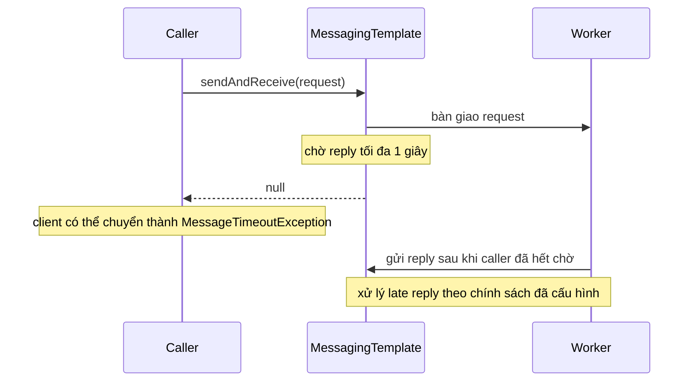

# Xử lý MessageTimeoutException

## 1. Mục tiêu và phạm vi

Trong chương **MessagingTemplate** của module **SPRING_INTEGRATION_CORE**, bài này giải thích cách nhận diện và xử lý việc một trao đổi thông điệp không hoàn tất trong thời gian chờ. Trọng tâm là quan hệ giữa `Message`, `MessageChannel`, endpoint, gateway và luồng Java DSL; từ đó thiết kế phản hồi, xử lý lỗi và kiểm thử phù hợp.

Sau bài học, bạn có thể:

- Phân biệt gửi không thành công, không nhận được thông điệp và không nhận được phản hồi.
- Biết khi nào có `MessageTimeoutException`, khi nào chỉ có `null` hoặc `MessageDeliveryException`.
- Đặt chính sách bắt buộc có phản hồi ở ranh giới ứng dụng.
- Xử lý phản hồi đến muộn, retry và kết quả nghiệp vụ chưa xác định.
- Viết kiểm thử tái hiện các tình huống này mà không phụ thuộc vào `Thread.sleep()`.

Các ví dụ dùng Java 17+, Spring Integration 6.3.x và JUnit Jupiter. Những điểm phụ thuộc phiên bản được đối chiếu với API Spring Integration 6.3.2 và Spring Framework 6.1.11. Đây là mốc giải thích hành vi, không phải yêu cầu thay đổi phiên bản của ứng dụng đang học.

## 2. Hiểu đúng loại ngoại lệ

Lớp cần dùng nằm trong package của Spring Integration:

```java
import org.springframework.integration.MessageTimeoutException;
```

Quan hệ kế thừa liên quan:

```text
RuntimeException
└── ...
    └── org.springframework.messaging.MessagingException
        └── org.springframework.messaging.MessageDeliveryException
            └── org.springframework.integration.MessageTimeoutException
```

`MessageTimeoutException` là ngoại lệ không bắt buộc khai báo bằng `throws`. Nó có constructor nhận thông điệp thất bại, mô tả và nguyên nhân. `getFailedMessage()` giúp truy lại ngữ cảnh nhưng có thể trả `null` nếu ngoại lệ được tạo chỉ với mô tả. [API MessageTimeoutException 6.3.2](https://docs.spring.io/spring-integration/docs/6.3.2/api/org/springframework/integration/MessageTimeoutException.html).

Do quan hệ kế thừa, nếu cần xử lý riêng thì đặt `catch (MessageTimeoutException ...)` trước `catch (MessageDeliveryException ...)`. Kiểu ngoại lệ phản ánh lớp phát hiện vấn đề; muốn xác định nguyên nhân vẫn phải xem channel, giai đoạn xử lý và chuỗi `cause`.

## 3. Hết thời gian chờ không luôn tạo MessageTimeoutException

`org.springframework.integration.core.MessagingTemplate` kế thừa `GenericMessagingTemplate`. Với cơ chế cơ bản trong các phiên bản đối chiếu, cần phân biệt các kết quả sau. [Mã nguồn MessagingTemplate 6.3.2](https://github.com/spring-projects/spring-integration/blob/v6.3.2/spring-integration-core/src/main/java/org/springframework/integration/core/MessagingTemplate.java).

| Thao tác | Tình huống | Kết quả ở template cơ bản |
|---|---|---|
| `send(channel, message)` | Channel trả `false` khi gửi | Ném `MessageDeliveryException` |
| `receive(pollableChannel)` | Hết thời gian nhận mà chưa có message | Trả `null` |
| `sendAndReceive(channel, request)` | Gửi xong nhưng chưa có reply khi hết thời gian nhận | Trả `null` |
| Gửi đến luồng đồng bộ | Handler ném ngoại lệ | Ngoại lệ truyền về caller; không tự đổi mọi lỗi thành timeout |

Hai nhánh `false` và `null` được thể hiện trực tiếp trong [mã nguồn GenericMessagingTemplate 6.1.11](https://github.com/spring-projects/spring-framework/blob/v6.1.11/spring-messaging/src/main/java/org/springframework/messaging/core/GenericMessagingTemplate.java).

Vì vậy, chỉ viết `try/catch (MessageTimeoutException ...)` quanh `template.sendAndReceive(...)` chưa bảo đảm xử lý được việc thiếu phản hồi. Ứng dụng phải kiểm tra `null`, hoặc dùng một gateway có chính sách tạo lỗi khi timeout.

Ví dụ, với thao tác lấy báo giá, ứng dụng có thể cho phép thiếu kết quả để dùng giá dự phòng. Với thao tác xác nhận đơn hàng, thiếu phản hồi có thể cần trở thành lỗi có thông điệp và mã theo dõi rõ ràng. Chính sách này cần được quyết định ở ranh giới nghiệp vụ.

## 4. Tách thời gian gửi, thời gian nhận và thời gian xử lý

### 4.1. Hai cấu hình khác nhau

```java
import org.springframework.integration.core.MessagingTemplate;

MessagingTemplate template = new MessagingTemplate();
template.setSendTimeout(200L);
template.setReceiveTimeout(1_000L);
template.setThrowExceptionOnLateReply(true);
```

`sendTimeout` áp dụng cho thao tác gửi khi channel có cơ chế chờ, chẳng hạn chờ chỗ trống trong queue. `receiveTimeout` áp dụng cho thao tác nhận hoặc chờ reply. Các giá trị tính bằng mili giây; đối với cơ chế chờ tương ứng, `0` là thử ngay, số dương là chờ hữu hạn và số âm là chờ không giới hạn. Khả năng chặn còn phụ thuộc loại channel. [Message Channel Implementations](https://docs.spring.io/spring-integration/reference/channel/implementations.html).

Không gọi `setReceiveTimeout()` liên tục trên một singleton template để phục vụ từng request: các caller đồng thời sẽ chia sẻ cấu hình đang thay đổi. Hãy cấu hình ổn định, dùng template riêng cho chính sách riêng, hoặc dùng header cho từng request:

```java
import org.springframework.messaging.Message;
import org.springframework.messaging.core.GenericMessagingTemplate;
import org.springframework.messaging.support.MessageBuilder;

Message<String> request = MessageBuilder.withPayload("SKU-42")
        .setHeader("operationId", "quote-1001")
        .setHeader(GenericMessagingTemplate.DEFAULT_SEND_TIMEOUT_HEADER, 100L)
        .setHeader(GenericMessagingTemplate.DEFAULT_RECEIVE_TIMEOUT_HEADER, 800L)
        .build();
```

Với `sendAndReceive`, các header timeout của template có thể ghi đè cấu hình cho lần gọi đó và được loại bỏ trước khi gửi xuống luồng. Chúng không phải deadline tự động truyền qua mọi endpoint. [API GenericMessagingTemplate 6.1.11](https://docs.spring.io/spring-framework/docs/6.1.11/javadoc-api/org/springframework/messaging/core/GenericMessagingTemplate.html).

### 4.2. DirectChannel không cung cấp cơ chế ngắt handler theo receiveTimeout

Giả sử handler chạy trực tiếp trên thread của caller và mất ba giây. `receiveTimeout = 100` không khiến handler tự bị ngắt sau 100 ms. Caller vẫn đang thực hiện phần gửi và chạy handler; việc chờ nhận chỉ bắt đầu sau khi phần gửi trả quyền điều khiển.

Khi toàn bộ luồng đồng bộ đã tạo reply, reply có thể sẵn sàng ngay ở thời điểm nhận. Với luồng chuyển sang thread khác, caller mới chờ kết quả trong khoảng timeout đã đặt. Đây cũng là điểm được giải thích trong [Messaging Gateways — timeout và luồng đồng bộ/bất đồng bộ](https://docs.spring.io/spring-integration/reference/gateway.html).

Ví dụ thiết kế:

```text
Luồng đồng bộ:
caller ── send/handler: 3 giây ── receive: reply đã có ── trả kết quả

Luồng chuyển thread:
caller ── bàn giao công việc ── chờ reply tối đa 1 giây ── trả null
worker                         └── vẫn có thể đang xử lý
```

Do đó, giới hạn thời gian của lời gọi HTTP, truy vấn cơ sở dữ liệu hoặc thao tác I/O phải được cấu hình tại client/thành phần thực hiện nó. Để xây ngân sách toàn bộ thao tác, còn phải tính thời gian trước khi bàn giao, thời gian nằm trong queue và thời gian ánh xạ kết quả.

## 5. Đặt hợp đồng bắt buộc có phản hồi

Một cách dùng template là bọc nó trong client có chính sách rõ ràng: nếu lời gọi kết thúc mà chưa nhận được reply, tạo `MessageTimeoutException` gắn với request ban đầu. Ví dụ dưới đây cũng dành payload `Throwable` cho việc truyền lỗi từ downstream.

```java
import org.springframework.integration.MessageTimeoutException;
import org.springframework.integration.core.MessagingTemplate;
import org.springframework.messaging.Message;
import org.springframework.messaging.MessageChannel;
import org.springframework.messaging.MessagingException;

public final class RequiredReplyClient {

    private final MessageChannel requestChannel;
    private final MessagingTemplate template;

    public RequiredReplyClient(MessageChannel requestChannel,
                               long sendTimeoutMs,
                               long receiveTimeoutMs) {
        if (sendTimeoutMs < 0 || receiveTimeoutMs < 0) {
            throw new IllegalArgumentException("Cần timeout hữu hạn");
        }
        this.requestChannel = requestChannel;
        this.template = new MessagingTemplate();
        this.template.setSendTimeout(sendTimeoutMs);
        this.template.setReceiveTimeout(receiveTimeoutMs);
        this.template.setThrowExceptionOnLateReply(true);
    }

    public Message<?> exchange(Message<?> request) {
        Message<?> reply = this.template.sendAndReceive(
                this.requestChannel, request);

        if (reply == null) {
            if (Thread.currentThread().isInterrupted()) {
                throw new MessagingException(request,
                        "Thread bị ngắt khi chờ phản hồi");
            }
            throw new MessageTimeoutException(request,
                    "Không nhận được phản hồi trong thời gian chờ");
        }

        if (reply.getPayload() instanceof Throwable failure) {
            if (failure instanceof Error fatal) {
                throw fatal;
            }
            if (failure instanceof RuntimeException runtime) {
                throw runtime;
            }
            throw new MessagingException(request,
                    "Downstream trả về lỗi qua reply", failure);
        }

        return reply;
    }
}
```

Đây là chính sách do ứng dụng bổ sung, không phải hành vi mặc định của mọi `MessagingTemplate`. Kiểm tra trạng thái ngắt giúp tránh quy mọi kết quả `null` thành hết thời gian chờ; implementation của kênh phản hồi tạm thời có nhánh khôi phục cờ interrupt khi việc chờ bị ngắt. [GenericMessagingTemplate — TemporaryReplyChannel](https://github.com/spring-projects/spring-framework/blob/v6.1.11/spring-messaging/src/main/java/org/springframework/messaging/core/GenericMessagingTemplate.java#L254-L339).

Client không bắt rồi đổi tất cả `MessagingException` thành timeout. Chẳng hạn, lỗi chuyển đổi payload, lỗi nghiệp vụ từ handler hoặc lỗi không có subscriber vẫn phải giữ ý nghĩa gốc để caller chọn cách xử lý.

Các header timeout có thể làm thay đổi thời gian chờ thực tế của từng request. Vì vậy, nếu mở rộng thông tin log, hãy ghi giá trị hiệu lực thay vì luôn khẳng định rằng lần gọi đã chờ đúng giá trị mặc định trong constructor.

## 6. Kết nối với luồng Java DSL

Ví dụ cấu hình một luồng báo giá có điểm chuyển thread trước bước xử lý. Đặt lớp này cùng package với `RequiredReplyClient` ở trên.

```java
import org.springframework.context.annotation.Bean;
import org.springframework.context.annotation.Configuration;
import org.springframework.integration.channel.DirectChannel;
import org.springframework.integration.config.EnableIntegration;
import org.springframework.integration.dsl.IntegrationFlow;
import org.springframework.scheduling.concurrent.ThreadPoolTaskExecutor;

@Configuration
@EnableIntegration
public class QuoteFlowConfiguration {

    @Bean
    public DirectChannel quoteRequests() {
        return new DirectChannel();
    }

    @Bean
    public ThreadPoolTaskExecutor quoteExecutor() {
        ThreadPoolTaskExecutor executor = new ThreadPoolTaskExecutor();
        executor.setCorePoolSize(4);
        executor.setMaxPoolSize(4);
        executor.setQueueCapacity(16);
        executor.setThreadNamePrefix("quote-");
        return executor;
    }

    @Bean
    public IntegrationFlow quoteFlow(DirectChannel quoteRequests,
                                     ThreadPoolTaskExecutor quoteExecutor) {
        return IntegrationFlow.from(quoteRequests)
                .channel(channels -> channels.executor(quoteExecutor))
                .handle(String.class,
                        (sku, headers) -> "QUOTE:" + sku)
                .get();
    }

    @Bean
    public RequiredReplyClient quoteClient(DirectChannel quoteRequests) {
        return new RequiredReplyClient(quoteRequests, 200L, 1_000L);
    }
}
```

Java DSL hỗ trợ executor channel để bàn giao message cho `Executor`. Spring quản lý vòng đời executor bean trong ví dụ. [API MessageChannels 6.3.2](https://docs.spring.io/spring-integration/docs/6.3.2/api/org/springframework/integration/dsl/MessageChannels.html).

Lời gọi từ ứng dụng:

```java
Message<?> reply = quoteClient.exchange(request);
String quote = (String) reply.getPayload();
```

`request` ở đây là message có payload chuỗi được tạo ở phần 4. Trong ứng dụng thật, thay phần ghép chuỗi bằng dịch vụ báo giá và cấu hình timeout I/O của dịch vụ đó.

Một số điểm cần hiểu khi thay đổi cấu hình:

- Thành công khi bàn giao cho executor chưa có nghĩa là bước báo giá đã hoàn tất.
- `sendTimeout = 200` không biến thao tác nộp task thành việc chờ chính xác 200 ms khi executor đầy. Executor có chính sách từ chối riêng; lỗi quá tải phải được phân loại theo ngoại lệ thực tế.
- Nếu đổi sang chính sách chạy task trên thread caller khi quá tải, bước xử lý có thể lại chạy đồng bộ. Khi đó phải xem lại kỳ vọng về thời gian trả về.
- `receiveTimeout` của caller không xóa task khỏi queue và không hủy task đang chạy.

## 7. Gửi thất bại vì queue đầy

`QueueChannel` có thể được tạo với dung lượng hữu hạn. Khi queue đầy, thao tác gửi có thể chờ chỗ trống theo timeout; cần phân biệt kết quả của channel với API template bọc quanh nó. [API QueueChannel 6.3.2](https://docs.spring.io/spring-integration/docs/6.3.2/api/org/springframework/integration/channel/QueueChannel.html).

```java
import org.springframework.integration.channel.QueueChannel;
import org.springframework.integration.core.MessagingTemplate;
import org.springframework.messaging.MessageDeliveryException;
import org.springframework.messaging.support.GenericMessage;

QueueChannel queue = new QueueChannel(1);
boolean firstAccepted = queue.send(new GenericMessage<>("first"), 0L);
if (!firstAccepted) {
    throw new IllegalStateException("Không tạo được dữ liệu minh họa");
}

MessagingTemplate template = new MessagingTemplate();
template.setSendTimeout(0L);

try {
    template.send(queue, new GenericMessage<>("second"));
} catch (MessageDeliveryException deliveryFailure) {
    // Trong ví dụ này queue đầy và không có consumer lấy message ra.
    // Caller có thể từ chối yêu cầu hoặc đưa vào cơ chế retry có giới hạn.
    throw deliveryFailure;
}
```

Ví dụ dùng `0` để thất bại ngay khi không thể gửi. Đổi thành số dương cho phép chờ trong giới hạn đó nếu channel hỗ trợ. Không nên kiểm tra tên lớp bằng cách tìm chuỗi `timeout` trong thông báo lỗi: mô tả lỗi có thể đổi và nhiều nguyên nhân giao nhận không phải timeout.

Một message chưa được chấp nhận trong ví dụ queue này có trạng thái khác với message đã được downstream nhận nhưng caller chưa có kết quả. Retry cần xét sự khác biệt đó.

## 8. Dùng gateway để tạo lỗi khi thiếu phản hồi

Nếu ứng dụng muốn gọi một interface nghiệp vụ thay vì trực tiếp thao tác `Message`, có thể dùng gateway. Từ Spring Integration 6.2, `@MessagingGateway` có thuộc tính `errorOnTimeout`. Bật thuộc tính này khiến trường hợp thiếu reply tạo `MessageTimeoutException` hoặc thông điệp lỗi gửi đến error channel. [API MessagingGateway — errorOnTimeout](https://docs.spring.io/spring-integration/docs/6.3.2/api/org/springframework/integration/annotation/MessagingGateway.html#errorOnTimeout()).

```java
import org.springframework.integration.annotation.MessagingGateway;

@MessagingGateway(
        defaultRequestChannel = "quoteRequests",
        defaultRequestTimeout = "200",
        defaultReplyTimeout = "1000",
        errorOnTimeout = true
)
public interface QuoteGateway {

    String quote(String sku);
}
```

Với cấu hình này, không khai báo error channel riêng; lỗi timeout được truyền về caller. Nếu khai báo `errorChannel`, luồng xử lý lỗi có thể trả một kết quả bù phù hợp với kiểu trả về của gateway. [Mã nguồn MessagingGatewaySupport 6.3.2](https://github.com/spring-projects/spring-integration/blob/v6.3.2/spring-integration-core/src/main/java/org/springframework/integration/gateway/MessagingGatewaySupport.java).

Interface gateway cần được phát hiện bởi `@IntegrationComponentScan` trong cấu hình phù hợp; `@ComponentScan` thông thường không tự đăng ký interface này. [API MessagingGateway — đăng ký interface](https://docs.spring.io/spring-integration/docs/6.3.2/api/org/springframework/integration/annotation/MessagingGateway.html).

Hai lựa chọn là các ranh giới thay thế nhau: dùng `RequiredReplyClient` khi muốn kiểm soát trực tiếp message/header, hoặc dùng gateway khi muốn hợp đồng qua interface. Không đặt `setErrorOnTimeout(true)` lên `MessagingTemplate`: đây không phải thuộc tính của template.

## 9. Lỗi đồng bộ, ErrorMessage và errorChannel

Với luồng chạy trên thread caller, ngoại lệ từ handler truyền về stack gọi. Một `try/catch` ở caller có thể xử lý nó. Sau điểm chuyển sang thread khác, lỗi cần được chuyển qua cơ chế xử lý lỗi của endpoint/executor; `try/catch` quanh bước gửi không tự bắt mọi lỗi xảy ra sau đó. Spring Integration sử dụng `ErrorMessage` và ưu tiên `errorChannel` header khi phát thông điệp lỗi qua cơ chế hỗ trợ tương ứng. [Error Handling](https://docs.spring.io/spring-integration/reference/error-handling.html).

Với request–reply, template sử dụng kênh phản hồi tạm thời cho việc trao đổi. Khi thiết kế một nhánh lỗi, cần quyết định rõ:

| Hợp đồng của nhánh lỗi | Hành vi cần thiết |
|---|---|
| Caller cần nhận lỗi | Chuyển được lỗi về ranh giới đang chờ; client/gateway phải diễn giải nó |
| Caller cần giá trị dự phòng | Trả payload phù hợp với hợp đồng nghiệp vụ |
| Chỉ ghi log và kết thúc | Chấp nhận rằng caller có thể tiếp tục chờ rồi hết thời gian |
| Xử lý nền độc lập | Có mã thao tác và nơi tra cứu kết quả sau khi caller đã rời đi |

Trong `RequiredReplyClient`, payload `Throwable` được diễn giải là lỗi theo hợp đồng đã chọn. Cách này tránh trả một thông điệp lỗi như thể đó là báo giá thành công. Nếu nghiệp vụ thực sự cần truyền `Throwable` như dữ liệu, phải đổi quy ước này.

Không mặc định rằng mọi lỗi đều đến global `errorChannel`, hoặc rằng gắn một header tên `errorChannel` sẽ tự tạo đầy đủ cơ chế phát lỗi cho mọi `Executor` tự viết. Phải xác định thành phần nào bắt lỗi, thành phần nào xuất `ErrorMessage` và ai chịu trách nhiệm tạo reply cuối cùng.

## 10. Phản hồi đến muộn

Xét trình tự sau:



`setThrowExceptionOnLateReply(true)` làm cho phía gửi reply nhận `MessageDeliveryException` khi gửi vào kênh phản hồi tạm thời đã hết chờ. Cấu hình này cũng liên quan trường hợp reply trùng hoặc trao đổi đã thất bại ở bước gửi. Nó không làm caller cũ chờ lại hoặc nhận một ngoại lệ mới sau khi đã trả về. [API GenericMessagingTemplate — late reply](https://docs.spring.io/spring-framework/docs/6.1.11/javadoc-api/org/springframework/messaging/core/GenericMessagingTemplate.html#setThrowExceptionOnLateReply(boolean)).

Trong ví dụ, thuộc tính được đặt tường minh để chính sách dễ nhìn thấy. Nếu lỗi gửi reply được bao bọc bởi một endpoint, cần kiểm tra cả `cause` thay vì chỉ tên lớp ngoài cùng.

Thiết kế xử lý muộn phụ thuộc nghiệp vụ:

- Báo giá chỉ phục vụ một lần hiển thị có thể được bỏ qua, kèm metric để nhận ra hệ thống đang chậm.
- Kết quả tạo đơn hàng cần được lưu theo `operationId` để truy vấn trạng thái sau đó.
- Tác vụ dài nên có hợp đồng nhận việc và tra cứu kết quả, thay vì giữ một thread chờ quá lâu.

Không dùng `replyChannel` tạm thời như địa chỉ lưu trữ bền vững. Nếu request đi ra broker hoặc hệ thống khác, cần cơ chế ánh xạ địa chỉ phản hồi và correlation phù hợp với transport.

## 11. Tránh tạo timeout bằng luồng không có đường phản hồi

Timeout có thể xuất phát từ cấu trúc flow, kể cả khi mọi dịch vụ đều chạy nhanh. Với luồng request–reply, hãy xem từng nhánh như một hợp đồng cần kết thúc bằng reply, lỗi hoặc một trạng thái bất đồng bộ đã thỏa thuận.

| Thành phần | Tình huống cần kiểm tra | Hướng thiết kế |
|---|---|---|
| Transformer | Thay message và làm mất header cần cho đường về | Giữ ngữ cảnh phản hồi khi tạo message mới |
| Filter | Loại request rồi kết thúc nhánh mà caller vẫn chờ | Trả trạng thái từ chối, phát lỗi hoặc quy định rõ không có reply |
| Router | Một nhánh đi đến nơi chỉ nhận sự kiện | Xác định nhánh trả kết quả hoặc đổi hợp đồng tương tác |
| Service activator | Trả `null` dù caller cần kết quả | Cân nhắc `requiresReply` để phát hiện vi phạm hợp đồng sớm |
| Aggregator | Nhóm chưa đủ điều kiện release | Xác định xử lý nhóm thiếu, hạn của nhóm và kết quả cuối cùng |
| Polling endpoint | Chu kỳ poll quá dài hoặc consumer chưa chạy | Đối chiếu lịch poll và thời gian chờ của caller |

Ví dụ, một aggregator chờ hai nguồn nhưng nguồn thứ hai không đến sẽ giữ nhóm chưa hoàn tất. Tăng `receiveTimeout` chỉ kéo dài việc chờ của caller. Cần quyết định kết quả khi thiếu nguồn: phản hồi một phần, lỗi hoặc trạng thái đang xử lý.

Timeout của nhóm aggregator và timeout chờ reply là hai chính sách khác nhau. Nếu nhóm được xử lý sau khi caller đã hết chờ, kết quả vẫn có thể trở thành late reply. Lưu ý thêm thời gian chờ queue và bước tạo phản hồi khi chọn ngân sách.

## 12. Retry và trạng thái nghiệp vụ chưa xác định

Không có reply đúng hạn chỉ cho biết caller chưa quan sát được kết quả. Với thao tác thay đổi dữ liệu, downstream có thể đã hoàn tất trước khi phản hồi bị chậm hoặc không quay lại được.

Ví dụ, khi tạo đơn hàng, nên cấp `operationId` trước lần gửi đầu tiên, ghi nhận nó tại phía xử lý và tái sử dụng cùng định danh cho lần thử lại của cùng một thao tác. `MessageHeaders.ID` là định danh của message, không tự trở thành khóa chống thực hiện lặp của nghiệp vụ.

| Tình huống đã xác định | Chính sách có thể áp dụng |
|---|---|
| Queue không nhận message trong ví dụ ở phần 7 | Retry có giới hạn nếu nguyên nhân tạm thời và ngân sách còn đủ |
| Đọc dữ liệu có tính lặp an toàn | Có thể retry, kèm giới hạn số lần và thời gian |
| Tạo đơn hàng đã được nhận nhưng chưa có kết quả | Tra cứu theo `operationId`; gửi lại chỉ khi có cơ chế chống thực hiện lặp |
| Sai payload hoặc cấu hình channel | Sửa nguyên nhân; retry lặp lại cùng dữ liệu thường không giúp |
| Thread caller bị ngắt | Tôn trọng tín hiệu ngắt và chính sách dừng của ứng dụng |

Đặt retry ở đúng tầng. Retry advice trên một handler không tự retry việc caller chờ reply rồi nhận `null`; đó là một giai đoạn khác. Ngược lại, retry handler có thể làm tổng thời gian xử lý vượt thời gian caller còn chờ.

Một ngân sách thiết kế giả định là 2 giây có thể dành 200 ms cho tiếp nhận, 1.200 ms cho xử lý và phần còn lại cho queue, ánh xạ kết quả hoặc trả phản hồi. Đây chỉ là cách phân bổ để thảo luận; phải đo thực tế và áp dụng deadline/timeout ở từng thành phần phù hợp, không giả định hai thuộc tính template tạo ra deadline toàn hệ thống.

## 13. Kiểm thử các nhánh quan trọng

Các kiểm thử dưới đây là ví dụ mã nguồn JUnit Jupiter, đặt cùng package với `RequiredReplyClient`. Chúng không cần khởi tạo Spring context. Chọn timeout bằng `0` để kiểm tra hợp đồng và tránh phụ thuộc tốc độ máy; kiểm thử tải và thời gian thực cần được tổ chức riêng.

```java
import java.util.concurrent.atomic.AtomicReference;

import org.junit.jupiter.api.Test;
import org.springframework.integration.MessageTimeoutException;
import org.springframework.integration.channel.DirectChannel;
import org.springframework.integration.channel.QueueChannel;
import org.springframework.integration.core.MessagingTemplate;
import org.springframework.messaging.MessageChannel;
import org.springframework.messaging.MessageDeliveryException;
import org.springframework.messaging.support.GenericMessage;

import static org.junit.jupiter.api.Assertions.assertEquals;
import static org.junit.jupiter.api.Assertions.assertNotNull;
import static org.junit.jupiter.api.Assertions.assertNull;
import static org.junit.jupiter.api.Assertions.assertSame;
import static org.junit.jupiter.api.Assertions.assertThrows;
import static org.junit.jupiter.api.Assertions.assertTrue;

class MessagingTimeoutTest {

    @Test
    void fullQueueProducesDeliveryException() {
        QueueChannel queue = new QueueChannel(1);
        assertTrue(queue.send(new GenericMessage<>("first"), 0L));

        MessagingTemplate template = new MessagingTemplate();
        template.setSendTimeout(0L);

        MessageDeliveryException failure = assertThrows(
                MessageDeliveryException.class,
                () -> template.send(queue, new GenericMessage<>("second")));

        assertEquals(MessageDeliveryException.class, failure.getClass());
    }

    @Test
    void emptyPollableChannelReturnsNull() {
        MessagingTemplate template = new MessagingTemplate();

        assertNull(template.receive(new QueueChannel(), 0L));
    }

    @Test
    void noReplyReturnsNullWithPlainTemplate() {
        DirectChannel input = new DirectChannel();
        input.subscribe(message -> { /* nhận request nhưng không gửi reply */ });

        MessagingTemplate template = new MessagingTemplate();
        template.setReceiveTimeout(0L);
        template.setThrowExceptionOnLateReply(true);

        assertNull(template.sendAndReceive(input,
                new GenericMessage<>("SKU-42")));
    }

    @Test
    void requiredReplyClientAddsTimeoutPolicy() {
        DirectChannel input = new DirectChannel();
        input.subscribe(message -> { /* không có reply */ });

        RequiredReplyClient client = new RequiredReplyClient(input, 0L, 0L);
        GenericMessage<String> request = new GenericMessage<>("SKU-42");

        MessageTimeoutException failure = assertThrows(
                MessageTimeoutException.class, () -> client.exchange(request));

        assertSame(request, failure.getFailedMessage());
    }

    @Test
    void lateReplyFailsOnTheReplySender() {
        DirectChannel input = new DirectChannel();
        AtomicReference<MessageChannel> replyAddress = new AtomicReference<>();
        input.subscribe(message -> replyAddress.set(
                (MessageChannel) message.getHeaders().getReplyChannel()));

        MessagingTemplate template = new MessagingTemplate();
        template.setReceiveTimeout(0L);
        template.setThrowExceptionOnLateReply(true);

        assertNull(template.sendAndReceive(input,
                new GenericMessage<>("SKU-42")));
        MessageChannel temporaryReplyChannel = replyAddress.get();
        assertNotNull(temporaryReplyChannel);

        assertThrows(MessageDeliveryException.class,
                () -> temporaryReplyChannel.send(new GenericMessage<>("late")));
    }
}
```

Kiểm thử late reply chủ động giữ địa chỉ phản hồi, cho lần gọi đầu kết thúc rồi mới gửi reply. Cách sắp xếp này tạo thứ tự cần kiểm tra mà không phải đoán một khoảng ngủ đủ dài.

Khi kiểm thử flow có executor thật, có thể dùng latch/barrier để giữ worker tại một điểm xác định rồi giải phóng trong `finally`. Ngoài nhánh timeout, cần kiểm tra đường thành công, lỗi nghiệp vụ, quá tải executor và việc tác vụ thay đổi dữ liệu có bị thực hiện lặp sau retry hay không. Một kiểm thử hợp đồng với timeout `0` không chứng minh hệ thống đáp ứng độ trễ mục tiêu dưới tải.

## 14. Chẩn đoán và quan sát vận hành

Khi gặp lỗi hoặc `null`, hãy tìm giai đoạn bị gián đoạn trước khi điều chỉnh timeout:

1. Xác định caller dùng template trực tiếp, client bọc hay gateway; ghi nhận cấu hình timeout hiệu lực.
2. Kiểm tra request đã được channel nhận chưa, queue có đầy không, executor có từ chối task không.
3. Xác định flow chạy cùng thread hay đã chuyển thread; kiểm tra handler có đang chặn ở I/O không.
4. Theo `operationId` qua filter, router, aggregator và nhánh lỗi để tìm nơi không tạo phản hồi.
5. Kiểm tra địa chỉ reply, header bị thay đổi và log late reply ở phía worker.
6. Xác minh trạng thái nghiệp vụ trước khi gửi lại thao tác có tác dụng phụ.

Thông tin quan sát hữu ích gồm tên luồng/channel, loại thao tác, giai đoạn gửi hoặc chờ reply, timeout hiệu lực, thời gian đã trôi qua và loại ngoại lệ. Dùng `System.nanoTime()` khi tự đo khoảng thời gian trong cùng JVM.

Với metric, chọn nhãn có tập giá trị giới hạn, chẳng hạn tên luồng, giai đoạn và kết quả. Đặt `operationId` trong log/trace thay vì tạo một nhãn metric riêng cho mỗi request. Tránh log toàn bộ payload khi chỉ cần định danh thao tác.

Việc xử lý timeout được thiết kế đầy đủ khi caller có hợp đồng rõ về thiếu phản hồi, downstream có timeout I/O phù hợp, phản hồi muộn có nơi xử lý và retry không làm thực hiện nghiệp vụ ngoài ý muốn. Những quyết định đó cần được kiểm chứng trên flow thực tế; tăng một con số timeout chỉ thay đổi thời gian chờ.
