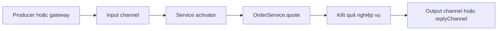

# Service activator là gì

Service activator là một message endpoint dùng để nối luồng thông điệp với phương thức xử lý của một đối tượng do Spring quản lý. Khi thông điệp đến input channel, endpoint lấy dữ liệu đầu vào, gọi phương thức nghiệp vụ và xử lý giá trị trả về theo hợp đồng của luồng.

Trong module **SPRING_INTEGRATION_CORE**, đây là thành phần giúp đưa service Java vào một flow gồm `Message`, `MessageChannel`, gateway và các bước xử lý khác. Ví dụ, ứng dụng nhận yêu cầu báo giá dưới dạng thông điệp; service activator gọi `OrderService.quote(...)`; kết quả được chuyển đến bước tiếp theo hoặc trả về bên yêu cầu. Cách tiếp cận này tương ứng với mẫu Service Activator trong Enterprise Integration Patterns. [Tham khảo định nghĩa mẫu Service Activator](https://www.enterpriseintegrationpatterns.com/patterns/messaging/MessagingAdapter.html).

## 1. Mục tiêu và kiến thức nền

Sau bài này, bạn có thể:

- Giải thích vai trò của service activator trong một message flow.
- Xác định quan hệ giữa channel đầu vào, endpoint và service nghiệp vụ.
- Viết cấu hình bằng `@ServiceActivator` và Java DSL `.handle(...)`.
- Chọn kiểu tham số và kiểu trả về phù hợp với hợp đồng message.
- Theo dõi đường đi của reply và exception trong ví dụ cơ bản.
- Phân biệt service activator với transformer, filter, router, aggregator và gateway.
- Thiết kế kiểm thử chứng minh message đã được xử lý đúng.

Bạn nên biết cách khai báo Spring bean và hiểu hai thành phần:

| Thành phần | Vai trò trong bài |
| --- | --- |
| `Message<T>` | Mang payload nghiệp vụ cùng các header như `tenantId` hoặc `replyChannel` |
| `MessageChannel` | Là điểm gửi/nhận thông điệp để nối các bước xử lý |

Các ví dụ dùng Java 17 trở lên vì có `record`. Cú pháp cấu hình được trình bày theo API Spring Integration 6.x; hãy dùng bộ phiên bản Spring tương thích do dự án quản lý.

## 2. Bài toán: đưa một service Java vào luồng thông điệp

Giả sử hệ thống có một service tính báo giá:

```java
public OrderQuote quote(OrderRequest request) {
    BigDecimal total = request.unitPrice()
            .multiply(BigDecimal.valueOf(request.quantity()));
    return new OrderQuote(request.orderId(), total);
}
```

Một controller hoặc service khác có thể gọi trực tiếp phương thức này. Khi ứng dụng đã có luồng tích hợp, bạn còn muốn yêu cầu báo giá đi qua các bước kiểm tra, chuyển đổi hoặc định tuyến trước khi gọi nghiệp vụ.

Service activator cung cấp điểm kết nối đó:



Ranh giới trách nhiệm được thể hiện như sau:

- Producer gửi một message theo hợp đồng đã thống nhất.
- Channel quyết định cách chuyển giao message.
- Endpoint kết nối việc nhận message với handler.
- Service thực hiện quy tắc nghiệp vụ.
- Kết quả tiếp tục đi trong flow theo cấu hình phản hồi.

Ví dụ, producer biết tên `quoteRequests` và kiểu `OrderRequest`, còn việc bean nào thực hiện tính báo giá nằm ở cấu hình endpoint. Nhờ vậy, bạn có thể thay cách triển khai nghiệp vụ hoặc chèn thêm bước xử lý mà không bắt producer gọi trực tiếp bean đích.

Cách tách này hữu ích khi nghiệp vụ thực sự nằm trong một flow nhiều bước. Với một phép gọi nội bộ đơn giản, hãy cân nhắc chi phí cấu hình và quan sát luồng trước khi đưa thêm messaging.

## 3. Service activator gồm những phần nào?

Khi đọc cấu hình, hãy phân biệt ba lớp:

| Lớp | Ví dụ | Trách nhiệm |
| --- | --- | --- |
| Service nghiệp vụ | `OrderService` | Thực hiện tính báo giá |
| Message handler | `ServiceActivatingHandler` trong trường hợp gọi POJO | Ánh xạ message sang lời gọi phương thức, xử lý kết quả |
| Consumer endpoint | `EventDrivenConsumer` hoặc `PollingConsumer` | Kết nối handler với channel và quản lý cách nhận message |

Với input channel có khả năng subscribe, endpoint dùng cơ chế event driven. Với input channel có khả năng poll, endpoint cần một poller được cấu hình tại chỗ hoặc dùng poller mặc định. Đây là cách Spring Integration tổ chức consumer endpoint. [Tham khảo Message Endpoints](https://docs.spring.io/spring-integration/reference/endpoint.html).

```text
Message<OrderRequest>
        |
        v
Consumer endpoint
        |
        v
Handler ánh xạ payload/header
        |
        v
orderService.quote(request)
        |
        v
OrderQuote -> reply message -> đích phản hồi
```

Một bean được đánh dấu `@Service` chỉ trở thành Spring bean theo cơ chế component scanning. Để bean tham gia message flow, bạn còn cần cấu hình endpoint, chẳng hạn `@ServiceActivator` hoặc một bước `.handle(...)` trong Java DSL.

Tương tự, service activator có thể gọi một phương thức Java trong cùng JVM. Việc tiếp cận HTTP, Kafka, JMS hay một hệ thống khác phụ thuộc vào adapter, gateway và hạ tầng được ghép vào flow.

## 4. Ví dụ hoàn chỉnh bằng annotation

### 4.1. Chuẩn bị dependency

Nếu dự án đã có Spring Boot dependency management, có thể khai báo starter sau mà không ghi version riêng:

```xml
<dependency>
    <groupId>org.springframework.boot</groupId>
    <artifactId>spring-boot-starter-integration</artifactId>
</dependency>
```

Với ứng dụng Spring thuần, dependency cốt lõi là `org.springframework.integration:spring-integration-core`. Khi đó, dự án phải quản lý version tương thích và các dependency liên quan. Java DSL nằm trong core của những phiên bản đang được minh họa.

Ví dụ sau khởi tạo `AnnotationConfigApplicationContext` trực tiếp để bạn nhìn rõ các bean cần thiết.

### 4.2. Message contract và cấu hình

Đặt mã sau trong `example/ServiceActivatorDemo.java` của một dự án đã có dependency:

```java
package example;

import java.math.BigDecimal;

import org.springframework.context.annotation.AnnotationConfigApplicationContext;
import org.springframework.context.annotation.Bean;
import org.springframework.context.annotation.Configuration;
import org.springframework.integration.annotation.ServiceActivator;
import org.springframework.integration.channel.DirectChannel;
import org.springframework.integration.channel.QueueChannel;
import org.springframework.integration.config.EnableIntegration;
import org.springframework.messaging.Message;
import org.springframework.messaging.MessageChannel;
import org.springframework.messaging.handler.annotation.Header;
import org.springframework.messaging.support.MessageBuilder;

public class ServiceActivatorDemo {

    public record OrderRequest(
            String orderId,
            int quantity,
            BigDecimal unitPrice) {
    }

    public record OrderQuote(String orderId, BigDecimal total) {
    }

    public static class OrderService {

        public OrderQuote quote(OrderRequest request) {
            if (request.quantity() <= 0) {
                throw new IllegalArgumentException("quantity must be positive");
            }
            if (request.unitPrice() == null
                    || request.unitPrice().signum() < 0) {
                throw new IllegalArgumentException(
                        "unitPrice must be non-negative");
            }

            BigDecimal total = request.unitPrice()
                    .multiply(BigDecimal.valueOf(request.quantity()));

            return new OrderQuote(request.orderId(), total);
        }
    }

    public static class QuoteEndpoint {

        private final OrderService orderService;

        public QuoteEndpoint(OrderService orderService) {
            this.orderService = orderService;
        }

        @ServiceActivator(
                inputChannel = "quoteRequests",
                outputChannel = "quoteResults",
                requiresReply = "true")
        public OrderQuote onQuote(
                OrderRequest request,
                @Header("tenantId") String tenantId) {

            if (tenantId.isBlank()) {
                throw new IllegalArgumentException("tenantId must not be blank");
            }

            return orderService.quote(request);
        }
    }

    @Configuration
    @EnableIntegration
    public static class Config {

        @Bean
        public MessageChannel quoteRequests() {
            return new DirectChannel();
        }

        @Bean
        public QueueChannel quoteResults() {
            return new QueueChannel(10);
        }

        @Bean
        public OrderService orderService() {
            return new OrderService();
        }

        @Bean
        public QuoteEndpoint quoteEndpoint(OrderService orderService) {
            return new QuoteEndpoint(orderService);
        }
    }

    public static void main(String[] args) {
        try (var context =
                     new AnnotationConfigApplicationContext(Config.class)) {

            MessageChannel requests = context.getBean(
                    "quoteRequests", MessageChannel.class);
            QueueChannel results = context.getBean(
                    "quoteResults", QueueChannel.class);

            Message<OrderRequest> request = MessageBuilder
                    .withPayload(new OrderRequest(
                            "ORD-101", 3, new BigDecimal("125000.00")))
                    .setHeader("tenantId", "shop-a")
                    .setHeader("source", "web-demo")
                    .build();

            if (!requests.send(request, 1000)) {
                throw new IllegalStateException("Request was not accepted");
            }

            Message<?> reply = results.receive(1000);
            if (reply == null) {
                throw new IllegalStateException("No quote received");
            }

            OrderQuote quote = (OrderQuote) reply.getPayload();
            System.out.println(
                    quote.orderId() + " -> " + quote.total().toPlainString());
        }
    }
}
```

Kết quả nghiệp vụ mong đợi:

```text
ORD-101 -> 375000.00
```

Các bean được khai báo trực tiếp bằng `@Bean` nên ví dụ không cần component scanning để tìm `QuoteEndpoint`. `@EnableIntegration` đăng ký hạ tầng Spring Integration cho application context thuần Spring này.

### 4.3. Theo dấu một message

Với request trong ví dụ, bạn có thể lần theo sáu bước:

1. `requests.send(...)` gửi `Message<OrderRequest>` vào `quoteRequests`.
2. `DirectChannel` chuyển message đến handler đã được endpoint đăng ký.
3. Framework ánh xạ payload vào `request` và header `tenantId` vào tham số cùng tên.
4. `QuoteEndpoint` kiểm tra tenant rồi gọi `OrderService.quote(...)`.
5. Service trả về `OrderQuote` có tổng tiền `375000.00`.
6. Endpoint gửi reply đến `quoteResults`; chương trình lấy ra bằng `receive(1000)`.

`quoteResults` được chọn là queue để chương trình chủ động đọc và quan sát kết quả. Trong ví dụ này, service được gọi trên thread gửi message vì input là `DirectChannel`. Việc đặt một queue ở đầu ra không làm bước tính báo giá chuyển sang thread nền.

Bạn có thể tự quan sát điểm này bằng cách in `Thread.currentThread().getName()` trước `send(...)` và trong `onQuote(...)`.

## 5. Ánh xạ tham số: payload, header hay toàn bộ message?

Phương thức xử lý có thể nhận payload, một số header, tập header hoặc toàn bộ `Message`. Cấu hình annotation hỗ trợ các kiểu ánh xạ này. [Tham khảo Annotation Support](https://docs.spring.io/spring-integration/reference/configuration/annotations.html).

### 5.1. Nhận riêng payload

```java
public OrderQuote quote(OrderRequest request) {
    // Tính toán chỉ dựa trên dữ liệu nghiệp vụ.
    return orderService.quote(request);
}
```

Đây là lựa chọn dễ kiểm thử cho logic miền nghiệp vụ. `OrderService` trong ví dụ hoàn chỉnh chỉ phụ thuộc vào `OrderRequest` và `OrderQuote`.

### 5.2. Nhận payload cùng một header

```java
public OrderQuote quote(
        OrderRequest request,
        @Header("tenantId") String tenantId) {

    return orderService.quote(request);
}
```

`@Header` mặc định yêu cầu header tồn tại. Trong ví dụ chính, thiếu `tenantId` gây lỗi ánh xạ trước khi phần thân phương thức chạy. Kiểm tra `isBlank()` chỉ xử lý trường hợp header đã có nhưng rỗng hoặc chỉ chứa khoảng trắng.

Nếu một header chỉ mang thông tin bổ sung, có thể cho phép thiếu:

```java
public OrderQuote quote(
        OrderRequest request,
        @Header(value = "traceId", required = false) String traceId) {

    return orderService.quote(request);
}
```

Trong hệ thống nhiều tenant, giá trị tenant cần đến từ nguồn đáng tin cậy và được kiểm tra quyền truy cập tại ranh giới thích hợp. Ví dụ ở đây chỉ minh họa cách truyền metadata vào endpoint; tính báo giá chưa có quy tắc riêng cho từng tenant.

### 5.3. Nhận toàn bộ message

```java
import org.springframework.messaging.Message;

public OrderQuote quote(Message<OrderRequest> message) {
    OrderRequest request = message.getPayload();
    Object source = message.getHeaders().get("source");

    return orderService.quote(request);
}
```

Cách này phù hợp khi lớp tích hợp cần truy cập nhiều header hoặc kiểm soát metadata. Có thể đặt nó trong một lớp endpoint mỏng rồi ủy quyền cho service chỉ nhận dữ liệu nghiệp vụ.

Một phương thức xử lý không nhất thiết phải nhận cả payload và `Message`. Hãy chọn hợp đồng tham số dễ đọc nhất cho nhu cầu thực tế. Nếu cần nhiều header mà vẫn muốn tách payload, có thể dùng `@Headers Map<String, Object>`.

### 5.4. Kiểu dữ liệu phải có hợp đồng rõ ràng

Nếu gửi một `String` vào nơi mong đợi `OrderRequest`, bạn đang dựa vào khả năng chuyển đổi kiểu có sẵn hoặc converter đã đăng ký. Việc trùng tên field trong JSON và record chưa đủ để tạo ra hợp đồng chuyển đổi.

Với đầu vào JSON, cách bố trí dễ theo dõi là:

```text
JSON text
   -> transformer giải mã thành OrderRequest
   -> service activator gọi OrderService
   -> OrderQuote
```

Cách này làm rõ bước nào chịu trách nhiệm đọc dữ liệu và bước nào chịu trách nhiệm nghiệp vụ.

## 6. Hợp đồng giá trị trả về

Service activator hỗ trợ cả xử lý một chiều và xử lý có phản hồi. Vì vậy, kiểu trả về là một phần của thiết kế flow.

| Kết quả từ phương thức | Ý nghĩa |
| --- | --- |
| Một object khác `null` | Dùng object làm payload của reply |
| Một `Message<?>` | Cho phép lớp tích hợp trả về payload kèm header chủ động |
| `void` | Hoàn thành xử lý mà không tạo reply |
| `null` với `requiresReply=false` | Kết thúc nhánh hiện tại mà không tạo reply |
| `null` với `requiresReply=true` | Phát sinh `ReplyRequiredException` |

`requiresReply` của service activator mặc định có hiệu lực là `false`. Trong annotation, cấu hình này nhận chuỗi nên dùng `requiresReply = "true"`. [Tham khảo API ServiceActivator](https://docs.spring.io/spring-integration/docs/6.5.0/api/org/springframework/integration/annotation/ServiceActivator.html).

### 6.1. Trường hợp một chiều

Một endpoint ghi nhận sự kiện có thể có hợp đồng:

```java
@ServiceActivator(inputChannel = "auditRequests")
public void recordAudit(AuditEvent event) {
    auditService.append(event);
}
```

Đây là đoạn minh họa độc lập, giả định đã có `AuditEvent`, `auditService` và channel tương ứng.

Phương thức hoàn tất sau khi gọi `append(...)`. Nếu một bước downstream đang chờ message tiếp theo, cần thiết kế rõ ai sẽ tạo message đó. Chỉ thêm một bước `.handle(...)` khác vào sau phương thức `void` sẽ không làm request tự đi tiếp.

### 6.2. Kết quả bắt buộc

Trong ví dụ báo giá, mỗi request hợp lệ phải có một quote, nên `requiresReply = "true"` thể hiện đúng hợp đồng.

Cấu hình này phát hiện trường hợp phương thức trả về `null`. Nó không thay thế thời hạn gọi dịch vụ ngoài, thời gian gửi message hoặc tính sẵn sàng của consumer tiếp theo. Một reply hợp lệ vẫn có thể gặp lỗi chuyển giao sau khi nghiệp vụ tính xong.

### 6.3. Trả về message và header

Một endpoint cần bổ sung header có thể xây dựng reply như sau:

```java
import org.springframework.messaging.Message;
import org.springframework.messaging.support.MessageBuilder;

public Message<OrderQuote> quoteWithMetadata(
        Message<OrderRequest> request) {

    OrderQuote result = orderService.quote(request.getPayload());

    return MessageBuilder.withPayload(result)
            .copyHeaders(request.getHeaders())
            .setHeader("quoteStatus", "READY")
            .build();
}
```

Dùng `MessageBuilder` để tạo message và thay đổi header, thay vì sửa trực tiếp bản đồ header của request. Khi gửi qua ranh giới hệ thống, hãy chủ động chọn các header được phép đi qua; những tham chiếu channel cục bộ chỉ có ý nghĩa trong phạm vi hỗ trợ chúng.

Trong bài này, phương thức trả POJO đã đủ vì không cần tự đặt thêm header đầu ra. Metadata thông thường của request được framework lan truyền theo cơ chế tạo reply; bạn có thể kiểm chứng `tenantId` và `source` ở ví dụ kiểm thử.

## 7. Reply được gửi đến đâu?

Với kết quả khác `null`, thứ tự chọn đích phản hồi là:

1. `outputChannel` cấu hình trên endpoint.
2. Header `replyChannel` của request nếu endpoint không có output channel.
3. Header `replyChannel` của message kết quả nếu request không cung cấp địa chỉ này.

Đích trong header có thể là một `MessageChannel` hoặc tên channel cần được phân giải. Có kết quả nhưng không tìm được đích phản hồi phù hợp sẽ gây lỗi phân giải đích. Nếu muốn chủ động bỏ kết quả, có thể cấu hình output là `nullChannel`. [Tham khảo quy tắc reply của Service Activator](https://docs.spring.io/spring-integration/reference/service-activator.html).

### 7.1. Output channel tường minh

Ví dụ chính khai báo:

```java
@ServiceActivator(
        inputChannel = "quoteRequests",
        outputChannel = "quoteResults",
        requiresReply = "true")
```

Vì vậy, reply vào `quoteResults`. Producer có thể bổ sung `replyChannel` vào request, nhưng endpoint này vẫn ưu tiên output đã khai báo.

Đây là lựa chọn phù hợp khi bước tiếp theo của pipeline đã xác định rõ.

### 7.2. Địa chỉ phản hồi trong request

Nếu muốn bên gọi cung cấp nơi nhận kết quả, có thể dùng một endpoint khác không khai báo output:

```java
@ServiceActivator(
        inputChannel = "dynamicQuoteRequests",
        requiresReply = "true")
public OrderQuote quote(OrderRequest request) {
    return orderService.quote(request);
}
```

Bên gửi tạo một queue phản hồi riêng:

```java
QueueChannel replies = new QueueChannel(1);

Message<OrderRequest> request = MessageBuilder
        .withPayload(new OrderRequest(
                "ORD-102", 2, new BigDecimal("50000.00")))
        .setReplyChannel(replies)
        .build();

boolean accepted = dynamicQuoteRequests.send(request, 1000);
Message<?> reply = accepted ? replies.receive(1000) : null;
```

Đoạn gửi này giả định `dynamicQuoteRequests` là channel nối đến endpoint vừa nêu. Với `DirectChannel` trong cùng JVM, tham chiếu queue có thể được dùng làm return address.

Nếu có nhiều request đồng thời, một queue riêng cho từng lời gọi giúp việc nhận reply dễ xác định. Khi dùng queue chung, cần một cơ chế correlation để kết quả đến đúng bên chờ.

### 7.3. Kết quả có chủ ý bị bỏ

Một phương thức có thể luôn trả kết quả dù một flow cụ thể chỉ cần tác dụng phụ. Khi đó, cấu hình `outputChannel = "nullChannel"` nói rõ ý định kết thúc bằng cách bỏ reply.

Nếu phương thức đã trả `void` hoặc `null` với hợp đồng cho phép, endpoint không tạo reply để gửi đến `nullChannel`.

## 8. Dùng Java DSL để giữ nghiệp vụ dưới dạng POJO

Java DSL biểu diễn lời gọi service bằng `.handle(...)`. Bạn có thể chỉ rõ đối tượng và tên phương thức, hoặc dùng lambda nhận payload cùng headers. [Tham khảo Service Activators and the .handle() method](https://docs.spring.io/spring-integration/reference/dsl/java-handle.html).

### 8.1. Gọi một phương thức nghiệp vụ

Dùng lại `OrderService` và các record của ví dụ chính:

```java
import org.springframework.context.annotation.Bean;
import org.springframework.integration.dsl.IntegrationFlow;

@Bean
public IntegrationFlow quoteFlow(OrderService orderService) {
    return IntegrationFlow.from("quoteRequests")
            .handle(orderService, "quote",
                    endpoint -> endpoint.requiresReply(true))
            .channel("quoteResults")
            .get();
}
```

Đây là **phương án thay thế** cho bean `QuoteEndpoint`. Nếu muốn chạy bản DSL, giữ các bean channel và service, thay bean endpoint bằng bean flow ở trên, đồng thời giữ `@EnableIntegration`.

Bản DSL này gọi trực tiếp `OrderService.quote(...)` nên chưa thực hiện bước kiểm tra `tenantId` của `QuoteEndpoint`. Muốn giữ yêu cầu tenant, cần bổ sung bước kiểm tra hoặc gọi một phương thức có hợp đồng nhận header tương ứng.

Trong flow:

- `from("quoteRequests")` chọn điểm nhận.
- `handle(orderService, "quote", ...)` nối đến nghiệp vụ tính báo giá.
- `requiresReply(true)` yêu cầu kết quả khác `null`.
- `channel("quoteResults")` chọn điểm chuyển giao kết quả.

Hãy đăng ký đúng một trong hai phương án cho cùng ví dụ. Hai handler cùng subscribe một `DirectChannel` tạo ra nhiều consumer cạnh tranh cho message; mỗi message được chuyển đến một handler theo cơ chế dispatcher, khiến luồng chạy khác với ý định “một cấu hình, một bước xử lý”.

### 8.2. Dùng lambda có kiểu payload tường minh

```java
@Bean
public IntegrationFlow quoteFlow(OrderService orderService) {
    return IntegrationFlow.from("quoteRequests")
            .handle(OrderRequest.class,
                    (request, headers) -> orderService.quote(request),
                    endpoint -> endpoint.requiresReply(true))
            .channel("quoteResults")
            .get();
}
```

Tham số thứ nhất của lambda là payload, tham số thứ hai là headers. Chỉ rõ `OrderRequest.class` giúp thể hiện hợp đồng kiểu ở bước xử lý.

Đặt logic nghiệp vụ dài trong service riêng sẽ giúp flow giữ được vai trò mô tả đường đi của thông điệp. Lambda ngắn phù hợp cho việc ủy quyền hoặc xử lý đơn giản.

## 9. Gateway và service activator phối hợp thế nào?

Gateway cung cấp giao diện Java cho bên gọi; service activator gọi nghiệp vụ ở phía xử lý.

```text
caller
  -> gateway proxy
  -> request channel
  -> service activator
  -> OrderService
  -> replyChannel
  -> gateway trả OrderQuote
```

Với gateway có phản hồi, framework thông thường tạo một reply channel tạm và đặt nó vào request. Nhờ đó, endpoint cuối flow có thể trả kết quả mà không cần biết trước từng caller. [Tham khảo Messaging Gateways](https://docs.spring.io/spring-integration/reference/gateway.html).

Một interface minh họa:

```java
import org.springframework.integration.annotation.MessagingGateway;

@MessagingGateway(
        defaultRequestChannel = "gatewayQuoteRequests",
        defaultReplyTimeout = "1000")
public interface QuoteGateway {
    OrderQuote quote(OrderRequest request);
}
```

Endpoint đích tương ứng:

```java
@ServiceActivator(
        inputChannel = "gatewayQuoteRequests",
        requiresReply = "true")
public OrderQuote quoteFromGateway(OrderRequest request) {
    return orderService.quote(request);
}
```

Đây là phần mở rộng độc lập với cấu hình ban đầu. Để chạy, interface gateway phải được đăng ký qua cơ chế như `@IntegrationComponentScan` trên package thích hợp; endpoint và service cũng phải là bean. Endpoint đích không khai báo output để kết quả được gửi theo `replyChannel` do gateway cung cấp.

Một tình huống dễ nhầm là dùng gateway chờ `OrderQuote` nhưng vẫn nối đến endpoint có `outputChannel = "quoteResults"`. Quote có thể đã vào queue đó trong khi gateway vẫn chờ trên địa chỉ phản hồi của riêng nó. Khi ghép các đoạn cấu hình, cần vẽ rõ đường đi cuối cùng về caller.

Ngoài ra, `defaultReplyTimeout` giới hạn giai đoạn chờ reply của gateway. Nếu cả flow đang chạy đồng bộ qua `DirectChannel`, thời gian thực thi phương thức service có thể xảy ra trước giai đoạn chờ ấy. Cần cấu hình timeout của client HTTP, cơ sở dữ liệu hoặc tài nguyên thực sự bị chặn ở đúng lớp chịu trách nhiệm.

## 10. Đồng bộ, polling và ý nghĩa của send

Loại channel đầu vào ảnh hưởng đến thời điểm handler chạy:

| Input channel | Cách chuyển giao | Điều cần quan sát |
| --- | --- | --- |
| `DirectChannel` | Gọi một subscriber trên thread gửi | Thời gian gọi service nằm trong thời gian `send(...)` |
| `QueueChannel` | Giữ message chờ consumer lấy ra | Endpoint cần poller; gửi vào queue có thể hoàn tất trước nghiệp vụ |
| `ExecutorChannel` | Giao việc qua executor đã cấu hình | Theo dõi thread pool, lỗi bất đồng bộ và khả năng xử lý đồng thời |

`QueueChannel` mặc định lưu trong bộ nhớ; `DirectChannel` có cơ chế point to point. Chọn queue không tự tạo độ bền lưu trữ. [Tham khảo Message Channel Implementations](https://docs.spring.io/spring-integration/reference/channel/implementations.html).

Nếu đổi input của ví dụ sang queue, có thể gắn poller vào endpoint:

```java
import org.springframework.integration.annotation.Poller;

@ServiceActivator(
        inputChannel = "queuedQuoteRequests",
        outputChannel = "quoteResults",
        requiresReply = "true",
        poller = @Poller(
                fixedDelay = "100",
                maxMessagesPerPoll = "10"))
public OrderQuote quoteFromQueue(OrderRequest request) {
    return orderService.quote(request);
}
```

Đoạn này giả định `queuedQuoteRequests` là bean `QueueChannel` và lớp chứa phương thức là bean. `fixedDelay` ở đây dùng mili giây. Bạn có thể cấu hình poller chung thay cho cấu hình tại endpoint nếu phù hợp với ứng dụng.

Cần đọc `send(...)` theo loại channel và hợp đồng chuyển giao:

- Với queue, `true` cho biết message đã được nhận vào queue; kết quả nghiệp vụ có thể chưa có.
- Với `DirectChannel` trong ví dụ, `send(...)` chỉ trả về sau lời gọi đồng bộ, nhưng caller vẫn nhận giá trị boolean, không nhận `OrderQuote`.
- Muốn lấy kết quả, caller dùng reply channel, gateway hoặc một cơ chế nhận riêng.

Khi xử lý song song, service singleton có thể được nhiều thread gọi. Trạng thái của từng message nên nằm ở biến cục bộ; dữ liệu dùng chung cần một cơ chế đồng bộ hoặc lưu trữ phù hợp.

## 11. Khi service ném exception

Ví dụ nghiệp vụ chủ động từ chối `quantity <= 0`. Cách caller quan sát lỗi phụ thuộc vào đường đi của message.

### 11.1. Đường đi đồng bộ

Với `DirectChannel` trong ví dụ chính, lỗi xử lý truyền ngược qua lời gọi `send(...)`, thường trong một exception của Spring Messaging chứa nguyên nhân gốc:

```java
import org.springframework.messaging.MessagingException;

try {
    requests.send(invalidRequest, 1000);
} catch (MessagingException ex) {
    Throwable root = ex;
    while (root.getCause() != null) {
        root = root.getCause();
    }
    System.err.println(root.getMessage());
}
```

`invalidRequest` ở đây là `Message<OrderRequest>` có `quantity = 0` và vẫn có `tenantId` hợp lệ.

Một header `errorChannel` trên message không tự đổi mọi exception đồng bộ thành thông điệp lỗi. Với việc gửi trực tiếp vào `DirectChannel`, bạn vẫn cần xử lý exception tại caller hoặc một cơ chế advice/gateway được cấu hình phù hợp.

### 11.2. Đường đi bất đồng bộ

Khi xử lý diễn ra trong task của Spring Integration hoặc scheduled poller, lỗi có thể được xuất bản dưới dạng `ErrorMessage`. Cơ chế xử lý lỗi mặc định xét `errorChannel` trên request rồi dùng channel lỗi chung khi cần. Đây là cách chuyển lỗi qua ranh giới thread. [Tham khảo Error Handling](https://docs.spring.io/spring-integration/reference/error-handling.html).

Một lớp endpoint ghi log có thể nhận payload lỗi:

```java
@ServiceActivator(inputChannel = "quoteErrors")
public void onQuoteError(Throwable failure) {
    System.err.println("Quote flow failed: " + failure.getMessage());
}
```

Đoạn trên chỉ có tác dụng khi `quoteErrors` đã được khai báo và đường xử lý lỗi thực sự gửi đến đó. Nếu muốn lấy cả metadata của thông điệp lỗi, có thể nhận `ErrorMessage` thay cho riêng `Throwable`.

### 11.3. Tác dụng phụ và retry

Giả sử service lưu đơn hàng rồi gặp lỗi ở bước gửi kết quả. Một lần xử lý lại có thể gọi service lần nữa. Vì vậy, với nghiệp vụ có tác dụng phụ, hãy xác định:

- Định danh nào dùng để nhận biết cùng một yêu cầu.
- Việc gọi lại có được phép tạo thêm bản ghi hoặc gửi thêm thông báo không.
- Transaction bao phủ những thao tác nào.
- Sau khi hết retry, kết quả lỗi được lưu hoặc chuyển cho bước nào.

Service activator là điểm gọi service; chính sách retry, idempotency và transaction cần được thiết kế theo tác dụng phụ thực tế. Ví dụ báo giá thuần tính toán giúp học cơ chế endpoint trước khi bổ sung các yếu tố này.

## 12. Chọn đúng thành phần cho từng công việc

Các endpoint có thể cùng gọi một phương thức Java, nhưng nên được chọn theo ý nghĩa của bước trong flow:

| Thành phần | Câu hỏi nó trả lời | Ví dụ |
| --- | --- | --- |
| Service activator | Cần thực hiện nghiệp vụ nào? | Tính báo giá, giữ hàng, ghi nhận yêu cầu |
| Transformer | Cần đổi biểu diễn dữ liệu thế nào? | JSON thành `OrderRequest` |
| Filter | Message có được đi tiếp không? | Loại yêu cầu thiếu thông tin bắt buộc |
| Router | Message cần đến nhánh nào? | Chọn luồng đơn thông thường hoặc đơn ưu tiên |
| Aggregator | Khi nào đủ dữ liệu để tạo kết quả nhóm? | Gom báo giá của nhiều nhà cung cấp |
| Gateway | Bên gọi tương tác với messaging qua giao diện nào? | `QuoteGateway.quote(request)` |
| Channel adapter | Dữ liệu đi vào hoặc ra tài nguyên nào? | Đọc file đầu vào, ghi kết quả ra hệ thống khác |

Ví dụ một flow tổng quát:

```text
JSON đầu vào
   -> transformer: tạo OrderRequest
   -> filter: kiểm tra điều kiện nhận
   -> router: chọn nhánh nghiệp vụ
   -> service activator: gọi service của nhánh
   -> aggregator: ghép kết quả nếu bài toán yêu cầu nhiều nhánh
   -> bước cuối trả reply
```

Aggregator chỉ cần khi bài toán có yêu cầu gom nhóm, cùng quy tắc correlation và release thích hợp. Một phép tính báo giá đơn lẻ như ví dụ chính có thể trả kết quả ngay.

Service activator có thể trả object khác kiểu đầu vào, nhưng nếu mục đích chủ yếu là chuyển đổi dữ liệu, transformer diễn đạt ý định rõ hơn. Transformer có hợp đồng tạo kết quả và không cho phép kết thúc bằng `null` như service activator mặc định. [Tham khảo Transformer](https://docs.spring.io/spring-integration/reference/transformer.html).

Tương tự, muốn bỏ message theo một điều kiện thì filter giúp biểu diễn quyết định rõ ràng. Muốn chọn channel theo dữ liệu thì router giúp người đọc thấy các nhánh xử lý ngay trong cấu hình.

## 13. Kiểm thử ví dụ theo hai lớp

Có hai điều khác nhau cần chứng minh:

1. **Nghiệp vụ đúng:** `OrderService` tính đúng tổng và từ chối đầu vào sai.
2. **Kết nối flow đúng:** message đi vào đúng endpoint, header được ánh xạ và reply đến đúng nơi.

Unit test cho service không thay thế kiểm thử cấu hình endpoint. Ngược lại, một test flow quá lớn có thể làm nguyên nhân lỗi khó xác định. Hãy giữ từng nhóm kiểm thử có mục tiêu cụ thể.

### 13.1. Kiểm thử đường đi thành công và lỗi đồng bộ

Ví dụ JUnit 5 sau dùng nguyên cấu hình annotation ở mục 4. Dự án cần dependency kiểm thử cung cấp JUnit Jupiter, chẳng hạn `spring-boot-starter-test` nếu đang dùng Spring Boot dependency management.

```java
package example;

import java.math.BigDecimal;

import org.junit.jupiter.api.Test;
import org.springframework.context.annotation.AnnotationConfigApplicationContext;
import org.springframework.integration.channel.QueueChannel;
import org.springframework.messaging.Message;
import org.springframework.messaging.MessageChannel;
import org.springframework.messaging.MessagingException;
import org.springframework.messaging.support.MessageBuilder;

import static org.junit.jupiter.api.Assertions.*;

class ServiceActivatorDemoTest {

    @Test
    void shouldCreateQuoteAndPreserveBusinessHeaders() {
        try (var context = new AnnotationConfigApplicationContext(
                ServiceActivatorDemo.Config.class)) {

            MessageChannel requests = context.getBean(
                    "quoteRequests", MessageChannel.class);
            QueueChannel results = context.getBean(
                    "quoteResults", QueueChannel.class);

            var order = new ServiceActivatorDemo.OrderRequest(
                    "ORD-101", 3, new BigDecimal("125000.00"));

            Message<?> request = MessageBuilder.withPayload(order)
                    .setHeader("tenantId", "shop-a")
                    .setHeader("source", "test")
                    .build();

            assertTrue(requests.send(request, 1000));

            Message<?> reply = results.receive(1000);
            assertNotNull(reply);

            var quote = assertInstanceOf(
                    ServiceActivatorDemo.OrderQuote.class,
                    reply.getPayload());

            assertEquals("ORD-101", quote.orderId());
            assertEquals(new BigDecimal("375000.00"), quote.total());
            assertEquals("shop-a", reply.getHeaders().get("tenantId"));
            assertEquals("test", reply.getHeaders().get("source"));
            assertNull(results.receive(0));
        }
    }

    @Test
    void shouldPropagateInvalidQuantityAndProduceNoQuote() {
        try (var context = new AnnotationConfigApplicationContext(
                ServiceActivatorDemo.Config.class)) {

            MessageChannel requests = context.getBean(
                    "quoteRequests", MessageChannel.class);
            QueueChannel results = context.getBean(
                    "quoteResults", QueueChannel.class);

            var invalidOrder = new ServiceActivatorDemo.OrderRequest(
                    "ORD-BAD", 0, new BigDecimal("125000.00"));

            Message<?> request = MessageBuilder.withPayload(invalidOrder)
                    .setHeader("tenantId", "shop-a")
                    .build();

            MessagingException failure = assertThrows(
                    MessagingException.class,
                    () -> requests.send(request, 1000));

            Throwable root = failure;
            while (root.getCause() != null) {
                root = root.getCause();
            }

            assertInstanceOf(IllegalArgumentException.class, root);
            assertEquals("quantity must be positive", root.getMessage());
            assertNull(results.receive(0));
        }
    }
}
```

Mỗi test tạo context riêng, giúp queue và bean không mang trạng thái sang test khác. `receive(1000)` chờ có giới hạn để test không treo vô hạn. `receive(0)` kiểm tra ngay việc không có thêm reply tại thời điểm kiểm tra.

Với ví dụ đồng bộ này, kiểm tra queue ngay sau khi `send(...)` ném lỗi là phù hợp. Với flow bất đồng bộ, cần chờ điều kiện hoàn tất bằng timeout phù hợp thay vì suy luận rằng “queue đang trống” nghĩa là toàn bộ xử lý đã kết thúc.

### 13.2. Những hợp đồng nên mở rộng kiểm thử

Khi chỉnh ví dụ, có thể bổ sung các tình huống sau:

| Thay đổi | Điều cần chứng minh |
| --- | --- |
| Bỏ `tenantId` | Endpoint báo lỗi ánh xạ, service chưa được gọi |
| Cho service trả `null` và bật `requiresReply` | Nhận `ReplyRequiredException` ở đường xử lý thích hợp |
| Bỏ output channel và cung cấp `replyChannel` | Quote đến đúng địa chỉ của request |
| Đặt cả output channel và `replyChannel` | Reply đi theo output đã cấu hình |
| Thay input bằng queue có poller | Thành công được kiểm tra qua reply; lỗi được kiểm tra qua error flow |
| Thêm retry cho service có tác dụng phụ | Cùng yêu cầu không tạo tác dụng phụ ngoài ý định |

Đây là các kiểm thử hợp đồng của luồng. Chúng cho biết người gọi sẽ quan sát được hành vi nào khi cấu hình thay đổi.

## 14. Những tình huống thường gây hiểu nhầm

| Hiện tượng | Nguyên nhân cần kiểm tra | Hướng xử lý |
| --- | --- | --- |
| Gửi message nhưng không vào service | Bean endpoint chưa đăng ký, sai channel hoặc endpoint chưa chạy | Kiểm tra application context và tên input channel |
| Queue có message nhưng service chưa chạy | Input là pollable channel nhưng chưa có consumer/poller hoạt động | Khai báo poller và quan sát lịch chạy |
| Service chạy xong nhưng thiếu reply | Phương thức trả `void`/`null` hoặc kết quả đi sang đích khác | Xem hợp đồng trả về và toàn bộ đường phản hồi |
| Có exception phân giải đích | Có kết quả nhưng thiếu hoặc sai địa chỉ output/reply | Khai báo channel hợp lệ hoặc chủ động dùng `nullChannel` |
| Gateway chờ dù đã tính xong | Output cố định đưa kết quả ra khỏi đường về gateway | Theo dấu `replyChannel` đến bước cuối |
| Header không ánh xạ được | Thiếu header bắt buộc hoặc sai kiểu dữ liệu | Kiểm tra hợp đồng message trước endpoint |
| Logic chỉ chạy ở một trong hai handler | Có nhiều subscriber cạnh tranh trên `DirectChannel` | Chọn đúng một cấu hình hoặc thiết kế consumer cạnh tranh có chủ ý |
| Caller không bắt được lỗi xử lý nền | Handler chạy sau ranh giới thread | Theo dõi `ErrorMessage` và đường error channel |
| Tăng timeout nhưng service vẫn bị treo | Timeout cấu hình ở chỗ chờ reply hoặc gửi channel | Đặt giới hạn tại thao tác I/O hoặc tài nguyên bị chặn |

Khi gỡ lỗi, hãy bắt đầu từ một message cụ thể: payload thuộc kiểu gì, header nào đi kèm, channel đầu vào là loại nào, endpoint nào nhận, service trả gì và reply cần đến đâu. Đường đi này thường cho biết vị trí cấu hình đang lệch với hợp đồng.

## 15. Vận dụng vào thiết kế một flow

Với một bài toán mới, có thể xác định lần lượt:

1. **Đầu vào:** kiểu payload, trường bắt buộc và metadata cần truyền.
2. **Nghiệp vụ:** phương thức service thực hiện thao tác gì, có tác dụng phụ hay không.
3. **Phản hồi:** một chiều, một kết quả bắt buộc hay kết thúc có điều kiện.
4. **Đích kết quả:** bước tiếp theo cố định hay địa chỉ do caller cung cấp.
5. **Mô hình thực thi:** chạy trên thread gửi, qua queue hay qua executor.
6. **Lỗi:** caller nhận exception trực tiếp hay một flow khác nhận thông điệp lỗi.
7. **Kiểm thử:** chứng minh dữ liệu, kết quả và lỗi đến đúng nơi.

Áp dụng vào ví dụ báo giá:

| Quyết định | Lựa chọn |
| --- | --- |
| Payload | `OrderRequest` |
| Header bắt buộc ở bản annotation | `tenantId` |
| Nghiệp vụ | Nhân đơn giá với số lượng hợp lệ |
| Kết quả | `OrderQuote` bắt buộc |
| Input | `DirectChannel` để theo dõi lời gọi đồng bộ |
| Output | `QueueChannel` để quan sát reply |
| Lỗi | Truyền ngược về lời gọi `send(...)` |
| Kiểm thử quan trọng | Đúng tổng, giữ header, đầu vào sai không có quote |

Khi mở rộng sang giữ hàng hoặc ghi đơn, hãy giữ endpoint dễ đọc và đưa quy tắc nghiệp vụ vào service thích hợp. Khi cần đổi định dạng, chọn nhánh hoặc gom nhiều kết quả, hãy ghép thêm endpoint có ý nghĩa tương ứng.

Một service activator được cấu hình rõ ràng cho người đọc biết ba điều: message nào kích hoạt nghiệp vụ, phương thức nào được gọi và kết quả hoặc lỗi đi theo đường nào.

## 16. Tài liệu tham khảo

- [Enterprise Integration Patterns — Service Activator](https://www.enterpriseintegrationpatterns.com/patterns/messaging/MessagingAdapter.html): mẫu kiến trúc kết nối service với messaging.
- [Spring Integration — Service Activator](https://docs.spring.io/spring-integration/reference/service-activator.html): cấu hình endpoint và quy tắc phản hồi.
- [Spring Integration — Annotation Support](https://docs.spring.io/spring-integration/reference/configuration/annotations.html): ánh xạ payload, header và khai báo endpoint.
- [Spring Integration — ServiceActivator API 6.5.0](https://docs.spring.io/spring-integration/docs/6.5.0/api/org/springframework/integration/annotation/ServiceActivator.html): thuộc tính annotation.
- [Spring Integration — Service Activators and the .handle() method](https://docs.spring.io/spring-integration/reference/dsl/java-handle.html): cấu hình Java DSL.
- [Spring Integration — Message Endpoints](https://docs.spring.io/spring-integration/reference/endpoint.html): handler và hai cơ chế consumer.
- [Spring Integration — Message Channel Implementations](https://docs.spring.io/spring-integration/reference/channel/implementations.html): ý nghĩa từng loại channel.
- [Spring Integration — Messaging Gateways](https://docs.spring.io/spring-integration/reference/gateway.html): giao diện cho caller và reply channel.
- [Spring Integration — Error Handling](https://docs.spring.io/spring-integration/reference/error-handling.html): phân biệt lỗi đồng bộ và bất đồng bộ.
- [Spring Integration — Transformer](https://docs.spring.io/spring-integration/reference/transformer.html): hợp đồng chuyển đổi thông điệp.
