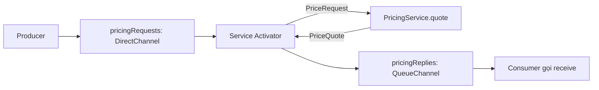

# Gọi POJO method từ message

Chương **Service activator** · Module **SPRING_INTEGRATION_CORE**

Một ứng dụng đã có phương thức `PricingService.quote(PriceRequest)` để tính báo giá. Khi yêu cầu đến dưới dạng `Message<PriceRequest>`, cần một thành phần nhận message, lấy dữ liệu để gọi phương thức và đưa kết quả trở lại luồng. **Service Activator** kết nối dịch vụ với hệ thống message, còn nghiệp vụ có thể tiếp tục là mã Java thông thường. [Mô hình endpoint của Spring Integration](https://docs.spring.io/spring-integration/reference/overview.html).

Trong phạm vi Spring Integration Core, bài này hướng dẫn kết nối Message, MessageChannel và endpoint bằng Java DSL hoặc annotation; xác định tham số, reply và lỗi; sau đó kiểm thử lời gọi nghiệp vụ. Đây là nền tảng để đưa dịch vụ vào các flow lớn hơn có gateway, transformer, router, filter hoặc aggregator.

## 1. Mục tiêu và kiến thức chuẩn bị

Sau bài học, bạn có thể:

- Kết nối một Spring bean với input channel và chỉ rõ phương thức cần gọi.
- Thiết kế chữ ký nhận payload, header hoặc toàn bộ message.
- Phân biệt trả về đối tượng, `Message<?>`, `null` và `void`.
- Theo dõi reply và exception trong một luồng đồng bộ.
- Kiểm thử riêng nghiệp vụ POJO và cấu hình tích hợp.

Cần biết Java method, generics, Spring bean, `Message<T>` và `MessageChannel`. Ví dụ dùng Java 17 trở lên, `record`, Spring Context và Spring Integration Core với API `IntegrationFlow.from(...)`. Quản lý phiên bản thư viện theo BOM hoặc cấu hình dependency của dự án. Phần kiểm thử dùng JUnit Jupiter.

Ví dụ chạy trong `AnnotationConfigApplicationContext`, không cần Spring Boot, broker hay máy chủ ngoài. Quy tắc phụ phí 10% chỉ là dữ liệu minh họa cho phép tính báo giá.

## 2. Từ message đến lời gọi Java



| Thành phần | Trách nhiệm trong ví dụ |
| --- | --- |
| Producer | Tạo message chứa yêu cầu báo giá |
| Input channel | Chuyển message tới endpoint |
| Endpoint và handler | Chuẩn bị đối số rồi gọi dịch vụ |
| POJO | Áp dụng quy tắc tính báo giá |
| Output channel | Chuyển hoặc lưu reply cho bước tiếp theo |

Với cách gọi POJO thông thường, `ServiceActivatingHandler` là handler đứng sau endpoint. Lớp nghiệp vụ không phải triển khai `MessageHandler`. Nhờ đó, có thể dùng cùng một dịch vụ trong flow và trong lời gọi Java trực tiếp. [API ServiceActivatingHandler](https://docs.spring.io/spring-integration/api/org/springframework/integration/handler/ServiceActivatingHandler.html).

`input.send(message)` trả về `boolean` theo hợp đồng gửi của channel. Giá trị đó không phải kết quả nghiệp vụ `PriceQuote`. Muốn đọc báo giá phải lấy reply từ đường trả lời đã cấu hình.

## 3. Ví dụ đầy đủ bằng Java DSL

Ví dụ gồm ba lớp trong cùng package `example.integration`.

### 3.1. Lớp nghiệp vụ thuần Java

`PricingService.java`:

```java
package example.integration;

import java.math.BigDecimal;
import java.math.RoundingMode;
import java.util.Objects;

public class PricingService {

    public record PriceRequest(String orderId, BigDecimal subtotal) {
    }

    public record PriceQuote(
            String orderId,
            BigDecimal total,
            String currency) {
    }

    public PriceQuote quote(PriceRequest request) {
        Objects.requireNonNull(request, "request must not be null");

        if (request.orderId() == null || request.orderId().isBlank()) {
            throw new IllegalArgumentException("orderId must not be blank");
        }
        if (request.subtotal() == null || request.subtotal().signum() < 0) {
            throw new IllegalArgumentException("subtotal must be non-negative");
        }

        BigDecimal total = request.subtotal()
                .multiply(new BigDecimal("1.10"))
                .setScale(2, RoundingMode.HALF_UP);

        return new PriceQuote(request.orderId(), total, "USD");
    }
}
```

Lớp này không import Spring và không tự gửi message. Có thể gọi trực tiếp `new PricingService().quote(request)` trong unit test. Đầu vào `PriceRequest` và đầu ra `PriceQuote` diễn đạt hợp đồng nghiệp vụ, độc lập với channel.

### 3.2. Bean, channel và flow

`PricingFlowConfiguration.java`:

```java
package example.integration;

import org.springframework.context.annotation.Bean;
import org.springframework.context.annotation.Configuration;
import org.springframework.integration.channel.DirectChannel;
import org.springframework.integration.channel.QueueChannel;
import org.springframework.integration.config.EnableIntegration;
import org.springframework.integration.dsl.IntegrationFlow;
import org.springframework.messaging.MessageChannel;

@Configuration
@EnableIntegration
public class PricingFlowConfiguration {

    @Bean
    public PricingService pricingService() {
        return new PricingService();
    }

    @Bean
    public MessageChannel pricingRequests() {
        return new DirectChannel();
    }

    @Bean
    public QueueChannel pricingReplies() {
        return new QueueChannel(10);
    }

    @Bean
    public IntegrationFlow pricingFlow(PricingService pricingService) {
        return IntegrationFlow.from("pricingRequests")
                .handle(pricingService, "quote", endpoint -> endpoint
                        .id("priceQuoteEndpoint")
                        .requiresReply(true)
                        .sendTimeout(1000))
                .channel("pricingReplies")
                .get();
    }
}
```

Điểm nối là `.handle(pricingService, "quote", ...)`: flow gọi phương thức `quote` trên bean được truyền vào. POJO không cần thêm annotation endpoint khi đã được kết nối bằng DSL. `.handle()` hỗ trợ gọi phương thức trên POJO cũng như xử lý bằng lambda hoặc `MessageHandler`. [Java DSL: phương thức .handle()](https://docs.spring.io/spring-integration/reference/dsl/java-handle.html).

Các tùy chọn làm rõ hợp đồng:

- `id("priceQuoteEndpoint")` đặt tên endpoint.
- `requiresReply(true)` yêu cầu kết quả khác `null`.
- `sendTimeout(1000)` cấu hình thời gian chờ gửi reply nếu channel đích phải chờ.
- `.channel("pricingReplies")` đặt đường ra cho kết quả.

Các tùy chọn endpoint không tự giới hạn thời gian thực thi của `quote`. [API GenericEndpointSpec](https://docs.spring.io/spring-integration/api/org/springframework/integration/dsl/GenericEndpointSpec.html).

Trong cấu hình Spring thủ công này, `@EnableIntegration` bật hạ tầng tích hợp. Chỉ đăng ký dịch vụ thành bean chưa nối nó vào channel; vẫn cần flow hoặc endpoint annotation. [Cấu hình hạ tầng Spring Integration](https://docs.spring.io/spring-integration/reference/overview.html).

### 3.3. Gửi request và nhận reply

`PricingDemo.java`:

```java
package example.integration;

import java.math.BigDecimal;

import org.springframework.context.annotation.AnnotationConfigApplicationContext;
import org.springframework.integration.channel.QueueChannel;
import org.springframework.messaging.Message;
import org.springframework.messaging.MessageChannel;
import org.springframework.messaging.support.MessageBuilder;

import example.integration.PricingService.PriceRequest;

public class PricingDemo {

    public static void main(String[] args) {
        try (var context = new AnnotationConfigApplicationContext(
                PricingFlowConfiguration.class)) {

            MessageChannel input = context.getBean(
                    "pricingRequests", MessageChannel.class);
            QueueChannel output = context.getBean(
                    "pricingReplies", QueueChannel.class);

            Message<PriceRequest> request = MessageBuilder
                    .withPayload(new PriceRequest(
                            "ORDER-101", new BigDecimal("100.00")))
                    .setHeader("traceId", "trace-101")
                    .build();

            if (!input.send(request, 1000)) {
                throw new IllegalStateException("Request was not accepted");
            }

            Message<?> reply = output.receive(1000);
            if (reply == null) {
                throw new IllegalStateException("No pricing reply received");
            }

            System.out.println(reply.getPayload());
            System.out.println(reply.getHeaders().get("traceId"));
        }
    }
}
```

Kết quả mong đợi:

```text
PriceQuote[orderId=ORDER-101, total=110.00, currency=USD]
trace-101
```

Với `DirectChannel`, handler chạy trên thread gửi. Output `QueueChannel` chỉ lưu reply cho đoạn demo gọi `receive`; nó không tự chuyển lời gọi nghiệp vụ trước đó sang thread khác. Nếu thay **input** bằng `QueueChannel`, endpoint cần poller để lấy message. Output queue không cần poller khi chính mã gọi chủ động `receive`. [Các loại MessageChannel](https://docs.spring.io/spring-integration/reference/channel/implementations.html).

## 4. Cách tương đương bằng annotation

Để dùng annotation, **thay** bean `pricingFlow` ở mục 3 bằng bean sau và thêm lớp lồng `PricingEndpoint` vào `PricingFlowConfiguration`. Giữ các bean dịch vụ, hai channel và `@EnableIntegration`.

Thêm import:

```java
import org.springframework.integration.annotation.ServiceActivator;
import example.integration.PricingService.PriceRequest;
import example.integration.PricingService.PriceQuote;
```

Phần thay thế trong class cấu hình:

```java
@Bean
public PricingEndpoint pricingEndpoint(PricingService pricingService) {
    return new PricingEndpoint(pricingService);
}

public static class PricingEndpoint {

    private final PricingService pricingService;

    public PricingEndpoint(PricingService pricingService) {
        this.pricingService = pricingService;
    }

    @ServiceActivator(
            inputChannel = "pricingRequests",
            outputChannel = "pricingReplies",
            requiresReply = "true",
            sendTimeout = "1000")
    public PriceQuote quote(PriceRequest request) {
        return pricingService.quote(request);
    }
}
```

`PricingEndpoint` là Spring bean nhờ phương thức `@Bean`. Hạ tầng xử lý annotation trên `quote` để tạo endpoint và handler; không cần thêm `@Component` cho cùng đối tượng. [Annotation Support](https://docs.spring.io/spring-integration/reference/configuration/annotations.html).

Chọn DSL hoặc annotation cho đường gọi đang học. Giữ cả hai sẽ đăng ký hai consumer trên cùng input. Với `DirectChannel`, các consumer có thể cạnh tranh nhận những message khác nhau, khiến kết quả quan sát không còn phản ánh một đường xử lý duy nhất.

Cần phân biệt:

| Vị trí annotation | Ý nghĩa |
| --- | --- |
| `@ServiceActivator` trên phương thức của một bean | Phương thức đó xử lý message |
| `@Bean` kết hợp `@ServiceActivator` trên factory trả về `MessageHandler` | Factory tạo handler; không chạy lại factory như nghiệp vụ cho từng message |

Hai hình thức có vai trò khác nhau dù cùng sử dụng annotation. [Endpoint và phương thức factory](https://docs.spring.io/spring-integration/reference/overview.html).

## 5. Ánh xạ message vào tham số

### 5.1. Chọn dữ liệu cần dùng

| Nhu cầu | Chữ ký minh họa |
| --- | --- |
| Chỉ cần payload | `PriceQuote quote(PriceRequest request)` |
| Ghi rõ tham số payload | `PriceQuote quote(@Payload PriceRequest request)` |
| Payload và một header | `quote(PriceRequest request, @Header("tenantId") String tenantId)` |
| Payload và tập headers | `audit(PriceRequest request, @Headers Map<String, Object> headers)` |
| Toàn bộ envelope | `quote(Message<PriceRequest> message)` |

Đối số POJO thông thường được ánh xạ từ payload. Khi cần metadata, dùng `@Header`, `@Headers` hoặc nhận toàn bộ message. [Ánh xạ tham số bằng annotation](https://docs.spring.io/spring-integration/reference/configuration/annotations.html).

Các annotation tham số nằm trong package sau:

```java
import org.springframework.messaging.handler.annotation.Payload;
import org.springframework.messaging.handler.annotation.Header;
import org.springframework.messaging.handler.annotation.Headers;
```

`@Payload` chỉ rõ tham số gắn với payload. Khi cả payload và headers đều có thể là `Map`, dùng `@Payload` và `@Headers` để diễn đạt nguồn dữ liệu, tránh phụ thuộc vào suy luận từ chữ ký. Tên biến Java `payload` hay `headers` không thay thế hợp đồng annotation. [API @Payload](https://docs.spring.io/spring-framework/docs/current/javadoc-api/org/springframework/messaging/handler/annotation/Payload.html).

### 5.2. Header bắt buộc và tùy chọn

Trong adapter có trường `pricingService`, có thể viết:

```java
public record TenantQuote(
        String tenantId,
        String traceId,
        PriceQuote quote) {
}

public TenantQuote quoteForTenant(
        @Payload PriceRequest request,
        @Header("tenantId") String tenantId,
        @Header(value = "traceId", required = false) String traceId) {

    return new TenantQuote(tenantId, traceId, pricingService.quote(request));
}
```

Đây là phần khai báo đặt trong adapter, dùng các DTO và import ở trên. Đăng ký adapter thành bean rồi nối bằng `.handle(adapterBean, "quoteForTenant")`, hoặc khai báo endpoint annotation như mục 4.

`tenantId` mặc định bắt buộc; thiếu header làm bước chuẩn bị đối số thất bại trước khi thân phương thức chạy. `traceId` tùy chọn nên có thể nhận `null`. Với header tùy chọn dạng số, dùng wrapper như `Integer` nếu cần biểu diễn việc thiếu giá trị. Ghi rõ tên trong `@Header("tenantId")` giúp hợp đồng không phụ thuộc tên tham số Java. [API @Header](https://docs.spring.io/spring-framework/docs/current/javadoc-api/org/springframework/messaging/handler/annotation/Header.html).

Đừng viết `quote(PriceRequest request, String tenantId)` rồi mong framework tự biết chuỗi đó đến từ header.

Ví dụ chỉ đưa tenant vào DTO kết quả. Nếu tenant làm thay đổi quy tắc tính, cần đưa nó vào hợp đồng nghiệp vụ và thực sự sử dụng khi tính báo giá; việc nhận header chưa tự thay đổi công thức.

### 5.3. Nhận tập headers

```java
public void audit(
        @Payload PriceRequest request,
        @Headers java.util.Map<String, Object> headers) {

    System.out.println("orderId=" + request.orderId()
            + ", traceId=" + headers.get("traceId"));
}
```

Tham số `@Headers` phải tương thích với `Map<String, Object>`. Nếu chỉ cần một vài header đã biết, các tham số `@Header` riêng thường dễ kiểm soát hơn việc tự tìm và ép kiểu nhiều giá trị trong map. [API @Headers](https://docs.spring.io/spring-framework/docs/current/javadoc-api/org/springframework/messaging/handler/annotation/Headers.html).

`MessageHeaders` thông thường là bất biến; gọi `put` trên headers nhận vào có thể ném `UnsupportedOperationException`. Khi cần đổi metadata, dựng message mới bằng `MessageBuilder`. [API MessageHeaders](https://docs.spring.io/spring-framework/docs/current/javadoc-api/org/springframework/messaging/MessageHeaders.html).

### 5.4. Nhận toàn bộ message

Trong adapter có trường `pricingService`:

```java
public Message<PriceQuote> quoteWithMetadata(Message<PriceRequest> request) {
    PriceQuote result = pricingService.quote(request.getPayload());

    return MessageBuilder.withPayload(result)
            .copyHeaders(request.getHeaders())
            .setHeader("pricingRule", "SURCHARGE_10")
            .build();
}
```

Dùng chữ ký này khi adapter cần chủ động làm việc với envelope. Đổi lại, adapter phụ thuộc Spring Messaging. Tách công thức vào `PricingService.quote(PriceRequest)` giúp nghiệp vụ vẫn kiểm thử được bằng Java thuần.

`Message<PriceRequest>` không phải chỉ thị tự giải mã JSON. Nếu payload thực tế là chuỗi JSON, cần chuyển đổi phù hợp trước lời gọi nghiệp vụ hoặc cấu hình converter được hỗ trợ. Không ép kiểu chuỗi thành DTO rồi kỳ vọng generic xử lý thay.

## 6. Chọn phương thức và chuyển đổi kiểu

### 6.1. Chỉ rõ tên phương thức

`.handle(pricingService, "quote")` chỉ rõ tên nhưng chưa loại bỏ sự phức tạp nếu có nhiều overload cùng tên. `MethodInvokingMessageProcessor` hỗ trợ phân giải động khi một tên có nhiều phương thức ứng viên. [API MethodInvokingMessageProcessor](https://docs.spring.io/spring-integration/api/org/springframework/integration/handler/MethodInvokingMessageProcessor.html).

Với một hợp đồng báo giá, ưu tiên một phương thức `public` có tên và kiểu rõ ràng. Các chữ ký minh họa dưới đây khiến hợp đồng khó theo dõi hơn:

```text
Object process(Object value)
PriceQuote process(String value)
PriceQuote process(Map<String, Object> value)
```

Nếu input mang nhiều loại yêu cầu nghiệp vụ khác nhau, cân nhắc router hoặc flow riêng. Người bảo trì nên nhìn thấy quyết định phân luồng trong cấu hình thay vì phải đoán từ tập overload.

Trong trường hợp chỉ cần tín hiệu kích hoạt, Service Activator cũng hỗ trợ phương thức không tham số, chẳng hạn `void refresh()`. Khi đó nội dung message không được dùng làm đối số. [Service Activator](https://docs.spring.io/spring-integration/reference/service-activator.html).

### 6.2. Chuyển đổi kiểu có giới hạn

Hạ tầng hỗ trợ chuyển payload sang kiểu đối số khi có cơ chế chuyển đổi đáp ứng. Điều này không bảo đảm mọi chuỗi JSON, map hoặc dữ liệu nhị phân đều tự biến thành DTO mong muốn. [API @ServiceActivator](https://docs.spring.io/spring-integration/api/org/springframework/integration/annotation/ServiceActivator.html).

Quy ước của ví dụ là **payload phải là `PriceRequest` khi tới endpoint**. Nếu nguồn cung cấp JSON, đặt bước chuyển đổi rõ ràng trước đó. Nhờ vậy có thể phân biệt lỗi định dạng với lỗi nghiệp vụ như subtotal âm.

### 6.3. Lambda có kiểu payload

Có thể dùng đoạn sau trong chuỗi dựng flow:

```java
.handle(PriceRequest.class,
        (payload, headers) -> pricingService.quote(payload))
```

Lambda nhận payload và headers; `PriceRequest.class` cung cấp thông tin kiểu cho hạ tầng xử lý lambda. Đây không phải câu lệnh độc lập. Nếu muốn giữ các tùy chọn endpoint ở mục 3, dùng overload có thêm cấu hình endpoint. [Java DSL và lambda handler](https://docs.spring.io/spring-integration/reference/dsl/java-handle.html).

## 7. Giá trị trả về trở thành gì?

| Kết quả phương thức | Hành vi cần dự kiến |
| --- | --- |
| `PriceQuote` khác `null` | Tạo reply message chứa báo giá |
| `Message<PriceQuote>` | Trả kết quả dưới dạng message |
| `null` hoặc `void`, không bắt buộc reply | Kết thúc mà không phát reply |
| `null`, `requiresReply=true` | Ném `ReplyRequiredException` |
| Exception | Chuyển sang đường xử lý lỗi |

API `@ServiceActivator` mô tả việc đóng gói đối tượng trả về và yêu cầu kết quả khác `null`. Không ghép một service chỉ làm tác vụ `void` với hợp đồng phải có reply. [API @ServiceActivator](https://docs.spring.io/spring-integration/api/org/springframework/integration/annotation/ServiceActivator.html).

Trong bài, báo giá thành công cần có kết quả nên bật `requiresReply(true)`. Với endpoint chỉ ghi audit, `void` có thể phù hợp. Không trả `null` cho mọi lỗi: caller dễ chỉ thấy không có phản hồi và mất nguyên nhân nghiệp vụ.

Cờ `requiresReply` kiểm tra việc tạo kết quả; nó không chứng minh kết quả đã được consumer cuối xử lý thành công. Đây là hai trách nhiệm cần kiểm thử riêng. [API AbstractReplyProducingMessageHandler](https://docs.spring.io/spring-integration/api/org/springframework/integration/handler/AbstractReplyProducingMessageHandler.html).

### Headers của reply

Service Activator có thể bổ sung header từ request khi chúng chưa có trong message kết quả. Vì vậy tự dựng `Message<?>` mà bỏ một header không bảo đảm header ấy bị loại khỏi reply. Nếu cần xóa, đặt bước lọc header rõ ràng. [Service Activator và kiểu trả về](https://docs.spring.io/spring-integration/reference/service-activator.html).

Trong ví dụ, dùng `traceId` hoặc `orderId` để liên kết xử lý. Không dùng giả định `id` của request và reply phải bằng nhau làm quy tắc liên kết nghiệp vụ.

## 8. Reply được gửi tới đâu?

Trong flow chính, `.channel("pricingReplies")` đặt output channel. Nếu muốn caller chọn nơi nhận kết quả, có thể để endpoint cuối sử dụng `replyChannel`.

| Trường hợp | Đích trả lời |
| --- | --- |
| Có output channel | Output đã cấu hình |
| Không có output, request có `replyChannel` | Địa chỉ trong request |
| Chưa có đích, kết quả là `Message<?>` có `replyChannel` | Có thể dùng địa chỉ trong kết quả |
| Có kết quả nhưng không tìm được đích | Lỗi phân giải đường trả lời |

Cơ chế này được mô tả trong [tài liệu Service Activator](https://docs.spring.io/spring-integration/reference/service-activator.html).

### Thử request–reply bằng MessagingTemplate

**Thay** bean `pricingFlow` hiện tại bằng phiên bản sau để thử đường reply động:

```java
@Bean
public IntegrationFlow pricingFlow(PricingService pricingService) {
    return IntegrationFlow.from("pricingRequests")
            .handle(pricingService, "quote",
                    endpoint -> endpoint.requiresReply(true))
            .get();
}
```

Trong context chạy cấu hình vừa thay, dùng `input` và `request` như ở demo:

```java
var template = new org.springframework.integration.core.MessagingTemplate();
template.setReceiveTimeout(1000);

Message<?> reply = template.sendAndReceive(input, request);
if (reply == null) {
    throw new IllegalStateException("No reply received");
}
System.out.println(reply.getPayload());
```

`MessagingTemplate` cung cấp thao tác gửi và nhận reply; thao tác request–reply thiết lập đường trả lời tạm thời. Nếu giữ output cố định của flow cũ, hãy dự kiến kết quả đi vào output ấy thay vì đường reply tạm thời. [API MessagingTemplate](https://docs.spring.io/spring-integration/api/org/springframework/integration/core/MessagingTemplate.html).

`setReceiveTimeout(1000)` giới hạn chờ nhận reply; nó không ngắt phương thức `quote` sau một giây. Với `DirectChannel`, lời gọi đồng bộ vẫn thực thi trong quá trình gửi. [API GenericMessagingTemplate](https://docs.spring.io/spring-framework/docs/current/javadoc-api/org/springframework/messaging/core/GenericMessagingTemplate.html).

Khi dùng messaging gateway, caller có thể nhìn thấy một phương thức Java thay vì tự thao tác message. Service Activator vẫn nằm ở đầu xử lý nghiệp vụ của đường request–reply đó.

## 9. Exception khi gọi POJO

### 9.1. Luồng đồng bộ

Subtotal âm làm `PricingService.quote` ném `IllegalArgumentException`. Với `DirectChannel`, lỗi có thể truyền về caller của `send`; hạ tầng thường bọc nguyên nhân trong exception xử lý message. Hãy xem chuỗi `cause` khi chẩn đoán.

Chỉ thêm header `errorChannel` không làm mọi exception từ `send` đồng bộ tự chuyển sang một flow lỗi. Cơ chế xử lý còn phụ thuộc thành phần thực thi và ranh giới thread. [Error Handling](https://docs.spring.io/spring-integration/reference/error-handling.html).

Trong context của mục 3:

```java
Message<PriceRequest> invalid = MessageBuilder.withPayload(
        new PriceRequest("ORDER-NEG", new BigDecimal("-1.00")))
        .build();

try {
    input.send(invalid);
} catch (org.springframework.messaging.MessagingException exception) {
    Throwable cause = exception;
    while (cause.getCause() != null) {
        cause = cause.getCause();
    }
    System.out.println(cause.getMessage());
}
```

Nguyên nhân nghiệp vụ mong đợi là `subtotal must be non-negative`. Yêu cầu này không tạo báo giá thành công.

### 9.2. Khi có ranh giới bất đồng bộ

Với endpoint chạy nhờ poller hoặc cơ chế bất đồng bộ phù hợp, lỗi không thể quay về stack đã hoàn tất của producer theo cùng cách. Hạ tầng có thể công bố `ErrorMessage` đến error channel. Cần xác định thành phần nào chịu trách nhiệm bắt và công bố lỗi khi đổi channel. [Error Handling và thread xử lý](https://docs.spring.io/spring-integration/reference/error-handling.html).

Đối với thiết kế của ví dụ, retry cùng subtotal âm không khắc phục dữ liệu sai. Nếu thay báo giá bằng dịch vụ có tác dụng phụ, hãy quyết định thêm cách chống xử lý trùng khi retry hoặc nhận lại message, chẳng hạn dùng định danh nghiệp vụ. Việc kết nối POJO vào endpoint chưa tự thiết lập chính sách đó.

## 10. Kiểm thử nghiệp vụ và cấu hình tích hợp

POJO tính đúng chưa chứng minh channel đã nối đúng. Nhận được reply cũng chưa chứng minh công thức đúng với trường hợp biên. Kiểm thử hai lớp trách nhiệm riêng giúp xác định lỗi nằm ở đâu.

Dùng cấu hình DSL **có output `pricingReplies` ở mục 3** cho lớp kiểm thử này. Nếu đã thử phiên bản ở mục 8, khôi phục bean flow có output trước.

```java
package example.integration;

import java.math.BigDecimal;

import org.junit.jupiter.api.Test;
import org.springframework.context.annotation.AnnotationConfigApplicationContext;
import org.springframework.integration.channel.QueueChannel;
import org.springframework.messaging.Message;
import org.springframework.messaging.MessageChannel;
import org.springframework.messaging.support.MessageBuilder;

import example.integration.PricingService.PriceRequest;
import example.integration.PricingService.PriceQuote;

import static org.junit.jupiter.api.Assertions.*;

class PricingFlowTest {

    @Test
    void pojoCalculatesQuoteWithoutSpring() {
        PriceQuote result = new PricingService().quote(
                new PriceRequest("ORDER-101", new BigDecimal("100.00")));

        assertEquals("ORDER-101", result.orderId());
        assertEquals(new BigDecimal("110.00"), result.total());
        assertEquals("USD", result.currency());
    }

    @Test
    void pojoRejectsNegativeSubtotal() {
        var service = new PricingService();

        assertThrows(IllegalArgumentException.class, () -> service.quote(
                new PriceRequest("ORDER-NEG", new BigDecimal("-1.00"))));
    }

    @Test
    void flowInvokesPojoAndProducesReply() {
        try (var context = new AnnotationConfigApplicationContext(
                PricingFlowConfiguration.class)) {

            MessageChannel input = context.getBean(
                    "pricingRequests", MessageChannel.class);
            QueueChannel output = context.getBean(
                    "pricingReplies", QueueChannel.class);

            Message<PriceRequest> request = MessageBuilder.withPayload(
                    new PriceRequest("ORDER-101", new BigDecimal("100.00")))
                    .setHeader("traceId", "trace-101")
                    .build();

            assertTrue(input.send(request, 1000));
            Message<?> reply = output.receive(1000);

            assertNotNull(reply);
            PriceQuote result = assertInstanceOf(
                    PriceQuote.class, reply.getPayload());
            assertEquals(new BigDecimal("110.00"), result.total());
            assertEquals("trace-101", reply.getHeaders().get("traceId"));
            assertNull(output.receive(0));
        }
    }
}
```

| Kiểm tra | Bằng chứng thu được |
| --- | --- |
| POJO tính báo giá | Công thức đúng với đầu vào mẫu |
| Từ chối subtotal âm | Hợp đồng lỗi nghiệp vụ được thực thi |
| Flow tạo `PriceQuote` | Channel nối được tới service và output |
| Reply còn `traceId` | Metadata mẫu đi qua bước xử lý |
| Queue không còn reply thứ hai | Không có reply dư tại thời điểm kiểm tra đồng bộ |

`receive(1000)` giới hạn chờ khi cấu hình sai. `receive(0)` kiểm tra queue ngay lúc gọi; không chứng minh một luồng bất đồng bộ sẽ không bao giờ phát thêm message.

Khi dùng adapter nhận header, bổ sung tình huống thiếu header bắt buộc, thiếu header tùy chọn và header sai kiểu. Khi cấu hình `requiresReply`, thêm trường hợp service trả `null`. Không cần đưa chi tiết channel vào unit test của công thức tính.

## 11. Lỗi thường gặp và cách kiểm tra

| Hiện tượng | Điểm cần kiểm tra |
| --- | --- |
| Bean có nhưng message không gọi được service | Flow, endpoint annotation và lifecycle |
| Chưa vào thân phương thức đã lỗi | Kiểu payload, header bắt buộc và converter |
| `send` thành công nhưng không thấy báo giá | Caller đang đọc đúng output hoặc reply channel chưa |
| Chờ reply mà không có kết quả | `null`/`void`, đích trả lời và timeout |
| Sửa headers gây exception | Đang thay đổi headers nhận vào thay vì dựng message mới |
| JSON không thành DTO | Chưa có bước chuyển đổi phù hợp |
| Không rõ overload nào chạy | Chữ ký quá rộng hoặc nhiều ứng viên |
| Kết quả khó dự đoán khi đổi cấu hình | Có đăng ký cả DSL lẫn annotation ngoài dự kiến không |

Với dịch vụ dùng transaction, caching hoặc advice do Spring quản lý, truyền bean được inject vào flow giúp giữ đường gọi qua đối tượng container đã cấu hình. Tránh tạo một đối tượng khác ngay trong `.handle(new PricingService(), "quote")` khi mong chờ hành vi gắn với bean. Unit test công thức vẫn có thể dùng `new` vì mục tiêu chỉ là nghiệp vụ.

Giữ dữ liệu mỗi request trong tham số và biến cục bộ. Không đặt `currentOrderId` vào field thay đổi của service dùng chung rồi dùng nó để tạo reply. DTO đầu vào và đầu ra làm đường dữ liệu rõ hơn khi nhiều yêu cầu cùng được xử lý.

## 12. Thực hành trên luồng mẫu

Thực hiện từng thay đổi riêng để quan sát một hành vi:

1. Đổi subtotal thành `250.00`; dự kiến total là `275.00`.
2. Thay DSL bằng annotation ở mục 4, giữ nguyên producer và quan sát kết quả tương đương.
3. Nối adapter `quoteForTenant`, gửi rồi bỏ header `tenantId` để quan sát binding.
4. Thay output cố định bằng nhánh `MessagingTemplate` ở mục 8.
5. Gửi subtotal âm, tìm nguyên nhân gốc và kiểm tra không có báo giá thành công.

Khi giải thích được các thay đổi này, bạn đã theo dõi được đường đi từ message qua endpoint đến phương thức POJO, rồi từ giá trị trả về hoặc exception sang đường xử lý tiếp theo. Kiến thức đó dùng trực tiếp khi ghép dịch vụ nghiệp vụ vào các mẫu tích hợp doanh nghiệp phức tạp hơn.

