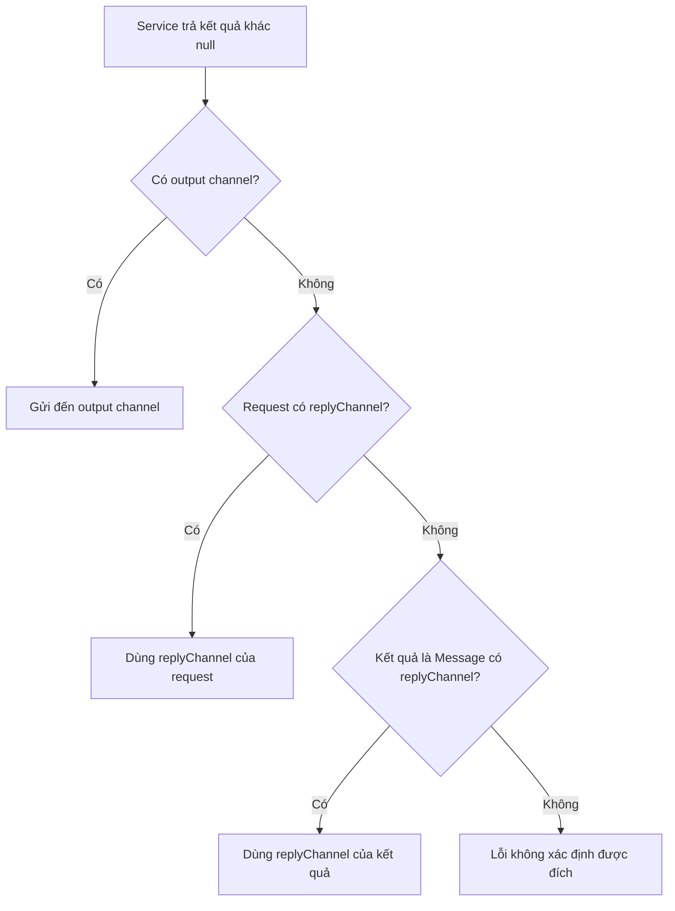

# Output channel của service activator

Trong module **SPRING_INTEGRATION_CORE**, service activator kết nối xử lý nghiệp vụ với luồng thông điệp. Sau khi phương thức nghiệp vụ hoàn thành, endpoint còn phải quyết định đưa kết quả đi đâu. Quyết định đó ảnh hưởng trực tiếp đến việc nối các bước xử lý, trả lời gateway và phát hiện lỗi cấu hình.

Bài học thuộc chương **Service activator**, tập trung vào output channel. Ví dụ xuyên suốt là dịch vụ tính giá đơn hàng: nhận yêu cầu, tính tổng tiền và chuyển báo giá cho bên cần sử dụng. Từ ví dụ này, bạn sẽ phân biệt được giá trị trả về của phương thức Java, message đầu ra và kênh nhận message.

## 1. Output channel nằm ở đâu trong luồng?

Xét một bước tính giá:

```text
Message<OrderRequest>
        |
        v
priceRequests --> Service Activator --> pricedOrders
                       |
                       v
                PricingService.quote(...)
                       |
                       v
                   OrderQuote
```

Có ba trách nhiệm khác nhau:

| Thành phần | Trách nhiệm trong ví dụ |
| --- | --- |
| Phương thức quote | Tính toán và trả về OrderQuote |
| Service activator | Gọi phương thức, xử lý kết quả dưới dạng message |
| Output channel pricedOrders | Tiếp nhận message để bên khác xử lý hoặc đọc |

Nếu phương thức trả về một đối tượng nghiệp vụ, framework tạo reply message có payload là đối tượng đó. Phương thức cũng có thể trả về **Message<?>** khi cần chủ động đặt header. Hợp đồng này được mô tả trong [API ServiceActivator](https://docs.spring.io/spring-integration/api/org/springframework/integration/annotation/ServiceActivator.html).

Tên “output channel” mô tả vai trò trong cấu hình endpoint. Một **QueueChannel** có thể là đầu ra của bước tính giá, đồng thời là đầu vào của bước lưu báo giá. Không có yêu cầu phải tạo một lớp channel riêng mang tên OutputChannel.

Với cách thiết kế này, PricingService chỉ cần biết về đơn hàng và báo giá. Việc quyết định báo giá đi tiếp đến lưu trữ, kiểm tra hạn mức hay trả về người gọi nằm trong cấu hình luồng.

## 2. Thứ tự xác định kênh nhận kết quả

Với một kết quả khác null, service activator tìm đích theo thứ tự:

1. Output channel được cấu hình tại endpoint.
2. Header **replyChannel** của request.
3. Header **replyChannel** của kết quả, nếu kết quả là Message và request không có header này.

Header có thể chứa đối tượng MessageChannel hoặc tên channel dạng String; tên phải phân giải được. Đây là cơ chế Return Address của Spring Integration. Xem [quy tắc chọn reply channel](https://docs.spring.io/spring-integration/reference/7.0/service-activator.html).



Điểm cần chú ý: thứ tự trên chọn một đích, không tạo danh sách kênh dự phòng. Nếu đích đã chọn không phân giải được hoặc gửi thất bại, endpoint không tự chuyển sang header có ưu tiên thấp hơn. Khi không có đích nào, mã xử lý ném **DestinationResolutionException**. Có thể đối chiếu tại [mã nguồn AbstractMessageProducingHandler](https://raw.githubusercontent.com/spring-projects/spring-integration/v7.0.0/spring-integration-core/src/main/java/org/springframework/integration/handler/AbstractMessageProducingHandler.java).

Ví dụ, request có replyChannel trỏ đến callerReplies, nhưng endpoint đặt output channel là pricedOrders. Báo giá được gửi đến pricedOrders. Muốn cuối cùng trả về callerReplies, cần có bước tiếp theo tiêu thụ báo giá và tạo phản hồi theo hợp đồng của luồng.

## 3. Ví dụ Java DSL với hai cách trả kết quả

### 3.1. Chuẩn bị

Ví dụ dùng Java 17 trở lên và các API **IntegrationFlow.from(...)**, **@EnableIntegration**, **DirectChannel**, **QueueChannel**.

Ứng dụng cần dependency **org.springframework.integration:spring-integration-core**. Phần kiểm thử bên dưới cần JUnit Jupiter. Đồng bộ các dependency Spring theo BOM của dự án; nếu dùng Spring Boot, có thể sử dụng **spring-boot-starter-integration** và bộ dependency kiểm thử do Boot quản lý.

Hai file Java minh họa cùng đặt trong package **example.integration**. Không cần cơ sở dữ liệu, broker hoặc kết nối mạng để hiểu luồng này.

### 3.2. Cấu hình hoàn chỉnh

```java
package example.integration;

import java.math.BigDecimal;
import java.math.RoundingMode;

import org.springframework.context.annotation.Bean;
import org.springframework.context.annotation.Configuration;
import org.springframework.integration.channel.DirectChannel;
import org.springframework.integration.channel.QueueChannel;
import org.springframework.integration.config.EnableIntegration;
import org.springframework.integration.dsl.IntegrationFlow;

@Configuration
@EnableIntegration
public class OrderOutputConfig {

    public record OrderRequest(String orderId, BigDecimal subtotal) {
    }

    public record OrderQuote(String orderId, BigDecimal total) {
    }

    public static class PricingService {

        public OrderQuote quote(OrderRequest request) {
            if (request.subtotal().signum() < 0) {
                throw new IllegalArgumentException(
                        "Subtotal must not be negative");
            }

            BigDecimal total = request.subtotal()
                    .multiply(new BigDecimal("1.10"))
                    .setScale(2, RoundingMode.HALF_UP);

            return new OrderQuote(request.orderId(), total);
        }
    }

    @Bean
    public PricingService pricingService() {
        return new PricingService();
    }

    @Bean
    public DirectChannel priceRequests() {
        return new DirectChannel();
    }

    @Bean
    public DirectChannel replyRequests() {
        return new DirectChannel();
    }

    @Bean
    public QueueChannel pricedOrders() {
        return new QueueChannel(10);
    }

    @Bean
    public IntegrationFlow explicitOutputFlow(
            PricingService pricingService) {

        return IntegrationFlow.from("priceRequests")
                .handle(pricingService, "quote",
                        endpoint -> endpoint
                                .requiresReply(true)
                                .sendTimeout(1_000))
                .channel("pricedOrders")
                .get();
    }

    @Bean
    public IntegrationFlow returnAddressFlow(
            PricingService pricingService) {

        return IntegrationFlow.from("replyRequests")
                .handle(pricingService, "quote",
                        endpoint -> endpoint.requiresReply(true))
                .get();
    }
}
```

Hệ số 1.10 chỉ là quy tắc tính toán minh họa, không đại diện cho quy định thuế thực tế.

Ở explicitOutputFlow, lời gọi **.channel("pricedOrders")** sau **.handle(...)** nối đầu ra của handler đến channel này. Ở returnAddressFlow, handler cuối không có channel đầu ra được cấu hình, nên request cần cung cấp địa chỉ trả lời.

Trong Java DSL, **.handle(...)** có thể gọi phương thức POJO hoặc một GenericHandler dạng lambda. Xem [service activator và phương thức handle](https://docs.spring.io/spring-integration/reference/dsl/java-handle.html). Cách **.channel(...)** nối các endpoint và tạo kênh trung gian được mô tả tại [Message Channels trong Java DSL](https://docs.spring.io/spring-integration/reference/dsl/java-channels.html).

Hai flow dùng chung service vì nghiệp vụ tính giá giống nhau. Cấu hình endpoint quyết định người sử dụng kết quả:

| Gửi request vào | Kết quả đi đâu? |
| --- | --- |
| priceRequests | pricedOrders, kể cả request có replyChannel |
| replyRequests có replyChannel hợp lệ | Channel do request chỉ định |
| replyRequests không có replyChannel | Lỗi thiếu đích vì quote trả về một POJO |

**requiresReply(true)** và **sendTimeout(1_000)** là tùy chọn trên endpoint, không phải tham số nghiệp vụ của quote. API tương ứng có tại [ConsumerEndpointSpec](https://docs.spring.io/spring-integration/api/org/springframework/integration/dsl/ConsumerEndpointSpec.html).

### 3.3. Vì sao chọn QueueChannel làm đầu ra minh họa?

pricedOrders giữ báo giá để kiểm thử đọc bằng **receive(...)**. Chưa có consumer phía sau, nên queue giúp quan sát kết quả trực tiếp.

Nếu thay bằng DirectChannel, phải có handler đăng ký nhận message trước khi gửi. DirectChannel gọi một subscriber trong chính luồng gửi; nó không cung cấp hàng đợi để đọc lại kết quả. Xem [API DirectChannel](https://docs.spring.io/spring-integration/api/org/springframework/integration/channel/DirectChannel.html).

Trong ứng dụng thực tế, hãy đặt tên channel theo hợp đồng nghiệp vụ, chẳng hạn pricedOrders, thay vì tên chung chung như out. Tên rõ nghĩa giúp nhận biết payload mong đợi khi nối nhiều flow.

## 4. Kiểm thử đường đi của message

Chỉ kiểm tra trực tiếp **pricingService.quote(...)** chưa xác nhận output channel. Cần gửi request qua input channel và quan sát kênh đích.

Lớp sau dùng context Spring thuần và JUnit 5. Mỗi test tạo context riêng để không dùng chung message còn tồn trong queue.

```java
package example.integration;

import java.math.BigDecimal;

import org.junit.jupiter.api.Test;
import org.springframework.context.annotation.AnnotationConfigApplicationContext;
import org.springframework.integration.channel.QueueChannel;
import org.springframework.messaging.Message;
import org.springframework.messaging.MessageChannel;
import org.springframework.messaging.MessagingException;
import org.springframework.messaging.support.MessageBuilder;

import static org.junit.jupiter.api.Assertions.*;

class OrderOutputChannelTest {

    @Test
    void explicitOutputTakesPriorityOverRequestReplyChannel() {
        try (var context =
                new AnnotationConfigApplicationContext(OrderOutputConfig.class)) {

            MessageChannel input =
                    context.getBean("priceRequests", MessageChannel.class);
            QueueChannel output =
                    context.getBean("pricedOrders", QueueChannel.class);
            QueueChannel callerReplies = new QueueChannel(1);

            Message<?> request = MessageBuilder.withPayload(
                    new OrderOutputConfig.OrderRequest(
                            "ORD-101", new BigDecimal("100.00")))
                    .setReplyChannel(callerReplies)
                    .build();

            assertTrue(input.send(request, 1_000));

            Message<?> reply = output.receive(1_000);
            assertNotNull(reply);
            var quote = assertInstanceOf(
                    OrderOutputConfig.OrderQuote.class, reply.getPayload());

            assertEquals("ORD-101", quote.orderId());
            assertEquals(new BigDecimal("110.00"), quote.total());
            assertNull(callerReplies.receive(0));
        }
    }

    @Test
    void requestReplyChannelIsUsedWhenOutputIsNotConfigured() {
        try (var context =
                new AnnotationConfigApplicationContext(OrderOutputConfig.class)) {

            MessageChannel input =
                    context.getBean("replyRequests", MessageChannel.class);
            QueueChannel callerReplies = new QueueChannel(1);

            Message<?> request = MessageBuilder.withPayload(
                    new OrderOutputConfig.OrderRequest(
                            "ORD-102", new BigDecimal("200.00")))
                    .setReplyChannel(callerReplies)
                    .build();

            assertTrue(input.send(request, 1_000));

            Message<?> reply = callerReplies.receive(1_000);
            assertNotNull(reply);
            var quote = assertInstanceOf(
                    OrderOutputConfig.OrderQuote.class, reply.getPayload());

            assertEquals("ORD-102", quote.orderId());
            assertEquals(new BigDecimal("220.00"), quote.total());
            assertNull(context.getBean(
                    "pricedOrders", QueueChannel.class).receive(0));
        }
    }

    @Test
    void aProducedResultNeedsADestination() {
        try (var context =
                new AnnotationConfigApplicationContext(OrderOutputConfig.class)) {

            MessageChannel input =
                    context.getBean("replyRequests", MessageChannel.class);

            Message<?> request = MessageBuilder.withPayload(
                    new OrderOutputConfig.OrderRequest(
                            "ORD-103", new BigDecimal("300.00")))
                    .build();

            assertThrows(MessagingException.class,
                    () -> input.send(request, 1_000));
        }
    }
}
```

Các quan sát mong đợi:

- Test thứ nhất nhận báo giá ở pricedOrders, còn callerReplies rỗng.
- Test thứ hai nhận báo giá ở callerReplies, còn pricedOrders rỗng.
- Test thứ ba thất bại trong lúc gửi vì có kết quả nhưng không có địa chỉ nhận.

Test thứ ba kiểm tra nhóm lỗi messaging; khi chẩn đoán thực tế, đọc cả chuỗi nguyên nhân để thấy lỗi phân giải đích cụ thể.

Không dùng **Thread.sleep(...)** trong các test này. **receive(1_000)** tạo thời hạn chờ rõ ràng; **receive(0)** kiểm tra ngay một queue mà tại thời điểm đó luồng đồng bộ đã xử lý xong. Các test là mã minh họa để chạy trong dự án có dependency tương ứng, không phải kết quả thực thi được báo cáo cho bài viết.

## 5. Cấu hình tương đương bằng annotation

Thay vì đăng ký **.handle(...)**, có thể khai báo một phương thức trên Spring bean:

```java
import org.springframework.integration.annotation.ServiceActivator;

// Đặt trong một Spring bean; OrderRequest, OrderQuote và pricingService
// tương ứng với các kiểu và service ở ví dụ trên.
@ServiceActivator(
        inputChannel = "priceRequests",
        outputChannel = "pricedOrders",
        requiresReply = "true",
        sendTimeout = "1000")
public OrderOutputConfig.OrderQuote quoteOrder(
        OrderOutputConfig.OrderRequest request) {

    return pricingService.quote(request);
}
```

Đây là phương án thay thế cho endpoint explicitOutputFlow; chỉ đăng ký một cách cấu hình cho cùng bước nghiệp vụ. Nếu đồng thời thêm một endpoint annotation và một endpoint DSL cùng nhận priceRequests, bạn đã tạo nhiều consumer trên channel đó.

Các thuộc tính **outputChannel**, **requiresReply** và **sendTimeout** của annotation nhận chuỗi. Vì vậy ví dụ sử dụng "true" và "1000". Xem [API annotation ServiceActivator](https://docs.spring.io/spring-integration/api/org/springframework/integration/annotation/ServiceActivator.html).

Tránh gọi **pricedOrders.send(...)** bên trong service rồi đồng thời trả lại báo giá cho một service activator có đầu ra. Cách đó tạo hai đường gửi cho cùng kết quả và làm nghiệp vụ phụ thuộc vào cấu hình messaging.

## 6. Output channel, null, void và requiresReply

Output channel chỉ nhận được message khi handler thực sự tạo đầu ra. Cấu hình tên channel không biến một phương thức void thành bước có phản hồi.

| Kết quả của phương thức | requiresReply | Hành vi |
| --- | --- | --- |
| Đối tượng khác null | false hoặc true | Tạo reply và xác định đích |
| null | false | Kết thúc bước, không gửi reply |
| null | true | Ném ReplyRequiredException |
| void | false | Chỉ thực hiện tác vụ, không gửi reply |

Mặc định requiresReply là false. Bật nó khi hợp đồng yêu cầu mỗi request phải sinh kết quả; không dùng phương thức void cho hợp đồng đó. Đối chiếu tại [API handler sinh phản hồi](https://docs.spring.io/spring-integration/api/org/springframework/integration/handler/AbstractReplyProducingMessageHandler.html) và [thuộc tính requiresReply](https://docs.spring.io/spring-integration/api/org/springframework/integration/annotation/ServiceActivator.html).

Một trường hợp dễ nhầm:

```java
public void saveQuote(OrderOutputConfig.OrderQuote quote) {
    repository.save(quote);
}
```

Nếu bước lưu này nằm cuối một flow trả lời gateway, gateway chưa có phản hồi nghiệp vụ chỉ vì lưu thành công. Khi hợp đồng cần xác nhận, nên trả về một kiểu như QuoteSaved, hoặc trả về chính báo giá sau khi lưu thành công.

Ngược lại, nếu chỉ cần thực hiện tác vụ và kết thúc, phương thức void thể hiện rõ ý định. Không cần tạo dữ liệu giả để gửi vào output channel.

## 7. Chủ động kết thúc luồng bằng nullChannel

Đôi khi phương thức có trả kết quả nhưng luồng hiện tại không cần sử dụng nó. Có thể gửi kết quả đến bean đặc biệt **nullChannel**:

```java
@Bean
public IntegrationFlow discardQuoteFlow(
        OrderOutputConfig.PricingService pricingService) {

    return IntegrationFlow.from("discardQuoteRequests")
            .handle(pricingService, "quote")
            .channel("nullChannel")
            .get();
}
```

Với payload báo giá thông thường, nullChannel chấp nhận message và bỏ kết quả. Điều này khác với việc không cấu hình output channel: bỏ cấu hình vẫn cho phép framework tìm replyChannel. Xem [API NullChannel](https://docs.spring.io/spring-integration/api/org/springframework/integration/channel/NullChannel.html).

Tình huống sử dụng: một service tính toán đồng thời ghi nhận thống kê; flow này chỉ cần tác dụng ghi nhận, còn giá trị trả về không thuộc hợp đồng của nó.

Trước khi chọn cách này, xác định rõ phía gọi có đang chờ báo giá hay không. Nếu có, bỏ báo giá sẽ khiến bên gọi không nhận được kết quả mong đợi.

## 8. Quan hệ với gateway và các bước trung gian

Gateway tạo một địa chỉ phản hồi tạm thời và đưa vào header replyChannel. Khi endpoint cuối không đặt output channel riêng, kết quả có thể quay lại địa chỉ này. Xem [cơ chế reply channel của gateway](https://docs.spring.io/spring-integration/reference/gateway.html).

Một pipeline hợp lý có thể là:

```text
Gateway
   |
   v
priceRequests
   |
   v
Tính giá --output--> Lưu báo giá --output--> Tạo xác nhận
                                                  |
                                                  v
                                    replyChannel trong header
                                                  |
                                                  v
                                               Gateway
```

Đây là thiết kế minh họa: các bước trung gian tạo đầu ra cho bước kế tiếp; bước cuối tạo QuoteAccepted rồi dùng địa chỉ trả lời của request.

Một thay đổi tưởng nhỏ có thể phá hợp đồng này: thêm **.channel("pricedOrders")** vào cuối flow vốn đang trả trực tiếp cho gateway, trong khi chưa có consumer nào nhận từ queue và chuyển tiếp kết quả. Báo giá vẫn tồn tại, nhưng đang nằm ở queue thay vì đi đến nơi gateway chờ.

Khi tùy biến header, cần xem replyChannel như địa chỉ thuộc lần gọi hiện tại. Không ghi đè nó tùy tiện bằng một channel dùng chung để “chuẩn hóa cấu hình”.

Với nhiều request đồng thời, một queue chung không tự ghép báo giá với đúng người gọi. Nếu tự xây cơ chế request–reply, phải định nghĩa cách tương quan và phân phối kết quả; với lời gọi ứng dụng thông thường, nên để gateway đảm nhiệm phần trao đổi này.

## 9. Chọn loại output channel theo cách tiêu thụ

| Loại channel | Cách chuyển kết quả | Câu hỏi thiết kế |
| --- | --- | --- |
| DirectChannel | Gọi một subscriber trong thread gửi | Bước kế tiếp có thể hoàn thành trong cùng lời gọi không? |
| QueueChannel | Lưu message, consumer lấy sau | Ai tiêu thụ, sức chứa bao nhiêu và có cần lưu bền không? |
| ExecutorChannel | Giao dispatch cho executor | Pool, quá tải và xử lý lỗi khi tách thread được cấu hình thế nào? |
| PublishSubscribeChannel | Phát message đến các subscriber | Những bên nào cần cùng nhận sự kiện? |

QueueChannel mặc định lưu trong bộ nhớ, không phải broker có lưu bền. Consumer là endpoint Spring Integration trên queue cần poller. Với publish–subscribe, việc dùng executor quyết định có tách thread hay không. Xem [các triển khai MessageChannel](https://docs.spring.io/spring-integration/reference/channel/implementations.html). ExecutorChannel thường tách xử lý sang executor và không chia sẻ transaction theo thread với bên gửi; xem [API ExecutorChannel](https://docs.spring.io/spring-integration/api/org/springframework/integration/channel/ExecutorChannel.html).

Trong ví dụ, **new QueueChannel(10)** đủ để quan sát một số báo giá. Nếu triển khai bước tiêu thụ tự động, có thể dùng một flow riêng:

```java
// Minh họa phần nối thêm vào cấu hình ứng dụng.
// quoteStore là Spring bean, có phương thức save(OrderQuote) trả void.
@Bean
public IntegrationFlow storeQuotedOrders() {
    return IntegrationFlow.from("pricedOrders")
            .handle("quoteStore", "save",
                    endpoint -> endpoint.poller(
                            org.springframework.integration.dsl.Pollers
                                    .fixedDelay(200)))
            .get();
}
```

Khi thêm flow tiêu thụ này, không giữ nguyên kiểm thử vốn đòi tự đọc báo giá từ pricedOrders: poller và test sẽ cùng tranh nhận message. Lúc đó cần quan sát tác động tại quoteStore hoặc đặt điểm kiểm thử khác phù hợp.

## 10. Timeout gửi kết quả và phản hồi đầu cuối

Ba khoảng chờ có mục đích khác nhau:

| Cấu hình/lời gọi | Đang giới hạn điều gì? |
| --- | --- |
| endpoint.sendTimeout(1_000) | Việc gửi reply vào channel đầu ra khi channel hỗ trợ chờ gửi |
| queue.receive(1_000) | Thời gian một consumer chờ lấy message |
| Reply timeout của gateway | Thời gian gateway chờ phản hồi theo cơ chế của gateway |

sendTimeout hữu ích khi output là queue có sức chứa hữu hạn và đang đầy. Nó không giới hạn thời gian chạy phương thức nghiệp vụ hoặc toàn bộ các bước phía sau DirectChannel. Thuộc tính này được mô tả trong [API ServiceActivator.sendTimeout](https://docs.spring.io/spring-integration/api/org/springframework/integration/annotation/ServiceActivator.html).

Trong ví dụ, **input.send(request, 1_000)** là lời gọi gửi vào DirectChannel. Con số này không biến **quote(...)** thành một tác vụ bị hủy sau một giây. **sendTimeout(1_000)** trên endpoint mới điều khiển lần gửi báo giá vào queue đầu ra, theo khả năng của channel.

Tương tự, timeout ở phía chờ phản hồi không phải cơ chế hủy tác vụ nghiệp vụ. Khi thiết kế thời hạn đầu cuối, cần tính cả thời gian nằm trong queue, thời gian xử lý và cách xử lý kết quả đến muộn.

## 11. Phân biệt đầu ra thành công với đường xử lý lỗi

Output channel của service activator là đường đi của kết quả xử lý thành công. Nếu **quote(...)** ném exception, endpoint không tự coi exception đó là báo giá.

Với đường gọi đồng bộ qua DirectChannel, lỗi có thể truyền về bên gửi. Khi dùng tác vụ bất đồng bộ hoặc poller của Spring Integration, cơ chế công bố ErrorMessage có thể gửi lỗi đến header errorChannel hoặc kênh lỗi mặc định. Chỉ đặt header errorChannel không làm mọi lỗi đồng bộ tự chuyển thành message. Xem [Error Handling](https://docs.spring.io/spring-integration/reference/error-handling.html).

Áp dụng vào ví dụ:

- subtotal = 100.00: tạo báo giá và gửi theo quy tắc output.
- subtotal = -1.00: service ném IllegalArgumentException; không có báo giá đầu ra.
- Queue đầu ra đầy và hết thời gian gửi: tính giá có thể đã hoàn thành nhưng chuyển kết quả thất bại.

Trường hợp cuối đặc biệt quan trọng nếu service còn cập nhật dữ liệu hoặc gọi hệ thống bên ngoài. Khi thêm retry, cần xét khả năng tác dụng nghiệp vụ đã xảy ra trước lỗi chuyển tiếp. Nên có mã đơn hàng hoặc khóa nghiệp vụ để xử lý việc gửi lại một cách rõ ràng.

## 12. Chẩn đoán nhanh theo triệu chứng

| Triệu chứng | Điểm nên kiểm tra |
| --- | --- |
| Có kết quả trong log nhưng gateway không nhận | Output channel ở bước cuối và consumer chuyển tiếp phản hồi |
| Header trỏ đúng kênh nhưng kết quả đến kênh khác | Output channel cấu hình tại endpoint có ưu tiên cao hơn |
| Lỗi không xác định được đích | Không có output channel hoặc replyChannel dùng được |
| Tên reply channel không phân giải được | Tên bean, phạm vi context và giá trị header |
| DirectChannel báo không có subscriber | Endpoint nhận đã được đăng ký và đang chạy chưa |
| Queue có message nhưng không được xử lý | Consumer, poller và lifecycle của endpoint |
| Không có message sau phương thức void | Hợp đồng phương thức có thực sự tạo phản hồi không |
| Gửi bị chờ lâu | Queue đầy, timeout gửi hoặc xử lý đồng bộ phía sau |
| Kết quả bị xử lý hai lần | Service có tự gửi message ngoài cơ chế trả về của endpoint không? |

Khi đọc cấu hình, hãy đi theo một request cụ thể: payload vào là gì, service trả kiểu nào, đích được chọn từ đâu và thành phần nào tiêu thụ message đó. Với hợp đồng request–reply, tiếp tục lần theo đường đi cho đến nơi người gọi nhận kết quả. Cách kiểm tra này giúp phát hiện một flow tính toán đúng nhưng chưa hoàn chỉnh đường trả lời.
