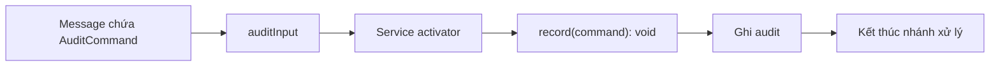
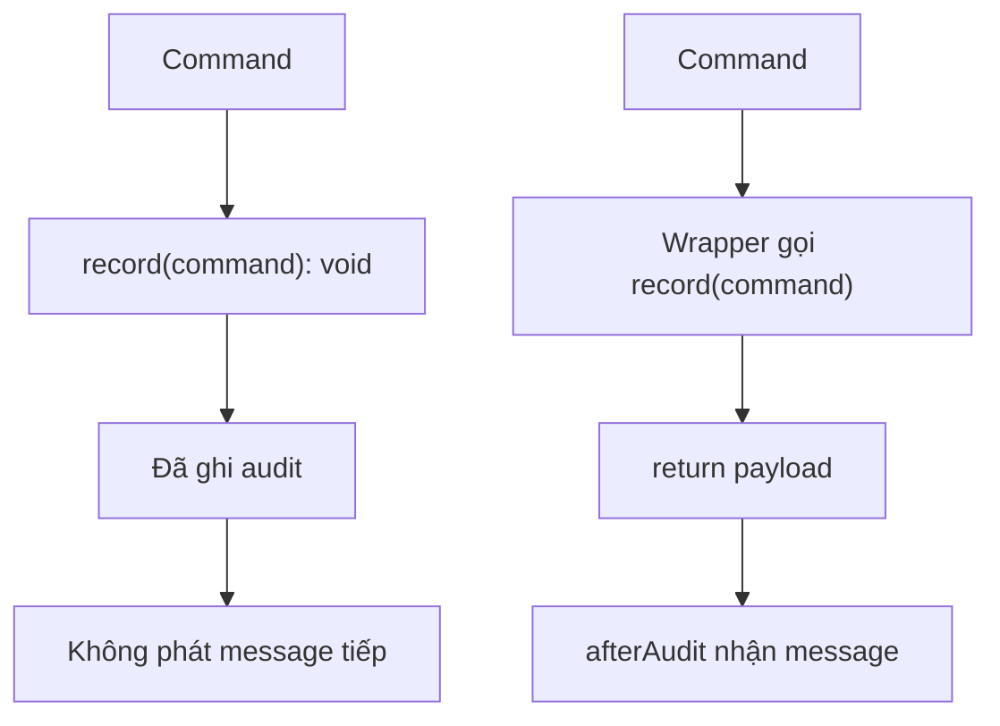

# Method trả về void

Trong chương **Service activator** của module **SPRING_INTEGRATION_CORE**, một method trả về `void` thể hiện hợp đồng xử lý thông điệp mà không tạo kết quả trả lời từ giá trị trả về. Đây là lựa chọn thường gặp khi ghi audit, cập nhật dữ liệu hoặc gọi một dịch vụ chỉ tạo tác dụng phụ.

Bài học tập trung vào cách hợp đồng ấy ảnh hưởng đến `Message`, `MessageChannel`, endpoint, gateway và Java DSL. Sau bài này, bạn có thể đặt đúng vị trí cho một handler `void`, biết khi nào cần trả tiếp payload và kiểm thử được cả tác dụng phụ lẫn đường đi của lỗi.

## 1. Hợp đồng của một service activator void

Xét một dịch vụ ghi nhận thao tác với đơn hàng:

```java
public void record(AuditCommand command) {
    auditRepository.save(command);
}
```

Service activator nhận một message đầu vào rồi gọi `record(...)` với payload thích hợp. Với cấu hình thông thường cho phép không có reply, khi method hoàn tất bình thường, endpoint kết thúc lần xử lý đó mà không phát message đầu ra. Nó không tự gửi lại message đầu vào, không tạo một message có payload `null` và không tạo một message xác nhận thành công. Đây là hành vi được mô tả trong [tài liệu Service Activator](https://docs.spring.io/spring-integration/reference/service-activator.html).



Cần tách hai điều:

- **Kết thúc nhánh message:** không có reply từ endpoint để chuyển sang bước tiếp theo.
- **Kết thúc tác vụ nghiệp vụ:** phụ thuộc công việc mà method thực sự đã hoàn thành, transaction và các tác vụ nó có thể đã giao cho nơi khác.

Nếu `record(...)` chỉ đưa dữ liệu vào một hàng đợi nội bộ khác, việc method trả về chưa chứng minh nơi nhận cuối cùng đã lưu xong dữ liệu.

### void, null và một kết quả thông thường

| Khai báo hoặc kết quả | Ý nghĩa thiết kế | Hành vi khi cho phép không có reply |
| --- | --- | --- |
| `void record(Command c)` | Method không cung cấp giá trị trả về | Không tạo reply từ kết quả method |
| `Receipt record(Command c)` nhưng trả `null` | Có kiểu kết quả, nhưng lần gọi này không cung cấp kết quả | Không tạo reply |
| `Receipt record(Command c)` trả một `Receipt` | Có dữ liệu đầu ra | Endpoint có thể tạo reply và gửi tới đích trả lời |
| `Command record(Command c)` trả lại `c` | Có chủ đích tiếp tục xử lý cùng dữ liệu | Endpoint có thể chuyển tiếp bằng reply |

`void` là từ khóa kiểu trả về trong Java; `Void` là một lớp Java. Đổi chữ thường thành chữ hoa không tạo ra cơ chế xác nhận xử lý. Tương tự, trả `null` không phải cách biểu diễn một message có payload rỗng để gửi đi.

## 2. Ví dụ bằng annotation

Ví dụ dùng Java 17 trở lên, Spring Integration Core và cấu hình Java. Các phần Java DSL phía sau sử dụng `IntegrationFlow.from(...)` của Spring Integration 6 trở lên. Chọn phiên bản dependency phù hợp với nền tảng Spring của ứng dụng; ví dụ không yêu cầu Spring Boot.

Đặt đoạn sau vào `VoidActivatorConfig.java` trong package `example.integration`:

```java
package example.integration;

import java.util.List;
import java.util.concurrent.CopyOnWriteArrayList;

import org.springframework.context.annotation.Bean;
import org.springframework.context.annotation.Configuration;
import org.springframework.integration.annotation.ServiceActivator;
import org.springframework.integration.channel.DirectChannel;
import org.springframework.integration.config.EnableIntegration;
import org.springframework.messaging.handler.annotation.Header;

@Configuration
@EnableIntegration
public class VoidActivatorConfig {

    public record AuditCommand(String orderId, String action) {
    }

    public static final class AuditStore {

        private final List<AuditCommand> entries =
                new CopyOnWriteArrayList<>();

        public void append(AuditCommand command) {
            entries.add(command);
        }

        public List<AuditCommand> snapshot() {
            return List.copyOf(entries);
        }
    }

    public static class AuditHandler {

        private final AuditStore store;

        public AuditHandler(AuditStore store) {
            this.store = store;
        }

        @ServiceActivator(
                inputChannel = "auditInput",
                requiresReply = "false")
        public void record(
                AuditCommand command,
                @Header(value = "traceId", required = false)
                String traceId) {

            if (command.orderId() == null
                    || command.orderId().isBlank()) {
                throw new IllegalArgumentException(
                        "orderId must not be blank");
            }

            // traceId có thể dùng cho log; không chi phối kết quả nghiệp vụ.
            store.append(command);
        }
    }

    @Bean
    public DirectChannel auditInput() {
        return new DirectChannel();
    }

    @Bean
    public AuditStore auditStore() {
        return new AuditStore();
    }

    @Bean
    public AuditHandler auditHandler(AuditStore store) {
        return new AuditHandler(store);
    }
}
```

`AuditStore` là bộ lưu trong bộ nhớ để quan sát hành vi, không phải kho dữ liệu bền vững. `CopyOnWriteArrayList` giúp ví dụ tránh phụ thuộc vào một danh sách khả biến không an toàn khi truy cập đồng thời; nó không thay thế thiết kế lưu trữ cho hệ thống thực tế.

Trong cấu hình trên:

1. `@EnableIntegration` bật hạ tầng Spring Integration.
2. `auditInput` là kênh chuyển message tới endpoint.
3. `@ServiceActivator` trên bean `AuditHandler` đăng ký method nhận thông điệp.
4. `AuditCommand` được lấy từ payload; `traceId` được ánh xạ từ header và được phép vắng mặt.
5. `record(...)` ghi vào store rồi kết thúc mà không trả kết quả.

`requiresReply = "false"` được ghi rõ để người đọc nhận ra hợp đồng. Đây cũng là giá trị mặc định về hành vi của service activator. API annotation xác định `outputChannel` là đích nhận reply, còn `requiresReply` kiểm soát yêu cầu kết quả khác `null`; xem [API @ServiceActivator](https://docs.spring.io/spring-integration/docs/current/api/org/springframework/integration/annotation/ServiceActivator.html).

Có thể gửi một message như sau trong một method Java:

```java
try (var context =
        new org.springframework.context.annotation.AnnotationConfigApplicationContext(
                VoidActivatorConfig.class)) {

    var input = context.getBean(
            "auditInput",
            org.springframework.messaging.MessageChannel.class);

    var command = new VoidActivatorConfig.AuditCommand(
            "ORD-1001", "CREATED");

    var message = org.springframework.messaging.support.MessageBuilder
            .withPayload(command)
            .setHeader("traceId", "trace-1001")
            .build();

    boolean delivered = input.send(message);

    var store = context.getBean(VoidActivatorConfig.AuditStore.class);
    System.out.println(delivered);         // true
    System.out.println(store.snapshot());  // Chứa command vừa ghi
}
```

Không có bộ thực thi riêng, poller hay luồng bất đồng bộ trong ví dụ này. Với `DirectChannel` và handler duy nhất này, `send(...)` chạy phần xử lý trên thread gọi; nó trở về sau khi handler hoàn tất bình thường. Giá trị `boolean` là kết quả thao tác gửi trên channel, không phải một reply nghiệp vụ do `record(...)` tạo ra. Hành vi của kênh được trình bày trong [Message Channel Implementations](https://docs.spring.io/spring-integration/reference/channel/implementations.html).

## 3. Có outputChannel vẫn không tự có message đầu ra

Giả sử thay annotation của ví dụ bằng:

```java
@ServiceActivator(
        inputChannel = "auditInput",
        outputChannel = "afterAudit",
        requiresReply = "false")
public void record(AuditCommand command) {
    store.append(command);
}
```

Đây là đoạn minh họa độc lập; `afterAudit` cần là một channel đã được cấu hình nếu dùng trong ứng dụng.

`outputChannel` chỉ chỉ định nơi gửi **kết quả khi endpoint có kết quả**. Nó không biến method `void` thành thao tác chuyển tiếp. Vì vậy, đặt một transformer, router hoặc aggregator phía sau `afterAudit` sẽ không làm chúng nhận được message từ lần gọi này.

Ở mức triển khai, handler xử lý kết quả khác `null` bằng nhánh gửi output; nếu không có kết quả, nó xử lý yêu cầu reply hoặc kết thúc. Bạn có thể đối chiếu [mã nguồn AbstractReplyProducingMessageHandler](https://github.com/spring-projects/spring-integration/blob/main/spring-integration-core/src/main/java/org/springframework/integration/handler/AbstractReplyProducingMessageHandler.java).

Một trường hợp dễ nhầm khác là tự sửa đối tượng payload bên trong method:

```java
public void markHandled(MutableOrder order) {
    order.setHandled(true);
}
```

Nếu nơi gửi còn giữ cùng tham chiếu `order`, nó có thể nhìn thấy thay đổi đó. Tuy nhiên, việc sửa đối tượng không tạo reply và không đưa message tới endpoint kế tiếp. Đối với luồng tích hợp, hãy dùng dữ liệu đầu ra rõ ràng thay vì dựa vào thay đổi có thể quan sát qua tham chiếu dùng chung.

## 4. Ba cách biểu đạt trong Java DSL

Các phương án dưới đây **thay thế** endpoint annotation ở mục 2: bỏ `@ServiceActivator` khỏi `record(...)` và chỉ đăng ký một flow mong muốn. Giữ lại bean `AuditHandler` và logic nghiệp vụ. Không bật đồng thời cả endpoint annotation lẫn flow DSL trên `auditInput` chỉ để diễn đạt cùng một việc; với `DirectChannel`, các subscriber đó trở thành các consumer cạnh tranh.

Các đoạn cấu hình dùng các kiểu `IntegrationFlow`, `AuditHandler` và `AuditCommand`; hai kiểu sau nằm trong `VoidActivatorConfig`. Import DSL chính là:

```java
import org.springframework.integration.dsl.IntegrationFlow;
```

### 4.1. Gọi method void của một bean

```java
@Bean
public IntegrationFlow auditFlow(AuditHandler auditHandler) {
    return IntegrationFlow.from("auditInput")
            .handle(auditHandler, "record")
            .get();
}
```

Đây là cách giữ dịch vụ ở dạng POJO và đặt cấu hình luồng ra ngoài. Endpoint gọi `record(...)` rồi dừng nhánh vì method không cung cấp kết quả.

### 4.2. Dùng GenericHandler và chủ động trả null

```java
@Bean
public IntegrationFlow auditFlow(AuditHandler auditHandler) {
    return IntegrationFlow.from("auditInput")
            .handle(AuditCommand.class, (payload, headers) -> {
                auditHandler.record(
                        payload, (String) headers.get("traceId"));
                return null;
            })
            .get();
}
```

Lambda hai tham số nhận payload và headers. Ở đây hàm lambda cần một giá trị trả về; `return null` thể hiện lựa chọn không tạo reply. Lời gọi `auditHandler.record(...)` bên trong vẫn là một method Java `void`.

Chỉ rõ `AuditCommand.class` giúp thể hiện kiểu payload mà lambda xử lý. Cách dùng lambda và kiểu payload được giải thích trong [Service Activators and the .handle() method](https://docs.spring.io/spring-integration/reference/dsl/java-handle.html).

### 4.3. Dùng MessageHandler nhận cả Message

```java
@Bean
public IntegrationFlow auditFlow(AuditHandler auditHandler) {
    org.springframework.messaging.MessageHandler sink = message -> {
        var command = (AuditCommand) message.getPayload();
        var traceId = (String) message.getHeaders().get("traceId");
        auditHandler.record(command, traceId);
    };

    return IntegrationFlow.from("auditInput")
            .handle(sink)
            .get();
}
```

`MessageHandler.handleMessage(...)` trả `void` và nhận toàn bộ message. Trong ví dụ, payload được ép kiểu trực tiếp nên người gửi phải tuân thủ hợp đồng `AuditCommand`.

Đây là handler kết thúc flow. Một `MessageHandler` thông thường không có cơ chế phát output chỉ vì bạn viết thêm một bước sau nó; DSL có thể từ chối nối output cho handler không hỗ trợ tạo message. Các overload của `handle(...)` được phân biệt trong [API BaseIntegrationFlowDefinition](https://docs.spring.io/spring-integration/docs/current/api/org/springframework/integration/dsl/BaseIntegrationFlowDefinition.html).

## 5. Muốn tiếp tục luồng thì phải tạo đầu ra

Giả sử yêu cầu nghiệp vụ thay đổi: sau khi ghi audit, cần chuyển command cho bước phân loại. Khi đó, việc ghi audit là một bước trung gian, không còn là đích cuối.

Một cách rõ ràng là bọc lời gọi `void` trong một handler có trả payload:

```java
@Bean
public org.springframework.integration.channel.QueueChannel afterAudit() {
    return new org.springframework.integration.channel.QueueChannel(10);
}

@Bean
public IntegrationFlow auditThenContinueFlow(AuditHandler auditHandler) {
    return IntegrationFlow.from("auditInput")
            .handle(AuditCommand.class, (payload, headers) -> {
                auditHandler.record(
                        payload, (String) headers.get("traceId"));
                return payload;
            })
            .channel("afterAudit")
            .get();
}
```

Phương án này cũng thay thế endpoint ở các ví dụ trước. Khác biệt nằm ở dòng `return payload`: wrapper tạo kết quả đầu ra để service activator chuyển tới `afterAudit`. Với cách tạo reply thông thường của service activator, các header ứng dụng của request được mang sang reply theo quy tắc sao chép header; message trả lời không nhất thiết giữ nguyên `id` và `timestamp` của message ban đầu.

`QueueChannel` ở đây giúp quan sát dữ liệu sau bước audit bằng `receive(...)`. Nếu đặt một endpoint tiêu thụ từ kênh này để chạy tiếp tự động, cần cấu hình polling consumer và poller phù hợp.

Có thể đối chiếu hai luồng:



### Trả về một xác nhận có ý nghĩa

Khi người gọi cần biết bước ghi audit đã hoàn thành, nên mô hình hóa kết quả thay vì trả một chuỗi tùy ý như `"OK"`.

Ví dụ thêm record kết quả sau vào `VoidActivatorConfig`:

```java
public record AuditReceipt(String orderId, String status) {
}
```

Sau đó thêm method vào `AuditHandler`:

```java
public AuditReceipt recordAndConfirm(AuditCommand command) {
    record(command, null);
    return new AuditReceipt(command.orderId(), "RECORDED");
}
```

Cấu hình endpoint gọi `recordAndConfirm` thay cho `record`. Trong ví dụ lưu bộ nhớ, `RECORDED` chỉ nói command đã được thêm vào store. Với cơ sở dữ liệu, cần định nghĩa rõ kết quả nói về thao tác nào và transaction đã hoàn tất ở đâu; không gán cho nó ý nghĩa đã commit hoặc đã giao đến hệ thống khác nếu kiến trúc chưa bảo đảm điều đó.

Nếu mục tiêu là ghi log quan sát mà vẫn cho message đi tiếp, có thể cân nhắc `log(...)` hoặc một nhánh `wireTap(...)` thay vì chèn một handler kết thúc luồng. Nhánh quan sát vẫn cần được thiết kế về thread, tải và xử lý lỗi; tên “tap” không tự làm nhánh đó bất đồng bộ hoặc cô lập lỗi.

## 6. requiresReply không biến void thành xác nhận thành công

`requiresReply` là một ràng buộc đối với kết quả của handler.

| Hợp đồng cần có | Cách thể hiện phù hợp |
| --- | --- |
| Chỉ thực hiện tác dụng phụ ở cuối nhánh | Method `void`, cho phép không có reply |
| Luôn phải có kết quả cho bước sau | Method trả dữ liệu, bật yêu cầu reply khi phù hợp |
| Thực hiện tác dụng phụ rồi tiếp tục dữ liệu cũ | Wrapper gọi method `void` rồi trả payload |
| Không muốn sử dụng một kết quả vốn đã được tạo | Gửi kết quả tới `nullChannel` |

Với xử lý đồng bộ thông thường, khi handler bắt buộc có reply nhưng kết quả là `null`, `ReplyRequiredException` biểu thị việc vi phạm hợp đồng. Cấu hình chọn method cũng có thể loại method `void` khi yêu cầu reply, nên không nên thiết kế một ví dụ dựa vào việc method `void` chắc chắn được gọi rồi mới phát sinh ngoại lệ.

Quy tắc áp dụng là:

- Không ghép `void` và `requiresReply=true` để mong framework tạo acknowledgement.
- Nếu cần kết quả, đổi hợp đồng method hoặc thêm wrapper tạo kết quả.
- Dùng yêu cầu reply để phát hiện sự thiếu kết quả ngoài ý muốn ở một bước vốn được thiết kế có đầu ra.

`requiresReply=false` chỉ **cho phép** kết quả vắng mặt. Với method có kiểu trả về, một kết quả khác `null` vẫn có thể được gửi đi. Nếu muốn bỏ kết quả đó một cách có chủ đích, `nullChannel` là đích loại bỏ kết quả; nó không giống việc method không tạo kết quả ngay từ đầu.

## 7. Gateway phải khớp với hợp đồng của flow

Một gateway có method trả `void` thể hiện hợp đồng gửi một chiều ở API người gọi. Ví dụ interface riêng cùng package:

```java
package example.integration;

import org.springframework.integration.annotation.MessagingGateway;

@MessagingGateway(defaultRequestChannel = "auditInput")
public interface AuditGateway {

    void record(VoidActivatorConfig.AuditCommand command);
}
```

Để framework phát hiện interface này, thêm cấu hình quét gateway vào class cấu hình, chẳng hạn:

```java
@org.springframework.integration.annotation.IntegrationComponentScan(
        basePackageClasses = AuditGateway.class)
```

Đặt annotation này cùng `@Configuration` và `@EnableIntegration` của `VoidActivatorConfig`. Sau đó ứng dụng có thể inject `AuditGateway` và gọi `record(command)` thay vì tự tạo `Message`.

Ba tính chất cần đọc cùng nhau:

1. Gateway trả `void` không đợi một reply nghiệp vụ để trả cho caller.
2. Với flow đồng bộ qua `DirectChannel`, lời gọi vẫn thực thi handler trên thread của caller; method gateway vẫn có thể mất thời gian hoặc ném lỗi.
3. Một API gửi một chiều không mặc nhiên là API chạy nền.

Ngược lại, nếu gateway khai báo trả `AuditReceipt` nhưng nhánh xử lý cuối cùng chỉ gọi method `void`, flow không cung cấp receipt. Gateway có thể chờ đến reply timeout, trả `null` hoặc báo lỗi theo cấu hình. Nếu cho phép chờ vô hạn, lời gọi có thể không kết thúc. Đặt timeout hữu hạn giúp giới hạn thời gian chờ reply, nhưng không tạo ra kết quả còn thiếu và không hủy một method đồng bộ đang chạy chậm.

Đây là các tình huống được giải thích trong [Messaging Gateways](https://docs.spring.io/spring-integration/reference/gateway.html). Khi thiết kế API, hãy chọn một trong hai hợp đồng rõ ràng: `void` cho thao tác không cần dữ liệu trả lời, hoặc một kiểu kết quả và đường reply thực sự tạo ra kiểu đó.

## 8. void không quyết định thread, transaction hay cơ chế giao nhận

Kiểu trả về trả lời câu hỏi “method cung cấp dữ liệu gì?”. Channel và cấu hình thực thi trả lời câu hỏi “ai chạy method và khi nào?”.

| Cấu hình đầu vào | Thực thi handler | Điều người gửi có thể suy ra khi gửi thành công |
| --- | --- | --- |
| `DirectChannel` trong cấu hình đồng bộ đơn giản | Thread gọi `send` | Handler đã hoàn tất bình thường trước khi `send` trở về |
| `QueueChannel` có polling consumer | Thread thực thi poller | Message đã được đưa vào queue; handler có thể chưa chạy |
| `ExecutorChannel` với executor chạy trên worker | Thread được executor bố trí | Công việc đã được chuyển giao theo cơ chế executor; chưa bảo đảm nghiệp vụ xong |

Một executor có thể có chính sách thực thi hoặc từ chối khác nhau; cần đọc cấu hình thực tế thay vì suy luận chỉ từ tên channel. `QueueChannel` tiêu chuẩn cũng lưu trong bộ nhớ theo mặc định, nên “đã vào queue” không tương đương “đã lưu bền vững”.

Trong luồng đồng bộ, nếu một method `void` tự khởi động tác vụ nền rồi lập tức trả về, phần framework gọi method chỉ thấy lời gọi đó đã kết thúc. Lỗi phát sinh sau đó trong tác vụ nền cần một cơ chế quan sát riêng. Bởi vậy, hãy quyết định rõ điểm hoàn tất mà API muốn công bố.

### Tác dụng phụ và retry

Giả sử handler đã gọi dịch vụ gửi thông báo thành công, nhưng sau đó xảy ra lỗi trước khi hệ thống ghi nhận việc xử lý. Nếu message được giao lại hoặc retry, thông báo có thể được gửi lần nữa. `void` không bổ sung cơ chế chống trùng.

Đối với thao tác có thể chạy lại, cần một khóa nghiệp vụ phù hợp, chẳng hạn `orderId + action + eventVersion`, rồi thiết kế thao tác ghi hoặc gọi dịch vụ theo hướng idempotent. Đừng mặc nhiên dùng `MessageHeaders.ID` làm khóa nghiệp vụ xuyên suốt các lần tái tạo message.

Tương tự, `void` không tự mở transaction hoặc làm nhiều hệ thống cùng commit. Nếu dùng transaction, hãy xác định tài nguyên nào thực sự tham gia và ranh giới commit nằm ở đâu. Thành công ở một lời gọi Java không đủ để kết luận toàn bộ quá trình tích hợp đã hoàn tất.

## 9. Xử lý lỗi của method void

Method `void` vẫn có thể ném exception. Việc không có giá trị trả về không đồng nghĩa với không có tín hiệu lỗi.

Trong ví dụ ở mục 2, `orderId` rỗng làm `record(...)` ném `IllegalArgumentException` trước khi ghi. Khi gọi qua endpoint, caller thường nhìn thấy một exception của hạ tầng messaging chứa nguyên nhân nghiệp vụ.

Với luồng đồng bộ qua `DirectChannel`, lỗi đi ngược call stack tới nơi gửi, trừ khi có thành phần được cấu hình để xử lý hoặc chuyển hướng nó. Chỉ thêm header `errorChannel` vào một message gửi trực tiếp không khiến mọi exception đồng bộ tự động chuyển thành message lỗi.

Với tác vụ bất đồng bộ do hạ tầng Spring Integration quản lý, cơ chế xử lý lỗi có thể công bố `ErrorMessage` tới channel trong header `errorChannel`, hoặc tới `errorChannel` mặc định nếu không có header tương ứng. Poller, executor, advice và gateway có thể tác động đến đường lỗi cụ thể. Tham khảo [Error Handling](https://docs.spring.io/spring-integration/reference/error-handling.html).

Một lỗi thiết kế phổ biến là bắt exception rồi chỉ ghi log:

```java
public void record(AuditCommand command) {
    try {
        auditRepository.save(command);
    }
    catch (RuntimeException ex) {
        logger.error("Cannot record audit", ex);
        // Method kết thúc bình thường đối với bên gọi.
    }
}
```

Đoạn này minh họa tình huống cần xem xét, với `auditRepository` và `logger` là các dependency của ứng dụng. Nếu không có hành động bù hoặc đường lỗi khác, hạ tầng có thể xem lần xử lý là hoàn tất bình thường. Advice retry dựa trên exception cũng không nhìn thấy exception đã bị nuốt.

Nếu yêu cầu là báo lỗi cho bên gọi hoặc cho cơ chế retry của endpoint, hãy để exception đi ra, hoặc bắt để bổ sung ngữ cảnh rồi ném lại. Nếu chủ đích tiếp nhận lỗi như một kết quả nghiệp vụ, hãy mô hình hóa kết quả đó và nơi tiêu thụ nó.

## 10. Kiểm thử tác dụng phụ và việc không có reply

Với method `void`, chỉ xác nhận “không ném lỗi” là chưa đủ: handler có thể đã được cấu hình sai hoặc chưa thực hiện tác dụng phụ mong muốn.

Hai kiểm thử dưới đây dùng cấu hình annotation nguyên bản ở mục 2. Đặt chúng cùng package `example.integration`. Test classpath cần Spring Integration Core và JUnit Jupiter, cùng cấu hình chạy JUnit Jupiter của công cụ build.

```java
package example.integration;

import java.util.List;

import org.junit.jupiter.api.Test;
import org.springframework.context.annotation.AnnotationConfigApplicationContext;
import org.springframework.integration.channel.QueueChannel;
import org.springframework.messaging.MessageChannel;
import org.springframework.messaging.MessagingException;
import org.springframework.messaging.support.MessageBuilder;

import example.integration.VoidActivatorConfig.AuditCommand;
import example.integration.VoidActivatorConfig.AuditStore;

import static org.junit.jupiter.api.Assertions.assertEquals;
import static org.junit.jupiter.api.Assertions.assertInstanceOf;
import static org.junit.jupiter.api.Assertions.assertNull;
import static org.junit.jupiter.api.Assertions.assertThrows;
import static org.junit.jupiter.api.Assertions.assertTrue;

class VoidActivatorTest {

    @Test
    void recordsSideEffectWithoutSendingReply() {
        try (var context = new AnnotationConfigApplicationContext(
                VoidActivatorConfig.class)) {

            MessageChannel input =
                    context.getBean("auditInput", MessageChannel.class);
            AuditStore store = context.getBean(AuditStore.class);
            QueueChannel replies = new QueueChannel(1);

            AuditCommand command =
                    new AuditCommand("ORD-1001", "CREATED");

            var message = MessageBuilder.withPayload(command)
                    .setHeader("traceId", "trace-test-1")
                    .setReplyChannel(replies)
                    .build();

            assertTrue(input.send(message));
            assertEquals(List.of(command), store.snapshot());
            assertNull(replies.receive(0));
        }
    }

    @Test
    void propagatesFailureWithoutWritingAudit() {
        try (var context = new AnnotationConfigApplicationContext(
                VoidActivatorConfig.class)) {

            MessageChannel input =
                    context.getBean("auditInput", MessageChannel.class);
            AuditStore store = context.getBean(AuditStore.class);

            var message = MessageBuilder.withPayload(
                    new AuditCommand(" ", "CREATED")).build();

            MessagingException error = assertThrows(
                    MessagingException.class,
                    () -> input.send(message));

            Throwable root = rootCause(error);
            assertInstanceOf(IllegalArgumentException.class, root);
            assertEquals("orderId must not be blank", root.getMessage());
            assertTrue(store.snapshot().isEmpty());
        }
    }

    private static Throwable rootCause(Throwable error) {
        Throwable current = error;
        while (current.getCause() != null) {
            current = current.getCause();
        }
        return current;
    }
}
```

Kiểm thử đầu tiên quan sát hai phía của hợp đồng:

- Command đã được ghi đúng vào store.
- Dù request có `replyChannel` hợp lệ, không có reply nào được tạo từ method `void`.

`receive(0)` kiểm tra ngay hàng đợi. Điều này có cơ sở vì flow đang chạy đồng bộ qua `DirectChannel` và handler đã hoàn tất trước khi `send(...)` trở về. Nếu chuyển sang xử lý bất đồng bộ, kiểm tra hàng đợi trống ngay sau `send(...)` có thể chạy trước handler; khi ấy kết quả “chưa có reply” không chứng minh handler sẽ không tạo reply về sau.

Kiểm thử thứ hai xác nhận đầu vào sai làm lỗi truyền tới người gửi và store chưa bị thay đổi. Nó không khẳng định một cơ sở dữ liệu đã rollback; ví dụ chưa cấu hình cơ sở dữ liệu hoặc transaction.

Nếu hệ thống thực tế ghi DB, gửi HTTP hoặc phát message ra broker, thay store minh họa bằng quan sát phù hợp: bản ghi đã lưu, tương tác với dependency hoặc sự kiện đầu ra. Với xử lý bất đồng bộ, dùng cơ chế đợi có giới hạn như latch hoặc điều kiện quan sát được; đừng dùng một khoảng `sleep` cố định để suy ra tác vụ đã hoàn tất.

## 11. Chẩn đoán những nhầm lẫn thường gặp

| Hiện tượng | Điều cần kiểm tra | Hướng điều chỉnh |
| --- | --- | --- |
| Ghi audit xong nhưng endpoint sau không nhận gì | Method hoặc lambda có kết quả đầu ra không? | Trả payload hoặc kết quả nghiệp vụ nếu muốn tiếp tục |
| Đã khai báo `outputChannel` nhưng channel vẫn trống | Method trả `void` hoặc trả `null`? | Đích gửi không thay thế việc tạo kết quả |
| Gateway chờ rất lâu sau khi tác dụng phụ đã xảy ra | Gateway yêu cầu kết quả trong khi flow kết thúc không có reply? | Sửa hợp đồng hai phía; cấu hình timeout hữu hạn |
| Caller không nhận lỗi khi chạy trên worker | Lỗi đang xuất hiện ở thread nào, được chuyển tới đâu? | Thiết kế và quan sát đường `ErrorMessage` phù hợp |
| Retry không kích hoạt dù dependency gặp lỗi | Method có bắt rồi nuốt exception không? | Để lỗi đi tới cơ chế xử lý đã chọn |
| Thông báo bị gửi hai lần sau một lần thử lại | Tác dụng phụ có chống trùng theo khóa nghiệp vụ không? | Xác định idempotency và ranh giới hoàn tất |
| Ví dụ annotation và DSL có hành vi khó đoán | Có đăng ký nhiều consumer cho cùng `DirectChannel` không? | Chỉ giữ endpoint cần thiết cho phương án đang dùng |

Khi chọn `void`, hãy mô tả được ba điều trong hợp đồng của endpoint: tác dụng phụ cần hoàn thành, điểm kết thúc của nhánh message và đường quan sát lỗi. Nếu một bước phía sau hoặc một gateway cần dữ liệu, hãy tạo đầu ra rõ ràng bằng payload hoặc kiểu kết quả phù hợp.
